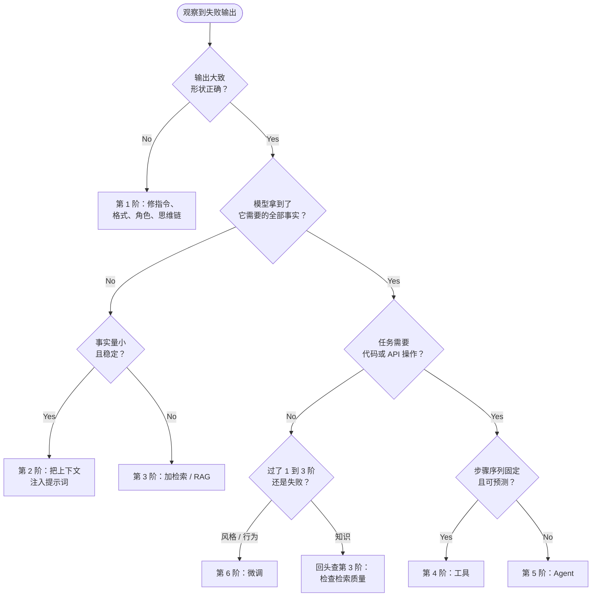

# 升级阶梯

你的客服机器人刚给一位客户讲错了退款政策。你有六种办法可以修。你可以重写提示词。你可以把政策文档粘进 system message。你可以围绕整个知识库搭一条检索流水线。你可以给模型一个工具，让它去查实时的政策 API。你可以把它做成一个能自己规划、自己检查的 Agent。或者，你也可以拿几千条标注样本微调一个定制模型。

这六个选项并不等价。第一个不花钱，一个下午就能做完。最后一个要真金白银、几周工期，还会带来一笔永久的维护账单。可团队往往一上来就去够那个贵的，因为微调和多 Agent 系统听起来才像严肃、高级的答案。

它们几乎从来都不是正确的第一步。有一条规则能让你不做过度建设，整本书就是围着它组织的。

## 这条规则

> 从能用的最简单方案开始。用评估去优化它。只有当更简单的方案被证明不够用时，才增加复杂度。

这是 Anthropic 在 *Building Effective Agents* 里给出的框架，也是后面所有内容的主干。[^1] 这六种修法构成一架梯子。每往上一阶，换来更多能力，同时付出更多延迟、更多钱、更多复杂度和更大的故障面。你要做的是爬上能解决问题的最低那一阶，然后停手。

六阶台阶，从低到高：

| 台阶 | 手段 | 它修的是什么 | 必须再往上爬的信号 |
|---|---|---|---|
| 1 | **提示词工程** | 模型不知道你要什么：任务含糊、格式不对、推理策略差 | 给出清晰指令、输出 schema、3 到 5 个示例和反例之后，仍然失败 |
| 2 | **上下文工程** | 模型缺少这次请求需要的具体事实，但这些事实量小且稳定 | 参考资料大到窗口装不下，或者它变得比你重新部署还快 |
| 3 | **检索（RAG）** | 知识量大或经常变，必须每次查询时取出来再注入 | 检索质量不错，但任务需要实时操作或代码，光读不够 |
| 4 | **工具** | 任务需要文本做不到的操作：实时查询、精确计算、往系统里写 | 一次调用不够；下一次调用取决于上一次，步骤顺序没法预先定死 |
| 5 | **Agent** | 任务是开放式的；下一步取决于中间结果揭示了什么 | 质量的天花板是基座模型的权重，而不是它的工具或上下文 |
| 6 | **微调** | 一种风格或行为，无论怎么穷尽式地提示，模型都保持不住 | （阶梯顶端） |

每一阶后面都会完整讲：提示词在第 3 部分，上下文工程在第 5 部分，检索在第 6 部分，工具与 Agent 在第 7 部分，微调在第 10 部分。

成本梯度非常陡。第 1 阶不增加任何 API 成本，只花你的时间。第 2 阶增加 token。第 3 阶要多一条 embedding 流水线、一个向量数据库，且每个请求都多一次检索往返。第 5 阶把你的 LLM 调用次数乘以 Agent 走的步数，Anthropic 对这个权衡说得很直白：“Agent 的自主性意味着更高的成本，以及误差不断累积的可能。”[^1] 第 6 阶是最贵的，因为微调模型不是一次性支出。基座模型每更新一次就要重训，而你的训练数据从此变成一份你永久持有的、带版本号的产物。

*能力和成本都随每一阶上升；多数生产功能从来没越过第三阶。*

## 一周内的判断法则

阶梯真正派上用场的时候，是线上某个输出坏了，而你必须在周五之前决定怎么办。先判断失败的类型；失败类型会告诉你该上哪一阶。

*每次输出失败都跑一遍这棵树；从顶部开始，停在第一个能解决问题的台阶。*

格式不对、推理策略差，是提示词的问题。答得很自信但事实错了，通常是知识问题，也就是上下文或检索。请求的东西在模型之外，比如今天的汇率、或者往你数据库里写一条，那是工具问题。真正多步、路径事先画不出来的任务，是 Agent 问题。而无论你怎么提示，模型都不断偏离的某种风格，是唯一指向微调的情况。

### 神谕测试（oracle test）

最难分的那一岔，是分清知识失败和行为失败，因为两者看起来一模一样：一个自信的错答案。一个一分钟的诊断就能定案。

把正确答案，或者包含答案的那份文档，直接粘进上下文，再问一遍。

- **模型这下一答就对了。** 你的问题是缺知识。用上下文（第 2 阶）或检索（第 3 阶）修。别去微调。
- **模型还是错。** 问题在行为，不在知识，你手上才有一个真正的微调候选。

这一个检查就能挡住整架梯子上最贵的错误：为了教模型几个本来直接递给它就行的知识点，去微调它。

## 为什么“台阶更多”不等于“更好”

OpenAI 在一个冰岛语文本纠错任务上做过一个干净的实验，用 BLEU（一个标准的翻译质量指标）给每一阶打分。[^2] 零样本的 GPT-4 得 62 分。加三个 few-shot 示例——纯粹的第 1 阶动作——提到 70 分。再用 1000 条样本微调 GPT-4，到 87 分，最高点。到这里，梯子的表现和你的预期一致：每次升级都有帮助。

然后他们又摞了一阶。在微调过的模型之上再加检索，分数掉到 83。[^2] 多出来的那一阶把系统弄差了，因为这次任务的瓶颈在行为，检索回来的示例只是加了噪声。爬过那个已经解决问题的台阶，买不到保险；买到的是成本、延迟，和一批新的出错方式。

过早升级有三个原因。团队把第 1 阶的指令缺口误判成第 6 阶的训练数据缺口。他们去建自己能想象的最强系统，而不是满足及格线的最简系统。还有，说实话，Agent 和微调写在简历上比一段写得好的提示词好看。[^4] Anthropic 把代价说得很直白：多出来的层“会遮蔽底层的提示词和响应，让它们更难调试。”[^1]

### 什么时候该跳级

阶梯是默认值，不是教条。有些失败在设计阶段就定了，这时候从高处起步才是对的：

- **格式硬要求。** 一个要往数据库写记录的预订系统，没法用自由文本交付。结构化输出或函数调用（第 4 阶）就是最小可行架构，不算升级。
- **已知的巨大知识缺口。** 如果你要在一个一万页的内部 wiki 上做机器人，你第一天就知道语料永远塞不进 system prompt。直接从检索（第 3 阶）开始；先试第 2 阶会立刻失败，而且败得很明显。
- **真正多步的任务。** 一个解决 GitHub issue 的编码 Agent 没法用单次调用完成。Anthropic 自己的 SWE-bench 编码 Agent 就是这类情况。[^1]

对这个分歧最诚实的版本来自 Hamel Husain：先做提示词工程，最深的理由不是提示词总能赢，而是提示词会逼你把评估工具搭起来，而没有它，你没法评判任何更高的台阶。[^3] 工具一旦存在，微调就从一个猜测变成一个可测量的选择。

所以规则在例外面前依然成立。只有当一条硬要求能证明下面所有台阶都行不通时，才跳级。否则，从底下开始。

> [!WARNING]
> **没有评估工具就升级，等于闭着眼睛飞。** 如果你说不清一次改动前后的失败率，你就判断不了检索或微调到底帮了忙、添了乱，还是什么也没做。在第 1 阶就建一个 20 到 50 条标注样本的测试集，然后带着它走到每一阶。第 4 部分（评估）是让整架梯子成立的前提；在生产环境升级任何东西之前，先读它。

一个台阶是不是用尽了，让评估说了算，别靠感觉。

## 参考文献

[^1]: Anthropic, "Building Effective Agents", December 19, 2024. https://www.anthropic.com/engineering/building-effective-agents
[^2]: OpenAI, "Optimizing LLM Accuracy", platform.openai.com (as of June 2026). https://platform.openai.com/docs/guides/optimizing-llm-accuracy
[^3]: Hamel Husain, "Is Fine-Tuning Still Valuable?", March 27, 2024. https://hamel.dev/blog/posts/fine_tuning_valuable.html
[^4]: "Resume-driven development"（简历驱动开发）是实践者讨论中一种有社区记录的社会现象，不是某一篇发表的研究；这里点名它，是因为它确实是过早升级的一个真实而常见的原因。
