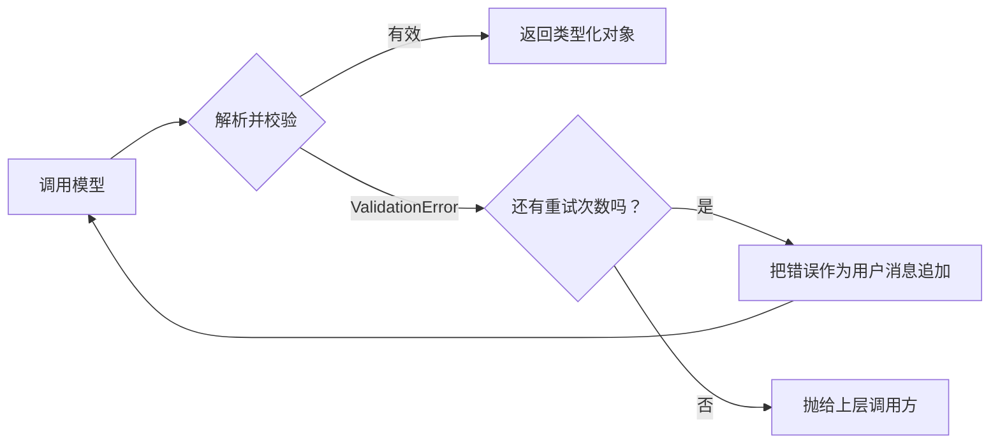

# 结构化输出

你把 LLM 接进一条流水线。它负责抽取客户的邮箱和套餐档位，你的代码把这两个值写进数据库。开发环境跑得通，预发环境也跑得通。然后在第 1000 次生产调用时，模型返回了这个：

```text
Sure! Here's the JSON you asked for:

    {"name": "John Smith", "email": "john@example.com", "plan": "Enterprise"}
```

你的 `json.loads()` 抛异常了。重试成功了。三次调用之后模型返回了干净的 JSON，但它把 `plan` 改名成了 `plan_tier`。现在 `result["plan"]` 会抛 `KeyError`。一周后模型把 `"Enterprise"` 返回成了 `{"plan": "enterprise"}`，你那个基于枚举的路由器悄悄把客户带进了错误的代码分支。

多项针对“朴素 JSON 提示”的研究显示，中等复杂度的 schema 有 5% 到 20% 的概率无法干净解析，失败集中在四种模式上：啰嗦的开场白、markdown 代码围栏、缺失的键、虚构的取值。[^1] 每天 1000 次调用、10% 的失败率，就是每天一百条坏记录；而其中那些不出声的、错键类型的失败，比大声报错的更糟。

解决办法不是把提示词写得更好。解决办法是别再拿模型输出当文本看，改把它当作一个有类型的返回值。这个契约有个名字：**结构化输出（structured outputs）**。

## 两种机制，只有一种能解决问题

各家厂商用听起来差不多的名字发布了两样不同的东西。别把它们混为一谈；两者之间的差距，就是“一般能用”和“不可能出错”的差距。

**JSON 模式**（OpenAI 的 `response_format: {"type": "json_object"}`，2023 年 11 月上线）改动采样器，避开那些会产出畸形 JSON 的 token。输出能解析。它只承诺这一点。模型仍然可以随意编造键、漏掉必填字段，或者返回任何它喜欢的形状，只要括号配平就行。[^1]

**严格结构化输出**（OpenAI 的 `strict: true`、Anthropic 的 `output_config.format`、Gemini 的 `responseFormat`）走得更远。在每一个 token 步上，推理引擎按你的 schema 维护一个状态机，算出当前语法状态下哪些 token 合法，其余的在采样前把 logits 置为负无穷直接屏蔽。它不是客客气气地请求模型输出符合 schema 的内容，而是让模型在物理上无法输出别的东西。Willard 和 Louf 在 2023 年把这个算法形式化了；OpenAI 2024 年 8 月的发布和 Anthropic 2026 年年中的 GA 都建立在它之上。[^2][^3][^4]


*JSON 模式保证括号配平，严格模式保证 schema。两者都不保证里面的值是对的。*

这套机制有实际代价：第一次用新 schema 的请求会在厂商一侧触发语法编译，平白多出延迟。后续请求走缓存（Anthropic 是 24 小时，OpenAI 只要 schema 字节完全一致就一直有效）。[^3][^4] 每个 token 的语法检查耗时不到 50 微秒，相比于模型生成每个 token 所花的 10 到 50 毫秒可以忽略不计。[^5]

OpenAI 在自己的文档里给出了决策规则：**只要目标模型支持，就默认用严格结构化输出。** 截至 2026 年年中，这包括 gpt-4o-2024-08-06 及之后的版本、Claude Sonnet 4.6 及之后的版本、Gemini 2.5 及之后的版本。[^3][^4][^6] 只有当模型早于严格模式支持、而你又换不了模型时，才退回 JSON 模式。

## Pydantic 既是 schema，也是校验器，还是类型

手写 JSON Schema 又啰嗦又累人，而且拿回来的 dict 也不是你代码真正想处理的那个类型。Pydantic v2 把这两个缺口都补上了。你声明一个 `BaseModel`，SDK 从中推导出 schema，用 `strict: true` 调用模型，最后交回一个带类型的 Python 对象：

```python
from pydantic import BaseModel, Field
from openai import OpenAI

client = OpenAI()

class LeadExtraction(BaseModel):
    name: str
    email: str
    plan_interest: str = Field(description="One of: Starter, Pro, Enterprise")
    demo_requested: bool

completion = client.chat.completions.parse(
    model="gpt-4o-2024-08-06",
    messages=[
        {"role": "system", "content": "Extract lead information from the message."},
        {"role": "user", "content": "John Smith (john@example.com) wants an Enterprise plan demo."},
    ],
    response_format=LeadExtraction,
)
lead = completion.choices[0].message.parsed
# lead.email 是 str，lead.demo_requested 是 bool，IDE 知道这一点。
```

这段代码里有三个细节值得留着。`client.chat.completions.parse`（而不是 `.create`）是那个帮手：它自动设 `strict: true`、从 Pydantic 类推导 schema，并在返回途中把响应解析成模型对象。`Field(description=...)` 用来约束字段的*含义*而不只是类型；像 `plan_interest` 这种含糊的名字会逼模型去猜你到底要什么，写清描述才能钉死。另外每个字段默认都是必填，这恰好也是严格模式本来的要求。Anthropic 的 SDK 用 `client.messages.parse(output_format=LeadExtraction)` 暴露同样的形状，Google 的 GenAI SDK 直接接受 `schema=LeadExtraction.model_json_schema()`。[^4][^6]

有一条字段顺序的规则值得知道，因为它改变的是输出质量而不只是形状。模型是从左往右生成的，所以把一个 `reasoning: str` 字段放在答案字段*之前*，模型就能先在纸上想一想再落笔。Tam 等人（EMNLP 2024）通过实验证明，答案在前的 schema 会降低推理质量。[^7] 如果你既要分类结果又要理由，把理由放前面。

## 严格模式保证的是传输，不是正确性

这里是最多读者低估的一点。严格模式保证输出的*形状*，不保证*值*是对的。

一个 `score: float = Field(ge=0.0, le=1.0)` 字段永远会返回该区间内的 float。这个 float 是否真的表达了输入的情感，是另一个问题，完全取决于模型的推理。面对一条尖刻的一星评论，模型可能因为把“没坏”读成了夸奖，自信地返回 `score: 0.9`。schema 合规率指标会显示 100%，对这种情况一无所知。[^1]

这正是 Pydantic 第二份工作的价值所在：用校验器表达语法表达不了的业务规则。

```python
from pydantic import BaseModel, model_validator
from datetime import date

class Booking(BaseModel):
    start_date: date
    end_date: date
    guest_count: int

    @model_validator(mode="after")
    def end_after_start(self) -> "Booking":
        if self.end_date <= self.start_date:
            raise ValueError("end_date must be after start_date")
        return self
```

严格模式保证你能拿到两个合法的 `date` 值。校验器抓的是模型挑了两个合法日期却顺序颠倒的情况。它抛错时你有两个选择：让这次调用失败，或者把错误喂回模型重试。

无效即重试的循环就是这件事本身：捕获 `ValidationError`，把模型的错误输出和错误信息作为新的对话轮追加进去，再调一次。模型拿到了自己失败的尝试，加上一份精确的错误说明，通常多一次调用就能收敛。



*重试循环。错误信息本身就是让模型自我纠正的信号；不把错误回喂给它直接重试，几乎总会重犯同一个错。*

[Instructor 库](https://python.useinstructor.com/)把这个模式封装到了各家厂商之上；`instructor.from_provider("openai/gpt-4o", max_retries=2)` 会给客户端打补丁，把这一整套透明地做掉，并在重试耗尽时汇总各次尝试的 token 用量。[^8]

重试预算设为 2 是合适的默认值。每次重试都是一次完整的 API 调用，所以 10% 的语义失败率配上 2 次重试，大概给你的成本和延迟各加 10%。有两种反模式要避开：无限重试（有些 schema 在语义上就无法满足，你会死循环）；以及在严格模式已开启时对语法错误重试（这类错误根本不会发生，那条重试路径是迟早会烂掉的死代码）。

## 各家厂商那些会咬人的怪癖

三家厂商，三种有微妙差别的 schema 方言。写可移植代码时，这些差异很要紧。

| | OpenAI 严格模式 | Anthropic `output_config.format` | Gemini `responseFormat` |
|---|---|---|---|
| 可选字段 | 必须是 `anyOf: [T, null]`；所有键都进 `required` | 原生支持可选，但每个可选项都会扩展语法状态 | 原生支持可选 |
| `additionalProperties: false` | 每个对象上必填 | 不要求 | 不要求 |
| 不支持的关键字 | 直接报 400 错误 | 直接报 400 错误 | 静默丢弃 |
| schema 复杂度上限 | 5000 个属性，10 层嵌套 | 每次请求 24 个可选字段、16 个联合类型 | 未公布上限 |
| 拒答路径 | `message.refusal` 有值，`parsed` 为 `None` | 标准拒答文本，不套用 schema | 标准拒答文本 |

其中有几行是地雷。Gemini 静默丢弃不支持的关键字，意味着你可以上线一个带 `allOf` 的 schema，而模型压根没见过它，返回的 JSON 还“校验通过”，你永远不知道自己的约束根本没生效。[^6] OpenAI 的拒答路径是生产代码里最常漏掉的一条：安全系统一触发，`message.parsed` 就是 `None`，任何 `lead.email` 访问都会抛 `AttributeError`。永远先检查 `message.refusal`。[^3]

> [!WARNING]
> **`output_config.format` 一变，Anthropic 的语法缓存就失效，哪怕是在同一个对话线程里。**在单个请求上对两个 schema 版本做 A/B 测试，会毁掉该线程的提示缓存，成本可能意外飙升。把 schema 变体批量跑，不要逐请求交替，并且把任何 schema 变更都当成冷启动事件。[^4]

单说 Anthropic：在 `output_config.format` 于 2026 年年中 GA 之前，主流做法是“工具技巧”——定义一个工具，让它的 `input_schema` 匹配你想要的输出，强制发起一次 `tool_use` 调用，然后把工具输入当作结构化响应来读。这个技巧在每个 Claude 模型上都还能用，包括更老的型号，大量生产代码仍在使用它。对 Sonnet 4.6 及之后的版本，响应结构优先用 `output_config.format`，工具输入结构则用工具定义上的 `strict: true`；下一章 [函数调用与工具调用](./03-function-and-tool-calling.md)会讲这一侧。

## 这给了你什么，接下来是什么

严格结构化输出加 Pydantic 加一个小重试循环，就是任何“输出要喂给下游代码”的 LLM 调用的生产级原语。schema 违规从“5% 到 20% 概率会发生的事”变成“根本不会发生的事”。语义违规——值错了但形状很漂亮——成为唯一剩下的失败模式，而这恰好就是 eval 存在的意义所在。

这个交接就是[为什么离不开 eval](../../../ai-eng/part-4-eval-fundamentals/00-why-you-cant-ship-without-evals.md)和[给 LLM 输出写断言与单元测试](../../../ai-eng/part-4-eval-fundamentals/03-assertions-and-unit-tests.md)两篇的主题。你在这里写的 Pydantic 模型会成为那套 eval 栈里最简单、最快的一层：schema 合规检查就是一个白送的单元测试。

## 参考文献

[^1]: LDS Team, "Structured Outputs: Making LLMs Return Reliable JSON", Let's Data Science, February 2026, https://www.letsdatascience.com/blog/structured-outputs-making-llms-return-reliable-json
[^2]: Brandon T. Willard and Remi Louf, "Efficient Guided Generation for Large Language Models", arXiv:2307.09702, July 2023, https://arxiv.org/abs/2307.09702
[^3]: OpenAI, "Structured model outputs", OpenAI Platform Docs, accessed June 2026, https://platform.openai.com/docs/guides/structured-outputs
[^4]: Anthropic, "Structured outputs", Anthropic Docs, accessed June 2026, https://docs.anthropic.com/en/docs/build-with-claude/structured-outputs
[^5]: Yixin Dong et al., "XGrammar: Flexible and Efficient Structured Generation Engine for Large Language Models", arXiv:2411.15100, MLSys 2025, https://arxiv.org/abs/2411.15100
[^6]: Google, "Structured outputs", Google AI for Developers, accessed June 2026, https://ai.google.dev/gemini-api/docs/structured-output
[^7]: Tam et al., "Let Me Speak Freely? A Study of Language Models in JSON and Other Output Structures", arXiv:2408.02442, EMNLP 2024, https://arxiv.org/abs/2408.02442
[^8]: Jason Liu et al., "Retry Mechanisms", Instructor Docs, accessed June 2026, https://python.useinstructor.com/learning/validation/retry_mechanisms/
