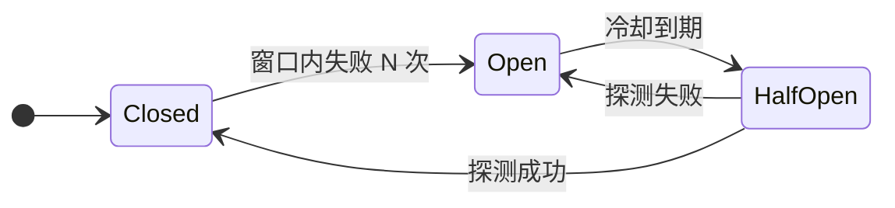

# 长时间运行的智能体

上午 9:02，一个编码智能体接到重构任务。它调用搜索工具，收到一个格式错误的响应，于是用同样的参数重试。同样的错误再次出现。模型又重试了一次。四十分钟后，一位工程师才注意到监控面板。这个循环已经在完全相同的失败工具调用上花掉 412 美元，而且还在继续。

模型没有坏，坏的是包在它外面的运行框架（harness）。一旦智能体的运行时间超过一次请求-响应，工程问题就不再是“模型会不会推理”，而是“什么东西能让它停下来”。本章讲的就是把多步智能体管住的运行时框架：给成本和时长设上限、在它跑偏时从外部杀掉它、在任务中途崩溃后活下来、重放一条轨迹来调试它，以及决定客户端是该一直挂着连接，还是发出去就不管。每一条都是独立的工程决策。漏掉任何一条，对应的故障模式就会找上你。

## 四种预算，不是一种

智能体最常见的生产事故是无界循环。一份收录了 21 个编排框架（2023 到 2026 年）、63 起已确认预算超支事故的清单发现，几乎所有这些事故都有同一个特征：没有硬性上限，只有模型自己对“什么时候算做完”的判断。[^1]

你需要四条限制，而不是一条，因为它们拦下的是不同的故障类别：

- **Token 预算（累计）。** 限制整轮运行总共花掉多少 token。拦的是智能体做了一百次便宜回合、悄无声息花掉 40 美元这种情况。
- **每回合 `max_tokens`。** 单次 API 调用的硬顶。拦的是想一次写出 5 万 token 报告的那种失控回合。
- **步数（step count）。** 限制循环能跑多少个工具调用来回。拦的是由又便宜又快的步组成的死循环——那种循环碰不到 token 预算。
- **墙上时钟超时（wall-clock timeout）。** 不管 token 和步数，跑满固定时长就杀掉循环。拦的是非 LLM 工具（子进程、爬虫、外部 API）卡住一小时这种情况。


*每种预算拦下的故障类别都不同；四条全都要设，不能只设一条。*

token 预算底下还有第二个决策：由谁来执行它，模型还是运行框架？Anthropic 的 `task_budget` 字段（2026 年中还是 beta，最小 20,000 token，Claude Opus 4.7+ 支持）是*建议性*的。平台把倒计时注入对话；Claude 看得到还剩多少预算，自己调节，在预算耗尽时优雅收尾。[^2] 这是软上限。如果中断当前动作比做完更麻烦，模型可能会稍微超一点。

那不是硬上限。硬上限是运行框架在回合之间、下一次 API 调用发出之前执行的那些检查：

```python
import time
from dataclasses import dataclass, field

@dataclass
class BudgetEnforcer:
    max_tokens: int
    max_steps: int
    max_wall_seconds: float
    _tokens: int = field(default=0, init=False)
    _steps: int = field(default=0, init=False)
    _start: float = field(default_factory=time.time, init=False)

    def record_turn(self, output_tokens: int) -> None:
        self._tokens += output_tokens
        self._steps += 1

    def check(self) -> str | None:
        if self._tokens >= self.max_tokens:
            return f"token_budget ({self._tokens}/{self.max_tokens})"
        if self._steps >= self.max_steps:
            return f"step_budget ({self._steps}/{self.max_steps})"
        if time.time() - self._start >= self.max_wall_seconds:
            return "wall_time"
        return None
```

每个回合结束后、下一次 API 调用之前调用 `check()`。停止这个决定权归运行框架，模型只是它的一个输入。用建议性的 `task_budget` 让智能体优雅收尾（把最后一个动作干净地做完），用运行框架的计数器作为结构性的保证，确保什么都逃不出去。

## 急停开关与熔断器（彼此正交，两个都要）

预算管的是智能体自己结束自己。另外两个机制管的是从外部把它停下。

**急停开关（kill switch）**是一次外部中断。运维人员判定这次运行该停，不管智能体自己怎么想。最便宜的实现是一个共享的 `asyncio.Event`，在工具调用之间检查；生产版本是运行框架每回合轮询一个 Redis 键，或者直接给容器发 kill 信号。它的本质属性是模型无法覆盖它。智能体就算输出“我想继续跑”，什么也不会发生；运行框架只看 kill 标志，然后中止。

**熔断器（circuit breaker）**是一台保护下游调用的状态机。它针对的不是某一次运行，而是服务商。OpenAI 出故障、最近 60 秒里的调用有 5 次失败时，你不会希望每个正在跑的智能体各自重试三次、把工作线程占住 14 秒，让队列越堆越高。[^3] 熔断器跳到 Open 状态，在服务商恢复之前对所有调用快速失败。



对 LLM 端点管用的默认值：60 秒滚动窗口内失败 5 次就跳闸；冷却 30 秒；用一次探测调用测试是否恢复。[^3] 熔断器打开时，重试根本不会发出。熔断器的意义是*预防*重试风暴，而不是扛过它。

这两个机制不冗余。急停开关因为某一次运行做错了事、由人触发，只停那一次。熔断器因为服务商挂了、自动触发，停所有运行。两个都要建。然后再建第三种熔断器，它盯的是智能体本身而不是服务商：把每次工具调用按 `(name, args)` 做哈希，如果同一个哈希在 3 到 5 个回合的滑动窗口内重复出现，就中止。开场那个重试螺旋就是这么抓的——在预算把时间耗光之前。

## 有检查点不等于能恢复

LangGraph、CrewAI 和 Google ADK 都在用 checkpointer 宣传“容错”。这个承诺听起来是这样的：进程在任务中途挂了，重启一下，智能体就从断点继续。代码实际做的事和这个承诺有出入。

checkpointer 真正保证的是*状态被存下来了*。每个 super-step（图的一次推进，期间一个或多个节点执行）之后，`PostgresSaver` 把整份图状态写进一行，主键是 `(thread_id, checkpoint_id)`。要恢复，你调用 `graph.invoke(None, config={"configurable": {"thread_id": "..."}})`，LangGraph 取出最新的检查点，从下一个排定的节点继续跑。[^4] 状态是持久化的，执行不是。

落到实践上就是这样：你的 worker 进程在 12 步里的第 5 步崩了。检查点在 Postgres 里好好的。但没人去读它。没有看门狗发现 worker 已经没了。没有监管进程用正确的 `thread_id` 去调 `graph.invoke(None, config)`。除非有人（或者你自己写的那段胶水代码）显式做这件事，任务就是死的，只是尸体保存得非常完整。[^5]

这就是*检查点*和*持久化执行（durable execution）*之间的落差。持久化执行引擎（Temporal、Dapr Workflows）把每个 `await` 点都当成自动检查点，并且登记一条持久化的提醒，worker 死了就重新触发那一步。恢复是自动的，不需要人推。代价是厂商锁定和基础设施复杂度。升级路径是这样的：

- **`InMemorySaver`** 用于本地开发。生产环境想都别想，进程一重启就没了。
- **`SqliteSaver`** 用于单进程的预发环境。
- **`PostgresSaver` + 手写恢复胶水** 用于大多数生产智能体。存储便宜且持久，看门狗你自己写。
- **持久化执行引擎** 用于任务关键到不能容忍 worker 掉线，或者你需要跨多个 worker 扇出并做分布式去重的时候。

再就是持久化模式本身。LangGraph 暴露了三种：

| 模式 | 持久化时机 | 适用场景 |
|---|---|---|
| `"exit"` | 仅在退出图时 | 纯只读流水线；吞吐量比恢复更重要 |
| `"async"` | 异步，步骤进行中 | 长图，单步成本比最后一步的持久化更重要 |
| `"sync"` | 每步之前同步写入 | 工具有非幂等副作用；正确性优先于吞吐量 |

只要有工具会写外部系统，就默认用 `"sync"`。延迟代价是真实的，但把一个非幂等工具跑两遍的代价要糟得多。

上一句指向的那个坑，每个人都恰好会踩一次：**恢复可能重复副作用。** 从第 3 步的检查点恢复时，LangGraph 会重跑第 3 步之后的节点，包括调用工具的节点。`send_email` 工具不是幂等的，客户就收到两封邮件。`create_invoice` 工具不是幂等的，你就给人家开了两次账单。要么把每个工具做成幂等的（用一个请求 ID 让工具自己去重），要么把图设计成每次外部调用都是一个独立的 super-step，各自单独存检查点。这套纪律我们在[工具设计](./03-tool-design.md)里讲过；检查点加恢复，正是它要在故障下接受检验的地方。

## 重放用于调试，不用于重试

支撑恢复的那套检查点存储，同样也支撑调试。LangGraph 管它叫时间旅行。`graph.get_state_history(config)` 返回一个线程的每一个 `StateSnapshot`，最新的在前；每个快照含完整状态、接下来要跑的节点，以及一个 `step` 计数器。想回到第 3 步重新往前跑，取出那个快照的 config，调用 `graph.invoke(None, config=snapshot.config)`。想探究一个反事实（“假如智能体在第 3 步拿到了正确的工具输出会怎样？”），先调 `graph.update_state(snapshot.config, {"corrected_key": value})`，再 invoke。轨迹就在那个检查点处分叉。[^4]

问“智能体为什么走了那条路”，这是对的工具。拿它做生产重试，就是错的工具。越过检查点的重放会真的重跑 LLM 调用和工具调用，连带那些不确定性（和副作用）。真正的确定性重放需要一份记录下来的观测日志，每个 LLM 响应和工具结果都从缓存回放，而不是重新请求。LangGraph 默认不做这件事；所选检查点之前的步骤从存档状态加载，但它*之后*的每一步都对着真实 API 跑。

所以规则是：用时间旅行去看发生了什么，用幂等工具和 `pending_writes` 恢复（LangGraph 里某个节点与另一个节点在同一 super-step 内失败时会自动触发）去处理生产故障。别把两者混为一谈。

有一条安全提醒值得单独说。检查点的数据块通常存的时候不做完整性校验。有一类已有记录的攻击是把恶意工具结果注入历史检查点；恢复时智能体把注入内容当成事实，从一个已被污染的状态往下走。[^6] 修法很直接：用运维方持有的密钥给检查点数据块做 HMAC 签名，每次加载都验签，并把检查点存储的读权限和写权限分开。第一天做是免费的，事后补很痛。

## 同步还是异步：30 秒法则

最后一个决策：客户端是一直挂着连接等智能体跑完（同步），还是提交任务、之后再轮询完成情况（异步）。

短任务的默认做法是同步。每个框架的示例都长这样：`result = runner.run(agent, input)`，阻塞，返回。任务在 30 秒以内、用户正盯着加载动画时，这是对的选择。

这个数字不是随手定的。客户端到智能体进程之间的几乎每一个代理和负载均衡器，空闲超时都落在 30 到 60 秒这个区间。AWS ALB 默认 60 秒。Lambda 的硬上限是 15 分钟。手机网络在息屏时会断连。一个“5 分钟的编码任务”用同步方式提供，在链路的每一跳上都在等着掉连接。

异步模式换了个形状来解决它：

```text
1. Client POSTs the task params.
2. Server enqueues, returns {task_id, status: "queued"}.
3. Worker dequeues and runs the agent loop.
4. Client polls GET /tasks/{id} until status is "completed" or "failed".
5. Client fetches the result.
```

OpenAI 的 Background 模式直接实现了这个形状：给 `responses.create` 传 `background=True`，拿回一个带 `status: "in_progress"` 的响应句柄，然后用 `responses.retrieve(resp_id)` 轮询，或者用 `starting_after=cursor` 续接断掉的流。结果数据为轮询保留约 10 分钟。[^7] MCP 的实验性 Tasks 原语把同一套生命周期（`working`、`input_required`、`completed`、`failed`、`cancelled`）在 MCP 服务器之间做了标准化。

以下情况改用异步：

- 任务运行时长超过代理的空闲超时（约 30 秒以上）。
- 客户端挂不住连接（移动端后台、上限 15 分钟的 serverless 函数）。
- 你想让多个 worker 并行执行，又不阻塞提交方。
- 任务中途有人工审核环节。

要避免的错误是：用一个普通队列（Celery + Redis）实现异步就收工。队列管的是任务提交和 worker 取活；它不管 worker 死掉。worker 在任务中途崩了，这个 job 就没了，即使你存了检查点。这和第 4 节是同一个落差：队列给你扇出，不给你持久化。当任务关键到“它就是没跑完，抱歉”不能算一个可接受的结果时，去用 Temporal 或 Dapr Workflows。

Google Jules 是生产环境里的实证。它把 GitHub 仓库克隆到一台全新的 Cloud VM，把编码智能体跑几分钟到几十分钟，跑完返回一个 pull request。客户端从不挂连接。VM 就是沙箱。PR 的 diff 就是结果。这个架构让数小时的智能体式编码变得可行，也是“每个任务起一台隔离 VM”成为 2026 年长时程编码智能体主流模式的原因。[^8]

## 参考文献

[^1]: Sajjad Khan, "Token Budgets: An Empirical Catalog of 63 LLM-Agent Budget-Overrun Incidents, with an Affine-Typed Rust Mitigation as a Case Study," arXiv:2606.04056, June 2026. https://arxiv.org/abs/2606.04056

[^2]: Anthropic, "Task budgets (beta)," Claude Developer Platform docs, accessed June 2026. https://platform.claude.com/docs/en/build-with-claude/task-budgets

[^3]: Ahmed Aleryani, "Circuit breakers for LLM calls: stop cascading failures," learnwithparam.com, March 2026. https://www.learnwithparam.com/blog/circuit-breakers-llm-calls-preventing-cascading-failures

[^4]: LangChain/LangGraph, "Checkpointers," LangGraph Python docs, accessed June 2026. https://docs.langchain.com/oss/python/langgraph/checkpointers

[^5]: Yaron Schneider, "Checkpoints Are Not Durable Execution: Why LangGraph, CrewAI, Google ADK and Others Fall Short for Production Agent Workflows," Diagrid blog, February 2026. https://www.diagrid.io/blog/checkpoints-are-not-durable-execution-why-langgraph-crewai-google-adk-and-others-fall-short-for-production-agent-workflows

[^6]: Shen et al., "Preventing Semantic Rollback Attacks in Agent Checkpoint-Restore," arXiv:2603.20625, March 2026. https://arxiv.org/abs/2603.20625

[^7]: OpenAI, "Background mode," OpenAI API docs, accessed June 2026. https://platform.openai.com/docs/guides/async-requests

[^8]: Google, "Jules: an autonomous AI coding agent," Google Blog, August 2025. https://blog.google/technology/google-labs/jules/
