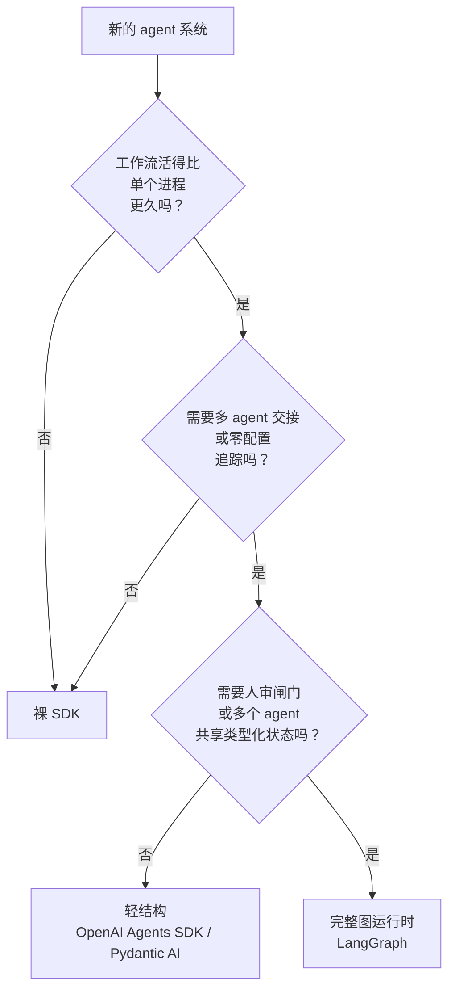

# 选择框架

Anthropic 跟几十个把 agent 送上生产的团队打过交道。2024 年 12 月他们把看到的东西写成了文章，其中最该被记住的一句话，恰恰是多数框架教程从不引用的：“最成功的实现并没有用复杂框架或专用库，而是用简单、可组合的模式搭起来的。”[^1] 说这话的是卖 API 的模型厂商——它在告诉你，你大概不需要包在 API 外面的那层壳。

原因不是框架不好，而是几乎所有人问的问题问错了。“我该用 LangGraph 还是 CrewAI”是错的问题。对的问题是：框架真正能给你的三样东西里我需要哪几样，自己手写是五行还是五百行？

## 框架究竟买到了什么

剥掉营销话术，一个现代 agent 框架提供的，是几乎每个产品都会用到的三样能力：

- **可持久化的状态。** 一份描述 agent 知道什么的类型化 schema，外加一个检查点器（checkpointer），每步之后把状态序列化到磁盘，进程重启不丢这次运行。
- **按步骤生效的重试与超时策略。** 可配置的退避、抖动、异常过滤和单节点截止时间，并且能与运行时其余部分正确组合。
- **追踪钩子。** 每次模型调用、工具调用、交接（handoff）都自动收集 span，导出到可观测性后端，业务逻辑里不用写一行埋点代码。

清单就这些。框架宣传的其他东西（handoff、护栏、角色化 agent），要么是这三样的糖，要么是你在[工作流与 agent](00-workflow-vs-agent.md)和 [agent 循环](02-the-agent-loop.md)里已经见过的那些模式的糖。

微妙之处在于：这三样在某些系统里确实有用，在另一些系统里纯属额外开销。逐个来看。

### 扛得住重启的状态

不用框架，agent 的状态就是你在一堆函数之间传的 Python dict。调试极其省事，而 pod 一重启它就没影了。对十二秒跑完的单轮工具型助手，这样挺好；对一个要跑四十分钟、中途还得停下等人审批的多步调研 agent，这是灾难。

LangGraph 的答案是 `TypedDict` schema 加一个 checkpointer。每个节点执行完，运行时就把完整状态按 `(thread_id, checkpoint_id)` 序列化，存进 SQLite、Postgres 或 Redis。重启后从下一个排队的节点继续，状态完好。[^2] OpenAI Agents SDK 用基于 SQLAlchemy 的 Sessions 做同一件事。[^3]

这里踩的坑太常见了，值得给它起个名字。团队拿着 LangGraph 的 `InMemorySaver`（开发环境默认值）上线，看着一次 Kubernetes 滚动重启干掉二十个在跑的 agent 线程，然后下一个 sprint 在生产压力下逆向推导 Postgres schema。[^4] 修法只是编译期一行代码，代价是一周。

> [!WARNING]
> 如果你采用了带检查点的框架，在第一次上线之前就把 `InMemorySaver` 换成 `PostgresSaver` 或 `SqliteSaver`，别等第一次故障之后。

### 不会让你破产的重试

大多数团队在重试逻辑上偷工减料，也大多在这里栽跟头。标准错误：没有抖动（于是一百个客户端整齐划一地同时砸向服务商）、没有异常过滤（于是 bug 抛出的 `ValueError` 被重试三次）、没有预算上限、不区分 429 和 500。基本形态我们在[错误、重试、兜底](../part-2-working-with-model-apis/04-errors-retries-fallbacks.md)里讲过。

LangGraph 的 `RetryPolicy`（langgraph >= 1.2，2026 年 6 月）把合理的默认值烘进一个按节点生效的装饰器：`max_attempts=3`、`initial_interval=0.5s`、`backoff_factor=2.0`、`max_interval=128s`、`jitter=True`，还有一个 `default_retry_on`，把 `ValueError`、`TypeError`、`OSError` 等不可重试异常排除在外。[^2] 与 `TimeoutPolicy` 的组合开箱即用；超时计时在每次新尝试时重置。

框架救不了你的，是重试放大。有个团队的账单在十一天里从每周 127 美元变成每周 47000 美元，原因是框架隐藏的重试层没有预算熔断器。[^5] 五个服务串成一条链，每层重试三次，一次用户请求就变成 243 次后端调用。好框架给你一个干净的重试面，但它不替你给花费设上限。

### 不用埋点的追踪

OpenAI Agents SDK 默认开启追踪。每次 `Runner.run()` 成为一条根 trace；每次模型调用、工具分发、handoff 变成一个带类型的 span；所有东西发往 OpenAI 仪表盘和 25 个以上第三方处理器（Langfuse、Arize、Datadog、MLflow），只要加一行 `add_trace_processor()`。[^3] LangGraph 把同样的事交给 LangSmith。

自己用 OpenTelemetry 的 GenAI 语义约定做这件事，每个接入点要 30 到 100 行样板代码。[^6] 如果你已经在跑 OTel 流水线、团队对 span 埋点也熟，这笔样板就是一次性成本。如果不是，框架的自动追踪是它第一天就能给你的最大收益。放到架构尺度上，拿到这些 trace 之后怎么用，要看 HLD 第 9 部分的可观测性一章。


*框架买到的三样东西，以及不用框架时你得自己写的那些。*

## 三档决策

上面那三样能力也许适用于你的系统，也许不。实践中解决问题的决策树有三档。

**第一档：裸 SDK。** 单次 LLM 调用、线性提示链、简单分支，或者内存状态就够用的有状态对话。整个工作流塞进一个函数。报错就是 Python traceback。换服务商是单个文件里的查找替换。Anthropic 指南里的五种工作流模式（提示链、路由、并行化、编排者-工作者、评估者-优化者）直接对着 SDK 写，大致落在 20 到 50 行。[^1]

**第二档：轻结构。** 多 agent handoff、带校验重试的类型安全结构化输出，或者跨多个模型服务商的零配置追踪。OpenAI Agents SDK（2025 年 3 月发布，MIT）和 Pydantic AI（v1.0 于 2025 年 9 月发布，MIT）就坐在这一档。[^3][^7] 两者都不要求你定义状态 schema 或编译图。你拿到了追踪和结构，不必付拓扑的开销。

**第三档：完整图运行时。** 跨进程重启的可持久状态、延迟没有上限的人审闸门、多个 agent 共享一份类型化状态对象，或者条件路由复杂到你想要一张显式状态机。LangGraph 在这一档，截至 2026 年 4 月在 Uber、JP Morgan、BlackRock 等公司有生产部署。[^8] 这些部署的共同点不是体量大，而是运行时间长、要过审批闸门。图的分量就体现在这里。

升级条件是判据，不是感觉。顺着问题往下走：



默认走最左边那条分支。多数团队应该比自己现在低一档。

## 什么情况下干脆不用框架

还有第四种情况决策树没覆盖：不管复杂度如何，框架这个形状对问题压根不合适。这正是 Anthropic 指南点名、复盘文章又一再印证的情况。

以下情况你就不该用框架：

- 整个工作流最多两个分支点，写成裸 Python 不会有任何损失。
- 近期内换模型服务商很重要。框架自带的模型对象（节点体里的 `langchain_openai.ChatOpenAI`）会让换服务商从一次改配置变成好几天的审计。
- 你的调试手段就是读 Python traceback。框架会把异常绕经内部的 Pregel/LCEL 运行时再抛到你的代码，加 `print()` 常常意味着去改框架源码。[^5]
- 你需要自定义重试、超时或限流逻辑，而这与框架的模型相冲。为了改一个退避系数去五层抽象里摸黑翻代码，这笔税会复利。

围绕这件事的数字，对“无脑上框架”的直觉不太友好。一份 2026 年的工程复盘汇总指出，试过高阶编排框架的开发者里大约 45% 从未把它们部署上线，23% 上线后又拆掉。[^5] 有个做 AI 浏览器测试的团队花了六个月把 LangChain 剥掉，对结果的描述很干脆：“我们不用再把自己的需求翻译成 LangChain 觉得合适的方案了，直接写代码就行。”[^5] 2026 年 2 月提交到 arXiv 的对照研究 MAFBench 测出，仅框架的设计选择一项，就能把延迟抬高 100 倍以上，最差配置下协调成功率从 90% 以上掉到 30% 以下。[^9] 100 倍是最坏情况，更典型的税是 2 到 5 倍。那也还是税。

代价还有结构性的。框架专属类型（`StateGraph`、`MessagesState`、`CompiledGraph`）会渗出去。六个月后，它们出现在你的 API 响应 schema、评测框架和业务逻辑里。迁移于是变成对所有 import 了框架的文件做一遍查找替换，而不是重构一个编排模块。ActiveWizards 把这叫“对象泄漏”，并建议在任何迁移之前做一次隔离审计：数一数编排模块之外有多少文件 import 了框架类型。[^4] 超过两三个就是信号。

## 裸 SDK 到底长什么样

在伸手去拿框架之前，先看看你省掉的是什么。完整的 agent 循环——操作上限、消息累积、工具分发、硬性预算封顶——一个函数就装得下：

```python
import json
from typing import Any

def run_agent(
    system_prompt: str,
    user_message: str,
    tools: list[dict],
    client: Any,
    max_turns: int = 10,
    max_budget_usd: float = 1.0,
) -> str:
    messages: list[dict] = [{"role": "user", "content": user_message}]
    cost = 0.0

    for turn in range(max_turns):
        if cost >= max_budget_usd:
            return f"Stopped: budget ${cost:.4f}"

        resp = client.messages.create(
            model="claude-opus-4-5",
            max_tokens=4096,
            system=system_prompt,
            tools=tools,
            messages=messages,
        )
        cost += resp.usage.input_tokens * 15e-6 + resp.usage.output_tokens * 75e-6

        if resp.stop_reason == "end_turn":
            return "\n".join(b.text for b in resp.content if hasattr(b, "text"))

        messages.append({"role": "assistant", "content": resp.content})
        results = [
            {"type": "tool_result", "tool_use_id": b.id,
             "content": json.dumps(dispatch(b.name, b.input))}
            for b in resp.content if b.type == "tool_use"
        ]
        messages.append({"role": "user", "content": results})

    return f"Stopped: max turns reached, cost ${cost:.4f}"
```

这就是整个 agent。状态就是 messages 列表。重试是你 HTTP 客户端本来就会给的东西（或者[错误、重试、兜底](../part-2-working-with-model-apis/04-errors-retries-fallbacks.md)里那份显式策略）。追踪是你 OTel 已经在做的事。如果你的系统需要的比这更多，你才有资格问该往哪一档爬。

具体框架的清单（LangGraph、OpenAI Agents SDK、Pydantic AI、CrewAI 以及其他），连同当前版本、定价和功能矩阵，都放在手册网站的[框架参考页](https://ai-eng.handbook.academy/frameworks/)上，这样它变化时不必让本章失效。留在这里的是规则。从梯子最下面开始。只有当真实的生产触发条件逼你时，才往上爬一档。多数产品永远用不到最上面那档，而用到的那几个，几乎在第一天就知道了。

## 参考文献

[^1]: Anthropic, "Building Effective Agents," December 19, 2024, https://anthropic.com/research/building-effective-agents
[^2]: LangChain, "Fault Tolerance" (LangGraph docs, langgraph >= 1.2), retrieved June 2026, https://docs.langchain.com/oss/python/langgraph/fault-tolerance
[^3]: OpenAI, "Tracing" (OpenAI Agents SDK docs), retrieved June 2026, https://openai.github.io/openai-agents-python/tracing/
[^4]: Igor Bobriakov (ActiveWizards), "LangGraph vs Direct API Orchestration: When the Framework Earns Its Weight," June 3, 2026, https://activewizards.com/blog/langgraph-vs-direct-api-orchestration-when-the-framework-earns-its-weight/
[^5]: Tian Pan, "When Your Agent Framework Becomes the Bug," April 17, 2026, https://tianpan.co/blog/2026-04-17-when-agent-framework-becomes-the-bug
[^6]: OpenTelemetry GenAI Semantic Conventions SIG, 2024, https://opentelemetry.io/docs/specs/semconv/gen-ai/
[^7]: Pydantic team, "A Predictable & Robust GenAI Framework" (Pydantic AI v1.0 announcement), September 2025, https://pydantic.dev/articles/pydantic-ai-v1
[^8]: Alphabold, "LangGraph Agents in Production," April 2026, https://www.alphabold.com/langgraph-agents-in-production/
[^9]: Orogat, Rostam, Mansour, "Understanding Multi-Agent LLM Frameworks: A Unified Benchmark and Experimental Analysis" (MAFBench), arXiv:2602.03128, submitted February 3, 2026, https://arxiv.org/abs/2602.03128
