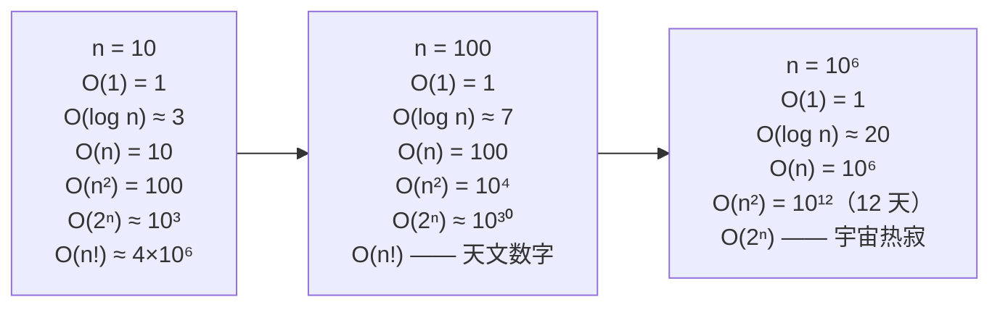

# 计算复杂度与 Big-O

候选人盯着约束条件那一行。`n <= 10^9`。六十秒后，他提出对数组做一趟遍历。面试官在等。候选人没意识到问题出在哪。

十亿个元素，每个一纳秒，在真正开始干活之前就要耗掉整整一秒 CPU 时间，而这个估算还假设内存免费、缓存完美。在生产硬件上线性扫一遍 `10^9` 个元素要十到三十秒。面试官不是故弄玄虚，约束条件本身就是整道题。当 `n` 到十亿这个量级，你没法在线性时间内读完输入，这就意味着算法只能是 `O(log n)`、一个闭式公式，或者预先算好的查表。没有哪种扫描塞得进预算。

后面每一章都假设你能在脑子里完成这种计算。`n = 10^5` 用滑动窗口，`n = 10^6` 用线段树，`n = 5000` 用动态规划——每个约束都隐含一个复杂度上限，算法必须待在下面。整本书都压在这一页上。

## 所谓“复杂度”到底指什么

工程师在三类场合用渐进记号。写代码之前，给定输入上界，先估一个候选算法是否落在隐含的时间预算内。编译型语言 C++、Java、Go 在多数在线判题系统上每秒大约跑 `10^8` 次简单操作，Python 大约 `10^7`。*“`O(n^2)` 在 `n = 10^5` 时会不会超时？”* 这个判断在敲任何代码之前就做完了。（会超：`10^{10}` 次操作是两分钟，不是一秒。）面试中，Big-O 是出现频率遥遥领先的第一概念，既作为独立问题，也作为每道算法题隐含的框架。在生产环境里，同一套记号决定真实选型：哈希表还是树，递归还是迭代，立即求值还是惰性求值，放内存还是流式处理。

你不是在推导定理。你是在读写 `O(...)` 表达式，把它当作库、论文、代码评审和设计文档之间的共同方言。下面讲的就是这套方言。

## 怎么读一个复杂度上界

五种 Bachmann-Landau 记号承担了全部工作。Big-O 和 Big-Theta 干日常的活；其余几种出现在证明和下界陈述里。

**Big-O（渐进上界）。** 若存在正常数 `c` 和 `n_0`，使得对所有 `n >= n_0` 都有 `0 <= f(n) <= c · g(n)`，则 `f(n) = O(g(n))`。[^1] 念出来就是：`f` 最终被 `g` 的某个常数倍从上方压住。用集合隶属的写法 `f(n) ∈ O(g(n))` 在数学上更干净，但等式写法是 CLRS 用的[^1]，也是未来十年每篇论文、每本教材、每次代码评审会写的。

`=` 是单向的。`n = O(n^2)` 成立，`O(n^2) = n` 是胡说。Knuth 的比喻：*“亚里士多德是人，但人不一定是亚里士多德。”*[^2] 把这个等号读成“是”就对了。

**Big-Omega（渐进下界）。** 若对所有 `n >= n_0` 都有 `0 <= c · g(n) <= f(n)`，则 `f(n) = Ω(g(n))`。Knuth 在 1976 年提出这个定义，理由是分析数论里早先那个 Hardy-Littlewood 的 Omega 对算法分析来说是错的工具。[^2] CLRS、Sedgewick、Erickson 都用 Knuth 这一版。你也该用。

**Big-Theta（渐进紧界）。** `f(n) = Θ(g(n))` 当且仅当 `f(n) = O(g(n))` 且 `f(n) = Ω(g(n))`。[^1] 当你说一个算法是 `Θ(n log n)`，上下界对齐，没有余量。两个界都知道时用 Theta；只知道上界，或者听的人只需要上界时，用 O。面试几乎总是问上界。

**Little-o。** 若 `lim f(n)/g(n) = 0`，则 `f(n) = o(g(n))`。和 O 的关键差别：big-O 里常数 `c` 是一次选定、只要存在即可；little-o 里不等式对*每一个* `c` 都成立，不管多小。所以 `n = o(n^2)` 成立（`n` 增长严格更慢），而 `n = o(n)` 不成立（`n` 是同阶，不是严格更小）。

little-o 会出现在下界证明里，也会出现在 `T(n) = n^2 + o(n^2)` 这类推导中，意思是*主项是 `n^2`，后面跟着更小的修正*。Little-omega 是它的镜像，几乎见不到。

整套形式化工具只为支撑一个操作习惯。你写 `O(n log n)` 时，意思是*在输入足够大、常数已经不再重要的范围内，这个算法的运行时间增长最多和某个常数乘以 `n log n` 一样快*。由此落下三条规则：

1. **丢掉常数。** `7n + 100 = O(n)`。常数前缀不改变渐进行为。
2. **丢掉低阶项。** `n^2 + n log n + 50 = O(n^2)`。主项赢。
3. **取最坏情况。** 除非题目明确要平均时间或期望时间，“复杂度”一律指最坏情况复杂度。

这三条规则能覆盖你会做的 95% 分析。

## 所谓“常数因子”到底指什么

`O(n)` 里那个常数在实际中很要紧，在记号里却看不见。CLRS 第 3 章把这点讲得很直白：常数是 `1000` 的 `O(n)` 算法，在 `n = 100` 时比常数是 `1` 的 `O(n^2)` 算法还慢。[^1] 交叉点大约在 `n = 1000`。渐进记号能正确预测最终谁赢，而对“最终”之前的一切保持沉默。

插入排序和归并排序把这个权衡变得具体。插入排序最坏 `Θ(n^2)`，但常数很小，内层循环每轮通常两三次数组访问。归并排序 `Θ(n log n)`，常数大得多：每次归并都要分配，每层每个元素两次读一次写，还有递归开销。`n = 50` 时，在真实硬件上插入排序赢归并排序。`n = 5,000` 时不赢，差大约三十倍。

生产环境的排序例程直接利用这一点。Java 的 `Arrays.sort` 和 Python 的 TimSort 都对长度不到约 32 的 run 用插入排序，超过就切到分治策略。合并后算法的 Big-O 仍是 `Θ(n log n)`；生产代码之所以最快，是因为它针对每种输入规模挑了更好的常数。

结论很短。Big-O 是规划工具。约束写着 `n <= 50`，只要常数够小，你可以用渐进更差的算法。约束写着 `n <= 10^5`，就不行。

## 你会遇到的复杂度阶层

面试里出现的复杂度类很少。背下来。

| 类别 | 记号 | 你在什么场合遇到 |
|---|---|---|
| 常数 | `O(1)` | 数组下标访问、哈希表平均查找、固定大小的查表 |
| 反阿克曼 | `O(α(n))` | Union-Find 每次操作的摊还代价（Tarjan 1975） |
| 对数 | `O(log n)` | 二分查找、平衡 BST、二项堆 |
| 平方根 | `O(√n)` | 试除法判素、莫队算法 |
| 线性 | `O(n)` | 单趟扫描、`O(V + E)` 的 BFS/DFS、KMP 匹配 |
| 线性对数 | `O(n log n)` | 归并排序、堆排序、FFT；比较排序的下界 |
| 平方 | `O(n^2)` | 嵌套循环的成对扫描、朴素 3SUM |
| 立方 | `O(n^3)` | Floyd-Warshall、朴素矩阵乘法 |
| 指数 | `O(2^n)` | 枚举子集、不做剪枝的状压 DP |
| 阶乘 | `O(n!)` | 枚举排列、暴力 TSP |

这些阶层之间的增长差距是戏剧性的，而最戏剧性的部分藏在 log 轴里：



*`n = 100` 时，`O(2^n)` 算法需要的操作数比可观测宇宙里的原子数还多。低阶项在高阶项变得灾难性之前很久就已经不重要了。*

实际的问题是“一秒内能塞进什么”。给定编译型语言判题的标准一秒预算，输入规模表比形式化定义更好用：

| 输入规模 | 容得下的算法 |
|---|---|
| `n <= 10` | `O(n!)`、`O(2^n)` —— 随便来 |
| `n <= 20` | `O(2^n)`（约 `10^6` 次操作）、状压 DP |
| `n <= 500` | `O(n^3)`（约 `10^8`） |
| `n <= 5,000` | `O(n^2)`（约 `2.5 × 10^7`） |
| `n <= 10^5` | `O(n log n)` 和 `O(n)` |
| `n <= 10^6` | `O(n log n)`、`O(n)` |
| `n <= 10^9` | 只有 `O(log n)` 和 `O(1)` |

最后一行要内化。题目给你 `n = 10^9`，答案只能是二分答案、闭式公式，或者预先算好的结构。其余一切在读完输入之前就超时了。

## 主定理

分治算法产生形如

```text
T(n) = a · T(n/b) + f(n)
```

的递推式，其中 `a >= 1`、`b > 1`，`f(n)` 是顶层拆分与合并所做的工作。主定理按临界指数 `c_crit = log_b(a)` 分三种情况解这种形状的递推式。[^3]

**情况 1 —— 子问题占主导。** 若 `f(n) = O(n^c)` 且 `c < c_crit`，则 `T(n) = Θ(n^{c_{crit}})`。

**情况 2 —— 平衡。** 若 `f(n) = Θ(n^{c_{crit}} · (log n)^k)` 且 `k >= 0`，则 `T(n) = Θ(n^{c_{crit}} · (log n)^{k+1})`。

**情况 3 —— 拆分工作占主导。** 若 `f(n) = Ω(n^c)` 且 `c > c_crit`，并且正则性条件 `a · f(n/b) <= k · f(n)` 对某个 `k < 1` 成立，则 `T(n) = Θ(f(n))`。

三个你会反复见到的应用：

| 算法 | 递推式 | 主定理情况 | 结果 |
|---|---|---|---|
| 二分查找 | `T(n) = T(n/2) + O(1)` | 情况 2，k=0 | `O(log n)` |
| 归并排序 | `T(n) = 2T(n/2) + O(n)` | 情况 2，k=0 | `O(n log n)` |
| Karatsuba 乘法 | `T(n) = 3T(n/2) + O(n)` | 情况 1（`log_2 3 ≈ 1.585`） | `O(n^{1.585})` |

主定理有覆盖不到的地方。`f(n)` 与 `n^{c_{crit}}` 之间差的不是多项式量级的递推式（比如 `T(n) = 2T(n/2) + n/log n`）不属于任何情况，需要 Akra-Bazzi 方法。本书在它出现时标出 Akra-Bazzi，其余情况都留在主定理里。

## 摊还分析

当一个数据结构的操作大部分便宜、偶尔来一次昂贵，逐操作的最坏情况分析就失效了。动态数组的 push 通常是 `O(1)`。偶尔缓冲区满了，数组翻倍，那一次 push 干的是 `O(n)` 的活。问*最坏情况是什么？* 得到 `O(n)`。问*在一长串操作上平均下来，最坏情况是什么？* 得到 `O(1)`。做容量规划时第二个答案才有用，而产出它的技术就是摊还分析（amortised analysis）。

Tarjan 1985 年的论文把这个框架形式化了。[^4] 他的说法：*“把每次操作的运行时间在一个最坏情况的操作序列上做平均，我们有时能得到一个整体时间上界，远小于逐操作最坏时间乘以操作数。”*

三种方法，都出自 CLRS 第 16 章。[^1]

**聚合分析（aggregate）。** 先界定任意 `n` 次操作序列的总代价 `T(n)`，再除以 `n`。动态数组 push：`n` 次 push 总代价 `T(n) = O(n)`，因为扩容工作构成等比级数 `1 + 2 + 4 + ... + n/2 + n = 2n - 1`。每次 push 摊还 `O(1)`。

**记账法（banker's）。** 给每次操作记一个虚拟的摊还代价，可以不同于它的实际代价。便宜的操作多收一点，盈余作为“信用”存在数据结构里。昂贵的操作花掉这些信用。动态数组 push 每次收 3：一份付当前插入，一份预付数组下次翻倍时搬走这个元素，一份预付搬走更早进来的配对元素。翻倍真的发生时，此前插入的每个元素上积累的信用正好覆盖它的搬运。

**势能法（potential）。** 定义数据结构状态的非负函数 `Φ`。一次操作的摊还代价等于实际代价加上 `Φ_after - Φ_before`。对动态数组取 `Φ = 2 · num_elements - capacity`。push 不触发扩容时，Φ 涨 2，摊还代价是 `actual + 2 = 3`。push 触发从 `k` 到 `2k` 的扩容时，实际代价是 `k + 1`，Φ 从 `k` 掉到 `2`，摊还代价是 `(k + 1) + (2 - k) = 3`。同一个答案，两条路径推出来。

关键提醒：摊还 `O(1)` 不等于每次操作都是 `O(1)`。触发扩容的那次 push 在那一刻确实是 `O(n)`。硬实时系统——游戏音频缓冲、嵌入式控制器、低延迟交易——在意的正是逐操作最坏情况，它们可能为此改用去摊还（deamortised）的数据结构或固定容量环形缓冲。

你还会在这些地方再遇到摊还界：[动态数组内部实现](../part-1-linear-data-structures/01-dynamic-array-internals.md)（翻倍的证明会一步步完整展开）、带路径压缩的 Union-Find 每次操作 `O(α(n))`、splay 树摊还 `O(log n)` 而最坏情况 `O(n)`。

## 时间与空间的权衡

时间和空间不是各自独立的预算。给递归斐波那契加记忆化，付出 `O(n)` 空间把时间从 `O(2^n)` 降到 `O(n)`，拿线性成本换指数级下降。这个原则从 Knuth 的 TAOCP 第一卷 §1.2.11 起就被认识到了，Bentley 的 *Programming Pearls* 把它列为一条设计原则。只要系统缓存算过的值而不重算，就是用空间换时间；只要系统流式处理而不缓冲，就是用时间换空间。

2025 年 11 月一篇 arXiv 综述考察了 118 道题上的 800 多个算法，发现对越来越大比例的问题，要拿到更好的渐进时间复杂度就必须接受更差的渐进空间复杂度，反之亦然。[^5] 这些问题落在帕累托前沿（Pareto frontier）上。你沿着前沿做交换，没法同时优化两边。

在动态规划里你会反复碰到这个权衡。一个只查上一行的 `O(n · m)` DP，可以压到 `O(min(n, m))` 空间而不改变时间，代价是失去回溯能力。值留下了，路径没有了。基于哈希的集合给出 `O(1)` 平均查找，空间 `2-4n` 个字；有序数组给出 `O(log n)` 查找，空间 `O(n)`。布隆过滤器用每元素常数个比特给出近似的集合成员判断，用假阳性换一个数量级的空间节省。

带着走进 Part 9 的心智模型：时间和空间是帕累托前沿上的两个维度。大部分算法设计就是在上面挑一个点。

## 本章没有覆盖的内容

平均情况分析出现在 Part 5，那里会完整证明快排 `O(n log n)` 平均与 `O(n^2)` 最坏的对比。随机化算法——期望时间、Las Vegas 与 Monte Carlo——在 Part 1 随全域哈希出现，在 Part 5 随随机选主元出现。下界证明（比较排序的 `Ω(n log n)` 决策树论证、对手论证）放在 Part 5 讲排序的地方。Akra-Bazzi 方法只在分治递推式跳出主定理时出现。P、NP 以及复杂度理论剩下的部分，等到 Part 14 的面试元章节。

本章的取态是刻意收窄的。Big-O 是方言。那些奇异复杂度所需的证明，放在需要它们的章节里。

这些界马上就会用上。[双指针：相向而行](../../../dsa/part-3-pointers-window-prefix/00-two-pointers-opposite.md) 是你第一次做 `O(n)` 与 `O(n^2)` 的选择。[滑动窗口：可变长度](../../../dsa/part-3-pointers-window-prefix/03-sliding-window-variable.md) 是常数因子要紧、实现自己也清楚这点的 `O(n)` 算法。[前缀和 + 哈希表组合](../../../dsa/part-3-pointers-window-prefix/05-prefix-sum-hash.md) 是用空间换时间明确付账的地方。等你走到 Part 9 动态规划，`O(n^2 · m)` 与 `O(n · m)` 的区分已经是条件反射了。

## 参考文献

[^1]: Cormen, Leiserson, Rivest, Stein, *Introduction to Algorithms*, 4th ed., MIT Press, 2022, ISBN 978-0-262-04630-5.

[^2]: Knuth, D.E., "Big Omicron and Big Omega and Big Theta", *SIGACT News*, 8(2), 18–24, April–June 1976, [doi:10.1145/1008328.1008329](https://dl.acm.org/doi/10.1145/1008328.1008329).

[^3]: Bentley, Haken, Saxe, "A general method for solving divide-and-conquer recurrences", *ACM SIGACT News*, 12(3), 36–44, September 1980, [doi:10.1145/1008861.1008865](https://dl.acm.org/doi/10.1145/1008861.1008865).

[^4]: Tarjan, R.E., "Amortized Computational Complexity", *SIAM Journal on Algebraic and Discrete Methods*, 6(2), 306–318, April 1985, [doi:10.1137/0606031](https://epubs.siam.org/doi/10.1137/0606031).

[^5]: Sherry, Y. and Thompson, N., "How fast are algorithms reducing the demands on memory? A survey of progress in space complexity", arXiv:2511.22084, November 2025, [arxiv.org/abs/2511.22084](https://arxiv.org/abs/2511.22084).
