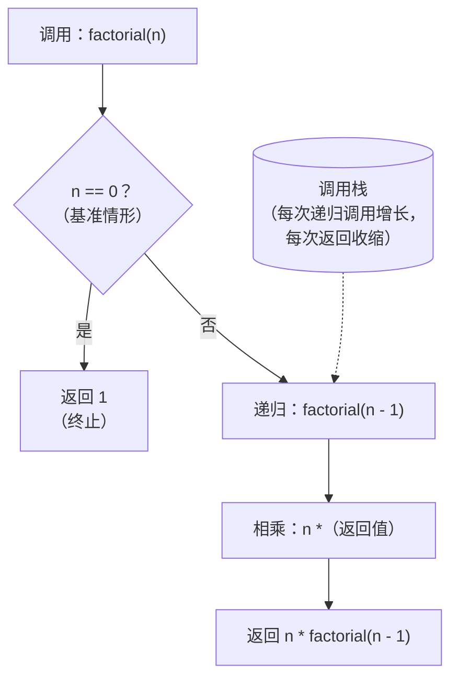
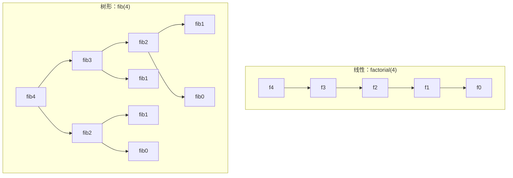

# 递归的心智模型

一位候选人写下 `def fib(n): return fib(n-1) + fib(n-2)`，点了运行，眼看着 Python 在 `fib(35)` 上崩掉，抛出 `RecursionError: maximum recursion depth exceeded`。他读完报错，顺手加上 `sys.setrecursionlimit(10**6)`，再跑一次，这回 Python 花了三十秒才吐出一个数。问题不在深度限制。甚至也不在漏了基准情形（其实漏了两个）。问题是这位候选人看不见运行时到底在干什么。他写了三行看起来像数学的代码，运行时把它变成了一棵二十五亿次调用的树，而屏幕上没有任何东西解释这个落差。

这一章就是来填这个落差的。后面每一章只要建立在递归之上——[二叉树基础](../../../dsa/part-6-trees-heaps/00-binary-tree-fundamentals.md) 里的树 DFS、[回溯基础](../../../dsa/part-7-recursion-backtracking/01-backtracking-template.md) 里的“递归加撤销”模式、[DP：从递归到记忆化](../../../dsa/part-9-dynamic-programming/00-dp-recursion-to-memo.md) 里“把递归缓存起来”的技巧——都假定你能读懂一个递归函数，并把基准情形、递归情形和隐式调用栈当成三件彼此分离的东西挑出来。在这个读法变成条件反射之前，递归会不断抛给你不知道该怎么调的异常。

## 为什么阶乘是个陷阱

大多数递归教程都从阶乘讲起。这一章也这样，只是附带一句警告：阶乘是用来*引入*心智模型最糟糕的载体，也是用来*演示*它最好的载体。这个函数太熟了，新手直接在语法上做模式匹配，反而错过结构上的要点。

先看那个一眼就能想到的错误答案：

```python
def factorial(n):
    return n * factorial(n - 1)
```

它能编译，能运行。它在 `factorial(5)` 上以 `RecursionError` 崩掉，而一个被告知*“递归就是函数调用自己”*的新手，会把这条报错读成*“我超了深度限制，那就该把限制调高”*。真正的 bug 是没有基准情形。函数沿着 `5 -> 4 -> 3 -> 2 -> 1 -> 0 -> -1 -> -2 -> ...` 一路递归下去，永不停歇，因为没有任何东西叫停它。

补上基准情形：

```python
def factorial(n):
    if n == 0:
        return 1
    return n * factorial(n - 1)
```

现在它能跑了。至于它*为什么*能跑，其结构就是本章剩下的内容。

## 三个组成部分

每一个能终止的递归函数都恰好有三个组成部分。缺任何一个，函数就是错的。

**基准情形。** 函数不用递归就能直接作答的最小输入。对阶乘来说，`n == 0` 返回 `1`，因为空乘积是乘法单位元。终止递归的就是基准情形；没有它，你得到的是一个多了几步的无限循环。

**递归情形。** 一个严格更小的子问题，加上常数量的合并工作。对阶乘来说，`n * factorial(n - 1)` 把规模减一，再用一次乘法把答案合起来。Knuth 的 *The Art of Computer Programming* §1.1 给终止性论证打下了根基：每一个能终止的递归过程之所以终止，是因为在输入空间的某个良序下，每次递归调用都把输入严格推向基准情形。[^1] 如果归约这一步不是严格前进的，函数就会永远循环。

**一个隐式调用栈。** 运行时在你背后维护着一摞待处理的栈帧。每次递归调用压入一帧，每次返回弹出帧。这串待处理的帧替你保管着那些被推迟的乘法——`5 *`、`4 *`、`3 *`——直到基准情形终于交回一个可以拿来相乘的值。

第三部分是新手从没见过明说的那个。Abelson 和 Sussman 的 *Structure and Interpretation of Computer Programs* §1.2.1 把它叫作代换模型（substitution model），并强调*过程写法*（procedure，函数调用自己这套语法）和*执行过程*（process，解释器实际执行的那条延迟操作链）不是一回事。[^2] 把调用栈当成一件实物来理解——帧被压入、帧被弹出、帧携带状态——你才有能力推理自己还没写过的递归函数。



*三个承重的部件：基准情形负责终止，递归情形把工作委托给更小的子问题，调用栈则是运行时对一切在途工作的记账。*

## 相信递归

写递归函数最难的一个动作，恰恰是那个感觉像作弊的动作。你写下递归调用，然后当作它已经能用，继续往下写。

Jeff Erickson 的 *Algorithms* 把这个动作命名为*递归精灵*（Recursion Fairy）：把原问题简化，把更小的那一版交给一个魔法帮手，再把这个帮手的答案和你留给自己的那部分工作合起来。[^3] Erickson 的原话是：*“你唯一的任务就是简化原问题……递归精灵会替你魔法般地处理好所有更简单的子问题。”*

落到代码上，就是写下 `factorial(n - 1)`，然后不做证明、不展开、不单步，直接假定它返回 `(n - 1)!`。接着乘上 `n`。完事。

这感觉很不对。函数还没写完，怎么能在一个还没生效的函数里调用它？

答案是数学归纳法。基准情形是归纳的起点：`factorial(0)` 一眼就能看出返回 `1`。递归情形是归纳步：*若* `factorial(n - 1)` 正确返回 `(n - 1)!`，*则* `n * factorial(n - 1)` 正确返回 `n!`。两者合起来，函数对每个非负 `n` 都正确。你不需要把调用树走一遍来说服自己，归纳法替你做这件事。

这就是后面每一章都会提前引用的那个“归约并委托”动作。树 DFS 成立，是因为你能搜左子树和右子树，就能搜整棵树。回溯成立，是因为你能在前 `n - 1` 行摆下皇后，就能在第 `n` 行摆下皇后。自顶向下的 DP 成立，是因为你能解长度 `< n` 的子问题，就能解长度 `n`。相信递归是那个动词，“归约并委托”是这个动词的含义。

## 模式

任何单支递归函数的伪代码：

```text
function recurse(input):
    if input is at the base:
        return base answer
    smaller = reduce(input)
    sub_answer = recurse(smaller)
    return combine(input, sub_answer)
```

这四行里有三行是常数工作。只有递归调用那一行会分叉出新的栈帧。对阶乘来说，`reduce` 是 `n - 1`，`combine` 是 `n * sub_answer`，基准是 `n == 0` 时返回 `1`。

```python
def factorial(n: int) -> int:
    if n < 0:
        raise ValueError("factorial is undefined for negative integers")
    # 基准情形：按定义 0! = 1。递归在这里终止。
    if n == 0:
        return 1
    # 递归情形：n! = n * (n-1)!
    return n * factorial(n - 1)
```

**参考实现** —— Python（[Java](./02-recursion-mental-model/sol.java) · [C++](./02-recursion-mental-model/sol.cpp) · [Go](./02-recursion-mental-model/sol.go)）

```python
# 第 0.2 章 —— 递归的心智模型
# 实例：用直接递归计算 factorial(n)。
import sys

sys.setrecursionlimit(10**6)  # CPython 默认的 1000 对本章练习来说太低了。


def factorial(n: int) -> int:
    """Return n! computed by direct recursion. Requires n >= 0."""
    if n < 0:
        raise ValueError("factorial is undefined for negative integers")
    # 基准情形：按定义 0! = 1。递归在这里终止。
    if n == 0:
        return 1
    # 递归情形：n! = n * (n-1)!
    return n * factorial(n - 1)
```

四种语言的骨架一模一样：校验、基准分支、递归调用、合并返回。差别全在坑上。Java、C++、Go 把结果加宽到 64 位，因为 `13! = 6,227,020,800` 会撑爆 32 位 int。C++ 在相乘*之前*做提升而不是之后，因为 int 的有符号溢出是未定义行为。Python 在模块加载时就设 `sys.setrecursionlimit(10**6)`，因为 CPython 默认的 1000 对任何真实的递归负载都太低。[^4] Go 在负输入上直接 panic，因为它没有异常模型，也没有 `Optional` 可以返回。

## 实例推演：追踪 factorial(4)

调用栈活在运行时的记账里，不在纸面上。光读代码看不见它，你得看它跑起来。往下读之前，先把这个小控件有意识地走两遍。重点看第 5 步到第 7 步——栈满的那一刻、基准情形触发的那一刻、第一个被推迟的乘法执行的那一刻。

> **Interactive widget:** [递归调用栈（阶乘；三种形态对比）](../../../dsa/widgets/w-01-recursion-call-stack.yml) —— 在网站上渲染；YAML 规格描述了各个关键帧。

*静态版本：`factorial(4)` 依次递归到 `factorial(3)`、`factorial(2)`、`factorial(1)`、`factorial(0)`，栈上攒起五帧。`factorial(0)` 处的基准情形直接返回 1。随后栈开始回卷：每一帧算出 `n *（返回值）` 并返回，顺序与调用顺序相反。*

完整追踪，十二步：

1. 调用 `factorial(4)`，此时栈为空。
2. 压入 `f(4)`。不是基准情形，对 `n - 1 = 3` 递归。
3. 压入 `f(3)`。继续递归。
4. 压入 `f(2)`。继续递归。
5. 压入 `f(1)`。继续递归。
6. 压入 `f(0)`。栈上现在有五帧；四帧是等答案的乘法，一帧即将触发基准情形。
7. 基准情形：`factorial(0)` 直接返回 `1`。栈开始回卷。
8. 弹出 `f(0)`。`f(1)` 恢复执行，算出 `1 * 1 = 1`，返回 `1`。
9. 弹出 `f(1)`。`f(2)` 恢复执行，算出 `2 * 1 = 2`，返回 `2`。
10. 弹出 `f(2)`。`f(3)` 恢复执行，算出 `3 * 2 = 6`，返回 `6`。
11. 弹出 `f(3)`。`f(4)` 恢复执行，算出 `4 * 6 = 24`，返回 `24`。
12. 弹出 `f(4)`。最终答案：`24`。

被推迟的乘法按调用的*相反顺序*发生。让它们在下潜期间悬停不动的，正是调用栈。递归精灵确实会送货上门，但只是因为栈上每一帧都在等她。

## 实际开销

线性递归版阶乘的递推式是 `T(n) = T(n-1) + Theta(1)`。每次调用在子问题的开销之上多做一次乘法。用 telescoping（CLRS 第 4 版 §4.3，代入法）[^5] 展开，得到 `T(n) = T(0) + n * Theta(1) = Theta(n)` 的时间。空间对得上：每个待处理的递归调用在调用栈上留下一帧，子调用不返回就不释放，所以那条被推迟的乘法链和递归调用次数一样长。

由此有三点。

**占的是栈空间，不是堆空间。** 这个函数不在堆上分配。辅助开销是*调用栈*空间。`RecursionError`（Python）和 `StackOverflowError`（Java）报的是栈耗尽，不是内存耗尽。

**这个常数在实践中很要紧。** 每个 Python 帧大约 500 到 1000 字节；PEP 651 的分析里引用实现数据，大约每兆字节放 1000 帧。[^4] 在 Python 默认的 `setrecursionlimit(1000)` 下，大约是 1 MB 栈，跑 `factorial(900)` 没问题，`factorial(10**5)` 就别想了。Java 在 Linux x86-64 上默认线程栈是 512 KB 到 1 MB。C++ 看编译器和操作系统：主线程典型默认值在 Windows 上是 1 MB，在 Linux 上是 8 MB。Go 是个异类：goroutine 的栈从堆上分段增长，所以限制不在栈大小，而在可用内存。

**时间随调用次数增长，空间随深度增长。** 对阶乘来说这两个数是同一个，因为递归是线性的（每帧一次调用）。对树状递归来说它们会分叉，而且分叉很大。

## 你会遇到的变体

**线性递归。** 每帧一次递归调用。阶乘、求表长、反转列表、二分查找。调用栈随输入规模线性增长；递归*树*退化成一条路径。

**尾递归。** 递归调用就是最后一个动作，直接返回，周围没有别的工作：写 `return f(...)` 而不是 `return n * f(...)`。做尾调用优化的编译器可以复用当前帧而不压新帧，把空间从 `Theta(n)` 降到 `Theta(1)`。Python、Java、Go 都不把尾调用消除当作语言保证。C++ 可能做，取决于编译器和优化开关。**把尾递归当作表达上的语法糖，而不是可移植的空间优化**——见下面的警告。

**树状递归。** 每帧多次递归调用。朴素斐波那契、归并排序、树 DFS、SICP §1.2.2 里的找零问题。[^2] 递归树会分叉，于是节点数（决定时间）和树深（决定空间）分道扬镳。朴素斐波那契是 `Theta(phi^n)` 时间，却只要 `Theta(n)` 空间：时间数的是树上每一个节点（指数级扇出），空间数的是从根到叶的最长路径（长度就是 `n`）。

**互递归。** 函数 `A` 调用 `B`，`B` 调用 `A`，两边都有基准情形。递归下降解析器里很常见（`parseExpr` 调 `parseTerm`，`parseTerm` 再调 `parseExpr`），互为定义的奇偶判定也一样。正确性证明需要对两个函数同时做归纳。



*线性递归（左）塌缩成深度为 n 的一条路径。树状递归（右）扇出：`fib(2)` 被算了两次，`fib(1)` 算了三次。这份冗余正是 [DP：从递归到记忆化](../../../dsa/part-9-dynamic-programming/00-dp-recursion-to-memo.md) 里记忆化要消掉的东西——每个子问题的答案在第一次算出时就缓存起来。*

## 什么时候迭代更合适

递归表达力强，但它慢、受栈约束、比等价的循环更难调。以下情况用迭代：

- **深度可能超过几千层。** 主流语言没有哪个保证尾调用优化（TCO）。尾递归的 `factorial(10**5)` 在 Python、Java、Go 里都会把栈撑爆，哪怕这个算法在原理上是常数空间。
- **递归是纯线性的。** 迭代版阶乘 `for i in range(1, n+1): result *= i` 是 `O(1)` 空间，还比递归版快。调用树如果就是一条路径，递归什么也没给你换来。
- **问题本身不自然地分解成自身的更小版本。** 硬把递归套到并行扫描、原地反转或指针追逐的循环上，只会多出栈帧和噪声，换不来洞察。

只有当问题结构本身就是递归的——树、路径、决策序列、分治切分——递归才配得上它的位置。其余场合，写循环。

## 常见陷阱

> [!WARNING]
> **忘了基准情形（或者写的那个永远不触发）。** 最经典的失败模式。修法是结构性的：基准情形必须覆盖*每一个*合法输入——凡是会逼出一次不前进的递归调用的输入，都得被它接住。对阶乘来说，`n == 0` 覆盖了最小的合法输入；防御式的 `n <= 0` 再加一道，拦住那些否则会沿 `0 -> -1 -> -2 -> ...` 无限递归的负输入。做评审时，画出最小输入的递归树，检查每个非叶节点是否都有一个 `n` 严格更小的孩子。

> [!WARNING]
> **把尾调用消除当成可移植的。** 带累加器的尾递归阶乘在 `n = 10000` 时，在 Python、Java、Go 里都会把栈撑爆，因为这三家都不消除尾调用。Guido van Rossum 明确拒绝在 CPython 里做 TCO：*“TRE 与好看的栈回溯不兼容。”*[^6] Java 的 HotSpot 团队拒绝它，因为安全相关的 API 要靠遍历栈来识别调用者。Go 团队更看重完整的栈回溯，认为分段增长的 goroutine 栈才是应对深度的正解。C++ 在 `-O2` 下由编译器尽力而为，不是语言保证。如果递归深度可能超过几千层，改写成迭代循环。栈一溢出，递归什么也没给你换来。

> [!WARNING]
> **归约这一步差一。** 写成 `return n * factorial(n)`（对同一个 `n` 递归）会死循环；写成 `return n * factorial(n - 2)` 会跳过零处的基准情形，沿 `0 -> -2 -> -4 -> ...` 一路递归进负数。每次递归调用都必须在某个严格递减的良序下缩小输入。这个小控件能让不前进的调用立刻现形：`n` 不变，栈却一直长。

> [!WARNING]
> **在递归帧里改动共享状态。** 回溯搜索如果用外层作用域的 `path = []`，并在递归调用里往上 append，答案就会错，因为可变默认参数和模块级列表是按引用共享的。局部名字每帧重新绑定，背后的可变对象不会。把可变累加器*当参数传*，并且在 append 时拷贝（用 `result.append(path[:])` 而不是 `result.append(path)`）。阶乘只传一个整数，踩不到这个坑；[回溯基础](../../../dsa/part-7-recursion-backtracking/01-backtracking-template.md) 会踩，LeetCode Discuss 上关于子集、全排列、N 皇后的帖子，大多能追溯到这个 bug。

## 练习题

本章属于基础/框架豁免：没有简单/中等/困难三档跨度要求，也没有正式的 CORE 梯度。下面两道题只作第一次递归练习。解法顺序：先写基准情形，再写递归情形，然后拿最小的非平凡输入手工把栈走一遍。

### 核心

- [LC 509 — Fibonacci Number](https://leetcode.com/problems/fibonacci-number/) [简单] • recursion-linear ★

### 进阶

- [LC 344 — Reverse String](https://leetcode.com/problems/reverse-string/) [简单] • recursion-linear

LC 509 是标准的“第一次递归”题：题面本身的定义（`F(n) = F(n-1) + F(n-2)`）就是递归的，这是最强的信号，告诉你该用这个模式。先用朴素写法，看它在 `n = 35` 时慢下来，注意 `fib(35)` 的递归树大约有 `phi^35` 个节点——三千万上下——而调用栈同一时刻只放 35 帧。时间和深度分道扬镳。这个分叉正是 [DP：从递归到记忆化](../../../dsa/part-9-dynamic-programming/00-dp-recursion-to-memo.md) 的全部要点。

LC 344 是“把递归当累加”：交换 `s[l]` 和 `s[r]`，再对 `(l + 1, r - 1)` 递归，基准情形是 `l >= r`。迭代的双指针版是 [字符串](../part-1-linear-data-structures/02-strings.md) 里的标准答案；这里特意用递归写，是练“相信递归”的题。

如果要比每帧把输入对半分治的递归，看 [数学面试题](./04-math-for-interviews.md) 里的 [LC 50 — Pow(x, n)](https://leetcode.com/problems/powx-n/)：当 `n` 是偶数时 `pow(x, n) = pow(x*x, n/2)`，把递推式从 `T(n) = T(n-1) + O(1)` 降到 `T(n) = T(n/2) + O(1) = O(log n)`。

## 后续衔接

递归不是一个模式，它是很多模式共用的工具。[二叉树基础](../../../dsa/part-6-trees-heaps/00-binary-tree-fundamentals.md) 是在树上递归。[回溯基础](../../../dsa/part-7-recursion-backtracking/01-backtracking-template.md) 是递归加一步撤销。[DP：从递归到记忆化](../../../dsa/part-9-dynamic-programming/00-dp-recursion-to-memo.md) 是递归加一个缓存。这三者都立在这里装好的心智模型上。

这个小控件就是本章本身。后面哪一章的递归函数把你绕晕了，就回来把这个再走一遍：压栈、基准情形、回卷时的弹栈。故事就这些。

下一章是 [位运算入门](./03-bit-manipulation-primer.md)。

## 参考文献

[^1]: Knuth, D.E., *The Art of Computer Programming, Volume 1: Fundamental Algorithms*, 3rd ed., Addison-Wesley, 1997.

[^2]: Abelson, H., Sussman, G.J., with Sussman, J., *Structure and Interpretation of Computer Programs*, 2nd ed., MIT Press, 1996. §1.2.1 *Linear Recursion and Iteration* (the substitution model and the *chain of deferred operations* characterisation); §1.2.2 *Tree Recursion*. Online edition: [sarabander.github.io/sicp/html/1_002e2.xhtml](https://sarabander.github.io/sicp/html/1_002e2.xhtml).

[^3]: Erickson, J., *Algorithms*, 1st ed., 2019, Chapter 1 ("Recursion"), [jeffe.cs.illinois.edu/teaching/algorithms](https://jeffe.cs.illinois.edu/teaching/algorithms/).

[^4]: Shannon, M., "PEP 651 — Robust Stack Overflow Handling," Python Enhancement Proposal, January 2021 (rejected). <https://peps.python.org/pep-0651/>

[^5]: Cormen, T.H., Leiserson, C.E., Rivest, R.L., Stein, C., *Introduction to Algorithms*, 4th ed., MIT Press, 2022, Chapter 4 (§4.3 substitution method, §4.4 recursion-tree method, §4.5 master method).

[^6]: van Rossum, G., "Tail Recursion Elimination", *Neopythonic* blog, April 2009. Key claim: *"TRE is incompatible with nice stack traces."* [gvanrossum.github.io/neopythonic/tail-recursion-elimination.html](https://gvanrossum.github.io/neopythonic/tail-recursion-elimination.html).
