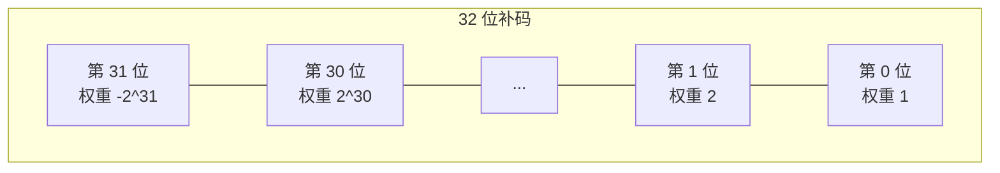

# 位运算入门

这一章存在的理由只有一行代码：`n &= n - 1` 会清掉 `n` 的最低置位（lowest set bit）。单靠这一个技巧，就能把 popcount 从 32 次迭代的循环压到 `popcount(n)` 次迭代的循环，顺手给出经典的“是不是 2 的幂”判定，还为你在本书后面会遇到的所有 Fenwick 树索引游走兜底。如果你只带走这一个惯用法，再加上运算符优先级的条件反射（写 `(x & 1) == 0`，绝不写 `x & 1 == 0`），这章就算交差了。

剩下的部分是菜谱：十二个惯用法，每个配一个例子。补码（two's complement）放在最后，因为每一个位运算 bug 最终都能追到它头上。

## 什么时候该用位运算

题面里出现四类信号，就该想到位。

题目里说“汉明重量（Hamming weight）”、“置位（set bits）”、“1 的个数”、“bits differ”、“奇偶性（parity）”、“XOR sum”、“不使用算术运算符”，或者“只用 O(1) 额外内存”。[^1]

状态空间很小（`n <= 32`），而题目要求枚举*每一个子集*。整数 `0..2^n - 1` 一个 for 循环就能枚举全部子集，位掩码 DP 于是变得自然。

约束强调非负 32 位整数，而自然的表示方式是二进制，不是十进制。

想要的变换有现成的位运算闭式表达：最低置位（`x & -x`）、交换（`a ^= b; b ^= a; a ^= b`）、乘除 `2^k`（`<<k` 或 `>>k`）、置位（`x |= (1 << k)`）、清位（`x &= ~(1 << k)`）、翻位（`x ^= (1 << k)`）、测位（`(x >> k) & 1`）。

本章只是入门。更深的应用——Single Number II 的按位真值表、Single Number III 的按位分组 XOR 分治、区间 AND 的 MSB 对齐技巧、并行 SWAR popcount——都在本书位运算的深入篇里。这里你拿到的是词汇表。

## 单比特操作

四个基本操作，每个一行代码。背下来。位掩码状态表示、Unix 文件权限、稀疏子集枚举、位掩码 DP 的状态转移，全都建立在这四行之上。[^2]

| 操作 | 写法 | 示例 |
|---|---|---|
| 测试第 `i` 位 | `(x >> i) & 1` | `(0b1011 >> 2) & 1 == 0`（第 2 位未置位） |
| 置位第 `i` 位 | `x \| (1 << i)` | `0b1011 \| (1 << 2) == 0b1111` |
| 清零第 `i` 位 | `x & ~(1 << i)` | `0b1011 & ~(1 << 0) == 0b1010` |
| 翻转第 `i` 位 | `x ^ (1 << i)` | `0b1011 ^ (1 << 1) == 0b1001` |

## 提取最低置位：`x & -x`

```python
# 返回 x 的最低置位，值为 2 的幂（x == 0 时返回 0）。
lowest_bit = x & -x
# 0b10110 & -0b10110 == 0b00010 == 2
```

在补码里，`-x = ~x + 1`：所有位取反，再加一。`+1` 产生的进位会穿过末尾那串 0，停在最低置位上，这个位于是成了与原 `x` 唯一共同为 1 的位。结果是该位的*值*（2 的幂），不是它的位置。[^3]

这是 Fenwick 树索引游走的主力：`i += (i & -i)` 跳到下一个负责区间的下标，每次查询 `O(log n)`。

## 汉明重量惯用法：Brian Kernighan 循环

最经典的数位算法，也是本章的实例推演。对 `n` 减 1：末尾每个 0 变成 1，最低置位变成 0。再与原值做 AND：最低置位以下的位全部归零，最低置位本身归零，它以上的位保持不变。净效果：置位少了一个。

```python
def hamming_weight(n: int) -> int:
    """LC 191: count the number of set bits (Hamming weight) of n."""
    count = 0
    while n:
        n &= n - 1   # 清掉最低置位
        count += 1
    return count
```

**解法** — Python（[Java](./03-bit-manipulation-primer/lc-191/sol.java) · [C++](./03-bit-manipulation-primer/lc-191/sol.cpp) · [Go](./03-bit-manipulation-primer/lc-191/sol.go)）

```python
# LC 191. Number of 1 Bits


def hamming_weight(n: int) -> int:
    """Count set bits via Brian Kernighan's loop. O(popcount(n)) time, O(1) space."""
    count = 0
    while n:
        n &= n - 1  # 清掉最低置位
        count += 1
    return count
```

循环正好跑 `popcount(n)` 次。`n = 0xFFFFFFFF`（32 位全为 1）时跑 32 次；`n = 1`（只有一个置位）时跑一次。朴素的 `for k in range(32): count += (n >> k) & 1` 不管输入长什么样都跑 32 次。稀疏输入上 Brian Kernighan 最多快 32 倍，稠密输入上打平。

手工跟踪 `n = 11 = 0b1011`：

| 迭代 | `n`（前） | `n - 1` | `n & (n - 1)` | 清掉的位 | count |
|---|---|---|---|---|---|
| 1 | `1011` | `1010` | `1010` | bit 0 | 1 |
| 2 | `1010` | `1001` | `1000` | bit 1 | 2 |
| 3 | `1000` | `0111` | `0000` | bit 3 | 3 |

循环退出，返回 3。

这个算法最早由 Peter Wegner 发表在 *CACM* 第 3 卷（1960 年）第 322 页，1964 年 Derrick Lehmer 又独立重新发现。Brian Kernighan 与 Dennis Ritchie 把它收进 *The C Programming Language* 第 2 版（1988）的习题 2-9，算法因此冠上了 Kernighan 的名字。Henry Warren 的 *Hacker's Delight* §5-1 有完整证明。[^4]

推论就是那个经典的“是不是 2 的幂”判定。**当且仅当 `n` 是 2 的幂时 `n & (n - 1) == 0`**，前提是 `n > 0`。2 的幂恰好只有一个置位，清掉就归零；其他数至少有两个置位，清掉最低的那个之后仍非零。

生产代码里别写 Kernighan 循环。x86 SSE4.2 和 ARMv8 上的硬件 POPCNT 三个周期就出结果。用 `std::popcount`（C++20）、`Integer.bitCount`（Java）、`math/bits.OnesCount32`（Go）或 `int.bit_count()`（Python 3.10+）。循环是拿来教学的。

## 汉明距离

两个整数的汉明距离（Hamming distance），是它们取值不同的二进制位的个数。闭式表达：

```text
hamming_distance(x, y) = popcount(x ^ y)
```

XOR 恰好在 `x` 与 `y` 不同的位上置 1，数一下置位个数就是距离。[^5] LC 461 一行就能写完：Java 里 `Integer.bitCount(x ^ y)`，Python 里 `bin(x ^ y).count('1')`。

## 乘以和除以 2 的幂

```python
x * (1 << k)   # 等价于 x << k
x // (1 << k)  # 对非负的 x，等价于 x >> k
```

有符号右移是陷阱。各语言的行为不一致。

| 语言 | 负数输入下的有符号右移 |
|---|---|
| Java | `>>` 是算术右移（符号扩展）。`>>>` 是逻辑右移（补零）。 |
| C++17 | 对负值是实现定义行为，当作未指定处理。位运算请用无符号类型。 |
| Python | 向负无穷舍入：`-5 >> 1 == -3`，不是 `-2`。 |
| Go | 有符号类型是算术右移，无符号类型是逻辑右移。行为取决于左操作数的*静态类型*。 |

对有符号值做位运算时，最安全的反射是先转成无符号（Java 里用 `>>>`）再移位。约束保证输入非负的 LC 题目里，这个问题很少冒头；但写 Number of 1 Bits 的朴素循环时如果不考虑符号位，就会栽在这里。

## 不用临时变量的 XOR 交换

```python
a ^= b
b ^= a
a ^= b
```

只用 XOR 交换 `a` 和 `b`，不要临时变量。证明逐位成立：第一次 XOR 之后 `a` 存的是 `a ^ b`；第二次之后 `b` 存的是 `(a ^ b) ^ b = a`；第三次之后 `a` 存的是 `(a ^ b) ^ a = b`。完成。

> [!WARNING]
> 如果 `a` 和 `b` *别名*同一块内存（`SWAP(arr[i], arr[j])` 且 `i == j`），这个写法会把那块内存清零，而不是什么都不做。防御式写法：`if (&a != &b) { a ^= b; b ^= a; a ^= b; }`。现代编译器通常能认出这个写法，直接生成基于寄存器的交换；这招作为脑筋急转弯比作为性能模式更有意思。

## 补码简介

有一个事实能解释你写出的每一个位运算 bug：N 位补码整数表示的范围是 `[-2^(N-1), 2^(N-1) - 1]`。[^6] 这个区间不对称。32 位有符号 `int` 里有 `2^31` 个负值、`2^31 - 1` 个正值。

三个会在真实代码里咬人的后果。

**`-INT_MIN` 溢出回到 `INT_MIN`。** 最小可表示整数的数学取反值本身不可表示。Java 里 `Math.abs(Integer.MIN_VALUE)` 返回的是 `Integer.MIN_VALUE`（负数）；C++ 里留作未定义。

**`INT_MIN / -1` 在 x86 上会触发异常。** 商是 `+2^31`，塞不进 32 位有符号寄存器。Linux 抛 `SIGFPE`；C++ 声明为未定义。

**取反就是“全部位翻转再加一”：`-x == ~x + 1`。** 等价地，`~x == -x - 1`。这就是 `x & -x` 能提取最低置位的原因，也是 Python 里 `~5 == -6` 的原因。

最高位是符号位，权重是 `-2^(N-1)` 而不是 `+2^(N-1)`。每一个“输入是负数时我的汉明距离怎么数错了”的 bug，最后都能归到忘了这一点上。



*同一个位模式可以表示不同的整数，取决于第 31 位按权重 `-2^31`（有符号）还是 `+2^31`（无符号）来读。在 C、C++ 和 Go 里，有符号与无符号类型之间的转换不改位模式；整数值之所以变化，只是因为解释方式变了。*

## 常见陷阱

> [!WARNING]
> **运算符优先级：`&` 比 `==` *更低*。** `if (x & 1 == 0)` 会被解析成 `if (x & (1 == 0))`，也就是 `if (x & 0)`，即 `if (false)`。条件永远不成立。加括号：`if ((x & 1) == 0)`。这是新手代码里最常见的位运算 bug，gcc 的 `-Wparentheses` 就是专门为这个反模式加的。

> [!WARNING]
> **Java 的 `>>` 与 `>>>` 在负数输入下的差别。** 朴素的 popcount `for (int k = 0; k < 32; k++) count += (n >> k) & 1;` 在 `n` 的符号位为 1 时返回垃圾值，因为 `>>` 做符号扩展，每次迭代都在和符号扩展填进来的 `1` 做 AND。改用 `>>>`（无符号右移），或者用与符号无关的 `n &= n - 1` 写法。

> [!WARNING]
> **C++ 的有符号溢出是未定义行为。** 在有符号值上左移越过符号位、对 `INT_MIN` 取负、或者指望 `int` 溢出回绕，在 C++17 下都是 UB。编译器有权假设溢出不会发生，可能生成与回绕语义明显矛盾的代码。真正做位级操作时，请用 `uint32_t` 和 `uint64_t`。

> [!WARNING]
> **Python 里对正数用 `~` 会得到负数。** `~5 == -6`，不是 `0xFFFFFFFA`。Python 的 `int` 是任意精度的补码，`~x` 定义为 `-(x + 1)`。在 Python 里做定宽 32 位运算时，每个可能变负的操作之后都要掩码：`(~x) & 0xFFFFFFFF`。

## 练习

本章属于基础篇，豁免框架要求：没有 Easy/Medium/Hard 的跨度要求，也没有正式的 CORE 三级梯度。两道简单题锚住后面章节里复现最多的两个写法。

### 核心

- [LC 191 — Number of 1 Bits](https://leetcode.com/problems/number-of-1-bits/) [简单] • bit-count-popcount ★
- [LC 461 — Hamming Distance](https://leetcode.com/problems/hamming-distance/) [简单] • bit-xor-distance

本书位运算部分的深入篇会接手 Single Number II、Single Number III、Bitwise AND of Numbers Range、Total Hamming Distance，以及其余经典的 Medium/Hard 位运算题。它们在那边归口，不在这里，因为入门篇的任务是装好词汇表，不是去抢那些头牌题。

## 后续衔接

位运算的深入篇会拿这里的写法去搭更硬的构造：“每个元素出现 `k` 次、只有一个例外”的按位真值表解法、按位分组的 XOR 分治、区间 AND 的 MSB 对齐技巧，以及在稠密输入上压过 Kernighan 的并行 SWAR popcount。Fenwick 树每次更新和查询的索引游走，用的都是 `x & -x`。

下次在某一章里看到 `n & (n - 1)` 或 `x & -x`，你已经知道它们在做什么了。这就是这篇入门存在的全部意义。

接下来是 [Math for interviews](./04-math-for-interviews.md)。

## 参考文献

[^1]: LeetCode 第 191 题（Number of 1 Bits），[leetcode.com/problems/number-of-1-bits](https://leetcode.com/problems/number-of-1-bits/)。

[^2]: Anderson, S.E.，*Bit Twiddling Hacks*，Stanford Computer Graphics Laboratory，[graphics.stanford.edu/~seander/bithacks.html](https://graphics.stanford.edu/~seander/bithacks.html)。

[^3]: Wikipedia，“Two's complement”一节“Why it works”，[en.wikipedia.org/wiki/Two%27s_complement](https://en.wikipedia.org/wiki/Two%27s_complement)。关于 `x & -x` 的进位传播论证。

[^4]: Warren, H.S.，*Hacker's Delight*，第 2 版，Addison-Wesley Professional，2013，ISBN 978-0-321-84268-8。

[^5]: Wikipedia，“Hamming distance”，[en.wikipedia.org/wiki/Hamming_distance](https://en.wikipedia.org/wiki/Hamming_distance)。`popcount(x XOR y)` 公式。

[^6]: Wikipedia，“Two's complement”一节“Most negative number”，[en.wikipedia.org/wiki/Two%27s_complement](https://en.wikipedia.org/wiki/Two%27s_complement)。不对称区间：`[-2^(N-1), 2^(N-1) - 1]`。
