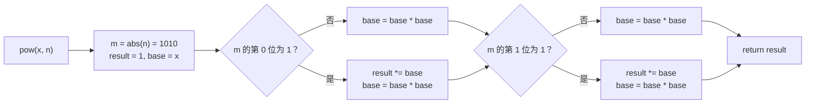
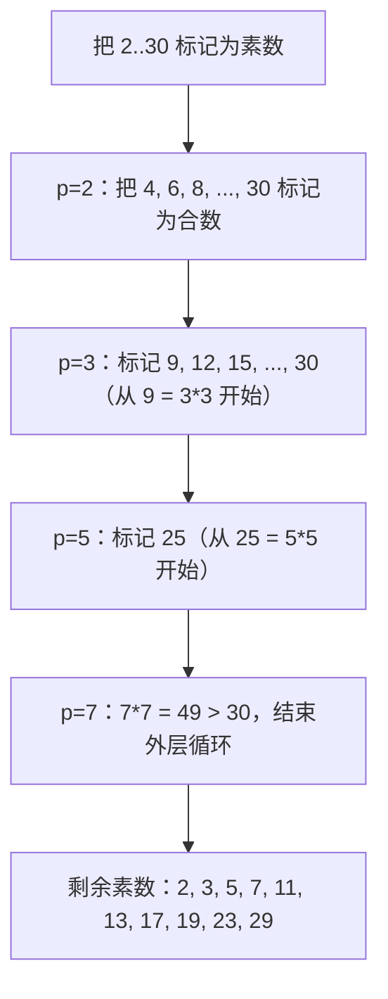

# 面试中的数学

一位候选人往 Python REPL 里敲下 `pow(2, 100) % (10**9 + 7)`，看着它明显思考了一拍才出结果；接着把同一个表达式换成 `pow(2, 100, 10**9 + 7)`，答案瞬间就出来了。两个表达式长得一样，实际完全不同。第一个先把完整的 `2^100` 算成任意精度整数（一个 31 位数），再取模；第二个用反复平方法做模幂运算，从头到尾不构造那个巨大的中间值。在 `2^100` 这个量级上，两者差的只是微秒。换到 `2^(10^18)`，第一个调用永远不返回，第二个 60 次乘法就算完了。

整章的内容都藏在这一个细节里。面试数学不是数论，而是一小套工具：它们让解法在对抗性输入上不崩，让显而易见的算术算不出结果时仍能按时给出答案。六个工具，每个都只是一屏的写法：二进制快速幂、模运算、整数溢出规则、欧几里得 GCD、埃拉托斯特尼筛法、逐位处理类问题。每一个都会在面试里出现，每一个都有一处锋利的边角，能把本来能跑的算法变成一次失败的提交。

## 二进制快速幂

标志性题目是 *Pow(x, n)*（LC 50）。给定 `x = 2.1, n = 3`，返回 `9.261`。朴素的 `for _ in range(n): result *= x` 是 `O(n)`。LC 50 的约束是 `-2^31 <= n <= 2^31 - 1`，最坏情况下循环要跑 `2 * 10^9` 次，没戏。

二进制快速幂把它降到 `O(log n)`，最坏约 31 次迭代。递推式：`n` 为偶数时 `x^n = (x^{n/2})^2`，`n` 为奇数时 `x · (x^{(n-1)/2})^2`。每轮迭代指数减半，循环跑 `floor(log2 n) + 1` 次。[^1]

```python
def my_pow(x: float, n: int) -> float:
    if n < 0:
        x = 1.0 / x
        n = -n
    result = 1.0
    base = x
    while n > 0:
        if n & 1:
            result *= base
        base *= base
        n >>= 1
    return result
```

**解法** — Python（[Java](./04-math-for-interviews/lc-50/sol.java) · [C++](./04-math-for-interviews/lc-50/sol.cpp) · [Go](./04-math-for-interviews/lc-50/sol.go)）

```python
# LC 50. Pow(x, n)


def my_pow(x: float, n: int) -> float:
    """Binary exponentiation. O(log |n|) time, O(1) space."""
    if n < 0:
        x = 1.0 / x
        n = -n

    result = 1.0
    base = x
    while n > 0:
        if n & 1:
            result *= base
        base *= base
        n >>= 1
    return result
```

Python 版本读起来干净，因为 Python 的 `int` 是任意精度；PEP 237 把 `int` 和 `long` 统一了，算术会自动加宽。[^2] Java、C++、Go 都要在函数开头多写一行：`long m = n;`（Java）、`long long m = n;`（C++）、`m := int64(n)`（Go）。原因在于补码的不对称性。`Integer.MIN_VALUE = -2^31 = -2147483648`。有符号 32 位 `int` 里根本不存在 `+214****3648`，所以 `-INT_MIN` 会绕回 `INT_MIN`（Java、Go），或者触发未定义行为（C++）。[^3] 如果你在 32 位空间里把 `n` 取负、再去判断 `m > 0`，循环一次都进不去，函数对 `INT_MIN` 附近的所有负数输入都返回 `1.0`。

以 `n = 10 = 1010`（二进制）走一遍：

| 迭代 | `m`（二进制） | `m & 1` | 迭代后的 `base` | 迭代后的 `result` |
|---|---|---|---|---|
| 1 | `1010` | 0 | `4.0`（= `x^2`） | `1.0`（不变） |
| 2 | `0101` | 1 | `16.0` | `4.0` |
| 3 | `0010` | 0 | `256.0` | `4.0`（不变） |
| 4 | `0001` | 1 | （下一轮即退出循环） | `1024.0` |

指数被拆成二进制表示：`n = sum_i b_i · 2^i`。每轮迭代把 `base` 平方，走出 `x, x^2, x^4, x^8, ...` 这个序列；当 `n` 的对应位为 1 时，把 `base` 乘进 `result`。总共 `floor(log2 n) + 1` 轮，正好是 `n` 的位数。



*循环只在 `n` 的对应位为 1 的迭代里把 `base` 乘进 `result`；无论该位是什么，每轮都会对 `base` 平方。*

如果在每次乘法后都对 `m` 取模，同一个算法就变成了**模幂运算**：`result = (result * base) % m; base = (base * base) % m`。密码学库就是用这种方式算 Diffie-Hellman 的 `g^x mod p`；开头那段里的三参数 `pow(a, b, m)`，底层做的也是这件事。

## 模运算

信号：题目要求“返回答案对 `10^9 + 7` 取模”（或 `998244353`），或者要数的东西按不取模的形式算，明显超出 64 位存储。`10^9 + 7` 是面试里的标准模数，因为它既是素数，`(10^9 + 7)^2` 又刚好装得进 `int64`。

起作用的就三条恒等式：

| 恒等式 | 它说了什么 |
|---|---|
| `(a + b) mod m = ((a mod m) + (b mod m)) mod m` | 先约简加数。和始终小于 `2m`。 |
| `(a * b) mod m = ((a mod m) * (b mod m)) mod m` | 先约简因子。乘积小于 `m^2`，只要 `m < 2^32` 就装得进 `int64`。 |
| `a^b mod m = 每步乘法后取模的二进制快速幂` | 快速幂的递推照样成立，只是每一步都要取模。 |

乘法这条恒等式让长连乘变得可控。如果 `a` 和 `b` 都已经约简到 `[0, m)`，它们的乘积最多是 `(m-1)^2`。对 `m = 10^9 + 7` 来说约为 `10^18`，`long` / `long long` / `int64` 都放得很松。在 Python 里这个问题根本不成立。

用反复平方法的模幂运算，就是上面那个 `O(log n)` 的二进制快速幂，只是每次乘法后跟一个 `% m`。只要 `n` 极大（`10^18`，或者矩阵快速幂里的斐波那契下标），而你又只需要答案对某个数取模，就用它。

更深的模运算机制（素数 `p` 下的费马小定理 `a^(p-1) ≡ 1 mod p`、由它导出的模逆元、中国剩余定理）留到竞赛编程那一章。对付面试，上面三条恒等式加模幂运算，基本覆盖你会遇到的所有题目。

## 整数溢出的四种情形

面试数学里隐藏 bug 的最大来源。同一行 `result = result * 10 + digit`，在四种目标语言里行为各不相同，而其中三种是静默失败。

| 语言 | 有符号整数溢出的行为 |
|---|---|
| Python | 什么都不发生。按语言保证，`int` 没有上限。[^2] |
| Java | 静默回绕。JLS §4.2.2：“整数运算符不以任何方式指示溢出或下溢。”[^4] 用 `Math.addExact` / `Math.multiplyExact` / `Math.divideExact`（最后一个是 Java 18+）让溢出抛异常。[^5] |
| C++ | 未定义行为。编译器被允许假定溢出不会发生，在 `-O2` 下可能生成与回绕语义相矛盾的代码。[^3] 改用 `int64_t`，或者前置校验。 |
| Go | 静默、确定性地按补码回绕。规范特别点出一个例外：`INT_MIN / -1` 溢出成 `INT_MIN`，而不是 panic。[^6] |

典型题目是 *Reverse Integer*（LC 7）。约束：`-2^31 <= x <= 2^31 - 1`，再加一句“环境不允许存储 64 位整数”。下意识的做法是在 32 位空间里算出反转结果，事后再检查边界：

```python
# 错误写法——等到检查执行时，乘法早已经溢出了。
result = result * 10 + digit
if result > INT_MAX or result < INT_MIN:
    return 0
```

等到比较执行时，Java 和 Go 里的溢出早就静默发生了，C++ 里则已经触发了 UB。正确做法是在乘法**之前**检查边界：

```python
INT_MAX = 2**31 - 1   # 2147483647

# 只有下一轮“乘十再加”之后仍在范围内，才继续。
if result > INT_MAX // 10:
    return 0
if result == INT_MAX // 10 and digit > 7:
    return 0
result = result * 10 + digit
```

`digit > 7` 这个检查拦住的是 `result == 214748364`、马上要加上 `INT_MAX = 2147483647` 末位的那种边界。证明：输入本身被 `INT_MAX` 限住，所以它的首位十进制数字最大是 `2`；反过来说，反转后的最后一位 `y` 最大也是 `2`。于是只要 `result <= INT_MAX / 10`，就有 `result * 10 + y <= 2147483640 + 2 < INT_MAX`。[^7]

在 Python 里这些都不成立——`int` 会自动加宽。书里每个多语言代码页在 Java/C++/Go 里都带溢出保护，在 Python 里都跳过，原因正在于此。

## 最大公约数与最小公倍数

信号：题目里出现“公约数”“公倍数”“最简分数”，或者两个数之间任何与整除有关的关系。欧几里得算法三行：

```python
def gcd(a, b):
    while b:
        a, b = b, a % b
    return a
```

递推式：`gcd(a, b) = gcd(b, a mod b)`，终止条件 `gcd(a, 0) = a`。结合律让它可以自然扩展：`gcd(a, b, c) = gcd(a, gcd(b, c))`。[^8]

复杂度是 `O(log min(a, b))`，依据是 Lamé 定理（1844）：若 `a > b >= 1` 且 `b < F_n`（第 n 个斐波那契数），那么 `gcd(a, b)` 最多做 `n - 2` 次递归调用。相邻斐波那契数是其中最坏的情况，而斐波那契数指数增长，所以深度是对数级。[^8] 即使输入是 `int64`，算法也是微秒级。

LCM 用恒等式 `lcm(a, b) = (a · b) / gcd(a, b)`：

> [!IMPORTANT]
> 要写成 `lcm(a, b) = a / gcd(a, b) * b`，**不要**写 `(a * b) / gcd(a, b)`。前一种写法里中间乘积始终不超过 `lcm(a, b)` 本身；后一种在输入接近 `sqrt(2^63)` 时会溢出 `int64`，即便真正的 LCM 完全放得下。

标准库的支持并不齐整。Python 有 `math.gcd`（3.5+）和 `math.lcm`（3.9+）。C++17 在 `<numeric>` 里提供 `std::gcd`。Java 有 `BigInteger.gcd`，但没有原生 `int` 的 `Math.gcd`，得自己写那三行循环。Go 的大整数有 `big.Int.GCD`，原生 `int` 没有任何内置实现，同样自己写循环。多数库把 `gcd(0, 0)` 定义为 `0` 以保持结合律，尽管数学上两个零的 GCD 并未定义。[^8]

## 埃拉托斯特尼筛法

面对“数一数 `n` 以内的素数”或“枚举素数”，试除法是 `O(n · sqrt(n))`，到 `n = 10^6` 就撑不住了。筛法只要 `O(n log log n)`。

```python
def sieve(n):
    is_prime = [True] * (n + 1)
    is_prime[0] = is_prime[1] = False
    for i in range(2, int(n**0.5) + 1):
        if is_prime[i]:
            for j in range(i * i, n + 1, i):
                is_prime[j] = False
    return [i for i in range(n + 1) if is_prime[i]]
```

两处优化都值得保留。外层循环到 `sqrt(n)` 就停，因为任何不超过 `n` 的合数都有一个不超过 `sqrt(n)` 的素因子；`sqrt(n)` 到 `n` 之间的素数，就是外层循环结束时还没被标记的那些格子。[^9] 内层循环从 `i * i` 开始而不是 `2 * i`，因为 `i` 的所有更小的倍数都含有更小的素因子，早就被那个更小的素数筛过了。[^9]

`O(n log log n)` 这个界就是 Mertens 定理的体现：对每个素数 `p`，内层标记循环跑 `n/p` 次，而 `sum_{p <= n} 1/p ~ ln ln n`。[^9] `n = 10^6` 时总工作量大约是 `n · 4` 次操作，几十毫秒就跑完。



*外层循环在 `p · p > n` 时终止。内层循环从 `p · p` 开始，因为 `p` 的所有更小的倍数都已经含有更小的素因子。*

> [!WARNING]
> 当 `i > sqrt(INT_MAX) ≈ 46340` 时，内层循环的起始下标 `i * i` 会溢出 32 位 `int`，这只在 `n` 极大时才有影响。C++/Java 里用 `(long long) i * i <= n` 保护，或者在 `i * i > n` 时结束外层循环。[^9]

内存是筛法的另一个约束。每个下标占一位的 `vector<bool>`，每兆字节约可处理 `n = 8 · 10^6`。`n = 10^9` 时朴素写法要一个多 G；生产方案是分段筛，内存 `O(sqrt(n))`，但那超出本章范围。LC 204 把 `n` 限在 `5 · 10^6`，朴素写法装得下。

## 逐位处理类问题

对整数的十进制表示做三种操作，不需要转字符串：

```python
last_digit = x % 10
x = x // 10                                    # 去掉末位
reversed_so_far = reversed_so_far * 10 + last_digit   # 逐位构建
```

LC 9 *Palindrome Number* 在追问里明确禁止转字符串。巧妙的解法只反转**一半**数字：循环条件是 `reversed < x`，位数为奇数时再做一次 `// 10` 修正。循环退出时，比较两半是否相等就能判断回文。大约比完整反转快一倍，还避开了完整反转可能触发的溢出。

LC 7 *Reverse Integer* 是上一节那个溢出保护的范本。LC 233 *Number of Digit One* 数的是 `0` 到 `n` 所有整数里数字 `1` 出现的次数；最优解是数位 DP，把计数按位值拆开（个位贡献多少、十位贡献多少、百位贡献多少……），复杂度 `O(log10 n)`。完整的数位 DP 框架在[第 9 部分 — 动态规划](../../../dsa/part-9-dynamic-programming/00-dp-recursion-to-memo.md)；这里只点到结构为止。

> [!CAUTION]
> 回文题里的负数一律是 `false`：开头的 `-` 找不到结尾对应的 `-`。以 `0` 结尾的数（`0` 本身除外）也一律是 `false`：开头的 `0` 对不上结尾的非零数字。这两个边界情况让“反转一半”的算法省掉不必要的计算。

## 组合数学简述

信号：问“有多少种方式”做某件事，而输入规模小到不需要穷举。三条恒等式覆盖了面试里大部分组合计数：

- **排列**：`n` 个互不相同元素的全排列是 `n!`。`n <= 20` 时预计算，避免溢出；`21!` 已经超过 `int64`。
- **组合**：`C(n, k) = n! / (k! · (n - k)!)`。`n <= 60` 要精确算时，改用乘法形式 `C(n, k) = product_{i=1..k} (n - i + 1) / i`，绕开那个巨大的阶乘中间值。
- **`C(n, k) mod p`**（`p` 为素数）：预计算模 `p` 的阶乘，再用费马小定理求模逆元（`a^(p-2) mod p` 就是逆元）。整张表的构建代价是每个逆元 `O(n + log p)`。

卡特兰数、斯特林数、容斥原理属于 DP 章节，在那里才用得上。这里只提一句，免得它们冒出来时你被术语打个措手不及。

## 浮点幂运算

`pow(2.0, 10)` 精确返回 `1024.0`，因为中间的几次平方恰好都能被 IEEE 754 精确表示。`pow(2.1, 3)` 返回 `9.261000000000001`，末几位有微小误差，因为 `2.1` 在二进制浮点里无法精确表示，每次乘法都会把舍入误差叠上去。LC 的判题器容忍 `1e-5` 的绝对误差，所以标准测试用例都能过。

> [!WARNING]
> 比较浮点结果和期望输出要用 epsilon（`abs(got - want) < 1e-5`），绝不要用 `==`。如果需要比这更高的精度，那本章就是错误的工具了——改用 `Decimal`（Python）、`BigDecimal`（Java）或 `boost::multiprecision::cpp_dec_float`（C++）。

## 练习

本章的三道 CORE 题横跨简单/中等/困难。标志性的是 LC 50：代码短，在四种语言里的三种都会踩到 `INT_MIN` 取负这个坑，还给了你二进制快速幂这个写法——后面全书都会以取模形式反复用到它。

### 核心（全做才算掌握本章）

- [LC 9 — Palindrome Number](https://leetcode.com/problems/palindrome-number/) [简单] • digit-manipulation
- [LC 50 — Pow(x, n)](https://leetcode.com/problems/powx-n/) [中等] • binary-exponentiation ★
- [LC 233 — Number of Digit One](https://leetcode.com/problems/number-of-digit-one/) [困难] • digit-manipulation

### 进阶（可选）

- [LC 7 — Reverse Integer](https://leetcode.com/problems/reverse-integer/) [中等] • overflow-guard
- [LC 204 — Count Primes](https://leetcode.com/problems/count-primes/) [中等] • sieve-of-eratosthenes

LC 233 标着 Hard，但一旦看成数位 DP 就平了。模式是“逐位取出，按位统计贡献”。第一次遇到别硬写数位 DP；去读 LC 的题解，再回来看本章的位值拆解，就通了。

## 跨语言陷阱

> [!WARNING]
> **在 Java/C++/Go 里对 `INT_MIN` 取负会静默失败。** `-(-2^31) = 2^31`，装不进 32 位有符号 `int`。Java 和 Go 绕回 `INT_MIN`，C++ 触发未定义行为。修法永远一样：取负**之前**先加宽到 64 位。`(long) n`、`(long long) n`、`int64(n)`。Python 不需要。

> [!WARNING]
> **溢出检查写在闯祸的乘法之后。** LC 7 里 `result * 10 + digit` 在比较执行之前就已经溢出，事后的任何检查都不会触发。保护条件必须在乘法之前检查 `result > INT_MAX / 10`，而不是之后。

> [!WARNING]
> **`INT_MIN / -1` 在 C++ 和 Go 里溢出；Java 的 `int /` 静默返回 `INT_MIN`。** 数学上的商是 `+2^31`，装不下。C++ 声明为未定义行为。Go 在规范的整数运算符一节专门点出这一点。[^6] Java 18+ 加了 `Math.divideExact`，遇到这种情况会抛异常。[^5]

## 后续衔接

[第 9 部分 — 动态规划](../../../dsa/part-9-dynamic-programming/00-dp-recursion-to-memo.md)是模运算和数位 DP 放大的地方：子数组和模素数计数、不含某些子串的字符串计数、LC 233 暗示的那套数位 DP。[位运算入门](./03-bit-manipulation-primer.md)和二进制快速幂共享同一套位游走结构；一旦你把“指数拆成二进制”内化，同样的想法会在树状数组的下标游走里再次出现。[Python、Java、C++、Go 的语言惯用法](./05-language-idioms.md)是下一章，它把四种语言的溢出现象整理成一张表，你不用重读正文就能随时回查。

这里的数学很浅。难的是那份纪律：记住 `n * 10 + digit` 会溢出——每一次，每一种不是 Python 的语言里。

## 参考文献

[^1]: CP-Algorithms, "Binary Exponentiation," [cp-algorithms.com/algebra/binary-exp.html](https://cp-algorithms.com/algebra/binary-exp.html).

[^2]: Zadka, M. and van Rossum, G., "PEP 237 — Unifying Long Integers and Integers," [peps.python.org/pep-0237](https://peps.python.org/pep-0237/).

[^3]: cppreference.com, "Arithmetic operators" §"Overflows," [en.cppreference.com/w/cpp/language/operator_arithmetic](https://en.cppreference.com/w/cpp/language/operator_arithmetic)

[^4]: Java Language Specification, JLS 21, §4.2.2 "Integer Operations," [docs.oracle.com/javase/specs/jls/se21/html/jls-4.html](https://docs.oracle.com/javase/specs/jls/se21/html/jls-4.html)

[^5]: Oracle, "Class Math (Java SE 21)," [docs.oracle.com/en/java/javase/21/docs/api/java.base/java/lang/Math.html](https://docs.oracle.com/en/java/javase/21/docs/api/java.base/java/lang/Math.html).

[^6]: The Go Programming Language Specification, "Integer overflow," [go.dev/ref/spec](https://go.dev/ref/spec)

[^7]: doocs/leetcode mirror, "0007. Reverse Integer," [github.com/doocs/leetcode](https://github.com/doocs/leetcode/blob/main/solution/0000-0099/0007.Reverse%20Integer/README_EN.md).

[^8]: CP-Algorithms, "Euclidean algorithm for computing the greatest common divisor," [cp-algorithms.com/algebra/euclid-algorithm.html](https://cp-algorithms.com/algebra/euclid-algorithm.html).

[^9]: CP-Algorithms, "Sieve of Eratosthenes," [cp-algorithms.com/algebra/sieve-of-eratosthenes.html](https://cp-algorithms.com/algebra/sieve-of-eratosthenes.html).
