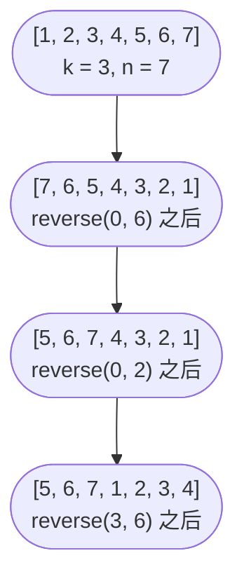

# 数组：静态、动态与多维

一排七个整数，外加一条指令：原地把它向右轮转三个位置，不许多分配任何一个槽位。多数读者的第一反应是开一个大小为三的临时缓冲区，拷走尾部，挪动头部，再把缓冲区写回。这办法可行，代价是 O(n) 的额外内存。Jon Bentley 1986 年的《Programming Pearls》用三行代码给出了另一种答案：没有额外缓冲区，没有辅助结构，还带一句"还能这样？"——这正是本章的全部意义。

连续内存模型是这套戏法成立的前提。运行时一旦知道第 0 个元素的地址，第 `i` 个元素的地址就是 `base + i × sizeof(elem)`，CPU 用带比例变址的一条指令就能算出来。接下来十二章里关于数组的每一个论断，都建立在这一个事实上。

## 数组到底是什么

静态数组（static array）是一段定长的连续缓冲区，元素大小相同。Java 写成 `int[] a = new int[10]`；C++ 写成 `int a[10]`；Go 写成 `var a [4]int`。长度是类型的一部分，运行时不能改。[^1] 这看着受限，但正因如此才有 O(1) 随机访问、O(1) 取长度，以及缓存预取器最爱的顺序遍历。

动态数组（dynamic array）在同一套原语上加了扩容策略：一个能读的 `length`，一个通常读不到的 `capacity`，以及一个在溢出时扩容底层缓冲区的 `append`。Python 的 `list`、Java 的 `ArrayList`、C++ 的 `std::vector`、Go 的切片都是这个形状。开销的故事是每次 append 摊还 O(1)，证明在 [Dynamic array internals](./01-dynamic-array-internals.md)。[^2] 现在先信这个界，往下走。

多维数组（multi-dimensional array）是同一个想法在二维上的展开。行主序布局（C、Java、Python 的列表套列表）下，`m × n` 矩阵的元素 `(i, j)` 位于 `base + i × n + j`。内层循环走最右下标，是顺序扫内存；内层循环走外层下标，步长为 `n`，缓存会被打烂。等你在 [Matrix manipulation](../../../dsa/part-1-linear-data-structures/07-matrix-manipulation.md) 里做到 LC 48，就是这一点决定了代码是快还是慢。

数组与链表的决策分界比多数初学者以为的更锋利。如果负载是"按下标 `i` 取值、交换两个下标、从左往右扫"，数组在每个维度上都赢：缓存局部性、无分支的索引计算、更低的单元素开销。如果负载是"把一段 100 个节点的子链插到另一个链表的中间，且什么都不许挪"，链表赢。本章只待在数组这一侧；链表在书里另有一部分。

## 面试里能直接背的开销模型

本章由三个操作主导，动态数组变体另有三个操作标价。它们共享同一条连续内存不变式，界就是它的推论。

| 操作 | 时间 | 额外空间 | 原因 |
|---|---|---|---|
| 随机访问 `a[i]` | O(1) | O(1) | 地址算术只要一条指令。 |
| 取长度 `len(a)` | O(1) | O(1) | 与缓冲区头一起存储。[^2] |
| LC 88 倒序归并（m + n） | O(m + n) | O(1) | 每个目标槽位只写一次。 |
| LC 27 读写压缩 | O(n) | O(1) | 一趟扫描，两个下标。[^3] |
| LC 189 三次反转轮转 | O(n) | O(1) | 三次反转共 2n 次交换。[^3] |
| 动态数组 append（摊还） | O(1) | O(1) | 对倍增表做聚合分析。[^2] |
| 动态数组 append（最坏） | O(n) | O(n) | 重分配那一步。 |
| 靠前位置插入或删除 | O(n) | O(1) | 后面每个元素都要挪。[^2] |

三个原地算法的下界很直接。任何值发生变化的单元格至少要被碰一次，所以对 `n` 个值的任何原地重排都是 Ω(n)。三个算法都达到了这个界；除非打破原地约束，否则连常数因子也压不下去。

## 三道题，三种技巧

本章剩下部分是三道 LeetCode 题，蒸馏出本章三个招牌技巧：倒序归并、双指针压缩、三次反转轮转。都是原地，都是 O(n)。只要题目说"原地"或"O(1) 额外空间"，你就该反射性地想到它们。

### LC 88 — Merge Sorted Array：倒序归并

你有两个有序数组。第一个 `nums1` 长度是 `m + n`，但只有前 `m` 个槽位有效，尾部 `n` 个槽位填着哨兵零。第二个 `nums2` 长度是 `n`。把 `nums2` 原地归并进 `nums1`，结果保持有序。

错误答案是从 `nums1` 开头往前走，边比较边插入。向前遍历会覆盖 `nums1` 中尚未比较的位置，或者逼你开一个 O(m + n) 的辅助缓冲区来躲开覆盖。题目要求 O(1) 额外空间时，两种都不可接受。

正确答案是从后往前走。放三个指针：`i` 指向 `nums1` 最后一个有效槽位，`j` 指向 `nums2` 末尾，`k` 指向目标缓冲区末尾。每一步把 `nums1[i]` 和 `nums2[j]` 中较大者写进位置 `k`，把被选中的来源指针减一，`k` 减一。尾部槽位保证是空的，所以往那里写永远不会毁掉活数据。等 `k` 走到一个存着活值的位置时，`k` 右边每个值都已经被比较并安置好了。

```python
def merge(nums1, m, nums2, n):
    i, j, k = m - 1, n - 1, m + n - 1
    while j >= 0:
        if i >= 0 and nums1[i] > nums2[j]:
            nums1[k] = nums1[i]
            i -= 1
        else:
            nums1[k] = nums2[j]
            j -= 1
        k -= 1
```

**解法** — Python（[Java](./00-arrays/lc-88/sol.java) · [C++](./00-arrays/lc-88/sol.cpp) · [Go](./00-arrays/lc-88/sol.go)）

```python
# LC 88. Merge Sorted Array
# 把 nums2（长度 n）原地归并进 nums1（容量 m+n，前 m 个有效）。
# 从后往前走，写入永远不会覆盖尚未读取的值。O(m+n)，O(1)。
from typing import List


def merge(nums1: List[int], m: int, nums2: List[int], n: int) -> None:
    i, j, k = m - 1, n - 1, m + n - 1
    while j >= 0:
        # i >= 0 的短路判断隐含处理了 m == 0 的情况。
        if i >= 0 and nums1[i] > nums2[j]:
            nums1[k] = nums1[i]
            i -= 1
        else:
            nums1[k] = nums2[j]
            j -= 1
        k -= 1
```

整个算法六行。每个位置只写一次。总工作量 O(m + n)，额外空间 O(1)。循环的退出条件是 `j < 0`，也就是 `nums2` 用光了；`nums1[0..i]` 里剩下的东西本来就在正确位置，因为它一开始就是有序的。

### LC 27 — Remove Element：双指针压缩

给定 `nums` 和值 `val`，原地删掉 `nums` 里所有等于 `val` 的元素。返回新的逻辑长度 `k`；`nums` 前 `k` 项应当装着保留下来的值。`nums[k:]` 里剩什么无关紧要，判题器不看。

这是标准的读写分离。读指针 `i` 走遍每个位置；写指针 `k` 只在 `nums[i] != val` 时前进。留下的元素往前压紧，被丢弃的会在下一个幸存者写入时被覆盖。

```python
def remove_element(nums, val):
    k = 0
    for i in range(len(nums)):
        if nums[i] != val:
            nums[k] = nums[i]
            k += 1
    return k
```

**解法** — Python（[Java](./00-arrays/lc-27/sol.java) · [C++](./00-arrays/lc-27/sol.cpp) · [Go](./00-arrays/lc-27/sol.go)）

```python
# LC 27. Remove Element
# 双指针压缩：读指针 i 扫过每个槽位，写指针 k 只在
# 遇到保留元素时前进。返回新的逻辑长度。O(n)，O(1)。
from typing import List


def remove_element(nums: List[int], val: int) -> int:
    k = 0
    for i in range(len(nums)):
        if nums[i] != val:
            nums[k] = nums[i]
            k += 1
    return k
```

`k` 既是下一个写入下标，也是最终长度，这是契约最干净的形式：返回 `k` 一次给全了两条信息。这个模式比单道题所暗示的更通用。LC 26（Remove Duplicates from Sorted Array）在 `nums[i]` 与 `nums[k-1]` 不同时保留它；LC 283（Move Zeroes）保留非零值；LC 75（Sort Colors）扩展到三个指针。完整模板在 [Two pointers, same direction](../../../dsa/part-3-pointers-window-prefix/01-two-pointers-same-direction.md)。

### LC 189 — Rotate Array：三次反转

把 `nums` 原地向右轮转 `k` 步，额外空间 O(1)。约束：`1 ≤ n ≤ 10^5`，`0 ≤ k ≤ 10^5`，所以 `k` 可能超过 `n`。

朴素答案是把每个元素向右挪一位，重复 `k` 次。那是 O(n × k)，最坏情况 10^10 次操作，哪种语言都会超时。

Bentley 的戏法，在《Programming Pearls》第 2 栏里归功于一位研究生，他"想通了就再没忘掉"：[^3]

```text
reverse(nums, 0, n - 1)   # 反转整个数组
reverse(nums, 0, k - 1)   # 反转前 k 个
reverse(nums, k, n - 1)   # 反转后 n - k 个
```

这就是轮转。总交换次数 2n，额外空间 O(1)。证明一段话：第一次反转后，位置 `i` 装着原数组 `n - 1 - i` 处的值。第二次反转后，前 `k` 个位置已是最终轮转顺序。第三次反转后，后 `n - k` 个位置也是。完事。

```python
def rotate(nums, k):
    n = len(nums)
    if n == 0:
        return
    k %= n

    def _reverse(lo, hi):
        while lo < hi:
            nums[lo], nums[hi] = nums[hi], nums[lo]
            lo += 1
            hi -= 1

    _reverse(0, n - 1)
    _reverse(0, k - 1)
    _reverse(k, n - 1)
```

**解法** — Python（[Java](./00-arrays/lc-189/sol.java) · [C++](./00-arrays/lc-189/sol.cpp) · [Go](./00-arrays/lc-189/sol.go)）

```python
# LC 189. Rotate Array
# 三次反转：先反转整个数组，再反转前 k 个，
# 最后反转剩下的部分。避开 O(n*k) 的朴素移位。O(n)，O(1)。
from typing import List


def rotate(nums: List[int], k: int) -> None:
    n = len(nums)
    if n == 0:
        return
    k %= n  # 容忍 k > n；轮转 n 位等于不动。

    def _reverse(lo: int, hi: int) -> None:
        while lo < hi:
            nums[lo], nums[hi] = nums[hi], nums[lo]
            lo += 1
            hi -= 1

    _reverse(0, n - 1)
    _reverse(0, k - 1)
    _reverse(k, n - 1)
```

`nums = [1, 2, 3, 4, 5, 6, 7]`、`k = 3` 的图示推演：



*三次反转按序施加，把数组向右轮转 k 位。每次反转本身都是双指针交换，所以总交换次数恰好是 2n。*

`n == 0` 守卫之后第一行可执行代码是 `k %= n`，这一行必须有。没有它，只要 `k ≥ n`，`reverse(0, k - 1)` 就越界。Python 会安静地产生空切片和错误答案；C++ 是未定义行为；Java 抛 `ArrayIndexOutOfBoundsException`。约束允许 `k ≤ 10^5` 而数组可能更短，所以这是真实故障模式，不是假想。

## 常见误区

实践中出现五种失败模式，一类题一种。形状都一样：bug 是一行，修法是一行，代价落在"答案错"到"运行时越界"之间。

> [!WARNING]
> **给参数重新赋值，而不是原地修改。** Python 那一行 `nums = nums[-k:] + nums[:-k]` 在打印出来的例子上看着对，但它只是重绑了本地名字。LC 的判题器检查调用方的数组，看不到任何变化。改用切片赋值 `nums[:] = nums[-k:] + nums[:-k]`，或者用三次反转算法，那里每次修改都是 `nums[i] = ...`。同样的 bug 在 Go 里也有，`nums = append(...)` 重绑的是本地切片头；任何参数重绑不会传回调用方的语言都有这个问题。

> [!WARNING]
> **LC 88 上向前遍历。** 从左往右走意味着目标位置和活的源数据重叠。你要么覆盖 `nums1` 中尚未读取的值，要么开一个 O(m + n) 的辅助缓冲区。修法只有一行：从后往前遍历，那里的尾部槽位保证是空的。

> [!WARNING]
> **LC 27 上返回错东西。** 契约是"原地修改并返回新长度 `k`"。返回 `nums` 本身，或者返回 `len(nums)`（原长度）的提交都会挂。标准写法 `k = 0; for i: if nums[i] != val: nums[k++] = nums[i]; return k` 让 `k` 既是写下标又是最终长度，没别的东西要返回。

> [!WARNING]
> **LC 189 上忘了 `k %= n`。** 约束允许数组长度到 10^5、`k` 也到 10^5。当 `k ≥ n`，第二次反转就走出边界。先取模，后面一切都靠它。

> [!WARNING]
> **Go 切片在轮转时的别名问题。** 构造 `append(nums[len(nums)-k:], nums[:len(nums)-k]...)` 复用了同一块底层数组；从一个切片头写入会破坏另一个切片头看到的值。Andrew Gerrand 2011 年的 Go 博客文章在 "A possible gotcha" 一节里提醒过这一点。[^4] 三次反转算法在构造上就没有别名问题，因为唯一的修改是 `a[i], a[j] = a[j], a[i]`，只写同一个切片的 `i` 和 `j` 两个下标。确实需要拷贝时，`slices.Clone(nums)`（Go 1.21+）返回一块全新的底层数组。

## 题目梯度

### 核心（三题全做才算掌握本章）

- [LC 88 — Merge Sorted Array](https://leetcode.com/problems/merge-sorted-array/) [简单] • 倒序归并 ★
- [LC 27 — Remove Element](https://leetcode.com/problems/remove-element/) [简单] • 双指针压缩
- [LC 189 — Rotate Array](https://leetcode.com/problems/rotate-array/) [中等] • 三次反转轮转

### 进阶（可选）

- [LC 4 — Median of Two Sorted Arrays](https://leetcode.com/problems/median-of-two-sorted-arrays/) [困难] • 在分割线上二分

LC 4 归 [Binary search variants](../../../dsa/part-2-search-sort/02-binary-search-variants.md) 所有，深入处理在那里。这里列出它，是因为它是本章唯一一道困难题，好让核心 + 进阶这一组覆盖简单/中等/困难。

## 后续衔接

读写压缩一旦遇到同族的"删除重复项"或"移动零"，立刻就能推广；[Two pointers, same direction](../../../dsa/part-3-pointers-window-prefix/01-two-pointers-same-direction.md) 收录了这一族。对撞双指针技术开启 [Two pointers, opposite ends](../../../dsa/part-3-pointers-window-prefix/00-two-pointers-opposite.md)。当对一个连续区间的操作能归约为累加值相减时，你就该伸手去拿 [Prefix sums, prefix XOR, and difference arrays](../../../dsa/part-3-pointers-window-prefix/04-prefix-sums.md)。至于让 `append` 在 Python list、Java ArrayList、Go 切片上摊还 O(1) 的扩容策略，就是下一章 [Dynamic array internals](./01-dynamic-array-internals.md)。

## 参考文献

[^1]: Java SE 21 Language Specification, §10 "Arrays." [docs.oracle.com/javase/specs/jls/se21/html/jls-10.html](https://docs.oracle.com/javase/specs/jls/se21/html/jls-10.html).

[^2]: Python Software Foundation, "TimeComplexity"（CPython 各操作的开销）。[wiki.python.org/moin/TimeComplexity](https://wiki.python.org/moin/TimeComplexity).

[^3]: Jon Bentley, *Programming Pearls*, 2nd ed., Addison-Wesley, 2000.

[^4]: Andrew Gerrand, "Go Slices: usage and internals," The Go Blog, 5 January 2011. [go.dev/blog/slices-intro](https://go.dev/blog/slices-intro).
