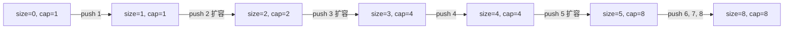

# 动态数组内部机制

在 Python 的 list 里跑一个追加一百万次整数的循环，循环结束前大约要做九百万次元素搬移。换成 Java，同一个循环是三百万次。换成 C++ libstdc++，是两百万次。换成一个假想的“每次只多扩一个槽位”的库，是五千亿次。

四种做法都对。三种是均摊 O(1)，一种是均摊 O(n)。本章讲的就是这两种结局之间的差别，以及三个不同的库在测量同一个操作时为什么会落到三个不同的常数上、这件事怎么证明。

## 一段话讲完的证明

拿一个全新的动态数组，初始容量 1，增长因子 `b > 1`。压入 `n` 个元素。每次压入要么写进空槽（便宜），要么触发一次重新分配，把所有现存元素复制到一个更大的新缓冲区里（昂贵）。昂贵的那次发生在 `size == cap` 时，也就是容量刚刚按 2 倍、3 倍、或者任意 `b` 倍涨到 `b^k`（满足 `b^k ≥ n`）的时候。每次重新分配复制的元素数等于那一刻的 size：第 i 次扩容搬 `b^(i-1)` 个元素。把所有重新分配的搬移量加起来：

```text
total_copies = b^0 + b^1 + b^2 + ... + b^(k-1)
             = (b^k - 1) / (b - 1)
             ≤ n / (b - 1)
```

再加上 `n` 次写入空槽的操作，除以 `n`，每次 push 的均摊成本最多是 `b / (b - 1)`。`b = 2` 时是每次 push 搬两个元素。`b = 1.5` 时是三个。`b = 1.125`（CPython 的实际因子）时是九个。[^1][^2] 每个值对 `n` 来说都是常数。只要 `b > 1`，不管选哪个增长因子，`n` 次 push 的总工作量都是 `Θ(n)`。

去掉 `b > 1` 这个前提，证明就塌了。算术增长——每次重新分配只多加固定的 `c` 个槽位——第 i 次扩容搬 `(i × c)` 个元素，总和是 `Θ(n^2/c)`，每次 push 的均摊成本变成 `Θ(n)`。一百万元素的循环要付五千亿次元素搬移。这就是为什么没有哪个生产库用算术增长。[^3]

CLRS §16.4 用势能法证明同一个 `b = 2` 的界。定义 `Φ(D) = 2 × num_elements - capacity`。不扩容的 push 不动容量、只让 `num` 加一，所以 `ΔΦ = 2`，均摊成本 = 实际 + ΔΦ = 1 + 2 = 3。从容量 `k` 扩到 `2k` 的 push 做 `k + 1` 的实际工作，但把 Φ 从 `k`（扩容前那张满表）降到 `2`（刚翻倍的那张），所以均摊成本 = (k + 1) + (2 - k) = 3。两种推导，同一个数。[^3]

## 容量到底涨得多快

下面的 Mermaid 图追踪一个参考动态数组，从 `cap = 1` 起、`b = 2`，压入八个元素：



*八次 push 里发生了三次重新分配；每次装满就翻倍。前十次翻倍覆盖容量 1、2、4、8、16、32、64、128、256、512、1024，所以 1024 次 push 的循环会触发十次扩容。*

参考实现把增长因子参数化成有理数 `growth_num / growth_den`，你可以填 2/1、3/2 或 9/8，看同一份模板如何产出四种生产策略。Python 版本是标准文本：

```python
class DynArr:
    def __init__(self, initial_cap=1, growth_num=2, growth_den=1):
        self._cap = initial_cap
        self._size = 0
        self._growth_num = growth_num
        self._growth_den = growth_den
        self._buf = [None] * initial_cap

    def push(self, x):
        if self._size == self._cap:
            self._grow()
        self._buf[self._size] = x
        self._size += 1

    def _grow(self):
        new_cap = (self._cap * self._growth_num + self._growth_den - 1) // self._growth_den
        if new_cap <= self._cap:
            new_cap = self._cap + 1
        new_buf = [None] * new_cap
        for i in range(self._size):
            new_buf[i] = self._buf[i]
        self._buf = new_buf
        self._cap = new_cap
```

**解答** — Python（[Java](./01-dynamic-array-internals/dynarr/sol.java) · [C++](./01-dynamic-array-internals/dynarr/sol.cpp) · [Go](./01-dynamic-array-internals/dynarr/sol.go)）

```python
# DynArr —— 几何扩容动态数组的参考模板。
# 增长因子参数化（growth_num / growth_den），用于研究
# 均摊 O(1) 的 push 证明；记录重新分配次数，让几何
# 增长的模式可观测。不是 LeetCode 题。
from __future__ import annotations
from typing import Any, Optional


class DynArr:
    def __init__(self, initial_cap: int = 1, growth_num: int = 2, growth_den: int = 1) -> None:
        if initial_cap < 1:
            raise ValueError("initial_cap must be >= 1")
        if growth_num <= growth_den:
            raise ValueError("growth_num must be > growth_den (factor > 1)")
        self._cap: int = initial_cap
        self._size: int = 0
        self._growth_num: int = growth_num
        self._growth_den: int = growth_den
        self._buf: list[Optional[Any]] = [None] * initial_cap
        self._reallocs: int = 0

    def size(self) -> int:
        return self._size

    def capacity(self) -> int:
        return self._cap

    def reallocations(self) -> int:
        return self._reallocs

    def get(self, i: int) -> Any:
        if i < 0 or i >= self._size:
            raise IndexError("get index out of range")
        return self._buf[i]

    def push(self, x: Any) -> None:
        if self._size == self._cap:
            self._grow()
        self._buf[self._size] = x
        self._size += 1

    def _grow(self) -> None:
        # 向上取整，这样 9/8 这类因子在小容量上也能增长。
        new_cap = (self._cap * self._growth_num + self._growth_den - 1) // self._growth_den
        # 防止取整后变成空操作（否则下一次 push 会死循环）。
        if new_cap <= self._cap:
            new_cap = self._cap + 1
        new_buf: list[Optional[Any]] = [None] * new_cap
        for i in range(self._size):
            new_buf[i] = self._buf[i]
        self._buf = new_buf
        self._cap = new_cap
        self._reallocs += 1


def simulate(initial_cap: int, growth_num: int, growth_den: int, n_push: int) -> tuple[int, int, int]:
    """往一个新建的 DynArr 里 push n_push 个元素；返回 (size, capacity, reallocations)。"""
    a = DynArr(initial_cap=initial_cap, growth_num=growth_num, growth_den=growth_den)
    for i in range(n_push):
        a.push(i)
    return a.size(), a.capacity(), a.reallocations()
```

`if new_cap <= self._cap` 这个判断挡住了一个真实的 bug。对容量 1 套用 1.125 的因子，整数运算的公式返回 1；没有增长，下一次 push 就死循环。真实库用单独的小数组策略处理这件事（CPython 从 0 跳到 4、再跳到 8，之后才由渐近的 1.125 接管）。参考实现只是在因子会四舍五入成空操作时硬加上一。

用 `b = 2` 往这份模板里 push 1000 个元素，会触发十次重新分配，总共复制 1023 个元素。同样的循环换成 `b = 1.125`，大约 80 次重新分配、复制约 9000 个元素。两者都是 O(n)。常数差 9 倍，而这 9 倍就是不同库选不同因子的全部原因。

## 五个库，五种不同答案

每个自带动态数组的标准库都选 `b > 1`。每家选得都不一样。

| 实现 | 增长因子 | 默认初始容量 | 来源 |
|---|---|---|---|
| Java OpenJDK `ArrayList` | 1.5 倍，通过 `oldCapacity >> 1` | 10（懒初始化） | OpenJDK `ArrayList.java`[^4] |
| CPython `list` | 约 1.125 倍，通过 `(newsize + (newsize >> 3) + 6) & ~3` | 0 | CPython `Objects/listobject.c`[^1] |
| C++ libstdc++ `std::vector` | 2 倍（“Grow by (at least) doubling”） | 0 | GCC `bits/stl_vector.h`[^5] |
| C++ libc++ `std::vector` | 2 倍，通过 `max(2 × cap, new_size)` | 0 | LLVM `__vector/vector.h`[^6] |
| C++ MSVC `std::vector` | 1.5 倍，通过 `oldCap + oldCap/2` | 0 | Microsoft STL `inc/vector`[^7] |
| Folly `FBVector` | 1.5 倍 | 可配置 | Facebook Folly `FBVector.md`[^8] |
| Go slice（1.18+） | 256 以下 2 倍，以上平滑过渡到 1.25 倍 | 视情况 | Go `runtime/slice.go`[^9] |

*同一个基本操作，七个不同的常数。C++ 标准只规定 `push_back` 是“均摊常数时间”，没规定因子。[^10] 全都合规，没有一个是可移植的。*

CPython 选了所有主流语言里最小的因子，差距极大。`listobject.c` 源码注释里公布的增长率序列是 `0, 4, 8, 16, 24, 32, 40, 52, 64, 76, ...`。64 到 76 是 19% 的一步；88 到 100 是 14%；渐近值是 1.125 倍。python-dev 在 `discuss.python.org` 上的帖子把这段历史讲清楚了：Python 在 2000 年代初是翻倍的，后来降到 1.5，理由是“现实中太多大 list 提前把内存吃光了”，之后又因为同样的理由降到 1.125。[^2] 每次 push 的均摊成本大约是九次元素搬移，是表里最高的，而 python-dev 的维护者认为这是优点，因为它比任何替代方案都更紧地压住了内存峰值。

Go 的策略在 2022 年 3 月变了。commit `2dda92ff` 把阈值从 1024 降到 256，并用一个平滑公式替掉了原来从 2 倍到 1.25 倍的断崖：超过阈值后 `newcap += (newcap + 3*256) >> 2`。commit message 解释了阈值的选择：让“往一个超大 slice 里追加”时的重新分配总次数大致与旧策略相当。目标是在不破坏任何人已 benchmark 过的常数的前提下完成迁移。[^9] 2022 年之前的教程还在说“Go 在 1024 以下翻倍，之后 1.25 倍”。那曾经是对的。

### 为什么 1.5 倍是工程上的折中

Folly 的 `FBVector` 用数学论证而非 benchmark 来支持 1.5 倍。翻倍的情况下，所有被释放缓冲区的大小累计是 `1 + 2 + 4 + ... + 2^(k-1) = 2^k - 1`，严格小于下一次分配的 `2^k`。被释放的区域永远凑不出一块足够大的空间给下一次扩容，连理论上都不行。而当 `b < (1 + √5) / 2 ≈ 1.618`（黄金比例）时，累计释放量最终会超过下一次分配量，所以一个会合并空闲块的分配器原则上可以复用同一片物理内存来支撑缓冲区增长。[^8] MSVC STL 和 Folly 都因此选了 1.5 倍；libstdc++ 和 libc++ 为了更低的均摊常数保留 2 倍。

这份好处有多少是真的，取决于分配器。现代 size-class 分配器（jemalloc、tcmalloc）用的桶边界并不总像教科书里的 free list 那样合并。数学成立；实际的内存回收随负载而变。

## 可以在面试里报出来的开销表

| 操作 | 最坏时间复杂度 | 均摊时间 | 空间 | 说明 |
|---|---|---|---|---|
| `get(i)` 随机访问 | O(1) | O(1) | O(1) | 地址运算。[^11] |
| `push(x)` 不扩容的情况 | O(1) | O(1) | O(1) | 一次写。 |
| `push(x)` 触发扩容的情况 | O(n) | — | O(n) 临时 | 这一次 push 把元素全复制了。 |
| `push(x)` 连续 n 次 | — | 每次 push O(1) | O(n) 峰值 | 上面的证明。[^3] |
| `pop()` 不缩容 | O(1) | O(1) | O(1) | 对 `size` 写一次。 |
| 在头部附近插入或删除 | O(n) | O(n) | O(1) | 后面每个元素都要挪。 |

“均摊 O(1) 但最坏 O(n)”这个区分，是本章唯一能救你躲过硬实时（hard real-time）bug 的一招。一个飞行控制循环如果要求每次 push 都在 1 微秒内完成，就不能用普通的 `ArrayList`，因为隔很久会有一次 push 触发重新分配，把此前所有元素复制一遍。这种场景的解法是去均摊（deamortized）动态数组：把这次复制拆到后续多次 push 里，代价是更多记账，换来每次操作都有最坏时间上界。CLRS 把这种技术叫 table-doubling 配 lazy-rehash 模式；实践中它出现在实时游戏引擎里，也出现在 [Heaps](../../../dsa/part-6-trees-heaps/04-heaps-priority-queues.md) 讲的堆再平衡里。[^3]

### 容量缩回去时会发生什么

缩容比扩容难，多数生产库干脆不管。CPython 的 `list` 从不缩容，除非你显式用更小的目标调用 `list_resize`。Java 的 `ArrayList` 出于同样的理由提供 `trimToSize()`：缩容要手动开。Go 的 slice 从不缩小底层数组。切片会产生一个 `len` 更小的新 header，但 `cap` 和底层内存原地不动。

原因还是均摊。朴素的缩容策略——只要 `size ≤ cap / 2` 就把容量减半——会破坏交替 push/pop 序列的均摊界。刚越过边界 push 触发扩容；刚越过边界 pop 触发缩容；再 push 又扩容；再 pop 又缩容。每次操作都是 O(n)，均摊的缓冲永远攒不起来，`n` 次操作总共 `Θ(n^2)`。CLRS §16.4.2 用迟滞策略修好它：只在 `size ≤ cap / 4` 时缩容。均摊界回来了；代价是谷底时最多浪费 75% 的容量。[^3] 多数标准库直接跳过这套策略，内存压力真的要紧就让你自己调 `trim` 或 `clone`。

## 常见误区

> [!WARNING]
> **`reserve(n)` 不设置 size；设置它的是带长度的构造函数。** 在 C++ 里，`vector<int> v(n);` 创建一个长度为 `n`、全是 0 的 vector。`vector<int> v; v.reserve(n);` 创建一个空 vector、容量为 `n`。Java 的 `new ArrayList<>(n)` 行为像 `reserve`（只管容量）；要在 Java 里预填得用 `new ArrayList<>(Collections.nCopies(n, default))`。把两种语义搞混，就会把数据写到“`n` 个 0 的缓冲区”的第 0 个位置，而不是追加在后面。

> [!WARNING]
> **头部插入每次都是 O(n)，没有均摊能救。** Python 的 `list.insert(0, x)`、C++ 的 `vector::insert(vector.begin(), x)`，以及任何“把后面全部右移一位”的操作，每次调用都是 O(n)。循环做 `n` 次就是 `Θ(n^2)`。几何扩容均摊的是尾部的增长；头部的工作没有任何东西能均摊。访问模式要匹配数据结构：只往后追加用动态数组；两头都要动就用双端队列（Python 的 `collections.deque`、Java 的 `ArrayDeque`、C++ 的 `std::deque`，以及 [Queues and deques](../../../dsa/part-1-linear-data-structures/06-queues-deques.md) 里的环形缓冲模式）。

> [!WARNING]
> **跨平台 C++ benchmark 量的是增长策略，不是速度。** 一千万个 int 的 push 循环在 libstdc++ 和 libc++（2 倍）上大约 23 次重新分配，在 MSVC STL（1.5 倍）上大约 58 次。MSVC 的数字看起来差 1.4~2 倍，但算法和标准库实现做的完全是要求它们做的事。增长因子 C++ 标准没规定，所以同一份代码在不同工具链上量的是不同的东西。要么用已知的最终大小提前 `reserve(n)`，要么就按工具链分别报数。[^10]

> [!WARNING]
> **“Python 的 list 是翻倍的”是错的，而且已经错了二十多年。** 教程和论坛帖还在类比 `std::vector` 说“2 倍”。任何人翻开 `Objects/listobject.c` 都能看到真正的公式 `new_allocated = (newsize + (newsize >> 3) + 6) & ~3`：1.125 倍，带一个 +6 常量和 4 元素的对齐下限。如果增长因子对答案重要，就引源码。python-dev 上关于提高因子的帖子开头就摆出了历史记录：Python 在 2000 年代初翻倍，后来降到 1.5，现在停在 1.125。[^2]

> [!WARNING]
> **热路径里把 capacity 和 size 搞混。** Python 里 `for i in range(len(arr))` 是对的；移植成 C++ 写成 `for (size_t i = 0; i < arr.capacity(); ++i)` 就会越过有效数据的末尾，走进未初始化的槽位。永远按 size 迭代；capacity 是给 `reserve`、埋点和 benchmark 用的。Go 的惯用法直接体现了这点：`s[:len(s)]` 是有效数据，`s[:cap(s)]` 会露出没初始化的尾部，同一片底层数组的两个视图。[^9]

## 题目梯度

本章讲的是机制深度，不是模式章节。经典的“原地数组操作”简单/中等题归 [Arrays: static, dynamic, multi-dimensional](./00-arrays.md) 所有。剩下符合本章定位的题——容量与长度之差就是设计面的显式数据结构——集中在中等难度，所以下面三道 CORE 题都是中等。`foundation_framework_exempt` 这个 ladder 标记适用：本章的承重产物是那段证明，题目梯度只是补充练习。

### 核心（全做才算掌握本章）

- [LC 1146 — Snapshot Array](https://leetcode.com/problems/snapshot-array/) [中等] • array-design-per-cell-version-list ★
- [LC 919 — Complete Binary Tree Inserter](https://leetcode.com/problems/complete-binary-tree-inserter/) [中等] • array-backed-tree-with-index-arithmetic
- [LC 622 — Design Circular Queue](https://leetcode.com/problems/design-circular-queue/) [中等] • array-buffer-bounded-with-modular-indexing

## 后续衔接

从这里开始的每一章，只要它声称 `append`、`add`、`push_back` 或 `append(slice, x)` 是 O(1)，都在悄悄引用本章。最直接的下游是 [Hash maps](../../../dsa/part-1-linear-data-structures/03-hash-maps.md)，它把几何扩容的论证复用到“装载因子越界就扩表”的契约上：同一个证明，不同的前提。需要最坏情况界而不是均摊界的实时系统会去用去均摊的变体，等你见过优先队列，它第一次出现在 [Heaps](../../../dsa/part-6-trees-heaps/04-heaps-priority-queues.md)。

## 参考文献

[^1]: CPython 源码，`Objects/listobject.c`，函数 `list_resize`。[github.com/python/cpython/.../listobject.c](https://github.com/python/cpython/blob/main/Objects/listobject.c)。

[^2]: discuss.python.org 帖子“Consider increasing the growth factor of list objects”（2026 年 3 月）。<https://discuss.python.org/t/consider-increasing-the-growth-factor-of-list-objects/106622>

[^3]: Cormen、Leiserson、Rivest、Stein，《Introduction to Algorithms》第 4 版，MIT Press，2022。通用的 `b/(b-1)` 界见 Jeff Erickson《Algorithms》第 13 章 §13.3 “Doubling Tables”。[jeffe.cs.illinois.edu/teaching/algorithms](https://jeffe.cs.illinois.edu/teaching/algorithms/)。

[^4]: OpenJDK 源码，`src/java.base/share/classes/java/util/ArrayList.java`，方法 `grow(int minCapacity)`。[github.com/openjdk/jdk/.../ArrayList.java](https://github.com/openjdk/jdk/blob/master/src/java.base/share/classes/java/util/ArrayList.java)。

[^5]: GCC libstdc++-v3，`bits/stl_vector.h`，成员 `_M_check_len(size_type, const char*)` 返回 `size() + max(__n, size())`，并带有内联注释“Grow by (at least) doubling.”。[github.com/gcc-mirror/gcc/.../stl_vector.h](https://github.com/gcc-mirror/gcc/blob/master/libstdc%2B%2B-v3/include/bits/stl_vector.h)。

[^6]: LLVM libc++，`libcxx/include/__vector/vector.h`，成员 `vector::__recommend(size_type)` 返回 `std::max(2 * __cap, __new_size)`，上限是 `max_size()`。[github.com/llvm/llvm-project/.../vector.h](https://github.com/llvm/llvm-project/blob/main/libcxx/include/__vector/vector.h)。

[^7]: Microsoft STL，`stl/inc/vector`，成员 `vector::_Calculate_growth(const size_type)` 返回 `_Oldcapacity + _Oldcapacity / 2`——也就是 1.5 倍——几何增长不够时回落到请求的大小。[github.com/microsoft/STL/.../vector](https://github.com/microsoft/STL/blob/main/stl/inc/vector)。

[^8]: Facebook Folly，`folly/docs/FBVector.md`，内存分配策略一节：“It can be mathematically proven that a growth factor of 2 is rigorously the worst possible because it never allows the vector to reuse any of its previously-allocated memory.”Folly 选的因子是 1.5 倍。[github.com/facebook/folly/.../FBVector.md](https://github.com/facebook/folly/blob/main/folly/docs/FBVector.md)。

[^9]: Go runtime，`src/runtime/slice.go`，函数 `growslice` 与辅助函数 `nextslicecap`。阈值变更记录在 commit `2dda92ff6f9f07eeb110ecbf0fc2d7a0ddd27f9d`（2022 年 3 月）：“256 was chosen as the threshold to roughly match the total number of reallocations when appending to eventually make a very large slice.”[github.com/golang/go/.../slice.go](https://github.com/golang/go/blob/master/src/runtime/slice.go)。

[^10]: ISO/IEC 14882:2020（C++20），[vector.modifiers]/3：`push_back` 是均摊常数时间；标准没有规定增长因子。

[^11]: Python Software Foundation，“TimeComplexity”（CPython 各操作的开销）。[wiki.python.org/moin/TimeComplexity](https://wiki.python.org/moin/TimeComplexity)。
