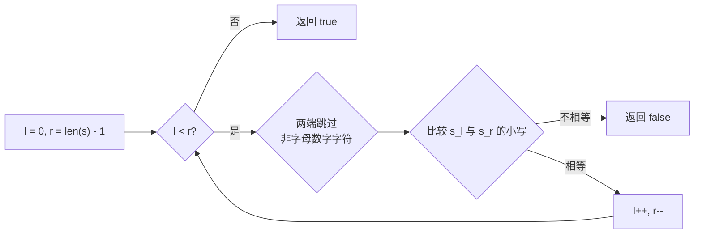
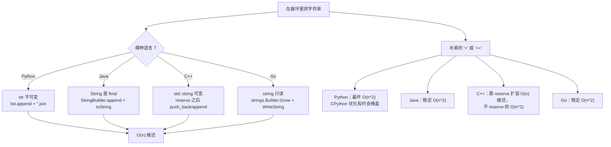

# 字符串：编码、不可变性与构建器

同一个循环，用四种语言写出来，就是四种不同的代价。`s += "x"` 跑上百万次：在 C++ 里，只要先调过 `std::string::reserve`，几百毫秒就能跑完；在 Java 里不用 `StringBuilder`，要几十秒；在 Python 里取决于这个正在增长的字符串有没有被别名引用；在 Go 里不用 `strings.Builder`，则稳定是 O(n²)。解释背后原因的那些文字，比任何单个算法都更有用。

本章关注的是字符串在四门标准语言里的*形状*。三道招牌题支撑整段讨论：LC 14 Longest Common Prefix 对应纵向扫描，LC 344 Reverse String 对应原地修改的惯用法，LC 125 Valid Palindrome 对应带字符分类的双指针。三道都是简单题。它们都不是重点。重点是跨语言的对比。

## 每种语言里的字符串

| 语言 | 类型 | 可变？ | `s[i]` 返回 | 构建器模式 |
|---|---|---|---|---|
| Python | `str` | 否 | 长度为 1 的 `str`（一个 Unicode 码点） | `list.append` 之后 `"".join(parts)` |
| Java | `String` | 否（`final`） | `char`（一个 UTF-16 编码单元） | `StringBuilder.append` 之后 `toString()` |
| C++ | `std::string` | 是 | `char`（一个字节） | `string::reserve(n)` 之后 `push_back` |
| Go | `string` | 否 | `byte`（一个 UTF-8 八位组，**不是** rune） | `strings.Builder.Grow(n)` 之后 `WriteString` |

四种里有三种不可变。C++ 是唯一一个你写 `s[i] = 'x'` 能真的改到原处的语言。另外三种语言里的每一次“修改”，都是造出一个新字符串，再把名字重新绑到它上面。[^1][^2][^3][^4]

这个结论在 LC 344 里表现得最清楚。题目说“用 O(1) 额外内存原地反转字符串”。如果输入真是字符串，那在四种语言里有三种根本做不到。所以 LC 的签名是 `List[str]`（Python）、`char[]`（Java）、`vector<char>`（C++）、`[]byte`（Go）。输入是字符缓冲区，不是字符串。[^5] 这不是风格偏好，而是这道题唯一能表达出来的形式。

一旦走出 ASCII，索引方式的差别就开始咬人。对 `s = "café"`，Python 的 `s[3]` 返回长度为 1 的 `"é"`。对 `s = "日本語"`，Go 的 `s[0]` 返回 `0xe6`，也就是“日”的 UTF-8 编码的第一个字节。要在 Go 里按 rune 迭代，得写 `for i, r := range s` 或者 `unicode/utf8.DecodeRuneInString(s[i:])`。[^4] 下面三道 CORE 题的输入都是 ASCII，这个区别不会冒出来。但它不会永远沉默。大规模的模式匹配，见 [Part 12 — KMP and friends](../../../dsa/part-12-strings-pattern-matching/02-kmp.md)，那里假定读者已经内化了一件事：`s[i]` 在 Go 里是*字节*，在 Python 里是*码点*。

## LC 14 — 纵向扫描

给一组字符串，返回它们的最长公共前缀。如果没有公共前缀，返回 `""`。

这道题的形状是“一串字符串，输出是共享的结构”。三种做法都是 O(S)，其中 S 是所有字符串的字符数之和：水平扫描（拿当前前缀去和每个新字符串归约）、纵向扫描（先比较所有行在第 `i` 列上的字符，再递增 `i`）、分治（递归合并）。在不匹配出现在靠前几列的输入上，纵向扫描停得最快。[^6]

```python
def longest_common_prefix(strs):
    if not strs:
        return ""
    shortest = min(strs, key=len)
    for i, ch in enumerate(shortest):
        for s in strs:
            if s[i] != ch:
                return shortest[:i]
    return shortest
```

**解法** — Python ([Java](./02-strings/lc-14/sol.java) · [C++](./02-strings/lc-14/sol.cpp) · [Go](./02-strings/lc-14/sol.go))

```python
# LC 14. Longest Common Prefix
# 纵向扫描：沿最短字符串的列往前走；一遇到不匹配，
# 就返回该列之前的前缀。在开头附近就分叉的输入上，
# 提前退出比水平归约更快。O(S)，S 为各字符串长度之和，空间 O(1)。
from typing import List


def longest_common_prefix(strs: List[str]) -> str:
    if not strs:
        return ""
    shortest = min(strs, key=len)
    for i, ch in enumerate(shortest):
        for s in strs:
            if s[i] != ch:
                return shortest[:i]
    return shortest
```

提前退出这个模式，是它和教科书式双层循环唯一的区别。对 `["dog", "racecar", "car"]`，第 0 列就有三个不同字符，函数比较一次就返回 `""`。

## LC 344 — 原地反转的四种写法

用 O(1) 额外内存原地反转一个字符缓冲区。双指针交换本身是机械动作；有意思的是这个函数签名在四种语言里长什么样。

```python
def reverse_string(s):
    l, r = 0, len(s) - 1
    while l < r:
        s[l], s[r] = s[r], s[l]
        l += 1
        r -= 1
```

**解法** — Python ([Java](./02-strings/lc-344/sol.java) · [C++](./02-strings/lc-344/sol.cpp) · [Go](./02-strings/lc-344/sol.go))

```python
# LC 344. Reverse String
# 在可变字符缓冲区上做双指针原地交换。
# Python 的 str 不可变，所以 LC 的签名用 List[str]。O(n)，空间 O(1)。
from typing import List


def reverse_string(s: List[str]) -> None:
    l, r = 0, len(s) - 1
    while l < r:
        s[l], s[r] = s[r], s[l]
        l += 1
        r -= 1
```

Python 收 `List[str]`，因为 `str` 不可变。Java 收 `char[]`，因为 `String` 是 `final`。Go 收 `[]byte`，因为 `string` 只读。C++ 收 `vector<char>` 是为了跟 LC 的判题脚手架对齐，尽管 `std::string` 也能用——它是可变的。四种语言里双指针的函数体一模一样。参数类型才是这一章。[^5]

Python 的元组交换惯用法 `s[l], s[r] = s[r], s[l]` 值得单独提一句。它被编译成一条字节码，不用临时变量就完成交换，比你在 Java 里写的那三行 `tmp = s[l]; s[l] = s[r]; s[r] = tmp` 更快。C++ 的 `std::swap` 对 `vector` 元素交换同样有专门优化；在 -O2 下这次调用会展开成一次移动构造加两次移动赋值。

## LC 125 — 带字符分类的双指针

判断一个字符串是不是回文，只看字母和数字字符，忽略大小写。空字符串算合法回文。[^7]

所有人都见过的经典例子是 `"A man, a plan, a canal: Panama"`。而真正把大多数初学者绊倒的例子是 `"0P"`。

```text
"0P"  →  '0'.lower() == '0';  'P'.lower() == 'p';  '0' != 'p'  →  false
```

如果你用 `isalpha`（只认字母）而不是 `isalnum`（字母加数字）去过滤，数字 `0` 就被跳过了。剩下的是 `"P"`，一个长度为 1 的字符串，它当然是回文。本地测试通过，判题器拒绝。LC 125 的题面写的是“alphanumeric”。字母数字包含数字。把题面读两遍。[^7]

```python
def is_palindrome(s):
    l, r = 0, len(s) - 1
    while l < r:
        while l < r and not s[l].isalnum():
            l += 1
        while l < r and not s[r].isalnum():
            r -= 1
        if s[l].lower() != s[r].lower():
            return False
        l += 1
        r -= 1
    return True
```

**解法** — Python ([Java](./02-strings/lc-125/sol.java) · [C++](./02-strings/lc-125/sol.cpp) · [Go](./02-strings/lc-125/sol.go))

```python
# LC 125. Valid Palindrome
# 双指针从两端向中间收敛，跳过非字母数字字符，
# 比较时统一大小写。空字符串和单字符串都算回文。
# O(n)，空间 O(1)。
def is_palindrome(s: str) -> bool:
    l, r = 0, len(s) - 1
    while l < r:
        while l < r and not s[l].isalnum():
            l += 1
        while l < r and not s[r].isalnum():
            r -= 1
        if s[l].lower() != s[r].lower():
            return False
        l += 1
        r -= 1
    return True
```

双指针的结构和 LC 344 完全一样。区别在于那两个内层跳过循环，负责越过非字母数字字符。每个字符最多被访问两次（一次是某个指针在跳过阶段经过它，一次是相等性比较），所以整体是 O(n)。



*带字母数字过滤和大小写折叠的双指针扫描。循环退出时两个指针已经交叉；总工作量是 O(n)，因为每个字符只被碰常数次。*

## O(n²) 拼接陷阱

对下游代码来说，这是本章最有分量的一节。

在循环里反复用 `+=`（Python）、`+`（Java）、`+`（C++ 未预留容量）、`+`（Go）来堆一个长字符串，在四种语言里有三种是 O(n²)。每一次 `+` 都返回一个全新的字符串对象，把已有的全部字节加上新字节一起复制一遍。追加 n 次、每次一个字符之后，复制的总字节数是 `1 + 2 + 3 + ... + n = O(n²)`。[^1][^2]

CPython 在某些微基准里把这个藏了起来，靠的是一个从 2.4 就待在解释器里的“引用计数为 1 时原地扩展”优化。一旦这个正在增长的字符串被另一个引用别名，优化就失效；在 PyPy 和 Jython 上彻底没有；而且它被明确记录为实现的细节，不是语言的保证。[^8] 在较新的 CPython 3.11 上，n=200,000 时 `s += "a"` 大约比 `"".join(parts)` 慢 2.2 倍。这远没到渐近差距那么夸张，但已经是很清楚的常数因子信号：即使优化生效，join 惯用法也更快。

修法就是用这门语言的构建器类型。能预分配就预分配，循环里只用构建器 API，最后一次性产出结果：

| 语言 | 构建器模式 |
|---|---|
| Python | `parts = []` ... `parts.append(piece)` ... `"".join(parts)` |
| Java | `StringBuilder sb = new StringBuilder(initialCapacity); sb.append(piece); ... sb.toString();` |
| C++ | `std::string out; out.reserve(expectedSize); out += piece;` |
| Go | `var b strings.Builder; b.Grow(expectedSize); b.WriteString(piece); ... b.String();` |

四种做法在总共写入 n 个字节时都是摊还 O(n)。预分配（`reserve`、`Grow`、Java 构造函数的那个参数）是常数因子上的收益，不是渐近上的。不做预分配，构建器依然靠 [Dynamic array internals](./01-dynamic-array-internals.md) 里那套几何扩容的论证正确摊还。[^1][^2][^3][^4]



*四种语言里有三种的字符串不可变；第四种（C++）的字符串可变，但为了可预测的分配，它同样受益于 `reserve`。*

## 常见误区

> [!WARNING]
> **LC 125 的 `"0P"` 用例。** 用 `isalpha` / `isLetter` 过滤会把那个数字剥掉，只剩一个单字符回文。LC 125 写的是“alphanumeric”，数字也算。用 `isalnum` / `isLetterOrDigit`。这是 LC 125 讨论区里最经典的首次尝试翻车方式。[^7]

> [!WARNING]
> **C++ `std::isalnum` 的未定义行为。** 在 `char` 有符号的平台上（x86_64 Linux 和 macOS 的默认情况），最高位为 1 的字节是负的 `char` 值。把它传给 `isalnum` 是未定义行为；标准要求输入能表示成 `unsigned char`，或者等于 `EOF`（-1）。永远显式转换：`std::isalnum(static_cast<unsigned char>(s[i]))`。把它变成无条件反射。[^3]

> [!WARNING]
> **Go 里对多字节 rune 用 `s[i]`。** 对 ASCII 题目，按字节迭代是对的，而且更快。要按 Unicode 迭代，用 `for i, r := range s` 或 `unicode/utf8.DecodeRuneInString(s[i:])`。在 UTF-8 输入上把 `s[i]` 当成一个字符来用的代码，得到的是错误答案，不是崩溃。[^4]

> [!WARNING]
> **Java 的 `==` 与 `.equals()`。** `"abc" == "abc"` 返回 `true`，因为字符串字面量被 intern 了。`"abc" == new String("abc")` 返回 `false`，因为 `new String(...)` 造了一个新实例。比较内容永远用 `.equals()`。字符串池这个优化让 bug 在字面量上隐身，在动态构造的字符串上现形。[^2]

> [!WARNING]
> **LC 344 用错签名。** Python 的一行 `return s[::-1]` 确实反转了字符串，但它分配了一个新字符串并返回；LC 344 要求原地修改，O(1) 额外内存。正确的签名写 `def reverse_string(s: List[str]) -> None`：没有返回值，通过参数修改。Java 里同样的陷阱：如果签名写成 `String s` 而不是 `char[] s`。LC 的签名是刻意写成逼你交原地版本的。[^5]

## 题目梯度

本章的 CORE 全是简单题。真正天然的困难字符串题（变长窗口类的 LC 3、76、424；最长回文子串 DP 的 LC 5）分别归 [Sliding window: variable size](../../../dsa/part-3-pointers-window-prefix/03-sliding-window-variable.md) 和 Part 9 的动态规划章节管。在这里，横跨四种语言的广度才是深度。

### 核心（三题全做才算掌握本章）

- [LC 14 — Longest Common Prefix](https://leetcode.com/problems/longest-common-prefix/) [简单] • vertical-prefix-scan
- [LC 344 — Reverse String](https://leetcode.com/problems/reverse-string/) [简单] • in-place-string-reversal
- [LC 125 — Valid Palindrome](https://leetcode.com/problems/valid-palindrome/) [简单] • two-pointer-palindrome-check ★

### 进阶（可选）

- [LC 28 — Find the Index of the First Occurrence in a String](https://leetcode.com/problems/find-the-index-of-the-first-occurrence-in-a-string/) [简单] • naive-substring-search
- [LC 9 — Palindrome Number](https://leetcode.com/problems/palindrome-number/) [简单] • integer-palindrome

LC 28 是暴力朴素子串搜索；线性时间的 KMP 算法归 [Part 12 — KMP and friends](../../../dsa/part-12-strings-pattern-matching/02-kmp.md)。LC 9 是把同一个双指针回文形状套到整数的数位上，主要归 [Math for interviews](../part-0-foundations/04-math-for-interviews.md)；这里提到它，是因为它是最干净的检验：LC 125 那套双指针模式能推广到字符串之外。

## 后续衔接

变长窗口的字符串题在 [Sliding window: variable size](../../../dsa/part-3-pointers-window-prefix/03-sliding-window-variable.md)，那里的前提是读者已经内化了本章的双指针模式。大规模模式匹配（KMP、Rabin-Karp、后缀数组）在 [Part 12 — KMP and friends](../../../dsa/part-12-strings-pattern-matching/02-kmp.md) 讲，那里的每一章都假定你记得：`s += c` 在四种语言里有三种是 O(n²)，`s[i]` 在 Go 里返回一个字节。Part 9 里的编辑距离和最长公共子序列动态规划，凡是讨论构造中间字符串的代价，都会引用本章那张复杂度表。

## 参考文献

[^1]: Python Software Foundation，"Built-in Types — Sequence Types"，Python 3 文档。<https://docs.python.org/3/library/stdtypes.html#typesseq>

[^2]: Java Language Specification §4.3.3 "The Class String." 该节确立 `String` 实例"represent sequences of Unicode code points"，并且"a `String` object has a constant (unchanging) value." 字符串字面量是指向常量池中被 intern 的实例的引用。[docs.oracle.com/javase/specs/jls/se21/html/jls-4.html](https://docs.oracle.com/javase/specs/jls/se21/html/jls-4.html)。

[^3]: cppreference.com，`std::basic_string` 参考。[en.cppreference.com/w/cpp/string/basic_string](https://en.cppreference.com/w/cpp/string/basic_string)。

[^4]: Rob Pike，"Strings, bytes, runes and characters in Go"，The Go Blog，2013 年 10 月 23 日。该文确立 Go 字符串按字节索引，`for range` 会解码 rune。[go.dev/blog/strings](https://go.dev/blog/strings)。

[^5]: LeetCode 344，"Reverse String"："Write a function that reverses a string. The input string is given as an array of characters `s`. You must do this by modifying the input array in-place with `O(1)` extra memory." [leetcode.com/problems/reverse-string](https://leetcode.com/problems/reverse-string/)。

[^6]: LeetCode 14 官方题解，"Longest Common Prefix"。记录了四种做法——水平扫描、纵向扫描、分治、二分查找——前三种的界是 O(S)。[leetcode.com/problems/longest-common-prefix/editorial](https://leetcode.com/problems/longest-common-prefix/editorial/)

[^7]: LeetCode 125，"Valid Palindrome"："A phrase is a palindrome if, after converting all uppercase letters into lowercase letters and removing all non-alphanumeric characters, it reads the same forward and backward. Alphanumeric characters include letters and numbers." [leetcode.com/problems/valid-palindrome](https://leetcode.com/problems/valid-palindrome/)。

[^8]: PEP 393，"Flexible String Representation"，Martin von Löwis，2010。[peps.python.org/pep-0393](https://peps.python.org/pep-0393/)。
