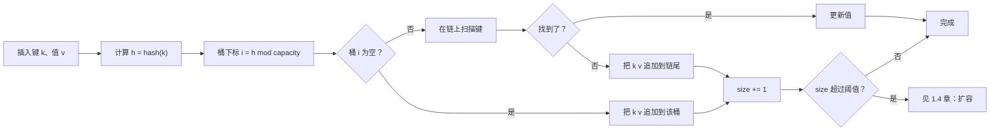

# 哈希映射与哈希集合

OpenJDK 的 `HashMap` 在表装到 75% 时扩容。CPython 的 `dict` 在 67% 时扩容。Go 在 2024 年改用 Swiss table 之前的 `runtime.map` 跑到 81% 才扩容。同一个抽象数据类型的三份生产实现，三个不同的常数，都声称平均查找与插入是 O(1)。它们都没错。这个常数*本身*就是本章要讲的：搞清三个团队为什么挑了三个不同的数字，才能把「我会用 HashMap」和「我能解释 HashMap 为什么守得住它的界」区分开。

这个界，一句话说完：哈希表是一个桶数组，用 `hash(key) mod capacity` 作索引，每个桶里做一次少量扫描来区分冲突，再靠溢出时把数组翻倍，把负载因子压在阈值以下。查找、插入、删除平均都是 `Θ(1 + α)`，其中 `α = n / m` 是负载因子，阈值把它钉在一个常数上。CLRS 把这称为定理 11.1；证明只有一段，我们写一次就够。[^1]

它值一整章的理由是杠杆效应。O(n²) 暴力解里那个 `for j > i` 的内层循环，只要是在找一个键（补数、重复元素、同一个等价类的成员），哈希表就把这次搜寻压到平均 O(1)，整个算法变成 O(n)。LC 1 Two Sum 是标准例子：给定 `[2, 7, 11, 15]` 和 `target = 9`，走一遍数组，问哈希表「`9 - nums[i]` 我见过吗？」，第一次命中就返回下标。四行代码。平均 O(n)。在 LC 的最大输入上，暴力解要 2.5 亿次操作，哈希表版本是 10,000 次。[^4]

本章先讲机制，再讲三个招牌应用。成本侧的姊妹篇在[哈希冲突与负载因子](./04-hash-collisions.md)：冲突堆起来会怎样、表在循环中途扩容会怎样、攻击者挑选对抗性键会怎样。两章共用一个 widget，左边动画演顺利路径，右边演代价路径。我们站在左边。

## 平均情况的界依赖什么不变量

CLRS 第 11 章把链地址哈希表拆成：一个 `m` 个桶的数组，每个桶挂着一条 `(key, value)` 条目的链表。[^1] 插入时先哈希键，对 `m` 取模选出桶，在链上扫描有没有同键的条目（有就更新），没有就在链尾追加新条目。查找做同样的哈希取模，扫链，返回值或 `NotFound`。删除是同样的扫描，命中后再做一次链表删除。



*平均情况的插入；扩容这条分支上的代价故事，由[哈希冲突与负载因子](./04-hash-collisions.md)接着讲。*

负载因子 `α = n / m` 就是平均链长。定理 11.1 证明：在简单均匀哈希假设下（每个键独立均匀随机地落到某个槽），任意一条链的期望长度恰好是 `α`。[^1] 所以查找、插入、删除的期望代价是 `Θ(1 + α)`。给 `α` 加一个常数上界，这个表达式就塌缩成 `Θ(1)`。

负载因子阈值就是用来给 `α` 定上界的。当 `size > threshold * capacity` 时，表把容量翻倍，把所有已有条目重新哈希进新桶。这一次扩容事件是 `Θ(n)`；[动态数组内部实现](./01-dynamic-array-internals.md)里的动态表论证把它摊还成每次插入 `Θ(1)`，跟摊还 `ArrayList.add` 是同一套手法。[^1]

阈值是个具体数字，硬编码在源码里。三份生产实现挑了三个不同的数：

| 实现 | 策略 | 阈值 | 每次插入的摊还开销 |
|---|---|---|---|
| Java OpenJDK `HashMap` | 链地址法，链长到 8 时树化 | `DEFAULT_LOAD_FACTOR = 0.75` | 约 3 次链操作 |
| CPython `dict` | 带扰动探测的开放寻址 | `USABLE_FRACTION = 2/3` | 约 2 次探测 |
| C++ libstdc++ `unordered_map` | 链地址法（每桶一个 forward_list） | `max_load_factor = 1.0` | 约 2-3 次链操作 |
| Go `runtime.map`（Swiss table 之前） | 分桶开放寻址 | `loadFactor = 6.5/8 ≈ 0.81` | 约 5 次探测 |

*常数取自 OpenJDK `HashMap.java`、CPython `Objects/dictobject.c`、libstdc++ 文档与 Go `runtime/map.go` 源码。[^1][^2][^3][^5]*

链地址法的实现（Java、C++）能容忍更高的阈值，因为链的遍历比争用下的开放寻址探测更便宜。开放寻址的实现（Python、Go）选更低的阈值，因为定理 11.6 说均匀哈希下的期望探测次数是 `1 / (1 - α)`：`α = 0.5` 时两次探测，`α = 0.75` 时四次，`α = 0.9` 时十次。[^1] 事后看数学让选择变得显然；这也是没有哪个主流库会用 `α = 0.95` 的原因。

本章的 widget 演一段干净序列：没有冲突，也不扩容。在 4 个桶的链地址表上做四次插入、两次查找，哈希函数取 `hash(s) = ord(s[0])`，好让前三个键落进互不相同的桶：

> **Interactive widget:** [哈希表（链地址插入 + 查找）](../../../dsa/widgets/w-02-hash-table.yml)（panel `panel-a`）—— 在网站上渲染；YAML 规格描述了关键帧。

*静态回放：4 个桶的表一开始是空的；三次插入（apple、banana、cherry）分别落进桶 1、2、3；第四次插入 apple 找到已有条目，就地更新；查找 banana 命中桶 2，返回 1；查找 grape 探测桶 3，扫过 cherry，返回 NotFound。*

查找 grape 这一步最值得看。桶 3 非空（cherry 在里面），但 cherry 的键和 grape 不匹配，于是扫描走到链尾，报 NotFound。桶非空不等于命中，每个条目的比较还是要付。

下一章的 panel 复用同一个 widget 外壳，把一场冲突风暴灌进一次扩容。两边同步一步步看，是体会这份契约两半最清楚的方式。

## LC 1：值到下标的映射

给定一个数组 `nums` 和一个整数 `target`，返回和为 `target` 的两个元素的下标。每个输入恰好有一个有效答案；同一个元素不能用两次。[^4]

暴力解就是直白的嵌套循环：枚举所有 `j > i` 的 `(i, j)`，返回第一对和为 target 的。O(n²) 时间，O(1) 空间。在 LC 的最大输入规模 10⁴ 上，最坏是 10⁸ 次比较，C++ 在边界上会超时，其他语言都超时且余量不多。

哈希表版本换了个问法。不问*「对这个 `nums[i]`，数组后面是否有个 `nums[j]` 能凑成这对？」*，而问*「对这个 `nums[i]`，它的搭档 `target - nums[i]` 之前出现过吗？」* 哈希表把「之前出现过吗」变成平均 O(1) 的答案。一趟扫完，没有内层循环：

```python
def two_sum(nums, target):
    seen = {}                              # 值 -> 首次出现的下标
    for i, x in enumerate(nums):
        complement = target - x
        if complement in seen:
            return [seen[complement], i]
        seen[x] = i                        # 在查找之后才存入
    return []
```

**解法** — Python ([Java](./03-hash-maps/lc-1/sol.java) · [C++](./03-hash-maps/lc-1/sol.cpp) · [Go](./03-hash-maps/lc-1/sol.go))

```python
# LC 1. Two Sum
# 一趟扫描，配一张 值 -> 首次出现下标 的映射。对每个 x，先查补数
# (target - x)，再插入 x；正是这个"先查后插"的顺序，让 [3,3] 这类
# 输入不会把元素和它自己配上对。
# O(n) 时间，O(n) 空间。
from typing import Dict, List


def two_sum(nums: List[int], target: int) -> List[int]:
    seen: Dict[int, int] = {}
    for i, x in enumerate(nums):
        complement = target - x
        if complement in seen:
            return [seen[complement], i]
        seen[x] = i
    return []
```

操作的顺序是关键。对每个 `nums[i]`，函数先查 `target - nums[i]`，后存 `nums[i] -> i`。把顺序反过来，测试用例 `nums = [3, 3], target = 6` 会返回 `[0, 0]`，同一下标和自己配对，违反了「同一个元素不能用两次」的约束。Sedgewick 与 Wayne 在《Algorithms》§3.4 里正是把这个归约当作哈希的教科书应用：把内层查找循环换成一次哈希表探测。[^6]

题解的 widget 以完整精度演 LC 1 专属的执行轨迹，输入故意取得很小（`nums = [3, 3]`，`target = 6`），因为它在第 4 步会把「先查后存」这个不变量暴露出来：

> **Interactive widget:** [Two Sum（LC 1）—— 最优的一趟哈希表](../../../dsa/widgets/e-LC001-two-sum.yml)（panel `default`）—— 在网站上渲染；YAML 规格描述了关键帧。

*静态回放：值到下标的哈希表一开始是空的；`i = 0` 时查补数 3 未命中，随后存入 3 → 0；`i = 1` 时查补数 3 在 0 号下标命中，函数返回 `[0, 1]`。两次查找，一次插入。*

`[3, 3]` 这个输入是大多数候选人在白板上做错的那一个。更大的输入（LC 的 `[2, 7, 11, 15]`、`[3, 2, 4]`）在两种操作顺序下都对，只有重复值的情形能把 bug 逼出来。

## LC 49：签名到列表的映射

把一组字符串按字母异位词分类。两个字符串属于同一类的充要条件是互为排列。[^7]

哈希表的值这一列换了形状。值不再是单个下标或计数，而是共享同一个等价类的一*组*字符串。键是从每个字符串推出的规范形式：要么是排过序的字符串，要么是把 26 个字符的计数向量编码成带分隔符的字符串，好让 `1,11` 不会和 `11,1` 撞上。

```python
def group_anagrams(strs):
    groups = defaultdict(list)
    for s in strs:
        counts = [0] * 26
        for ch in s:
            counts[ord(ch) - ord("a")] += 1
        groups[tuple(counts)].append(s)
    return list(groups.values())
```

**解法** — Python ([Java](./03-hash-maps/lc-49/sol.java) · [C++](./03-hash-maps/lc-49/sol.cpp) · [Go](./03-hash-maps/lc-49/sol.go))

```python
# LC 49. Group Anagrams
# 按规范形式分桶。26 个整数的计数元组每个字符串是 O(k)，而排序字符串
# 作键是 O(k log k)，k 是串长。
# defaultdict(list) 一行就装下"没有就先建、再追加"这个惯用法。
# O(N * k) 时间，O(N * k) 空间，N 个串、平均长度 k。
from typing import Dict, List
from collections import defaultdict


def group_anagrams(strs: List[str]) -> List[List[str]]:
    groups: Dict[tuple, List[str]] = defaultdict(list)
    for s in strs:
        counts = [0] * 26
        for ch in s:
            counts[ord(ch) - ord("a")] += 1
        groups[tuple(counts)].append(s)
    return list(groups.values())
```

每种语言都拿自己最惯用的写法来表达「还没有列表就先建一个，然后追加」。Java 写成 `computeIfAbsent(key, k -> new ArrayList<>())`。Python 用 `defaultdict(list)`。Go 直接写 `m[k] = append(m[k], element)`，靠 nil 切片追加后变成单元素切片。C++ 写 `groups[key].push_back(s)`，因为 `operator[]` 会给缺失的值做默认构造。同一个模式，四种表面写法。

字符计数签名在生产里胜过排序字符串签名。排序是每个字符串 `O(k log k)`，计数是 `O(k)`。对 LC 49 的约束（字符串最长 100 个字符，最多 10⁴ 个串）差别不大；换成长字符串变体，差别就是全部意义所在。计数向量这个惯用法能直接推广到任何固定大小的字母表，所以每一篇讲类似模式的 LC 题解都会伸手用它。[^7]

## LC 242：逐字符计数

给定两个字符串 `s` 和 `t`，判断 `t` 是不是 `s` 的字母异位词。字符多重集相同，顺序可以不同。[^8]

最干净的写法是「先加、再减、边减边查」。用 `s` 建计数器；走 `t` 递减；任何一个计数变成负数，立刻返回 false：

```python
def is_anagram(s, t):
    if len(s) != len(t):
        return False
    counts = {}
    for ch in s:
        counts[ch] = counts.get(ch, 0) + 1
    for ch in t:
        if counts.get(ch, 0) == 0:
            return False
        counts[ch] -= 1
    return True
```

**解法** — Python ([Java](./03-hash-maps/lc-242/sol.java) · [C++](./03-hash-maps/lc-242/sol.cpp) · [Go](./03-hash-maps/lc-242/sol.go))

```python
# LC 242. Valid Anagram
# 先加后减再查：用 s 建计数器，再走 t 递减；任何一次下溢都说明
# t 不是 s 的排列。
# 长度短路：长度不等时干脆不建计数器。
# O(n)，O(k)，k 是字母表大小。
from typing import Dict


def is_anagram(s: str, t: str) -> bool:
    if len(s) != len(t):
        return False
    counts: Dict[str, int] = {}
    for ch in s:
        counts[ch] = counts.get(ch, 0) + 1
    for ch in t:
        if counts.get(ch, 0) == 0:
            return False
        counts[ch] -= 1
    return True
```

长度短路是必须的，也是最常被漏掉的一步。漏了它，你会花 O(n) 建完计数器，才发现两个串长度不同，而这个比较本来零成本就能拦住。

这里的参考实现用 `HashMap<Character, Integer>`（Java）和 `dict`（Python），为的是跟本章的伪代码对齐，也为了接得住 LC 242 关于 Unicode 的追问。对纯 ASCII 输入、在 LC 242 的最大约束下（50,000 个小写字母），用 `ch - 'a'` 索引的 `int[26]` 在 Java 里快 3-5 倍，因为它省掉了哈希、自动装箱和逐桶的指针跳转。两个版本都对；数组特化是 LeetCode 上写 Java 该有的性能反射。[^9] 同样的数组惯用法在 LC 567 Permutation in String 和 LC 438 Find All Anagrams 里都会出现，只要固定字母表撞上紧凑循环，我们就会回头看它。

## LC 149：复合键哈希

给定平面上 `n` 个点，求最多有多少个点在同一条直线上。暴力是 O(n³)：挑三个点，判共线，重复。[^10]

哈希表的键得更有料。键既不是一个值也不是一个字符串，而是一个*约分后的分数*：对每个锚点，其他每个点都定出一个用 GCD 约分过的斜率 `(dy, dx)`；把这些斜率收进 `Map<(dx, dy), int>`；最大的计数就是这个锚点的答案。总代价：用哈希表平均 O(n²)，不用是 O(n³)。

本章的招牌题是 LC 1 而不是 LC 149，但 LC 149 能占住 CORE 的一席只有一个理由：它逼读者直面哈希中*与语言相关*的那部分。Python 元组在元素可哈希时可哈希。Java 的 record（Java 14+）自动生成 `equals` 和 `hashCode`。C++17 没给 `std::pair` 提供 `std::hash`，所以你要么拼一个字符串键，要么写一个自定义哈希特化。Go 的结构体类型在所有字段都可比较时，作为 map 键自动可比较。[^11] 四种语言，同一个想法四种表面。本章没有 LC 149 的解答文件；四语言代码覆盖 LC 1、LC 49 和 LC 242。

## 实际开销

| 操作 | 平均时间 | 最坏时间 | 空间 | 备注 |
|---|---|---|---|---|
| `insert(k, v)` 链地址法 | 摊还 `Θ(1 + α)` | `O(n)` | `O(n + m)` | 最坏情况出现在冲突堆积或扩容事件上。[^1] |
| `lookup(k)` 链地址法 | `Θ(1 + α)` | `O(n)` | `O(n + m)` | 沿链扫描；`α` 有界时是常数。[^1] |
| `delete(k)` 链地址法 | `Θ(1 + α)` | `O(n)` | `O(n + m)` | 与查找同样的扫描，外加一次链表删除。 |
| `insert(k, v)` 开放寻址 | `O(1 / (1 - α))` | `O(n)` | `O(m)` | 探测次数随 `α → 1` 陡增。[^1] |
| 扩容（重哈希全部条目） | （事件） | 每次事件 `O(n)` | 峰值 `O(n)` | 靠几何翻倍，摊还到每次插入 `O(1)`。 |
| LC 1 Two Sum | `O(n)` | `O(n²)` | `O(n)` | 只有对抗性冲突才落到最坏；期望 `O(n)`。[^4] |
| LC 49 Group Anagrams | `O(n · k)` | `O(n · k)` | `O(n · k)` | `k` = 最长字符串长度；计数 + 分桶。[^7] |
| LC 242 Valid Anagram | `O(n)` | `O(n)` | `O(C)` | `C` = 字母表大小，小写 ASCII 是 26。[^8] |

上面有两个界需要一句话解释。忽略最坏情况的每次插入摊还 `Θ(1)` 之所以成立，*正是因为*最坏情况罕见；CLRS §17.4 的动态表论证把每次 `O(n)` 的扩容摊到引发它的那 `n` 次插入上。单次插入的 `O(n)` 最坏情况不是假设：Java 8 专门在链长到 8 时加上红黑树树化来给它设界，因为 `hashCode` 写坏的生产流量能把每个键都挤进同一个桶。[^2] 冲突堆积的完整故事在[下一章](./04-hash-collisions.md)。

## 常见误区

> [!WARNING]
> **在 LC 1 里先存值再查补数。** 写反的顺序 `seen[nums[i]] = i; if target - nums[i] in seen: ...` 会在 `nums = [3, 3], target = 6` 上返回 `[0, 0]`，把 0 号下标和它自己配上。先查，再存。参考实现是刻意这么排的。[^4]

> [!WARNING]
> **在 Java 紧凑循环里用 `HashMap<Character, Integer>`。** 每次 `counts.merge(ch, 1, Integer::sum)` 都要把 `char` 装箱成 `Character`、把 `int` 装箱成 `Integer`，在内层循环里分配堆对象。按 LC 242 的最大输入（50,000 字符 × 2）算，一次提交就是超过 100,000 个装箱对象。换成用 `ch - 'a'` 索引的 `int[26]`：同一个算法，没有装箱，在 LC 判题机上快 3-5 倍。[^9]

> [!WARNING]
> **在 C++ 里以为 `unordered_map` 的遍历是插入序。** C++17 标准明确声明不保证任何遍历顺序，一次重哈希还会把看到的顺序打乱。Python 的 `dict` 和 Java 的 `LinkedHashMap` 保留插入序，肌肉记忆会带过来。C++ 里如果顺序重要，用 `std::map`（红黑树，按键有序），或者另外维护一个 `std::vector<Key>`。[^5]

> [!WARNING]
> **用一个依赖遍历顺序的 `Map.of` 建 Java map。** `Map.of("a", 1, "b", 2)` 返回的不可变 map，其遍历顺序在不同 JVM 运行间被刻意随机化，就是为了劝退依赖它的代码。按声明顺序回读的 LRU 式代码会在 JVM 重启后悄悄出错。只要遍历顺序可观测，就用 `LinkedHashMap`；`Map.of` 留给测试和顺序无关的只读字面量。[^2]

> [!WARNING]
> **把 `int[]` 当 Java `HashMap` 的键插入。** 数组用的是*基于身份*的 `hashCode` 和 `equals`，不是基于内容。两个内容相同的数组哈希值不同、永远不会撞上，map 看起来在「丢」条目。转成 `Arrays.toString(arr)`（便宜）、改用 `List<Integer>`（会装箱，但通过 `AbstractList` 按内容定键），或者自己拼一个带分隔符的字符串键。本章 LC 49 的参考实现里，`groupAnagrams` 正是为了避开这个坑才拼的带分隔符计数向量键。[^2]

## 题目梯度

### 核心（全部做完才算掌握本章）

- [LC 1 — Two Sum](https://leetcode.com/problems/two-sum/) [简单] • hash-map-complement-lookup ★
- [LC 242 — Valid Anagram](https://leetcode.com/problems/valid-anagram/) [简单] • hash-map-character-counts
- [LC 49 — Group Anagrams](https://leetcode.com/problems/group-anagrams/) [中等] • hash-map-keyed-by-sorted-or-counted
- [LC 149 — Max Points on a Line](https://leetcode.com/problems/max-points-on-a-line/) [困难] • hash-map-keyed-by-reduced-slope *（参考实现：仅 Python）*

### 进阶（可选）

- [LC 347 — Top K Frequent Elements](https://leetcode.com/problems/top-k-frequent-elements/) [中等] • hash-map-counts-plus-heap
- [LC 217 — Contains Duplicate](https://leetcode.com/problems/contains-duplicate/) [简单] • hash-set-membership

LC 347 归[堆](../../../dsa/part-6-trees-heaps/04-heaps-priority-queues.md)那一章管；「哈希计数器 + 大小为 k 的小顶堆」的深入讲法在那里。它在这里占一个进阶位，是因为哈希计数器这一半就是本章的模式，看它和第二种数据结构组合起来值得读一遍。

## 后续衔接

成本侧的姊妹篇是[哈希冲突与负载因子](./04-hash-collisions.md)，深入讲阈值到底买到了什么、冲突叠起来会怎样、Java 8 为什么要加红黑树树化。那一章的 widget panel 就是你在这里看的同一个双面板 widget 的右半边。再往后，哈希表杠杆最高的应用是[前缀和与哈希表的变招](../../../dsa/part-3-pointers-window-prefix/05-prefix-sum-hash.md)，它把今天的模式和累加和技巧合起来，用 O(n) 找出任意和的子数组。

## 参考文献

[^1]: Cormen, Leiserson, Rivest, Stein, *Introduction to Algorithms*, 4th ed., MIT Press, 2022.

[^2]: OpenJDK 源码，`src/java.base/share/classes/java/util/HashMap.java`。[github.com/openjdk/jdk](https://github.com/openjdk/jdk/blob/master/src/java.base/share/classes/java/util/HashMap.java)。

[^3]: CPython 源码，`Objects/dictobject.c`。[github.com/python/cpython](https://github.com/python/cpython/blob/main/Objects/dictobject.c)。

[^4]: LeetCode 1, "Two Sum." 约束：`2 <= nums.length <= 10^4`，`-10^9 <= nums[i], target <= 10^9`，恰好存在一个有效答案。追问："Can you come up with an algorithm that is less than O(n²) time complexity?" [leetcode.com/problems/two-sum](https://leetcode.com/problems/two-sum/)。

[^5]: ISO/IEC 14882:2017, §22.5.4 "Class template `unordered_map`"：`max_load_factor()` 默认为 1.0；遍历顺序未指定，重哈希后可能改变。

[^6]: Sedgewick & Wayne, *Algorithms*, 4th ed., Addison-Wesley, 2011, §3.4 "Hash Tables." 命题 K（简单均匀哈希下链地址法的性能），以及把哈希当作「O(n²) 内层查找归约为 O(n) 哈希表探测」的标准框架。[algs4.cs.princeton.edu/34hash](https://algs4.cs.princeton.edu/34hash/)。

[^7]: LeetCode 49, "Group Anagrams." 约束：`1 <= strs.length <= 10^4`，`0 <= strs[i].length <= 100`，小写英文字母。[leetcode.com/problems/group-anagrams](https://leetcode.com/problems/group-anagrams/)。

[^8]: LeetCode 242, "Valid Anagram." 约束：`1 <= s.length, t.length <= 5 * 10^4`，小写英文字母。追问："What if the inputs contain Unicode characters?" [leetcode.com/problems/valid-anagram](https://leetcode.com/problems/valid-anagram/)。

[^9]: doocs/leetcode 的 LC 242 题解明确把 `int[26]` 数组特化写成有界字母表情形下相对 `HashMap<Character, Integer>` 的标准性能改进。[github.com/doocs/leetcode](https://github.com/doocs/leetcode/blob/main/solution/0200-0299/0242.Valid%20Anagram/README_EN.md)。

[^10]: LeetCode 149, "Max Points on a Line." 约束：`1 <= points.length <= 300`，`-10^4 <= x_i, y_i <= 10^4`，所有点互不相同。[leetcode.com/problems/max-points-on-a-line](https://leetcode.com/problems/max-points-on-a-line/)。

[^11]: 四种参考语言里复合键哈希的规则：Python 元组在元素可哈希时按内容哈希（CPython `tupleobject.c`）；Java record（JEP 395，Java 16）自动生成基于内容的 `equals`/`hashCode`；C++17 没有 `std::pair` 的 `std::hash`，见 [stackoverflow.com/questions/32685540](https://stackoverflow.com/questions/32685540)
