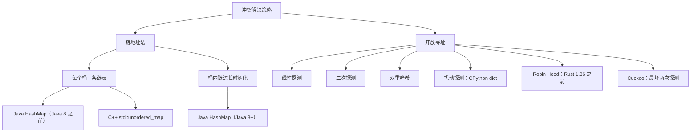

# 哈希冲突与装载因子

Java 的 `HashMap` 在表填到 75% 时扩容。CPython 的 `dict` 在 67% 时扩容。C++ `std::unordered_map` 出厂的最大装载因子是 1.0。Go 在 Swiss table 之前的 `runtime.map` 跑在 81%，Go 1.24 的 Swiss 重设计又把这个数挪了个位置。同一个数据结构，四个生产团队，四个不同的数字，而且不是因为谁犯了错。这个数字是一个旋钮，旋钮背后有一套数学推导，四个团队之所以落在曲线的不同位置上，是因为他们选了不同的冲突解决策略。搞清楚 1.5 个百分点的差别为什么重要，就是本章存在的全部理由。

这件事的赌注不是学术性的。2011 年 12 月，两位德国研究员站在第 28 届 Chaos Communication Congress 的台上演示：一个 1 MB 的 POST 请求就能把服务器 CPU 钉在 100% 上好几个小时，没有僵尸网络，没有零日漏洞，也没有应用 bug。这个利用手法同时打穿了 PHP 5、Java、ASP.NET、V8、Python（3.4 之前）和 Ruby。Crosby 和 Wallach 早在 2003 年的 USENIX Security 上就发表了这一整类攻击；[^1] 28C3 的演讲把这篇论文变成了一个下午就能打掉大半个 Web 的可用漏洞。崩掉的不是缓冲区溢出，而是没人盯着装载因子时 `Map.put` 的平均复杂度。

[Hash maps and hash sets](./03-hash-maps.md) 讲的是顺风路径：平均 O(1) 查找、平均 O(1) 插入、几何扩容均摊到每次操作 O(1)。本章讲的是代价路径。两种策略共享同一份契约，它们的数字分道扬镳是有原因的，而一个标准算法（LC 128 Longest Consecutive Sequence）会在契约破裂的那一瞬间崩掉。

## 两种策略，同一份契约

哈希表用 `hash(key) mod capacity` 把每个键映射到一个槽位。两个键可能落到同一个槽位。接下来发生什么，就是策略。

**链地址法（chaining）**给每个槽位挂一条链表。发生冲突时，新条目追加到链上。查找时先哈希、定位槽位、走链表。CLRS 定理 11.1 把代价钉死了：在简单均匀哈希下，任意一条链的期望长度恰好是装载因子 `α = n/m`，所以查找和插入是 `Θ(1 + α)`。[^2] 把 `α` 压在某个常数以下，这个界就塌缩成 `Θ(1)`。

**开放寻址（open addressing）**把所有条目都留在桶数组里。发生冲突时，算法按某个序列探测一串备选槽位，直到找到空的。线性探测一格一格往前走。二次探测按平方步长跳。双重哈希用第二个哈希函数。CPython 的变体叫扰动探测（perturbation probing），用递推式 `j = (5*j + 1 + perturb) mod 2^i`，`perturb` 由哈希值的高位初始化，每步右移。[^3] CLRS 定理 11.6 同样把代价钉死了：均匀哈希下一次不成功查找的期望探测次数最多是 `1 / (1 - α)`。`α = 0.5` 时是 2 次探测，0.75 时是 4 次，0.9 时是 10 次。[^2]



*冲突解决策略的家谱。每条分支都带着自己的装载因子阈值，而阈值之间的差距可以一路追回到各自策略的代价公式。*

这两个公式解释那四个数字。链地址法是 `Θ(1 + α)`，一条斜率很缓的线性函数。把 `α` 从 0.75 推到 1.0，期望链长从 0.75 涨到 1.0，涨了 33%。开放寻址是 `1 / (1 - α)`，一条在 `α = 1` 处冲向无穷的双曲线。把 `α` 从 0.5 推到 0.67，期望探测次数从 2 涨到大约 3，涨了 50%；再从 0.67 推到 0.9，就从 3 次探测变成 10 次。开放寻址的实现*不可能*停在链地址法的阈值上；数学不允许。

| 实现 | 策略 | 阈值 | 来源 |
|---|---|---|---|
| Java OpenJDK `HashMap` | 链地址法（链长到 8 时树化） | `DEFAULT_LOAD_FACTOR = 0.75` | `HashMap.java`[^4] |
| C++ libstdc++ `unordered_map` | 链地址法（每桶一条 forward_list） | `max_load_factor = 1.0`（默认） | C++17 §22.5.4[^5] |
| CPython `dict` | 开放寻址（扰动探测） | `USABLE_FRACTION = 2/3` | `Objects/dictobject.c`[^3] |
| Go `runtime.map`（Swiss 之前，Go ≤ 1.23） | 分桶开放寻址（每桶 8 个槽位 + 链式溢出） | `loadFactor = 6.5 / 8 ≈ 0.81` | `runtime/map.go`[^6] |

链地址法的两个库（Java、C++）落在 0.75 到 1.0 之间。开放寻址的两个库（Python、Go）落在 0.67 到 0.81 之间。没人选 0.95，也没人选 0.5。是那两个定理钉出了这条走廊。

更微妙的一点：同一个定理也说明了*为什么*链地址法处理对抗性输入比开放寻址更从容。当 `n` 个键全撞在一条链上，链地址法的最坏情况是每次操作 `O(n)`，表还能用。开放寻址在同样的攻击下最坏情况是每次操作 `O(n)`，*外加*表基本停摆。每次探测巡游都在扫一段长连续区间，一次聚集（primary clustering）把伤害叠加上去，唯一的解法是整表重建。这就是 Java 选链地址法的原因，也是 CPython 不惜重本搞随机化哈希的原因。

## 扩容的代价

阈值不是在查找时检查的，是在插入时检查的。当 `size > threshold * capacity`，表把容量翻倍，分配一个新桶数组，把每个条目从旧表重哈希到新表。那一次插入要付 `Θ(n)`。来自 [Dynamic array internals](./01-dynamic-array-internals.md) 的动态表论证，把这份成本摊到上次扩容以来填满表的 n 次插入上，所以每次插入的均摊成本仍然是 `O(1)`。让这套东西成立的是几何翻倍；算术增长会给出每次插入均摊 `Θ(n)`，整个哈希表抽象就此散架。[^2]

下面这个 widget 是与 [Hash maps and hash sets](./03-hash-maps.md) 共用的双面板 `w-02-hash-table` widget 的 panel-b。五个键（5、1、9、13、17）是特意调过的：容量为 4 时，它们每一个都哈希到 1 号桶。第三次插入正好把表顶到阈值，第四次跨过阈值，触发翻倍。

> **Interactive widget:** [哈希表（链式插入 + 查找）](../../../dsa/widgets/w-02-hash-table.yml)（panel `panel-b`）—— 在网站上渲染；YAML 规格描述了各个关键帧。

*静态替代说明：一张 4 桶的链地址表从空开始；依次插入 5、1、9、13 全都落到 1 号桶，链长涨到 4，装载因子被推到 1.0；跨阈值触发；容量翻倍到 8；重哈希把四个键重新分布（5 和 13 → 5 号桶，1 和 9 → 1 号桶）；最后插入 17，落到 1 号桶，与 1、9 同处，此时表的装载因子是 0.625，各条链长度都有良好上界。*

要盯住的只有一个瞬间：第 4 步 → 第 6 步。扩容之前，1 号桶那条链上有四个键，对其中任何一个做查找都要四次比较。扩容之后，最长的链是两条。每次操作的查找工作量被一次 O(n) 的突发工作*减半*了。这笔交易就是契约的核心：偶尔付一个 `n`，换来每次操作的成本保持在很小的常数上。

## 契约破裂时：两种复杂度下的 LC 128

本章的招牌题是 LC 128 Longest Consecutive Sequence。给定一个无序整数数组，返回最长连续整数序列的长度。对 `[100, 4, 200, 1, 3, 2]`，答案是 4（序列 1、2、3、4）。要求的复杂度是 `O(n)`。[^7]

暴力做法感觉很免费，其实是个陷阱。*“对 nums 里的每个 x，只要 x+1、x+2……还在集合里就一路往前走；记录最长的一段。”* 让它撞上一段长度为 k 的连续序列，内层行走就会为 k 个不同的起点各走 k 次。总工作量 `O(k²)`，在对抗性输入上推广成 `O(n²)`。在 LC 128 的最大输入上（`n = 10⁵`，只有一段），这是 10¹⁰ 次操作。任何语言都超时。

```python
# 暴力：只有一段长连续序列时是 O(n^2)
def longest_consecutive_brute(nums):
    s = set(nums)
    best = 0
    for x in nums:
        y = x
        while y in s:        # 对这一段里的每个元素都把整段走一遍
            y += 1
        best = max(best, y - x)
    return best
```

修法只多一行分支判断：只有当 `x` 是所在连续段的*最小值*时才启动内层行走。

```python
def longest_consecutive(nums):
    s = set(nums)
    best = 0
    for x in s:
        if (x - 1) not in s:        # 跳过所有非最小值
            y = x + 1
            while y in s:
                y += 1
            best = max(best, y - x)
    return best
```

**Solution** — Python（[Java](./04-hash-collisions/lc-128/sol.java) · [C++](./04-hash-collisions/lc-128/sol.cpp) · [Go](./04-hash-collisions/lc-128/sol.go)）

```python
# LC 128. Longest Consecutive Sequence
# 先建一个哈希集合，然后对每个值，只有当 (x - 1) 不在集合里
# 时才启动内层行走——也就是 x 是自己所在连续段的最小值。每个
# 元素最多被碰两次，在集合查询平均 O(1) 的前提下总工作量 O(n)。
# 时间 O(n)，空间 O(n)。
from typing import List


def longest_consecutive(nums: List[int]) -> int:
    s = set(nums)
    best = 0
    for x in s:
        if (x - 1) not in s:
            y = x + 1
            while y in s:
                y += 1
            best = max(best, y - x)
    return best
```

正确性论证才是本章真正要教的东西。输入里的每个整数在整个算法中最多被碰两次：一次是外层循环访问到它（要么因为 `x - 1` 存在而跳过，要么启动一次行走），一次是内层行走代表它所在连续段的最小值经过它。集合操作的总工作量：2n。上界：`O(n)`。[^8]

现在重新读一遍这个界。两个 `n` 和一个常数。会随着装载因子翻转的就是那个常数。每次集合操作花 `O(1)`，*前提是 `set.contains` 平均是 `O(1)`*，而这只在冲突被阈值约束住时成立，而这只在哈希函数把对抗性挑选的键均匀分布开时成立。把这些假设一层层打破，看这个界怎么移位：

| 场景 | `set.contains` 代价 | LC 128 总计 |
|---|---|---|
| 正常输入，随机化哈希 | `O(1)` | `O(n)` |
| 链地址集合停在 α = 5（从来没触发过扩容） | `O(5)` | `O(5n)`，仍是线性，只是更慢 |
| 对抗性键，确定性哈希，链地址法 | 每次探测 `O(n)`（一条链） | `O(n²)`，超时 |
| 对抗性键，确定性哈希，开放寻址 | 每次探测 `O(n)`（整表被扫） | `O(n²)`，同样的墙，不同的原因 |

把“平均 O(1)”当一句轻飘飘的话来读，就丢掉了这个假设有多强。PEP 456 的随机化哈希[^9]和 Java 8 的桶树化[^4]是让这个假设在攻击下依然成立的两种机制；把它们拿掉，LC 128 就不再是一个 `O(n)` 算法。

## 28C3 攻击是怎么打的，又是怎么修的

2011 年那个攻击向量很小。多数 Web 框架会把 POST 请求体里的表单字段解析成一个以字段名为键的哈希表。Java 的 `String.hashCode` 是公开的确定性函数；攻击者可以预先算出成千上万个哈希值都撞在同一个桶里的字符串。一个带 10 万个这种键的 POST，就逼着框架每次插入都扫一条长 10 万的链，解析一个请求总计 10¹⁰ 次操作。框架限制的是请求体大小，不是链长，所以攻击从限流器底下溜了过去。

两个修复先后上线，顺序正好是数学要求的顺序。

**把哈希函数随机化，让攻击者算不出冲突集合。** PEP 456 把 SipHash-2-4 引入为 Python 3.4 对 `str` 和 `bytes` 的默认算法，种子按解释器实例随机化。[^9] 两次解释器运行对同一个字符串哈希会得到不同的值；拿不到运行进程种子的攻击者无法预先算出全部冲突的键。其他主流语言都跟进了：Java 7 加了哈希随机化补丁，Java 8 又用桶树化替换了它；Ruby 把 `String#hash` 随机化；V8 按进程给 `String::hashCode` 重新播种；ASP.NET 发了 MS11-100。这类攻击在约 18 个月内对未认证的远程攻击者关上了门。

**把链本身加固，让成功的碰撞攻击优雅降级。** Java 8 加了桶树化：当一条链长到 8、且底层表容量至少 64 时，链转成红黑树。那个桶里的查找从 `O(n)` 降到 `O(log n)`。阈值 8 不是随手定的，OpenJDK 源码注释里算了这笔账。在装载因子 0.75 的简单均匀哈希下，链长服从参数 0.5 的泊松分布，任何一条链长到 8 的概率低于 10⁻⁸。[^4] 树化只在对抗性输入或确实糟糕的 `hashCode` 重写下才会触发；正常数据上走的还是纯链表的快路径。

C++ `std::unordered_map` 两样防御都没有。C++17 标准不规定哈希函数；libstdc++ 对 `int` 键用恒等哈希（`std::hash<int>(x) = x`）。[^5] 在 Codeforces 以及其他公开 stdlib 的评测机上，攻击者几秒钟就能造出全冲突的键。竞赛圈的绕法大家都知道：给 map 套一个把 `chrono::high_resolution_clock::now()` 的熵异或进去的自定义哈希。生产代码里输入不是对抗性的，默认的就够；在比赛评测机上，这就成了对着自己脚的一门炮。

## 什么时候链地址法赢，什么时候开放寻址赢

| 维度 | 链地址法占优的情形 | 开放寻址占优的情形 |
|---|---|---|
| 内存局部性 | （输） | 一条缓存行能装下好几个条目；一次 CPU 读取覆盖多次探测 |
| 内存开销 | （输） | 没有每条目的指针开销；桶数组*本身*就是存储 |
| 对高 `α` 的容忍度 | 0.85 以上；链长线性增长 | （输） |
| 对抗性输入 | 树化可以把最坏情况救到 `O(log n)` | 最坏情况每次操作仍是 `O(n)`，一次聚集还会加重它 |
| 删除语义 | 简单：从链上摘掉 | 难：墓碑标记、定期压实；CPython 做对了，很多实现没做对 |
| 单次操作成本可预测 | （输） | 在 `α` 有界时方差更小；Robin Hood 专门冲这个来 |

四个实现做的决策，从这张表里就能读出来。Java 必须容忍用户提供的、可能糟糕透顶的 `hashCode` 重写；链地址法加树化给了它一条优雅降级的路径。CPython 掌控哈希函数（`object.__hash__`），能保证内置类型走 SipHash，不需要备用结构；开放寻址的缓存局部性是纯赚。C++ 继承的是 C ABI 和用户提供的哈希；链地址法是保守的默认选项，需要的时候实现方把绳子递到你手上（`max_load_factor`、自定义哈希）。Go 在 Swiss 之前的设计选了分桶开放寻址，每个桶 8 对键值、对缓存行友好，明确是为了优化常见的无冲突情形，同时让兜底路径保持简单。

要学的不是“开放寻址更快”。而是：策略选择是两个问题的下游——*我掌控哈希函数吗？*和*我的失效模式长什么样？*两个不同的答案，对应两种不同的正确设计。

## 第二个例子：LC 380 的指针重定向技巧

LC 380 Insert Delete GetRandom O(1) 是本章的第二道题，也是最干净的示范：哈希表的基本操作和另一个结构组合起来，能做单独任何一方都做不到的事。[^10] 契约是：在一个不许重复的集合上支持 `insert`、`remove` 和 `getRandom`，全部 `O(1)`（LC 381 加了允许重复）。

光靠哈希集合能拿到 `insert` 和 `remove`，拿不到 `getRandom`：哈希集合不暴露数组式的下标。光靠动态数组能拿到 `getRandom`（随机挑一个下标），拿不到 `O(1) remove`（删任意一个值要扫数组）。组合起来就赢了。维护一个 `Map<Value, int>`，值列是这个值在并行 `List<Value>` 里的下标；`getRandom` 取 `list[rand(0, list.size())]`；`remove(v)` 把 `list[map[v]]` 与 `list[list.size() - 1]` 交换，弹出尾部，并为被换过来的元素更新映射。

```python
class RandomizedSet:
    def __init__(self):
        self.idx = {}      # 值 -> 在 self.arr 中的位置
        self.arr = []

    def insert(self, val):
        if val in self.idx:
            return False
        self.idx[val] = len(self.arr)
        self.arr.append(val)
        return True

    def remove(self, val):
        if val not in self.idx:
            return False
        i = self.idx[val]
        last = self.arr[-1]
        self.arr[i] = last           # 用尾部元素覆盖被删掉的槽位
        self.idx[last] = i           # 尾部元素的下标现在指向这里
        self.arr.pop()
        del self.idx[val]
        return True

    def getRandom(self):
        return self.arr[random.randrange(len(self.arr))]
```

不显然的一步是：在 `arr.pop()` 和 `del` *之前*先做 `self.arr[i] = last; self.idx[last] = i`。把顺序反过来，`val == last` 这个角落情况会安静地自毁：`arr.pop()` 删掉的正是你刚写进去的那个槽位，而 `self.idx[last] = i` 留下一个悬空下标。这个教训可以推广。只要哈希表里存的是并行数组的下标，每一次会重排数组的修改，都必须为*被移动*的元素更新哈希表，而不只是为*被改动*的那个。[^10]

## 常见误区

> [!WARNING]
> **LC 128 从每个元素起跑，而不是从连续段的最小值起跑。** 没有 `if (x - 1) not in s`，内层行走会对每一段的每个元素都跑一遍，一段长度为 k 就是 `O(k²)`。加上这道守卫，每个整数最多被碰两次。守卫只有一行，检验你有没有真的懂的标准，是你能不能在面试里把“最多被碰两次”这个论证讲清楚。讲得出来，说明你懂了这个算法；跳过它，暴力版本在一段长连续序列上就超时。

> [!WARNING]
> **`HashSet<Integer>` 热循环里的 Java 装箱。** 每一次 `s.contains(y)`，只要 `y` 落在整型缓存（-128 到 127）之外，就把 `y` 装箱成一个新的 `Integer`。在对抗性输入的紧循环里，这可能主导整个实际耗时。对性能敏感的代码，换 Eclipse Collections 的 `IntHashSet` 或 fastutil 的 `IntOpenHashSet`。本章的参考实现用 `HashSet<Integer>`，因为那是 LC 的标准写法；该换的时候换，是值得知道的生产直觉。

> [!WARNING]
> **在竞赛评测机上忽略哈希随机化。** Codeforces 上的 `std::unordered_map<int, int>` 用恒等哈希；知道 stdlib 的测试者能造出键全部冲突的输入。修法是自定义哈希，把 `chrono::high_resolution_clock::now()` 的熵异或进去。[^5] 生产代码里输入不是对抗性的，这是过度设计；在比赛评测机上，这是 Accepted 和 Time Limit Exceeded 的区别。

> [!WARNING]
> **每次插入都扩容，而不是跨过阈值才扩容。** 一个朴素的“实现哈希表”，如果每逢新 size 是 16 的倍数（或任何非几何的触发条件）就扩容，每次插入的均摊成本是 `Θ(n)`，不是 `O(1)`。让均摊界成立的是几何翻倍，容量走 4、8、16、32、64。来自 [Dynamic array internals](./01-dynamic-array-internals.md) 的动态表论证，正是在为几何这个要求做辩护。[^2]

> [!WARNING]
> **在 LC 380 上把 swap-and-pop 的顺序搞反。** 在更新 `self.idx[last] = i` 之前先 `self.arr.pop()`，当被删的值恰好是最后一个元素时，索引映射会被安静地写坏。永远按这个顺序：把尾部元素写进腾出来的槽位，为尾部元素更新映射，最后才 pop。这个角落情况在每一个 `random.randrange` 抽到数组末尾的输入上都会出现。

## 题目梯度

### 核心（三题全做才算掌握本章）

- [LC 128: Longest Consecutive Sequence](https://leetcode.com/problems/longest-consecutive-sequence/) [中等] • hash-set-only-start-runs-from-min ★
- [LC 36: Valid Sudoku](https://leetcode.com/problems/valid-sudoku/) [中等] • hash-set-row-col-box-uniqueness
- [LC 380: Insert Delete GetRandom O(1)](https://leetcode.com/problems/insert-delete-getrandom-o1/) [中等] • hash-map-plus-dynamic-array

### 进阶（可选）

- [LC 705: Design HashSet](https://leetcode.com/problems/design-hashset/) [简单] • design-hash-data-structure
- [LC 432: All O\`one Data Structure](https://leetcode.com/problems/all-oone-data-structure/) [困难] • hash-map-plus-doubly-linked-list-buckets

LC 705 是本章唯一一个够得上 CORE 的 Easy 候选；放在 STRETCH，是因为端到端重写一遍哈希表机制是个值得做的练习，但和本章的算法内核重复。LC 432 是 Hard 一端的锚点：它把 LC 380 的“哈希 + 次级结构”思路推广成“哈希 + 等频键的有序桶”，并暴露出哈希表单靠自己确实做不到的事，也就是在 `O(1)` 里给出有序的最小/最大值。

## 后续衔接

LC 380 引出的“哈希表 + 另一个结构”模式，是 [Part 13 — Designing data structures](../part-13-design-the-data-structure/) 的主线；在那一部分，问题从“用一个哈希表”变成了“把哈希表和那个能补上哈希做不到的部分的结构组合起来”。哈希表杠杆最高的*算法*应用是 [Prefix sums and the hash-map twist](../../../dsa/part-3-pointers-window-prefix/05-prefix-sum-hash.md)：它用今天这个平均 `O(1)` 的集合成员查询，在 `O(n)` 里找出和值任意的子数组，而且（和 LC 128 一样）依赖一个没人检查的装载因子和一个没人挑过的哈希函数。当工作负载真的需要有序遍历时，替代方案是 [Binary search trees](../../../dsa/part-6-trees-heaps/05-binary-search-trees.md)（有序，每次操作 `O(log n)`）和 [Heaps](../../../dsa/part-6-trees-heaps/04-heaps-priority-queues.md)（优先访问，部分有序）。

## 参考文献

[^1]: Scott A. [usenix.org/conference/12th-usenix-security-symposium/denial-service-algorithmic-complexity-attacks](https://www.usenix.org/conference/12th-usenix-security-symposium/denial-service-algorithmic-complexity-attacks)。

[^2]: Cormen, Leiserson, Rivest, Stein, *Introduction to Algorithms*, 4th ed., MIT Press, 2022.

[^3]: CPython 源码，`Objects/dictobject.c`。[github.com/python/cpython](https://github.com/python/cpython/blob/main/Objects/dictobject.c)。

[^4]: OpenJDK 源码，`src/java.base/share/classes/java/util/HashMap.java`。[github.com/openjdk/jdk](https://github.com/openjdk/jdk/blob/master/src/java.base/share/classes/java/util/HashMap.java)。

[^5]: ISO/IEC 14882:2017，§22.5.4 “Class template `unordered_map`”：`max_load_factor()` 默认为 1.0；迭代顺序未指定，重哈希之后可能变化；标准不为任何内置类型规定哈希函数。

[^6]: Go runtime 源码，`src/runtime/map.go`。Go 1.24 交付了 Swiss table 重设计；遗留常量 `loadFactorNum = 7`、`loadFactorDen = 8`（= 0.875）出现在 master 树里，标注为“used by tests but not the actual map”。[github.com/golang/go/blob/master/src/runtime/map.go](https://github.com/golang/go/blob/master/src/runtime/map.go)。

[^7]: LeetCode 128，“Longest Consecutive Sequence”。约束：`0 <= nums.length <= 10^5`、`-10^9 <= nums[i] <= 10^9`；要求时间复杂度 `O(n)`。[leetcode.com/problems/longest-consecutive-sequence](https://leetcode.com/problems/longest-consecutive-sequence/)。

[^8]: doocs/leetcode 上 LC 128 的题解，“Solution 2: Hash Table (Optimization)”一节：只从连续段最小值起跑的变体。[github.com/doocs/leetcode](https://github.com/doocs/leetcode/blob/main/solution/0100-0199/0128.Longest%20Consecutive%20Sequence/README_EN.md)。

[^9]: Christian Heimes，“PEP 456: Secure and interchangeable hash algorithm”，Python Enhancement Proposals，2014 年接受，在 Python 3.4 中实现。[peps.python.org/pep-0456](https://peps.python.org/pep-0456/)。

[^10]: LeetCode 380，“Insert Delete GetRandom O(1)”。约束：`-2^31 <= val <= 2^31 - 1`；最多 2 × 10⁵ 次调用；`getRandom` 只在至少有一个元素时才被调用。[leetcode.com/problems/insert-delete-getrandom-o1](https://leetcode.com/problems/insert-delete-getrandom-o1/)。
