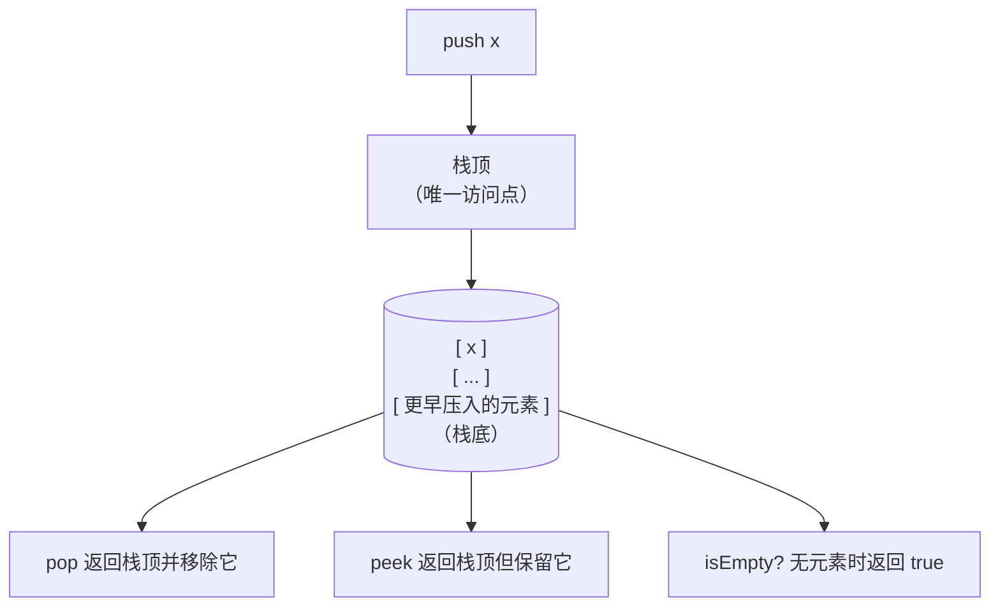
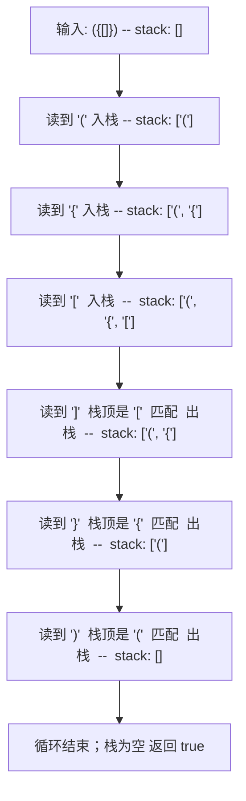

# 栈与调用栈的类比

打开任意一个调试器，命中断点，看那个标着 *Call Stack* 的面板。它展示把你送到这一步的那串函数调用：`main` 调用了 `parseRequest`，后者调用 `validateHeaders`，再调用 `checkContentType`，你就停在这里。每一行都是运行时在进入函数时压入的栈帧（frame），函数返回时运行时再把这些帧逐个弹出。那个面板不是比喻。本章讲的栈数据结构，就是 CPU 每次调用函数时操作的那一个，就是递归太深时溢出的那一个，也是 Knuth 在 *The Art of Computer Programming* 里用来引出线性数据结构研究的基础动机。

应用层面的版本是三个操作加一条规则。Push 把元素加到栈顶。Pop 移除最近压入的元素。Peek 读取栈顶但不移除。规则是*后进先出*（last in, first out）：你能看到、修改、删除的只有最近加入的那一个。运行时发生递归调用时，语言的实现做的事情和你写 `stack.push(x)` 时一样。保存调用方局部变量的那个栈帧、返回地址、被保存的寄存器：这些就是被压入的元素。[^1]

这里的招牌题是 LC 20 Valid Parentheses。另外还有三类应用值得关注（用于 O(1) 辅助查询的增强栈、后缀表达式求值、用于下一个更大元素的单调栈），三者都已超出单章篇幅。增强栈在[最小栈与最大栈](../../../dsa/part-4-stack-queue-patterns/02-min-max-stack.md)。后缀求值在[表达式求值](../../../dsa/part-4-stack-queue-patterns/03-expression-evaluation.md)。单调这套纪律——栈维护一个严格的有序不变式——在[单调栈与双端队列](../../../dsa/part-4-stack-queue-patterns/01-monotonic-deque.md)。本章讲这个原语本身，外加一个能把契约讲干净的应用（延迟匹配校验）。

## 后进先出（LIFO）契约到底是什么

栈就是一个数组（或链表）加两条额外规则：写只在一端发生，读也只在同一端发生。Sedgewick & Wayne 的 algs4 §1.3 把它定义为“一种基于后进先出（LIFO）策略的集合”。[^3] 只暴露一端，才让它成为栈而不是列表。你的代码伸不进中间。取不到倒数第三个元素。不能遍历。你能看见的只有栈顶那些元素，顺序与压入顺序相反。



*四个操作，全是 O(1)，全都只碰栈顶。接口窄正是关键：LIFO 纪律由类型强制，而不是靠约定。*

接口窄才让这个结构有用。当文章说*“运行时在调用时压入一个帧”*，读者能精确预测返回时会发生什么：最近压入的那一帧被弹出，且只有它。中间的帧不会消失；底部的帧不会冒上来；没有任何乱序。这种可预测性正是调用栈成立的原因，也是延迟匹配校验器成立、后缀求值器成立、迭代式 DFS 成立、你按过的每一次 Ctrl+Z 背后的撤销栈成立的原因。同一套机制，六种应用。

每种实现都提供同样的四个操作：

| 操作 | 作用 | 开销 |
|---|---|---|
| `push(x)` | 把 x 加到栈顶 | O(1) |
| `pop()` | 移除并返回栈顶 | O(1) |
| `peek()`（或 `top()`） | 返回栈顶但不移除 | O(1) |
| `isEmpty()` | 无元素时返回 true | O(1) |

CLRS §10.1 直接给出了数组实现：一个 `S.top` 整数指向最近插入的槽位。Push 写入 `S[S.top + 1]` 并自增。Pop 读取 `S[S.top]` 并自减。不用追指针。不用整块拷贝。[^2] 可扩容数组的版本在溢出时把底层数组翻倍；[动态数组内部机制](./01-dynamic-array-internals.md) 里的动态表论证把翻倍开销摊到自上次扩容以来的所有 push 上，单次 push 的均摊开销仍是 O(1)。[^2]

常见实现有两种，实践中选哪个通常不重要：

- **数组实现。** push 和 pop 都是数组尾部的写入。对缓存友好。扩容代价就是翻倍那一次事件，均摊 O(1)。标准库十有八九给的就是这个。
- **链表实现。** push 在头部插入节点；pop 摘掉头节点。每个操作都是 O(1) 最坏情况，不需要均摊。代价是每节点一份指针开销；节点散落在堆上，对缓存不友好。

只有当负载真的需要每次操作的最坏情况上界时（实时系统、硬性延迟底线），才该选链表实现。否则数组版本在内存局部性和简单性上都更好。

## 调用栈就是同一个数据结构

运行时执行 `f()` 调用 `g()` 时，会往操作系统在进程启动时为此预留的一块内存里压入一条记录。这条记录保存 `f` 的局部变量、`f` 内部要继续执行的地址，以及（取决于调用约定）被保存的寄存器值。`g` 返回时，运行时弹出这条记录，在保存的地址处恢复 `f`。Knuth 在 TAOCP §2.2.1 里正是以此作为引入该数据结构的基础动机。[^1] CLRS §10.1 的开篇段落也得出同样的联系：栈的 PUSH 和 POP 恰好就是过程调用栈所做的操作。[^2]

这就是递归能成立的原因。递归函数没有什么特殊机制。它把一帧压到任何其他调用都会用的同一个调用栈上，跑完函数体，返回时弹出这一帧。`factorial(5)` 得到 `120` 而不是最近的某个中间值，是因为每次递归调用都有自己的帧、各自持有自己的 `n` 副本，而调用栈的 LIFO 纪律保证这些帧按创建顺序的逆序拆解。[递归的心智模型](../part-0-foundations/02-recursion-mental-model.md) 从递归那一侧展开这个联系；我们从数据结构这一侧进来，落到同一点上。

“栈溢出”也是这么来的。操作系统为调用栈预留固定大小的区域，Linux 上通常是 1 到 8 MB，可用 `ulimit -s` 调整。每次函数调用都要消耗其中一部分。递归太深就把它耗光。Python 在 OS 硬限之下设了一个软限（`sys.setrecursionlimit`，默认 1000），好在 OS 杀掉进程之前干净地抛出 `RecursionError`。Java 用 `-Xss` 控制大小；默认 512KB 到 1MB，大约能嵌套到 10,000 层才抛 `StackOverflowError`。你读到这些报错时，那个数据结构不是比喻——它字面上就是数据结构。

递归改迭代，是同一个观察反过来说。如果你的递归解超出语言的递归上限，就在应用代码里显式分配一个栈，把本会是活动记录的东西（当前状态 + 该回到的位置）压进去，然后手动走。树上的迭代式 DFS 是标准例子：递归版本用调用栈，迭代版本用 `Deque<Node>` 或 `list[Node]`，算法一样，区别只在于栈由谁管。[回溯](../part-7-recursion-backtracking) 和[图遍历](../part-8-graphs) 两章都依赖这个转换，不再重讲。

## LC 20：延迟匹配校验器

本章的招牌题是 LC 20 Valid Parentheses。给定一个由圆括号、方括号、花括号组成的字符串，判断每个闭括号是否都与最近一个未匹配的开括号配对。空串合法。示例：`"()"` 为 true，`"()[]{}"` 为 true，`"(]"` 为 false，`"([)]"` 为 false，`"{[]}"` 为 true。

模式信号就是“最近一个未匹配”这个说法。只要输入是一串开符号和闭符号，且每个闭符号必须与最近打开的同类型符号配对，栈就是底层结构。Sedgewick algs4 §1.3 习题 4 把平衡括号列为该章第一个非平凡的栈客户端。[^3] XML 风格的标签、函数调用的参数列表、JSON 的花括号、编辑器里的平衡文本，都是这个形状。

大多数读者的第一反应是用计数器：遇开括号加一，遇闭括号减一，最后看是否归零。单一括号类型可行。多类型立刻失效，因为计数器分不清 `"([)]"` 和 `"()[]"`：两者各类括号的开闭数量都相等。计数器丢掉了顺序信息，栈保留了它。

完整算法只有一个状态：一个存放未匹配开括号的栈。逐字符处理，是开括号就压栈；是闭括号就查看栈顶、检查它是否等于期望的开括号，一致则弹出。两种失败模式由两处不同的空栈检查捕获：

```text
- 闭括号没有对应开括号 →  peek 时的空栈检查命中
- 开括号没有对应闭括号 →  结尾的空栈检查失败
```

```python
def is_valid(s: str) -> bool:
    pair = {")": "(", "]": "[", "}": "{"}
    stack = []
    for c in s:
        if c in "([{":
            stack.append(c)
        else:
            if not stack or stack[-1] != pair[c]:
                return False
            stack.pop()
    return not stack
```

**解法** — Python（[Java](./05-stacks/lc-20/sol.java) · [C++](./05-stacks/lc-20/sol.cpp) · [Go](./05-stacks/lc-20/sol.go)）

```python
# LC 20. Valid Parentheses
# 开括号入栈；遇到闭括号则查看栈顶开括号，匹配才弹出。
# 配对表以闭括号为键（'(' 是值，')' 是键），
# 查表因此无需分支。收尾的空栈检查负责拒掉未匹配的
# 开括号。O(n), O(n)。
from typing import List


def is_valid(s: str) -> bool:
    pair = {")": "(", "]": "[", "}": "{"}
    stack: List[str] = []
    for c in s:
        if c in "([{":
            stack.append(c)
        else:
            if not stack or stack[-1] != pair[c]:
                return False
            stack.pop()
    return not stack
```

`pair` 表以*闭括号*为键，不是开括号。这看着像风格问题，其实是结构问题。循环里用闭括号 `c` 去查 `pair[c]`，直接得到期望的开括号。反过来以开括号为键（`{"(": ")", ...}`），循环就得另想办法区分开闭括号，因为此时表的键和值都是合法输入字符。以闭括号为键的版本更短、分支更干净，也更难写出“错了但能过 LC 测试”的版本。

对 `"({[]})"` 走一遍：



*每个开括号压栈；每个闭括号与（按闭括号查出的）期望匹配项比对，一致则弹栈。收尾的空栈检查区分“所有开括号都已匹配”和“循环结束时还剩开括号”，比如 `"((("`。*

总开销是 O(n) 时间、O(n) 空间：每个字符最多贡献一次 push 和一次 peek-and-pop，最坏栈深为 n（全开括号的串 `"((..("`）。

## 四种语言如何表示“栈”

每种语言都有一个标准写法，和一个错但诱人的替代方案。四种里有三种，那个错误的默认选项至今还留在标准库中：

| 语言 | 正确写法 | 错但诱人的替代 |
|---|---|---|
| Python | `list`（`append`、`pop()`、`[-1]`） | `collections.deque` —— 能用，但过度设计 |
| Java | `Deque<T> stack = new ArrayDeque<>()` | `java.util.Stack` —— 带同步，慢 |
| C++ | `std::stack<T>` | `std::vector<T>` —— 能用，但不在类型层面强制 LIFO |
| Go | `[]T` 切片配 `append` 与 `s[:len(s)-1]` | `container/list` —— 指针密集，更慢 |

Java 这一条值得多费点笔墨。`java.util.Stack` 是 1996 年的类，继承自 `Vector`，也就是最早那个带同步的动态数组。它的每次 `push` 和 `pop` 都要获取 `this` 上的内置锁，即使代码是单线程的。Sedgewick & Wayne 在 algs4 里毫不含糊：“Java 自带一个叫 Stack 的库，但你应该避免使用它。”[^3] Oracle 自己在 JDK 21 里为 `ArrayDeque` 写的 Javadoc 说：“当用作栈时，这个类很可能比 `Stack` 更快。”[^4] *Effective Java* 讲的是更普适的原则：遗留的同步集合不是单线程代码该用的原语。[^5] 入门 Java 教程至今仍默认 `new Stack<>()`。标准的代码评审改法是 `Deque<Integer> stack = new ArrayDeque<>()`，用 `Deque` 接口的 `push`、`pop`、`peek`。

C++ 的 `std::stack<T>` 默认是架在 `std::deque<T>` 上的容器适配器。它的接口有意比 `std::deque` 本身更窄（不能遍历，不能随机访问），这正是它在类型层面强制 LIFO 契约的方式。你当然可以用 `std::vector<T>` 调 `push_back` / `pop_back`，程序也是对的，但类型就不再编码 LIFO 承诺了。评审的人得读函数体才能确认这套纪律。适配器替他们做了这件事。

Python 的 `list` 是标准的栈写法，它值得享受和 Java `ArrayDeque` 同等的辩护。`list.append` 和 `list.pop()`（不带参数）在尾部都是均摊 O(1)。`list.pop(0)` 和 `list.insert(0, x)` 是 O(n)，因为它们要把其余每个元素挪一格。Python 文档说得很直接：“list 对象……针对定长快速操作做了优化，`pop(0)` 和 `insert(0, v)` 操作会产生 O(n) 的内存搬移开销。”[^6] 用 `list.pop(0)` 搭出来的“栈”，n 次操作总共 O(n²)。只有需要*头部* O(1) 操作时才该用 `collections.deque`（BFS 队列边界、滑动窗口双端队列）；拿它当栈是过度设计。

Go 没有原生栈类型。切片写法就是正确答案：`append(s, x)` 压栈，`s = s[:len(s)-1]` 弹栈，`s[len(s)-1]` 读栈顶。push 和 pop 都是均摊 O(1)。切片当队列时，`s[1:]` 只是移动切片头而不释放底层数组的前缀，这里有坑；切片当栈没有这个问题：两个操作都在尾部，底层长度会真的缩短。

## 实际开销

所有实现都是这些数字：

| 操作 | 时间 | 来源 |
|---|---|---|
| `push(x)`（可扩容数组，均摊） | O(1) | Sedgewick §1.3[^3] |
| `pop()` | O(1) | CLRS §10.1[^2] |
| `peek()` / `top()` | O(1) | CLRS §10.1[^2] |
| `isEmpty()` | O(1) | CLRS §10.1[^2] |
| 对 n 个字符跑 LC 20 | O(n) 时间，O(n) 空间 | Sedgewick §1.3 习题 4[^3] |

push 的均摊上界，就是[动态数组内部机制](./01-dynamic-array-internals.md) 为 `ArrayList.add` 证明的那一个。可扩容数组的栈在溢出时把底层数组翻倍；CLRS §17.4 把翻倍开销摊到自上次扩容以来的所有 push 上，平均每次 push 是 O(1)，尽管每 `log n` 次 push 中有一次要为拷贝付出 Θ(n)。链表实现的栈跳过均摊论证，因为它最坏情况 O(1)，代价是指针开销。

## 常见误区

> [!WARNING]
> **用 `java.util.Stack` 而不是 `ArrayDeque`。** 程序是对的，但每个操作都要交一笔同步税，一线公司的任何代码评审都会指出来。Sedgewick 不含糊，Oracle 不含糊，*Effective Java* 也不含糊：`Deque<T> stack = new ArrayDeque<>()` 是唯一正确答案。[^3][^4]

> [!WARNING]
> **括号配对表以开括号为键。** `{"(": ")", "[": "]", "{": "}"}` 读起来自然（“看到 `(`，就期待 `)`”），但循环是从闭括号那一侧查表。以开括号为键的表会逼着循环另找办法区分开闭括号。以闭括号为键（`{")": "(", ...}`）则可以让循环保持“`c in "([{"` 就压栈、`else` 就弹栈”的分支。更短，也更难写错。

> [!WARNING]
> **在 Python 里用 `list.pop(0)` 或 `list.insert(0, x)`。** 两者都是 O(n)，因为要挪动其余每个元素。用 `pop(0)` 搭的栈，n 次操作总共 O(n²)，任何 `n ≥ 10⁴` 的 LC 题都会超时。正确的 Python 写法是在列表*末尾*用 `list.append` 和 `list.pop()`（不带参数）。只有需要*头部* O(1) 操作时才用 `collections.deque`。[^6]

> [!WARNING]
> **递归触限时忘了调用栈这个类比。** Python 的默认递归上限是 1000；Java 大约 10,000，取决于 `-Xss`。递归解超限时，改迭代的写法就是用一个显式栈，手动做运行时本来自动做的事。把等价于活动记录的东西（当前状态 + 该回到的位置）压进去，每轮迭代检查栈顶帧。这个套路跨语言通用。

> [!WARNING]
> **空栈 peek 的崩溃语义。** 对空的 `std::stack` 调 `s.top()` 是未定义行为；对空的 `ArrayDeque` 调 `s.peek()` 返回 null（`pop()` 则抛 `NoSuchElementException`）；Python 的 `s[-1]` 抛 `IndexError`。peek 之前永远先查 `isEmpty`，即使 LC 的测试框架保证输入良构。生产代码很少享有 LC 这么窄的契约。

## 题目梯度

### 核心（两题全做才算掌握本章）

- [LC 20 — Valid Parentheses](https://leetcode.com/problems/valid-parentheses/) [简单] • stack-balanced-paren-matching ★
- [LC 71 — Simplify Path](https://leetcode.com/problems/simplify-path/) [中等] • stack-track-most-recent-context

### 进阶（可选）

- [LC 224 — Basic Calculator](https://leetcode.com/problems/basic-calculator/) [困难] • stack-iterative-recursion-simulation

LC 71 说明栈不只属于“校验器或求值器”这一种模式，它更宽泛地是一种“追踪最近上下文”的原语：把 Unix 风格路径按 `/` 切开，目录名压栈，遇 `..` 弹栈，遇 `.` 跳过。LC 224 是本章的困难跨度锚点，也是通往第 4 部分的桥：它用单个栈保存累计和与符号，解析带括号和一元负号的中缀表达式，迭代地模拟运行时本会执行的那次递归。

延到第 4 部分的那些模式包下了这个家族的其余成员。LC 155 Min Stack（带 O(1) 辅助查询的增强栈模式）在[最小栈与最大栈](../../../dsa/part-4-stack-queue-patterns/02-min-max-stack.md)。LC 150 Evaluate Reverse Polish Notation（标准后缀求值器）在[表达式求值](../../../dsa/part-4-stack-queue-patterns/03-expression-evaluation.md)。LC 232 和 LC 225（用栈实现队列的那一对）在[用栈实现队列](../../../dsa/part-4-stack-queue-patterns/04-queue-from-stacks.md)。下一个更大元素家族（LC 496、LC 503、LC 739、LC 84、LC 85、LC 239）用同一结构但加上更严格的单调性不变式，在[单调栈与双端队列](../../../dsa/part-4-stack-queue-patterns/01-monotonic-deque.md)。同一个数据结构，不同的纪律。

## 后续衔接

[队列、双端队列与环形缓冲区](./06-queues-deques.md) 是它的 FIFO 兄弟：同样是“只在一端”的纪律，只是那一端不同。[第 4 部分](../../../dsa/part-4-stack-queue-patterns/01-monotonic-deque.md) 的四章栈模式，展开从这个原语长出来的增强、求值、用栈实现队列、单调这几套纪律。而[递归与回溯](../part-7-recursion-backtracking) 和[图遍历](../part-8-graphs) 的每一章都继承了这里的调用栈类比。运行时的栈用光了，你就自己分配一个。

## 参考文献

[^1]: Donald E. Knuth, *The Art of Computer Programming*, Volume 1: Fundamental Algorithms, 3rd ed., Addison-Wesley, 1997.

[^2]: Cormen, Leiserson, Rivest, Stein, *Introduction to Algorithms*, 4th ed., MIT Press, 2022.

[^3]: Robert Sedgewick and Kevin Wayne, *Algorithms*, 4th ed., Addison-Wesley, 2011. §1.3 "Bags, Queues, and Stacks." Online at [algs4.cs.princeton.edu/13stacks](https://algs4.cs.princeton.edu/13stacks/).

[^4]: Oracle Java SE 21 API documentation, `java.util.ArrayDeque<E>`. [docs.oracle.com/en/java/javase/21/docs/api/java.base/java/util/ArrayDeque.html](https://docs.oracle.com/en/java/javase/21/docs/api/java.base/java/util/ArrayDeque.html).

[^5]: Joshua Bloch, *Effective Java*, 3rd ed., Addison-Wesley, 2017.

[^6]: Python Software Foundation, `collections.deque` 文档：“尽管 list 对象支持类似操作，但它们针对定长快速操作做了优化，`pop(0)` 和 `insert(0, v)` 操作会产生 O(n) 的内存搬移开销。”[docs.python.org/3/library/collections.html#collections.deque](https://docs.python.org/3/library/collections.html#collections.deque).
