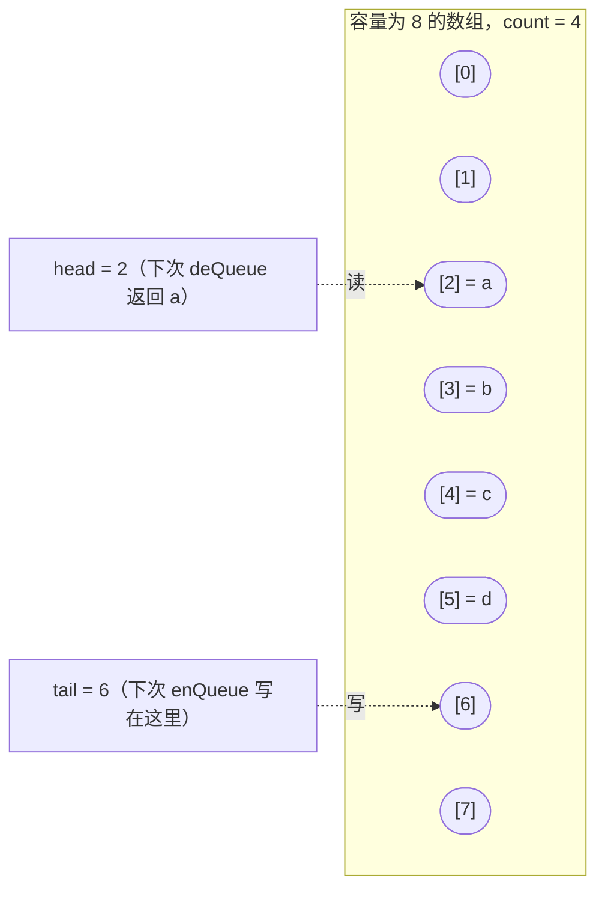
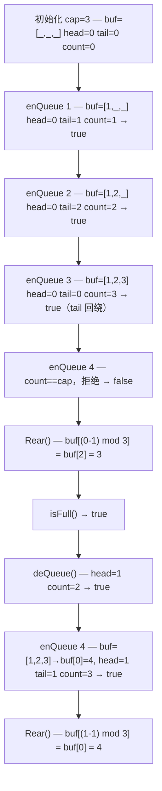

# 队列、双端队列与环形缓冲

三种抽象，远看长得一样，一旦真被负载压上就各走各路。它们都是有序序列，两端访问都很便宜。区别在于哪一端便宜、容量是否固定，以及某次操作撞到边界时会发生什么。

| 抽象 | 入队位置 | 出队位置 | 容量 | 典型用途 |
|---|---|---|---|---|
| 队列（FIFO） | 尾（rear） | 首（front） | 按需增长 | 调度器运行队列、BFS 边界、[栈那一章的调用栈类比](./05-stacks.md)翻转过来用 |
| 双端队列（deque） | 尾和首 | 尾和首 | 按需增长 | 滑动窗口聚合、双指针回文判断、工作窃取（work-stealing）调度器 |
| 环形缓冲（circular buffer） | 尾（直到写满） | 首 | 构造时固定 | UART 驱动缓冲、Linux 内核 `kfifo`、`journald` 日志环、LMAX Disruptor |

出问题的是第三行。队列和双端队列按需增长，环形缓冲不会。就是这一个决定，引出了“空还是满”的歧义，也解释了为什么 Linux 内核的 `kfifo` 在不同年代带着两套不同的空/满判别策略，以及为什么本章那道招牌面试题（LC 641 Design Circular Deque）要用另外两种抽象永远用不到的取模运算。

本章讲的是这三种数据结构本身。练它们的那批模式归别处：[用栈实现队列](../../../dsa/part-4-stack-queue-patterns/04-queue-from-stacks.md) 推演 LC 232 / LC 225 的均摊论证，[单调栈与单调队列](../../../dsa/part-4-stack-queue-patterns/01-monotonic-deque.md) 推演 LC 239 滑动窗口最大值，[BFS 与 DFS](../../../dsa/part-8-graphs/01-bfs.md) 才是“队列当图边界”这个模式真正发挥作用的地方。

## FIFO 契约

队列就是两个索引在缓冲区里互相追赶。入队写在尾部并把尾指针往前推；出队从头部读并把头指针往前推。CLRS §10.1 给出的教科书实现是一个循环数组，`head` 和 `tail` 两个索引对缓冲区长度取模回绕。[^1] 两个操作都是 O(1)，不需要任何均摊论证；空间不够时的扩容方式和 [动态数组内部结构](./01-dynamic-array-internals.md) 描述的一模一样。

接口之窄本身就是契约。你的代码伸不进队列中间，看不到第三个元素，也没法遍历。你能观察到的只有队首，顺序就是到达顺序。这份可预测性正是队列适合“按到达顺序处理”的工作的原因：调度器队列、BFS 边界、层序遍历、事件模拟、请求流水线。

最容易让读者栽跟头的是 Python。Python 的 `list` 长得像队列，但不是。`list.append(x)` 是 O(1)，可 `list.pop(0)` 要把剩下每个元素左移一格，代价 O(n)。用 `list.pop(0)` 搭出来的“队列”在 n 次操作上总共是 O(n²)。Python 文档写得很直白：“list objects... are optimized for fast fixed-length operations and incur O(n) memory movement costs for `pop(0)` and `insert(0, v)` operations.”[^2] 解法是 `collections.deque`，它的 `appendleft` 和 `popleft` 都是 O(1)。在 BFS 形状的 LC 题上，把 `list` 换成 `deque` 是最常见的一处 Python 性能修复；在 `n = 10^5` 时，它把 TLE 变成 100ms 的通过提交。

四种常用语言各有标准答案，也各有一个诱人但错误的替代品。

| 语言 | 正确写法 | 诱人但错误的写法 | 替代方案为何吃亏 |
|---|---|---|---|
| Python | `collections.deque` | `list.pop(0)` | 每次 pop 都是 O(n) |
| Java | `Deque<T> q = new ArrayDeque<>()` | `LinkedList`、`Stack` | 每节点多一份指针开销；遗留的 `Vector` 带同步 |
| C++ | `std::queue<T>`（适配器） | 手写 head 的 `std::vector` | 浪费空间，类型层面不强制 FIFO |
| Go | 切片（短生命周期）或环形缓冲（长生命周期） | 切片（长生命周期） | `s[1:]` 在数百万次出队后仍握着底层数组 |

Java 这一条值得像 [栈与调用栈类比](./05-stacks.md) 为 `ArrayDeque` 胜过 `Stack` 那样再辩护一次。Oracle JDK 21 关于 `ArrayDeque` 的 Javadoc 写道：“This class is likely to be faster than Stack when used as a stack, and faster than LinkedList when used as a queue. Most ArrayDeque operations run in amortized constant time.”[^3] `LinkedList` 在类型上确实是 `Deque`，但双向链表节点除了对象头还要带两个指针，在 64 位 JVM 上每个元素大约 24 到 48 字节。`ArrayDeque` 的循环数组不用付这笔钱。当栈用、当队列用，答案是同一个类。

Go 是切片写法开始弯掉的地方。生命周期短、长度被一个小常数卡住的双端队列（比如长度永不超过 k 的滑动窗口状态），`q = q[1:]` 完全没问题：切片头往前走，底层数组用掉的前缀很短。长期运行的队列（一次走 10⁷ 个节点的 BFS）就不行了，同样的写法会把整个前缀一直留住，因为重新切片并不释放 GC 能回收的内存。长期队列的解法是用环形缓冲，在固定容量的切片上显式维护 head 和 tail 索引。本章的 Go 参考实现展示的就是环形缓冲的形状；切片写法在第 4 章那道单调队列题里是对的，因为那里 deque 的长度被 k 卡住。

## 双端队列补上了尾端

双端队列是松掉一条约束的队列：*两端*的入和出都很便宜。CLRS 练习 10.1-5 定义了四个基本操作——`HEAD-ENQUEUE`、`TAIL-ENQUEUE`、`HEAD-DEQUEUE`、`TAIL-DEQUEUE`——在循环数组实现上各是 O(1)。[^4] 这个名字（读作“deck”）来自 Knuth 的 TAOCP 第 1 卷 §2.2.1，是“double-ended queue”的缩合。[^5]

双端队列之所以值得单独一章，是因为好几个看起来像滑动窗口的模式，其实需要两端都热。[滑动窗口最大值与单调队列](../../../dsa/part-4-stack-queue-patterns/01-monotonic-deque.md) 用的单调队列就是标准案例：把索引存进一个维持严格单调不变量的 deque，从前面淘汰过期索引，从后面淘汰被压制的索引，总共 O(n)。队列做不到，栈做不到，deque 恰好就是算法要的东西。

双端队列的四语言实现图谱和队列一样，只换一处：C++ 的 `std::queue` 适配器直接换成 `std::deque<T>`。cppreference 记载 `std::deque` 支持 O(1) 随机访问，两端 push/pop 也是 O(1)，典型实现是“a sequence of individually allocated fixed-size arrays.”[^6] 这种分块数组结构有个怪癖值得标出来：只有一个元素的 `std::deque` 也会分配一整块，在 64 位 libstdc++ 上通常是对象大小的 8 倍，在 64 位 libc++ 上是 4096 字节。对内存紧张、又要处理大量短命 deque 的系统，这个每实例基线是要算的；其他场景无所谓。

## 环形缓冲固定了容量

队列和双端队列按需增长，环形缓冲不会：容量在构造时定死，写入要么被拒绝，要么覆盖最旧的元素。实现就是 CLRS 描述的那个循环数组，去掉扩容。两个索引，都对固定容量取模，每次操作都往前走。



*缓冲区是一个定长数组；生产者把 `tail` 对容量取模往前推，消费者把 `head` 对容量取模往前推。空和满都归结为 `head == tail`，所以判别策略才重要。*

本章的核心面试题是 LC 641 Design Circular Deque：首尾都能插入和删除，容量固定，每个操作 O(1)。纯粹的取模索引——`head` 和 `tail` 对 `cap` 取模前进——用于*定位*是对的，用于*判断状态*却有歧义。`head == tail` 时，缓冲区要么是空（刚构造，什么都没有），要么是满（每个槽都写过，两个索引都绕了一圈）。两种标准解法：

1. **额外维护一个 `count` 字段。** 空是 `count == 0`，满是 `count == cap`。多一个整数的状态，自解释，没有边界情况。
2. **空出一个槽位。** 空是 `head == tail`，满是 `(tail + 1) % cap == head`。代价是每个缓冲区少一个可用槽，但索引本身就能说真话。

Linux 内核的环形缓冲（`kfifo`）历史上选的是空槽方案，因为容量取 2 的幂就能用 `& (cap - 1)` 代替 `% cap`，在 2000 年代初的热路径上是实打实的提速。现代 `kfifo` 改用无符号运算加隐式回绕，干脆绕开了判别问题。这第三种策略值得知道它存在，不过它依赖定宽整数回绕语义，LC 的评测环境不复现这一点。

LC 622 Design Circular Queue 是单端版本；LC 641 加上对称的首端操作。参考实现用显式 `count` 方案，因为教学示例里清晰胜过微优化。

```python
class MyCircularQueue:
    def __init__(self, k: int):
        self._buf = [0] * k
        self._cap = k
        self._head = 0
        self._tail = 0
        self._count = 0

    def enQueue(self, value: int) -> bool:
        if self._count == self._cap:
            return False
        self._buf[self._tail] = value
        self._tail = (self._tail + 1) % self._cap
        self._count += 1
        return True

    def deQueue(self) -> bool:
        if self._count == 0:
            return False
        self._head = (self._head + 1) % self._cap
        self._count -= 1
        return True

    def Front(self) -> int:
        return -1 if self._count == 0 else self._buf[self._head]

    def Rear(self) -> int:
        return -1 if self._count == 0 else self._buf[(self._tail - 1) % self._cap]

    def isEmpty(self) -> bool:
        return self._count == 0

    def isFull(self) -> bool:
        return self._count == self._cap
```

**Solution** — Python（[Java](./06-queues-deques/lc-622/sol.java) · [C++](./06-queues-deques/lc-622/sol.cpp) · [Go](./06-queues-deques/lc-622/sol.go)）

```python
# LC 622. Design Circular Queue
# 定容量环形缓冲。head 和 tail 对 cap 取模前进；用显式的 count 区分
# 空（count == 0）与满（count == cap），而单纯取模索引做不到这一点。
# 所有操作 O(1)，空间 O(k)。
class MyCircularQueue:
    def __init__(self, k: int):
        self._buf = [0] * k
        self._cap = k
        self._head = 0
        self._tail = 0
        self._count = 0

    def enQueue(self, value: int) -> bool:
        if self._count == self._cap:
            return False
        self._buf[self._tail] = value
        self._tail = (self._tail + 1) % self._cap
        self._count += 1
        return True

    def deQueue(self) -> bool:
        if self._count == 0:
            return False
        self._head = (self._head + 1) % self._cap
        self._count -= 1
        return True

    def Front(self) -> int:
        if self._count == 0:
            return -1
        return self._buf[self._head]

    def Rear(self) -> int:
        if self._count == 0:
            return -1
        # 对正容量来说 Python 的 % 结果非负，所以 tail == 0 时
        # (tail - 1) % cap 也能正确回绕。
        return self._buf[(self._tail - 1) % self._cap]

    def isEmpty(self) -> bool:
        return self._count == 0

    def isFull(self) -> bool:
        return self._count == self._cap
```

在 `cap = 3` 上走一遍：`enQueue(1)`、`enQueue(2)`、`enQueue(3)`、`enQueue(4)`、`Rear()`、`isFull()`、`deQueue()`、`enQueue(4)`、`Rear()`：



*第三次 enQueue 落在 `buf[2]` 并把 `tail` 绕回 0；第四次被拒绝；一次 deQueue 把 `head` 推到 1 之后，绕回来的槽位在 `buf[0]` 接住了下一个值。这里空和满都表现为 `head == tail`——把它区分开的是 `count` 字段。*

`Rear()` 那一行有个括号值得标出来。`(self._tail - 1) % self._cap` 在 Python 里成立，因为 Python 的 `%` 对被除数为负时返回非负结果；Java、C++、Go 不会。Java 和 C++ 的参考实现因此写成 `(tail - 1 + cap) % cap`。同一个算法，每种语言各自的防御性算术。这种行内 bug 在面试里事先没看见，就得花你十分钟。

## 剩下的部分为什么交给模式章节

有三个模式把这些数据结构延伸进真正拥有它们的算法章节。

**双栈队列**（LC 232）是借面试形状的代码引入均摊分析的入口。入队推进 inbox 栈；出队只在 outbox 为空时把 inbox 倒进 outbox，再从 outbox 弹。每个元素在它的生命周期里最多从 inbox 搬到 outbox 一次，所以尽管最坏情况那次倒腾是 O(n)，每次操作的均摊代价是 O(1)。CLRS 第 17 章 §17.2 的记账法给出形式化证明：入队时给每个元素记 2 份信用，一份付 push，一份付搬运。完整推演在 [用栈实现队列](../../../dsa/part-4-stack-queue-patterns/04-queue-from-stacks.md)。

**单调队列**（LC 239 Sliding Window Maximum）把索引存进一个维持严格单调不变量的 deque。对每个新元素，从前面淘汰过期索引（落在窗口外的），从后面淘汰被压制的索引（值严格小于新元素的）。每个索引只入队一次、出队一次：deque 操作总数 2n，总代价 O(n)，既赢过暴力 O(n × k)，也赢过基于堆的 O(n log n)。端到端推演在 [单调栈与单调队列](../../../dsa/part-4-stack-queue-patterns/01-monotonic-deque.md)。

**BFS 边界队列**（LC 200、994、542）是面试里大多数队列用法的动机所在。取出最旧的未访问节点，把它的未访问邻居入队，重复。树的层序遍历形状相同，只是输入从图的邻居换成树的子节点。推演在 [BFS 与 DFS](../../../dsa/part-8-graphs/01-bfs.md)。上面那条 Go 内存驻留警告在这里是关键：长期运行的 BFS 用 `q = q[1:]` 会把每个访问过的节点槽位留在底层数组里，在 `q` 本身被替换之前，GC 一个都回收不了。

## 实际开销

| 操作 | 时间 | 来源 |
|---|---|---|
| 队列循环数组的入队 / 出队 | O(1) | CLRS §10.1[^1] |
| 双端队列循环数组的四个基本操作 | O(1) | CLRS Ex 10.1-5[^4] |
| 环形缓冲的 enQueue / deQueue（LC 622、641） | O(1) | leetcode.ca[^7] |
| Python `list.pop(0)`（错误的工具） | O(n) | Python 文档[^2] |
| Python `collections.deque` 的 `appendleft` / `popleft` | O(1) | Python 文档[^2] |
| Java `ArrayDeque` 的 push / pop / peek | 均摊 O(1) | Oracle JDK 21[^3] |
| C++ `std::deque` 随机访问 + 两端操作 | O(1) | cppreference[^6] |

可增长变体（队列、双端队列）的均摊上界继承自 [动态数组内部结构](./01-dynamic-array-internals.md)：底层缓冲在溢出时翻倍，代价均摊到每次操作是 O(1)。环形缓冲完全跳过均摊论证；容量固定，每次操作的代价真的是 O(1)，不需要加“平均情况”的附注。

## 常见误区

> [!WARNING]
> **在 Python 里用 `list.pop(0)` 或 `list.insert(0, x)`。** 两者每次调用都是 O(n)；用 `list` 搭的 n 次操作队列是 O(n²)。凡是要 FIFO，就换 `collections.deque`。Python 文档写得很明确；在 `n = 10^5` 的 BFS 形状 LC 题上，提速稳定在一个数量级。[^2]

> [!WARNING]
> **在 Java 里拿 `LinkedList` 当 `Deque` 用。** 能用，但每个元素要付 24 到 48 字节的节点开销，还会把缓存局部性搞坏。按 Oracle 自己的文档，栈和队列都该写 `Deque<T> q = new ArrayDeque<>()`。[^3]

> [!WARNING]
> **环形缓冲的空/满歧义。** 纯取模索引把两种状态都塌成 `head == tail`。要么维护显式 `count` 字段，要么空出一个槽位让满表示成 `(tail + 1) % cap == head`。不做判别、只靠取模的索引会静默覆盖或者返回垃圾值。这正是 LC 622 和 LC 641 上的经典 bug。

> [!WARNING]
> **Python 之外 `Rear()` 里的负取模。** `(tail - 1) % cap` 在 Python 里返回非负结果；在 Java、C++、Go 里可能返回负索引。写成 `(tail - 1 + cap) % cap`。同样的表达式，不同的语言语义，同样是那一行 bug。

> [!WARNING]
> **Go 用切片当队列的内存驻留坑。** `q = q[1:]` 不释放前缀；在 `q` 本身被替换之前，GC 收不走那些元素。长度被小 `k` 卡住的短命 deque，切片写法没问题。长期运行的队列（在数百万节点上跑 BFS），请改用环形缓冲，在固定容量的底层切片上显式维护索引。

## 题目梯度

本章的 CORE 聚焦数据结构本身。历史上住在这里的模式题（LC 232、225、239）搬去了算法才是重点的第 4 章；LC 622 这道基础的动态数组设计题归 [动态数组内部结构](./01-dynamic-array-internals.md)，那里容量与长度之争是核心抽象。本章没有 Hard 级别的 CORE，因为队列和双端队列的经典 Hard 模式题（LC 239、LC 862）归教它们的算法章节。

### 核心（两题全做才算掌握本章）

- [LC 933 — Number of Recent Calls](https://leetcode.com/problems/number-of-recent-calls/) [简单] • queue-on-stream
- [LC 641 — Design Circular Deque](https://leetcode.com/problems/design-circular-deque/) [中等] • ring-buffer-deque ★

### 进阶（可选）

- [LC 622 — Design Circular Queue](https://leetcode.com/problems/design-circular-queue/) [中等] • ring-buffer
- [LC 1670 — Design Front Middle Back Queue](https://leetcode.com/problems/design-front-middle-back-queue/) [中等] • two-deque

LC 933 演示队列作为流上滑动窗口的角色：维护一个近期时间戳的队列，最旧的掉出 3000ms 窗口就从前面淘汰，返回队列长度。这是 FIFO 契约在流式输入上最简单的应用。LC 641 是本章的招牌题，也是四操作双端队列存在的理由：回绕算术在两端必须对称，而 `head` 递减要绕回 `cap - 1`，这是面试里最典型的 off-by-one。LC 622 是单端版本，放在进阶里，因为 [动态数组内部结构](./01-dynamic-array-internals.md) 把它当作容量对长度的设计练习来讲；专门为环形缓冲机制读本章的读者，带着 deque 的框架再过一遍 LC 622 是有好处的。LC 1670 把契约扩到三个插入点（首、中、尾），用两个长度相差不超过 1 的双端队列能干净地解掉——小题，但那个不变量优雅得有点出乎意料。

## 后续衔接

[用栈实现队列](../../../dsa/part-4-stack-queue-patterns/04-queue-from-stacks.md) 端到端推演 LC 232 和 LC 225 的均摊论证。[单调栈与单调队列](../../../dsa/part-4-stack-queue-patterns/01-monotonic-deque.md) 是 LC 239 的归属地——用本章教的 deque 内部结构解滑动窗口最大值。[BFS 与 DFS](../../../dsa/part-8-graphs/01-bfs.md) 是队列当图边界这个模式为 LC 200、994、542 家族兑现价值的地方。[堆](../../../dsa/part-6-trees-heaps/04-heaps-priority-queues.md) 是优先队列这条替代路线——同样的 FIFO 契约弯一下，让出队顺序按优先级而不是按到达时间。

## 参考文献

[^1]: Cormen, Leiserson, Rivest, Stein, *Introduction to Algorithms*, 4th ed., MIT Press, 2022.

[^2]: Python Software Foundation, `collections.deque` documentation. <https://docs.python.org/3/library/collections.html#collections.deque>

[^3]: Oracle Java SE 21 API documentation, `java.util.ArrayDeque<E>`. [docs.oracle.com/en/java/javase/21/docs/api/java.base/java/util/ArrayDeque.html](https://docs.oracle.com/en/java/javase/21/docs/api/java.base/java/util/ArrayDeque.html).

[^4]: Cormen 等，*Introduction to Algorithms*，第 4 版，第 10 章，练习 10.1-5：双端队列（deque），提供四个 O(1) 时间的过程，用于在数组两端插入和删除元素

[^5]: Donald E. Knuth, *The Art of Computer Programming*, Volume 1: Fundamental Algorithms, 3rd ed., Addison-Wesley, 1997.

[^6]: cppreference.com, `std::deque`. [en.cppreference.com/w/cpp/container/deque](https://en.cppreference.com/w/cpp/container/deque).

[^7]: leetcode.ca editorial for LC 622 Design Circular Queue. [leetcode.ca/2017-08-13-622-Design-Circular-Queue](https://leetcode.ca/2017-08-13-622-Design-Circular-Queue/).
