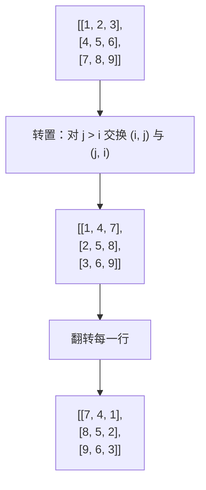
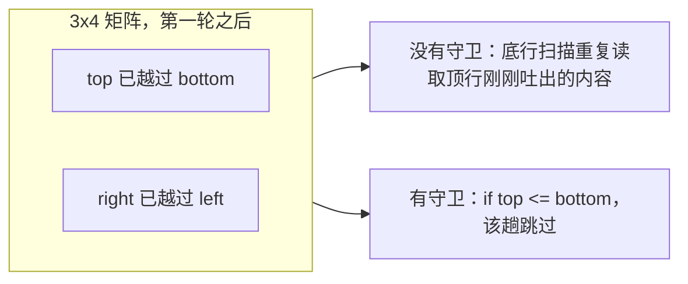

# 矩阵操作

矩阵是一个二维坐标系，而三道招牌面试题考的是同一种本领：把每个格子重写成它在*变换后*坐标处的函数，原地完成，不借第二块二维缓冲区。顺时针旋转 90 度把 `(i, j)` 送到 `(j, n - 1 - i)`。转置把 `(i, j)` 送到 `(j, i)`。螺旋遍历按坐标描出一个不断收缩的矩形的顺序依次走过格子。条件置零则根据格子的行、列坐标谓词改写格子。

题目里的触发词是 **“in-place”** 或 **“do not allocate another 2D matrix”**。[^1] LC 48 原话就是这么写的；LC 73 的追问明确要求 O(1) 额外空间；LC 54 返回一个平铺列表，并期望输入矩阵不被改动。三道题都归结为坐标算术，没有一道是图问题——格子不是节点，相邻关系也不是边集。当矩阵真的变成图或者状态空间时，你要用的是 [BFS 与 DFS](../../../dsa/part-8-graphs/01-bfs.md) 或 [网格 DP](../../../dsa/part-9-dynamic-programming/12-grid-dp.md) 里的算法。在这里，矩阵是一个可变换的对象，本章讲的就是变换它的三个条件反射。

| 操作 | 坐标映射 | 约束 | 条件反射 |
|---|---|---|---|
| 顺时针旋转 90 度 | `(i, j) -> (j, n - 1 - i)` | 方阵 `n x n`，原地 | 先转置再翻转行，或分层四元环 |
| 螺旋遍历 | `(top, bottom, left, right)` 收缩 | `m x n`，输出就是路径本身 | 四条单调边界 |
| 按行/列条件置零 | 每行一位 + 每列一位 | `m x n`，O(1) 额外空间 | 复用第 0 行和第 0 列当标记数组 |

这三个形状看着毫不相干，底座却是同一个。每一个都先抽出把输入坐标映射到输出坐标的规则，再只靠矩阵本身加上常数级簿记，沿着这条规则走一遍输入。

## LC 48：先转置，再翻转行

把一个 `n x n` 矩阵顺时针旋转 90 度，原地，O(1) 额外空间。[^1] 朴素答案另开一个矩阵，写 `dst[j][n - 1 - i] = src[i][j]`，最后拷回来。它正确，它干净，但当题目说不许第二块矩阵时，它就是错答案。

聪明的答案是两个教科书级的操作：

```text
1. 沿主对角线转置：for i in 0..n, for j in i+1..n, swap(m[i][j], m[j][i])
2. 翻转每一行。
```

证明是一行坐标代数。转置之后，新矩阵的 `(i, j)` 位置存的是原矩阵 `(j, i)` 处的值。再翻转第 `i` 行，同一位置 `(i, j)` 存的就是原矩阵 `(j, n - 1 - i)` 处的值，正好是顺时针旋转 90 度。[^2] 输入的列 `j` 变成输出的行 `n - 1 - j`，从上往下读。



*经典 3×3 例子上的“转置加翻转”。转置沿主对角线做镜像，行翻转沿纵轴做镜像，两者复合就是顺时针旋转 90 度。*

```python
def rotate(matrix):
    n = len(matrix)
    for i in range(n):
        for j in range(i + 1, n):
            matrix[i][j], matrix[j][i] = matrix[j][i], matrix[i][j]
    for row in matrix:
        row.reverse()
```

**解法** — Python（[Java](./07-matrix-manipulation/lc-48/sol.java) · [C++](./07-matrix-manipulation/lc-48/sol.cpp) · [Go](./07-matrix-manipulation/lc-48/sol.go)）

```python
# LC 48. Rotate Image
# 把一个 n x n 矩阵原地顺时针旋转 90 度，分两趟完成：
# 先沿主对角线转置，再翻转每一行。转置的内层循环
# 必须从 j = i + 1 开始（不是 j = 0），否则每个非对角线
# 元素对都会被交换两次，矩阵又回到原样。
# O(n^2) 时间，O(1) 空间。
from typing import List


def rotate(matrix: List[List[int]]) -> None:
    n = len(matrix)
    for i in range(n):
        for j in range(i + 1, n):
            matrix[i][j], matrix[j][i] = matrix[j][i], matrix[i][j]
    for row in matrix:
        row.reverse()
```

转置循环必须从 `j = i + 1` 开始。从 `j = 0` 开始会把每个非对角线对交换两次（外层下标是 `i` 时一次，外层下标是 `j` 时又一次），矩阵回到原样。[^2] 从 `j = i` 开始是把对角线格子跟自己交换，无害的空操作，也没问题。从 `j = 0` 开始才是那个标准 bug，也是 LC 48 官方题解易错点清单上被标得最多的一条。

组件里演示的是另一种拆法，因为动画的目标跟背题不一样。按同心环处理矩阵（先外圈，再内圈）。每个环内，一个四格循环用四重旋转对称把四个角串起来：`(i, j) -> (j, n - 1 - i) -> (n - 1 - i, n - 1 - j) -> (n - 1 - j, i)`。用一个临时变量存下一个角，其余三个沿环轮转，最后把存下的值写进空出来的槽位。对 `n x n` 矩阵，外环有 `n - 1` 个循环，下一环 `n - 3`，依次向内。

> **交互式组件：** [矩阵旋转（分层四元环）](../../../dsa/widgets/w-03-matrix-rotation.yml) —— 在网站上渲染；YAML 规格里描述了各个关键帧。

*静态回退：一个 4×4 矩阵，高亮某个角循环的四个格子；下一个关键帧显示它们旋转一步之后的样子，以及矩阵离最终朝向又近了一圈。*

两种拆法都是 O(n^2) 时间、O(1) 额外空间。转置加翻转更好背，也更好证。分层四元环更好*看*，因为它把原地置换呈现为一圈圈同心环，而不是两趟互不相干的全矩阵扫描。两种都能得到正确答案；组件给你看的是答案为什么成立。

## LC 54：四条收缩边界走螺旋

按顺时针螺旋顺序走一个 `m x n` 矩阵：上边一行从左到右，右边一列从上到下，下边一行从右到左，左边一列从下到上，然后在内层子矩阵上重复，直到走完。[^3]

状态是四个单调下标：`top`、`bottom`、`left`、`right`。每次定向扫描走完一条边界，就把这条边界向内推一格（`top++`、`right--`、`bottom--`、`left++`）。终止性对 `(bottom - top) + (right - left)` 单调；当其中某个距离变成负数时，循环结束。

```python
def spiral_order(matrix):
    if not matrix or not matrix[0]:
        return []
    out = []
    top, bottom = 0, len(matrix) - 1
    left, right = 0, len(matrix[0]) - 1
    while top <= bottom and left <= right:
        for j in range(left, right + 1):
            out.append(matrix[top][j])
        top += 1
        for i in range(top, bottom + 1):
            out.append(matrix[i][right])
        right -= 1
        if top <= bottom:
            for j in range(right, left - 1, -1):
                out.append(matrix[bottom][j])
            bottom -= 1
        if left <= right:
            for i in range(bottom, top - 1, -1):
                out.append(matrix[i][left])
            left += 1
    return out
```

**解法** — Python（[Java](./07-matrix-manipulation/lc-54/sol.java) · [C++](./07-matrix-manipulation/lc-54/sol.cpp) · [Go](./07-matrix-manipulation/lc-54/sol.go)）

```python
# LC 54. Spiral Matrix
# 用四条不断收缩的边界，按顺时针螺旋顺序走一个 m x n 矩阵。
# 循环里 `if top <= bottom` 和 `if left <= right` 两个守卫是强制的：
# 没有它们，形状不方的矩形会把底行或右列再吐一遍。方阵不加守卫
# 会碰巧跑对，把这个 bug 藏起来。
# O(m*n)，O(1) 额外空间。
from typing import List


def spiral_order(matrix: List[List[int]]) -> List[int]:
    if not matrix or not matrix[0]:
        return []
    out: List[int] = []
    top, bottom = 0, len(matrix) - 1
    left, right = 0, len(matrix[0]) - 1
    while top <= bottom and left <= right:
        for j in range(left, right + 1):
            out.append(matrix[top][j])
        top += 1
        for i in range(top, bottom + 1):
            out.append(matrix[i][right])
        right -= 1
        if top <= bottom:
            for j in range(right, left - 1, -1):
                out.append(matrix[bottom][j])
            bottom -= 1
        if left <= right:
            for i in range(bottom, top - 1, -1):
                out.append(matrix[i][left])
            left += 1
    return out
```

循环里 `if top <= bottom` 和 `if left <= right` 两个守卫是整段算法的承重墙。[^3] 没有它们，高度为奇数的矩阵会把底行当成顶行再吐一次（前两趟走完，`top` 已经越过 `bottom`，而 `bottom` 还指着仅剩的那一行），宽度为奇数的矩阵会把右列当成左列再吐一次。`m == n` 的方阵不加守卫也能碰巧跑对，这正是这个 bug 能在面试里活下来的原因：候选人拿 3×3 测，答案对，1×4 或 3×4 上的失败就漏掉了。



*边界守卫在一条边界越过它的对面之后阻止重复输出。方阵永远不会发生越界交叉，所以这个 bug 只在矩形输入上暴露。*

LC 59 Spiral Matrix II 用的是同一套四边界结构，只不过往格子里写 `1, 2, ..., n^2` 而不是读出来。控制流一样，操作对偶。会了一个，两个都会。

## LC 73：用第 0 行和第 0 列当标记数组

`m x n` 矩阵里只要有格子是零，就把它的整行和整列都置零。原地，O(1) 额外空间。[^4]

自然解法落在一条复杂度帕累托前沿上：

| 策略 | 时间 | 额外空间 |
|---|---|---|
| 复制矩阵，往副本里写零 | O(mn) | O(mn) |
| 脏行、脏列两个 HashSet | O(mn) | O(m + n) |
| 首行首列标记 + 2 个布尔值 | O(mn) | O(1) |

第三行才是 LC 追问要的。要维护 `m + n - 1` 个互不相同的（行、列）标记位（每行一个、每列一个，减去第 0 行与第 0 列重叠的那一格），而矩阵的第 0 行和第 0 列本来就有 `m + n - 1` 个格子空着。戏法就是拿这些格子当标记存储。当 `i, j > 0` 且 `matrix[i][j] == 0` 时，置 `matrix[i][0] = 0`（标记第 `i` 行脏），再置 `matrix[0][j] = 0`（标记第 `j` 列脏）。然后第二趟扫内区，凡是行标记或列标记被置上的格子，清零。

坑在 `(0, 0)` 这一格。它是第 0 行标记数组与第 0 列标记数组唯一的重叠点。一句“第 0 行某个内区格子是零”的写入落在 `(0, 0)`；一句“第 0 列某个内区格子是零”的写入也落在 `(0, 0)`。标记那一趟跑完之后，这两种写入分不出来，而且它们跟“(0, 0) 本来就是零”这个状态也分不出来。**在标记趟之前**取两个布尔标志，正好补上丢掉的那一位。[^4]

```python
def set_zeroes(matrix):
    if not matrix or not matrix[0]:
        return
    m, n = len(matrix), len(matrix[0])
    first_row_has_zero = any(matrix[0][j] == 0 for j in range(n))
    first_col_has_zero = any(matrix[i][0] == 0 for i in range(m))
    for i in range(1, m):
        for j in range(1, n):
            if matrix[i][j] == 0:
                matrix[i][0] = 0
                matrix[0][j] = 0
    for i in range(1, m):
        for j in range(1, n):
            if matrix[i][0] == 0 or matrix[0][j] == 0:
                matrix[i][j] = 0
    if first_row_has_zero:
        for j in range(n):
            matrix[0][j] = 0
    if first_col_has_zero:
        for i in range(m):
            matrix[i][0] = 0
```

**解法** — Python（[Java](./07-matrix-manipulation/lc-73/sol.java) · [C++](./07-matrix-manipulation/lc-73/sol.cpp) · [Go](./07-matrix-manipulation/lc-73/sol.go)）

```python
# LC 73. Set Matrix Zeroes
# 原地，O(1) 额外空间。用第 0 行和第 0 列当标记数组；
# 两个布尔值记录第 0 行或第 0 列原本是否含零（标记趟会覆盖
# 格子 (0, 0)，把这条信息抹掉）。
# 标志必须在标记趟之前读——这个顺序就是 bug 的修法。
# O(m*n) 时间，O(1) 额外空间。
from typing import List


def set_zeroes(matrix: List[List[int]]) -> None:
    if not matrix or not matrix[0]:
        return
    m, n = len(matrix), len(matrix[0])
    first_row_has_zero = any(matrix[0][j] == 0 for j in range(n))
    first_col_has_zero = any(matrix[i][0] == 0 for i in range(m))
    # 第一趟：用首行/首列当标志，标记脏行和脏列。
    for i in range(1, m):
        for j in range(1, n):
            if matrix[i][j] == 0:
                matrix[i][0] = 0
                matrix[0][j] = 0
    # 第二趟：把标记应用到内区。
    for i in range(1, m):
        for j in range(1, n):
            if matrix[i][0] == 0 or matrix[0][j] == 0:
                matrix[i][j] = 0
    # 第三趟：如果第 0 行和第 0 列原本就脏，把它们自己也清零。
    if first_row_has_zero:
        for j in range(n):
            matrix[0][j] = 0
    if first_col_has_zero:
        for i in range(m):
            matrix[i][0] = 0
```

`first_row_has_zero` 和 `first_col_has_zero` 在任何标记写入之前一次性读取。标记内区；把标记应用到内区；最后用这两个标志决定要不要把第 0 行和第 0 列本身清零。顺序很关键；标记趟跑完再读标志，就是那个标准错答案。

这个模式往下降一维照样成立。LC 41 First Missing Positive 在 1D 上用同一套想法：把输入数组自己的槽位当哈希表，靠翻符号（`nums[k - 1] = -|nums[k - 1]|` 标记“值 `k` 出现过”），或者循环放置（把 `nums[i]` 换向 `nums[i] - 1`，直到每个槽位 `k` 装着 `k + 1`，或者与它无关）。[^5] 同一套原地标记教学，出现在最难的那一级。完整推导在 [同向双指针](../../../dsa/part-3-pointers-window-prefix/01-two-pointers-same-direction.md) 的循环排序子模式下。

## 实际开销

| 算法 | 时间 | 额外空间 |
|---|---|---|
| LC 48 转置加翻转 | O(n^2) | O(1) |
| LC 48 分层四元环 | O(n^2) | O(1) |
| LC 54 四边界螺旋 | O(m x n) | O(1) 额外（输出按定义就是 O(m x n)） |
| LC 73 首行首列标记 | O(m x n) | O(1) |

每个格子只被改动（或被读取）常数次，这些下界是紧的。LC 48 的 `Omega(n^2)` 躲不掉，因为 `n^2` 个格子每个都要变值，两种拆法都达到了它。LC 54 的输出按构造正好有 `m x n` 个元素，所以 `Omega(m x n)` 是必须的，而四边界算法恰好只做这么多工作，因为每条边界都单调收缩，直到 `top > bottom` 或 `left > right` 至少有一个成立。[^3] LC 73 里每个最终为零的格子都必须被检查或写入，而算法对每个格子最多访问三次（一次扫第 0 行/第 0 列，一次打标记，一次应用）。

## 常见误区

> [!WARNING]
> **整块矩阵转置，而不是只转上三角。** 写 `for i in 0..n, for j in 0..n: swap(m[i][j], m[j][i])` 会把每个非对角线对交换两次，矩阵回到原样。内层循环从 `j = i + 1` 开始。有人喜欢写 `j = i`（对角线跟自己交换，无害）；只要 `j` 不去遍历下三角，两种都对。[^2]

> [!WARNING]
> **把顺时针和逆时针搞混。** 转置再翻转行是顺时针。转置再翻转列是逆时针（等价于先翻转行再转置）。在经典 3×3 例子 `[[1, 2, 3], [4, 5, 6], [7, 8, 9]]` 上，顺时针得到 `[[7, 4, 1], [8, 5, 2], [9, 6, 3]]`，逆时针得到 `[[3, 6, 9], [2, 5, 8], [1, 4, 7]]`。把这个 3×3 上的顺时针版本具体背下来；面试压力下别指望靠下标体操现场推方向。[^2]

> [!WARNING]
> **忘了 LC 54 的两个边界守卫。** 对非方阵，没有 `if top <= bottom` 和 `if left <= right` 两个守卫时，高度为奇数的矩阵底行、宽度为奇数的矩阵最左列都会被输出两次。方阵碰巧跑得对；bug 只在矩形输入上暴露。宣布算法正确之前，永远先测一个 1×N 和一个 M×1。[^3]

> [!WARNING]
> **标记格子 (0, 0) 会毁掉第 0 行和第 0 列的信息。** 没有标记趟之前取好的两个布尔守卫，算法分不清“第 0 行原本就有零”和“第 0 行被标记，是因为某个内区格子是零”。`first_row_has_zero` 和 `first_col_has_zero` 在任何标记写入之前一次读好，最后用它们决定要不要把第 0 行和第 0 列本身清零。[^4]

> [!WARNING]
> **把 Java 的 `int[][]` 当成连续的二维块。** Java 的 `int[][]` 是指向独立 `int[]` 堆对象的引用数组，不是一块平铺内存。[^6] 重新赋值 `matrix[i] = matrix[j]` 让两个下标别名同一行；之后通过 `matrix[i]` 的写入会实实在在改掉 `matrix[j]`。同样的陷阱适用于 Go 的 `[][]int` 和 C++ 的 `std::vector<std::vector<int>>`。C 风格的 `int matrix[N][M]` 是连续的，但这一栈里没有别的语言是这种布局。要换就换单个元素；只有在确实想要引用级别别名的场合才整行换。

## 题目梯度

### 核心（三题全做才算掌握本章）

- [LC 48 — Rotate Image](https://leetcode.com/problems/rotate-image/) [中等] • matrix-in-place ★
- [LC 54 — Spiral Matrix](https://leetcode.com/problems/spiral-matrix/) [中等] • matrix-traversal
- [LC 73 — Set Matrix Zeroes](https://leetcode.com/problems/set-matrix-zeroes/) [中等] • matrix-in-place

### 进阶（可选）

- [LC 867 — Transpose Matrix](https://leetcode.com/problems/transpose-matrix/) [简单] • matrix-traversal
- [LC 41 — First Missing Positive](https://leetcode.com/problems/first-missing-positive/) [困难] • in-place-array-as-hash

核心三题官方都标中等，因为纯粹考二维矩阵操作、不渗进回溯、DP 或图的题里没有经典困难题（LC 37 Sudoku Solver、LC 64 Min Path Sum、LC 200 Number of Islands 都住在别处）。LC 867 把 LC 48 那个恒等式的转置这一半单独拎出来，换到非方阵上；LC 41 是 LC 73 复用行列标记的一维类比。合起来，核心加进阶覆盖了简单、中等、困难。

## 后续衔接

一旦矩阵里的格子变成*节点*、格子之间的相邻关系变成算法的主结构，你就进了 [BFS 与 DFS](../../../dsa/part-8-graphs/01-bfs.md) 的地盘：LC 200 Number of Islands、LC 994 Rotting Oranges、LC 542 01 Matrix 都把矩阵当作图的隐式邻接表。当矩阵是一个状态空间、操作是在这些状态上递推时，你就进了 [网格 DP](../../../dsa/part-9-dynamic-programming/12-grid-dp.md)：LC 64 Minimum Path Sum、LC 174 Dungeon Game、LC 62/63 Unique Paths。本章交给你的是下标算术；那两章在另一套操作语义下复用同一个 `(i, j)` 底座。二维行主序底座本身是 [数组：静态、动态与多维](./00-arrays.md) 的主题，那里第一次讲清了行主序访问的缓存局部性。

## 参考文献

[^1]: LeetCode 48 *Rotate Image* 的题目描述、提示与约束文本。[leetcode.com/problems/rotate-image](https://leetcode.com/problems/rotate-image/).

[^2]: NeetCode 的 LC 48 *Rotate Image* 题解。[neetcode.io/solutions/rotate-image](https://neetcode.io/solutions/rotate-image).

[^3]: LeetCode 54 *Spiral Matrix* 题目描述，以及 [algomap.io/problems/spiral-matrix](https://www.algomap.io/problems/spiral-matrix) 上的图解。

[^4]: hellointerview 的 *Set Matrix Zeroes* 讲解，见 [hellointerview.com/learn/code/matrices/set-matrix-zeroes](https://hellointerview.com/learn/code/matrices/set-matrix-zeroes)

[^5]: LC 41 *First Missing Positive*。[leetcode.com/problems/first-missing-positive](https://leetcode.com/problems/first-missing-positive/).

[^6]: Stack Overflow，“How is a two-dimensional array represented in memory in Java?” <https://stackoverflow.com/questions/27465449>
