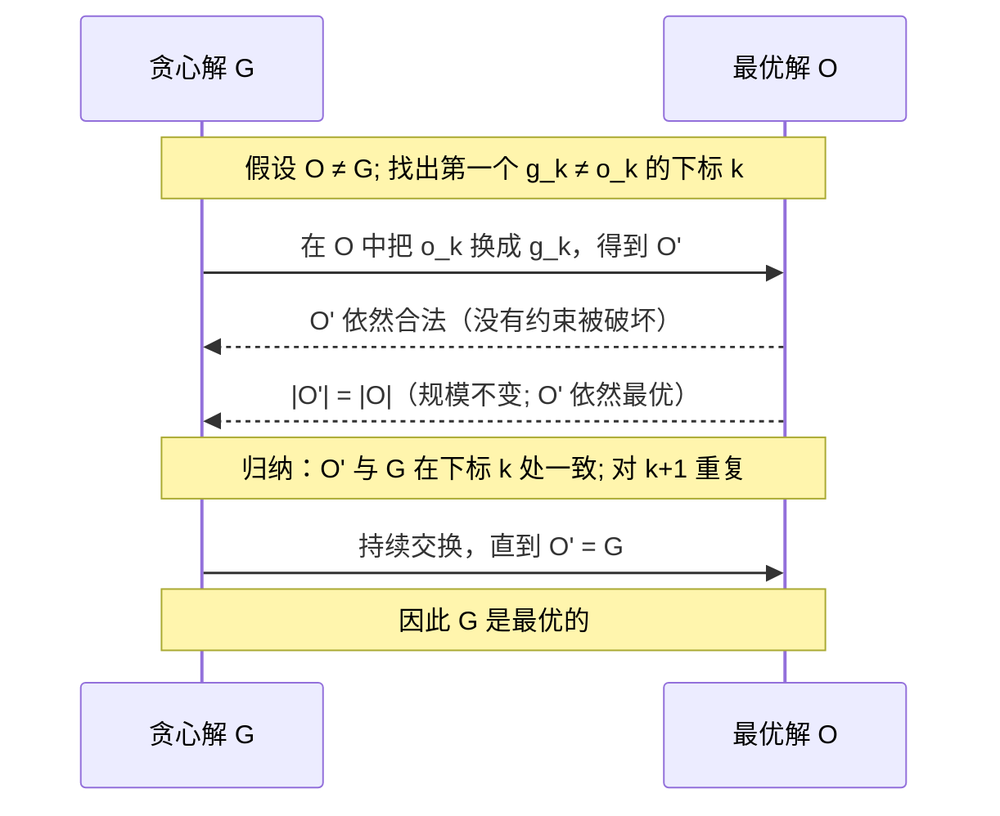
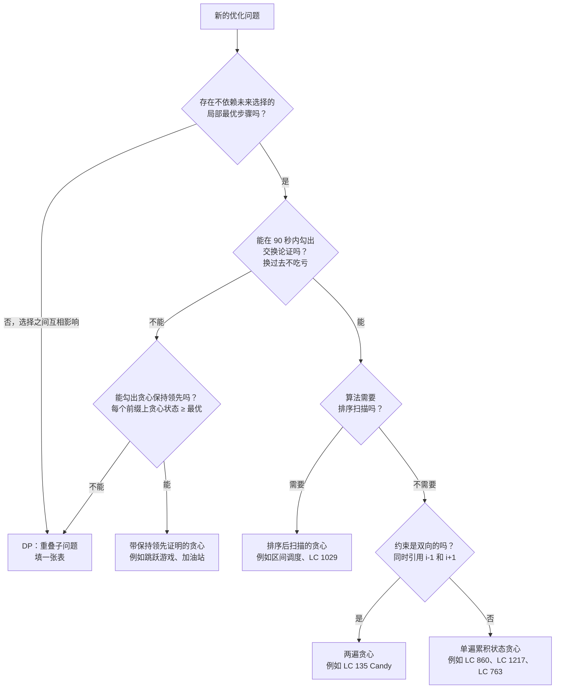

# 贪心思维：局部最优何时成立，何时不成立

把一道零钱兑换题丢给贪心求解器：面额 `[1, 3, 4]`，目标 `6`。它挑能塞进去的最大硬币，再挑下一个，再下一个：`4 + 1 + 1 = 6`。三枚硬币。最优答案是 `3 + 3`。两枚硬币。贪心算法正好差一枚硬币，而且它自己完全无从察觉。

这一个错误就是本章最有用的那个观念。[^1] 贪心算法（每一步取局部最优的动作，绝不回头）比动态规划跑得快，几行代码就能写完，在它恰好管用的时候还显得显然正确。它在另一大类问题上也照样错——那些看起来正确、LeetCode 给你的例子一个都测不出来、却会死在面试官等着的那组隐藏用例上的问题。Part 10 整部分的任务，就是教你分清这两类。本章是这一部分的思维模型：贪心什么时候可以被证明最优，什么时候不能，以及把两者区分开的证明技巧。

后面几章各自展开。[区间调度与合并](./01-interval-scheduling.md) 走一遍「先排序再扫描」这一族。[活动选择](./02-activity-selection.md) 深入处理最早结束时间这个模式。Part 10 的控件章节是[霍夫曼编码](./03-huffman-encoding.md)，那里用贪心构造最优前缀码，并附着一份写明白的交换论证。[跳跃游戏与加油站](../../../dsa/part-10-greedy/04-jump-games-gas-station.md) 讲单遍累积状态的贪心。只要你事先能认出模式的信号、两行话就能把证明勾出来，这四章都会好读得多。

## 贪心管用的时候买到了什么

贪心这套元算法有四个部件。[^1] 选定一个**贪心键**（greedy key），按它排序或排优先级；每一步取这个键指定的**贪心选择**（greedy choice）；维护一个被该选择保持住的**不变式**（invariant）；最后偿付**证明义务**（proof obligation）：这一步局部最优的动作，同时也属于某个全局最优解。前三个是机械动作，第四个才是唯一能区分「管用的算法」和「坏掉的算法」的东西。

```text
function greedy(input):
    sort or order input by some key            # 贪心键
    state <- initial
    for each item in order:
        choice <- locally-optimal move(state)  # 贪心选择
        commit choice; never revisit           # 不回溯
        state <- update(state, choice)
    return solution-from(state)
```

相对动态规划省下的开销是结构性的。DP 要填一张 `n` 维的表，`n` 是状态向量的维数，所以典型序列问题的计算量是 `O(n · m)` 或 `O(n²)`。贪心对每个决策只提交一次，每个元素上的工作是 `O(1)`。不需要排序时整个算法是 `O(n)`，需要排序就是 `O(n log n)`。跳跃游戏是最干净的示范：DP 解法从每个下标出发遍历所有可达的跳跃，是 `O(n²)`；贪心的最远可达扫描是 `O(n)`，额外空间 `O(1)`。[^2] 同一个问题，立方对线性。

这份速度是带条件的。没有正确性证明的贪心算法，只是一个长得像算法的猜测。它能编译，能过 LeetCode 给的那个例子，然后死在隐藏用例上。证明义务是真实存在的，而面试中唯一能把它偿付掉的办法，是脑子里存着那份技巧清单。

## 贪心何时可证明正确

教科书里几乎每一道贪心题，都落在这两种证明技巧之内。[^3] 两者都很短，都能在九十秒内口头勾出来。如果九十秒内两种都用不上，这题就是动态规划。

### 交换论证

交换论证是主力。形状是：假设某个最优解 `O` 与你的贪心解 `G` 在两者第一次出现分歧的位置上不同。证明把贪心选择换进 `O` 的这个位置，得到的新解 `O'` 依然合法、依然最优。再对位置做归纳，就收尾了。`O'` 与 `G` 一致的位置往后多推了一格，重复这次交换，最后 `O'` 就是 `G`。所以 `G` 本来就是最优的。



*交换论证：在两个候选解之间反复做变换。每次交换都保住合法性与最优性；当不再有分歧时，归纳结束。*

关键词是**交换**。哪个量能让交换这一步容易验证，哪个量就是该用来排序的东西。对两地调度（LC 1029），这个量是每个候选人的 `cost_a − cost_b`：如果最优解把第 `i` 个人派去 A 城、第 `j` 个人派去 B 城，但 `cost_a[i] − cost_b[i] > cost_a[j] − cost_b[j]`，那就把两人的去向往回一换，总成本会下降（或持平）。所以按 `cost_a − cost_b` 排序，前 `n/2` 个派去 A，剩下的派去 B。键选对的那一刻，证明自己就写出来了。[^4]

对区间调度，这个量是 `end[i]`。按最早结束时间排序区间。如果最优解挑了一个比贪心首选结束得更晚的区间，就把两者换过来：贪心选择结束得更早，给后面留的空间更多，交换只可能更好。这就是两句话说清的活动选择证明，也是[活动选择](./02-activity-selection.md) 那一章展开的细节。

### 贪心保持领先

第二个技巧叫「贪心保持领先」（greedy-stays-ahead）。它适用于贪心选择没法干净地和某个最优替代方案对换的场合，通常是因为算法维护的是单个滚动状态，而不是从有序列表里挑。形状是：对输入的每个前缀，证明贪心状态不差于任何可行替代方案在该位置的状态。一旦这个不变式扛过归纳步，整个输入上的结论就跟着成立。

跳跃游戏是标准案例。从左到右扫数组，用 `max_reach` 记当前能到的最远下标。处理完位置 `i` 之后，贪心的 `max_reach` 至少和其他任何算法在这一点的可达距离一样大，因为贪心考虑了直到 `i` 的每一个位置并取了最大值。如果 `i > max_reach`，答案就是 false；否则更新后继续。整个算法就是一个 for 循环加一个 max。[^2]

这个技巧的坑在于归纳假设取得太弱。[^5] 跳跃游戏 II 是只数*最少*跳跃次数、而不是判断可达性的那个变体，它需要的归纳假设比「在下标 `k` 处贪心的最远可达不劣于最优解的最远可达」更强，因为后者没法组合。正确的归纳假设要对所有 `m ≤ g_k` 的下标成立，而不只是 `g_k` 本身。讲这个变体的是[跳跃游戏与加油站](../../../dsa/part-10-greedy/04-jump-games-gas-station.md)；这里的教训是，走「贪心保持领先」这一路，值得一开始就挑最强的那个自然不变式，哪怕你眼前这个例子用弱一点的也够。

## 实例推演：Partition Labels

LC 763 Partition Labels 是本章的实例推演，因为它展示了一次只用一行话就能说清正确性的贪心决策。给定形如 `"ababcbacadefegdehijhklij"` 的字符串，把它切分成尽量长的子串，使每个字母最多出现在一个片段里。期望答案是 `[9, 7, 8]`。

```python
def partition_labels(s):
    last = {c: i for i, c in enumerate(s)}
    parts = []
    start = 0
    end = 0
    for i, c in enumerate(s):
        if last[c] > end:
            end = last[c]
        if i == end:
            parts.append(end - start + 1)
            start = i + 1
    return parts
```

**解法** — Python（[Java](./00-greedy-thinking/lc-763/sol.java) · [C++](./00-greedy-thinking/lc-763/sol.cpp) · [Go](./00-greedy-thinking/lc-763/sol.go)）

```python
# LC 763. Partition Labels
def partition_labels(s: str) -> list[int]:
    """LC 763: greedy boundary extension to last-occurrence index.

    One pre-pass to record the last index of each character; one
    main pass that extends the current partition's right boundary
    to the rightmost last-index of any character seen so far.
    Whenever the cursor reaches that boundary, the partition is
    closed. Time O(n), space O(1) (alphabet bound 26).
    """
    last = {c: i for i, c in enumerate(s)}
    parts: list[int] = []
    start = 0
    end = 0
    for i, c in enumerate(s):
        if last[c] > end:
            end = last[c]
        if i == end:
            parts.append(end - start + 1)
            start = i + 1
    return parts
```

算法分两个阶段。预处理建出 `last[c]`，即每个字符出现的最右下标。主循环走一遍字符串，把当前片段的右边界 `end` 扩展到「本片段开始以来见过的所有字符」里最大的那个 `last[c]`。当游标 `i` 追上 `end` 时，片段就闭合，新的片段从这里开始。

贪心选择就是边界扩展。每一步算法问的是：在我已经并入这个片段的字符里，哪一个的最后一次出现最靠右？把边界扩到那儿，不多扩一格。交换论证只有一句话：如果某个最优片段比贪心边界更早闭合，那么这个片段里必有一个字符在界外还出现过，这就违反了「每个字母最多出现在一个片段里」。所以贪心边界是最早的合法闭合点，也就意味着它从 `start` 出发切出的片段尽可能小，也就意味着下一个片段从这里开始，至少不比从更晚的地方开始差。一个不等式就把证明义务偿付完了。

两遍扫描的运行时间都是 `O(n)`。空间是 `O(1)`，因为字母表上界是 26。

## 贪心失效的地方

要一直记在脑子里的例子，是面额任意的零钱兑换。挑能塞进去的最大硬币，重复。`coins = [1, 5, 10, 25]`（美元面额）配任意目标，贪心都是最优的。`coins = [1, 3, 4]`、目标 `6` 时，贪心返回 `4 + 1 + 1`，三枚；最优的 `3 + 3` 是两枚。[^1] 差一枚硬币，在一道 Medium 题上就足以挂掉全部隐藏用例。

贪心在这里失效的结构性原因，是一步的选择*改变了你接下来面对哪个子问题*，而贪心看不见这件事。挑 `4` 剩下 `2`，`2` 只能由两个 `1` 凑出。挑 `3` 剩下 `3`，那正好是一枚硬币。贪心选 `4` 是局部最优（它是能塞进去的最大硬币），但它断送了小硬币本来能保住的一个未来选项。交换论证在这里失效：把 `3` 换进最优解的第一个位置，得到的解是*更好*而不是相等，归纳就无处落脚。

> [!IMPORTANT]
> 提交任何贪心之前，先跑一遍小规模反例测试。如果候选算法在一个 5 到 10 个元素的输入上给出的答案与 DP 不同，那这个算法就是错的，不管它侥幸跑过多少组大规模随机输入。最快的抓法是花九十秒在纸上写出 DP 版本，然后拿 `[1, 3, 4]` 对目标 `6` 把两者比一遍。答案不一致，就交 DP。零钱兑换本身之所以放在[无界背包](../part-9-dynamic-programming/05-knapsack-unbounded.md) 一章，正是这个原因。

由此得出的判定规则是：当候选贪心在第 `k` 步的选择*排除了*某个别的选择本来会留下的未来可能性，你手上就不是一道贪心题。你手上是一道穿着贪心外衣的 DP 题，唯一安全的应对就是像 DP 那样把各种替代方案枚举出来。

## 形式化刻画：拟阵

交换论证在某些问题上成立、在另一些上失效，不是巧合。底下有一套结构理论。**拟阵**（matroid）是一个集合系统，带两个性质：遗传性（独立集的子集仍然独立）与交换性（给定两个大小不同的独立集，你总能从大的里取一个元素把小的扩出来）。Edmonds 在 1971 年证明：在任何拟阵上贪心算法都能得到最优解；而只有拟阵上，贪心算法才总是有效。[^6]

几条有用的提醒。大多数 LeetCode 贪心题里并没有一个明显的拟阵藏着。拟阵结构在生成树上（图拟阵）、在横截集上、在一小撮调度变体上出现得很干净，但 Partition Labels 和柠檬水找零没法以任何有教学价值的方式归约成拟阵。交换论证这套框架，是拟阵结论在「形式结构不明显」的问题上的实用后代。把拟阵定理当成一个保证——你正在用的技巧有名字、有论文撑腰——而不是当成技巧本身的替代品。想要严谨的读者可以看 CLRS 第 16 章对拟阵联系的详细展开；[^7] 其他人只需要记住：交换论证是那件机械工具，拟阵是它为什么管用的解释。

## 一条决策规则

整章可以压缩成一棵树。



*本章教的那棵决策树。每个叶子都指向一个子模式和一个标准的 LC 例子；10.1 到 10.4 章逐个深入展开每个叶子。*

这四个叶子对应 Part 10 一次一章展开的四个子模式。排序后扫描（10.1、10.2）需要交换论证加一次全局排序。单遍累积状态贪心（LC 860 柠檬水找零、LC 1217 移动筹码到同一位置的最小代价、LC 763 本身）维护一个小小的滚动状态，逐个元素提交：不排序，只扫一遍，证明通常是一个不等式。两遍贪心（LC 135 Candy）用一遍正向、一遍反向处理双向约束，再用 `max` 合并。前沿推进式贪心（10.4 跳跃游戏）是在一维下标轴上把 BFS 写成贪心，因为前沿是连续的一段，所以能在 `O(n)` 内跑完。

## 常见陷阱

> [!WARNING]
> **不证明就选贪心。** 代码编译通过，跑起来了，过了 LC 给的那个例子，然后挂在隐藏用例上。候选人手上一份诊断都没有，因为他从头到尾就没有过正确性论证。修法是结构性的：动手写之前，先把交换论证口头勾出来。如果交换那一步两行话讲不通，算法就是错的，换 DP 或回溯。[^3]

> [!WARNING]
> **排序键选错。** 对区间调度，按开始时间排、按长度排、按「开始时间加长度」排，在小例子上都「管用」，都死在一个标准反例上：一个长活动挡掉了许多短活动。只有最早结束时间有证明。[^8] 修法是把排序键和交换论证绑在一起：哪个量让交换那一步容易验证，就按哪个量排序。对 LC 1029 是 `cost_a − cost_b`；对活动选择是 `end[i]`。如果一个排序键让你觉得是随手挑的，那这个算法很可能也是。

> [!WARNING]
> **该用 DP 的地方当成了贪心。** 有几道贪心题（LC 860、LC 1217、LC 763）手感很像零钱兑换。结构性差别在于：零钱兑换里挑一枚大硬币会*改变*最优子问题，贪心无法撤销这个改变；而在那几个管用的例子里，局部选择对最优子问题没有下游影响。[^1] 诊断手段还是小规模反例：如果 `[1, 3, 4]` 对目标 `6`，贪心和 DP 给出不同答案，这题就是 DP。这个检查花九十秒，能救你一次提交。

> [!WARNING]
> **忘了第二遍。** LC 135 Candy 只跑一遍正向，对 `[1, 2, 3]` 会返回正确答案（纯属巧合），对 `[1, 0, 2]` 就错了。这条约束同时引用 `i-1` 和 `i+1`，单遍扫描管不住两半。只要约束是双向的，默认就写两遍：一个方向落实左边那条规则，另一个方向落实右边那条，答案用 `max` 合并（或者用 `+`，取决于累积规则）。

> [!WARNING]
> **自创一套证明技巧。** 候选人在面试里写下一段「感觉对」的证明，但它不属于任何被承认的技巧。面试官往缺口上一戳，候选人守不住。把技巧的名字明确叫出来，歧义就没了：嘴上说「交换论证」或者「贪心保持领先」。这既表明你知道那份标准清单，也把证明从挥手比划变成一个有已知形状的结构化论断。

## 题目梯度

### 核心（三题全做才算掌握本章）

- [LC 860 — Lemonade Change](https://leetcode.com/problems/lemonade-change/) [简单] • greedy-state-tracking *(参考实现：仅 Python)*
- [LC 1217 — Minimum Cost to Move Chips to The Same Position](https://leetcode.com/problems/minimum-cost-to-move-chips-to-the-same-position/) [简单] • greedy-parity-classification *(参考实现：仅 Python)*
- [LC 763 — Partition Labels](https://leetcode.com/problems/partition-labels/) [中等] • greedy-interval-merge ★

### 进阶（可选）

- [LC 1029 — Two City Scheduling](https://leetcode.com/problems/two-city-scheduling/) [中等] • greedy-exchange-argument *(参考实现：仅 Python)*
- [LC 135 — Candy](https://leetcode.com/problems/candy/) [困难] • greedy-two-pass *(参考实现：仅 Python)*

核心这三题天然覆盖了简单和中等；困难那一格由进阶里的 LC 135 补上，这样区间调度和跳跃游戏那几道招牌困难题就能留在 10.1 到 10.4 章它们该在的位置。

## 后续衔接

[区间调度与合并](./01-interval-scheduling.md) 用完整展开的最早结束时间证明，开启「先排序再扫描」这一族。[活动选择](./02-activity-selection.md) 从教科书的视角处理同一族，其中的拟阵框架是给想要形式基础的读者准备的。[霍夫曼编码](./03-huffman-encoding.md) 是这一部分的控件章节，里面装着整套课程里最干净的交换论证。[跳跃游戏与加油站](../../../dsa/part-10-greedy/04-jump-games-gas-station.md) 讲单遍累积状态贪心，那条路靠的是「贪心保持领先」而不是交换。上面那棵决策树，就是在它们之间做选择的路线图。

## 参考文献

[^1]: LeetCopilot Team, *Why Greedy Fails on Coin Change (And When You Need Dynamic Programming Instead)*, 2025, [leetcopilot.dev/leetcode-pattern/greedy/coin-change-greedy-fails](https://web.archive.org/web/20260510042614/https://leetcopilot.dev/leetcode-pattern/greedy/coin-change-greedy-fails).

[^2]: LeetCopilot Team, *Jump Game: Why Greedy Beats DP (Proof and Complexity Comparison)*, 2025, [leetcopilot.dev/leetcode-pattern/greedy/jump-game-greedy-vs-dp](https://web.archive.org/web/20260510045324/https://leetcopilot.dev/leetcode-pattern/greedy/jump-game-greedy-vs-dp).

[^3]: LeetCopilot Team, *Exchange Argument: The Most Powerful Greedy Proof Technique (With Examples)*, 2025, [leetcopilot.dev/leetcode-pattern/greedy/exchange-argument-explained](https://web.archive.org/web/20260510052944/https://leetcopilot.dev/leetcode-pattern/greedy/exchange-argument-explained).

[^4]: walkccc, *LeetCode Solutions, 1029. Two City Scheduling*, [walkccc.me/LeetCode/problems/1029](https://walkccc.me/LeetCode/problems/1029/)

[^5]: Computer Science Stack Exchange, *Greedy Stays Ahead proof of "Jump Game"*, question 146619, 2021. <https://cs.stackexchange.com/questions/146619/greedy-stays-ahead-proof-of-jump-game>

[^6]: Edmonds, J., *Matroids and the greedy algorithm*, Mathematical Programming 1, 127–136, 1971. Cited via the survey in Wikipedia, *Greedy algorithm*, [en.wikipedia.org/wiki/Greedy_algorithm](https://en.wikipedia.org/wiki/Greedy_algorithm)

[^7]: Cormen, Leiserson, Rivest, Stein, *Introduction to Algorithms*, 4th ed., MIT Press, 2022, Chapter 15 "Greedy Algorithms" (note: greedy is Chapter 16 in older editions).

[^8]: LeetCopilot Team, *Wrong Sorting Criterion: The #1 Greedy Mistake (And How to Fix It)*, 2025, [leetcopilot.dev/leetcode-pattern/greedy/wrong-sorting-criterion](https://web.archive.org/web/20260510052013/https://leetcopilot.dev/leetcode-pattern/greedy/wrong-sorting-criterion).
