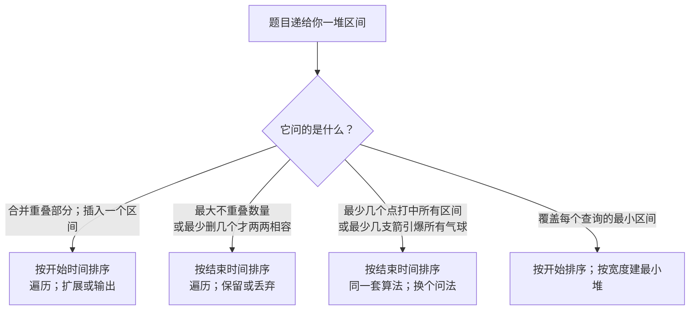

# 区间调度：比较器就是算法

你在给一间会议室排日程。四十个会议请求排在队列里，每个都是一对 `[start, end]`，其中很多彼此重叠。会议室一次只能开一个会。你希望尽量多留下请求；其余的被告知另找房间。多拒一个，老板就会发现。漏掉一次真正的冲突，算法就会把房间排炸。你先拒哪个会议？

大多数读者第一反应是*最长的那个*，或者*开始最晚的那个*，或者*冲突最多的那个*——每条听起来都合理的规则，都要用一段话才能驳倒。正确的规则只有一个字符长。按 `end` 排序，不按 `start`。整章都活在这一处替换里。

## 如何识别这个模式

区间问题按题目问什么，干净地分成四类。分类只需读一遍题干就能定，不是口味问题。



*图注：区间工具箱的四个分支。本章讲分支 D 和 E；分支 C 是同一章里当作对照的 LC 56 / LC 57 家族。分支 F 是一个伪装成区间问题的堆问题，只在进阶梯度里出现。*

[贪心思维与交换论证](./00-greedy-thinking.md) 介绍了这个技巧。区间调度是它最严格的考验，因为家族里其他成员（哈夫曼编码（Huffman codes）、Dijkstra 算法、Kruskal 最小生成树）的证明结构都继承自这一个。你能论证按结束时间排序为什么成立，就能论证其他所有经典贪心为什么成立。

## 为什么直觉解法会算错

标准题目是 LC 435，*Non-overlapping Intervals*。给定一个区间列表，返回为使剩下的区间两两不重叠，最少要移除多少个。端点相接是允许的；`[1,2]` 和 `[2,3]` 不算重叠。

多数读者刚做完 LC 56 的合并区间，会顺手用同一个比较器。按开始排序。从左往右走。遇到重叠就丢掉*当前*区间；否则保留。

```python
# 错误答案：按开始排序，遇到重叠丢掉当前区间。
def erase_overlap_brute(intervals):
    if not intervals:
        return 0
    intervals.sort(key=lambda x: x[0])  # 按 START 排序
    removed = 0
    current_end = intervals[0][1]
    for start, end in intervals[1:]:
        if start < current_end:
            removed += 1                # 丢掉这一个
        else:
            current_end = end
    return removed
```

拿 `[[1, 100], [2, 3], [3, 4]]` 跑一遍。按开始排序后，顺序没变。遍历先留下 `[1, 100]`，然后看到 `[2, 3]`（冲突，丢掉），接着看到 `[3, 4]`（仍然和已留下的 `[1, 100]` 冲突，因为 `3 < 100`，丢掉）。丢了两个。算法报 `2`。

正确答案是 `1`。丢掉 `[1, 100]`，剩下两个区间正合适。这个贪心在它看过的每一步上都做了更差的选择，因为它留下了一个吃掉剩余时间轴的区间。

Bug 不在循环里，在比较器里。按开始排序，算法就把自己锚定在*开始*最早的那个区间上，而完全没有关于这个区间会占用多少剩余时间轴的信息。一个从 1 开始、到 100 结束的区间，和一个从 1 开始、到 2 结束的区间，在读到第二个数字之前长得一模一样。

## 模式

改成按结束排序。从左往右走。留下第一个区间；对后面每个区间，如果它和游标重叠就丢掉，否则留下并推进游标。

```python
import math
from typing import List

def erase_overlap_intervals(intervals: List[List[int]]) -> int:
    """LC 435: minimum number of intervals to remove so the rest are non-overlapping."""
    if not intervals:
        return 0
    intervals.sort(key=lambda x: x[1])           # 按 END 排序
    removed = 0
    current_end = -math.inf
    for start, end in intervals:
        if start < current_end:
            removed += 1                          # 重叠；丢掉这一个
        else:
            current_end = end                     # 不重叠；采纳它
    return removed
```

**解法** — Python（[Java](./01-interval-scheduling/lc-435/sol.java) · [C++](./01-interval-scheduling/lc-435/sol.cpp) · [Go](./01-interval-scheduling/lc-435/sol.go)）

```python
# LC 435. Non-overlapping Intervals
#
# 按 END 升序排序。从左往右遍历。留下第一个区间；对后面每个区间，
# 如果它和上一个保留的结束位置重叠就丢掉，否则保留并更新游标。
# 返回丢弃的次数。
#
# 为什么按结束排序而不按开始排序：见本章的交换论证一节。按开始排序
# 在 [[1,100],[2,3],[3,4]] 这类输入上会失败——它会贪心地留下 [1,100]，
# 丢掉两个更短的区间，返回 2；最优解是留下 [2,3] 和 [3,4]，丢掉 [1,100]，
# 计数为 1。
from typing import List
import math


def erase_overlap_intervals(intervals: List[List[int]]) -> int:
    """LC 435: minimum number of intervals to remove so the rest are non-overlapping."""
    if not intervals:
        return 0
    intervals.sort(key=lambda x: x[1])  # 按 END 排序
    removed = 0
    current_end = -math.inf
    for start, end in intervals:
        if start < current_end:
            # 重叠：丢掉这个区间（保留已经选中的那个更早结束的）。
            removed += 1
        else:
            # 不重叠：采纳这个区间，把日程向后延伸。
            current_end = end
    return removed
```

同一个循环。同样多的行。比较器里只改了一个字符：`x[0]` 变成 `x[1]`。在弄坏暴力解的那个输入上，新排序产出 `[[2, 3], [3, 4], [1, 100]]`。遍历留下 `[2, 3]`，留下 `[3, 4]`（不冲突；在 3 处的相接是允许的），丢掉 `[1, 100]`（起点 1 小于位于 4 的游标）。丢一个。正确。

`start < current_end` 里的严格 `<` 是有实际作用的。LC 435 把端点相接当作不重叠。用 `<=`，`[1, 2]` 后面跟 `[2, 3]` 就会被判成冲突，在一个正确答案是 `0` 的输入上返回 `1`。定下运算符之前先读题。

## 为什么按结束时间排序最优

贪心算法正确，是一个比暴力解错误更强的论断。展示一个算法在某个输入上失败，并不能证明另一个算法永远成功。下面是证明，它是算法里最干净的交换论证之一。[^1]

令 `G` 为贪心保留的区间集合，`OPT` 为任意一个最优集合——最优解可能有多个。要证的是 `|G| = |OPT|`。

把 `G` 和 `OPT` 里的区间按结束时间排序，逐位比较：

- 贪心保留的第一个区间，按构造就是整个输入里结束时间最早的那个。记为 `g_1`。假设 `OPT` 在第一位保留的是另一个区间，记为 `o_1`。那么 `o_1` 结束得不早于 `g_1`（因为 `g_1` 是全局最早）。把 `OPT` 里的 `o_1` 换成 `g_1`。替换后的结束时间不晚于 `o_1`，所以原本与 `o_1` 相容的区间（开始时间在 `o_1.end` 之后）也一定与 `g_1` 相容。换完之后，`OPT` 仍然合法，规模也没变。

- 归纳地，假设 `G` 和 `OPT` 在前 `k` 个区间上一致。贪心在第 `k+1` 位的选择，是开始时间不早于 `g_k.end` 的所有区间里结束最早的那个。`OPT` 的第 `(k+1)` 个区间也必然开始于 `g_k.end` 或之后（因为 `OPT` 不重叠，且前 `k` 个一致），所以按贪心的选择有 `o_{k+1}.end >= g_{k+1}.end`。同样的替换论证，同样的结论。

贪心永远不会落后。如果 `G` 严格小于 `OPT`，就存在某个位置 `OPT` 有区间而 `G` 没有——但替换论证说明贪心本可以拿下那个区间，于是它就会拿下。故 `|G| = |OPT|`。

这对 LC 435 意味着什么？最多能*保留*多少不重叠区间是 `|G|`，所以最少必须*移除*多少是 `n - |G|`。两个问题互为对偶，同一套算法回答两边。

这个论证可以立刻推广到 LC 452 *Minimum Number of Arrows to Burst Balloons*。那里问的是“最少几个点能打中每个区间”；答案是互不重叠的组数，也就是贪心保留的个数。同一个循环，不同的返回值。背后的活动选择（activity selection）结论最早在 CLRS §16.1 里形式化，Kleinberg-Tardos §4.1 给了教科书篇幅的处理。[^2]

## 实例推演：LC 435 在 `[[1,2], [2,3], [3,4], [1,3]]` 上

按结束排序：`[[1,2], [1,3], [2,3], [3,4]]`。`[1,3]` 和 `[2,3]` 在结束时间 3 上并列；两种并列处理方式下算法都正确。初始化 `current_end = -∞`，`removed = 0`。遍历唯一的一次丢弃发生在第二次迭代，`[1,3]` 与已保留的 `[1,2]` 重叠。之后在 `[2,3]` 和 `[3,4]` 处又保留了两次，因为在 2 和 3 处的相接不算严格重叠。最终答案：`1`。

> **交互组件：** [区间调度：不重叠与最少箭数](../../../dsa/widgets/w-36-interval-scheduling.yml)（面板 `panel-non-overlap`）——在网站上渲染；YAML 规格描述了各个关键帧。

*静态版本：四个区间按结束时间依次进场。第一个被保留的区间 `[1,2]` 把游标钉在 2。接着 `[1,3]` 到达，被丢弃，因为它的起点 1 在游标左侧——交换论证在这里化成了单一可见事件。`[2,3]` 和 `[3,4]` 被保留；游标最后停在 4。丢一个，留三个。*

## 实际开销

| 变体 | 时间 | 空间 | 说明 |
|---|---|---|---|
| LC 435 按结束排序的贪心 | O(n log n) | O(1) 辅助空间，O(log n) 排序栈 | 本章的算法 |
| LC 56 合并（按开始排序） | O(n log n) | 输出 O(n) | 姊妹模式 |
| LC 57 插入（输入已排好序） | O(n) | O(n) | 省掉排序的特化情形 |
| 暴力：枚举所有子集 | O(2^n · n) | O(n) | 只在 `n <= 20` 时可行 |

O(n log n) 这个界由排序决定。遍历是一趟线性扫描，每个元素常数工作量，所以算法的渐进开销就是 `sorted()` 的渐进开销。在比较模型下没有算法能突破这一点：任何返回区间*顺序*的算法都能拿来排序，所以一个低于 `n log n` 的区间调度算法会蕴含一个低于 `n log n` 的排序算法。

遍历只占常数空间这个说法是精确的。循环里算法只跟踪两个整数（`current_end` 和 `removed`）和一个循环变量。Python 的 `sorted` 用 TimSort，栈空间是 `O(log n)`；如果你必须报告含排序在内的总空间，那就是这个下界。C++ 的 `std::sort` 和 Go 的 `sort.Slice` 用 introsort，最坏情况也是 `O(log n)`。

## 模式失效的场景

### 按开始时间排序，重叠时折叠合并（LC 56）

合并区间是另一个方向上的结构孪生。给定一个区间列表；返回一组最少的互不重叠区间，使它们的并集等于输入的并集。比较器翻回按开始排序；循环体改成扩展 `last.end`，而不是数丢弃的次数。

```python
def merge(intervals):
    if not intervals:
        return []
    intervals.sort(key=lambda x: x[0])           # 按 START 排序
    merged = [intervals[0][:]]
    for start, end in intervals[1:]:
        last = merged[-1]
        if start <= last[1]:                     # 相接或重叠：扩展
            last[1] = max(last[1], end)
        else:
            merged.append([start, end])
    return merged
```

两个细节要紧。比较器是 `<=` 而不是 `<`，因为 LC 56 的题干明确说在合并语义下 `[1,4]` 和 `[4,5]` 算重叠。[^3] LC 435 把这条约定反了过来；LC 56 沿用。另一个细节是 `last[1] = max(last[1], end)` 而不是 `last[1] = end`。像 `[2, 3]` 这种完全被包含的区间跟在 `[1, 10]` 后面时，无条件赋值会把 `last` 从 10 缩到 3，那就错了。`max` 才让“折叠”真的意味着折叠。

### 输入已排序时省掉排序（LC 57）

LC 57 *Insert Interval* 是 LC 56 的输入已排好序特化版。已有的区间保证有序且互不重叠；任务是把一个新的区间插进去并返回结果。再排一次序，会在一个本可以做到 `O(n)` 的题目上多出不必要的 `O(n log n)` 因子。分三段走：先复制在新区间开始之前就结束的区间，与所有重叠的区间合并，再复制剩下的。分类直接读约束条件得出。题干说“intervals were initially sorted according to their start times”，那就别再排序。

### 换成点与箭的表述（LC 452）

LC 452 *Minimum Number of Arrows* 把同一套算法藏在不同的措辞下。x 轴上画着一串气球，每个是一个区间；在坐标 `x` 处射一箭，能射爆所有包含 `x` 的气球。求射爆全部气球的最少箭数。同一个按结束排序的循环。答案是贪心*保留*的区间数（每次保留就是那支新箭的锚定区间），也就是 LC 435 算法里的 `n - removed`。两道 LeetCode 题，一套算法，两个不同的返回值。

> **交互组件：** [区间调度：不重叠与最少箭数](../../../dsa/widgets/w-36-interval-scheduling.yml)（面板 `panel-min-arrows`）——在网站上渲染；YAML 规格描述了各个关键帧。

*静态版本：四个气球按结束时间排成 `[[1,6], [2,8], [7,12], [10,16]]`；贪心在 x = 6 射出第 1 支箭（射爆 [1,6] 和 [2,8]）；在 x = 12 射出第 2 支箭（射爆 [7,12] 和 [10,16]）。答案：2 支箭。与 LC 435 报出的 `dropped = 2` 是同一套划分。*

## 常见陷阱

> [!WARNING]
> **按错了端点排序。** 用按开始排序去做 LC 435，凡是那种一个长区间遮住好几个短区间的输入都会算错。写下比较器之前先做这个反射测试：题目要的是*折叠*还是*计数*？折叠按开始，计数按结束。实在记不住就写在便签上贴着。

> [!WARNING]
> **Java 和 Go 里减法比较器溢出。** 简写 `(a, b) -> a[1] - b[1]` 看起来没问题，在 LC 示例覆盖的每个输入上都能跑。可碰到接近 `Integer.MAX_VALUE` 的对抗性输入，减法会回绕，比较器返回错误的符号，`Arrays.sort` 抛出 *Comparison method violates its general contract*。Java 里用 `Integer.compare(a[1], b[1])`，Go 里用 `cmp.Compare(a[1], b[1])`。本章的参考实现全都用安全写法。

第三个坑值得单独一句：Go 里 `merged := [][]int{intervals[0]}` 会别名到输入切片，之后对 `last[1]` 的赋值会改掉调用方的数据。append 时逐元素复制，每次都这样。

## 题目梯度

### 核心（三题全做才算掌握本章）

- [LC 435 — Non-overlapping Intervals](https://leetcode.com/problems/non-overlapping-intervals/) [中等] • sort-by-end-greedy-max-compatible ★
- [LC 56 — Merge Intervals](https://leetcode.com/problems/merge-intervals/) [中等] • sort-by-start-merge-overlapping
- [LC 57 — Insert Interval](https://leetcode.com/problems/insert-interval/) [中等] • sorted-intervals-three-phase-splice

### 进阶（可选）

- [LC 1851 — Minimum Interval to Include Each Query](https://leetcode.com/problems/minimum-interval-to-include-each-query/) [困难] • sort-and-heap-for-coverage-query
- [LC 252 — Meeting Rooms](https://leetcode.com/problems/meeting-rooms/) [简单] • overlap-detection-on-sorted-pairs *（Premium；免费替代是 LC 56）*

核心三题逼读者在同一章里切换比较器：LC 435 训练按结束排序的条件反射，LC 56 训练按开始排序的镜像，LC 57 干脆把排序整个剥掉。能三题都从零写出来的人，就算把工具箱的这个分野内化了。LC 1851 提升为以宽度为堆键的重新表述；堆的机制归 [堆与优先队列](../part-6-trees-heaps/04-heaps-priority-queues.md) 管，本章只做交叉引用，不重复推导。LC 252 是 Premium 题，但各个付费 LeetCode 镜像都印证了算法退化成 LC 56 的首次冲突检查。[^4]

## 后续衔接

按结束排序的贪心是一招解多题。换一个返回值再用一次，就有了点与箭家族——*最少几个点打中每个区间*还是同一个循环，只是报 `kept` 而不是 `dropped`。区间上的容量统计（LC 253 *Meeting Rooms II*、LC 1094 *Car Pooling*）在隔壁分支：当答案是“任意时刻最多有多少个区间重叠”时，把每个区间拆成开始处的 `+1` 事件和结束处的 `-1` 事件，给事件排序，扫一遍。这个家族在 [前缀和与差分数组](../part-3-pointers-window-prefix/04-prefix-sums.md) 里讲，因为扫描状态是一个滚动计数器，不是一个区间对象。

再隔两个模式，按结束排序的贪心推广到*带权*区间调度：每个区间带一个价值，目标是选出一个不重叠子集使总价值最大。一旦挂上权重，贪心就不管用了；问题变成在排好序的区间上做动态规划。那段故事在 [区间 DP](../part-9-dynamic-programming/11-interval-dp.md)。

## 参考文献

[^1]: Wikipedia, "Interval scheduling," <https://en.wikipedia.org/wiki/Interval_scheduling>

[^2]: Cormen, Leiserson, Rivest, Stein, *Introduction to Algorithms*, 4th ed., MIT Press, 2022, §16.1 "An activity-selection problem"; and Kleinberg & Tardos, *Algorithm Design*, Pearson/Addison-Wesley, 2006, §4.1.

[^3]: walkccc/LeetCode, "56. Merge Intervals," <https://walkccc.me/LeetCode/problems/56/>

[^4]: walkccc/LeetCode, "435. Non-overlapping Intervals," <https://walkccc.me/LeetCode/problems/435/>
