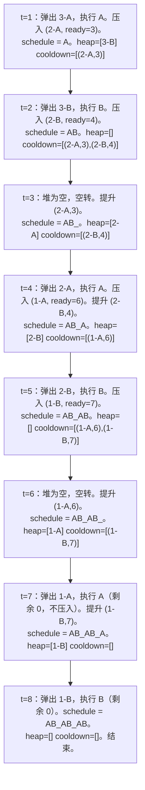

# 活动选择与任务调度器家族

一台 CPU 的队列里排着六个任务：`["A", "A", "A", "B", "B", "B"]`。麻烦在于冷却规则：同一个任务两次执行之间至少隔两个 tick。跑一次 `A`，`A` 在接下来两个 tick 内就被锁住。必要时 CPU 可以空转。把全部任务跑完的最短排期是多少？

先在纸上试试，再往下读。八个 tick 可行，七个不行。达到八个的那个排期是 `A B _ A B _ A B`，其中两个空槽是被迫空转的。这就是 LeetCode 621，它是一族问题里最干净的样本，而这一族共用一个算法脊椎：一个大顶堆管“还剩什么要做”，一个队列管“刚跑完、正在冷却”。同一副骨架能处理带冷却的任务调度、无相邻重复字母的重排、单 CPU 作业排序，以及共享长椅的入座模拟。六道 LeetCode 题，同一个形状。

## 为什么直觉排期会失败

多数读者第一反应是轮转（round-robin）：按顺序循环各种任务类型，直到全部做完。对 `["A", "A", "A", "B", "B", "B"]`、冷却 `n = 2`，轮转产出长度为 6 的 `A B A B A B`。错了：第二个 `A` 在第 3 个 tick 执行，距第 1 个 tick 的第一个 `A` 只隔两个 tick，违反 `n = 2` 的冷却（同一任务要等*至少* `n` 个 tick，所以下一个 `A` 最早只能排到第 4 个 tick）。

第二个直觉是先把最频繁的任务跑光：`A A A B B B`。前三个 `A` 每三个 tick 才挤得进一个合法槽位，排期一下子膨胀到十二。

正确答案来自一个值得点名的归约：**每个 tick 都调度当前已就绪任务里最频繁的那个。** 如果两个任务剩余次数相同，选哪个都行。如果没有任何任务就绪，CPU 就空转。这句话就是整个算法。下面那些机制只是让这句话跑得起来的记账。

“最频繁且就绪者胜”之所以成立，靠的是和 [区间调度：比较器就是算法](./01-interval-scheduling.md) 同一个交换论证。假设某个最优排期把最频繁的任务推迟到比必要更晚的 tick。把这次推迟的执行与顶替它的那次交换；交换是合法的（两个任务在这两个 tick 上都已就绪），结果排期不比原来长，所以贪心选择是安全的。CLRS 第 16 章 §16.1 为教科书的活动选择问题写下了同一套模板，只是那里的优先级键是完成时间而不是频率。[^1]

## 脊椎

两个数据结构协作。一个大顶堆保存所有当前已就绪任务的剩余次数。一个 FIFO 队列保存刚跑过的任务，以及它们重新可用的 tick。每个 tick 按顺序做三件事：弹出堆里最频繁的任务并执行，如果它还有剩余就压进冷却队列，最后把冷却队列里已到可用时间的条目提升回堆。这个循环重复到两个结构都空了，排期就构造出来了。

```python
def least_interval(tasks, n):
    if n == 0:
        return len(tasks)
    counts = Counter(tasks)
    heap = [-c for c in counts.values()]
    heapq.heapify(heap)
    cooldown = deque()
    time = 0
    while heap or cooldown:
        time += 1
        if heap:
            neg_c = heapq.heappop(heap)
            remaining = -neg_c - 1
            if remaining > 0:
                cooldown.append((-remaining, time + n))
        if cooldown and cooldown[0][1] == time:
            ready_neg, _ = cooldown.popleft()
            heapq.heappush(heap, ready_neg)
    return time
```

**解法** — Python ([Java](./02-activity-selection/lc-621/sol.java) · [C++](./02-activity-selection/lc-621/sol.cpp) · [Go](./02-activity-selection/lc-621/sol.go))

```python
# LC 621. Task Scheduler
from collections import Counter, deque
import heapq


def least_interval(tasks, n):
    """LC 621 Task Scheduler: minimum CPU intervals to finish all tasks
    with cooldown n between identical tasks."""
    if n == 0:
        return len(tasks)
    counts = Counter(tasks)
    # Python 的 heapq 是小顶堆；把次数取负就成大顶堆行为。
    heap = [-c for c in counts.values()]
    heapq.heapify(heap)
    cooldown = deque()  # (取负的剩余次数, 可用时间)
    time = 0
    while heap or cooldown:
        time += 1
        if heap:
            neg_c = heapq.heappop(heap)
            remaining = -neg_c - 1
            if remaining > 0:
                cooldown.append((-remaining, time + n))
        if cooldown and cooldown[0][1] == time:
            ready_neg, _ = cooldown.popleft()
            heapq.heappush(heap, ready_neg)
    return time
```

这段代码里只有三处真正在干活，其余都是机械操作。

取负那行 `[-c for c in counts.values()]` 存在的原因是 Python 的 `heapq` 是小顶堆。取负让它在绝对值上变成大顶堆。这一轮 C++ 占了便宜，`std::priority_queue<int>` 默认就是大顶堆。Java 需要 `Comparator.reverseOrder()`。Go 需要在堆接口的 `Less` 方法里翻转不等号。四门语言最终是同一个形状，只有 Python 的取负技巧不那么直观。

冷却队列是 FIFO，因为先进入的任务先到可用时间。新条目总是进队尾；队头总是下一个要被提升的。一个普通 deque 就够了，这一侧不需要优先队列。

“先提升、后执行”的顺序在 `n = 1` 时才显出重要性。冷却为 `n` 时，第 `t` 个 tick 跑过的任务在第 `t + n + 1` 个 tick 重新可用。检查 `cooldown[0][1] == time` 跑在堆弹出*之后*，所以刚跑完的任务不可能在同一个 tick 里把自己提升回来。把这个顺序倒过来，`n = 1` 的任务就会背靠背连续执行，冷却被破坏。

## 走一遍标准输入

在 `tasks = ["A", "A", "A", "B", "B", "B"]`、`n = 2` 上跑脊椎。初始状态：`heap = [3-A, 3-B]`、`cooldown = []`、`time = 0`。循环先把时间加一，然后执行堆顶（如果有），再把冷却队列里可用时间等于新 tick 的条目提升回堆。



*堆-冷却脊椎在 `AAABBB`、`n = 2` 上跑过的八个 tick。第 3 和第 6 个 tick 是被迫空转，因为冷却扣着唯一就绪的候选不放。最终得到的排期 `A B _ A B _ A B`，正是下一节那个公式预测的结果。*

八个 tick 的总数正是公式 `(f_max - 1) × (n + 1) + max_count = (3 - 1) × 3 + 2 = 8` 预测的。[^2] 那个公式就是下一节。

## 闭式替代解

当问题*只*问“总共多少个 tick”、不要排期本身时，LC 621 有一个一行答案。[^2]

```python
def least_interval_formula(tasks, n):
    counts = Counter(tasks).values()
    f_max = max(counts)
    max_count = sum(1 for c in counts if c == f_max)
    return max((f_max - 1) * (n + 1) + max_count, len(tasks))
```

推导很短。最频繁的任务出现 `f_max` 次，每次之间至少隔 `n` 个其他 tick，前 `f_max - 1` 个 `(一个任务 + n 个冷却槽)` 的块用掉 `(f_max - 1) × (n + 1)` 个 tick。最频繁任务的最后一份再加一个 tick，另外每一个同为最大值的任务也各占一个 tick。合起来就是 `(f_max - 1) × (n + 1) + max_count`。`max(..., len(tasks))` 这个夹取兜住另一种情况：非最频繁的任务足够多，把每个冷却槽都填满还溢出到不完整的一轮，这时答案就是任务总数本身。没有这个夹取，像 `["A", "C", "A", "B", "D", "B"]`、`n = 1` 这样的输入会返回 5，而正确答案是 6。[^2]

公式很优雅，但本章教的是堆脊椎，因为公式不产出*排期*，只产出长度，而下面四个近亲都需要排期本身或者更复杂的目标。公式是针对一个特定问题的闭式解；脊椎是一件能扩展的工具。

## 模式失效的场景

五道 LeetCode 题共用这套堆加队列的脊椎，优先级键和队列的职责随题目互换。

### 同一脊椎，冷却为一（LC 767）

LC 767 *Reorganize String* 问：重排一个字符串，使任意两个相邻字符都不相同。冷却 `n = 1`，外加一个额外麻烦：一个在不可行输入上快速失败的可行性检查。

长度为 `len` 的字符串最多有 `ceil(len / 2)` 个偶数下标位置。最频繁的字符必须塞得进这些位置才不会相邻。如果 `f_max > (len + 1) / 2`，任何重排都不成立，算法立刻返回 `""`。[^3] 这个检查只有一行算术，跑在堆循环之前。省掉它，堆构造要么死循环（堆被抽空，被扣住的字符回不来），要么输出带相邻重复的字符串。

```python
def reorganize_string(s):
    counts = Counter(s)
    if max(counts.values()) > (len(s) + 1) // 2:
        return ""
    heap = [(-c, ch) for ch, c in counts.items()]
    heapq.heapify(heap)
    out = []
    prev = (0, "")
    while heap:
        neg_c, ch = heapq.heappop(heap)
        out.append(ch)
        if prev[0] < 0:
            heapq.heappush(heap, prev)
        prev = (neg_c + 1, ch)
    return "".join(out)
```

相对 LC 621 的脊椎有三处变化。冷却队列塌缩成一个 `prev` 槽，因为 `n = 1` 意味着恰好隔一个 tick，也就是只扣一个条目。堆里存 `(count, char)`，因为输出要在意字符是谁。顶部那个鸽笼检查是承重的前提条件。

### 同一脊椎，优先级键互换（LC 1834）

LC 1834 *Single-Threaded CPU* 问：作业在已知时刻到达，每个都有执行时长；把它们排到一台 CPU 上，使得每个决策点上 CPU 执行的都是已到达作业中时长最短的那个。优先级键从频率翻成 `(duration, original_index)`。冷却队列变成到达时间事件队列。还是那个堆加队列，职责不同。

循环的形状：按到达时间给作业排序。模拟时间向前扫。凡是到达时间已过的作业就推进小顶堆。弹出堆里时长最短的作业，执行它（时间推进它的时长），把原始下标追加到答案。空闲时间就是堆变空到下一个到达之间的间隔；把时间直接跳到下一个到达就跨过去了。

一个真实的坑值得标出来：时间累加器会溢出 32 位整数。[^4] LC 1834 的约束允许最多 10^5 个作业、处理时间最大 10^9，累计时间可达 10^14。Java 要用 `long`；C++ 要用 `long long`；Go 要用 `int64`。Python 没事，因为整数按需增长。

### 同一脊椎，双堆（LC 1942）

LC 1942 *The Number of the Smallest Unoccupied Chair* 问：朋友们来开会，各自有到达和离开时间，每次有人到达就分配编号最小的空椅子。朋友 `k` 会坐到哪把椅子？

脊椎分叉成两个堆。一个小顶堆存空闲椅子编号（每次到达时弹出，取出最小空椅）。第二个小顶堆存已占用椅子的 `(leave_time, chair)` 对（每次到达时清空，释放所有离开时间已过的椅子）。两个堆协作：离开把椅子从“占用”挪到“空闲”，到达做反向操作。只用一个堆、靠递增 `next_unsat_chair` 计数而不回收腾出的椅子，这种错法一旦在某次后续事件中让小编号椅子变空，立刻给出错答案。[^4]

### 教科书的祖先（CLRS 16.1）

CLRS 16.1 的经典活动选择问题是这一族的退化情形 `n = 0`，优先级键是完成时间。给定若干用 `(start, finish)` 描述的活动，选出互相兼容的最大子集。按完成时间排序；从左到右扫；凡是开始时间不早于上一个选中活动完成时间的都选。章节 [区间调度：比较器就是算法](./01-interval-scheduling.md) 深入讲了这套脊椎，包括作为标准 LeetCode 映射的 LC 435 *Non-overlapping Intervals*。CLRS 16.1 的定理 16.1 用同一个交换论证证明贪心选择安全，也正是这里“最频繁且就绪者胜”的依据。[^1]

本章的脊椎就是教科书活动选择算法在冷却间隔从零变正、优先级键从完成时间换成频率之后的样子。证明技术经受住了替换；机制做了适配。

## 实际开销

| 变体 | 时间 | 空间 | 备注 |
|---|---|---|---|
| LC 621 堆脊椎（本章） | O(T log k)，k ≤ 26 | O(k) | T 是排期总长度 |
| LC 621 闭式公式 | O(n) | O(k)，k = 26 | 只算长度，不给排期 |
| LC 767 Reorganize String | O(n log k)，k ≤ 26 | O(k) | 含 O(n) 可行性预检 |
| LC 1834 Single-Threaded CPU | O(n log n) | O(n) | 排序主导 |
| LC 1942 Smallest Unoccupied Chair | O(n log n) | O(n) | 双堆 |
| LC 358 Rearrange k Distance Apart | O(26n) = O(n) | O(26) = O(1) | 有界字母表技巧 |
| CLRS 16.1 activity-selection | O(n log n) | O(1) 辅助 | 按完成时间排序 |

堆脊椎的界值得用一句话说明。堆里最多有 `k` 个不同键，字母类问题 `k` 是 26，任意任务 ID 时 `k` 是 `n`。每个 tick 最多一次压入和一次弹出，各是 O(log k)。总工作量 O(T log k)，其中 T 是排期长度，上界是 `(f_max - 1) × (n + 1) + max_count`。`k = 26` 时 `log k` 是常数，界就塌缩成 O(T)。[^2] 闭式公式完全跳过逐 tick 的工作，光算次数是 O(n)，这也是它作为替代方案存在的原因。

## 两个最容易踩的坑

> [!WARNING]
> **在冷却到期前把刚弹出的任务压回堆。** 新手把“弹出、减一、压回”（不涉及冷却时这是对的）和尊重冷却的版本混为一谈。可见症状是排期里出现相邻重复，总时长偏小。修法是让每个弹出的任务都经过冷却队列（`n = 1` 时经过 `prev` 槽），由提升步骤在可用时间到达时才把它送回堆。检查 `cooldown[0][1] == time` 在同一个 tick 的执行步骤之后跑，这正是第 `t` 个 tick 跑过的任务不会在同一 tick 里把自己提升回来的原因。

> [!WARNING]
> **跳过 LC 767 的鸽笼检查。** 长度为 `len` 的字符串最多容纳 `ceil(len / 2)` 个偶数下标位置。如果最频繁字符的出现次数超过 `(len + 1) / 2`，没有任何重排能避免相邻，算法必须在堆循环开始前返回 `""`。省掉检查，堆构造要么死循环（被扣住的字符回不来，因为堆空了），要么吐出带相邻重复的字符串被 LC 测试抓住。边界 `f_max ≤ (len + 1) / 2` 是让算法其余部分安全的前提。[^3]

还有第三个陷阱顺带一提：LC 1834 里的 `long` 累加器。累计时间可达 10^14，32 位整数在 Java 和 C++ 里会静默溢出。Python 免疫，另外三门语言不免疫。忽略这一点的生产代码在较大的 LeetCode 测试上返回垃圾数据，而不会造成任何可见崩溃。

## 题目梯度

### 核心（全做才算掌握本章）

- [LC 621 — Task Scheduler](https://leetcode.com/problems/task-scheduler/) [中等] • heap-greedy-cooldown ★
- [LC 767 — Reorganize String](https://leetcode.com/problems/reorganize-string/) [中等] • heap-greedy-cooldown *(参考实现：仅 Python)*
- [LC 1834 — Single-Threaded CPU](https://leetcode.com/problems/single-threaded-cpu/) [中等] • heap-priority-by-key *(参考实现：仅 Python)*

### 进阶（可选）

- [LC 1405 — Longest Happy String](https://leetcode.com/problems/longest-happy-string/) [中等] • heap-greedy-cooldown *(参考实现：仅 Python)*
- [LC 1942 — The Number of the Smallest Unoccupied Chair](https://leetcode.com/problems/the-number-of-the-smallest-unoccupied-chair/) [中等] • heap-greedy-event-driven *(参考实现：仅 Python)*
- [LC 358 — Rearrange String k Distance Apart](https://leetcode.com/problems/rearrange-string-k-distance-apart/) [困难] • heap-greedy-cooldown *(参考实现：仅 Python)*

LC 621 是本章的招牌题（★），也是堆加冷却脊椎最干净的演示。CORE 三题练的是脊椎的三处承重变化：身份（LC 621，按频率设键的冷却）、无相邻（LC 767，单槽扣留）、CPU 调度（LC 1834，键从频率翻成时长）。这个模式在面试轮转里没有标准的简单难度 LeetCode 题；算法上的最低配置（堆 + 冷却队列 + 频率表）本身就已经是中等难度的组合。本章的题目梯度在题目登记表里带 `core-emh-via-stretch` 策展标记：困难档由 LC 358（Premium）填补，核心档用免费的 LC 767 作为中等难度等效。

## 后续衔接

两条线从这里接下去。

堆贪心的证明技术可推广到任何“局部决策、全局证明”的贪心算法，只要交换论证能支撑局部选择。[Huffman 编码](./03-huffman-encoding.md) 是下一章，也是最近的兄弟：不同的目标（构造最优前缀码），同一个堆驱动算法（取两个最小值、合并、把合并节点压回），同一套交换论证的证明模板。堆的键不再是剩余次数或时长，而是子树权重。同一个形状，不同的优先级。

脊椎里冷却队列那一半在 [Dijkstra 最短路径](../part-8-graphs/09-dijkstra.md) 里换了名字再次出现。Dijkstra 的松弛让顶点经过一个按暂定距离设键的优先队列；已定稿的顶点不能重新进入，这与“刚弹出就进冷却”是同一条规则，只是冷却设为无穷。支撑这两个算法的交换论证证明技术，Part 10 后面讲贪心正确性的那一章会有正式处理；眼下在 `AAABBB` 上的推演就是工作直觉。

## 参考文献

[^1]: Cormen, Leiserson, Rivest, Stein, *Introduction to Algorithms*, 4th ed., MIT Press, 2022, Chapter 16 §16.1 "An activity-selection problem," Theorem 16.1 (greedy choice yields optimal activity-selection).

[^2]: walkccc, "621. Task Scheduler" LeetCode solutions mirror, accessed 2026-05-20. <https://walkccc.me/LeetCode/problems/0621/>.

[^3]: AlgoMaster, "Reorganize String" tutorial, accessed 2026-05-20. <https://algomaster.io/learn/dsa/reorganize-string>.

[^4]: walkccc, "1834. Single-Threaded CPU" LeetCode solutions mirror, accessed 2026-05-20. <https://walkccc.me/LeetCode/problems/1834/>.
