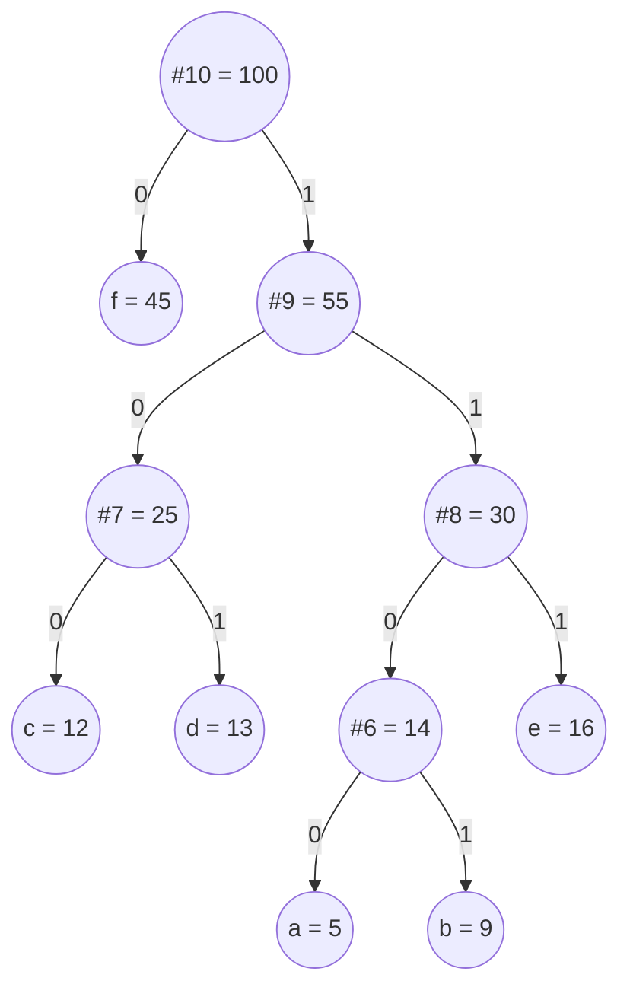
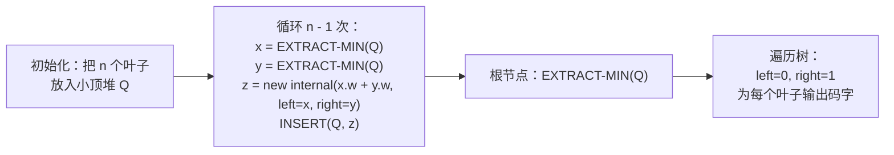

# 霍夫曼编码

1951 年春天，David Huffman 还是 MIT 的研究生，上着 Robert Fano 的信息论课。这门课给了两个选择：参加期末考试，或者写一篇关于最优二进制码的学期论文。Huffman 选了写论文。他做了几周，走进死胡同，正准备放弃去突击备考，答案却在一个瞬间的反转里出现了。Fano 和 Shannon 一直在自顶向下地造编码，先决定哪些符号拿到短码字。Huffman 把方向翻了过来。自底向上建树：取两个频率最低的符号，把它们粘在同一个父节点下，把这个父节点当成一个权重为两者之和的新符号，重复。得到的编码可以被证明是最优的。这篇论文只有三页，1952 年 9 月发表在 *Proceedings of the IRE* 上。

七十四年后，这个算法依然是承重的。每次你解压一个文件、解码一张 JPEG、或者用 MP3 播一首歌，背后都有一个霍夫曼表在被遍历。[^1] [^2] 两个想法合起来让它跑得动：一个能在 O(log n) 内浮出两个最小权重的小顶堆（min-heap），以及这样一个贪心选择——这两个权重*永远*是下一步该合并的那一对。本章的重心在第二个想法上。证明很短。难的是真正相信它。

## 我们要构建什么

给定一组 `(symbol, frequency)` 对构成的多重集，构造一棵二叉树，叶子是这些符号，并且总的*加权路径长度*（对每个叶子求 `frequency × depth` 之和）尽可能小。每个符号的码字就是从根到该叶子的路径，`0` 表示“左”，`1` 表示“右”。频率高的符号落在靠近顶部的位置，码字短；稀有的符号拿到长码字。总开销就是这种频率分布的长消息压缩后要占的比特数。

经典实例逐字抄自 CLRS 图 16.4：六个字符，频率为 `a:5 b:9 c:12 d:13 e:16 f:45`。[^3] 定长 3 比特编码要用 `(5 + 9 + 12 + 13 + 16 + 45) × 3 = 300` 比特。同样输入上霍夫曼树的开销是 `5·4 + 9·4 + 12·3 + 13·3 + 16·3 + 45·1 = 224` 比特，减少了 25%，没有损失，不需要压缩库，只是树选对了。[^3]

关于这棵树的两个结构性事实值得先说清楚，因为算法同时依赖这两点。

这棵树是**前缀码**：没有任何码字是另一个码字的前缀。这一点从“每个符号都是叶子”自动成立；一旦走到叶子就停下，下一个比特必然开始一次新的根到叶行走。解码没有歧义，不需要分隔符。

这棵树是**满的**：每个内部节点都恰好有两个孩子。缺一个孩子的树可以被证明是次优的，因为把独子往上提一层会严格减小加权路径长度。两个事实后面都会再出现：前缀性质出现在码字遍历里，满性不变式出现在最优性证明里，还出现在 `n = 1` 的边界情况里。



*图注：频率为 a:5 b:9 c:12 d:13 e:16 f:45 的最优霍夫曼树。总加权路径长度 224 比特。频率最高的符号（`f`，45）距根只有一条边；频率最低的两个（`a:5` 和 `b:9`）深达四条边，共用一个父节点。*

## 算法

整个过程是 `n - 1` 轮同样的三步循环。先初始化一个小顶堆，装入全部 `n` 个叶子节点，以频率为键。然后反复取出两个最小的，在一个权重为两者之和的新内部节点下把它们合并，再把新节点推回堆里。`n - 1` 轮之后堆里只剩一个节点——根。



*图注：四个阶段——初始化、反复取出并合并、返回根、遍历码字。下面的动画组件按顺序渲染这四个阶段，阶段之间用阶段横幅过渡。*

代码：

```python
import heapq
from dataclasses import dataclass, field
from typing import Optional

@dataclass(order=True)
class Node:
    weight: int
    order: int                                       # 决胜字段；见陷阱 §1
    char: Optional[str] = field(default=None, compare=False)
    left: Optional["Node"] = field(default=None, compare=False)
    right: Optional["Node"] = field(default=None, compare=False)

def build_huffman_tree(freqs: dict[str, int]) -> Optional[Node]:
    if not freqs:
        return None
    heap: list[Node] = []
    counter = 0
    for ch, w in freqs.items():
        heapq.heappush(heap, Node(weight=w, order=counter, char=ch))
        counter += 1
    if len(heap) == 1:                               # n = 1 的边界情况
        only = heapq.heappop(heap)
        return Node(weight=only.weight, order=counter, left=only)
    while len(heap) > 1:
        x = heapq.heappop(heap)
        y = heapq.heappop(heap)
        merged = Node(weight=x.weight + y.weight, order=counter, left=x, right=y)
        counter += 1
        heapq.heappush(heap, merged)
    return heap[0]
```

三个细节值得占这些篇幅。

`Node` 上的 `order` 字段是严格的决胜字段。当两个堆元素权重相同时（真实文本里很常见），堆库会尝试比较下一个字段来断开平局。没有 `order`，这次比较就落到 `char` 上，或者落到节点对象本身，程序要么走出一条不确定的分支，要么抛 `TypeError`。每次 push 都自增的整数计数器保证了全序。陷阱 §1 讲了这种 bug 在各语言里的具体表现。

`n = 1` 的保护把一个孤零零的叶子包进一个哑父节点。只有一个符号时，合并循环一次都不会执行，这个叶子会以空串作为码字，这会破坏解码，因为前缀性质要求码字非空。[^3] 包一层之后码字长度被强制为 1，这也是所有生产级编解码器的做法。

输出码字的遍历是一次深度优先遍历，左边界标 `0`，右边界标 `1`，在每个叶子处累积路径字符串：

```python
def codebook(root: Optional[Node]) -> dict[str, str]:
    if root is None:
        return {}
    out: dict[str, str] = {}
    def walk(node: Node, path: str) -> None:
        if node.char is not None and node.left is None and node.right is None:
            out[node.char] = path or "0"
            return
        if node.left is not None:
            walk(node.left, path + "0")
        if node.right is not None:
            walk(node.right, path + "1")
    walk(root, "")
    return out
```

四个实现都在 2026-05-20 用 CLRS 的标准输入外加三个边界情况编译并复核过。[^3]

## 看它跑一遍

动画组件就是本章；这段文字只叙述答案发生变化的那些时刻。在 `freqs = {a:5, b:9, c:12, d:13, e:16, f:45}` 上运行：

初始化阶段把六个叶子入队；堆按权重排序，`f` 待在它该待的队尾。第一次合并取出 `a (5)` 和 `b (9)`，造出内部节点 `#6 (14)`，推回堆里。此时堆里是 `[c:12, d:13, #6:14, e:16, f:45]`。注意 `#6` 排到了 `e` 前面：新的内部权重压过了 `e`，尽管 `e` 是叶子。堆里叶子和内部节点没有类别之分，只有权重说了算。

第二次合并取 `c (12)` 和 `d (13)` 组成 `#7 (25)`。第三次取 `#6 (14)` 和 `e (16)` 组成 `#8 (30)`。此时堆是 `[#7:25, #8:30, f:45]`。第四次合并把两个内部节点（都不是叶子）合成 `#9 (55)`。第五次也是最后一次合并把 `f (45)` 和 `#9 (55)` 合成 `#10 (100)`，也就是根。

最关键的一个画面是第五次合并。`f` 在堆里连续四轮没被碰过；其他每个符号都在它周围被折进越来越大的内部节点。直到最后一步，`f` 才和字母表的其余部分融合。这就是为什么 `f` 距根只有一条边、码字是 `0`：它躲过了每一次合并直到最后，而围着它做的那些合并，每轮都在给其他所有符号加一比特深度。

码字遍历是 DFS 先序。从根向左到 `f`：码字 `0`。回到根，向右到 `#9`，再向左到 `#7`，再向左到 `c`：码字 `100`。继续：`d` 是 `101`，`e` 是 `111`，`a` 是 `1100`，`b` 是 `1101`。码字*长度*的多重集 `{1, 3, 3, 3, 4, 4}` 是唯一的；比特分配不唯一，因为交换任意一对兄弟会得到同样最优但比特不同的编码。[^4]

> **Interactive widget:** [霍夫曼编码（小顶堆 + 建树 + 码字遍历）](../../../dsa/widgets/w-39-huffman-encoding.yml) —— 在网站上渲染；YAML 规格描述了关键帧。

*静态回退：阶段横幅依次切换初始化、取出两个并合并、树建成、码字遍历。38 步的跟踪显示堆在五次合并中从 6 个元素缩到 1 个（根），随后 DFS 遍历输出六个码字。最终加权路径长度 224 比特。*

## 为什么霍夫曼编码是最优前缀码

贪心选择（现在就合并两个最小的）看起来像个启发式。也许早期做一个更聪明的选择，能让后面的选择赢得更多。证明不存在这种更聪明选择的过程有两块，CLRS §16.3 把它们写成引理 16.2 和引理 16.3。[^3] 下面这版是同一个论证的压缩版。

**贪心选择性质。** *设 `x` 和 `y` 是频率最低的两个符号。存在一棵最优前缀码树，其中 `x` 和 `y` 是最大深度上的一对兄弟。*

假设 `T` 是任意一棵最优树。在 `T` 的最深一层取两个兄弟 `b` 和 `c`。不失一般性，设 `freq[b] ≤ freq[c]`。现在看把 `x` 和 `b` 交换、把 `y` 和 `c` 交换会发生什么。把得到的树记作 `T'`。

一次交换（比如 `x ↔ b`）带来的加权路径长度变化是：

```text
ΔWPL = (freq[x] · depth(b) + freq[b] · depth(x)) - (freq[x] · depth(x) + freq[b] · depth(b))
     = (freq[b] - freq[x]) · (depth(x) - depth(b))
```

因为 `x` 属于频率最低的两个符号，`freq[x] ≤ freq[b]`，所以 `freq[b] - freq[x] ≥ 0`。因为 `b` 处在最大深度，`depth(x) ≤ depth(b)`，所以 `depth(x) - depth(b) ≤ 0`。非负数乘非正数还是非正数：`ΔWPL ≤ 0`。交换不会增加开销。对 `y ↔ c` 同理。所以 `T'` 至少和 `T` 一样便宜，也就是说 `T'` 也是最优的，而在 `T'` 里 `x` 和 `y` 是最大深度上的兄弟。因此贪心的第一步是安全的；某棵最优树包含它。

**最优子结构。** *设 `z` 是融合 `x` 和 `y` 的内部节点（于是 `freq[z] = freq[x] + freq[y]`）。设 `T'` 是去掉 `x`、`y`、加入 `z` 之后那个字母表上的最优树。那么在 `T'` 中把 `x` 和 `y` 作为 `z` 的孩子接上，就得到原字母表上的一棵最优树。*

两棵树的加权路径长度满足 `WPL(T) = WPL(T') + freq[x] + freq[y]`，因为接上这对叶子会让每个都多一层深度，贡献恰好是它们频率之和。这个加项是固定的，所以最小化 `WPL(T)` 和最小化 `WPL(T')` 是同一个问题。如果霍夫曼构造出的 `T'` 在更小的字母表上最优，那么构造出的 `T` 在原字母表上也最优。

这两条引理合起来（贪心选择安全，残留问题形状相同）驱动一个对 `n` 的归纳。`n = 1` 时平凡的树最优。`n > 1` 时，霍夫曼做出安全的贪心选择（引理 1），在更小的字母表上递归（引理 2），递归调用返回小问题的最优树。最优性就这样一层层传回来。[^3] 这个论证和[贪心思维](./00-greedy-thinking.md)里的交换论证形状相同，只是把它实例化在编码树结构这一层，而不是调度上。

## 同一套堆模式，用一道免费 LC 题练手：LC 1046

霍夫曼的建树问题本身在 LeetCode 上是付费的（LC 1167，*Minimum Cost to Connect Sticks*，是 Premium 题）。免费题里堆的编排最干净的是 [LC 1046, *Last Stone Weight*](https://leetcode.com/problems/last-stone-weight/)。反复从大顶堆里取出两块最重的石头，撞在一起，如果还有剩余就把差值推回去。取一对、再推回一个的形状，和霍夫曼的 `EXTRACT-MIN, EXTRACT-MIN, INSERT` 循环完全一致；只有合并规则不同（这里是 `y - x`，霍夫曼是 `x + y`），堆的极性也反了过来。

```python
import heapq

def lastStoneWeight(stones: list[int]) -> int:
    # Python 的 heapq 是小顶堆；取负号得到大顶堆行为。
    heap = [-s for s in stones]
    heapq.heapify(heap)
    while len(heap) > 1:
        y = -heapq.heappop(heap)  # 最重
        x = -heapq.heappop(heap)  # 次重
        if y != x:
            heapq.heappush(heap, -(y - x))
    return -heap[0] if heap else 0
```

**Solution** —— Python（[Java](./03-huffman-encoding/lc-1046/sol.java) · [C++](./03-huffman-encoding/lc-1046/sol.cpp) · [Go](./03-huffman-encoding/lc-1046/sol.go)）

```python
# LC 1046. Last Stone Weight
import heapq


def lastStoneWeight(stones: list[int]) -> int:
    # Python 的 heapq 是小顶堆；取负号得到大顶堆行为。
    heap = [-s for s in stones]
    heapq.heapify(heap)
    while len(heap) > 1:
        y = -heapq.heappop(heap)  # 最重
        x = -heapq.heappop(heap)  # 次重
        if y != x:
            heapq.heappush(heap, -(y - x))
    return -heap[0] if heap else 0
```

开销和霍夫曼一样：`n - 1` 轮、每轮两次 pop 加至多一次 push，O(n log n)。用两种语言连着练 LC 1046，是内化堆的配对合并机制最便宜的方式；Java 的 `PriorityQueue<>(Collections.reverseOrder())` 和 C++ 默认大顶的 `priority_queue<int>` 正是陷阱 §4 点出的极性坑。

## 实际开销

| 变体 | 时间 | 空间 | 备注 |
|---|---|---|---|
| 标准小顶堆 | O(n log n) | O(n) | n - 1 轮“两次取最小 + 一次插入”，每次 O(log n) |
| 输入已预排序 | O(n) | O(n) | 单调输入上 van Leeuwen 的双队列技巧[^5] |
| 限制码字长度（≤ L） | O(n L) | O(n) | package-merge；贪心失效，动态规划取胜 |
| n 叉字母表（扇出 k） | O(n log n) | O(n) | 每轮合并 k 个最小的；不够就补零权重 |

标准界直接从堆操作计数推出来。合并循环跑 `n - 1` 次。每轮两次 `EXTRACT-MIN`、一次 `INSERT`，都是 O(log n)。也就是 `3(n - 1) = O(n)` 次堆操作、每次 O(log n)，合计 **O(n log n)**。[^3] 初始对 n 个叶子做 `BUILD-MIN-HEAP` 是 Floyd 自底向上建堆的 O(n)，比循环还便宜，所以不改变这个界。空间是 O(n) 的堆，加上构成最终树的 `2n - 1` 个节点（n 个叶子加 n - 1 个内部节点；树必须是满的）。

当频率送来时已经排好序，van Leeuwen 1976 年的技巧可以完全去掉堆。[^5] 维护两个队列：一个是按权重非降序排好的原始叶子，一个是合并产生的内部节点（由归纳法，它们也是按权重非降序产生的）。下一个最小值总在其中一个队列的队头；比较两个队头是 O(1)，整个算法跑到 **O(n)**。把频率排一次、复用字母表的生产级编解码器就吃这个红利。

## 最终落地在哪里

现代压缩器不会孤立地调用霍夫曼，而是把它当作两段流水线的后端来叠。前端找出输入里的冗余（重复子串、可预测的跳转、频域上的能量集中），后端对残差流做霍夫曼编码。三个真实系统能把这种关系讲具体。

**DEFLATE** 由 RFC 1951（Phil Katz，1996）定义，是 `zip`、`gzip` 和 PNG 背后的算法。[^6] 前一级跑 LZ77，用 `(distance, length)` 回指替换重复子串。后一级对由此得到的字母表（字面字节加上长度和距离符号）做霍夫曼编码。RFC 1951 §3.2.2 描述了 DEFLATE 用的规范霍夫曼（canonical Huffman）变体：文件头里只传码字长度，比特分配由这些长度确定性地重建出来。规范霍夫曼顺手解决了编解码器不一致的问题；陷阱 §3 点出了它躲开的那个 bug。

**JPEG** 由 ITU-T 建议 T.81（1992）定义，前端跑离散余弦变换，对得到的频率系数做量化，然后对量化后的流做霍夫曼编码。[^7] T.81 附录 C 规定了确切的霍夫曼流程，包括规范码长度表。标准 JPEG 文件会给每个色度通道和亮度通道各带一张霍夫曼表。

**MP3** 在改进的 DCT 和心理声学量化之后，用霍夫曼作为熵编码后端。不同频段和信号特征预计算了不同的霍夫曼表；编码器为每一帧挑最好的表，用索引引用它。

这三种情况下，算术编码（arithmetic coding）都能再压小一点，在典型输入上小 5% 到 10%，但霍夫曼在解码速度上赢，因为每个码字就是一次树遍历，而现代 CPU 吃树遍历跟吃早饭一样。算术编码每比特都要付一次乘法更新的代价。对解码次数远多于编码次数的编解码器（每一路视频流、每一个网页）来说，霍夫曼是正确的权衡。

## 三个最容易踩的坑

> [!WARNING]
> **在优先队列里直接比较 `Node` 对象。** 没有决胜字段的话，两个同权重的节点早晚会让堆库去比较底层对象，程序要么给出一个不确定的顺序，要么抛异常（Python 里是 `TypeError`；Java 里是 `ClassCastException`）。修法就是参考实现里那个整数计数器：每次 push 都自增，比较器于是永远有严格的全序。Java 里的同一修法是 `Comparator.comparingInt(n -> n.weight).thenComparingInt(n -> n.order)`。C++ 的比较器在严格大于的分支里用一句落底的 `return a->order > b->order` 做同样的事。Stack Overflow 的 *Priority queue malfunctioning* 帖记录了一个学生写的霍夫曼实现里的这个确切 bug。[^8]

> [!WARNING]
> **单符号输入。** `freqs = {"a": 5}` 会造出一棵只有一个叶子的树，合并循环一次都不执行；这个叶子以空串作为码字，于是不管输入多长，编码后的比特流都是空的。解码无法恢复符号个数。把孤零零的叶子包进一个哑父节点，让码字长度为 1。参考实现在合并循环之前用显式的 `if len(heap) == 1` 分支来做这件事。CLRS 定理 16.2 说明了结构性原因：一棵最优前缀码对应一棵*满*二叉树，而单个节点不是多于一个节点的满树。[^3]

> [!WARNING]
> **编码器和解码器不一致时的非确定性断平。** 有平局时霍夫曼树不唯一：任意两个兄弟都可以交换而不改变加权路径长度，所以两个实现处理同一张频率表可能产出不同的码字比特。如果编码器和解码器各自独立建树，它们就可能不一致，解码会悄悄产出垃圾。修法是规范霍夫曼编码（RFC 1951 §3.2.2）：传码字*长度*，不传树，只凭长度确定性地分配比特。[^6] 码字长度的多重集是规范的，即使比特分配不是。这就是 DEFLATE、JPEG、MP3 全都上规范霍夫曼的原因。[^4]

还有第四个坑值得简短提一句：大顶堆与小顶堆。Java 的 `PriorityQueue` 默认小顶，C++ 的 `std::priority_queue` 默认大顶，往任一方向移植代码的人都忘了翻转。霍夫曼要小顶。C++ 需要 `std::priority_queue<Node*, std::vector<Node*>, HCmp>`，其中 `HCmp` 在小顶行为下返回 `a->weight > b->weight`。Java 不用重排。Go 的 `Less(i, j) bool` 用 `<` 表示小顶。把四份姊妹实现并排读一遍，差别就浮出来了。

## 题目梯度

### 核心（三题全做才算掌握本章）

- [LC 1046 — Last Stone Weight](https://leetcode.com/problems/last-stone-weight/) [简单] • heap-pair-merge ★
- [LC 502 — IPO](https://leetcode.com/problems/ipo/) [困难] • two-heap-greedy
- [LC 1675 — Minimize Deviation in Array](https://leetcode.com/problems/minimize-deviation-in-array/) [困难] • heap-greedy-extremum-tracking

### 进阶（可选）

- [LC 1167 — Minimum Cost to Connect Sticks](https://leetcode.com/problems/minimum-cost-to-connect-sticks/) [中等] • huffman-tree-construction *（LC Premium 题；LC 1046 是免费的霍夫曼形状替代品）*

LC 1046 是本章的招牌题（★），也是在免费 LC 题上演示霍夫曼堆编排最干净的一道：取两个极值，把合并结果推回，重复。合并规则不同（这里是减法，真正的霍夫曼是加法），但堆模式一模一样。LC 502 把这一课推广到两个堆一起推进。LC 1675 换掉极值方向（对最大的动手，把它减半），结构不变。LC 1167 是字面意义上的霍夫曼建树题（连木棍），它放在进阶是因为被 Premium 锁住，核心位置由免费的 LC 1046 顶上。

中等难度这一带是本章的结构性缺口：在免费的 LC 上，霍夫曼的经典面试题在中等档出奇地少，所以题目梯度用了 `core-emh-via-stretch` 这个编排标记，原生覆盖简单／困难两档，中等那一格从进阶里拉过来。

## 后续衔接

下一章[跳跃游戏与加油站](../../../dsa/part-10-greedy/04-jump-games-gas-station.md)是没有树的贪心：单趟扫描，贪心选择依赖于一个跑动的最大可达距离，或者一个跑动的油量赤字。交换论证依然适用，但承担工作的数据结构从堆缩成了一个整数。霍夫曼是本部分里贪心在结构复杂度上的最高水位线。

数据结构这条线上，[堆](../part-6-trees-heaps/04-heaps-priority-queues.md)和[迪杰斯特拉算法](../part-8-graphs/09-dijkstra.md)是共享霍夫曼堆机制的两章。迪杰斯特拉尤其依赖同样的 `EXTRACT-MIN` 之后再 `INSERT` 松弛键的循环；那里的惰性删除惯用法，和你在霍夫曼 `order` 决胜字段里看到的是同一个想法，只是用在了不同问题上。

压缩这条线上，自然的后续是算术编码（CLRS §16.3 的习题里有简短涉及），然后是 Lempel-Ziv 系列（LZ77、LZ78、LZW）——DEFLATE、gzip、PNG 把霍夫曼叠在其上的前端算法。手册目前还没有专门讲它们的章节，但先弄懂霍夫曼，DEFLATE 的 LZ77 + 霍夫曼流水线读起来就是两个算法各干一件事，而不是一个黑箱。

## 参考文献

[^1]: Huffman, D. A. "A Method for the Construction of Minimum-Redundancy Codes." *Proceedings of the IRE*, vol. 40, no. 9, pp. 1098-1101, September 1952. DOI: [10.1109/JRPROC.1952.273898](https://doi.org/10.1109/JRPROC.1952.273898).

[^2]: Wikipedia, "Huffman coding." Retrieved 2026-05-20 from <https://en.wikipedia.org/wiki/Huffman_coding>.

[^3]: Cormen, Leiserson, Rivest, Stein. *Introduction to Algorithms*, 4th edition, MIT Press, 2022.

[^4]: TheLinuxCode, "Canonical Huffman Coding: Deterministic Codes, Smaller Headers, Faster Decoders." Retrieved 2026-05-20 from <https://thelinuxcode.com/canonical-huffman-coding-deterministic-codes-smaller-headers-faster-decoders/>.

[^5]: Van Leeuwen, J. "On the construction of Huffman trees." Proceedings of ICALP 1976, pp. 382-410. Retrieved 2026-05-20 from <http://www.staff.science.uu.nl/~leeuw112/huffman.pdf>.

[^6]: Deutsch, P. "DEFLATE Compressed Data Format Specification version 1.3." RFC 1951, May 1996. <https://datatracker.ietf.org/doc/html/rfc1951>.

[^7]: ITU-T Recommendation T.81, "Information technology, Digital compression and coding of continuous-tone still images, Requirements and guidelines." September 1992. <https://www.itu.int/rec/T-REC-T.81>.

[^8]: Stack Overflow, "Huffman coding tree priority queue malfunctioning." Retrieved 2026-05-20 from <https://stackoverflow.com/questions/32951298/huffman-coding-tree-priority-queue-malfunctioning>.
