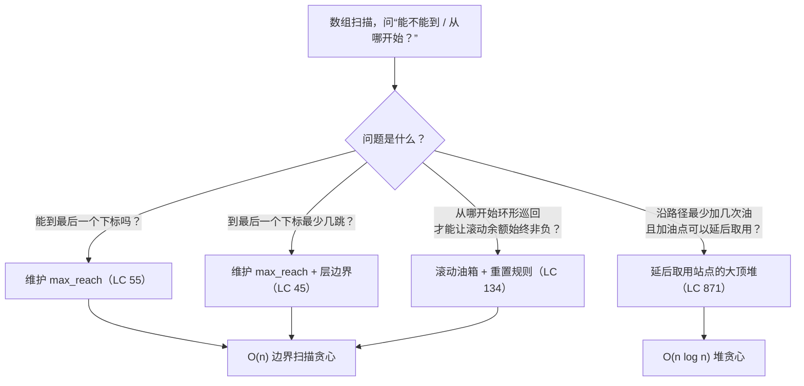
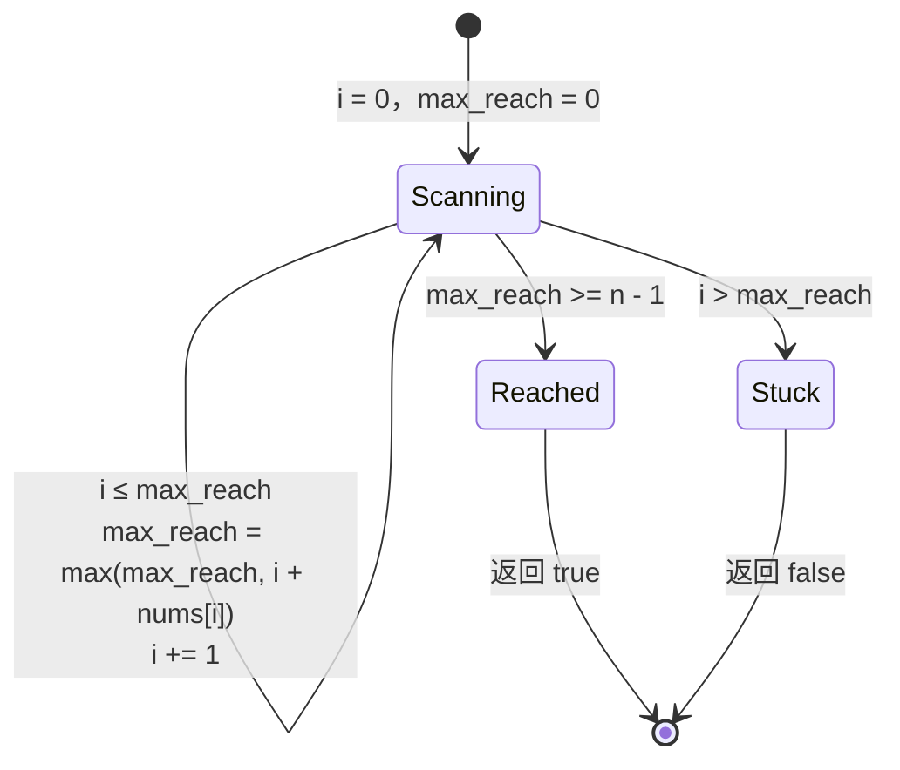
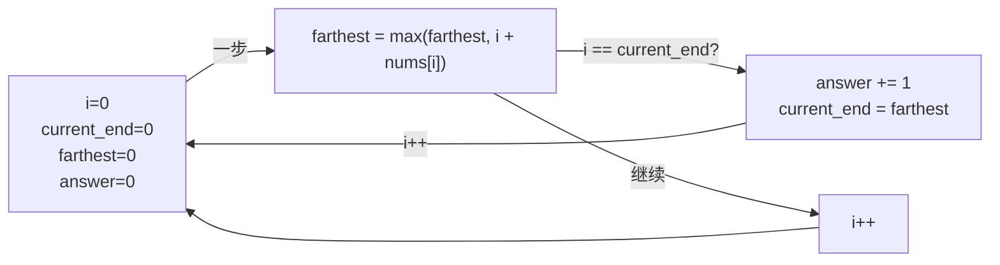
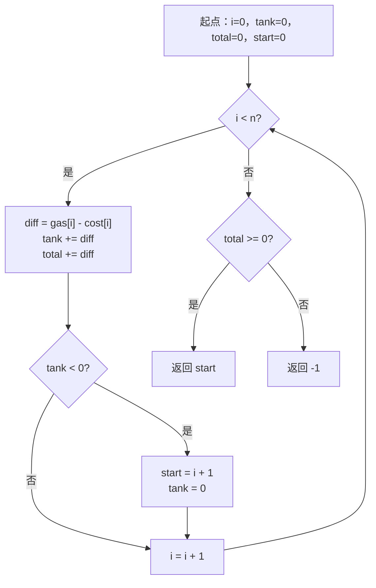

# 跳跃游戏与加油站

两道数组题，两个看起来该花 `O(n²)` 的答案，两趟在 `O(n)` 内跑完的贪心扫描。两次的技巧形状相同：把数组走一遍，只维护一个滚动量，让这一个数承担暴力搜索枚举所有选择时所做的全部记账。这个技巧在本章落地两次，因为两道题的伪装方式不同。*Jump Game*（LeetCode 55）把它藏在可达性里。*Gas Station*（LeetCode 134）把它藏在环形巡回的合法性检查里，而这个检查的正确性不够显然，大多数候选人会在白板上重新推一遍暴力解法，才肯接受线性答案。

本章是贪心从口号变成证明的一章。两道题各配一个交换论证——用一段话说清为什么那个急切的局部选择永远不会堵死更好的全局结果。Gas Station 的那个论证尤其如此，强面试官一定会追问。要做好把它画出来的准备。

## 如何识别这个模式



*同一趟数组扫描上的四个贪心变体。三个是纯边界扫描，线性时间；第四个在资源是延后取用而不是立即消耗时，换入了大顶堆。*

模式信号很短。如果输入是一个非负的跳跃长度数组，问的是可达性或跳跃次数，你要的是一趟扫描，维护最远可达下标。如果输入是一个由“收益减成本”对组成的环形数组，问的是“从哪开始”，你要的是一趟扫描，维护滚动油箱，并在油箱跌破零时重置候选起点。两者都属于教科书称为*边界扫描贪心*（frontier-sweep greedy）的那一族：那个滚动量*就是*算法的边界，而正确性证明永远是[贪心思维与交换论证](./00-greedy-thinking.md)里的同一个交换论证。

## 为什么直觉解法代价太高

第一道是 LC 55，*Jump Game*。给定一个非负整数数组 `nums`，`nums[i]` 是从下标 `i` 起能往前跳的最大步数。从下标 0 出发，能到最后一个下标吗？样例：`nums = [2, 3, 1, 1, 4]`，期望答案 `True`。一条合法路径是 `0 → 1 → 4`：从下标 0 跳 1 步（在 2 的预算之内），从下标 1 跳 3 步（在 3 之内），落在下标 4，也就是最后一个。反例：`nums = [3, 2, 1, 0, 4]`，期望 `False`。每条路径都会落到下标 3，那里预算是 0，到下标 4 之前的那段缺口跨不过去。

老实的第一次尝试会问：站在每个下标上，我该选哪个跳跃长度？没有提示的情况下，唯一稳妥的做法是全试一遍。暴力解法是一场递归爆炸：从每个位置出发，把 1 到 `nums[i]` 的每个跳跃长度都试一遍，递归下去，把结果求或。

```python
# 暴力：最坏情况 O(2^n)。这就是我们要替换掉的那堵墙。
def can_jump_brute(nums):
    n = len(nums)

    def reachable(i):
        if i >= n - 1:
            return True
        for step in range(1, nums[i] + 1):
            if reachable(i + step):
                return True
        return False

    return reachable(0)
```

对任何输入都正确。在 `n = 50` 的 `nums = [25, 25, 25, ..., 25]` 上，每一层都扇出 25 个分支，连开几十层，分支从不收敛，调用树是指数级的。加记忆化能把递归降到 `O(n²)`——每个下标 `i` 最多花 `n` 次探测目的地——好很多，但仍然平方。

第二道题把同样的浪费藏在另一套说辞后面。LC 134，*Gas Station*：给定两个长度均为 `n` 的非负整数数组 `gas` 和 `cost`，首尾相接成环。第 `i` 个加油站提供 `gas[i]` 单位燃料；从 `i` 开到下一站要消耗 `cost[i]`。油箱初始为空，找一个出发站，使你能绕行完整一圈；不存在这样的站就返回 `-1`。暴力解法把每个起点都试一遍。

```python
# 暴力：O(n^2)。每个起点都试一遍，每次都模拟完整一圈。
def can_complete_circuit_brute(gas, cost):
    n = len(gas)
    for start in range(n):
        tank = 0
        for k in range(n):
            i = (start + k) % n
            tank += gas[i] - cost[i]
            if tank < 0:
                break
        else:
            return start
    return -1
```

结果正确，但在 LC 134 的上界 `n ≤ 10⁵` 上大约要做 10¹⁰ 次操作，任何时间限制都过不去。修法在于看出来：从新起点重新模拟，等于把上一次模拟刚学到的东西全丢了。当从站 `s` 出发的那圈在下标 `i` 失败时，`s` 到 `i` 之间的每个站同样注定是失败的起点。下一个候选是 `i + 1`。这一个观察就是整章。

## 模式

两道题都归结为一趟扫描，只维护一个滚动标量。LC 55 里的标量是 `max_reach`，即任意一段决策前缀所能到达的最远下标。循环不变式是：在第 `i` 轮迭代开始时，下标 `0..i-1` 全部可达，且 `max_reach` 至少为 `i`。这个不变式一旦被打破，也就是 `i` 本身超过了 `max_reach`，目的地就不可达，扫描停止。否则扫描把 `nums[i]` 吸收进 `max_reach`，继续前进。

```python
def can_jump(nums):
    max_reach = 0
    n = len(nums)
    for i in range(n):
        if i > max_reach:
            return False
        if i + nums[i] > max_reach:
            max_reach = i + nums[i]
        if max_reach >= n - 1:
            return True
    return True
```

**Solution** — Python ([Java](./04-jump-games-gas-station/lc-55/sol.java) · [C++](./04-jump-games-gas-station/lc-55/sol.cpp) · [Go](./04-jump-games-gas-station/lc-55/sol.go))

```python
# LC 55. Jump Game
# [(2,3,1,1,4)->True, (3,2,1,0,4)->False, [0]->True, [1]->True, [2,0,0]->True].
# 贪心的 max_reach 边界扫描。时间 O(n)，空间 O(1)。
from typing import List


def can_jump(nums: List[int]) -> bool:
    """LC 55. Can we reach the last index with the given jump-length budget?"""
    max_reach = 0
    n = len(nums)
    for i in range(n):
        if i > max_reach:
            return False
        if i + nums[i] > max_reach:
            max_reach = i + nums[i]
        if max_reach >= n - 1:
            return True
    return True
```

实例推演之前，有两行代码值得单独看。

可达性判断写成 `if i > max_reach`，不是 `if i >= max_reach`。相等是没问题的：`max_reach == i` 意味着扫描刚好走到这里，当前下标可达。严格不等才是失败条件，因为它对应的是所有路径都在 `i` 之前停住、后面的下标也救不回来的情况。往另一个方向差一位（写成 `>=`）会误判输入 `nums = [0]`：循环看到 `i == 0`、`max_reach == 0`，而正确答案本来就是 `True`。

提前退出 `max_reach >= n - 1` 是常数因子优化，不是正确性要求。没有它，循环照样能正确结束：`i` 终究会走过所有下标，函数返回 `True`。有它，扫描在边界第一次覆盖目的地时就退出——对 `nums = [10000, ...]` 这类输入，那是第零步。这个退出也让 `i > max_reach` 检查在之后的任何一轮都不再必要，因为一旦 `max_reach >= n - 1`，不变式 `i ≤ max_reach` 对剩余所有 `i` 都成立。

让贪心成立的交换论证很短。假设某个非贪心调度能到达下标 `j`，而贪心调度到不了。在到达 `j` 之前的每一步，贪心的 `max_reach` 都不小于任何其他调度的可达集合上界，因为两个调度拿到的 `nums[i]` 完全一样，而 `max_reach` 取的就是最大值。可达集合是单调的：从更小的边界能到达的下标，从更大的边界也一定能到达。所以贪心的可达集合始终包含其他调度的可达集合，`j` 对贪心也可达，与假设矛盾。贪心选择没有牺牲任何东西，所以它不会输。[^1]

## 实例推演：LC 55 在 `nums = [2, 3, 1, 1, 4]` 上

初始：`max_reach = 0`，`n = 5`，目标下标 `n - 1 = 4`。

**下标 0，`nums[0] = 2`。** `i = 0`，不大于 `max_reach = 0`。更新 `max_reach = max(0, 0 + 2) = 2`。终止检查：`2 >= 4`？否。继续。

**下标 1，`nums[1] = 3`。** `i = 1`，不大于 `max_reach = 2`。更新 `max_reach = max(2, 1 + 3) = 4`。终止检查：`4 >= 4`？是。返回 `True`。

两轮迭代，结束。同一趟扫描跑失败的输入 `nums = [3, 2, 1, 0, 4]` 会走四轮，每一轮都把 `max_reach` 更新为 3（这是这段决策前缀能达到的最远距离），然后卡住。第 4 轮 `i = 4 > max_reach = 3`，不变式被打破，返回 `False`。

这个扫描的状态机是一个前进指针加两条终止转移：



*边界扫描状态机：单指针 i 在不变式 i ≤ max_reach 下前进，每一步都扩张边界，直到最后一个下标被覆盖，或者边界被反超。*

## 不回头地数跳跃次数：O(n) 的 BFS 分层

LC 45，*Jump Game II*，把布尔问题换成了计数：在可达性已知的前提下，到最后一个下标最少要跳几次？可达集合还是按同样的方式增长，但现在得显式数清层与层之间的切换。

看清这件事最干净的办法，是在那个隐式图上做 BFS：每个下标 `i` 都有指向 `i + 1, i + 2, ..., i + nums[i]` 的边。BFS 逐层展开节点，每多一层就多一跳。在这个图上，BFS 通常要花 `O(n²)`，因为每层最多枚举 `n` 个邻居。但没必要一个个枚举邻居。当前 BFS 层占据一段连续的下标区间 `[layer_start, layer_end]`，下一层的右边界就是当前区间里所有 `i` 的 `max(i + nums[i])`——正是我们已经会维护的那个 `farthest`。

```python
def jump(nums):
    answer = 0
    current_end = 0
    farthest = 0
    for i in range(len(nums) - 1):
        if i + nums[i] > farthest:
            farthest = i + nums[i]
        if i == current_end:
            answer += 1
            current_end = farthest
    return answer
```

要内化的那个差一位在这里：`answer` 只在层边界 `i == current_end` 处加一，不是每次 `farthest` 移动都加。每次 `farthest` 更新都加一是经典的错误答案；它把每一次边界外扩都算成单独一跳，哪怕从下标 `i` 起的那同一个物理跳跃沿途可以推进好几次边界。正确的不变式是：`answer` 是走到 `current_end` 所用的跳跃次数，而 `i` 一离开上一层，新的一层就开始了。[^2]



*Jump Game II 的隐式 BFS 骨架：farthest 是下一层的右边界，current_end 是上一层的边界，answer 只在 i 离开当前层时加一。*

## Gas Station：第二个原型

本章第二道题——LC 134——是全书对交换论证最干净的展示。贪心很短。证明才是这一章。

```python
def can_complete_circuit(gas, cost):
    total = 0
    tank = 0
    start = 0
    for i in range(len(gas)):
        diff = gas[i] - cost[i]
        total += diff
        tank += diff
        if tank < 0:
            start = i + 1
            tank = 0
    return start if total >= 0 else -1
```

```python
# LC 134. Gas Station
# 单趟交换论证贪心：从候选起点开始维护滚动油箱，油箱跌破零就
# 重置到 i+1，并用无条件的 total 作为存在性守卫。
# 时间 O(n)，空间 O(1)。本档位只给了 Python 参考实现；Java/C++/Go
# 的四语言覆盖按调研的验证记录延后。
from typing import List


def can_complete_circuit(gas: List[int], cost: List[int]) -> int:
    """LC 134. Find a start from which the circular tour completes, or -1."""
    total = 0
    tank = 0
    start = 0
    for i in range(len(gas)):
        diff = gas[i] - cost[i]
        total += diff
        tank += diff
        if tank < 0:
            start = i + 1
            tank = 0
    return start if total >= 0 else -1
```

两个标量承担了暴力解法外层循环的工作。`tank` 是从当前候选起点起的滚动燃料；一旦它跌破零，从候选起点到 `i` 的每个站都可证明无效，于是候选跳到 `i + 1`，油箱清零。`total` 是整条数组上无条件的累加和，最后用作存在性守卫。

`return start if total >= 0 else -1` 这一行是承重的，也最容易被省掉。省掉它，算法会返回 `start` 恰好停在哪里的那个值——在无解输入上那是个下标，不是 `-1`。在 `gas = [2], cost = [3]` 上，重置规则把 `start` 推到 1（= `n`），但如果你忘了存在性守卫，函数还是会返回 1。守卫挡住了这种情况。

### Gas Station 的不变式：total ≥ 0 意味着存在合法起点

贪心的正确性建立在两条断言上，都值得在下次遇到这道题的面试之前，先在纸上证一遍。

**断言 1。** 环形巡回可行，当且仅当 `total = Σ (gas[i] - cost[i]) ≥ 0`。

正向是直接的：如果存在合法起点 `s`，那么从 `s` 出发跑完整圈，每一步的滚动余额都非负，包括最后一步，所以总余额 `≥ 0`。算法依赖的是反方向。假设 `total ≥ 0`。定义累计净收益 `surplus[k] = Σ_{j=0..k} (gas[j] - cost[j])`，`k = 0, 1, ..., n - 1`。令 `min_i` 为 `surplus[]` 取到最小值的下标（取哪个都行，并列时任取一个）。结论是：从 `min_i + 1` 出发可行。理由是这样：从 `min_i + 1` 走一圈。对任何更靠后的下标 `k > min_i`，滚动油箱是 `surplus[k] - surplus[min_i] ≥ 0`，因为 `min_i` 是最小值。对任何更靠前的下标 `k ≤ min_i`（绕回来之后才会走到），滚动油箱是 `(total - surplus[min_i]) + surplus[k] = total + (surplus[k] - surplus[min_i]) ≥ total ≥ 0`。每个部分和都非负，所以这一圈能跑完。[^3]

**断言 2。** 如果在单趟前进中，从候选起点 `s` 起的滚动油箱在下标 `i` 第一次变成负数，那么 `[s, i]` 里没有任何下标是合法起点，下一个可行的候选是 `i + 1`。

令 `tank(s, j)` 表示从起点 `s` 出发、到达下标 `j` 那一刻的滚动油箱。按假设，`[s, i - 1]` 里每个 `k` 都有 `tank(s, k) ≥ 0`（这正是 `s` 一直活到 `i` 的原因），而 `tank(s, i) < 0`。现在考虑任意另一个起点 `s' ∈ (s, i]`。两者之间的关系是 `tank(s, i) = tank(s, s' - 1) + tank(s', i)`。移项得 `tank(s', i) = tank(s, i) - tank(s, s' - 1)`。由 `s` 的候选资格有 `tank(s, s' - 1) ≥ 0`，由 `i` 处的失败有 `tank(s, i) < 0`。负数减去非负数还是负数。所以 `tank(s', i) < 0`，也就是从 `s'` 出发的那圈同样在 `i` 之前失败。每个中间候选都注定失败，算法正确地跳到 `i + 1`。[^4]

两条断言合起来：算法的单趟前进找出一个候选起点 `start`，使得 `[0, start - 1]` 里没有任何站合法；随后存在性守卫 `total ≥ 0` 证明 `start` 本身合法。这个双断言结构就是交换论证用在环形扫描上的形态，也是算法能在 `O(n)` 而不是 `O(n²)` 内跑完的原因。



*两个不变式，一趟扫描：tank 跟踪从当前候选起点起的滚动余额，total 跟踪无条件的总余额、最后用作存在性守卫。重置规则就是交换论证的算法形态。*

## 实例推演：LC 134 在 `gas = [1,2,3,4,5], cost = [3,4,5,1,2]` 上

初始：`total = 0`，`tank = 0`，`start = 0`。

| `i` | `gas[i] - cost[i]` | 更新后 `tank` | 更新后 `total` | `tank < 0`？ | 更新后 `start` |
|---:|---:|---:|---:|:--:|---:|
| 0 | -2 | -2 | -2 | 是 | 1（重置，tank = 0） |
| 1 | -2 | -2 | -4 | 是 | 2（重置，tank = 0） |
| 2 | -2 | -2 | -6 | 是 | 3（重置，tank = 0） |
| 3 |  3 |  3 | -3 | 否  | 3 |
| 4 |  3 |  6 |  0 | 否  | 3 |

循环结束：`total = 0 ≥ 0`，所以答案是 `start = 3`。快速验算一下：从站 3 出发，油箱走 `0 → 4 - 1 = 3 → 3 + 5 - 2 = 6 → 6 + 1 - 3 = 4 → 4 + 2 - 4 = 2 → 2 + 3 - 5 = 0`。全程非负，一圈跑完。

前三步是重置规则在每个下标上触发。每一次都是断言 2 的实例：从 0、1、2 出发分别在第 0、1、2 步失败，所以候选每次都往后跳一格。第 3 步是候选第一次撑过一步没有变负，第 4 步确认了它。断言 1 的累计盈余图景在这里也看得见：整个数组的 `surplus[]` 值为 `[-2, -4, -6, -3, 0]`，最小值在下标 2，所以答案是 `min_i + 1 = 3`。同一个答案，两条等价的推导。[^4]

## 实际开销

| 变体 | 时间 | 空间 | 说明 |
|---|---|---|---|
| LC 55 max-reach | O(n) | O(1) | 一趟；循环是无条件的 |
| LC 55 暴力 | O(2ⁿ) 最坏，记忆化后 O(n²) | O(n) | 被我们替换掉的那个 |
| LC 45 BFS 分层 | O(n) | O(1) | 分层 DAG 上的隐式 BFS |
| LC 134 单趟 | O(n) | O(1) | 交换论证贪心 |
| LC 134 暴力 | O(n²) | O(1) | 在 LC 的 `n ≤ 10⁵` 上 TLE |
| LC 871 堆贪心 | O(n log n) | O(n) | 延后资源贪心[^5] |

对三个边界扫描变体来说，`O(n)` 这道墙是根本性的：每个下标恰好被检查一次，做 `O(1)` 的工作。没有改进空间，因为算法的输入本身就是 `n` 个数，任何正确算法都必须把它们全读一遍。CLRS 的贪心范式模板（第 4 版第 15 章《Greedy Algorithms》）给出了 LC 55 和 LC 134 都适用的证明模板：*贪心选择性质*（可以在不重新考虑已定子问题的前提下做出全局最优决策）加上*最优子结构*（问题剩余部分的最优解仍然能延伸早期的选择）。[^6] Erickson 的《Algorithms》第 4 章在不同的例子上展开了同一套交换论证骨架；本章的论证都是他那个模板的实例。[^7]

## 模式失效的场景

### 延后加油的最少加油次数：大顶堆贪心（LC 871）

LC 871，*Minimum Number of Refueling Stops*，是加油站原型最接近的延伸，却不适合纯单趟扫描。你沿一条一维路径从 0 开到 `target`；沿途的每个站提供一次性燃料补给，但你不必经过时立刻消耗。你可以把决定延后，等油箱真的见底时再“回头”取用。目标是最小化加油次数。

贪心做法是尽可能把一切都往后拖。车往前走，把经过的每个站按油量推进一个大顶堆。当油箱再开不到下一站（或目标）时，从堆里弹出最大的那笔补给，当作经过时其实已经取了。如果卡住时堆是空的，返回 -1。交换论证：只要存在某个最优调度，把它的最早一次加油换成当前还没用过、油量最大的那个站，既不会增加次数，也不会破坏可达性。这是“始终保持领先”形式的证明。[^5]

这个模式在本章的位置，是标出纯线性扫描贪心的终点。一旦题目允许延后使用资源，你就要用 `O(n log n)` 的堆增强扫描换掉 `O(1)` 状态的扫描。大顶堆的机制归 [堆与优先队列](../part-6-trees-heaps/04-heaps-priority-queues.md) 管；本章在这里的角色是命名这个模式信号——*延后资源贪心*——并指向拥有该数据结构的下一章。

## 两个最容易踩的坑

> [!WARNING]
> **LC 134 漏掉存在性守卫。** 光有重置规则是必要但不充分的。直接返回 `start` 的代码，即使根本不存在合法起点，也会返回一个非负整数，因为重置规则很乐意把 `start` 推过最后一个下标。在 `gas = [1, 2], cost = [2, 3]` 上，重置规则让 `start = 2 = n`，已经越界；标准写法 `return start if total >= 0 else -1` 挡住了它。只讲重置规则、不给守卫的写法，交付出去就是一个错算法。Harshit Raj 的 Medium 文章（2024）把这条列为 LC 134 上最常见的 bug。[^4]

> [!WARNING]
> **LC 45 每次 `farthest` 更新都加一。** 边界一动就加一跳，感觉是对的。但不对。在同一个 BFS 层内，边界是连续移动的；只有*离开*这一层才对应一次真实的跳跃。正确的不变式是 `answer` 只在 `i == current_end` 时加一。AlgoMonster 对 LC 45 的讲解把这条标为 Jump Game II 的经典差一位。[^2]

第三个坑值得一句话：LC 871 用了小顶堆。Python 的 `heapq` 默认是小顶堆，所以 `heappush(heap, fuel)` 之后 `heappop(heap)` 弹出的是*最小*的延后站点，正好选错。修法是压入 `-fuel`，弹出时再翻符号；或者在 C++/Java 里用 `priority_queue<int>` / `PriorityQueue<>(Collections.reverseOrder())`。[^5]

## 题目梯度

### 核心（三题全做才算掌握本章）

- [LC 55 — Jump Game](https://leetcode.com/problems/jump-game/) [中等] • greedy-frontier-sweep ★
- [LC 45 — Jump Game II](https://leetcode.com/problems/jump-game-ii/) [中等] • greedy-bfs-layer
- [LC 134 — Gas Station](https://leetcode.com/problems/gas-station/) [中等] • greedy-circular-tour-reset *（参考实现：仅 Python）*

### 进阶（可选）

- [LC 871 — Minimum Number of Refueling Stops](https://leetcode.com/problems/minimum-number-of-refueling-stops/) [困难] • greedy-heap-deferred

核心三题按 LeetCode 的标注都是 Medium，本章在题目注册表里的 `core-emh-via-stretch` 策展标记记录了结构上的原因：jump-game-greedy 这个模式在面试轮换里没有标准的 Easy。在 Easy 档位上勉强相似的题，比如种花（LC 605）或删除列使之有序（LC 944），分属不同的子模式，会稀释本章的信号。进阶档用 LC 871 提供 Hard，所以核心＋进阶合起来覆盖 Medium 加 Hard。

## 后续衔接

区间调度那一章（[区间调度与合并](./01-interval-scheduling.md)，等它落地）把同一套交换论证模板往下带，只是贪心作用在已排序的区间上，而不是一次向前扫描。证明的形状完全一样；变的是数据的准备。

等边权不再一致时，Held-Karp 的加权 TSP 推广就是 LC 845 那套边界扫描的自然后续。为此需要的位掩码 DP 机制在 [位掩码 DP](../part-9-dynamic-programming/14-bitmask-dp.md) 里；LC 134 的环形结构，只要改一处约束就成了 TSP 的一个变体，在那里候选起点的逻辑会与子集覆盖状态相互作用。算法形状分道扬镳，但章节之间在证明技巧上是相通的。

## 参考文献

[^1]: Cormen, Leiserson, Rivest, Stein, *Introduction to Algorithms*, 4th ed., MIT Press, 2022.

[^2]: AlgoMonster, "45. Jump Game II — In-Depth Explanation," <https://algo.monster/liteproblems/45>.

[^3]: 累计盈余的表述。定义 `surplus[k] = Σ_{j=0..k} (gas[j] - cost[j])`。只要 `total = surplus[n - 1] ≥ 0`，从 `min_i + 1` 出发就可行——这个论证是民间流传的结论，面试材料和 LC 官方题解里都有，用前缀和推理两行就能重建。Shepherd Gai 在 cnblogs 上的文章（2020）把同一个恒等式重述成算法循环的形式。

[^4]: Shepherd Gai, "A detailed explanation of leetcode 134: Gas Station," cnblogs.com, 2020-09-01, <https://www.cnblogs.com/shepherdgai/p/13599262.html>.

[^5]: walkccc, "871. Minimum Number of Refueling Stops," <https://walkccc.me/LeetCode/problems/871/>

[^6]: CLRS 第 4 版，§15（*Greedy Algorithms*），第 417 页起。双性质模板——贪心选择加最优子结构——是证明“交换论证已经足够”的标准参考。

[^7]: Jeff Erickson, *Algorithms*, 1st ed., self-published, jeffe.cs.illinois.edu, 第 4 章（*Greedy Algorithms*）, <https://jeffe.cs.illinois.edu/teaching/algorithms/book/04-greedy.pdf>.
