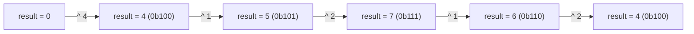
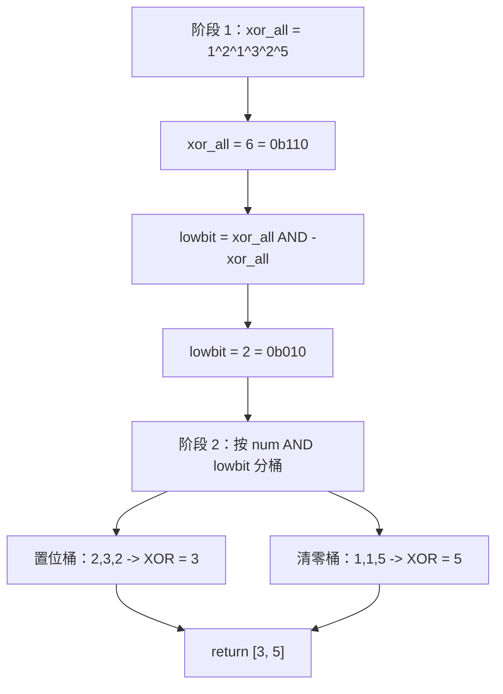

# XOR 模式

LC 136（Single Number）：数组里每个值都出现两次，只有一个例外，返回那个落单的值。样例输入 `[4, 1, 2, 1, 2]`，期望答案 `4`。第一反应是哈希集合：扫一遍、计数、返回计数为 1 的那个键。这能跑到 O(n) 时间，但要 O(n) 空间，而题目明确要求 O(1) 空间。第二反应是排序后扫相邻对：O(n log n) 时间，原地排序的话 O(1) 空间。同样被否，因为题目要的是 O(n) 时间。

过关的答案只有一行。把每个元素 XOR 进累加器，返回累加器。O(n) 时间、O(1) 空间，对负数成立、对 `INT_MIN` 成立、对单元素数组成立、对判题器扔过来的每一个变态用例都成立。没有特例。原因就一条恒等式：XOR 是自己的逆运算 —— `a ^ a = 0`、`a ^ 0 = a` —— 于是成对的消掉，单个的留下，而这一条性质就是整章的内容。

本章剩下的部分，就是把问题掰弯之后从这条恒等式里掉出来的东西。三个变体，外加一个警告。

## 哈希为什么要烧掉空间预算

哈希集合的答案，是你在没把位运算那一章摊在面前时会写出的循环：

```python
def single_number_hashset(nums):
    seen = set()
    for x in nums:
        if x in seen:
            seen.remove(x)
        else:
            seen.add(x)
    # 恰好剩下一个元素
    return next(iter(seen))
```

正确。但同样不合格。题目里那句 `O(1) extra space` 存在的意义就是排除它，因为每个面试官都见过哈希解法，他们真正在问的是你有没有见过更好的那个。Python 的 `Counter`、Java 的 `HashMap<Integer, Integer>`、C++ 的 `unordered_map<int, int>` 也一样，它们都带着与不同取值个数成正比的 O(n) 状态。

算术技巧 `2 * sum(set(nums)) - sum(nums)` 思路上更接近，但自带毛病：输入接近 `2^30` 时，那个乘法在 Java 和 C++ 里会溢出 `int`，而题目的取值范围写的是 `[-2^31, 2^31 - 1]`。XOR 不会溢出。`a ^ b` 的结果永远与 `a`、`b` 同宽，因为 XOR 是逐位做的：没有进位、没有传播、不需要更宽的中间值。[^1]

## 模式

`w` 位整数上的 `XOR` 构成一个阿贝尔群 `(Z_2^w, ^)`，单位元是 `0`，每个元素都是自己的逆元。[^2] 由此掉出四条恒等式，整章都靠这四条撑着：

| 恒等式 | 它给你什么 |
|---|---|
| `x ^ 0 = x` | 累加器初始化为 `0`，第一个元素原样通过。 |
| `x ^ x = 0` | 同一个值的两份拷贝互相抵消。 |
| `(x ^ y) ^ z = x ^ (y ^ z)` | 结合律：括号随便加。 |
| `x ^ y = y ^ x` | 交换律：任意顺序遍历数组都行。 |

前两条把成对的值压成零。后两条说配对以什么顺序到来都无所谓。四条合在一起，LC 136 的算法自己就写出来了：扫数组，把每个元素 XOR 进一个滚动累加器，返回累加器。扫完之后，每个出现两次的值被 XOR 进去两次、净贡献 `0`；唯一的值被 XOR 进去一次、贡献它自己。

```python
def single_number(nums):
    result = 0
    for x in nums:
        result ^= x
    return result
```

**解法** —— Python（[Java](./01-xor-patterns/lc-136/sol.java) · [C++](./01-xor-patterns/lc-136/sol.cpp) · [Go](./01-xor-patterns/lc-136/sol.go)）

```python
# LC 136. Single Number
from typing import List


def single_number(nums: List[int]) -> int:
    """LC 136 — element appearing once when every other element appears twice.
    O(n) time, O(1) space."""
    result = 0
    for x in nums:
        result ^= x
    return result
```

`[4, 1, 2, 1, 2]` 上的累加器状态走得很干净：



*中间值本身没有任何意义。只有最终状态重要：`(1, 1)` 和 `(2, 2)` 两组自我抵消，剩下的是 `4`。*

> [!IMPORTANT]
> **XOR 唯一性不变量。** 扫描的每一步，`result` 都等于此前见过的所有元素的 XOR，等价地说，等于这个前缀里出现次数为奇数的所有值的 XOR。按假设，除唯一值之外的每个值总出现次数都是 2（偶数），所以扫描结束时只剩唯一值。[^3]

## 当配对变成三份：LC 137

改约束。*每个元素出现三次，只有一个例外。* 哈希集合的本能依然能在 O(n) 空间里跑通；XOR 的本能不行。XOR 的配对抵消来自 `x ^ x = 0`，那是关于「翻倍」的事实，它对「翻三倍」什么都没说。同一个值的三份拷贝 XOR 在一起，得到的是它自己而不是零，算法在输入 `[3, 3, 3, 7]` 上直接死掉。

修法是降到单个比特位、逐位计数。每个输入值对 32 个比特位各贡献 0 或 1；唯一值的第 `i` 位被置位，当且仅当第 `i` 位的列和为 `1 mod 3`。逐位把答案重建出来。[^4]

```python
def single_number_137(nums):
    result = 0
    for i in range(32):
        bit_sum = sum((x >> i) & 1 for x in nums)
        if bit_sum % 3:
            if i == 31:
                result -= 1 << 31  # 负数输入上的符号位
            else:
                result |= 1 << i
    return result
```

**解法** —— Python（[Java](./01-xor-patterns/lc-137/sol.java) · [C++](./01-xor-patterns/lc-137/sol.cpp) · [Go](./01-xor-patterns/lc-137/sol.go)）

```python
# LC 137. Single Number II
#
# 逐位对 3 取模计数：其他每个元素对每个比特位都贡献 0（mod 3），
# 只有唯一元素的比特留了下来。O(32n) = O(n) 时间，
# O(1) 空间。三态 ones/twos 累加器是同一个答案的精简指令版，
# 但面试压力下更难当场推出来。
from typing import List


def single_number(nums: List[int]) -> int:
    """LC 137 — element appearing once when every other element appears three times."""
    result = 0
    for i in range(32):
        bit_sum = 0
        for x in nums:
            bit_sum += (x >> i) & 1
        if bit_sum % 3:
            # 第 i 位在唯一元素中置位。注意 i == 31 时的符号位。
            if i == 31:
                result -= 1 << 31
            else:
                result |= 1 << i
    return result
```

两层嵌套循环是 O(32 n)，也就是 O(n)，那个常数因子在渐近界里看不出来，但在真实耗时上看得出来。有更紧的解法：一个两比特的有限状态机，随着输入按三份到来，在每个比特位上循环 `00 → 10 → 01 → 00`，真正的 O(n)，没有 32 倍。[^4] 这也正是大多数候选人在面试里推不出来的一招。开口先讲按 3 取模计数那一版，把状态机作为优化提一句，别把它当答案。

同样的形状可以推广。*每个元素出现 `k` 次，只有一个例外*，用同样的逐位对 `k` 取模计数，任何 `k` 都是 O(32 n)。状态机的推广对小 `k` 存在，过了 `k = 3` 就变得难读。

## 当两个元素活下来：LC 260

再改一次约束。*每个元素出现两次，只有两个互不相同的唯一值。* 这时候 XOR 整个数组得到的是 `xor_all = a ^ b`，其中 `a`、`b` 就是那两个答案。这个残值非零（因为 `a ≠ b`），它任何一个置位的比特，都是 `a` 与 `b` *不同* 的比特。挑一个这样的位，按它把数组分成两半，每一半就都成了一个独立的 LC 136 实例。

惯例是挑最低的置位比特，因为有一行惯用法能把它取出来：

```python
def single_number_260(nums):
    xor_all = 0
    for x in nums:
        xor_all ^= x
    diff_bit = xor_all & -xor_all      # 取出最低的置位比特
    a = b = 0
    for x in nums:
        if x & diff_bit:
            a ^= x
        else:
            b ^= x
    return [a, b]
```

**解法** —— Python（[Java](./01-xor-patterns/lc-260/sol.java) · [C++](./01-xor-patterns/lc-260/sol.cpp) · [Go](./01-xor-patterns/lc-260/sol.go)）

```python
# LC 260. Single Number III
#
# 阶段 1：全部 XOR -> xor_all = a ^ b（那两个唯一值）。
# 阶段 2：取出 a 与 b 不同的任意一位（lowbit = xor_all & -xor_all），
# 按这一位分桶，对每个桶做 XOR。每个桶现在都是一个 LC-136 实例。
from typing import List


def single_number(nums: List[int]) -> List[int]:
    """LC 260 — two elements appear once; all others appear twice."""
    xor_all = 0
    for x in nums:
        xor_all ^= x
    diff_bit = xor_all & -xor_all  # 取出 a 与 b 不同的最低位
    a = b = 0
    for x in nums:
        if x & diff_bit:
            a ^= x
        else:
            b ^= x
    return [a, b]
```

在 `[1, 2, 1, 3, 2, 5]` 上走一遍：



*阶段 1 把成对的元素抵消掉，只有 `3 ^ 5 = 6` 存活。`6` 的最低置位比特是第 1 位，`3` 与 `5` 在这一位上不同，于是落进不同的桶。每个桶随后按 LC 136 实例解掉。*

### 为什么 `x & -x` 能取出最低的置位比特

这个惯用法值得两句话，因为它是大多数候选人漏掉的位运算辨识点。在补码里，`-x` 就是 `~x + 1`：把 `x` 的每一位取反，再加一。在 `x` 的最低置位比特以下，`~x` 的各位都是 1，`+1` 的进位径直穿过它们。到最低置位比特这一位，`~x` 是 0，进位停住，结果在这一位是 1。在最低置位比特以上，`~x` 的各位是 `x` 的补。所以 `x & -x` 只在最低置位比特那一位与 `x` 相同，AND 返回的就是这个值。[^5]

对偶的惯用法是 `x & (x - 1)`，它把最低的置位比特*清零*，撑起 [位运算入门](../part-0-foundations/03-bit-manipulation-primer.md) 里的 Kernighan 数位循环。把这两者弄混，是写出一道能过部分用例的错误 LC 260 最可靠的方式。它们是对偶的；分区算法要的是取位那个。

## 两个最容易踩的坑

> [!WARNING]
> **把 `x & -x` 和 `x & (x - 1)` 搞混。** 前者取出最低的置位比特，后者把它清零。在 LC 260 里用错那个，算法就会按*次低*的置位比特（或更高位）分区，而 `a` 与 `b` 在这一位上未必有差异。错误答案能过一部分用例、挂掉另一部分。把这一对记牢：取位是 `& -x`，清零是 `& (x - 1)`。

> [!WARNING]
> **在答案是一次比较、而不是一条恒等式的时候伸手去用 XOR。** LC 421（Maximum XOR of Two Numbers in an Array）会诱你写一行：把全部 XOR 在一起，返回结果。那返回的是所有值的 XOR，不是最大化那一对的 XOR。正确答案是贪心的位前缀树（bit-trie），对每个值从最高位往下走、每层优先选互补的那一位，见 [Tries](../part-6-trees-heaps/08-tries.md)。捷径是：只要题目问「最大」或「最小」，XOR 归约就是错的工具。

还有更多，本章的研究笔记把六个都列了。上面这两个是每个候选人第一次碰上都会栽的。

## 实际开销

| 变体 | 时间 | 空间 | 备注 |
|---|---|---|---|
| LC 136（Single Number） | O(n) | O(1) | 一趟，一个累加器。 |
| LC 137（Single Number II） | O(32 n) = O(n) | O(1) | 32 趟外层比特位遍历，每趟 O(n)。[^4] |
| LC 137（状态机变体） | O(n) | O(1) | 一趟，每个位置两比特状态。 |
| LC 260（Single Number III） | O(n) | O(1) | 两趟，两个累加器。[^6] |
| LC 268（Missing Number，XOR 变体） | O(n) | O(1) | 把 `0..n` 与 `nums[0..n-1]` 相 XOR，缺失的那个下标存活。 |
| LC 421（最大 XOR 对） | O(n log V) | O(n log V) | 深度 `log V = 32` 的位前缀树，`n` 次插入。 |

LC 137 上的常数因子藏在大 O 后面。按比特位计数是 32 趟数组遍历，状态机是一趟。在 `n = 30,000`（LC 判题器常见的上界）上，差别真实存在，但不决定性。面试里就讲按 3 取模计数那一版，除非你已经把状态机练到肌肉记忆。[^4]

## 值得知道的相邻用法

LC 268（Missing Number）是同一个技巧换个形状。给你 `0..n` 里的 `n` 个互不相同的整数，缺了一个；把每个下标 `0..n` 与每个数组值相 XOR。配对（下标 `i`、值 `i`）互相抵消，只有缺失的那个下标 XOR 进去一次、活了下来。算术答案（`n*(n+1)/2 - sum(nums)`）也能用，但 `n` 一过 `2^15`，在 Java 和 C++ 里就会溢出 `int`。XOR 不溢出。

LC 389（Find the Difference）是同一个技巧用在字符串上：把输入的每个字符与答案的每个字符相 XOR，多出来的那个字符存活。同样的代数，不同的领域。

XOR 前缀的构造（`prefix[i] = nums[0] ^ ... ^ nums[i-1]`，区间 XOR 为 `prefix[r+1] ^ prefix[l]`）是前缀和的位向量类比。自逆在这里扮演前缀和里减法的角色：公共前缀抵消。[^2] LC 1442（Count Triplets That Can Form Two Arrays of Equal XOR）是它的标准用法，而这题其实属于紧接本章之后的 bitmask 技巧那一章。

## 题目梯度

### 核心（三题全做才算掌握本章）

- [LC 136 — Single Number](https://leetcode.com/problems/single-number/) [简单] • bit-xor-uniqueness ★
- [LC 137 — Single Number II](https://leetcode.com/problems/single-number-ii/) [中等] • bit-position-counting
- [LC 260 — Single Number III](https://leetcode.com/problems/single-number-iii/) [中等] • bit-xor-partition

### 进阶（可选）

- [LC 421 — Maximum XOR of Two Numbers in an Array](https://leetcode.com/problems/maximum-xor-of-two-numbers-in-an-array/) [中等] • bit-xor-trie-prefix *（参考实现：仅 Python）*
- [LC 1707 — Maximum XOR With an Element From Array](https://leetcode.com/problems/maximum-xor-with-an-element-from-array/) [困难] • bit-xor-trie-offline *（参考实现：仅 Python）*

LC 268（Missing Number）和 LC 389（Find the Difference）是很强的荣誉提名；它们没进核心，只是为了让梯度聚焦在 Single Number 这一族上。LC 191 和 LC 461 待在 [位运算入门](../part-0-foundations/03-bit-manipulation-primer.md)，那才是它们该在的地方。

## 后续衔接

接下来是 [Bitmask 技巧](./02-bitmask-techniques.md)，它从本章停下的地方接手：子集枚举、bitmask DP，以及支撑 LC 1442 的 XOR 前缀构造。[Tries](../part-6-trees-heaps/08-tries.md) 是 LC 421 / 1707 那一族的数据结构归宿，那边 XOR 是最大化目标，而不是抵消装置。两章来回来去地交换同一批题目；模式标签会告诉你哪一种框法占上风。

## 参考文献

[^1]: Henry S. Warren Jr.，*Hacker's Delight*，第 2 版，Addison-Wesley，2012，§2-1（“Manipulating Rightmost Bits”）。

[^2]: Wikipedia，“Exclusive or”，§“Relation to modern algebra”。`(Z_2^n, ^)` 是单位元为 `0` 的阿贝尔群；每个元素都是自己的逆元。[en.wikipedia.org/wiki/Exclusive_or](https://en.wikipedia.org/wiki/Exclusive_or)。

[^3]: Donald E. Knuth，*The Art of Computer Programming, Volume 4A: Combinatorial Algorithms, Part 1*，Addison-Wesley，2011，§7.1.3（“Bitwise tricks and techniques”）。

[^4]: walkccc.me LeetCode 镜像，“137. Single Number II”，2026-05-20 核对。解法 1：逐位对 3 取模计数，O(32 n)。解法 2：三态 ones/twos 累加器，O(n)。[walkccc.me/LeetCode/problems/0137/](https://walkccc.me/LeetCode/problems/0137/)。

[^5]: Wikipedia，“Two's complement”，§“Why it works”。关于 `-x = ~x + 1` 的进位传播论证，以及由此得到的 `x & -x` 惯用法。[en.wikipedia.org/wiki/Two%27s_complement](https://en.wikipedia.org/wiki/Two%27s_complement)。

[^6]: walkccc.me LeetCode 镜像，“260. Single Number III”，2026-05-20 核对。全部 XOR 加最低置位比特分区，切成两个 LC-136 形状的桶。[walkccc.me/LeetCode/problems/0260/](https://walkccc.me/LeetCode/problems/0260/)。
