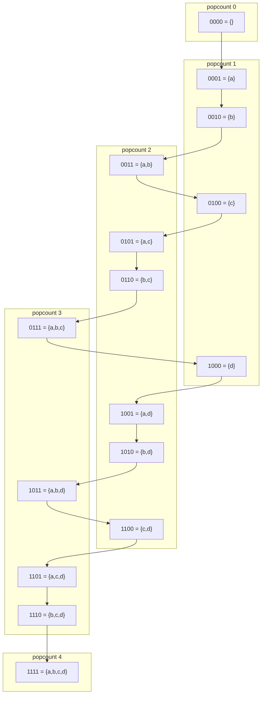
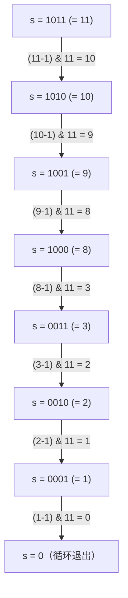

# 位掩码技巧

一段 10 个字母的 DNA 片段，字母表只有 4 个字符宽：A、C、G、T，就这些。两个比特编码一个碱基，二十个比特装下整段。得到的整数能塞进一个 CPU 寄存器，两段是否相等只看一条机器指令。

这一章讲的就是这件事：小集合就是一个整数。后面每一个操作，都是把这句话当真的结果——编码、迭代、枚举子集。

本章讲底座，不讲应用。[位掩码 DP](../part-9-dynamic-programming/14-bitmask-dp.md) 沿用同一套迭代，再加一个时间维度；那些经典的“把已访问集合当掩码”的 DP 题在那一章。这里唯一的状态就是掩码本身。

## 字母表小到能装进一个机器字的时候

有三个信号会触发这个模式。

输入有一个固定的字母表，最多 32 个字符宽，而你要回答“这个集合和那个集合相等吗？”或者“X 是 Y 的子集吗？”。两者都归约为在 32 位整数上做一次 AND 或一次比较。LC 187 *Repeated DNA Sequences* 和 LC 1178 *Number of Valid Words for Each Puzzle* 是经典应用。

元素个数 `n` 最多 22，而算法需要枚举 `[0..n-1]` 的每个子集。一次位掩码迭代 `for mask in range(1 << n)` 就顶替了递归回溯，还把每个子集压缩成一个寄存器大小的整数。

题目要在值都能装进 16 位的数组里找出满足某个按位谓词的三元组或二元组，比如 LC 982 *Triples with Bitwise AND Equal To Zero*。这时该用的招是按掩码索引的 `2^16` 项频次表。

三个信号一个都没触发，就别用位掩码。位掩码迭代是 `O(2^n)`；因为它只有一个循环变量就当它是多项式，这是最常见的位掩码错误，后面还会回来说。

## 为什么逐窗口从头扫描浪费了大部分工作

拿 LC 187 说。题目给你一个 DNA 字符串 `s`，要求找出所有出现不止一次的 10 字母子串。约束：`1 ≤ s.length ≤ 10^5`。

自然的第一版写法：

```python
# 暴力解法：O(n*k) —— 这就是我们要替换掉的做法。
def find_repeated_dna_brute(s):
    seen, answer = {}, set()
    for i in range(len(s) - 9):
        sub = s[i:i + 10]               # 重建 10 字符窗口
        if sub in seen:
            answer.add(sub)
        seen[sub] = True
    return list(answer)
```

能跑。但它每个位置都要重建一个 10 字符子串、算哈希、再存下来。`n = 10^5` 时，大约是 `10^6` 次字节级操作，外加一张键为 10 字节字符串的哈希表。Python 扛得住；Codeforces 上那种抠紧的 C++ 扛不住。

真正的代价是结构性的。每个窗口和前一个共享九个字符，暴力扫描无视这一点，把它们又读了一遍。我们需要一种滚动而不是重建的编码。

## 模式：小集合就是一个整数

两个比特覆盖一个碱基。把滚动中的掩码左移两位，OR 进新碱基的编码，再和 `(1 << 20) - 1` 做 AND，把刚从尾部滑出去的那个碱基丢掉。三次算术运算，窗口前进了一位。

```python
def find_repeated_dna_sequences(s):
    if len(s) < 10:
        return []
    code = {"A": 0, "C": 1, "G": 2, "T": 3}
    mask = 0
    MASK20 = (1 << 20) - 1               # 保留低 20 位 == 10 个碱基
    seen, answer = {}, []
    for i, c in enumerate(s):
        mask = ((mask << 2) | code[c]) & MASK20
        if i >= 9:                       # mask 里已是完整的 10 字母窗口
            seen[mask] = seen.get(mask, 0) + 1
            if seen[mask] == 2:
                answer.append(s[i - 9 : i + 1])
    return answer
```

**解法** — Python ([Java](./02-bitmask-techniques/lc-187/sol.java) · [C++](./02-bitmask-techniques/lc-187/sol.cpp) · [Go](./02-bitmask-techniques/lc-187/sol.go))

```python
# LC 187. Repeated DNA Sequences
from typing import List


def find_repeated_dna_sequences(s: str) -> List[str]:
    """LC 187: 10-letter substrings that repeat, encoded 2 bits per base."""
    if len(s) < 10:
        return []
    code = {"A": 0, "C": 1, "G": 2, "T": 3}
    mask = 0
    MASK20 = (1 << 20) - 1               # 保留低 20 位 == 10 个碱基
    seen: dict = {}
    answer: List[str] = []
    for i, c in enumerate(s):
        mask = ((mask << 2) | code[c]) & MASK20
        if i >= 9:                       # mask 里已是完整的 10 字母窗口
            seen[mask] = seen.get(mask, 0) + 1
            if seen[mask] == 2:
                answer.append(s[i - 9 : i + 1])
    return answer
```

整趟是 `O(n)`，每步一次整数比较。这个掩码就是哈希，而它的碰撞在物理上不可能发生。两个不同的 10 字母字符串按构造必然产出不同的 20 位编码，所以掩码相等就是窗口相等。哈希表的键是 20 位整数而不是 10 字节字符串，同样出于这个原因，Python 的 `dict` 大约快了一倍。

同样的思路可以推广。字母表有 26 个字母时，一个字母占一位，就能把“这个词里出现了哪些字母”编码进一个 32 位整数。*Maximum Product of Word Lengths*（LC 318）用它判断两个集合是否不相交：`mask_a & mask_b == 0`，一条指令搞定，替掉了朴素解法里那句 `O(L_a + L_b)` 的集合求交。

## 遍历 `[0..n-1]` 的每个子集

编码到手之后，下一步是把循环的对象从元素换成掩码本身。`n = 4` 时，`{a, b, c, d}` 的每个子集就是 `0..15` 里的一个整数，第 `i` 位说明“元素 `i` 在不在这个子集里”。

```python
for mask in range(1 << n):
    # mask 的第 i 位为 1 当且仅当元素 i 在这个子集中
    ...
```

十六次迭代覆盖四元素的全部子集。没有递归，没有栈。循环变量*就是*子集。



*位掩码迭代按数值顺序走遍四元素全集的全部 16 个子集；按 popcount 分层可以看出，这个访问顺序在布尔格上到处跳，并不是一层一层走。*

`n` 足够小的时候，这就是[子集与组合](../part-7-recursion-backtracking/02-subsets-combinations-permutations.md)所替换掉的东西。递归回溯产出同样这 `2^n` 个子集，但每个都是一张列表，带着分配开销。位掩码版本把它们产出成整数，一个占一个寄存器。`n ≤ 22`、每个子集的处理成本是 `O(1)` 时，同样的硬件上位掩码迭代大约快一个数量级。

### 子掩码枚举：用 `O(2^k)` 走遍某个特定掩码的所有子集

第三个操作是第一遍读不出来的那个。Antti Laaksonen 的 *Competitive Programmer's Handbook* 把它列为少数几个必须看两遍的位掩码惯用法之一；Knuth 在 *TAOCP* 第 4A 卷 §7.1.3 里给它留了一道习题。[^1]

你手里有一个父掩码 `m`，其中 `k` 位是 1，你想只遍历装在 `m` 里的那 `2^k` 个子集，而不是全部 `2^n`。对 LC 1178 来说，`m` 是一个谜题的字母集合，那些子集则是这个谜题合法能拼出的候选单词字母集合。把 `0..(1<<26)-1` 里每个掩码都暴力过一遍，每个谜题是 `2^26 ≈ 6.7·10^7`；`10^4` 个谜题就是 `6.7·10^{11}`，直接出局。

诀窍是：

```python
s = m
while s > 0:
    process(s)
    s = (s - 1) & m
```

从 `s` 里减 1，会翻掉它最低的那个置位，并把它下面的所有位全部打开。再和 `m` 做 AND，凡是不在父掩码里的位统统丢掉。结果就是 `m` 按字典序的下一个（更小的）子集。在 `m = 0b1011` 上走一遍：



*`s = (s-1) & m` 这个递推按字典序递减、恰好一次走遍 `m` 的每个子掩码；`s > 0` 这个守卫让循环在零处回绕重启之前就停下。*

八步，八个子掩码：`1011, 1010, 1001, 1000, 0011, 0010, 0001, 0000`。循环体跑了七次（空集不算），正好是 `2^popcount(m) - 1`。如果你的题目需要空集，在循环外面单独处理。

在每个掩码 `m` 及其所有子掩码上的总工作量是 `sum_{m=0}^{2^n - 1} 2^popcount(m) = (1 + 2)^n = 3^n`。二项式定理的恒等式干净地掉出来。`(m, submask)` 这一对里，`n` 个比特各自处在三种状态之一：完全不在 `m` 里、在 `m` 里但不在 submask 里、两边都在。所以总数是 `3^n`。CP-Algorithms[^2] 复现了这个证明。`n = 16` 时大约是 `4.3·10^7` 次迭代，一秒时限里很从容；`n = 20` 时是 `3.5·10^9`，你就得换思路了。

这就是那个优化。没有这个技巧，“遍历每个掩码的每个子集”是 `O(2^n · 2^n) = O(4^n)`。递推把它砍到 `3^n`，差一个 `(4/3)^n` 的因子。`n = 16` 时就是快 `100×`。正是这个改进让 LC 1178 变得可做。

> [!WARNING]
> **子掩码循环不要从 `s = 0` 开始。** 写 `for s = 0; ; s = (s-1) & m` 会进死循环：`(0 - 1) & m` 就是 `(-1) & m`，等于 `m`，循环重新开始。要从 `s = m` 起步，并用 `while s > 0` 当守卫。CP-Algorithms 指出这是该惯用法最常见的实现 bug。[^2]

## 实际开销

| 操作 | 时间 | 空间 | 说明 |
|---|---|---|---|
| 把长度 `L` 的单词编码成掩码 | `O(L)` | `O(1)` | 每个字符一次移位-OR |
| 对 `[0..n-1]` 做全空间迭代 | `O(2^n)` | `O(1)` | 在通常时限下到 `n ≈ 22` 都稳 |
| 枚举 popcount 为 `k` 的某个掩码 `m` 的子掩码 | `O(2^k)` | `O(1)` | `(s-1) & m` 递推 |
| `n` 位下所有掩码 × 其全部子掩码 | `O(3^n)` | `O(1)` | 二项式定理恒等式[^2] |
| LC 187（滚动 20 位掩码，长度 `n`） | `O(n)` | `O(n)` | 哈希表以 20 位整数为键 |
| LC 1178（`W` 个单词，`Q` 个长度为 7 的谜题） | `O(W·L + Q·128)` | `O(W)` | 128 = 每个谜题 `2^7` 个子掩码 |

`3^n` 这个界是主角，其余都跟着它走。

## 实践中容易踩的坑

### Java 里移位 32 位会静默返回 1，不是 0

按 JLS §15.19，Java 的 `<<` 对 `int` 操作数会把移位距离对 `0x1F` 取模，所以 `1 << 32` 求值为 `1` 而不是零，写成一个 33 位掩码的 `(1 << 32) - 1` 求值为 `0`。[^3] 本来只想清掉最高位的掩码，结果把整个整数清空了。

```java
// ⚠️ Java：这是 0，不是 2^32 - 1。
final int BAD = (1 << 32) - 1;
// 超过 31 位的掩码用 long：
final long GOOD = (1L << 32) - 1L;
```

C++ 更糟。对有符号 `int` 来说 `1 << 32` 按 `[expr.shift]/2` 是未定义行为，也就是说编译器可以假设它永远不会发生，然后生成与回绕语义相矛盾的代码。只要移位可能碰到 `int` 的顶部，就提升成 `long long` 或 `uint64_t`。

Go 的约定最干净：在所有受支持的 64 位目标上 `int` 都是 64 位，非恒定的移位越过类型宽度时，良定义为零。[^4] Python 当然不在乎，它的整数是任意精度。

跨语言的经验法则：`n ≤ 30` 时，任何语言里用普通 `int` 都没问题。再往上就提升类型，并在移位那里加一行注释写明这个界。

### 位掩码迭代是指数的，不是线性的

循环只有一个变量，但迭代次数是 `2^n`。`n = 30` 时大约 `10^9`，早就超出一秒的预算。心里的尺子：`n ≤ 22` 时位掩码全空间迭代能塞进 LeetCode 的典型时限，做点常数级优化能撑到 `n ≈ 25`，再往上你就需要[位掩码 DP](../part-9-dynamic-programming/14-bitmask-dp.md)，或者换一种形状的多项式算法。

### 把全空间迭代和子掩码枚举搞混

两个惯用法都在遍历掩码，都跟 `& m` 有关。它们不是一回事。全空间迭代不管 `m` 是什么都走 `2^n` 个掩码；子掩码枚举只走某一个特定 `m` 的 `2^popcount(m)` 个掩码。最便宜的修法是命名：第一个写 `for full_mask in range(1 << n):`，第二个写 `s = m; while s > 0: ...`。同一个函数里别把 `mask` 这个名字给两边复用。

## 题目梯度

位掩码迭代这个模式在结构上属于中等和困难。LC 的简单位掩码题（LC 191 *Number of 1 Bits*、LC 461 *Hamming Distance*、LC 136 *Single Number*）教的是 popcount 和 XOR 恒等式，不是本章负责的“编码—迭代—枚举”底座；它们在[位运算入门](../part-0-foundations/03-bit-manipulation-primer.md)和前面那章 XOR 模式里。

### 核心（三题全做才算掌握本章）

- [LC 187 — Repeated DNA Sequences](https://leetcode.com/problems/repeated-dna-sequences/) [中等] • bitmask-encode-alphabet
- [LC 1178 — Number of Valid Words for Each Puzzle](https://leetcode.com/problems/number-of-valid-words-for-each-puzzle/) [困难] • bitmask-submask-enumeration ★
- [LC 982 — Triples with Bitwise AND Equal To Zero](https://leetcode.com/problems/triples-with-bitwise-and-equal-to-zero/) [困难] • bitmask-multiset-aggregation

### 进阶（可选）

- [LC 320 — Generalized Abbreviation](https://leetcode.com/problems/generalized-abbreviation/) [中等] • bitmask-encode-pick-skip *（Premium；LC 187 免费覆盖了同一种形状）*

## 后续衔接

这里的位掩码迭代是底座。[位掩码 DP](../part-9-dynamic-programming/14-bitmask-dp.md) 拿同样的 `for mask in range(1 << n):`，再加一个时间维度。状态是“目前为止访问过哪些工作的子集”，转移挑下一个工作，递推把各个掩码缝起来。经典的 TSP 类问题和那些指派型 LC 题（LC 943 *Find the Shortest Superstring*、LC 526 *Beautiful Arrangement*、LC 698 *Partition to K Equal Sum Subsets*）全都跑在这台引擎上。

`(s-1) & m` 这个惯用法还会在子集和 DP 的优化里出现，也会在任何外层循环遍历掩码的题目里出现。把 `m = 0b1011` 的这条轨迹记在脑子里；真到需要它的那天，这七步下降从记忆里浮出来的速度会比代数推导更快。

## 参考文献

[^1]: Donald E. Knuth，*The Art of Computer Programming* 第 4A 卷：*Combinatorial Algorithms, Part 1*（Addison-Wesley, 2011），§7.1.3 "Bitwise tricks and techniques"，习题 7.1.3-26。书目页面：<https://www-cs-faculty.stanford.edu/~knuth/taocp.html>。

[^2]: cp-algorithms.com 贡献者，"Submask Enumeration"，<https://cp-algorithms.com/algebra/all-submasks.html>。

[^3]: James Gosling、Bill Joy、Guy Steele、Gilad Bracha、Alex Buckley、Daniel Smith，*The Java Language Specification, Java SE 21 Edition*，§15.19 "Shift Operators"（Oracle, 2023），<https://docs.oracle.com/javase/specs/jls/se21/html/jls-15.html>。

[^4]: The Go Authors，*The Go Programming Language Specification*，"Numeric types" 与 "Operators" 两节，<https://go.dev/ref/spec>。
