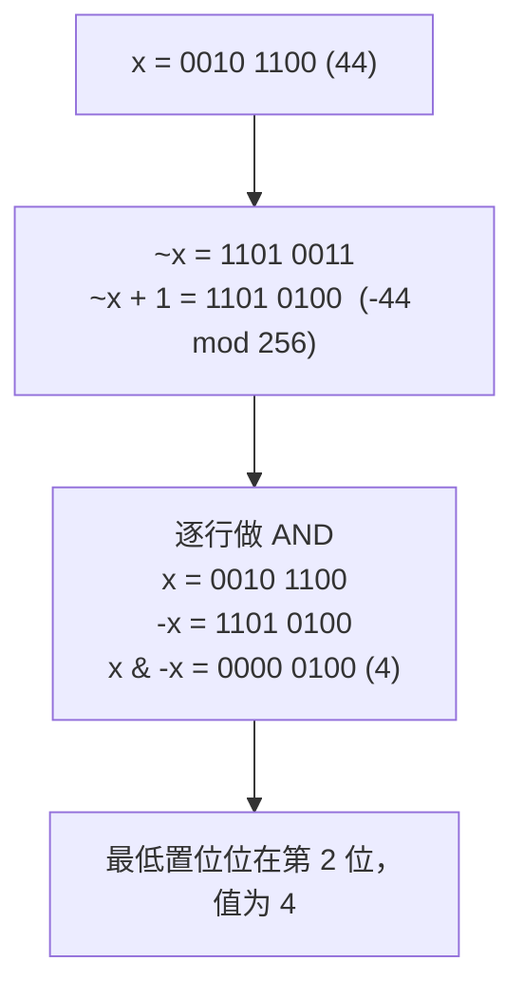
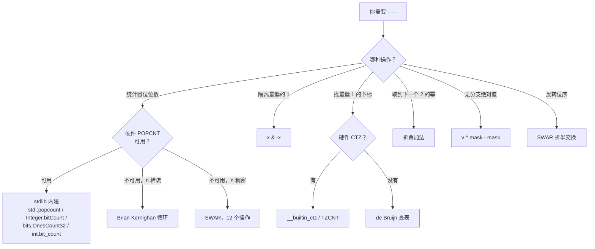

# 高性能位运算技巧

大多数生产代码不需要这一章。在 2008 年之后造的任何 x86-64 服务器、2013 年之后造的任何 ARMv8 手机上，`std::popcount`、`Integer.bitCount`、`bits.OnesCount32` 和 `int.bit_count()` 都降成一条硬件指令：延迟三个周期，吞吐每周期一条，没有分支。本目录收录的软件 popcount 里最巧妙的那一个，有十二个操作。硬件版本只有一个。只有当内建指令缺失时，当内层循环必须跑在 Cortex-M0 上或没有 `i32x4.popcnt` 的 WebAssembly 模块里时，或者面试题禁止算术运算符、你只能退回到位模式恒等式时，才需要动用这套工具。

即便你的 CPU 有 POPCNT，读这一章也有理由：那些内建指令不是凭空出现的。SSE4.2 在 2008 年加上 POPCNT，是因为 Henry Warren 的 *Hacker's Delight* §5-1 已经用二十年时间证明了“横向相加”才是正确的内核；等 Intel 最终把这个算法浇进硅里，它还是教科书教的那个分治折叠。[^1] 读一遍工具箱，认出那个形状，然后让编译器去干活。

## 这些技巧实际用在哪里

快速过一遍仍在用它们的生产代码。

**Fenwick 树（树状数组）。** 每次更新都通过 `i += i & -i` 向上走父节点；每次前缀查询都通过 `i -= i & -i` 向上走祖先。这个技巧把一次对数级的祖先查找换成一条 ALU 操作。Fenwick 树是“带点更新的区间求和”的标准数据结构，用在竞赛编程、金融逐笔行情聚合器，以及多版本数据库的索引层。没有 `x & -x`，这个结构就无法做到每次操作 `O(log n)`。[^2]

**Stockfish 国际象棋引擎。** 魔术位板（magic bitboard）把棋盘的 64 个格子表示成单个 `uint64_t`，合法着法生成归结为对这些字做 AND、OR、XOR。自 2014 年起，Stockfish 用 Intel 的 BMI2 PEXT 指令（Haswell，2013）在一个周期内从棋局状态里抽出相关的占位位。[^3] PEXT 这条路让 Stockfish 在 AMD Zen 3 和 Intel Skylake-X 上快了约 10%，对一个每秒搜索一亿个局面的引擎来说，这点提升已经算数。

**哈希表容量取整。** Java 的 `HashMap`、Go 的 `runtime.map`、Rust 的 `HashMap` 都把容量向上取到 2 的幂，好让桶的选取变成 `hash & (capacity - 1)` 而不是 `hash % capacity`。掩码是一个周期；在大多数 CPU 上取模要二十多个周期。这些分配器里那个“取到下一个 2 的幂”的例程，就是下文 §“MSB 隔离”里的折叠加法恒等式。[^4]

**长数组上的 SIMD popcount。** 当输入是几百万个 64 位字组成的缓冲区时，单条 POPCNT 每周期能跑一条，但会卡在跨寄存器的依赖上。Mula 和 Lemire 2017 年的算法用 AVX2 的 shuffle 和基于 PSHUFB 的半字节查表，在 32 字节向量上统计位数，吞吐量是标量 POPCNT 的两倍。[^5] glibc 的 `memrchr`、jq 的集合成员判断，以及几个列式数据库引擎（DuckDB、ClickHouse）都链接 `libpopcnt`，它按 `cpuid` 分派到标量路径或 AVX2 路径。

四个例子共有的模式是：技巧是算法，内建指令是优化，而这一章讲的是内建指令在底层到底做了什么。

## 两个基础恒等式

两个单操作技巧，后面几乎每个恒等式里都会再遇到。

**`x & -x` 取出最低的置位位。** 补码取负会翻转每一位再加一；`+1` 产生的进位穿过 `x` 末尾的连续 0，把最低的那个 1 翻掉之后就停下。再与 `x` 做 AND，只留下在两种表示里都幸存的位，那正好就是最低的那个 1。



*AND 会把 `x` 与 `-x` 不一致的每个位置都丢掉；按构造，剩下的只有 `x` 最低的那个 1。*

**`x & (x - 1)` 清除最低的置位位。** 对一个正数 `x` 减一，会把它从最低那个 1 往下的所有位翻转；最低的 1 变成 0，末尾的 0 变成 1。再与 `x` 做 AND，只保留最低那个 1 *之上*的位。这两个恒等式是 Fenwick 树遍历、位掩码子集上的集合迭代，以及下面 Brian Kernighan popcount 的主力工具。两者都在 *Hacker's Delight* §2-1 里有证明。[^1]

## Brian Kernighan 的 popcount

这是经典的位计数算法，由 Peter Wegner 发表于 *CACM* 3:5（1960），再经 Kernighan 与 Ritchie 的 *The C Programming Language* 习题 2-9 流行开来。[^1]

```python
def popcount_kernighan(n: int) -> int:
    count = 0
    while n:
        n &= n - 1   # 清除最低的置位位
        count += 1
    return count
```

循环跑 `popcount(n)` 次，不是 `WORD_BITS` 次。在一个有三位为 1 的 64 位字上，不管这三位落在哪里，循环都在三次后结束。朴素的移位计数 `for k in range(64): count += (n >> k) & 1` 永远跑 64 次。在稀疏输入上，Kernighan 最多能赢 `WORD_BITS / popcount(n)` 倍；在稠密输入上两者打平。

如果你在[位运算入门](../part-0-foundations/03-bit-manipulation-primer.md)里见过这个循环：没错，就是同一个。它在这里再出现一次，是因为本章其他所有内容都建立在它之上。

## SWAR popcount：十二个操作，无分支

*Hacker's Delight* §5-1 里的“最佳方法”，最初归功于 Beeler、Gosper 和 Schroeppel 在 MIT AI Memo 239（HAKMEM，1972）中的工作。[^1]

```python
def popcount_swar(v: int) -> int:
    # 输入为 32 位无符号数；开头先掩到 32 位。
    v &= 0xFFFFFFFF
    v = v - ((v >> 1) & 0x55555555)
    v = (v & 0x33333333) + ((v >> 2) & 0x33333333)
    v = (v + (v >> 4)) & 0x0F0F0F0F
    return ((v * 0x01010101) & 0xFFFFFFFF) >> 24
```

十二条 ALU 操作，无分支，无内存加载。这个算法是靠折半做横向相加。第一行之后，每个 2 位组存着这一对里 1 的个数（0、1 或 2，用 2 位编码）。第二行之后，每个半字节存着该半字节的计数（0..4）。第三行之后，每个字节存着自己的字节计数（0..8）。最后的乘法用 `0x01010101` 把四个字节计数汇进最高字节，再右移 24 位取出答案。

这就是 POPCNT 不可用时 `std::popcount` 回退到的算法。C++20 标准明确允许实现在每个调用点自行选择硬件指令还是软件回退。AMD 的 *Software Optimization Guide for Athlon 64 and Opteron* 第 187–188 页记录了一样的写法。[^1]

## de Bruijn 位扫描

如果要的是最低置位位的*下标*（不只是它的值），可移植的软件答案是“一次乘法加一次查表”。

```text
const int DEBRUIJN[32] = { ... };  // 0..31 的一个排列
int trailing_zeros(uint32_t v) {
    return DEBRUIJN[((v & -v) * 0x077CB531U) >> 27];
}
```

常量 `0x077CB531` 是一个 B(2, 5) de Bruijn 序列：它 32 位二进制展开里任意 5 位窗口都互不相同。乘以 `2^k`（非零 `v` 的 `v & -v` 产生的正是这个值）会把序列左移 `k` 位，所以乘完之后最高的 5 位就确定了 `k`。32 项的表把这 5 位映射回 `k`。Leiserson、Prokop 和 Randall 于 1998 年在 MIT 发表了这一构造，并证明了它的最坏情况是 `O(1)`，与字长无关。[^6]

现代 x86-64 有 BSF（自 8086 起），以及 BMI1 的 TZCNT、LZCNT（自 Haswell，2013）。ARMv8 有 CLZ。在不暴露硬件指令的平台上，`__builtin_ctz`、`Integer.numberOfTrailingZeros` 和 `bits.TrailingZeros32` 回退到的就是 de Bruijn 查表。

## 工具箱里的其余技巧

本章收录但不展开的五个恒等式。每个都只有一两行；重要的是在它出现时能认出这个模式。

**MSB 隔离与向上取到 2 的幂。** 把最高的那个 1 折叠到下面所有位置，然后减一或加一：

```python
v |= v >> 1
v |= v >> 2
v |= v >> 4
v |= v >> 8
v |= v >> 16
v -= v >> 1     # 向下取到 2 的幂；`+ 1` 则向上取整
```

六个操作；哈希表容量取整和伙伴分配器都在用。硬件回退：x86 的 BSR 或 ARM 的 CLZ；对非零的 32 位 `v`，`floor(log2(v)) = 31 - __builtin_clz(v)`。

**无分支绝对值。** `mask = v >> 31; abs_v = (v ^ mask) - mask`。三个操作，无分支。`v` 为负时，算术右移产生全 1，异或把 `v` 取反，再减 `-1` 等于加一，这就是教科书上的取负公式。`v` 非负时 mask 为零，值原样通过。现代编译器为普通的 `abs(v)` 大多会生成一条 CMOV，速度一样快；无分支写法的价值在流水线很深的核上，以及没有 CMOV 的 SIMD lane 里。[^1]

**从 `b` 位做符号扩展。** `m = 1U << (b - 1); r = (x ^ m) - m`。用来从网络协议里打包的位域（12 位和 20 位字段很常见）和 CPU 指令立即数中还原有符号值。

**SWAR 位反转。** 五轮折叠交换，每轮处理一种 2 的幂大小的块：位、对、半字节、字节、半字。并行反转 `N` 位总共 `5 · log₂(N)` 个操作。硬件 FFT 实现用它来在蝶形运算之前重排样本。字节反转（面试里更常问的那个）在 x86 上是一条 `bswap`，在 ARM 上是 `rev`。

**用 `(x & (x - 1)) == 0` 判断 2 的幂。** 对一个正数 `x` 减一，会把它从最低那个 1 往下的所有位翻转。如果 `x` 是 2 的幂，它只有一个置位位，清掉它就剩零。别的数至少有两个置位位，清掉一个之后仍然非零。

## 决策树

本章的速查表。读一遍；等哪个内层循环需要时再回来。



*每个触发条件对应一个恒等式；只要有硬件路径，硬件路径就胜过软件路径。*

## 实际开销

表里是 32 位无符号字、单周期 ALU 下每个技巧的开销。把 32 换成 64 就得到 64 位的开销。

| 技巧 | 软件实现 | 硬件回退 | 现代 stdlib 调用 |
|---|---|---|---|
| `x & -x` 取最低位 | 1 条 ALU 操作 | 直接 | 不适用（这个技巧本身就是原语） |
| `x & (x - 1)` 清除最低位 | 1 条 ALU 操作 | 直接 | 不适用 |
| Kernighan popcount | `popcount(n)` 次迭代 | POPCNT，1 个操作 | `std::popcount`、`Integer.bitCount` |
| SWAR popcount | 12 个操作，无分支 | POPCNT，1 个操作 | （降级时选择） |
| de Bruijn ctz | 3 个操作 + 查表 | BSF / TZCNT，1 个操作 | `__builtin_ctz`、`Integer.numberOfTrailingZeros` |
| MSB 隔离 | 6 个操作（5 次折叠 + 1 次减法） | BSR / LZCNT，1 个操作 | `Integer.numberOfLeadingZeros` |
| 无分支绝对值 | 3 个操作 | CMOV，1 个操作 | `std::abs`（编译器选择） |
| 位反转 | 5 · log₂(N) 个操作 | RBIT（仅 ARM） | `Integer.reverse`、`bits.Reverse32` |

在 Skylake 上，POPCNT 延迟三个周期、吞吐每周期一条；在 Zen 2 上延迟一个周期、吞吐每周期 0.25 条。[^7] 稠密负载下，在大部分非零的 64 位字缓冲区上，内建指令比 Kernighan 循环快几个数量级。稀疏负载下差距会小一些；当每个字的平均 popcount 低于 `log₂(WORD_BITS)` 时，Kernighan 对输出规模的敏感性才真正起作用。

## 两个陷阱

> [!WARNING]
> **C++17 里对负的有符号整数右移是实现定义的。** 按 C++17 规范，`int v = -1; v >> 1;` 允许得到 `0x7FFFFFFF`（逻辑右移）而不是 `-1`（算术右移），尽管实践中每个主流编译器做的都是算术右移。C++20 [basic.fundamental]/3 强制要求补码和算术右移；在 C++20 之前依赖这一行为实现无分支绝对值或符号扩展的代码是不可移植的。改用 `uint32_t` 加显式的 `(x ^ mask) - mask` 写法，或者升级标准。

> [!WARNING]
> **Java 的 `>>` 与 `>>>`。** Java 是唯一一个给算术右移和逻辑右移分了两个运算符的主流语言。`>>` 做符号扩展；`>>>` 补零。从 C++ 抄来、拿 `>>` 表示“把 1 从高位挤出去”的代码，在输入符号位为 1 时会悄悄产生全 1 的高位。LC 191 的规范 Java 实现用 `n >>> 1`，正是为了让循环在被喂进负的 `int`（`0xFFFFFFFF` 被当成 `-1`）时也能终止。

## 内置指令存在时，不要自己写技巧

这是本章最强烈的观点。一个开发者写了 Kernighan 循环、做了性能剖析、发现比 `std::popcount` 慢，他并没有推翻这个算法；他只是重新发现了 POPCNT 是一个周期，而 Kernighan 是 `popcount(n)` 个周期。生产代码调 `int.bit_count()`（Python 3.10+，2021 年 10 月）、`Integer.bitCount`（Java 自 JDK 7 起，在支持的 CPU 上被 JIT 内化为 POPCNT）、`bits.OnesCount32`（Go，在带 SSE4.2 的 amd64 上降为 POPCNT），或者 `std::popcount`（C++20）。本章讲的是这些调用在底层做了什么，以及平台缺这条指令时该怎么办。两者并不冲突；教学和部署各有各的最优解。[^8]

## 题目梯度

本章属于基础/框架豁免：它是一份工具箱目录，不是解题模式。下面两道题演示工具箱的用法。没有简单/中等/困难的跨度要求。

### 核心

- [LC 868 — Binary Gap](https://leetcode.com/problems/binary-gap/) [简单] • bit-shift-scan
- [LC 371 — Sum of Two Integers](https://leetcode.com/problems/sum-of-two-integers/) [中等] • bit-parallel-arithmetic ★

LC 371 是本章的招牌题：它禁止 `+` 和 `-`，逼着候选人把 `^`（不带进位的和）和 `& << 1`（进位）拼成一个全加器。四种语言的完整代码在 `lc-371/`。

```python
def get_sum(a: int, b: int) -> int:
    MASK = 0xFFFFFFFF
    SIGN_BIT = 0x80000000
    while b & MASK:
        carry = ((a & b) << 1) & MASK
        a = (a ^ b) & MASK
        b = carry
    return a if a < SIGN_BIT else a - (SIGN_BIT << 1)
```

**解法** — Python（[Java](./03-bit-tricks-performance/lc-371/sol.java) · [C++](./03-bit-tricks-performance/lc-371/sol.cpp) · [Go](./03-bit-tricks-performance/lc-371/sol.go)）

```python
# LC 371. Sum of Two Integers

def get_sum(a: int, b: int) -> int:
    """Return a + b without using + or -.

    Implements full-adder logic with bit-parallel composition:
      sum-without-carry: a XOR b
      carry:             (a AND b) << 1
    Iterate until carry is zero.

    Python ints are arbitrary-precision, so we mask to 32 bits each step
    and reinterpret the sign at the end. LeetCode's constraint is
    -1000 <= a, b <= 1000, well within 32-bit two's complement.
    """
    MASK = 0xFFFFFFFF
    SIGN_BIT = 0x80000000

    while b & MASK:
        carry = ((a & b) << 1) & MASK
        a = (a ^ b) & MASK
        b = carry

    # 若最高位为 1，则按负的 32 位整数解释。
    return a if a < SIGN_BIT else a - (SIGN_BIT << 1)
```

## 后续衔接

[位掩码技巧](./02-bitmask-techniques.md)用 `x & -x` 在子集 DP 状态上做集合迭代，用 `x & (x - 1)` 做“枚举 `x` 的每个子集”。[Fenwick 树](../part-6-trees-heaps/10-segment-tree.md)（待写）是 `i & -i` 的大规模应用：每次前缀查询、每次点更新，都是一条 ALU 操作走一步祖先。

## 参考文献

[^1]: Henry S. Warren Jr., *Hacker's Delight*, 2nd ed., Addison-Wesley, 2013, ISBN 978-0-321-84268-8.

[^2]: Peter M. Fenwick, "A New Data Structure for Cumulative Frequency Tables," *Software: Practice and Experience* 24:3 (1994), pp.

[^3]: Pradyumna Kannan, "Magic Bitboards Explained," *Stockfish Wiki*, [stockfishchess.org](https://stockfishchess.org/).

[^4]: Doug Lea, "ConcurrentHashMap" implementation notes, Java Community Process JSR-166.

[^5]: Wojciech Muła, Nathan Kurz, and Daniel Lemire, "Faster Population Counts Using AVX2 Instructions," *The Computer Journal* 61:1 (2018), pp. 111–120, DOI 10.1093/comjnl/bxx046. Source code at [github.com/CountOnes/hamming_weight](https://github.com/CountOnes/hamming_weight)

[^6]: Charles E. Leiserson, Harald Prokop, and Keith H. Randall, "Using de Bruijn Sequences to Index a 1 in a Computer Word," MIT Lab for Computer Science technical report, July 1998, [supertech.csail.mit.edu/papers/debruijn.pdf](https://web.archive.org/web/20240314060050/http://supertech.csail.mit.edu/papers/debruijn.pdf).

[^7]: Agner Fog, *Instruction Tables: Latencies, Throughputs and Micro-operation Breakdowns for Intel, AMD, and VIA CPUs*, Technical University of Denmark, latest revision, [agner.org/optimize/instruction_tables.pdf](https://www.agner.org/optimize/instruction_tables.pdf).

[^8]: Charlie Arehart, "Intrinsically fast: more JVM performance tinkering," Rapid7 blog, May 2016, [rapid7.com/blog/post/2016/05/24/intrinsically-fast-more-jvm-performance-tinkering](https://www.rapid7.com/blog/post/2016/05/24/intrinsically-fast-more-jvm-performance-tinkering/).
