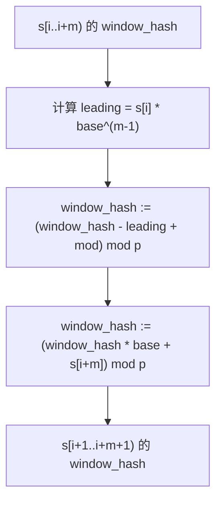
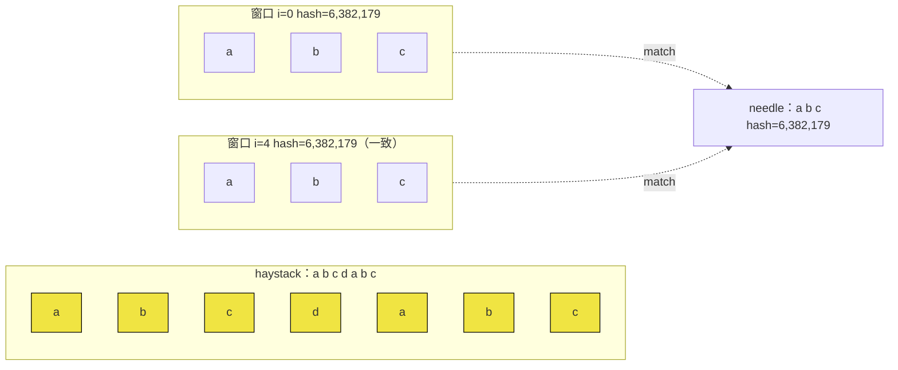

# Rabin-Karp 与滚动哈希

一个长度 30,000、只含小写字母的字符串。问题是：有没有哪个子串（长度不限）出现了两次。诚实的第一次尝试是：定一个长度，扫过每个长度 `L` 的窗口，逐个塞进哈希集合，看什么时候撞上。这能work。但最坏情况下，哈希函数内部要做大约 30,000 × 30,000 次字符比较；如果还对长度做二分，再乘一个 `log n`；整件事跑起来将近一分钟，而判题器只给两秒。

本章讲的就是那个把“窗口的哈希”从每滑一步 O(`L`) 压到每滑一步 O(1) 的技巧，以及事成之后保证算法依然正确的那点疑心病。Karp 和 Rabin 于 1987 年发表它，作为随机算法它有两副面孔：信哈希就快，但可能错；加了校验就快，而且永远正确。[^1] 正是校验让它成为真正的算法。

## 它算的是什么

对一个长度 `m` 的字符串 `s` 做多项式哈希：把每个字符当作一位数字，整个字符串当作一个 `b` 进制整数：

```text
H(s) = (s[0] * b^(m-1) + s[1] * b^(m-2) + ... + s[m-1]) mod p
```

`b` 至少取字母表大小（ASCII 取 256）。`p` 取 2^30 附近的素数，这样乘法 `(p - 1) * b` 仍落在 64 位寄存器内。`H` 是一个指纹（fingerprint）：相同的字符串一定哈希相同；不同的字符串*几乎*总是哈希不同，那点缝隙由显式的校验步骤补上。

选择这种做法、而不用通用字符串哈希函数，理由就是下面第二条性质。

## 滑动只差一行

已知 `s[i..i+m)` 的哈希，*下一个*窗口 `s[i+1..i+m+1)` 的哈希可以用三次乘法加一次减法算出来。不重新扫描，不把整个窗口重乘一遍。只需：

```text
H_next = (H_prev - s[i] * b^(m-1)) * b + s[i+m]   (mod p)
```

从左往右读。减去首位数字的贡献（也就是从左边离开的那个字符）。剩下的部分乘以 `b`，把整体左移一位。再加上新的末位数字（从右边进来的字符）。这和你在十进制数上滑动数位是同一套算术。从 `H("abr")` 到 `H("bra")` 就是“减去 `a` 的贡献、移位、加上 `b` 的贡献”，而这就是整个算法期望线性的全部原因。



*每滑一步都是四次整数运算，与 m 无关。这就是算法本身；其余全是记账。*

步骤 C 里的 `+ mod` 在任何有符号整数语言里都不是可选项。Java 和 C++ 的 `%` 在被除数为负时返回非正余数，于是 `(window_hash - leading) % mod` 可能落进 `(-mod, 0)` 区间，静默污染之后的每一个哈希。修法是经典写法 `((x - leading) % mod + mod) % mod`，或者 Java 里的 `Math.floorMod`，或者 C++ 里能干净回绕的 `uint64_t` 运算。[维基百科条目](https://en.wikipedia.org/wiki/Rabin%E2%80%93Karp_algorithm)的 §3.2 节把这叫“underflow avoider”，而它是让每个失败的 Java Rabin-Karp 提交失败的两个单字符 bug 之一。[^2]

## 哈希相等不等于字符串相等

整座大厦压在一个让新手心慌的事实上：两个不同的字符串可能哈希到同一个值。概率很小。`m` 取几千、`p ≈ 10^9` 时，用多项式根计数的论证可以证明单次碰撞概率被 `m / p` 界住，大约是每次窗口比较 10^-6。乘上长度 `n` 的 haystack 上的 `n - m + 1` 个窗口，整趟扫描的期望假匹配数仍稳稳低于 1。低于 1 不等于 0。

所以 Rabin-Karp 把哈希相等当作*过滤器*，而不是匹配。每当窗口哈希与 needle 哈希一致，算法就跑一次逐字符比较来确认。1987 年的原始论文给这两种模式起了名字：省掉校验得到 *Monte Carlo*（快，偶尔错）；保留校验得到 *Las Vegas*（永远正确，期望线性）。[^1] 无论你为面试还是为生产环境的搜索引擎写代码，都保留校验。教科书写法是

```text
if (window_hash == needle_hash && substring_equals(...)) { matched = true; }
```

把哈希比较看成相对朴素匹配器的 30 行提速，而不是字符比较的替代品。把校验当成契约。

## 完整算法，在 LC 28 上

LeetCode 28 要求返回 `needle` 在 `haystack` 中首次出现的下标，不存在则返回 -1。朴素答案在每个起始位置拿 needle 与 haystack 比较，最坏情况做 O(n × m) 次字符比较。Rabin-Karp 做同一趟扫描，只是把内层比较换成一次哈希检查，命中哈希后再校验。

```python
def str_str(haystack, needle):
    n, m = len(haystack), len(needle)
    if m == 0:
        return 0
    if m > n:
        return -1

    base = 256
    mod = 1_000_000_007
    high_power = pow(base, m - 1, mod)

    needle_hash = 0
    window_hash = 0
    for i in range(m):
        needle_hash = (needle_hash * base + ord(needle[i])) % mod
        window_hash = (window_hash * base + ord(haystack[i])) % mod

    for i in range(n - m + 1):
        if window_hash == needle_hash:
            if haystack[i:i + m] == needle:        # 哈希命中后校验
                return i
        if i < n - m:
            leading = ord(haystack[i]) * high_power
            window_hash = (window_hash - leading) % mod
            window_hash = (window_hash * base + ord(haystack[i + m])) % mod

    return -1
```

**解法** — Python（[Java](./01-rabin-karp/lc-28/sol.java) · [C++](./01-rabin-karp/lc-28/sol.cpp) · [Go](./01-rabin-karp/lc-28/sol.go)）

```python
# LC 28. Find the Index of the First Occurrence in a String


def str_str(haystack: str, needle: str) -> int:
    """LC 28. First index of needle in haystack via Rabin-Karp, or -1.

    Slide a length-m window across the haystack; compare each window's
    polynomial hash against the precomputed needle hash; on hash match,
    verify char-by-char to defeat collisions. Expected O(n + m); worst
    case O(n * m) when every window collides.
    """
    n, m = len(haystack), len(needle)
    if m == 0:
        return 0
    if m > n:
        return -1

    base = 256
    mod = 1_000_000_007
    high_power = pow(base, m - 1, mod)

    needle_hash = 0
    window_hash = 0
    for i in range(m):
        needle_hash = (needle_hash * base + ord(needle[i])) % mod
        window_hash = (window_hash * base + ord(haystack[i])) % mod

    for i in range(n - m + 1):
        if window_hash == needle_hash:
            if haystack[i:i + m] == needle:        # 哈希命中后校验
                return i
        if i < n - m:
            leading = ord(haystack[i]) * high_power
            window_hash = (window_hash - leading) % mod
            window_hash = (window_hash * base + ord(haystack[i + m])) % mod

    return -1
```

三件事按顺序发生。构建阶段用 O(m) 算出 `needle_hash` 和第一个 `window_hash`，每个字符一步 Horner 累加。滑动循环跑 n − m + 1 次；每次迭代四次整数运算，只有在哈希罕见的那些一致窗口上才多花一次 O(m) 校验。两个提前返回分别挡住 `m == 0` 和 `m > n`，而 LC 28 的测试集确实会检查这两种情况。

`high_power` 是构建阶段唯一让人意外的项。它是 `base^(m-1) mod p`，在循环前用 Python 的 `pow(base, m - 1, mod)`、或 Java/C++/Go 里一个小 for 循环算一次。每次滑动都要用它给离开的那个字符的贡献加权；只算一次，正是滑动保住 O(1) 的原因。

## 在一个小输入上走一遍滑动

设 `haystack = "abcdabc"`，`needle = "abc"`。取 `base = 256`，`mod = 10^9 + 7`。于是 `high_power = 256^2 = 65,536`。

构建阶段是两次 Horner 累加。对 needle：

- 'a' 之后：`0 × 256 + 97 = 97`
- 'b' 之后：`97 × 256 + 98 = 24,930`
- 'c' 之后：`24,930 × 256 + 99 = 6,382,179`

所以 `needle_hash = 6,382,179`。haystack 的第一个窗口也是 `"abc"`，同样三步 Horner 累加后 `window_hash = 6,382,179`。哈希在下标 0 处一致。校验：`haystack[0..3] == "abc"`。相等。返回 0。

换成同一题“找出全部出现”的变体（滑动这才看得见），继续走。丢掉首位 `'a'`，乘 256，加上 `'d'`。`(6,382,179 − 97 × 65,536) × 256 + 100 = 6,447,972`。哈希不一致，跳过校验。丢掉 `'b'`，加上 `'a'`：`6,513,761`。不匹配。丢掉 `'c'`，加上 `'b'`：`6,578,530`。不匹配。丢掉 `'d'`，加上 `'c'`：回到 `6,382,179`。匹配。校验：`haystack[4..7] == "abc"`。确认。整趟扫描在下标 0 和 4 报告匹配，花了十一次乘法、六次减法、两次三字符校验，在一个 7 字符的字符串上总共约六十次算术操作；朴素匹配器则可能要做二十一次字符比较。



*哈希与 needle 一致的那两个窗口都通过了校验；夹在它们中间的三个窗口只做一次整数比较就被跳过。*

在这个规模上省下的量看着很小，因为规模本来就小。在长度 10,000 的 haystack 和长度 50 的 needle 上，朴素匹配器最多做 500,000 次字符比较；Rabin-Karp 大约做 40,000 次整数运算加少量校验，在真实硬件上大致快一个数量级。

## 开销

| 变体 | 时间 | 空间 | 备注 |
|---|---|---|---|
| 单模式，平均 | O(n + m) | O(1) | 三个整数状态：`window_hash`、`needle_hash`、`high_power`。算法对外宣称的那个界。 |
| 单模式，最坏情况 | O(n × m) | O(1) | 每个窗口的哈希都等于 needle 哈希；校验每次都触发，做 m 次字符比较。只有对抗性输入会撞上。 |
| 多模式，k 个等长模式 | O(n + k × m) | O(k) | 把 k 个模式各哈希一次；每个窗口探查一张模式哈希的哈希集合。k 极大时 Aho-Corasick 的渐近更紧，但代码量约十倍。 |
| 朴素基线 | O(n × m) | O(1) | 你替换掉的那个。 |

期望线性的说法来自多项式根论证。两个不同的长度 `m` 字符串可以看作变量 `b` 上的两个多项式，系数都在 `[0, σ)` 内。它们模 `p` 相等，仅当 `b` 是它们之差的一个根；一个 `m` 次多项式在 `Z / pZ` 上最多有 `m` 个根。所以随机取足够大的 `p`，单次比较的碰撞概率至多 `m / p`；在 `n − m + 1` 个窗口上求和，期望校验开销是 `O(n × m / p)`，对 `p ≈ 10^9` 和 LC 规模的输入，这一项小到被滑动本身盖过。[^3] Karp 和 Rabin 1987 年的论文正式证明了线性期望界；CLRS §32.2 以教科书形式给出同样的证明。[^1][^4]

最坏情况真实存在，但很少见。撞上它的输入是构造出来的：比如用 Thue-Morse 序列可以生成对固定 (`base`, `mod`) 哈希系统性碰撞的 haystack。下面“输入是敌意的时候”一节讲怎么办。

## 输入是敌意的时候

上面的单模数实现在 LC 每个测试点上都过，面试就该这么写。要提交到 Codeforces 面对对抗性数据，或者在输入由用户控制的任何生产搜索引擎里，标准加固手段是**双哈希**：给滚动哈希配第二个用不同 `(base, mod)` 对的哈希，只有*两个*哈希都一致时，才把窗口当作候选匹配。

为什么两个哈希就够了：单个模 `p` 的哈希碰撞概率约 `m/p`。两个独立的模 `p_1`、`p_2` 哈希，联合碰撞概率约 `m^2 / (p_1 × p_2)`，对两个 30 位素数而言量级是 10^-15。校验步骤仍然保留，因为同时碰撞并非不可能，只是天文数字般地不可能；运行时间仍是期望线性。CP-Algorithms 和 dacin21 的 Codeforces 博客把攻击（用 Thue-Morse 打 `mod 2^64`）和防御（真素数模数 + 随机化基数）都详细走了一遍。[^5]

由此得出三条建议：

- 选真素数模数。`10^9 + 7`、`2^31 − 1`、`(2^61) − 1` 都可以。不要用 `mod = 2^64`（也就是把无符号溢出当成隐式模数）：在那个模数下，Thue-Morse 构造对任何基数都能产出等哈希的字符串。
- 输入有对抗性时，在程序启动阶段随机化基数。高分辨率时钟做种子，`base` 从 `[256, 2^30)` 区间的素数里均匀取一个，是标准配方。
- 两个哈希，不要三个。三个相对两个买不到足够的碰撞概率余量来抵偿多出的算术，而任何能击破两个精心选择的哈希的输入，用同样的构造也能击破三个。

对 LC 来说这些都不重要。单哈希、固定素数、固定基数、哈希命中后校验。对 Codeforces，三条都重要。

## 模式失效的场景——按长度二分

本章的招牌题是 LC 1044，Longest Duplicate Substring，也是 Rabin-Karp 在课程体系里挣到位置的地方。题目：给定字符串 `s`，找出至少出现两次的最长子串。朴素解法枚举每个子串（`O(n^2)` 个），按内容分桶（每次比较 `O(n)`），总共 `O(n^3)`，在 `n = 200` 附近就超时。

技巧是一个归约，把问题变成可行性问题。*是否存在长度为 `L` 的重复子串？* 如果有，就在 `s` 上滑一个长度 `L` 的窗口，逐个哈希，把哈希丢进一个以哈希为键、值为起始下标的字典，哈希撞上就切片校验。校验确认相等，长度 `L` 就是可行的。因为可行性是单调的（长度 `L+1` 的重复必然包含一个长度 `L` 的重复），所以对答案二分：最大的可行 `L` 就是答案长度，任一匹配对本身就给出那个子串。

```python
# LC 1044 草稿 —— 完整实现在 lc-1044/sol.py
def longest_dup_substring(s):
    n = len(s)
    # ... 预计算 s 上的前缀哈希 h[] 与幂 pow_b[] ...

    def find_dup(length):
        seen = {}
        for i in range(n - length + 1):
            wh = window_hash(i, length)
            if wh in seen:
                for j in seen[wh]:
                    if s[j:j+length] == s[i:i+length]:   # 校验
                        return j
                seen[wh].append(i)
            else:
                seen[wh] = [i]
        return None

    lo, hi, best_start, best_len = 1, n - 1, 0, 0
    while lo <= hi:
        mid = (lo + hi) // 2
        start = find_dup(mid)
        if start is not None:
            best_start, best_len = start, mid
            lo = mid + 1
        else:
            hi = mid - 1
    return s[best_start:best_start + best_len]
```

```python
# LC 1044. Longest Duplicate Substring
# 注意：本章的 LC 1044 只提供 Python 版（reference: Python only）。
from typing import Optional


def longest_dup_substring(s: str) -> str:
    """LC 1044. Find any longest substring that appears at least twice.

    Binary-search the answer length L in [1, n - 1]. At each L, run a
    Rabin-Karp scan over s using a precomputed prefix-hash array;
    insert each window's hash into a dict keyed by hash, value = first
    starting index. On collision (same hash already present) verify
    by string slice; if equal, L is feasible. The binary search is
    monotone because a duplicate of length L+1 contains a duplicate of
    length L.
    """
    n = len(s)
    if n < 2:
        return ""

    # 用本章 str_str 里同一对 (base, mod) 预计算 s 的前缀哈希。
    # h[i] = hash(s[0..i-1])；pow_b[i] = base^i。
    base = 256
    mod = (1 << 61) - 1                # 2^61 - 1，梅森素数
    h = [0] * (n + 1)
    pow_b = [1] * (n + 1)
    for i in range(n):
        h[i + 1] = (h[i] * base + ord(s[i])) % mod
        pow_b[i + 1] = (pow_b[i] * base) % mod

    def window_hash(left: int, length: int) -> int:
        # 用前缀哈希相减得到 hash(s[left..left+length-1])。
        return (h[left + length] - h[left] * pow_b[length]) % mod

    def find_dup(length: int) -> Optional[int]:
        seen: dict[int, list[int]] = {}
        for i in range(n - length + 1):
            wh = window_hash(i, length)
            if wh in seen:
                for j in seen[wh]:
                    if s[j:j + length] == s[i:i + length]:   # 校验
                        return j
                seen[wh].append(i)
            else:
                seen[wh] = [i]
        return None

    lo, hi = 1, n - 1
    best_start, best_len = 0, 0
    while lo <= hi:
        mid = (lo + hi) // 2
        start = find_dup(mid)
        if start is not None:
            best_start, best_len = start, mid
            lo = mid + 1
        else:
            hi = mid - 1

    return s[best_start:best_start + best_len]
```

和 LC 28 版本有两处不同。第一，内层哈希不是滑动窗口，而是*从前缀哈希表取子串哈希*。先用 `O(n)` 预处理出 `h[i] = hash(s[0..i])`，之后任何 `hash(s[left..left+length))` 都能用 `(h[left+length] - h[left] * pow_b[length]) mod p` 在 O(1) 内算出。第二，里面的数据结构是一张以窗口哈希为键的哈希*表*，而不是单个 needle 的哈希。碰撞时仍然校验；关键洞见是二分查找多花一个 `log n` 因子，但每次可行性测试确实是线性的，所以总共是 `O(n log n)` 期望——对 `n = 30,000` 够快。[^5]

同样的形状在 LC 1316（Distinct Echo Substrings：数出长度为偶数、且前半与后半哈希相等的子串个数）里重现，也出现在任何“是否存在满足性质 X 的子串”、X 对长度单调、内层谓词可归约为哈希集合成员的问题里。底座是滚动哈希；二分和哈希集合是外层的包装决策。

## 两个最容易踩的坑

> [!WARNING]
> **跳过校验步骤。** 读者第一次实现 Rabin-Karp 时，总想写 `if window_hash == needle_hash: return i` 然后收工。纸面上碰撞概率小得看不见，校验感觉像疑心病。并不是；它是“可能报告假匹配的 Monte Carlo 算法”与“永远正确的 Las Vegas 算法”之间的差别。即便用 30 位素数，LC 28 的测试集里也有构造输入，哈希恰好在下标 0 撞上，而不做校验的版本会在一个根本不含 needle 的 haystack 上返回 0。教科书写法是 `if window_hash == needle_hash and haystack[i:i+m] == needle: return i`。哈希相等是过滤器；校验才是匹配。

> [!WARNING]
> **Java 与有符号 C++ 里的负余数。** 滑动做的是 `window_hash = (window_hash - leading) % mod`，然后 `window_hash = (window_hash * base + char) % mod`。在 Java 里，左操作数非正时 `%` 返回非正余数，中间值可能落进 `(-mod, 0)`，下一次乘法就把一个负的、错的哈希传播到剩余整趟扫描。这个 bug 不可见：哈希静默地偏离 needle 哈希，之后每个窗口都被报告为不匹配。两个修法：写 `(window_hash - leading + mod) % mod`（Java 里用 `Math.floorMod(window_hash - leading, mod)`），或者改用无符号算术（C++ 的 `uint64_t`、Go 的 `uint64`），回绕干净。[`lc-28/sol.java`](./01-rabin-karp/lc-28/sol.java) 里的 Java 参考实现用 `+ mod` 写法；C++ 和 Go 参考实现用无符号类型。

第三个值得顺口提一句：乘法之前忘了转成 64 位类型。Java 的 `int` 是 32 位有符号，`(p − 1) × base` 在 `p ≈ 10^9`、`base = 256` 时会溢出一个确定但错误的值。修法是 `final long base = 256L`，让每次乘法都提升类型；参考实现第一行就这么写，正是为这个。

## 该用在哪、不该用在哪

模式固定、haystack 中小的单模式搜索：去写 KMP（下一章）。KMP 是确定性线性时间，没有哈希记账，一致性上赢过 Rabin-Karp。

haystack 极大、且你能接受期望时间界的单模式搜索：Rabin-Karp 没问题，`git diff` 内部用的就是它。

`k` 个等长模式的多模式搜索：Rabin-Karp 让你把 `k` 个模式哈希一次算好，之后每个窗口摊还 `O(1)` 探查哈希集合，期望 `O(n + k × m)` 完成。`k` 极大时（以及模式长度不等时）[Aho-Corasick](./04-aho-corasick.md) 的渐近更紧，但实现长一个数量级；45 分钟的面试里，Rabin-Karp 赢。

“满足性质 X 的最长子串”，且 X 对长度单调：二分长度，在每个候选长度上跑 Rabin-Karp 测可行性。这就是 LC 1044 那一族，也是本章的招牌应用。

任何输入有对抗性的地方：双哈希、真素数模数、随机化基数。任何没有对抗性的地方（LC 的每个测试点）：单哈希、固定素数、碰撞后校验。

## 题目梯度

### 核心（三题全做才算掌握本章）

- [LC 1044 — Longest Duplicate Substring](https://leetcode.com/problems/longest-duplicate-substring/) [困难] • rabin-karp + binary-search-on-length ★ *（参考实现只有 Python）*
- [LC 187 — Repeated DNA Sequences](https://leetcode.com/problems/repeated-dna-sequences/) [中等] • rabin-karp + small-alphabet-base
- [LC 1316 — Distinct Echo Substrings](https://leetcode.com/problems/distinct-echo-substrings/) [困难] • rabin-karp on substring hash sets

### 进阶（可选）

- [LC 1062 — Longest Repeating Substring](https://leetcode.com/problems/longest-repeating-substring/) [中等，Premium —— 免费替代题是 LC 1044] • rabin-karp + binary-search-on-length

LC 1044 是本章的招牌题（★），也是实例推演走的那题。LC 187 是最温和的第二遍：4 字母的 DNA 字母表意味着 `base = 4` 就够，100,000 字符的约束配固定窗口 10 刚好合拍。LC 1316 是换框：不拿窗口哈希与目标比较，而是把窗口哈希装进集合、数不同的回声；LC 1044 的 `pow_b` 与前缀哈希机器原封不动搬过来。

这个模式没有经典的 Easy LC 变体——在小输入上，滚动哈希的搭建成本比它替掉的朴素 O(n × m) 基线还要多几行，所以 LC “rolling hash” 标签下的 Easy 题，要么归滑动窗口那一章（LC 187 就卡在边界上），要么根本不存在。上面核心三题按 LC 的标签落在 M / H / H，本章的策展标记 `core-emh-via-stretch` 诚实地记录了 Easy 的缺席，而不是假装它存在。

## 后续衔接

单模式搜索的确定性线性时间替代方案，见下一章 [KMP 与失配函数](./02-kmp.md)：它用 needle 上预计算的自动机换掉滚动哈希，得到 `O(n + m)` 的最坏情况，而不是期望。多模式搜索的渐近升级，见本部分后面的 [Aho-Corasick](./04-aho-corasick.md)。在滚动哈希碰撞概率变得可观、需要离线数不同子串的规模上，见[后缀数组](../../../dsa/part-12-strings-pattern-matching/05-suffix-array.md)。

## 参考文献

[^1]: Karp, R. M.; Rabin, M. O., "Efficient randomized pattern-matching algorithms," *IBM Journal of Research and Development*, Vol. 31, No. 2, March 1987, pp.

[^2]: Wikipedia, "Rabin-Karp algorithm," English revision dated 2025-11-09. <https://en.wikipedia.org/wiki/Rabin%E2%80%93Karp_algorithm>.

[^3]: dacin21 (Codeforces user), "On the mathematics behind rolling hashes and anti-hash tests," Codeforces blog entry 60442, 2018. <https://codeforces.com/blog/entry/60442>.

[^4]: Cormen, Leiserson, Rivest, Stein, *Introduction to Algorithms*, 4th ed., MIT Press 2022, Chapter 32 "String Matching," §32.

[^5]: AlgoMaster, "Longest Duplicate Substring." <https://algomaster.io/learn/dsa/longest-duplicate-substring>.
