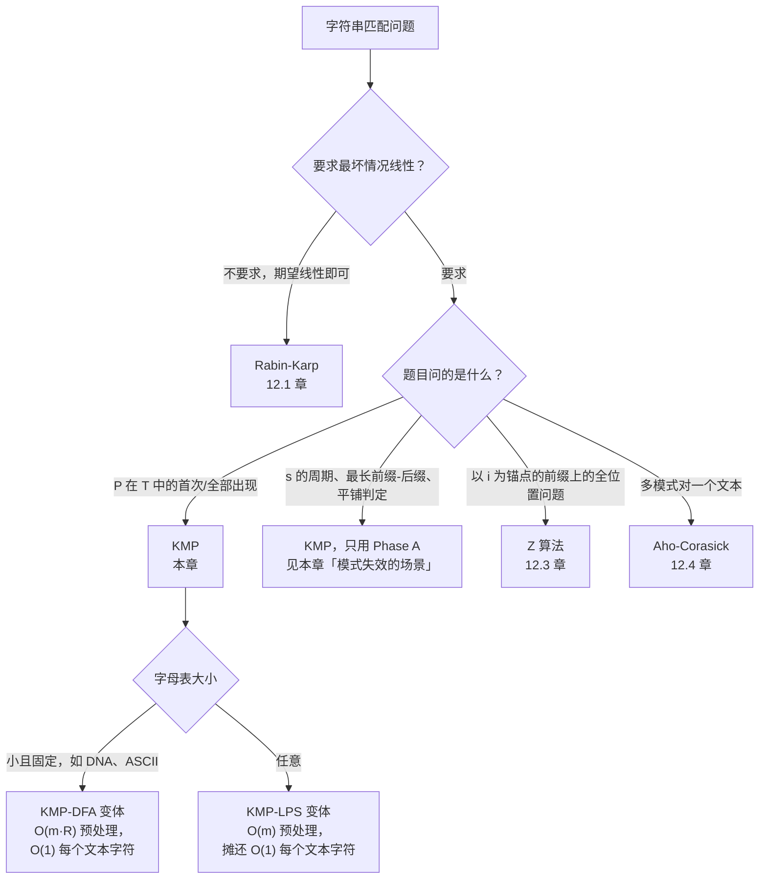

# KMP 与失败函数

一个长度 1,000 的模式串。一个长度 1,000,000 的文本串，构造得让模式串在每个起始位置都*几乎*匹配成功，直到最后一个字符才露馅：`aaaa...aab` 对上一百万字符的 `aaaa...aaab`。朴素匹配大约要做十亿次字符比较，KMP 只做两百万次。三个数量级。这道差距就是这套算法存在的全部理由。

> [!IMPORTANT]
> KMP 是大多数读者会在此卡住的一章。失败函数并不直观；只读代码、不亲眼看它跑一遍，基本不可能看懂。本章的动画承担了大部分解释工作，所以至少过两遍。跳过动画，就等于跳过了这一章。

[朴素字符串匹配](./00-naive-string-matching.md) 展示了那个简单循环为什么会炸：每遇到一次失配，就把刚确认过的字符全部丢掉，再从右边一个位置重新开始。[Rabin-Karp](./01-rabin-karp.md) 用哈希窗口换来了线性，外加一次核对来保证正确性。KMP 不用哈希、不用随机、也不用核对，同样拿到了线性。代价只有一次 O(m) 的预处理构建一个小数组，而这个小数组就是本章的全部内容。

## 为什么显而易见的做法会炸

走一遍朴素匹配在对抗性输入上到底干了什么。模式串是 `aaaab`；文本开头是 `aaaaaaaa...`。匹配器在位置 0..4 连续确认五个字符，在位置 4 失败（那里读到的是又一个 `a`，不是 `b`），然后回到文本位置 1 重新开始。在 1..5 确认五个字符，在 5 失败，回到文本位置 2。在 2..6 确认五个字符，在 6 失败。

看看浪费在哪里。第一次失败之后，匹配器刚刚验证过文本位置 0..3 全是 `a`。这四个字符*就是*模式串的一个前缀。匹配器知道这件事，它就是刚刚才知道的。然后它把这份知识扔掉，从位置 1 重新开始时又把这些同样的字符看了一遍。

一旦你盯着这份冗余看够久，修法就自己浮出来了。失配之后，匹配器已经知道文本的某个前缀长什么样。如果模式串有内部结构，也就是它的某个前缀等于我们刚刚匹配过的那段的后缀，我们就可以从模式串中间接着匹配，而不必从头重启。已经确认过的文本字符，一个都不用重读。

要做到这一点，只需要在搜索开始前回答一个问题，且只回答一次。*对模式串里的每个位置 `i`，`pattern[0..i]` 的、同时又是 `pattern[0..i]` 后缀的最长真前缀是什么？* 把答案记作 `lps[i]`。这个数组就是失败函数。用一趟 O(m) 遍历模式串把它建出来，然后拿着它当查表，走一遍文本。总工作量 O(n + m)，1977 年那篇原始论文给出了证明。[^1]

这个归约很小，但值得明确点出来。**因为 `lps[i]` 只取决于模式串自身、与文本无关，预处理只依赖 `m`，不依赖 `n`。** 这正是 KMP 能只付一次失败函数的构建成本、再把查找摊薄的原因。

## 失败函数到底在说什么

取模式串 `ABABCABAB`，字符下标 0..8。对每个前缀 `pattern[0..i]`，我们要找同时是后缀的最长真前缀。*真*（proper）这层限定很关键：整个前缀当然是它自己的前缀也是它自己的后缀，但那是废话，所以要排除。

| `i` | `pattern[0..i]` | 最长真前缀-后缀 | `lps[i]` |
|-----|------------------|------------------------------|----------|
| 0 | `A` | （无，单字符） | 0 |
| 1 | `AB` | （`A` 是前缀但不是后缀） | 0 |
| 2 | `ABA` | `A` | 1 |
| 3 | `ABAB` | `AB` | 2 |
| 4 | `ABABC` | （`C` 把所有对齐都打断了） | 0 |
| 5 | `ABABCA` | `A` | 1 |
| 6 | `ABABCAB` | `AB` | 2 |
| 7 | `ABABCABA` | `ABA` | 3 |
| 8 | `ABABCABAB` | `ABAB` | 4 |

读第 8 行。`ABABCABAB` 的、同时是后缀的最长真前缀长度是 4。前缀是 `ABAB`，匹配的后缀也是 `ABAB`。它们在字符串中间重叠了，但没关系。问题只是前四个字符和后四个字符是不是同一个串，答案是是。

这张数组就是之后每一个查找决策要查的东西。当匹配器已经确认了 `ABABCABAB`、而下一个文本字符不是 `C`（是 `C` 就能延伸成一整处匹配）时，它从 `lps[8] = 4` 就知道：刚刚看到的最后四个字符同时也是模式串的前四个字符。于是它可以拿 `pattern[4]` 对着下一个文本字符继续匹配，什么都不用重扫。

## 模式

KMP 在长度为 `n` 的文本 `T` 和长度为 `m` 的模式 `P` 上分两个阶段跑。两个阶段共用同一条回退规则，而这条规则就是本章的重心。

```python
def compute_lps(pattern: str) -> list[int]:
    m = len(pattern)
    lps = [0] * m
    length = 0          # 上一个最长前缀-后缀的长度
    i = 1
    while i < m:
        if pattern[i] == pattern[length]:
            length += 1
            lps[i] = length
            i += 1
        else:
            if length != 0:
                length = lps[length - 1]   # 回退；不要推进 i
            else:
                lps[i] = 0
                i += 1
    return lps


def str_str(haystack: str, needle: str) -> int:
    if needle == "":
        return 0
    n, m = len(haystack), len(needle)
    if m > n:
        return -1
    lps = compute_lps(needle)
    i = 0   # haystack 指针
    j = 0   # needle 指针
    while i < n:
        if haystack[i] == needle[j]:
            i += 1
            j += 1
            if j == m:
                return i - j
        else:
            if j != 0:
                j = lps[j - 1]
            else:
                i += 1
    return -1
```

**题解** — Python（[Java](./02-kmp/lc-28/sol.java) · [C++](./02-kmp/lc-28/sol.cpp) · [Go](./02-kmp/lc-28/sol.go)）

```python
# LC 28. Find the Index of the First Occurrence in a String
def compute_lps(pattern: str) -> list[int]:
    """Failure function: lps[i] = length of the longest proper prefix
    of pattern[:i+1] that is also a suffix of pattern[:i+1]."""
    m = len(pattern)
    lps = [0] * m
    length = 0  # 上一个最长前缀-后缀的长度
    i = 1
    while i < m:
        if pattern[i] == pattern[length]:
            length += 1
            lps[i] = length
            i += 1
        else:
            if length != 0:
                length = lps[length - 1]   # 回退；不要推进 i
            else:
                lps[i] = 0
                i += 1
    return lps


def str_str(haystack: str, needle: str) -> int:
    """Return the index of the first occurrence of needle in haystack, or -1.
    Per LC 28, an empty needle returns 0. Time O(n+m), space O(m)."""
    if needle == "":
        return 0
    n, m = len(haystack), len(needle)
    if m > n:
        return -1
    lps = compute_lps(needle)
    i = 0  # haystack 指针
    j = 0  # needle 指针
    while i < n:
        if haystack[i] == needle[j]:
            i += 1
            j += 1
            if j == m:
                return i - j
        else:
            if j != 0:
                j = lps[j - 1]
            else:
                i += 1
    return -1
```

两个循环是同一个形状。在 `compute_lps` 里慢指针是 `length`，在 `str_str` 里慢指针是 `j`。匹配时两者都前进；失配且指针非零时，两者都通过 `lps[<指针> - 1]` 回退。回退期间两者都不动快指针，这样同一个字符能对着新的模式位置再试一次。Phase A 在结构上就是把 Phase B 跑在模式串自己身上，`length` 扮演的是 Phase B 里 `j` 的角色。[^2]

`j = lps[j - 1]` 里的那个 `j-1`，是任何 KMP 实现里最容易被敲错的一行。它之所以对，是因为：在 `pattern[j]` 处失配之后，我们已知的是 `pattern[0..j-1]` 与文本中对应那一段匹配上了。`pattern[0..j-1]` 的、同时又是 `pattern[0..j-1]` 后缀的最长真前缀，长度就是 `lps[j - 1]`。那就是我们应该从模式串的哪个位置接着来。差一位，你要么死循环，要么跳过一处可行的对齐。

## 实例推演：在 ABABDABACDABABCABAB 中搜索 ABABCABAB

模式 `P = ABABCABAB`。文本 `T = ABABDABACDABABCABAB`。组件正是拿这份输入把两个阶段都动画化：先构建失败函数，再跑匹配。

构建是容易的那一半。从左往右走模式串，把每个字符跟当前 `length` 位置上的字符比。匹配时 `i` 和 `length` 都往前走，`lps[i]` 记下新的长度。失配且 `length > 0` 时，回退到 `lps[length - 1]` 再比一次，*此时不要移动 `i`*。失配且 `length = 0` 时，记 `lps[i] = 0` 并推进 `i`。十一步之后，数组 `[0, 0, 1, 2, 0, 1, 2, 3, 4]` 就建好了。

匹配阶段从左往右走。前四个字符对上了：`ABAB` 既是模式串的前缀，也是文本的头四个字符。到文本下标 4，匹配器读到 `D`，而模式串期待 `C`。失配，此时 `j = 4`。回退是 `j = lps[3] = 2`。这一行要仔细读：匹配器并没有跳回起点。它跳到 `pattern[2]`，因为失败函数说刚刚确认的最后两个字符（`AB`，在文本位置 2..3）同时也是模式串的头两个字符。文本指针 `i` 一动不动。

> [!IMPORTANT]
> *注意没有发生什么。* 匹配器没有重新看 `T[2]` 或 `T[3]`。它已经知道那是 `A` 和 `B`。匹配器接下来做的是把 `T[4]`（还是 `D`）跟 `P[2]`（是 `A`）比。又失配，再回退到 `j = lps[1] = 0`，然后走 `j = 0` 的跳过分支，直到这时 `i` 才前进到 5。**整趟跑下来，每个文本字符最多被读两次。** 这就是 O(n) 上界的具体样子。

匹配器在位置 5..9 之间又绕了几下，做了更多回退和跳过，在位置 10 捞到一处新的部分匹配，而这次的部分匹配是真的：文本位置 10..18 是 `ABABCABAB`，与模式串完全一致。匹配在起始下标 10 处报告。组件展示了完整的 36 步轨迹：失败函数构建 11 步，匹配 25 步。

> **交互组件：** [KMP 的失败函数构建与匹配阶段](../../../dsa/widgets/w-38-kmp.yml)（面板 `default`）—— 在网站上渲染；YAML 规格描述了关键帧。

*静态回退：失败函数是 `[0, 0, 1, 2, 0, 1, 2, 3, 4]`。匹配阶段回退了两次（在文本下标 4 和 8），跳过 `D` 和 `CD`，在下标 10 捞到那段连续的匹配，并在下标 10 报告命中。总工作量：36 个算法步，扫过 19 个文本字符。*

## 如何识别这个模式



*整个模式匹配家族的决策流程图。真正的判别信号是“问的是哪一对东西”：要“在 T 里找 P”且要最坏情况保证，用 KMP；要周期性 / 前缀-后缀这类结构问题、文本就是模式串自己，只用 KMP 的 Phase A。*

## 实际开销

| 变体 | 时间 | 空间 | 说明 |
|---|---|---|---|
| LPS 构建（Phase A） | Θ(m) | Θ(m) | 遍历模式串一趟。CLRS 4e §32.4。[^3] |
| 匹配阶段（Phase B） | Θ(n) | Θ(1) 辅助 | LPS 建好之后遍历文本一趟。 |
| 合计 | Θ(n + m) | Θ(m) | KMP 1977 年论文摘要。[^1] |
| 比较次数（最坏） | ≤ 2n | -- | 每个文本字符最多比两次：一次匹配尝试，一次回退。 |
| DFA 形式变体 | Θ(n + m·R) 时间，Θ(m·R) 空间 | -- | 字母表大小 R；用内存换真正 O(1) 的每字符开销。 |

2n 这条比较次数上界，是陈述 KMP 最坏情况最干净的方式。证明是势能论证：匹配循环的任意一次迭代里，`i` 和 `i - j` 至少有一个严格增大。匹配时或 `j == 0` 跳过时，`i` 增大；回退时（`j` 减小、`i` 不动）`i - j` 增大。这两个量上界都是 `n`。增量总和最多 `2n`，于是总迭代次数被它限住。[^4]

*同一套势能论证也限住了 Phase A：慢指针 `length` 在构建过程中最多前进 m 次，回退次数也不会超过它此前前进的次数。Phase A 总工作量是 O(m)，而有了 lps 数组之后 Phase B 是 O(n)。两者相加是 O(n + m)，没有隐藏常数，也没有概率性的附加条件。*

## 模式失效的场景

失败函数的用处最终会超出“查找”这件事。单靠 Phase A 就能回答关于字符串结构的一小类问题，而这些正是本章的核心题（CORE）。

### LC 459（Repeated Substring Pattern）：失败函数当作周期性判定

字符串 `s` 是某个更短字符串的两份或更多份拷贝拼接而成，当且仅当周期 `n - lps[n-1]` 能整除 `n`，*并且* `lps[n-1]` 非零。[^5] 证明是一段整除论证：如果 `s` 可以平铺，那么把字符串按一个周期平移之后它仍等于自身，这就逼出最长前缀-后缀长度必须满足那个确切关系。完整代码在同目录的 `sol.py` 里；算法本身只是一次 `compute_lps` 调用加一次取模。

```python
def repeated_substring_pattern(s: str) -> bool:
    n = len(s)
    if n < 2:
        return False
    lps = compute_lps(s)
    period = n - lps[n - 1]
    return lps[n - 1] != 0 and n % period == 0
```

```python
# LC 459. Repeated Substring Pattern
# compute_lps 子程序就是
# 验证过的那一版；闭式判断
# `n % (n - lps[n-1]) == 0` 是经典的 KMP 技巧证明，出自
def compute_lps(pattern: str) -> list[int]:
    m = len(pattern)
    lps = [0] * m
    length = 0
    i = 1
    while i < m:
        if pattern[i] == pattern[length]:
            length += 1
            lps[i] = length
            i += 1
        else:
            if length != 0:
                length = lps[length - 1]
            else:
                lps[i] = 0
                i += 1
    return lps


def repeated_substring_pattern(s: str) -> bool:
    """A string s is the concatenation of k>=2 copies of a smaller substring
    iff lps[n-1] != 0 AND n is divisible by (n - lps[n-1]).
    Time O(n), space O(n)."""
    n = len(s)
    if n < 2:
        return False
    lps = compute_lps(s)
    period = n - lps[n - 1]
    # period < n 是有保证的，因为 lps 记录的是最长真
    # 前缀-后缀；整除性检查排除了部分匹配。
    return lps[n - 1] != 0 and n % period == 0
```

这是本章的招牌题。它跑 LPS 子程序，却一次都不跑匹配循环。整个答案就在数组的某一个格子里。

### LC 1392（Longest Happy Prefix）：答案就是一个切片

“happy prefix” 指的是 `s` 最长的、非空的真前缀，同时也得是后缀。再读一遍这个定义。*那正是 `lps[n-1]` 所度量的东西。* 答案就是 `s[:lps[n - 1]]`。一次 compute_lps 调用，一次切片。

```python
def longest_prefix(s: str) -> str:
    n = len(s)
    if n < 2:
        return ""
    lps = compute_lps(s)
    return s[:lps[n - 1]]
```

```python
# LC 1392. Longest Happy Prefix
# compute_lps 子程序就是
# 验证过的那一版；"happy prefix" 是最长的、同时是后缀的真前缀，
# 字面上就是 s[:lps[n-1]]。
def compute_lps(pattern: str) -> list[int]:
    m = len(pattern)
    lps = [0] * m
    length = 0
    i = 1
    while i < m:
        if pattern[i] == pattern[length]:
            length += 1
            lps[i] = length
            i += 1
        else:
            if length != 0:
                length = lps[length - 1]
            else:
                lps[i] = 0
                i += 1
    return lps


def longest_prefix(s: str) -> str:
    """Return the longest non-empty proper prefix of s that is also a suffix.
    The entire problem is one application of the LPS construction.
    Time O(n), space O(n)."""
    n = len(s)
    if n < 2:
        return ""
    lps = compute_lps(s)
    return s[:lps[n - 1]]
```

LC 把它标成 Hard，大概是题面措辞掩盖了它与 KMP 的联系，而大多数提交都会去做某种 O(n²) 的前缀对后缀比较。KMP 解法只有两行，因为整道题的定义就是失败函数契约的改写。

### 在构造的拼接串上跑 KMP

当问题是“求 `s` 相对 `t` 的某个结构性质 X”，而 X 又是一个前缀-后缀问题时，就在拼接串 `s + "#" + t` 上跑 Phase A。分隔符（取任何一个在两个串里都不出现的字符）阻止匹配跨越边界。`s` 的最长回文前缀，就是把 `t` 取成 `reverse(s)` 之后的 `lps[len(t) - 1]`，这也是 [Shortest Palindrome (LC 214)](https://leetcode.com/problems/shortest-palindrome/) 那个归约（归 [Z 算法](./03-z-algorithm.md) 名下），但在这里照样可解。cp-algorithms 那一页推导了偏移公式和边界条件。[^6]

## 两个最容易踩的坑

> [!WARNING]
> **回退写成 `j = lps[j]` 而不是 `j = lps[j - 1]`。** 这是 KMP 的经典差一位错误。`lps` 数组的下标约定是“lps[j] 是以 j 结尾的前缀的 LPS 长度”，所以在 `pattern[j]` *处*失配之后，结构上相关的条目是 `lps[j - 1]`，因为刚匹配上的是前缀 `pattern[0..j-1]`。这里搞错了，匹配器要么死循环（`lps[j]` 让指针原地不动），要么悄悄跳过一处可行对齐（跳得太远）。把这一行背下来：**在下标 j 处失配之后，`j = lps[j - 1]`。整段匹配成功之后，找下一处出现的位移是 `j = lps[m - 1]`。** 两次回退都是从“最后确认匹配的位置”这个结构位置往前取 `j - 1`。

> [!WARNING]
> **把 LPS 数组和 Z 数组搞混。** 两者都在回答前缀匹配问题，但回答的是不同侧。**`lps[i]` 是 `s[0..i]` 的、同时是 `s[0..i]` 后缀的最长真前缀，锚定在子串开头。** **`z[i]` 是从 `i` 开始、与前缀 `s` 匹配的最长子串，锚定在下标 i。** 同样的前缀表信息，不同的表示方式。在白板上混着用，就会说出“lps[`ababaca`][3] = 0，因为下标 3 开头没有 `ab`”这种胡话——那是把 Z 数组的推理套到了 LPS 数组的下标上。本章的口诀：*LPS 从开头读；Z 从 i 往前读。* [Z 算法那一章](./03-z-algorithm.md) 专门讲 Z。

还有第三个坑值得点名：把 `compute_lps` 内层回退写成 `length -= 1` 或 `length = lps[length] - 1`。两个看着都跟标准写法 `length = lps[length - 1]` 差不多近，能混过代码评审，而两个都会产出“错但不崩”的结果。拿标准模式去验：`compute_lps("aaaa")` 必须返回 `[0, 1, 2, 3]`，其中 `lps[3] = 3`（不是 4，真前缀的限定不允许取整个串）。任何偏差都说明回退那一行有 bug。

## 题目梯度

### 核心（两题全做才算掌握本章）

- [LC 459 — Repeated Substring Pattern](https://leetcode.com/problems/repeated-substring-pattern/) [简单] • failure-function-trick ★ *（参考实现：仅 Python）*
- [LC 1392 — Longest Happy Prefix](https://leetcode.com/problems/longest-happy-prefix/) [困难] • failure-function-direct *（参考实现：仅 Python）*

### 进阶（可选）

- [LC 1668 — Maximum Repeating Substring](https://leetcode.com/problems/maximum-repeating-substring/) [简单] • failure-function-trick（归 [Z 算法](./03-z-algorithm.md) 名下；KMP 同样适用的变体）
- [LC 214 — Shortest Palindrome](https://leetcode.com/problems/shortest-palindrome/) [困难] • kmp-on-concatenated（归 [Z 算法](./03-z-algorithm.md) 名下；KMP 同样适用的变体）

LC 459 是本章的招牌题（★），也是“拿失败函数干匹配以外的事”的标准练习。LC 1392 是平台上最干净的纯 LPS 困难题；整道题归约成一次 `compute_lps` 调用。这一对核心题天然跨了简单与困难两档。中等档是结构性缺席的：KMP 天然适配的中等子串题（LC 686、LC 187、LC 3034）按主归属规则被姐妹章认领了，而本章的 `ladder_curation_flag` 就是 `no-medium-canonical`。KMP 的 O(n + m) 框架真正落地的标准简单题是 [LC 28（Find the Index of the First Occurrence）](https://leetcode.com/problems/find-the-index-of-the-first-occurrence-in-a-string/)，归 [朴素字符串匹配](./00-naive-string-matching.md) 名下，在这里被复用为本章的实例推演载体。

## 后续衔接

姊妹算法是 [Z 算法](./03-z-algorithm.md)。同样的 O(n + m) 上界，前缀匹配信息的不同表示方式，而陷阱一节里 LPS 与 Z 的对比就是两者之间的桥。多模式的推广是 [Aho-Corasick](./04-aho-corasick.md)：把 KMP 的失败函数抬到 trie 上，“fail link”干的事就是 `lps[j - 1]` 对单个模式干的事。如果字母表很小，而你想要真正每个文本字符常数时间、且没有内层回退循环的行为，DFA 变体会构造一张 `m × R` 的转移表，代价是 `O(m · R)` 的预处理；Sedgewick 的《算法》§5.3 走了一遍这个构造。[^7]

## 参考文献

[^1]: Knuth, Donald E.; Morris, James H. 原始论文同时给出了匹配算法与 O(m + n) 的失败函数预处理。 <https://epubs.siam.org/doi/epdf/10.1137/0206024>。

[^2]: cp-algorithms, "Prefix function. Knuth-Morris-Pratt algorithm." <https://cp-algorithms.com/string/prefix-function.html>。

[^3]: Cormen, Thomas H.; Leiserson, Charles E.; Rivest, Ronald L.; Stein, Clifford. *Introduction to Algorithms*，第 4 版，MIT Press，2022。

[^4]: Wikipedia, "Knuth-Morris-Pratt algorithm." <https://en.wikipedia.org/wiki/Knuth%E2%80%93Morris%E2%80%93Pratt_algorithm>。

[^5]: Stack Overflow, "Leetcode 459 proof for KMP." <https://stackoverflow.com/questions/65468603/leetcode-459-proof-for-kmp>。

[^6]: WebCoderSpeed, "Shortest Palindrome — KMP on Reversed String." <https://www.webcoderspeed.com/blog/dsa-string-algorithms/13-shortest-palindrome>。

[^7]: Sedgewick, Robert; Wayne, Kevin. *Algorithms*，第 4 版，Addison-Wesley，2011，第 5 章 §5.3 "Substring Search"。配套站点 <https://algs4.cs.princeton.edu/53substring/>。
