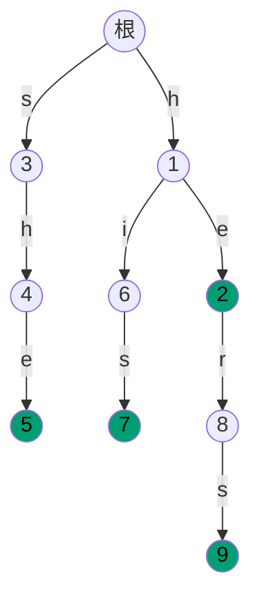
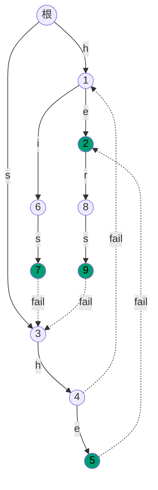

# Aho-Corasick：多模式，一趟扫完

模式集 `{he, she, his, hers}`，文本 `ushers`。这段文本里有三处命中：`she` 结束于下标 3，`he` 结束于下标 3，`hers` 结束于下标 5。老实的第一版做法，是把本部分前面讲的子串搜索按模式个数跑四遍，每遍都在六个字符的文本上走六个字符。这已经算宽的基线了。Alfred Aho 和 Margaret Corasick 于 1975 年 6 月在 *Communications of the ACM* 上发表的算法，只走文本一遍，报出全部三处命中，而且从不重复访问任何字符。

本章讲的就是这个算法。形状是一棵 Trie 外挂了两个额外想法，而难点大半就在这层外挂上。[Tries](../part-6-trees-heaps/08-tries.md) 负责模式词典的前缀结构；新增的两件东西是*失败链接*（failure link，Trie 路径走不通时匹配器跳去哪里）和*输出继承*（output inheritance，匹配器如何在不重扫任何东西的前提下，报出所有以当前状态结尾的模式）。两者齐备，总开销是 `O(n + m + z)`，其中 `n` 是文本长度，`m` 是模式长度之和，`z` 是匹配器报出的匹配数。

## 为什么把 KMP 跑 k 遍是错的

最干净的朴素解法：对每个模式，拿本部分前面讲的线性时间单模式匹配器（Knuth-Morris-Pratt）去扫文本。就是 `k` 次独立扫描：

```python
# 朴素做法：O(k * n + m)——本章要替换掉的就是它
def find_all_naive(patterns, text):
    matches = {}
    for pat in patterns:
        matches[pat] = kmp_find_all(text, pat)   # 每个模式各跑一遍 KMP
    return matches
```

它有两个毛病。第一个显而易见：在 `n` 个字符的文本上过 `k` 遍是 `O(k*n)`，而生产环境里的用例（入侵检测、杀毒扫描）动不动 `k` 上千、`n` 上 GB。第二个更微妙。每次 KMP 只预处理一个模式的失败函数，用完就丢。当两个模式共享前缀时（`he` 与 `hers`、`his` 与 `history`、字典攻击里 `password` 的各种变体），重复的那份工作，恰好就是 Trie 会坍缩掉的那份工作。每花在重走共享前缀上的一分钱，Aho 和 Corasick 都能省回来：共享一次 Trie 路径，把逐模式的失败函数粘成一个结构，一次处理全部 `k` 个模式。[^1]

结构上的信号是这样的：词典**固定**（或极少变动），而流经的文本**很多**时，该上 AC，而不是逐模式跑 KMP。预处理自动机是一次性开销，摊到此后的每一段文本上。若词典按查询变化，AC 的预处理开销就占了主导，这时你该用哈希。[^1] 若只有一个模式，KMP 更简单，而且在本部分出现得更早。

## 自动机里有什么

三样结构，都挂在每个 Trie 节点上。

**goto 函数**就是模式的 Trie。每个节点向外，每个字符一条带标签的边，把从根出发的路径拼出的前缀延长一个字符。沿根 → `h` → `e` 走，落在代表前缀 `he` 的节点上。这就是 [Tries](../part-6-trees-heaps/08-tries.md) 里的数据结构，没有别的。

**失败链接**是新东西。从每个节点 `v` 引一条回边，指向这样的节点：它从根出发的路径拼出的串，是 `v` 路径的最长真后缀，同时又是 Trie 里某个模式的前缀。节点 `she` 的失败链接指向节点 `he`，因为 `he` 是 `she` 的真后缀里最长、并且本身也是 Trie 前缀的那个。节点 `sh` 的失败链接指向 `h`，理由相同。深度为 1 的节点（根的直接子节点）的失败链接按定义都指向根。

**输出集**记录哪些模式在这里结束。节点 `he` 的输出是 `{he}`，节点 `hers` 是 `{hers}`，节点 `she` 在输出继承之后是 `{she, he}`。下面细说。

匹配器的循环：读一个文本字符，有 `goto` 就走 `goto`；否则沿 `failure` 走，直到某个 `goto` 可用或者走到根；报出当前节点输出集里的每个模式；前进。[^2] 每轮迭代消耗一个文本字符。循环里唯一看着像慢的就是失败跳转，§“开销”一节的摊还论证给它划了界。

## 构建 Trie

第一阶段。把每个模式当作从根出发的一条路径插进去，路径不存在的地方分配节点，在终点节点的输出集里记下该模式的 id。和 [Tries](../part-6-trees-heaps/08-tries.md) 一样，没有意外。

```python
# 阶段 1：建 Trie。children[v] 是 {字符: 子节点} 的字典。
children = [{}]
fail = [0]                          # 失败链接，阶段 2 填
out = [[]]                          # 匹配在此结束的模式 id

for pid, pat in enumerate(patterns):
    node = 0
    for ch in pat:
        nxt = children[node].get(ch)
        if nxt is None:
            nxt = len(children)
            children.append({})
            fail.append(0)
            out.append([])
            children[node][ch] = nxt
        node = nxt
    out[node].append(pid)
```

在 `{he, she, his, hers}` 上跑完，Trie 有十个节点：根，加上每个不同前缀各一个。两个模式共享根上的 `h` 边，所以 `he` 和 `his` 都从节点 1 往下走。节点 2 是 `he` 的终点，它有子节点 `r`，因为 `hers` 在它后面延长；节点 7 和 9 分别是 `his` 与 `hers` 的终点。



*插入 `{he, she, his, hers}` 之后的 Trie。绿色节点是输出节点，有模式在那里终止。*

## 加入失败链接

难的那一步。失败链接用 BFS 逐层在 Trie 上算，因为 `fail[v]` 依赖 `fail[parent(v)]`，而 BFS 是最便宜的、能保证父节点先于子节点被访问的顺序。

构造规则：对每个由父节点 `u` 经标签 `ch` 的边到达的非根节点 `v`——沿 `u` 的失败链向上走，直到找到一个祖先 `f` 使 `goto[f][ch]` 存在（令 `fail[v] = goto[f][ch]`，除非这样又落回 `v` 自己），或者走到根（令 `fail[v] = root`）。这条上行走在平均情况下很短，整个 BFS 摊下来与 Trie 规模成线性。[^2]

```python
# 阶段 2：用 BFS 填 fail[v]。根的直接子节点都指向根。
queue = deque()
for child in children[0].values():
    fail[child] = 0
    queue.append(child)

while queue:
    u = queue.popleft()
    for ch, v in children[u].items():
        queue.append(v)
        f = fail[u]
        while f != 0 and ch not in children[f]:
            f = fail[f]
        fv = children[f].get(ch, 0)
        if fv == v:           # 深度 1 子节点的自环守卫
            fv = 0
        fail[v] = fv
        # 输出继承，见下一节。
        out[v].extend(out[fail[v]])
```

对 `{he, she, his, hers}` 这棵 Trie，有六条失败链接值得说。深度 1 的节点（`h`、`s`）指向根。节点 `he`（路径 `he`）回落到根，因为 `he` 的任何真后缀都不是 Trie 前缀。路径 `sh` 回落到 `h`（`sh` 在 Trie 里的最长真后缀）。`she` 的失败目标是 `he`。而节点 `his` 和 `hers` 都回落到 `s`。



*同一棵 Trie，失败链接以虚线叠加。节点 `she`（5）的失败链接指向节点 `he`（2）。匹配器落到节点 `she` 时，输出继承保证 `she` 和 `he` 都被报出。*

> [!IMPORTANT]
> 从节点 `v` 出发的失败链接**不是**扫文本时没有 `goto` 所走的那条链接，而是那次上行的*一步*。扫描期的失败上行走的是失败链 `v → fail[v] → fail[fail[v]] → ...`，直到存在 `goto[f][ch]` 或 `f == root`。把两者混为一谈的作者，构造写对了，扫描写错了。

## 输出继承：为什么每次匹配都是 O(1)

上面阶段 2 末尾多了一行：`out[v].extend(out[fail[v]])`。干的正是让扫描以每个匹配 `O(1)` 报出全部命中的活。删掉它就是 AC 最常见的 bug，因为当词典里没有任何模式是另一个模式的后缀时，这个 bug 完全隐形。[^2]

理由：匹配器消耗完 `ushe` 落到状态 `she` 时，Trie 说这里结束一个模式（`she`）。但 `he` 也在这段文本的这个位置结束。证明这一点的那条路径是 `she → fail → he`，匹配器若要在扫描时走这条链，就得每一步、每个字符都走一遍，只为了以防链上某处坐着某个模式的终点。那次走能摊还成每个扫描位置 `O(1)`，只是因为我们*在构造期就把链预合并了*。BFS 处理完节点 `she` 时，它的输出集已经并入了 `out[fail[she]] = out[he]` 的全部内容，于是 `out[she] = {she, he}`。扫描每个位置只看一个集合。[^2]

渐近结论说清楚：匹配器以摊还 `O(1)` 报出每个匹配，扫描总工作量是 `O(n + z)`，`z` 是匹配总数。不做继承，最坏是 `O(n * L)`，`L` 是最长模式长度，因为在对抗性输入上匹配器每个字符都要沿失败链上行。[^2] 构造期多两三行常数代码，换来渐近改进，没有任何附加条件。

## 跑一遍匹配器

阶段 3 就是本章存在的理由。一个状态指针（`node`），从根开始。对每个文本字符：沿失败链走，直到 `goto` 可用或碰到根；走 `goto`；报出 `out[node]` 里的每个匹配。

```python
# 阶段 3：扫描文本。
result = {}
node = 0
for i, ch in enumerate(text):
    while node != 0 and ch not in children[node]:
        node = fail[node]
    node = children[node].get(ch, 0)
    for pid in out[node]:
        start = i - len(patterns[pid]) + 1
        result.setdefault(patterns[pid], []).append(start)
return result
```

**解法**——Python（[Java](./04-aho-corasick/lc-1032/sol.java) · [C++](./04-aho-corasick/lc-1032/sol.cpp) · [Go](./04-aho-corasick/lc-1032/sol.go)）

```python
# LC 1032. Stream of Characters

from collections import deque
from typing import List


class StreamChecker:
    """Aho-Corasick streaming matcher: query(c) returns True iff some pattern
    in the dictionary is a suffix of the characters streamed so far.

    The chapter teaches the offline matcher
        aho_corasick(patterns, text) -> {pattern: [start, ...]}
    LC 1032 is the same automaton with one character per call: the
    automaton state persists across calls, and query() returns True
    whenever the current state has any output.
    """

    def __init__(self, words: List[str]):
        # children[node][ch] -> 子节点 id
        self.children: List[dict] = [{}]
        # 失败链接；根的 fail 就是它自己（0）
        self.fail: List[int] = [0]
        # 是否有模式的匹配在此结束（输出继承之后）
        self.has_output: List[bool] = [False]

        # 1) 建 Trie。
        for pat in words:
            node = 0
            for ch in pat:
                nxt = self.children[node].get(ch)
                if nxt is None:
                    nxt = len(self.children)
                    self.children.append({})
                    self.fail.append(0)
                    self.has_output.append(False)
                    self.children[node][ch] = nxt
                node = nxt
            self.has_output[node] = True

        # 2) 用 BFS 建失败链接。BFS 保证 fail[parent] 先于
        #    fail[child] 算完。
        queue = deque()
        for child in self.children[0].values():
            self.fail[child] = 0
            queue.append(child)
        while queue:
            u = queue.popleft()
            for ch, v in self.children[u].items():
                queue.append(v)
                f = self.fail[u]
                while f != 0 and ch not in self.children[f]:
                    f = self.fail[f]
                fv = self.children[f].get(ch, 0)
                if fv == v:
                    fv = 0
                self.fail[v] = fv
                # 输出继承：任何在失败链上结束的模式也在这里结束。
                # 少了这一步，匹配器就会漏掉后缀的后缀这类命中
                # （she 里的 he）。
                if self.has_output[self.fail[v]]:
                    self.has_output[v] = True

        self.node = 0  # 当前自动机状态，跨查询保留

    def query(self, letter: str) -> bool:
        # 前进一个字符：沿失败链接走，直到 goto 有定义，再走那
        # 条 goto 边。与离线扫描同形。
        while self.node != 0 and letter not in self.children[self.node]:
            self.node = self.fail[self.node]
        self.node = self.children[self.node].get(letter, 0)
        return self.has_output[self.node]
```

配套实现把离线匹配器改造成 LC 1032 的 `StreamChecker` 类：自动机状态跨 `query(c)` 调用保留，每个字符的工作量完全相同，唯一的变化是循环体一次只处理一个字符，而不是放在对文本的 `for` 里。

## 实例推演：用 `{he, she, his, hers}` 匹配 `ushers`

六个字符，六轮迭代，整趟只有一次失败跳转。走位见下表。[^1]

| `i` | `text[i]` | 起始状态 | 失败跳转次数 | 落到的节点 | 报出的匹配 |
|---|---|---|---|---|---|
| 0 | `u` | 0（根） | 无 | 0（根）；`u` 不认识，停在根 | （无） |
| 1 | `s` | 0 | 无 | 3（`s`） | （无） |
| 2 | `h` | 3 | 无；`goto[3][h] = 4`（Trie 里有 `sh`，为的是 `she`） | 4（`sh`） | （无） |
| 3 | `e` | 4 | 无；`goto[4][e] = 5` | 5（`she`） | `she @ start 1`、`he @ start 2`（来自 `out[5] = {she, he}` 的继承） |
| 4 | `r` | 5 | 一次：`5 → fail[5] = 2`（此刻在节点 `he`）；`goto[2][r] = 8` 存在 | 8（`her`） | （无） |
| 5 | `s` | 8 | 无；`goto[8][s] = 9` | 9（`hers`） | `hers @ start 2` |

整条走位的关键在 `i = 3` 和 `i = 4`。`i = 3` 时匹配器落到节点 `she`，输出继承让它一次拿到两处命中（结束于下标 3 的 `she` 和结束于下标 3 的 `he`），不用重走任何东西。一步之后，`i = 4`，匹配器遇到全趟唯一一次失败跳转：`she` 没有 `r` 边，于是沿 `fail[5] = 2` 落到节点 `he`，那里 `goto[2][r] = 8` 确实存在。再走一个 `s` 的 `goto`，到达节点 `hers`，第三处命中报出。

三处命中，消耗六个字符，恰好一次失败跳转。模式 `his` 不在文本里，从未触发。完整结果是 `{she: [1], he: [2], hers: [2]}`，与 1975 年原论文在这个输入上的走位一致。[^1]

## 开销

| 阶段 | 时间 | 空间 | 备注 |
|---|---|---|---|
| 建 Trie | `O(m)` | 子节点数组 `O(m * σ)`，子节点映射 `O(m)` | 每个不同前缀一个节点；`m` 是模式长度之和 |
| 建失败链接（BFS） | 数组 `O(m * σ)`，映射 `O(m * log σ)` | `O(m)` 辅助空间 | 摊还论证见下文 |
| 扫描文本 | `O(n + z)` | 自动机状态之外每字符 `O(1)` | 干的活是输出继承 |
| **合计（一段文本）** | **`O(n + m + z)`** | `O(m * σ)` | Aho-Corasick 1975 定理 3 [^1] |

这个界在 `z` 上是信息论的：匹配器必须报出每个匹配，而最坏情况下可以有 `Θ(n*k)` 个匹配（文本 `aaaa...a` 对模式 `{a, aa, aaa, ...}`），所以 `z` 无法折进 `O(n + m)`。[^1]

BFS 构造的摊还论证是标准那一个，值得看一次。BFS 内部，`while f != 0 and ch not in children[f]: f = fail[f]` 这个循环看着贵，但一个势函数就能给它定界。把节点 `u` 的势定义成 `u` 在 Trie 里的深度。内层 `while` 每迭代一次，深度严格下降（失败链越走越浅），而 BFS 每次下降到子节点，深度至多加 1。整趟 BFS 求和，内层循环的总迭代次数被总下降量界住，总下降量又被 `m` 界住（每条 Trie 边一次下降）。构造总工作量：摊还 `O(m)` 次内层迭代，加 `O(m)` 次 BFS 访问，等于 `O(m)`。[^3] 同一套论证适用于扫描期的失败跳转：沿失败走一步深度下降，走一次 `goto` 深度上升 1，扫描总工作量是 `O(n)` 再加报出所需的 `O(z)`。[^2]

> [!NOTE]
> 空间系数 `σ`（字母表大小）会出现，是因为子节点数组布局给每个节点的每个字母表符号都留了一个槽。小写拉丁字母（`σ = 26`）大约 `26m` 个整数，没问题。ASCII（`σ = 128`）是四倍，也没问题。完整 Unicode（`σ > 100,000`）就是灾难；生产实现会换成哈希映射子节点（常数因子更慢，内存小得多），或者压缩双数组 Trie（YARA 的恶意规则引擎用的招，因为它要扫上 GB 内存，每节点 256 槽的数组会直接炸）。[^5]

## 模式失效的场景

上面的构造是教科书版 AC。有两个变体出现得足够频繁，值得点名。

### DFA 预计算：从每步摊还 O(1) 到每步最坏 O(1)

扫描循环里的 `while node != 0 and ch not in children[node]: node = fail[node]` 每步摊还 `O(1)`，但单步最坏 `O(L)`。在每个微秒都要紧的热循环里（Snort 按线速扫每个包、杀软扫一张几 GB 的内存镜像），最坏情况就会现形。[^4] 解法：构造期对每个 `(v, c)` 预计算 `go[v][c]`，凡是 `goto[v][c]` 未定义的地方就用 `go[v][c] = go[fail[v]][c]` 填上。这把失败链接自动机变成确定性有限自动机（DFA），每步扫描是一次数组查找，没有内层循环。Aho 和 Corasick 在原论文第 4 节给了这个构造。[^1] 内存涨 `σ` 倍（现在每个节点都有填满的转移表），但扫描步就是一次查找，仅此而已。

### 流式 AC：让状态跨调用存活

本章的招牌题（LC 1032 Stream of Characters）就是 AC 加一个变化：文本一个字符一个字符地到，每来一个字符匹配器要回答“有模式在这里结束吗”。变的纯粹是 API。自动机状态指针 `node` 变成类字段，跨 `query` 调用存活；每次调用跑一遍扫描循环的一轮。每次调用的工作量同样是摊还 `O(1)`。本章配套的 `StreamChecker` 实现就是这个形状。

LC 1032 上常见的另一种做法：把每个模式反转，用反转后的模式建 Trie，然后*从流的最新字符往前*走。这是反转词典上的同一个算法，匹配能力等价，只是 Trie 的遍历方向不同；两种写法在题解库里都能见到。正向 AC 才是 Snort 和 YARA 实际在跑的算法；反向 Trie 变体是让 LC 1032 在不点名 AC 的前提下变得说得通的那种讲法。

## 三个最容易踩的坑

> [!WARNING]
> **忘了输出继承。** 删掉 `out[v].extend(out[fail[v]])` 这一行，匹配器会静默漏掉所有“经由失败链”结束的匹配（`she` 里的 `he`、`hers` 里的 `ers`）。当词典里没有模式是另一个模式的后缀时，这个 bug 完全隐形，因为继承来的集合是空的，没什么可并。于是单测过、代码评审过，匹配器上线后静默丢匹配。修法是在 BFS 循环体末尾加一行。加上，永远别删。

> [!WARNING]
> **递归算失败链接会爆栈。** 有些教科书写法给出记忆化递归的 `compute_fail(v) { if not computed: compute_fail(parent(v)); ... }` 形式。小输入上是对的，对抗性输入上直接炸（很长的单模式、很深的 Trie 链，正是竞赛评测机最爱的那种输入）。BFS 不只是实现选择，它是一种正确性保证：父节点在严格更小的 BFS 层上，所以 `fail[parent]` 一定先于 `fail[child]` 算完。用 BFS。

> [!WARNING]
> **根的子节点上的自环。** 给深度为 1 的节点 `v`（根的直接子节点）算 `fail[v]` 时，若它的标签恰好等于查询返回的东西，粗心的实现会得出 `fail[v] = v`（自环）。扫描期的 `while node != 0 and ch not in children[node]: node = fail[node]` 于是永不终止。修法是上面构造代码里的 `if fv == v: fv = 0` 守卫，加上在 BFS 开始前显式把深度 1 节点的失败指针初始化为根。两道保险都要；只留一道，另一道负责的边界情况就会漏。

## 它在生产里怎么落地

AC 的生产血统罕见地干净。三个有名有姓的系统在跑它。

**Snort**，最初出自 Sourcefire（现属 Cisco）的开源入侵检测系统，把 Aho-Corasick 当作多模式特征匹配的核心：流过 Snort 探针的每个包，都在一趟 AC 里对着上千条攻击串特征扫一遍，而真正在热循环里挣到位置的，是上一节那个确定性有限自动机变体。[^4]

**YARA**，锚定当今大多数杀软与威胁狩猎流程的恶意规则引擎，在四字节“原子”模式的上限之下用一个字节级（`σ = 256`）AC 匹配器；引擎从每条规则里抽出原子，编译成共享自动机，然后把目标文件或内存镜像的每个字节扫一遍。字母表爆炸问题的答案是压缩 Trie 变体；匹配器本身与 1975 年的算法没有任何区别。[^5]

**fgrep**，后来被 GNU `grep -F` 取代的那个 Unix 工具，正是 Aho 和 Corasick 写下这个算法要驱动的干活机器：在一段文本里定位一张有限的固定串列表中的任意一个，耗时与文本长度成正比，与列表大小无关。1975 年论文的副标题把这个用例称作“an aid to bibliographic search”，那是 IBM 图书馆的原始应用；`fgrep` 把它推广到了每一个需要在文件里找一串词的 Unix shell。[^6]

把这三者（IDS、杀毒引擎、Unix 工具）串起来的那条线，正是本章复杂度存在的理由。多数读者一辈子不会亲手实现 AC，但每天都在通过上面某个系统用它。

## 题目梯度

### 核心（三题全做才算掌握本章）

- [LC 1032 — Stream of Characters](https://leetcode.com/problems/stream-of-characters/) [困难] • trie-with-failure-link-streaming ★
- [LC 745 — Prefix and Suffix Search](https://leetcode.com/problems/prefix-and-suffix-search/) [困难] • bidirectional-trie-multi-key
- [LC 648 — Replace Words](https://leetcode.com/problems/replace-words/) [中等] • trie-shortest-prefix-match

### 进阶（可选）

- [LC 720 — Longest Word in Dictionary](https://leetcode.com/problems/longest-word-in-dictionary/) [简单] • trie-membership-scan

LC 1032 是本章的招牌题（★），也是配套 `StreamChecker` 文件里给出 AC 写法的那道。LC 648 是更温和的入口：对着一个词的起始流做 Trie 扫描，不需要失败链接，但“预处理一次、扫描多次”的心智模型与 AC 一脉相承。LC 745 把预处理技巧推广到双向匹配。LC 720 是相邻模式的简单题：单棵 Trie、没有失败链接，填上多模式匹配在 LC 上没有标准入口的 Easy 档。

Word Search II（LC 212）算是亲戚（Trie + 网格上 DFS，失败机制被空子节点剪枝替代），但它主要的课是外层搜索的 Trie 加速，归 [Tries](../part-6-trees-heaps/08-tries.md) 当核心题。

## 后续衔接

下一章讲后缀数组，从另一个角度看同一个“预处理一次、查询多次”的想法：不是预处理模式、让文本流过，而是把文本预处理成它所有后缀的有序索引，再拿这个索引回答任意模式查询。AC 与后缀数组是对偶：一个给模式建索引，一个给文本建索引，选哪个取决于哪一侧是固定的。词典固定、文本很多时 AC 赢；文本固定、查询很多时后缀数组赢。

若上面任何一处 Trie 机制让你觉得过得快，该重读的就是 [Tries](../part-6-trees-heaps/08-tries.md)。AC 是一棵外挂了两个想法的 Trie；Trie 本身仍是那章讲的同一个 R 路结构。

## 参考文献

[^1]: Alfred V. Aho 与 Margaret J. Corasick, "Efficient string matching: an aid to bibliographic search," *Communications of the ACM* 18(6):333-340，1975 年 6 月。DOI: [10.1145/360825.360855](https://doi.org/10.1145/360825.360855)。

[^2]: cp-algorithms.com, "Aho-Corasick algorithm," 访问于 2026 年 5 月。<https://cp-algorithms.com/string/aho_corasick.html>。

[^3]: Maxime Crochemore、Christophe Hancart 与 Thierry Lecroq，*Algorithms on Strings*，Cambridge University Press，2007。

[^4]: University of Edinburgh, Research Explorer, "Hardware/Software Mechanisms for Protecting an IDS against Algorithmic Complexity Attacks," 2012。<https://www.research.ed.ac.uk/en/publications/hardwaresoftware-mechanisms-for-protecting-an-ids-against-algorit>。

[^5]: HackMag, "YARA to the maximum: writing effective YARA rules by examples." <https://hackmag.com/security/effective-yara>。

[^6]: GeeksforGeeks, "Aho-Corasick Algorithm for Pattern Searching," 更新于 2025。<https://www.geeksforgeeks.org/aho-corasick-algorithm-pattern-searching/>。
