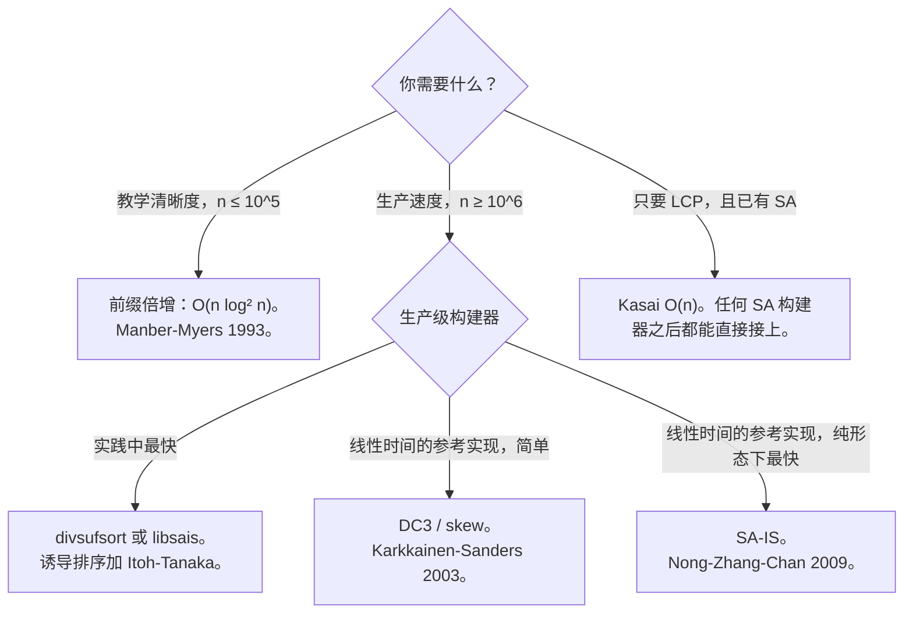

# 后缀数组：把所有后缀排好序的索引

Udi Manber 和 Gene Myers 在 1990 年的 SODA 上发表了 *Suffix Arrays: A New Method for On-Line String Searches*，期刊版于 1993 年登在 *SIAM Journal on Computing*。论文的主张是：有一个结构能做后缀树几乎所有的事，却只占零头的空间——在典型实现下**后缀数组大约占 4n 字节，而等效的后缀树要占 20n 字节**。二十年过去，每一条正经的生物信息学流水线、每一个 Burrows-Wheeler 变换压缩器、Go 标准库里每一个离线字符串索引器，都建立在这篇论文的后代之上。

结构本身一句话就能说完：**一个字符串的后缀数组，就是它每个后缀的起始位置排好序的列表。** 对 `s = "banana"`，六个后缀是 `banana`、`anana`、`nana`、`ana`、`na`、`a`。把它们按字典序排好，写下各自的起始位置：`a` 来自下标 5，`ana` 来自下标 3，`anana` 来自下标 1，`banana` 来自下标 0，`na` 来自下标 4，`nana` 来自下标 2。数组 `[5, 3, 1, 0, 4, 2]` 就是后缀数组。就这样。没有树、没有指针、没有逐节点的头部。六个字符的字符串，六个整数。

这一章是入门读物，不是面试主力。后缀数组的题在 LeetCode 上很稀少。它们活的地方是 Codeforces、`index/suffixarray`，以及驱动 BWA 和 Bowtie 的那个 FM-index。在这里学这个结构，是为了认出哪一类问题想要它，理解真正干了大部分活的搭档——LCP 数组，以及能读懂一篇论文或一份库文档而不被术语绊住。

## 这个数组能给你什么，不能给你什么

支撑本章的是两条事实；第三条挣来了下一节。

**事实一：排好序的后缀按字典序聚在一起。** 共享前缀的后缀在后缀数组里彼此相邻。对 `"banana"`，后缀 `ana` 和 `anana` 都以 `an` 开头，落在相邻的第 1、2 名。任何在文本中出现过的模式都是*某个*后缀的前缀，而所有以该模式开头的后缀构成一段连续区间。二分查找能作用在这个结构上，全部理由就在这里。

**事实二：数组里存的是整数，不是字符串。** 后缀数组只存起始位置，从不存后缀文本。一个后缀由它的下标命名；真要比较时，从该下标切到字符串末尾就把内容取回来了。大多数操作根本不需要取：数组的顺序本身就是答案。

```mermaid
flowchart LR
    subgraph Input["输入字符串"]
        S["s = banana"]
    end
    subgraph SA["后缀数组（排好序的后缀起点）"]
        SA0["SA[0] = 5  -- a"]
        SA1["SA[1] = 3  -- ana"]
        SA2["SA[2] = 1  -- anana"]
        SA3["SA[3] = 0  -- banana"]
        SA4["SA[4] = 4  -- na"]
        SA5["SA[5] = 2  -- nana"]
    end
    subgraph LCP["LCP 数组（Kasai）"]
        L0["LCP[0] = 0"]
        L1["LCP[1] = 1   a vs ana"]
        L2["LCP[2] = 3   ana vs anana"]
        L3["LCP[3] = 0   anana vs banana"]
        L4["LCP[4] = 0   banana vs na"]
        L5["LCP[5] = 2   na vs nana"]
    end
    S --> SA
    SA --> LCP
```



*后缀数组 `[5, 3, 1, 0, 4, 2]` 按排好的顺序列出各后缀的起始位置；LCP 数组 `[0, 1, 3, 0, 0, 2]` 记录每个后缀与它在排序中的前驱之间的最长公共前缀。*

光靠这个数组拿不到的信息是：两个后缀之间前缀重叠多少。第 1 名的后缀是 `ana`，第 2 名的下一个是 `anana`，它们共享 3 个字符的前缀。后缀数组知道顺序，不知道那个 3。这个数字住在它的兄弟结构——LCP 数组里，而后缀数组大多数有用的应用其实都是 SA 与 LCP 这一对的应用。LCP 下面单独一节讲。

## 构建数组：前缀倍增

朴素的构建是“拿 n 个后缀按字符串比较排序”。每次比较最坏要 O(n) 时间，一共有 O(n log n) 次比较，于是总量是 O(n² log n)。[^4] 在 `n = 10⁵` 上这会跑上几个小时。引入后缀数组的那篇论文也引入了更快的构建法，而那正是最该先学的构建法。

前缀倍增只靠一条不变式：**循环第 `k` 轮结束后，两个后缀的 rank 相同当且仅当它们的前 `2^k` 个字符完全相同。** 第 0 轮按第一个字符给每个后缀定 rank。第 1 轮按第 0 轮的 `(rank[i], rank[i+1])` 这个数对排序，于是按前两个字符定 rank。第 2 轮按 `(rank[i], rank[i+2])` 排序，按前四个字符定 rank。第 3 轮按八个，依此类推。经过 `ceil(log_2 n)` 轮之后，`2^k >= n`，每个后缀都有唯一 rank，排好的顺序白送。

每一轮的代价由“排序 n 个整数对”主导。比较排序每轮 O(n log n)，总共 O(n log² n)。[^4] Manber 和 Myers 的原始论文用有界 rank 上的基数排序把每轮降成 O(n)、总量降成 O(n log n);[^1] 而比较排序的写法才是一章篇幅装得下的：

```python
def build_suffix_array(s):
    n = len(s)
    sa = list(range(n))
    rank = [ord(c) for c in s]
    k = 1
    while True:
        sa.sort(key=lambda i: (rank[i], rank[i + k] if i + k < n else -1))
        tmp = [0] * n
        for j in range(1, n):
            same = (rank[sa[j]], rank[sa[j] + k] if sa[j] + k < n else -1) \
                == (rank[sa[j - 1]], rank[sa[j - 1] + k] if sa[j - 1] + k < n else -1)
            tmp[sa[j]] = tmp[sa[j - 1]] + (0 if same else 1)
        rank = tmp
        if rank[sa[n - 1]] == n - 1:
            break
        k *= 2
    return sa
```

**Solution** — Python ([Java](./05-suffix-array/build-suffix-array/sol.java) · [C++](./05-suffix-array/build-suffix-array/sol.cpp) · [Go](./05-suffix-array/build-suffix-array/sol.go))

```python
# Suffix array via prefix doubling, plus Kasai LCP. O(n log^2 n) build, O(n) LCP.
from typing import List


def build_suffix_array(s: str) -> List[int]:
    """Suffix array of s via prefix doubling. O(n log^2 n) time."""
    n = len(s)
    if n == 0:
        return []
    sa = list(range(n))
    rank = [ord(c) for c in s]

    def key(i: int, k: int) -> tuple:
        return (rank[i], rank[i + k] if i + k < n else -1)

    k = 1
    while True:
        sa.sort(key=lambda i: key(i, k))
        tmp = [0] * n
        for j in range(1, n):
            same = key(sa[j], k) == key(sa[j - 1], k)
            tmp[sa[j]] = tmp[sa[j - 1]] + (0 if same else 1)
        rank = tmp
        if rank[sa[n - 1]] == n - 1:
            break
        k *= 2
    return sa


def build_lcp_kasai(s: str, sa: List[int]) -> List[int]:
    """Kasai O(n). lcp[i] = lcp(sa[i-1], sa[i]); lcp[0] = 0."""
    n = len(s)
    if n == 0:
        return []
    inv = [0] * n
    for i, p in enumerate(sa):
        inv[p] = i
    lcp = [0] * n
    h = 0
    for i in range(n):
        if inv[i] > 0:
            j = sa[inv[i] - 1]
            while i + h < n and j + h < n and s[i + h] == s[j + h]:
                h += 1
            lcp[inv[i]] = h
            if h > 0:
                h -= 1
    return lcp
```

终止判定 `rank[sa[n - 1]] == n - 1` 读作“排序后最后一个后缀拿到了可能的最大 rank，也就是说所有 rank 互不相同”。它一旦成立，后面再跑多少轮都改不了顺序，循环就退出。

算法里有两个格子是坑。本章后面会把它们各自列成明确的警告；这里的讲解位置就在这里。

第一个在重排循环里。临时数组必须按 `sa[j]` 索引，不能按 `j`。一个后缀的 rank 由它在文本中的起始位置命名，而不是由它在排序中的位置命名。写成 `tmp[j] = ...` 会静默地把后缀数组和逆后缀数组的角色对调，之后每个下游操作都拿到错误答案，而且不崩。CP-Algorithms 把这个混乱讲得很明白。[^4]

第二个在比较器的读取上。在 Java、Go，以及任何 `sort` 调用的闭包按引用捕获 `rank` 的语言里，排序过程中改动 `rank` 会破坏这次排序。参考版 Java 实现在每轮开头克隆一次 `rank`，把克隆交给比较器。Python 实现只在排序完成之后才重建 `rank`。两种写法都行；边排边读边写同一份数组不行。

## LCP 数组与 Kasai 的线性扫描

只有后缀数组，能回答的是关于*顺序*的问题：最小的循环移位是哪个、字典序第 k 小的子串是什么、我的模式在这份排名表里出现在哪里。这些都是有用的问题，但最出名的那些应用——最长重复子串、不同子串计数、快速模式搜索——想先得到一个不同问题的答案：**排序中相邻的两个后缀重叠多少？**

LCP 数组让这个问题在每个下标上都是常数时间。`LCP[i]` 是排序第 `i` 名的后缀与第 `i - 1` 名的后缀之间的最长公共前缀长度。按约定 `LCP[0] = 0`，因为第 0 名没有前驱。对 `"banana"`，数组是 `[0, 1, 3, 0, 0, 2]`：第 1 名的 `ana` 与第 0 名的 `a` 共享 1 个字符（`a`）；第 2 名的 `anana` 与第 1 名的 `ana` 共享 3 个字符（`ana`）；第 3 名的 `banana` 与 `anana` 什么都不共享；依此类推。

LCP 可以朴素地在 O(n²) 里算：把后缀数组里每一对相邻后缀逐字符比一遍。Kasai 2001 年的算法用 O(n) 做到，办法是按原始下标顺序而不是按排名顺序遍历文本，并在相邻迭代之间复用比较结果：[^5]

```python
def build_lcp_kasai(s, sa):
    n = len(s)
    inv = [0] * n
    for i, p in enumerate(sa):
        inv[p] = i
    lcp = [0] * n
    h = 0
    for i in range(n):
        if inv[i] > 0:
            j = sa[inv[i] - 1]
            while i + h < n and j + h < n and s[i + h] == s[j + h]:
                h += 1
            lcp[inv[i]] = h
            if h > 0:
                h -= 1
    return lcp
```

交付 O(n) 上界的诀窍是变量 `h`。每次外层迭代把 `h` 延伸零个或多个字符，然后在移动到下一个文本位置之前恰好减一。于是 `h` 在所有迭代中最多增加 `n` 次、最多减少 `n` 次，内层 `while` 循环的总工作量就是 O(n)。[^4] 这个摊还论证是字符串学里最漂亮的结果之一；它也是每本教材讲完后缀数组构建后立刻讲 Kasai 的原因。

SA 加 LCP 这一对，不需要别的机械，就能掉出三个应用：

- **最长重复子串。** 扫一遍 LCP 数组；答案的长度是 `max(LCP)`，其中一次出现起于 `s[SA[i] : SA[i] + LCP[i]]`，`i` 是取到最大值的位置。[^6]
- **不同子串的数量。** 每个子串都恰好是某一个后缀的前缀。前缀总数是 `n(n+1)/2`；减去被 `sum(LCP)` 计到的重复部分。答案：`n(n+1)/2 - sum(LCP)`。[^4]
- **O(\|P\| log n) 的模式搜索。** 在后缀数组里二分找到第一个前缀匹配 `P` 的后缀；再二分找到第一个字典序大于 `P` 上界的后缀；两次得到的排名之差就是出现次数。加一层 LCP-LR 增强，每次查询的代价降到 O(\|P\| + log n)。[^1]

第三个应用就是后缀数组偶尔在面试里露脸时为什么相关：讲[二分查找：标准写法](../part-2-search-sort/01-binary-search-canonical.md)的那一章给你下界模板，后缀数组就是你喂给它的结构。文本固定、模式在线到达的场景，一次性构建之后每次查询 O(\|P\| log n)。

## 线性时间构建：只引用，不实现

比较排序的前缀倍增是 O(n log² n)。换成基数排序是 O(n log n)。对多数输入这就够了。到了 `n = 10⁶` 及以上，那个 log 因子开始咬人，文献对此给出了两个知名的线性时间算法。

Kärkkäinen 和 Sanders 在 ICALP 2003 提出的 **DC3**（也叫 *skew 算法*）递归地排好所有满足 `i mod 3 != 0` 的后缀，然后用两趟稳定排序把它们与剩下的 `i mod 3 == 0` 后缀归并。[^7] 线性时间，概念干净，大约一页伪代码装得下。

Nong、Zhang 和 Chan 在 DCC 2009 提出的 **SA-IS** 走了另一条路。每个文本位置按“该位置的后缀在字典序上比它的后继大还是小”被分类为 L 型、S 型或 LMS（最左 S 型）。算法递归地排好 LMS 子串，然后用两趟线性扫描从 LMS 的顺序*诱导*出其他每个后缀的顺序。[^8] 线性时间，读起来更密，是实践中已知最快的后缀数组构建器。Go 的 `index/suffixarray` 包就是 SA-IS。[^3] 事实上的最快开源构建器——Yuta Mori 的 `divsufsort` 和 Ilya Grebnov 的 `libsais`——是同一族里的诱导排序变体。[^2]

两个算法都值得各自一章。这里都不给。理由很坦白：讲清结构本身、LCP 搭档、前缀倍增构建，这样的面积已经够读者认出后缀数组问题、读懂库文档、并判断自己要不要再往深走。从第一原理解推 SA-IS 的那一章是个要读好几天的项目，会和本书其他章节抢书架位置。



*前缀倍增是本章为清晰度给出的参考实现；任何生产应用都该从实现了 SA-IS 或其某个后代的成熟库里去取。*

## 实际开销

| 操作 | 时间 | 空间 | 说明 |
|---|---|---|---|
| 朴素构建（按字符串比较给后缀排序） | O(n² log n) | O(n²)（存子串） | 本章要替换掉的基线。 |
| 前缀倍增，比较排序 | O(n log² n) | O(n) | 本章讲授的写法。 |
| 前缀倍增，基数排序（Manber-Myers 1993） | O(n log n) | O(n) | 原始论文。[^1] |
| DC3 / skew（Kärkkäinen-Sanders 2003） | O(n) | O(n) | 只引用，未实现。[^7] |
| SA-IS（Nong-Zhang-Chan 2009） | O(n) | O(n) | 只引用，未实现。生产标准。[^8] |
| Kasai LCP，给定 SA | O(n) | O(n) | 靠对 `h` 的摊还分析达到线性。[^5] |
| 模式搜索，仅 SA | O(\|P\| log n) | O(n) | 在后缀数组上二分。[^1] |
| 模式搜索，SA + LCP-LR | O(\|P\| + log n) | O(n) | 增强版二分查找。[^1] |

在这个尺度上常数是要命的。SA 的 4n 字节对后缀树的 20n 字节，这个差距正是后缀数组在 1990 年代基因组数据上可行的原因，而差距此后还在拉大：divsufsort 和 libsais 在人类基因组——三十亿个字符——上构建 SA 是常规操作，单核不到一分钟。[^2] 如果你真要为生产负载搞一个后缀数组，别照着某章手打构建代码；去取一个成熟库。

## 五个最容易踩的坑

> [!WARNING]
> **重排那一步按 `sa[j]` 索引，不是按 `j`。** 排序位置 `j` 上那个后缀的新 rank，必须写进以该后缀的文本起始位置命名的格子，也就是 `sa[j]`。写成 `tmp[j] = ...` 就把后缀数组和它的逆对调了，之后每个下游操作都给出错误答案且不崩。四种语言的已验证参考实现共用这一个模式；偏离它，第一个输入就会让标准测试失败。[^4]

> [!WARNING]
> **没有哨兵，前缀倍增排的是循环移位，不是后缀。** 教科书里的形式排的是输入的循环子串。要拿回真正的后缀排序，就在末尾追加一个字典序小于字母表所有字符的字符（常用 `$` 或 `\0`），在加长后的字符串上构建，再从结果里去掉哨兵位置。本章的参考实现靠 rank 互异判定终止，对它处理的输入来说这与哨兵法等价；但照抄一段 CP-Algorithms 的代码却漏掉“加哨兵再去掉”这一步，是后缀数组讨论帖里最常见的 LeetCode-Discuss 级 bug。[^4]

> [!WARNING]
> **捕获 `rank` 的 Java 比较器会在排序中途看到被改坏的值。** `Arrays.sort` 在一次排序里会调用比较器很多次。如果捕获的数组在两次调用之间变了，比较契约的传递性就失效，结果是未定义的。每轮开头克隆一次 `rank`，把克隆交给 lambda。参考实现用 `final int[] r = rank.clone();` 做到这点，并配了一句注释钉住原因。

> [!WARNING]
> **LCP 数组的下标 0 是个约定，不是一个值。** `LCP[0]` 是零，因为第 0 名的后缀没有前驱；有些资料把它定义成 1-indexed，从 `LCP[1]` 开始。两种约定混用会静默地把之后每个应用整体平移，而 bug 只在边角情况上冒头，比如全同字符串 `"aaaa"`——那里每个有区分力的答案都压在 LCP 上。[^9]

> [!WARNING]
> **只有后缀数组回答不了子串问题。** “最长重复子串”“不同子串计数”“任意两个后缀的最长公共前缀”，全都是 SA 加 LCP 的问题，只有 SA 没有 LCP，你大概只能走到三分之一。每次建 SA 就把 LCP 一起建了；额外代价是一趟线性扫描，可应用面宽出一个数量级。

## 在体系中的位置

有三个结构都在回答“找一个子串”，各有不同的权衡，选哪个主要取决于一开始就知道什么。[Trie](../part-6-trees-heaps/08-tries.md) 适合字典固定、查询是任意文本的场景；后缀数组把角色反过来，固定*文本*，接受任意查询。[朴素字符串匹配：O(nm) 基线](./00-naive-string-matching.md)里的 KMP 自动机及其后继是在线的：文本和模式都在查询时才给，两边的预处理都不能跨查询复用。后缀数组在这套分类里占的是离线索引那一格，当同一份固定文本要回答很多模式查询时最亮眼。

出了面试，后缀数组常常是别的东西的前端：基因组比对里驱动 BWA 和 Bowtie 的 FM-index 用后缀数组作为它 rank 操作的基础；Burrows-Wheeler 变换压缩器用它 O(n) 找出 BWT；有了 SA，LZ77 因子分解能降到 O(n)。[^2] 这些应用没一个在 LeetCode 上，但它们正是这个数据结构从 1990 年活到现在的原因，也是每个认真做字符串工作的标准库都在底下塞一份 SA-IS 实现的原因。

## 题目梯度

本章属于基础/框架豁免：LeetCode 题库对后缀数组问题覆盖不足，下面这两道锚点题列出来是为了建立联系，而不是作为计分的核心练习。两道都能在完全不构建后缀数组的情况下解出来；SA 的框架是本章铺垫的概念上最干净的解法。

### 锚点题（示范用，不计入核心）

- [LC 1163 — Last Substring in Lexicographical Order](https://leetcode.com/problems/last-substring-in-lexicographical-order/) [困难] • suffix-array-conceptual
- [LC 1062 — Longest Repeating Substring](https://leetcode.com/problems/longest-repeating-substring/) [中等, Premium] • suffix-array + LCP *（参考解法：仅 Python）*

LC 1163 要的是字典序最大的后缀；教科书解法建 SA 然后返回 `s[SA[n - 1]:]`。被接受的 O(n) 题解用双指针、不建 SA，但 SA 框架才是本章准备让你写出来的版本。LC 1062 的教科书解法是 Kasai 之后取 `max(LCP)`；官方题解偏向“对长度二分 + 滚动哈希”，因为 Premium 档并没有为 SA 讲解做过优化。免费的替代题 LC 1044 *Longest Duplicate Substring* 接受同样的 SA + LCP 解法。

## 参考文献

[^1]: Udi Manber and Gene Myers, "Suffix Arrays: A New Method for On-Line String Searches," *SIAM Journal on Computing* 22(5):935-948, 1993; conference version SODA 1990, pp. 319-327. <https://epubs.siam.org/doi/10.1137/0222058>.

[^2]: Wikipedia, "Suffix array," accessed 2026-05-25. <https://en.wikipedia.org/wiki/Suffix_array>.

[^3]: Go standard library, `index/suffixarray` package, file `sais.go`. <https://golang.org/src/index/suffixarray/sais.go>.

[^4]: CP-Algorithms, "Suffix Array," last updated August 2024. <https://cp-algorithms.com/string/suffix-array.html>.

[^5]: Toru Kasai, Gunho Lee, Hiroki Arimura, Setsuo Arikawa, and Kunsoo Park, "Linear-Time Longest-Common-Prefix Computation in Suffix Arrays and Its Applications," *Combinatorial Pattern Matching (CPM 2001)*, LNCS 2089, pp. 181-192. <https://doi.org/10.1007/3-540-48194-X_17>.

[^6]: Wikipedia, "LCP array," accessed 2026-05-25. <https://en.wikipedia.org/wiki/LCP_array>.

[^7]: Juha Kärkkäinen and Peter Sanders, "Simple Linear Work Suffix Array Construction," *ICALP 2003*, LNCS 2719, pp. 943-955. <https://doi.org/10.1007/3-540-45061-0_73>.

[^8]: Ge Nong, Sen Zhang, and Wai Hong Chan, "Linear Suffix Array Construction by Almost Pure Induced-Sorting," *Data Compression Conference (DCC 2009)*, p. 193. <https://doi.org/10.1109/DCC.2009.42>.

[^9]: Maxime Crochemore, Christophe Hancart, and Thierry Lecroq, *Algorithms on Strings*, Cambridge University Press, 2007, Chapter 4 ("Suffix arrays").
