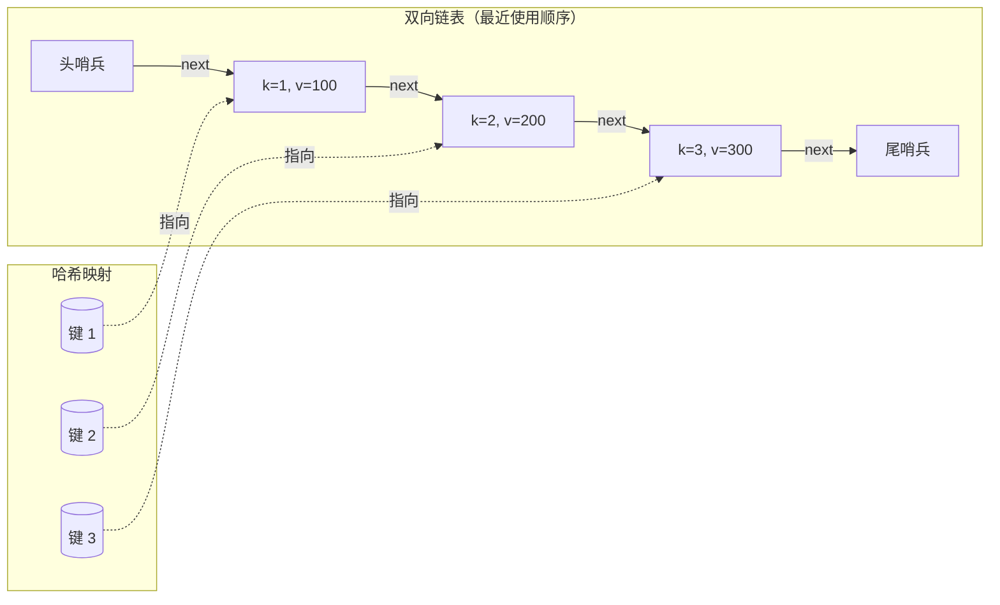
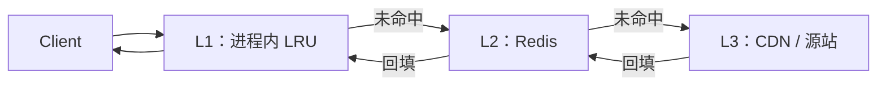

# LRU 缓存：设计框架、并发与多级部署

LRU 缓存会两次吓到面试候选人。第一次是题干写下 `O(1) get and put with eviction`，他们得把两个数据结构拼起来。第二次是面试官说 `now make it thread-safe and tell me how you'd run it across three tiers of memory`。Caffeine 是支撑 Spring、Kafka Streams 以及 2014 年前后大半个 Java 生态的 JVM 缓存库，它为了这第二个问题交了[约 3 万行 Java](https://github.com/ben-manes/caffeine)。第一个问题是一条 30 行的热身题，第二个问题才是本章。

[LC 146 里重连指针的那一半](../part-5-linked-lists/05-lru-cache.md) 是前置知识。那一章讲了双向链表，以及用四个指针把节点拼到头部、代价 O(1) 的接法。本章假定读者已经能凭记忆写出那段代码，然后问下一个问题：当面试官说“设计一个 LRU 缓存”时，他真正想听的是什么？答案很少是算法本身——从他说出“O(1) get and put”那一刻起，算法就被当成默认前提了。答案是 API 契约、围绕它的策略选择、并发方案，以及缓存住在哪一级内存里。

## API 要交付什么

把题干压缩成资深工程师口径的清单：

- `get(key) -> value or sentinel`。命中刷新最近使用顺序；未命中返回 `-1`（或者 `None`，或者 `Optional.empty()`，或者这门语言里表示“无”的习惯写法）。
- `put(key, value) -> void`。插入或更新。若缓存已满且键是新的，先淘汰最久没被碰过的条目。对已有键做更新从不触发淘汰，但会刷新最近使用顺序。
- `LRUCache(capacity)`。容量有上界，且在建的时候就得声明。

三个微妙之处藏在这个 API 里，几乎每次都会变成 bug。第一：更新也是一次触碰。对已有键执行 `put(k, v)` 既要写入值，*也* 要把条目挪到最近使用端；漏掉后半句，下一次 `put` 就会淘汰错条目。[^1] 第二：`get(k)` 命中时会改结构，哪怕它看起来像读操作；写最近使用顺序本身就是契约的一部分。第三：淘汰挑的是顺序链表里的 `tail.prev`，绝不会是调用方刚碰过的那个条目，哪怕那次调用是对已有键的 `put`。

六个澄清问题应该占掉面试的头 60 秒，写代码之前就问完：

1. 容量上界是多少？（LC 146 说 `1 ≤ capacity ≤ 3000`。[^1]）
2. `get` 算不算一次触碰？（按 LC 的契约算；真实缓存里有些把读触碰和写触碰分开。）
3. 对已有键的 `put` 算不算一次触碰？（算。这是杠杆最大的那个陷阱。）
4. key/value 是什么类型？（LC 是 int/int；生产缓存会泛化。）
5. 缓存需要线程安全吗？（LC 是单线程；生产环境说不是。）
6. 最近使用程度相同时怎么打破平局？（严格有序时不会发生；真正的问题是这个顺序有多严格。）

大多数候选人跳过第 3 步，然后在容量为 1 的测试用例上撞车。面试官考的不是双向链表的知识，考的是你知不知道什么叫契约。

## 把双结构当成基本操作

“两个互相配合的容器”这个模式是本章的论点：一张以 `key` 为键、指向节点的哈希映射，加一条双向链表，链头是最近使用的节点，链尾是最久未使用的节点。哈希映射给 O(1) 查找。双向链表给 O(1) 拼到头部和 O(1) 尾部淘汰。每个节点都带 `(key, value)`，因为淘汰时需要 key 才能删掉哈希映射里对应的那条；忘了带 key 是第二常见的 bug。[^1]



*哈希映射给 O(1) 的按键到节点查找；双向链表给 O(1) 的挪到头部和 O(1) 的尾部淘汰。头尾哨兵消掉了空链表和单元素这两种边界情况。*

Python 参考实现用 30 行装下整个契约。指针重连的细节（`_unlink`、`_insert_at_front`）在 [Part 5 的机制章节](../part-5-linked-lists/05-lru-cache.md) 里，本章把它们当成基本操作：

```python
class LRUCache:
    def __init__(self, capacity):
        if capacity <= 0:
            raise ValueError("capacity must be positive")
        self.capacity = capacity
        self.cache = {}
        self.head = _Node(0, 0)         # 哨兵；head.next 是 MRU
        self.tail = _Node(0, 0)         # 哨兵；tail.prev 是 LRU
        self.head.next = self.tail
        self.tail.prev = self.head

    def get(self, key):
        node = self.cache.get(key)
        if node is None:
            return -1
        self._move_to_front(node)
        return node.value

    def put(self, key, value):
        node = self.cache.get(key)
        if node is not None:
            node.value = value
            self._move_to_front(node)   # <- “更新也是一次触碰”就靠这一行
            return
        if len(self.cache) == self.capacity:
            lru = self.tail.prev
            self._unlink(lru)
            del self.cache[lru.key]     # <- 两个容器保持同步
        new_node = _Node(key, value)
        self.cache[key] = new_node
        self._insert_at_front(new_node)
```

> **Interactive widget:** [LRU 缓存（哈希映射 + 双向链表）](../../../dsa/widgets/w-15-lru-cache.yml)（面板 `design_framing`）—— 在网站上渲染；YAML 规范描述了各个关键帧。

*静态版本：容量 3，跑一段 9 次操作的序列。填满三次后缓存里是 [3,2,1]；`get(1)` 把 1 提到最前，键 2 落到 LRU 位置；`put(4)` 淘汰 2；`get(2)` 返回 -1；`put(1, 999)` 更新并刷新（不淘汰；键 4 落到 LRU 位置）；`put(5)` 淘汰 3；`get(3)` 返回 -1。*

widget 的 design_framing 面板和 [Part 5 那一章的面板](../part-5-linked-lists/05-lru-cache.md) 动画演示的是同一个算法，只是取景不同：一边是指针的机械动作，另一边是 API 契约、容量计数器和淘汰事件。把 5.5 消化透的读者读到这里，已经有底气聊策略了。

## 面试官允许的标准库捷径

有些面试房间里，题干允许用 `OrderedDict` 或 `LinkedHashMap`；也有些房间明确禁止。两种房间都得应付。

```python
from collections import OrderedDict

class LRUCache:
    def __init__(self, capacity):
        self.capacity = capacity
        self.cache = OrderedDict()

    def get(self, key):
        if key not in self.cache:
            return -1
        self.cache.move_to_end(key)         # O(1) —— 内部就是一次双向链表拼接
        return self.cache[key]

    def put(self, key, value):
        if key in self.cache:
            self.cache.move_to_end(key)
        elif len(self.cache) == self.capacity:
            self.cache.popitem(last=False)  # FIFO 端 = LRU
        self.cache[key] = value
```

`OrderedDict` 就是那套双结构，只不过记账藏进了 CPython 的 `Objects/odictobject.c`。[^2] Java 的 `LinkedHashMap` 配 `accessOrder=true` 再加一个 `removeEldestEntry` 覆写也一样：[^3] 十二行地道的 Java，把 Caffeine 在规模上做的事都影子般地做了一遍，只差锁。 [Part 5 那一章](../part-5-linked-lists/05-lru-cache.md) 里的 C++ 和 Go 参考实现靠 `std::list::splice` 与 `container/list.MoveToFront`，原因也是同一个。语法不同，算法一致。

允许走捷径的面试官在考语言熟练度；禁止的面试官在考你知不知道标准库那个容器在维护什么不变量。不管哪种，把不变量说出口：

> 链表里的每个节点都在映射里，映射里的每个键都指向一个节点。链表的顺序就是最近使用顺序，MRU 在链头。每次公开调用返回之后，`len(cache) ≤ capacity`。

能在白板上把这句话说出来，剩下的就只是打字。

## 开销

| 操作 | 期望时间 | 最坏时间 | 空间 |
|---|---|---|---|
| `get(key)` 命中 | O(1) | O(n) | O(1) |
| `get(key)` 未命中 | O(1) | O(n) | O(1) |
| `put(key, value)` 插入 | O(1) | O(n) | O(1) |
| `put(key, value)` 更新 | O(1) | O(n) | O(1) |
| `put(key, value)` 带淘汰 | O(1) | O(n) | O(1) |
| 总内存 | 不适用 | 不适用 | O(capacity) |

“期望”这个限定词是哈希的常规免责声明。在简单均匀哈希假设下，[哈希映射](../part-1-linear-data-structures/03-hash-maps.md) 每次操作期望 O(1) 次探测；链式哈希在对抗性键下退化成 O(n)，所以 Java 的 `HashMap` 从第 8 版起把冲突桶升级成红黑树，把最坏情况压到每次访问 O(log k)。[^4] 双向链表对这两个界都没有贡献；拼接和尾部弹出是无条件 O(1)。期望 O(1) 这个说法完全属于哈希映射。

## 剥掉细节的双结构：LC 1396

本章的论点是：LRU 模式只是一个更宽泛设计惯用法的具体实例——挑两个互相配合的容器，让你关心的操作落在 O(1)。[LC 1396 Design Underground System](https://leetcode.com/problems/design-underground-system/) 是看清同一副骨架、又不必处理链表账目的最干净的地方。

题目：给一套地铁闸机建模。`checkIn(id, station, t)` 记录乘客 `id` 在时间 `t` 从 `station` 进站。`checkOut(id, station, t)` 结束这次行程。`getAverageTime(start, end)` 返回两站之间所有已完成行程的平均耗时。每个操作都必须是均摊 O(1)。

会失败的那种直觉是“把整份行程日志存下来，需要平均值时再算”——求平均是一次 O(n) 扫描。能成立的那种直觉是两张互相配合的哈希映射：一张以乘客 id 为键，存尚未结束的行程；一张以 `(start, end)` 线路为键，存滚动的 `(sum, count)`，于是读的时候平均值只是一次除法。

```python
from collections import defaultdict


class UndergroundSystem:
    def __init__(self):
        self.check_ins = {}                      # id -> (起始站, t)
        self.check_outs = defaultdict(           # (start, end) -> (sum, count)
            lambda: (0, 0)
        )

    def checkIn(self, id, stationName, t):
        self.check_ins[id] = (stationName, t)

    def checkOut(self, id, stationName, t):
        start, t0 = self.check_ins.pop(id)
        total, n = self.check_outs[(start, stationName)]
        self.check_outs[(start, stationName)] = (total + (t - t0), n + 1)

    def getAverageTime(self, startStation, endStation):
        total, n = self.check_outs[(startStation, endStation)]
        return total / n
```

**解法** — Python（[Java](./00-lru-cache/lc-1396/sol.java) · [C++](./00-lru-cache/lc-1396/sol.cpp) · [Go](./00-lru-cache/lc-1396/sol.go)）

```python
# LC 1396. Design Underground System
# Two cooperating hash maps — the same skeleton as LRU's index_+order_,
# stripped to its essence. checkIns is keyed by passenger id (lookup
# the open trip); checkOuts is keyed by (start, end) station pair
# (aggregate completed trips for an average).
from collections import defaultdict


class UndergroundSystem:
    def __init__(self) -> None:
        # 乘客 id -> (起始站, t)
        self.check_ins: dict[int, tuple[str, int]] = {}
        # (start, end) -> (时长之和, 行程数)
        self.check_outs: dict[tuple[str, str], tuple[int, int]] = defaultdict(
            lambda: (0, 0)
        )

    def checkIn(self, id: int, stationName: str, t: int) -> None:
        self.check_ins[id] = (stationName, t)

    def checkOut(self, id: int, stationName: str, t: int) -> None:
        start, t0 = self.check_ins.pop(id)
        total, n = self.check_outs[(start, stationName)]
        self.check_outs[(start, stationName)] = (total + (t - t0), n + 1)

    def getAverageTime(self, startStation: str, endStation: str) -> float:
        total, n = self.check_outs[(startStation, endStation)]
        return total / n
```

把 LC 1396 摆在 LRU 旁边，同一副骨架就出现了。LRU 有 `cache`（键到节点）和 `order`（最近使用顺序）。LC 1396 有 `check_ins`（id 到未结束的行程）和 `check_outs`（线路到滚动平均）。一个容器负责索引，另一个负责聚合。LRU 的淘汰是“最近使用容器里最老的那条”；这里没有淘汰，但那个累加容器扮演了同样的结构角色：辅助结构握着这个头号问题的答案，随时能在 O(1) 里读出来。把这副骨架带到 LC 535（encode/decode TinyURL：`urlToCode` + `codeToUrl`），带到 LC 1352（一串数字 + 一个前缀积数组），带到 LC 588（路径用哈希映射树）。每次都是同一个想法。

空间界是更干净的那一半。每个键一个节点加一条映射记录，容量在构造时就封顶了。

## 并发：30 行答案在哪里崩掉

30 行的 LRU 按规格就是单线程的。把它丢进一个每秒 5 万请求、来自并发线程的服务里，会有三件事依次出错：哈希映射和链表失去同步，因为一次 `put` 可能插进某个 `get` 的 `move_to_front` 中间；链表的指针重连互相竞争，把结构改写坏；然后你的服务在一个 `prev` 字段错误的节点里崩掉。单线程 LRU 不能共享。它甚至不会优雅降级——它是直接损坏。

便宜的修法是在 `get` 和 `put` 外面套一把全局锁：

```java
public synchronized int get(int key) { /* ... */ }
public synchronized void put(int key, int value) { /* ... */ }
```

这能用。它也正是 Caffeine 特意不走的答案。加了全局锁，不管你有多少核，吞吐量都塌成单线程的水平；碰上一个热 key，每个核都堵在同一个 monitor 上。Caffeine 量过这件事：在 16 核机器上，全局同步的 LRU 峰值吞吐大约等于单线程 LRU。[^5]

生产答案有三层，按你会用到的频率排序：

**读写锁（read-write lock）。** `ReentrantReadWriteLock` 允许多个 `get` 同时持读锁，而 `put` 拿写锁把所有人挡住。听起来对，实际是错的：在 LRU 里每一次 `get` 都要写最近使用顺序。根本不存在“读”路径；读就是写。读写锁适合那种 `get` 真的只读、只统计命中率的缓存，不适合 LRU。[^5]

**分片锁。** 把键空间切成 `K` 个独立缓存，按 `hash(key) mod K` 定位，每片自带一把锁。键落在不同分片的两个线程互不阻塞；只有同分片争用才会串行化。Caffeine 和 Guava 都带这个模式。取 `K=64` 个分片，只要负载不会全堆在一个热 key 上，争用大致按同样的倍数下降。[^5]

**Window TinyLFU 加分段锁。** Caffeine 真正的答案。淘汰策略不再是 LRU，而是一个基于 sketch 的准入过滤器（W-TinyLFU，出自 Einziger、Friedman 与 Manes），那篇论文把一个研究想法变成了 JVM 的默认缓存库。[^6] 数据结构仍然是哈希映射加每段一条双向链表，加锁方式仍然按段；区别在于淘汰决策用了最近访问历史上的一张 count-min sketch，能挡住那些只被访问一次的键——LRU 会先把它们放进来，然后又立刻淘汰。结果是同样的内存开销下，真实 Web 负载上的命中率高于 LRU。[^6]

大多数面试停在分片锁这个答案。如果面试官继续追，问“大规模下有什么比 LRU 更好，为什么”，就报 W-TinyLFU 和 Caffeine。重点是让他看到你知道 LRU 是起跑线，不是终点线。

> [!IMPORTANT]
> **无锁 LRU 是个未解决的问题。** 有论文，也有原型实现，但没有哪个被广泛部署的生产库发布过无锁 LRU。每次读都要写最近使用顺序，这让同步方案真的很难做。如果面试官声称他想要无锁 LRU，可以反驳：SIEVE 或 W-TinyLFU 配分段锁，才是现实中存在的生产答案。

## 多级缓存：LRU 在真实系统里的位置

一个用户资料的请求到达你的服务。这份数据同时存在三个地方：



*层级：L1 是进程内、每实例一份的缓存（Caffeine，访问约 10 ns），L2 是跨整个服务集群共享的内存缓存（Redis，走网络约 1 ms），L3 是源站或 CDN。每一层有自己的淘汰策略。*

本章讲 LRU，是因为在这个层级的每一层上，淘汰策略都是 LRU 系：

- **L1（进程内）。** Caffeine 默认配置就是 W-TinyLFU。容量大致是运维给它分配的那部分 JVM 堆。淘汰只发生在进程内；同一服务的另一个实例有它自己的 L1。命中率取决于单个实例上的请求分布。[^5]
- **L2（Redis）。** Redis 提供八种淘汰策略；LRU 系的是 `allkeys-lru`（内存满了按近似 LRU 淘汰任意键）和 `volatile-lru`（只淘汰设了 TTL 的键）。[^7] Redis 的 LRU 是近似的：每轮淘汰采样 5 个键，淘汰样本里最老的那个，用精确性换规模下的常数时间界。调 `maxmemory-samples` 可以让每轮淘汰多花点 CPU，换来更接近真 LRU 的行为。[^7]
- **L3（CDN）。** Cloudflare、Fastly、Akamai 在各自的边缘节点上跑自己的 LRU 或 LFU 淘汰；开发者不直接选策略，但 cache-control 响应头塑造了 TTL 分布，也就塑造了 CDN 淘汰看到的东西。

面试官说“真实服务不会只靠一层进程内缓存”时，指的就是这个架构。每一层吸收下一层本来要承担的流量，每层的命中率在下一层上叠乘。L1 命中 95%，L2 就只看到 5% 的流量；上面再叠一个 95% 的 L2 命中率，L3 就只看到 0.25%。本章的算法在每一层上跑；设计问题在于选容量、定层与层之间的一致性规则，以及底层数据变化时的失效协议。

## 缓存击穿：热 key 过期时上千个线程同时涌入

让 L1+L2+L3 这套栈每秒扛 5 万请求，其中有一个热门 key。这个 key 的 TTL 是 60 秒，未命中时要去查数据库重算。TTL 到期了。

几毫秒之内，所有想要这个 key 的线程同时看到 L1 未命中和 L2 未命中，每个线程都发起自己的数据库查询去回填缓存。数据库是按稳态命中率设计的，现在要吃下上千条一模一样的查询，于是要么被打挂，要么返回错误，要么慢到更多线程堆在最初那一千个后面。这就是缓存击穿（cache stampede），也叫惊群（thundering herd），它是“缓存本身没错、线上却出事故”这类故障里最常见的一种形状。

三种缓解手段，组合使用：

**TTL 抖动。** 不要让每个条目都在精确算出的 TTL 上过期，而是在 `TTL ± rand(0, jitter)` 过期。挤在同一个墙上时钟瞬间的缓存填充被摊到抖动窗口里，过期自然错开。60 秒 TTL 配 6 秒抖动，意味着同一时刻填充的踩踏变成一次 6 秒的扫过，而不是 1 毫秒的齐撞。便宜，几乎免费，能从根上消掉“同时过期”这种形状的击穿。

**请求合并（request coalescing）。** 缓存未命中时，第一个发现未命中的线程拿一把按 key 的锁去重算，其他在同一 key 上未命中的线程等同一把锁，值算好后直接读走。锁在整个昂贵操作期间持有；数据库只看到一条查询，不是一千条。Go 的 `singleflight` 包就是这个，每个生产级 service mesh 的“请求合并”特性也是这个。[^8] 它比抖动贵一点（每次未命中都要付一次按 key 的锁获取），在完全没有抖动的工作负载上则是必需的。

**过期前后台刷新。** 不等条目过期、再发现未命中，而是在 `0.9 * TTL` 时安排一次刷新：老值还在服务流量的同时把缓存回填好，然后原子替换。这样击穿在构造上就不可能发生，因为没有任何线程会在热 key 上看到未命中。代价是热 key 的双倍工作量（你刷新的条目在刷新之后可能根本没人读），加上一个后台调度器的工程复杂度。像 Caffeine 这样的生产缓存把它做成 `refreshAfterWrite` 开关；用在键空间里最热的那 0.1%，而不是整个缓存。[^5]

> [!WARNING]
> **“未命中就重算”的天真缓存碰上爆款 key，等于自己给自己来一场 DDoS。** 这不是假设，多起公开故障就是这道题：某个名人的主页或某个热门商品页的缓存过期，服务随之化掉。任何接触用户流量的缓存层，都要按上面三种手段里至少一种审一遍。抖动最便宜；合并最有效；后台刷新留给那些少数值得投入工程成本的热 key。

## 什么时候该换掉 LRU

LRU 是设计面试的经典答案，也是正确的起手答案。它在生产里很少是正确的收尾答案。五个竞争者和各自取胜的场合：

| 策略 | 它做什么 | 什么时候胜过 LRU |
|---|---|---|
| **LFU** | 淘汰使用频率最低的条目，频率相同按最近使用顺序打破平局。 | 频率比最近使用更有信号的工作负载：热门商品页、头条新闻。O(1) 频率桶双向链表的实现见 [LFU 缓存](./01-lfu-cache.md)。 |
| **ARC** | 自适应替换：四条链表，两条偏向最近使用、两条偏向频率，在两者之间在线自动调参。 | 最近使用与频率的配比随时间漂移、又承担不起选错代价的工作负载。ZFS 和 PostgreSQL 的 buffer cache 在用。[^9] |
| **W-TinyLFU** | 对近期活跃集合用 LRU，再加一个 count-min sketch 准入过滤器，挡掉只访问一次的键。 | 长尾里大量键只被访问一次的 Web 负载。Caffeine 的默认策略；同样内存下胜过 LRU。[^6] |
| **SIEVE** | 单条 FIFO 队列加一只移动的“手”；命中时置 `visited` 位；淘汰时扫到第一个未访问的条目。 | 一次性访问比例很高的 Web 负载。较新（HOTOS 2023、NSDI 2024）；还不是设计面试的经典答案，但面试官问“LRU 之后是什么”时可以引。[^10] |
| **PLRU / CLOCK-Pro** | 每条目一位的近似 LRU。 | 真 LRU 的逐行账目太贵的硬件缓存。CPU 的 L1/L2 缓存和 Linux 页缓存跑的都是它的变体。[^9] |

本章的论点落在这里：LRU 是这个家族里最简单的成员，双结构证明最干净，也最该先教，因为每一个更精巧的策略都是同一套底层机械的改良——一张哈希映射，加一个淘汰时会被策略盘问的排序结构。ARC 有四条链表，LRU 只有一条。LFU 有一条频率桶的双向链表，而每个桶本身又是一条条目的双向链表。W-TinyLFU 在 LRU 上面加了一张 sketch。本章教底盘，家族在上面加装。

## 两个最容易踩的坑

> [!WARNING]
> **忘了更新也是一次触碰。** `if key in cache: cache[key].value = value; return` 这一行看起来完整，其实不完整。每次公开 API 调用都刷新最近使用顺序，包括对已有键的更新。漏了它，下一次 `put` 就淘汰错条目：那条刚被更新、最近使用顺序还停在旧位置的条目，会被当成 LRU 候选。Python 参考实现里 `node.value = value` 之后的 `self._move_to_front(node)`，就是补这一行的地方。[^1]

> [!WARNING]
> **淘汰时哈希映射和链表失去同步。** 淘汰把 LRU 节点从链表里摘掉时，哈希映射里那条必须在同一步删掉。把 key 放进每个节点（`Node {key, value, prev, next}`，绝不是 `Node {value, prev, next}`），淘汰时手里才有 key 去删映射。丢了这一点，哈希映射就握着悬空指针，下次对被淘汰的键 `get` 会返回旧值，下次 `put` 会复用那个悬空指针把链表改坏。[^1]

## 题目梯度

### 核心（全做才算掌握本章）

- [LC 1396 — Design Underground System](https://leetcode.com/problems/design-underground-system/) [中等] • hash-map-keyed-pair-aggregation ★
- [LC 588 — Design In-Memory File System](https://leetcode.com/problems/design-in-memory-file-system/) [困难] • trie-with-file-vs-dir-flag

### 进阶（可选）

- [LC 535 — Encode and Decode TinyURL](https://leetcode.com/problems/encode-and-decode-tinyurl/) [中等] • hash-map-bidirectional *（参考实现：仅 Python）*
- [LC 1352 — Product of the Last K Numbers](https://leetcode.com/problems/product-of-the-last-k-numbers/) [中等] • data-stream-with-prefix-product *（参考实现：仅 Python）*

[LC 146 — LRU Cache](https://leetcode.com/problems/lru-cache/) 归 [Part 5 的机制章节](../part-5-linked-lists/05-lru-cache.md) 所有；它是本章 API 与并发框架的实例锚点，但不占 CORE 席位。Easy 档在这里是结构性缺席：带多容器框架的设计题，经典化之后都落在 Medium 及以上，模式库把这件事记成 `core-emh-via-stretch` 这个策展标记，而不是拿一道单容器、教不了本章模式的 Easy 题来把题目梯度凑满。

## 后续衔接

沿着频率这个维度的推广是 [LFU 缓存](./01-lfu-cache.md) —— 同一副双结构底盘，频率桶的双向链表，每个桶本身又是一条条目的双向链表。再往下，[命中计数器与限流器那一章](./03-hit-counter-rate-limiter.md) 把同一个“用两个互相配合的容器来设计”的想法带进流式处理问题，只是那里的辅助结构是桶数组而不是链表。模式一样，变的只是淘汰那个问题。

## 参考文献

[^1]: Hello Interview Community, "Leetcode 146. LRU Cache — Common Mistakes and Constraints," `hellointerview.com/community/questions/lru-cache/cm5eh7nrh04r2838os7lk8nwf` (fetched 2026-05-20).

[^2]: Python documentation, [`collections.OrderedDict`](https://docs.python.org/3/library/collections.html#collections.OrderedDict).

[^3]: Java Platform SE documentation, [`LinkedHashMap`](https://docs.oracle.com/en/java/javase/21/docs/api/java.base/java/util/LinkedHashMap.html).

[^4]: OpenJDK source, `src/java.base/share/classes/java/util/HashMap.java`.

[^5]: ben-manes/caffeine GitHub repository, [README.md](https://github.com/ben-manes/caffeine).

[^6]: G. Einziger, R. Friedman, B. Manes, "TinyLFU: A Highly Efficient Cache Admission Policy," *ACM Transactions on Storage* 13(4), Article 35, November 2017. DOI: [10.1145/3149371](https://doi.org/10.1145/3149371).

[^7]: Redis documentation, [Key eviction](https://redis.io/docs/latest/develop/reference/eviction/).

[^8]: golang.org/x/sync, [`singleflight`](https://pkg.go.dev/golang.org/x/sync/singleflight).

[^9]: Wikipedia, [Cache replacement policies](https://en.wikipedia.org/wiki/Cache_replacement_policies).

[^10]: J. Yang, Z. Qiu, Y. Zhang, Y. Yue, K. V. Rashmi, "FIFO can be Better than LRU: The Power of Lazy Promotion and Quick Demotion," *Proceedings of the 19th Workshop on Hot Topics in Operating Systems (HOTOS '23)*, ACM, June 2023. DOI: [10.1145/3593856.3595887](https://doi.org/10.1145/3593856.3595887).
