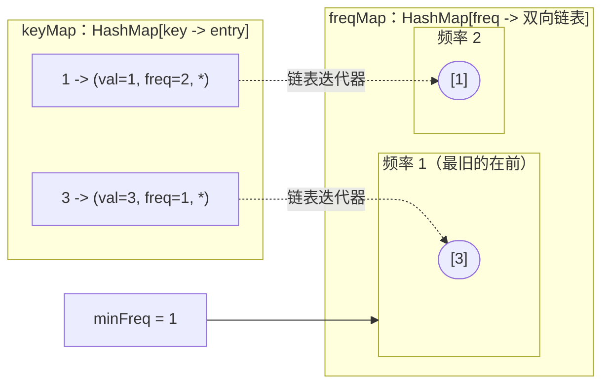
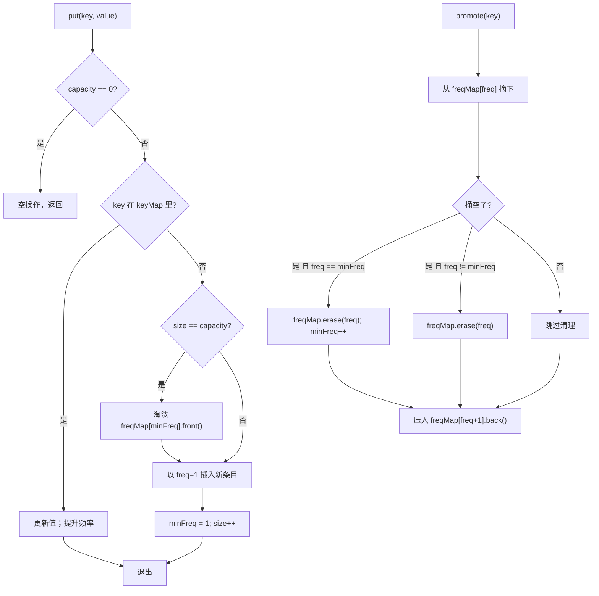

# LFU 缓存：哈希表加频率分桶的双向链表

朴素的 LFU 实现，在每一次撞到容量的 `put` 上都要付出 O(n)。把所有条目扫一遍，找出访问计数最小的那个，淘汰掉。缓存里放着 10 万个条目时，每一次未命中就是 10 万次比较，而真实缓存一小时要未命中几百万次。2010 年，Dhruv Matani、Ketan Shah 和 Anirban Mitra 发表了一篇论文，证明只要再加一张哈希表和一组双向链表，同样的操作就能做到 O(1)。他们的构造小到能画在一块白板上，又刁钻到 LeetCode 把第 460 题评为 Hard——缓存设计这一类题目里唯一的一道 Hard。整章讲的就是这个构造。

LC 460 的契约毫不留情。[^1] `get(key)` 和 `put(key, value)` 都必须是 O(1) 平均时间。未命中返回 `-1`，什么都不改。命中返回值，并把该键的频率计数加 1。对一个已存在的键做 `put`，既更新值，也把计数加 1。这句话值得读两遍，因为“least frequently *used*”字面上会让人以为“使用就是读”，而规范把“使用”定义成两种操作中的任意一种。当 `put` 让缓存溢出时，淘汰的目标是频率最小的条目；频率相同时，淘汰这个频率带里*最久*没被碰过的那个。所以淘汰要在常数代价下拿到两条信息：当前在用 的最小频率，以及这个频率桶里最旧的条目。

> [!IMPORTANT]
> [LRU 缓存：哈希表加双向链表](../part-5-linked-lists/05-lru-cache.md) 是硬性前置。这里的数据结构就是 LRU 那套双结构上加了一根频率维度，LRU 的机制（以节点指针为键的哈希表、带哨兵的双向链表、两半上成对出现的插入与删除）全章默认你已经熟练。如果“命中即拼接”还不是条件反射，先回去读那一篇。

## “最不经常使用”到底淘汰什么

LRU 按新近程度淘汰。LFU 按频率淘汰，把新近程度当作平局裁决。在一种 LRU 会悄悄搞砸的负载上，两种策略会分道扬镳：一次冷键的大规模扫描，中间穿插着对一小撮热工作集的稳定访问。想象一条每天把十亿行表扫一遍的数据库查询，外加一个每小时被读一百万次的热键。LRU 会把扫描键装进缓存，把那个每小时读一百万次的键挤出去，因为扫描键才是*最近*被碰过的。下一次热读就是未命中，缓存开始反复抖动。缓存替换理论把这种性质叫作抗扫描（scan-resistance），而裸 LRU 不具备它。[^4]

LFU 靠把淘汰锚定在访问计数上来抵御扫描。扫描键进来时频率是 1，热键稳稳停在 1,000,000，扫描键之间互相淘汰，永远碰不到热键。偏向 LFU 的生产级缓存（Memcached 的 `lfu` 模式、Redis 的 `allkeys-lfu`、Caffeine 背后那套 W-TinyLFU 策略）正是为这种场景设计的。[^4]

LC 460 的契约把设计空间收得更窄。有三个数必须在常数时间内拿到：

- 某个键对应的值，
- 缓存里当前最小的频率（淘汰时要知道去哪个桶找），
- 那个最小频率桶里最旧的条目（淘汰时要知道删哪个条目）。

一张哈希表解决第一个。第二张以频率为键的哈希表解决第三个——前提是它的值是按新近程度排好序的双向链表。第二个数，也就是最小频率，才是难点。你不能在每次淘汰时扫 `freqMap.keys()` 求最小值，那又把规模拉回 O(n) 了。解法是一个名为 `minFreq` 的整数，算法靠一处精心放置的更新让它始终正确。

## 三件套结构

三个字段，外加一条把它们绑在一起的规则。



*`put(1,1) put(2,2) get(1) put(3,3)` 之后的缓存状态。实线是持有的引用；虚线是保存下来的迭代器，它让原地摘下节点成为 O(1)。`minFreq` 字段指向 LFU 桶；下一次淘汰取该桶的队首。*

`keyMap` 是从每个键到它对应条目的哈希表。条目里存着值、当前频率，以及一个指回包含它的那条双向链表的指针。这个回指指针是承重的细节。没有它，一次 `get` 就得遍历频率桶里的链表才能找到装着该键的节点，每次调用 O(n)。

`freqMap` 是从每个频率到“该频率下的键所组成双向链表”的哈希表。链表按插入顺序排列，队首是最早插入的（也就是这个频率带内的 LRU），队尾是最近插入的。当 LC 460 的平局规则要求“淘汰频率 1 上最旧的条目”时，那个条目就是 `freqMap[1].front()`。一次指针解引用，不用扫描。

`minFreq` 是一个标量，保存当前在用 的最小频率。淘汰时看 `freqMap[minFreq]`，取队首，结束。整场游戏就是：不扫 `freqMap` 的键，还要让 `minFreq` 保持正确。

## 各操作如何运作

三个操作，全部钉死在 O(1)。

### `get(key)`

未命中是一次哈希查找，然后提前返回 `-1`。

命中有三个阶段：读出、提升、收尾。

1. 通过 `keyMap[key]` 读出条目。里面的值就是返回值；频率告诉你这个条目现在住在哪个桶里。
2. 提升这个条目：从 `freqMap[freq]` 里摘下，重新挂到 `freqMap[freq + 1]` 的尾部。摘下是 O(1)，因为条目自己存着链表迭代器，不用遍历。把条目里存的频率更新为 `freq + 1`。
3. 如果条目刚离开的那个桶现在空了，就把它从 `freqMap` 里删掉。如果这个空桶正好位于 `minFreq`，把 `minFreq` 加 1。

第 3 步的后半句是整个算法最难写对的一行。它也是命中路径上 `minFreq` 唯一会变大的地方。原因马上讲。

### `put(key, value)`

三个分支，按顺序来。

1. **容量检查。** 如果缓存是以 `capacity == 0` 构造的，立刻返回。LC 460 允许这个构造参数，测试集里也包含它；少了这道检查，下一个分支就会解引用一个不存在的频率桶。[^2]
2. **更新路径。** 如果键已存在，把新值写进条目，然后跑与 `get` 相同的提升逻辑。参考实现在换完值之后直接调用 `get(key)`，共用同一条代码路径。一次用于更新的 `put`，在结构上是一次命中，而不是未命中。
3. **插入路径。** 如果键是新的且缓存已满，淘汰 `freqMap[minFreq]` 的队首（同频率里最早插入的那个），并删掉对应的 `keyMap` 条目。然后创建 `freq = 1` 的新条目，压进 `freqMap[1]`，并置 `minFreq = 1`。这个重置是对的：新条目的频率是 1，按定义就是新的最小值。

插入路径里顺序很要紧。淘汰发生在新条目被构造和插入*之前*。在容量为 1 的缓存上先插入再淘汰，会把刚插入的条目当成 `minFreq` 上的 LRU 选中、淘汰，缓存最后空着。LC 之所以保留容量 1 的用例，就是为了测这个抖动。



*三条控制流分支。标着“是 且 freq == minFreq”的那一支是全章最容易出错的一步；下一节讲的就是它。*

### 每次 `get` 和 `put` 都是 O(1)

为什么这一切最后能压到每次操作常数时间，是本章最难的洞察。两个互相独立的 O(1) 技巧叠在一起。

**技巧一：按频率分桶的双向链表。** 每个频率桶都是一条按键的插入顺序排列的双向链表。`push_back` 是 O(1)（实现里握着尾指针）。`pop_front` 是 O(1)（头哨兵立刻把这个频率带内的 LRU 交出来）。从链表中任意位置摘下任意条目是 O(1)——*前提是手里有指向该节点的指针*，而条目把它存在 `keyMap` 里。CLRS 第 10 章 §10.2 给出了这个界。[^3] 于是提升（从旧桶摘下、压进新桶）是三个 O(1) 步骤之和，总共 O(1)。

**技巧二：`minFreq` 不变式。** `minFreq` 在提升路径里正好加一，加在那一行上：当条目刚离开的桶变空*并且*那个桶正好在 `minFreq` 时触发。这一处更新就够了。Matani、Shah 和 Mitra 用归纳法证明了这个论断。[^1] 对频率为 `f` 的条目做一次成功访问，要么让频率 `f` 的桶仍然非空（此时 `minFreq` 依然有效），要么把它抽空（此时下一个在用 的频率就是 `f + 1`，正是 `minFreq++` 记下的东西）。触发插入的未命中会无条件把 `minFreq` 重置为 1，因为新条目频率是 1，按定义就是新的最小值。命中路径上 `minFreq` 永远不需要*减少*；算法也永远不会为了求新的最小值去扫 `freqMap.keys()`。

结果就是：`get` 和 `put` 都分解为固定次数的哈希表操作（按 CLRS 定理 11.1，在简单均匀哈希下每次 O(1) 平均）加上固定次数的双向链表操作（按 CLRS §10.2，每次 O(1) 最坏）。[^3] 没有循环，没有扫描，没有 log 因子。LC 460 能有一个干净的答案，全靠这个构造。

## Python 参考实现

最清爽的实现，是把 Python 的 `dict`（充当 `keyMap`）和 `collections.OrderedDict`（充当每个频率桶）配在一起。`OrderedDict.popitem(last=False)` 以 O(1) 弹出最早插入的项，正是 LC 460 平局规则要的“桶内 LRU”原语。[^5] 普通 `dict` 从 CPython 3.7 起也保留插入顺序，但 `popitem(last=False)` 只有 `OrderedDict` 有；不要悄悄替换。

```python
from collections import defaultdict, OrderedDict


class LFUCache:
    def __init__(self, capacity: int):
        self.cap = capacity
        self.size = 0
        self.min_freq = 0
        self.kvf = {}                              # 键 -> [值, 频率]
        self.fk = defaultdict(OrderedDict)         # 频率 -> OrderedDict[键] = None

    def get(self, key: int) -> int:
        if key not in self.kvf:
            return -1
        val, freq = self.kvf[key]
        del self.fk[freq][key]
        if not self.fk[freq]:
            del self.fk[freq]
            if self.min_freq == freq:
                self.min_freq += 1                 # Matani 不变式
        self.fk[freq + 1][key] = None
        self.kvf[key] = [val, freq + 1]
        return val

    def put(self, key: int, value: int) -> None:
        if self.cap <= 0:
            return
        if key in self.kvf:
            self.kvf[key][0] = value
            self.get(key)                          # 复用提升路径
            return
        if self.size == self.cap:
            evict_key, _ = self.fk[self.min_freq].popitem(last=False)
            if not self.fk[self.min_freq]:
                del self.fk[self.min_freq]
            del self.kvf[evict_key]
            self.size -= 1
        self.kvf[key] = [value, 1]
        self.fk[1][key] = None
        self.min_freq = 1
        self.size += 1
```

**题解** — Python（[Java](./01-lfu-cache/lc-460/sol.java) · [C++](./01-lfu-cache/lc-460/sol.cpp) · [Go](./01-lfu-cache/lc-460/sol.go)）

```python
# LC 460. LFU Cache
from collections import defaultdict, OrderedDict


class LFUCache:
    """LFU cache with O(1) get/put using a freq-bucket of OrderedDicts.
    Tie-break inside a freq bucket = LRU (oldest insertion wins eviction)."""

    def __init__(self, capacity: int):
        self.cap = capacity
        self.size = 0
        self.min_freq = 0
        # 键 -> [值, 频率]；用 list（可变）是为了原地更新频率。
        self.kvf = {}
        # 频率 -> OrderedDict[键] = None；插入顺序 = 桶内 LRU。
        self.fk = defaultdict(OrderedDict)

    def get(self, key: int) -> int:
        if key not in self.kvf:
            return -1
        val, freq = self.kvf[key]
        del self.fk[freq][key]
        if not self.fk[freq]:
            del self.fk[freq]
            if self.min_freq == freq:
                self.min_freq += 1
        self.fk[freq + 1][key] = None
        self.kvf[key] = [val, freq + 1]
        return val

    def put(self, key: int, value: int) -> None:
        if self.cap <= 0:
            return
        if key in self.kvf:
            self.kvf[key][0] = value
            self.get(key)  # 复用提升逻辑
            return
        if self.size == self.cap:
            evict_key, _ = self.fk[self.min_freq].popitem(last=False)
            if not self.fk[self.min_freq]:
                del self.fk[self.min_freq]
            del self.kvf[evict_key]
            self.size -= 1
        self.kvf[key] = [value, 1]
        self.fk[1][key] = None
        self.min_freq = 1
        self.size += 1
```

每种语言都去抓自己那套“桶内 LRU”原语。Java 用 `LinkedHashSet<Integer>`：O(1) 添加、按元素 O(1) 删除，`iterator().next()` 以 O(1) 返回最早插入的那个。[^6] C++ 把 `std::list<int>`（它的迭代器在插入和其他元素被删除后依然有效，正是这一点让“保存迭代器”这套写法安全）和以条目元组为键的 `std::unordered_map` 配起来。Go 用 `container/list`，把 `*list.Element` 存在条目结构体上，于是从任何地方摘下都是 O(1)。同一个算法，四种写法。

这里有两个语言相关、值得点出来的坑。在 C++ 里，`auto& [val, freq, listIt] = it->second;` 之后再来一次可能触发 rehash 的 `unordered_map` 操作，就会让这个绑定失效；实现的做法是先把值拷出来，再通过 `std::make_tuple` 重新插入。在 Java 里，`kvf.get(key)[0] = value` 直接改的是 map 持有的那个 `int[]`；再走一遍 `kvf.put` 重新绑定是多余的，因为数组是按引用共享的。把引用关系写明白，出 bug 的面就小了。

## 走一遍标准序列

取容量 2，跑 LC 460 官方那串序列：`put(1,1) put(2,2) get(1) put(3,3) get(2) get(3) put(4,4) get(1) get(3) get(4)`。期望返回值：`[null, null, null, 1, null, 3, null, -1, 3, 4]`。[^2]

建仓阶段平淡无奇。`put(1,1) put(2,2)` 之后，`freqMap[1]` 里是 `[1, 2]`，键 1 在队首，`minFreq` 是 1，两个键都在频率 1。

第一个有意思的时刻是 `get(1)`。键 1 从 `freqMap[1]` 摘下，桶没空（键 2 还在里面），所以 `minFreq` 留在 1。键 1 落进 `freqMap[2]`，频率变为 2。此时 `freqMap[1]` 里是 `[2]`，`freqMap[2]` 里是 `[1]`。

接下来的 `put(3,3)` 发现缓存满了。淘汰目标是 `freqMap[minFreq=1].front()`，也就是键 2（唯一剩下的频率 1 条目，也是它那一带里的 LRU）。键 2 从两张表里都被删掉。键 3 以频率 1 插入，`minFreq` 重置为 1。

Matani 不变式最干净的展示是 `get(3)`。键 3 从 `freqMap[1]` 摘下。桶现在空了。`freqMap[1]` 被删除。刚刚空掉的那个桶正好在 `minFreq` 上，于是 `minFreq` 前进到 2。这一步之后的状态：`freqMap[2]` 里是 `[1, 3]`，`minFreq = 2`。下一次淘汰会正确地去找频率 2，而不是那个已经被删掉的频率 1。那一行代码干的事，朴素实现得靠一次 O(n) 扫描才做得到。

`put(4,4)` 淘汰 `freqMap[2]` 的队首，也就是键 1，并把键 4 以频率 1 插入。`minFreq` 又重置为 1。剩下的轨迹机械地走完：被淘汰的键未命中，存活的键命中，每次命中都走同一条提升路径。

| 操作 | 返回值 | `keyMap` 摘要 | `freqMap` | `minFreq` |
|---|---|---|---|---|
| `put(1,1)` | — | `{1:(1,1)}` | `{1:[1]}` | 1 |
| `put(2,2)` | — | `{1:(1,1), 2:(2,1)}` | `{1:[1,2]}` | 1 |
| `get(1)` | 1 | `{1:(1,2), 2:(2,1)}` | `{1:[2], 2:[1]}` | 1 |
| `put(3,3)` | — | `{1:(1,2), 3:(3,1)}` | `{1:[3], 2:[1]}` | 1 |
| `get(2)` | -1 | 不变 | 不变 | 1 |
| `get(3)` | 3 | `{1:(1,2), 3:(3,2)}` | `{2:[1,3]}` | **2** |
| `put(4,4)` | — | `{3:(3,2), 4:(4,1)}` | `{1:[4], 2:[3]}` | 1 |
| `get(1)` | -1 | 不变 | 不变 | 1 |
| `get(3)` | 3 | `{3:(3,3), 4:(4,1)}` | `{1:[4], 3:[3]}` | 1 |
| `get(4)` | 4 | `{3:(3,3), 4:(4,2)}` | `{2:[4], 3:[3]}` | **2** |

*加粗的 `minFreq` 值就是不变式触发的地方：旧 `minFreq` 上的桶空了，于是这个字段前进一格。*

## 实际开销

| 操作 | 时间 | 空间 | 出处 |
|---|---|---|---|
| `get(key)`（命中） | O(1) 平均 | 每次操作 O(1) | CLRS §10.2（有保存指针的双向链表 O(1) 摘下）+ §11.2 定理 11.1（链式哈希 O(1) 平均）[^3] |
| `get(key)`（未命中） | O(1) 平均 | 每次操作 O(1) | 一次哈希查找，无链表操作 |
| `put(key, value)`（插入，不淘汰） | O(1) 平均 | 每次操作 O(1) | 一次哈希插入 + 一次链表 push |
| `put(key, value)`（插入，带淘汰） | O(1) 平均 | 每次操作 O(1) | 一次链表 pop_front + 两次哈希删除 + 一次哈希插入 + 一次链表 push |
| `put(key, value)`（更新已有键） | O(1) 平均 | 每次操作 O(1) | 与 `get` 同形 |
| n 个条目的缓存总空间 | — | O(n) | 每个条目一个 `keyMap` 条目 + 一个链表节点；桶数 ≤ n[^1] |

哈希表操作按 CLRS 定理 11.1，在简单均匀哈希下是 O(1) **期望**。[^3] 双向链表操作按 CLRS §10.2 是 O(1) **最坏**。Matani 的贡献在于那套让*淘汰*这一步也钉在 O(1) 上的数据布局：没有频率分桶结构，要找到 LFU 键，就得扫整个 `keyMap`（O(n)），或者维护一个有序堆（O(log n)）。[^1] 这正是 NeetCode 题解先走一遍的暴力基线，然后才引出频率分桶的布局。[^7]

> [!NOTE]
> **单档 Hard 梯度。** LFU 在 LeetCode 上结构性地只有 Hard。最接近的 Medium 类比题，要么其实归约成 LRU（LC 146，锁定在第 5.5 章），要么是会员题、且没有免费的同模式替代（LC 1756）。Easy 的类比题（LC 705、LC 706）干脆去掉频率这一维，变成纯粹的哈希表设计。本章只把 LC 460 作为唯一的 CORE 题，带着 `single-difficulty-band` 这个选题标记；STRETCH 补的两道免费设计题是为了拓宽面，不是为了拉难度跨度。

## 面试中最容易翻车的五个地方

> [!WARNING]
> **忘了对已存在的键做 `put` 也要提升频率。** “least frequently *used*”字面上会让人以为“使用就是读”。LC 460 的规范把使用定义成两种操作中的任意一种，包括那些并没有改变值的更新。[^2] 修法是插入分支开头那一行：把已存在键的 put 改道到与 `get` 相同的提升路径。漏掉它，那些被反复写、从来没被读的键会攒下一个虚低的频率，比只被读过一次的键先被淘汰。[^7]

> [!WARNING]
> **桶空了却不推进 `minFreq`。** Matani 不变式在提升路径里触发：当条目刚离开的桶变空*并且*那个桶位于 `minFreq` 时，把 `minFreq` 加一。labuladong 称这是“LFU 算法里最容易出错的一步”。[^8] 漏掉它，下一次淘汰会去读 `freqMap[stale_minFreq]`，那要么是个空链表（KeyError、NPE、段错误），要么更糟——在 `defaultdict` 这类自动建值的实现下，是一个刚被重新造出来的空链表，把 bug 伪装成静默的数据损坏。

> [!WARNING]
> **每个频率桶用普通 set 或 unordered map。** 同一频率内的平局必须按新近程度裁决，也就是插入顺序。Java 里朴素的 `HashSet` 或 C++ 里的 `unordered_set` 没有顺序；淘汰会随便挑一个条目，违反 LC 460 的平局规则。修法是 `OrderedDict`（Python）、`LinkedHashSet`（Java）、把迭代器存在条目上的 `std::list`（C++），或者把 `*list.Element` 存在条目上的 `container/list`（Go）。[^7]

> [!WARNING]
> **跳过 `capacity == 0` 的检查。** LC 460 的构造函数允许容量为零。没有了 `put` 开头那次提前返回，第一次调用就会在空缓存上进淘汰分支，解引用 `freqMap[minFreq=0]`，然后崩掉（C++ 段错误，Python KeyError，Java NPE）。[^7]

> [!WARNING]
> **提升时忘了把条目从旧的频率桶里删掉。** 当算法被翻译到非链表式的桶结构上时（一个计数 map、一个以频率为下标的数组），写的人会记得把频率值加一、把条目加进新桶，却忘了从旧桶里显式删除。同一个键于是出现在两个桶里；下一次淘汰可能选中那个过期条目；缓存静默损坏。参考实现永远是在任何其他结构改动之前，先从旧桶里删掉。[^7]

## 值得了解的变体

上面那套教科书构造就是 LC 460 的答案。生产级缓存还会加三种改良，实现它们超出本章范围，但值得认得。

**LFUDA（带动态老化的 LFU）** 维护一个整数 `cacheAge`，每次淘汰时把它抬到被淘汰条目的频率；新插入的条目拿到 `freq = 1 + cacheAge`。效果是频率地板在缓慢抬升，让昨天工作集里的条目自然落到今天的工作集之后，哪怕它们的绝对计数还很高。Squid 的 HTTP 缓存和 Memcached 的 LFU 模式都用 LFUDA。[^4]

**TinyLFU 与 W-TinyLFU** 干脆丢掉按键的频率计数器。一个小的 Count-Min Sketch 用每条目常数内存跟踪频率估计；一个 LRU 窗口负责放新条目进来；每次准入时由 sketch 判断候选者是否打得过在位者。JVM 上的缓存库 Caffeine 把 W-TinyLFU 作为默认策略。在 Zipf 分布的负载上，实测命中率同时胜过 LRU 和 LFU。[^4]

**频率封顶** 给按键计数器设上上限，免得连续运行几个月后溢出。Redis 把它的 `LFU` 模式封在 8 位，用对数式递增；布局不变。[^4]

LC 460 一个都不要求。只有面试官追问生产真实感时再提。

## 题目梯度

### 核心（全做才算掌握本章）

- [LC 460 — LFU Cache](https://leetcode.com/problems/lfu-cache/) [困难] • hash-map-plus-frequency-bucketed-dll ★

### 进阶（可选）

- [LC 1472 — Design Browser History](https://leetcode.com/problems/design-browser-history/) [中等] • doubly-linked-list-with-cursor
- [LC 2227 — Encrypt and Decrypt Strings](https://leetcode.com/problems/encrypt-and-decrypt-strings/) [困难] • hash-table-bidirectional-with-precompute *(参考实现：仅 Python)*

LC 1472 把双结构模式里“带游标的双向链表”那一半从哈希表那一半里单独拆出来：同样的组合纪律，不同的第二维度。LC 2227 考的是同一种“把工作摊到构造函数里”的思维形状——LFU 正是用它把频率跟踪摊到每一次操作里。

[LC 432 (All O\`one Data Structure)](https://leetcode.com/problems/all-oone-data-structure/) 是结构上最亲近的兄弟题，同样是哈希表加频率分桶双向链表的形状，但它登记在 [哈希冲突与装载因子](../part-1-linear-data-structures/04-hash-collisions.md) 名下。去那一章做它，算是对频率桶机制的第二次练习。

## 后续衔接

双结构模式（一张哈希表管键的访问，一个辅助结构管次序统计量）活得比 LFU 长。[最小栈与最大频率栈](./02-min-stack-maxfreq.md) 把同一个形状复用到“在主栈上跟踪当前最小值”。[命中计数器与限流器](./03-hit-counter-rate-limiter.md) 把它用到按时间窗淘汰上。这个模式就是“给主结构配一个辅助结构，由它维护主结构无法在 O(1) 内回答的那个次序统计量”。这个框子一旦扣上，FAANG 面试里每一道缓存设计题都开始看起来像同一个主题的变奏。

想要本章的生产级现代变体，接下来该读 Caffeine wiki 上讲 W-TinyLFU 策略的那一篇。[^4] 想要听 O(1) 构造的原作者自己讲，Matani 那篇八页的论文很短，值得花时间。[^1]

## 参考文献

[^1]: Matani, Dhruv; Shah, Ketan; Mitra, Anirban。提出哈希表加频率分桶双向链表的布局，以及让 `get` 和 `put` 都达到 O(1) 平均的 `minFreq` 不变式。<https://arxiv.org/abs/2110.11602>。

[^2]: LeetCode 题目 “460. LFU Cache”。<https://leetcode.com/problems/lfu-cache/>

[^3]: Cormen, Leiserson, Rivest, Stein，*Introduction to Algorithms*（《算法导论》）第 4 版，MIT Press，2022。

[^4]: Manes, Ben（Caffeine 作者）。“Efficiency · ben-manes/caffeine Wiki”。<https://github.com/ben-manes/caffeine/wiki/Efficiency>。

[^5]: Python Software Foundation，`collections.OrderedDict`。`popitem(last=False)` 以 O(1) 弹出最早插入的项，是 CPython 里标准的桶内 LRU 原语。普通 `dict` 从 CPython 3.7 起保留插入顺序，但不提供 `popitem(last=False)`。<https://docs.python.org/3/library/collections.html#collections.OrderedDict>。

[^6]: Oracle，Java SE 21 文档，`LinkedHashSet`。在频率桶这个角色上，它是 Python `OrderedDict` 的 Java 对应物。<https://docs.oracle.com/en/java/javase/21/docs/api/java.base/java/util/LinkedHashSet.html>。

[^7]: NeetCode，“460. LFU Cache — Explanation”。走了一遍每次 `put` 花 O(n) 的暴力基线，以及双向链表的 O(1) 构造；列出了上面那些 WARNING 提示对应的五个典型 bug。<https://neetcode.io/solutions/lfu-cache>。

[^8]: labuladong，“Implementing LFU Cache like Building a Lego”。用七个子步骤自顶向下搭出 LFU 的结构；指出 `minFreq` 的更新是整个算法里最容易出错的一步。<https://labuladong.online/algo/en/frequency-interview/lfu/>。
