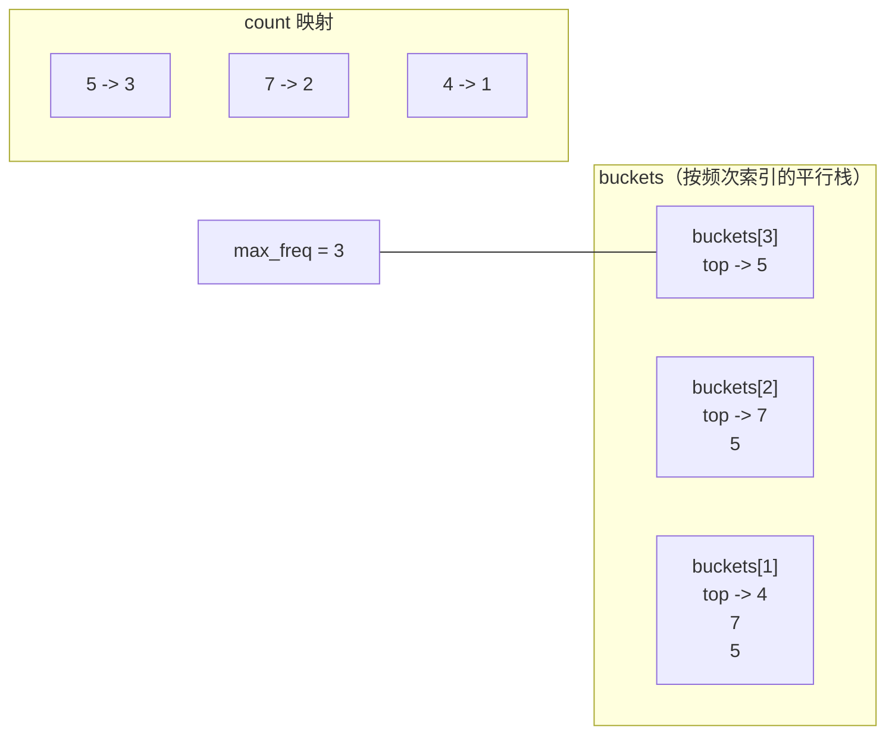
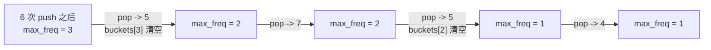
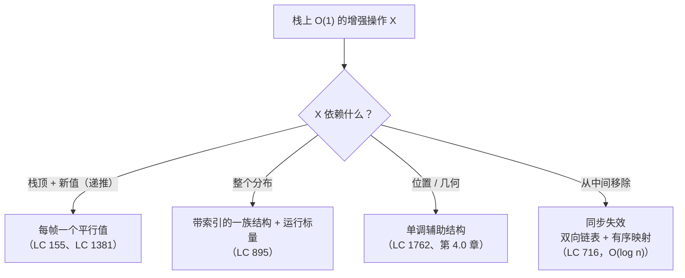

# 最小栈与最大频率栈

Part 4 那一章 [最小栈与最大栈](../part-4-stack-queue-patterns/02-min-max-stack.md) 讲的是算法：给值栈配一个平行的辅助结构，`getMin` 就退化成一次 peek。辅助结构的形状跟着聚合量走。维护当前最小值，用一个平行的 int 栈；维护出现最频繁的元素，用两个哈希表加一个计数器。三个题，一套技法。

现在换个角度，再看同一片表面。Part 13 讲的是*设计*数据结构，而真实面试官在被要求"给栈加一个 O(1) 的增强操作"时做的设计决策，不是"用什么算法"，而是"配什么辅助结构，按这份契约定尺寸、定形状"。算法章节给的是答案；这里问的是从冷启动怎么走到那个答案。两份状态对应契约的两个条款，而把它们对应起来的这套纪律，才是能推广到具体题目之外的东西。

## 「设计一个栈」到底意味着什么

面试官递给你一份契约。四个操作，全部 O(1)，其中一个原生栈做不到。

| LC 155 的契约 | LC 895 的契约 |
|---|---|
| `push(val)` — O(1) | `push(val)` — O(1) |
| `pop()` — O(1) | `pop()` 返回*并移除*出现最频繁的元素，频次并列时取最近入栈者 — O(1) |
| `top()` — O(1) | （没有 `top`） |
| `getMin()` 返回当前栈内的最小值 — O(1) | |

问题不是"实现一个栈"。栈在四种参考语言里都是一行代码。问题是"我在 push 和 pop 时多带哪些状态，才能让被增强的那个操作不必扫描"。

这个提法有两半。被增强的操作告诉你欠的是哪个聚合量；原生操作告诉你这个聚合量什么时候必须更新，以及能压到多便宜。只顾前半不顾后半的设计，读是 O(1)、写是 O(n)，同样硬生生违背契约。

## 两个操作，两份状态

技法是：每次 push 都在辅助结构上记一笔，每次 pop 都把它撤掉，被增强的操作读辅助结构的当前状态。辅助结构必须满足三个性质。

> [!IMPORTANT]
> **钉住不变式。** 每次操作之后，辅助结构对外暴露的值都等于值栈当前内容的聚合量。push 靠记录新状态保持它；pop 靠精确撤销那一次配对 push 所加的状态保持它。失败的设计，都是这两半里破了其中一半。

钉住这一半正是新手最容易跳过的。他们写的 push 记对了东西，写的 pop 却没把它撤掉，辅助结构就漂了。或者 pop 严格同步了，push 却漏掉一次状态转移（一个重复的最小值、一次跨频次层级），辅助结构就少数了。pop 与 push 必须同步，否则设计就是错的。

辅助结构的形状随聚合量伸缩。维护当前最小值是每帧一个整数，一个等高平行的 int 栈就装得下。维护出现最频繁的元素根本不是"一个整数"的事：它是当前频次分布的函数，要捕获它得用更丰富的状态。

## LC 155：一个平行的 int 栈

聚合量是一个数，辅助结构就是一个数栈。`push(val)` 时，新的当前最小值是 `min(prev_min, val)`，一行递推。辅助结构把它记下来。`pop()` 时值栈少一层，辅助栈也少一层。`getMin()` 就是辅助栈的栈顶。

```python
class MinStack:
    def __init__(self):
        self.values = []
        self.mins = []

    def push(self, val):
        self.values.append(val)
        new_min = val if not self.mins else min(self.mins[-1], val)
        self.mins.append(new_min)

    def pop(self):
        self.values.pop()
        self.mins.pop()

    def top(self):
        return self.values[-1]

    def get_min(self):
        return self.mins[-1]
```

LC 155 的完整四语言参考在 [最小栈与最大栈](../part-4-stack-queue-patterns/02-min-max-stack.md)，那一章把递推式、条件入栈变体、重复最小值陷阱，以及单栈存差值版本的溢出 bug 都走了一遍。想认真读一遍，Part 4 那一章是对的地方。

这里值得记住的设计动作是：辅助结构与值栈等高，每个条目占固定数量的位，且 push 时的状态转移只依赖当前栈顶和新值。三个性质，每一个都承重。丢掉第三个（状态依赖的不止栈顶加新值），平行 int 栈就不够用了。

## LC 895：两个哈希表加一个当前最大值

LC 895 丢掉的正是第三个性质。"出现最频繁的元素"这个聚合量依赖整个当前频次分布，而不只是最近一次 push。平行 int 栈装不下它。

契约是：

> 设计一个类栈结构，支持 `push(val)` 与 `pop()`，其中 `pop()` 返回当前频次最高的值。若有多个值在该频次上并列，返回最近压入的那个。

朴素设计想用以频次为键的堆。push 递增计数，把一个 `(freq, timestamp, val)` 三元组压进堆，pop 读堆顶。这样是能跑的，但堆条目携带的频次，在同一个值又一次 push 抬高真实计数的那一刻就*过期*了。要么读到过期条目再拿真实计数核对（push O(log n)，pop O(log n) 加重试），要么提前做失效，代价比省下来的还大。堆给出的是每操作 `O(log n)`，不满足本章契约。

能成立的设计，转折点在第二份状态。

> [!IMPORTANT]
> **频次桶不变式。** 对从 1 到当前最大值的每个频次层级 `f`，`buckets[f]` 是一个栈，按原始入栈顺序保存所有曾经达到过计数 `f` 的值。一次 `push(v)` 把 `v` 的计数抬到 `f` 之后，只把 `v` 追加到 `buckets[f]`。更早的那些 push 已经把 `v` 放进过 `buckets[1]` 到 `buckets[f-1]`。这条不变式跨 push 累积；每次 push 只碰一个桶。

这一条洞见就是本章的全部载荷。两份状态：`count[v]` 是 `v` 的当前频次，`buckets[f]` 是曾经达到过频次 `f` 的值栈。一个标量 `max_freq` 跟踪最大的非空桶。pop 读 `buckets[max_freq]`，一次就同时给出频次最高的值，以及（因为桶本身就是栈）该频次下最近入栈的那个。契约的两个条款，一次 pop 全兑现。

```python
def push(self, val):
    self.count[val] += 1
    f = self.count[val]
    self.buckets[f].append(val)
    if f > self.max_freq:
        self.max_freq = f

def pop(self):
    val = self.buckets[self.max_freq].pop()
    self.count[val] -= 1
    if not self.buckets[self.max_freq]:
        self.max_freq -= 1
    return val
```

**解法** — Python（[Java](./02-min-stack-maxfreq/lc-895/sol.java) · [C++](./02-min-stack-maxfreq/lc-895/sol.cpp) · [Go](./02-min-stack-maxfreq/lc-895/sol.go)）

```python
# LC 895. Maximum Frequency Stack
# pop 返回迄今压入的元素里出现最频繁的那个，并列时取最近入栈者。
# 维护两个平行结构：count[v] 记录 v 的当前计数；
# buckets[f] 是曾经达到过计数 f 的所有值构成的栈。一次 push 把 v
# 的计数抬到 f 时，只把 v 追加到 buckets[f]——更早的 push 已经把 v
# 放进过 buckets[1..f-1]。pop 读 buckets[max_freq]，同时给出最频繁
# 的值，以及（靠桶内的栈 LIFO）并列中的最近者。
# push O(1)，pop O(1)。
from collections import defaultdict


class FreqStack:
    def __init__(self) -> None:
        self.count: dict[int, int] = defaultdict(int)
        self.buckets: dict[int, list[int]] = defaultdict(list)
        self.max_freq: int = 0

    def push(self, val: int) -> None:
        self.count[val] += 1
        f = self.count[val]
        self.buckets[f].append(val)
        if f > self.max_freq:
            self.max_freq = f

    def pop(self) -> int:
        val = self.buckets[self.max_freq].pop()
        self.count[val] -= 1
        if not self.buckets[self.max_freq]:
            self.max_freq -= 1
        return val
```

不显然的一步是桶空之后的 `max_freq -= 1`。为什么减一就够？为什么下一次 pop 不用扫描找下一个非空桶？因为结构里还活着的每个当前计数为 `c` 的值，都是被某次 push 同时碰过 `buckets[1]` 到 `buckets[c]` 的。`buckets[max_freq]` 一空的瞬间，其他所有存活值的计数都严格小于 `max_freq`，其中至少有一个正停在 `max_freq - 1`。下一个非空桶恰好就在下一层。[^1]



*压入 `[5, 7, 5, 7, 4, 5]` 之后的状态。三个平行栈，每个对应迄今达到过的一个频次层级；下一次 pop 读 buckets[max_freq]，返回 5。*

这个状态上的 pop 序列是 `5, 7, 5, 4`。第一次 pop 抽干 `buckets[3]`，把 `max_freq` 减到 2，返回 5。第二次 pop 读 `buckets[2]` 返回 7；最近优先的并列规则自然落在桶自身的 LIFO 顺序上，因为 7 进 `buckets[2]` 晚于 5。不需要额外时间戳，不需要辅助排序，桶的栈纪律把事情做了。



*每当一次 pop 清空当前桶，max_freq 恰好减一；不会多减，也不会少减。*

每次 push 是两次哈希表操作加一次标量更新，每次 pop 同样。在标准的摊还哈希表假设下，每个操作都是 O(1)（[哈希表与哈希集合](../part-1-linear-data-structures/03-hash-maps.md) 讲了这组假设）。[^2] 堆基线跑的是 O(log n)；这个设计用两套平坦哈希结构加一条小心维护的不变式，替掉一棵基于比较的树，落到了 O(1)。

## 挑辅助结构的形状

两个设计站在同一根脊骨上。都把辅助结构钉在值栈上，都让它与 push、pop 严格同步，都把被增强的操作退化成一次 peek。区别在于：LC 155 的聚合量有一行递推，装得进一个平行 int 栈；LC 895 的聚合量是整个分布的函数，需要一族按派生量（计数）索引的结构化栈。

区分标准，也正是把这套技法推向更难题目的那一条：**聚合量依赖什么？**

| 聚合量依赖…… | 辅助结构的形状 | 例子 |
|---|---|---|
| 只有栈顶加新值（一行递推） | 每帧一个平行值 | LC 155 的当前最小值；LC 716 的当前最大值（`popMax` 除外）；LC 1381 的惰性递增 |
| 整个分布（计数、频次、排名） | 一族带索引的结构 + 一个运行摘要标量 | LC 895 的频次栈；带计数映射的滑动窗口众数 |
| 整个几何（某个位置需要邻居） | 记录*位置*而非值的辅助结构 | 单调栈（LC 1762、LC 901、LC 84） |

第一行是 4.2 章的地盘：每帧一个辅助数字，递推负责干活。第二行是本章的载荷：当递推因为聚合量不局部而失效，辅助结构就变成*带参数*的结构，按聚合量排序所依据的那个派生量来索引。第三行是 [单调栈与双端队列](../part-4-stack-queue-patterns/00-monotonic-stack.md) 里的单调栈家族——辅助结构自己就是数据结构（没有独立的值栈），因为被后来的 push 压制的那些位置再也不会被问到，可以直接弹掉。

这个视角的价值不在那三行，而在于："给栈加一个 O(1) 的增强操作 X"是同一个问题，取决于 X 读什么，有三种说得通的答案，而设计选择恰恰是面试真正考的地方。4.2 章的算法是实现；上面这张分派表才是设计。



*这个决策是局部于被增强操作的。挑辅助结构时看聚合量的依赖关系，而不是看算法的名字。*

## 这套技法在哪里失效

LC 716 的 `popMax` 是边界。契约要求"移除最大值，不管它在哪里"。同步的辅助结构能正确跟踪最大值，但值栈还得从中间某处把最大值抽出来，而数组实现的栈做不到 O(1) 抽除。辅助结构救不了这一点，因为辅助结构的职责是*知道*答案，不是*改变*值栈的表示。

修法是彻底换数据结构。放弃"值栈加辅助结构"这个框架，选双向链表（尾部 push、pop 是 O(1)，给定节点 O(1) 摘除），再加一个从值到持有该值的链表节点的有序多重映射。push 往链表尾部追加并向多重映射插一个节点；`popMax` 读多重映射的最后一个键，从链表和多重映射里移除最近匹配的那个节点。五个操作全部落在 O(log n)，代价就是那个有序多重映射。[^3] 这套技法只能推广到"值栈在相关的那一端保持只追加"为止。

设计时留意这个信号。被增强的操作是*读*值、或者在它下面*移除栈顶*：同步辅助结构成立。它要*移除一个非栈顶元素*：同步就破了，设计得换数据结构。4.2 章对 LC 716 的处理把替代方案完整走了一遍。

## 两个最容易踩的坑

> [!WARNING]
> **每次 push 都把 `val` 推进从 1 到 `count[val]` 的每一个桶。** 不变式一旦看懂，这是最常见的过度修正：读者看到"buckets[f] 保存所有曾达到计数 f 的值"，就断定 push 必须把它们全部填上。其实每次 push 只往一个桶追加。同一个值更早的那些 push 已经把低层桶填好了，累积不变式是靠增量维护的。这个过度修正把 push 撑到 O(count)，在 LC 895 最大的测试用例上会超时。[^4]

> [!WARNING]
> **桶空之后忘了 `max_freq -= 1`。** 下一次 pop 直接从 `buckets[max_freq]` 读。如果上一次 pop 把这个桶抽干了而 `max_freq` 没减，这次读就炸（Python 抛 `IndexError`，Java 抛 `NoSuchElementException`，C++ 是未定义行为）。上面的证明说明减一次就够；问题出在 `max_freq` 过期，不是需要深度级联。

## 题目梯度

### 核心（全做才算掌握本章）

- [LC 1762 — Buildings With an Ocean View](https://leetcode.com/problems/buildings-with-an-ocean-view/) [中等] • design-monotonic-stack-as-aggregate ★

### 进阶（可选，主要讲解在 4.2 章）

- [LC 155 — Min Stack](https://leetcode.com/problems/min-stack/) [中等] • design-stack-with-aux-min-stack *（主要讲解：[最小栈与最大栈](../part-4-stack-queue-patterns/02-min-max-stack.md)）*
- [LC 895 — Maximum Frequency Stack](https://leetcode.com/problems/maximum-frequency-stack/) [困难] • design-stack-with-frequency-buckets *（主要讲解：[最小栈与最大栈](../part-4-stack-queue-patterns/02-min-max-stack.md)；本篇有四语言参考）*

这个模式没有本章原生拥有的标准 Easy 题。LC 155（LC 上标 Medium）和 LC 895（Hard）覆盖了设计光谱的两端，代价是在本章 PRIMARY 主张上堆出一个难度聚集；注册表标记是 `no-easy-canonical`，与 4.2 章为算法家族打的同一个标记。

## 后续衔接

下一个设计章 [命中计数器与限流器](./03-hit-counter-rate-limiter.md) 用同一个视角看一份跨时间流的契约：当被增强的操作是"给我滑动窗口上的计数"，辅助结构就变成一个按时间戳索引的双端队列。聚合量不同，纪律相同。至于增强栈家族的算法基础，[最小栈与最大栈](../part-4-stack-queue-patterns/02-min-max-stack.md) 是算法章；[单调栈与双端队列](../part-4-stack-queue-patterns/00-monotonic-stack.md) 是上面分派表的第三行。

## 参考文献

[^1]: doocs/leetcode 社区题解及 LC 895 的思路叙述，README_EN.md，见 <https://github.com/doocs/leetcode/blob/main/solution/0800-0899/0895.Maximum%20Frequency%20Stack/README_EN.md>。

[^2]: Cormen, Leiserson, Rivest, Stein，《算法导论》（*Introduction to Algorithms*）第 4 版，MIT Press，2022。

[^3]: leetcode.ca 社区镜像的 LC 716 *Max Stack* 题解讨论，<https://leetcode.ca/2017-11-15-716-Max-Stack>。

[^4]: StackOverflow 帖子 "LeetCode Problem 895 (Python), can't finish last test"，<https://stackoverflow.com/questions/71543237/leetcode-problem-895-python-cant-finish-last-test>。
