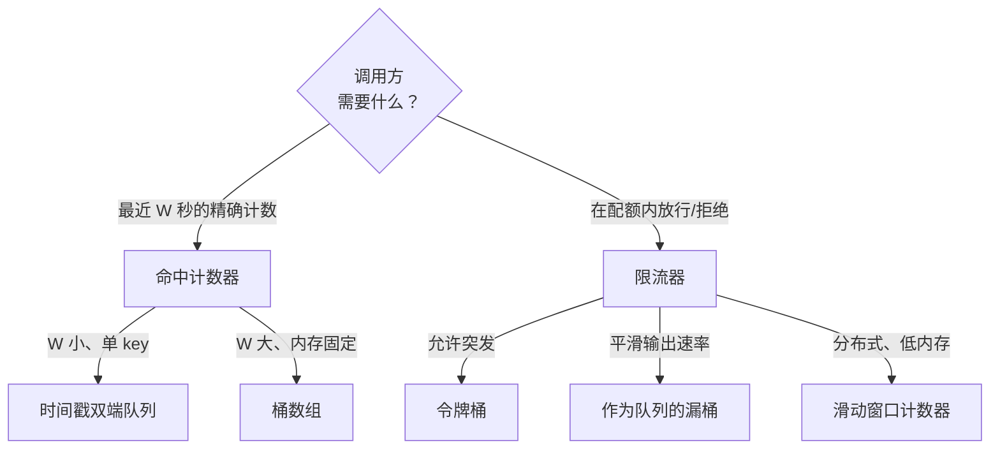
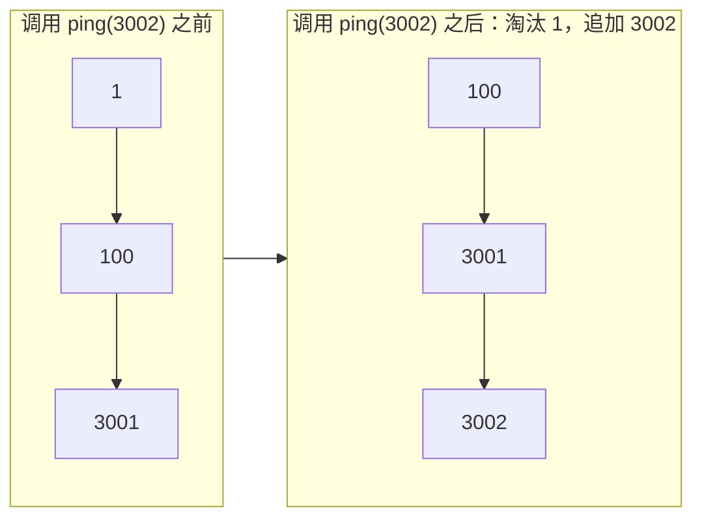
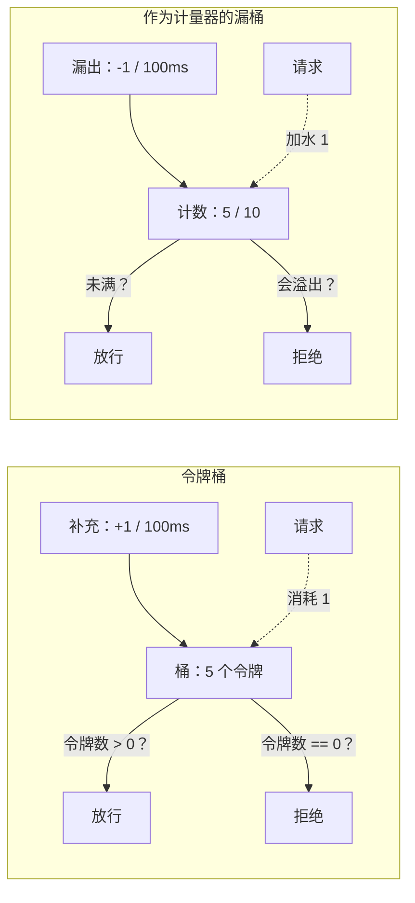
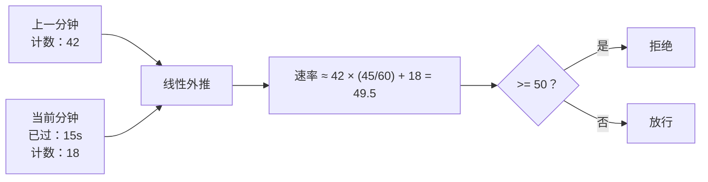

# 命中计数器与限流器

Cloudflare 的边缘节点跑着一个限流器，它误判请求的比例是 0.003%。这个数字是在 4 亿次生产请求上测出来的，而他们能拿到这个数字，是因为放弃了教科书里的固定窗口计数器，改用每 key 只花 16 字节的双桶近似。Stripe 的 API 拿 Redis 上的令牌桶吸收突发流量。AWS API Gateway 给每个 key 配一个令牌桶，在另一个量级上做同一件事。三个生产系统、三种细节上略有差别的算法，背后是同一道面试题：设计一个类，给定一串带时间戳的事件，回答关于最近 `W` 秒的某个问题。

面试级别的标准题是 LeetCode 362 *Design Hit Counter*。你要为 5 分钟的滑动窗口实现 `hit(t)` 和 `getHits(t)`。条件反射式的答案（存一个时间戳列表，每次 `getHits` 都扫一遍）是每次调用 `O(n)`。像样的答案是 300 个一秒长的桶、用 `t % 300` 定位，`hit` 是 `O(1)`、`getHits` 是 `O(W)`，而且无论突发多猛内存都恒定。这个像样的答案也是生产级限流器的起点：桶这个技巧只要见过一次，再跳到 Cloudflare 的双桶外推和 Stripe 的 Redis 令牌桶就没几步了。

本章把这两半都讲。先讲 LC 933 *Number of Recent Calls* 免费考查的时间戳双端队列；再讲 LC 362 拿来换 Premium 积分的桶数组；最后讲面试官想确认你有没有读过 LeetCode 题解之外的四种生产限流算法：令牌桶、漏桶、固定窗口、滑动窗口计数器。

## 要设计什么

两个抽象数据类型共用同一套骨架。**命中计数器**（hit counter）记录带时间戳的事件，并在被问到时回答*“最近 `W` 秒内落了多少个？”*。**限流器**（rate limiter）记录同样的事件，并在配额约束下回答*“这一个能进来吗？”*。命中计数器汇报状态，限流器执行状态。两者吃的都是时间戳非递减的事件流，所以 `t` 只会往前走；两者也都只保留足够遗忘 `W` 之前一切的状态。

数据结构层面的问题是：在哪种负载下用哪套骨架。权衡点在于精确计数与内存、单次调用开销之间的取舍：

| 变体 | `add` 开销 | `query` 开销 | 每 key 空间 | 什么时候选它 |
|---|---|---|---|---|
| 时间戳双端队列 | O(1) 摊还 | O(1) 摊还 | O(W) 条目 | `W` 小、单 key、要求精确计数（LC 933 基线）[^1] |
| 桶数组，1 秒粒度 | O(1) | O(W / 粒度) | O(W / 粒度) | `W` 大、单 key、内存必须固定（LC 362）[^2] |
| 令牌桶 | O(1) | O(1) | 每 key 16 字节 | 按 key 限流且允许突发（Stripe、AWS API Gateway）[^3][^4] |
| 滑动日志（完整时间戳列表） | O(log n) | O(n) | 每 key O(n) | 生产里永远别用；这是后面两个方案要改进的反面教材[^2] |
| 滑动窗口计数器 | O(1) | O(1) | 每 key 16 字节 | 分布式限流，且精确滑动日志太贵（Cloudflare）[^2] |

中间三行才是重点。双端队列是热身；滑动日志是反面教材；夹在中间的那些才是生产会选的。



*五种算法，两个问题。从问题走到算法的那条路径，正是面试官想听到的。*

## 时间戳双端队列基线

LC 933 *Number of Recent Calls* 是最干净的命中计数器。`ping(t)` 记录 `t`（按题目约定严格递增），返回闭区间 `[t - 3000, t]` 内的 ping 数。数据结构就是一个 FIFO 队列存时间戳。每次 `ping`，从尾部追加，然后只要队首落在窗口外就从队首淘汰：

```python
from collections import deque

class RecentCounter:
    def __init__(self):
        self.q = deque()

    def ping(self, t):
        self.q.append(t)
        # 严格用 `<`：q[0] == t - 3000 仍然落在窗口内。
        while self.q and self.q[0] < t - 3000:
            self.q.popleft()
        return len(self.q)
```

**解法** — Python（[Java](./03-hit-counter-rate-limiter/lc-933/sol.java) · [C++](./03-hit-counter-rate-limiter/lc-933/sol.cpp) · [Go](./03-hit-counter-rate-limiter/lc-933/sol.go)）

```python
# LC 933. Number of Recent Calls
from collections import deque


class RecentCounter:
    """LC 933 — sliding-window-on-stream, deque of timestamps.

    ping(t) records timestamp t (strictly increasing) and returns the
    count of pings inside the inclusive window [t - 3000, t]. Every
    timestamp is enqueued once and dequeued at most once across all
    calls, so the amortized cost per ping is O(1).
    """

    def __init__(self) -> None:
        self.q: deque[int] = deque()

    def ping(self, t: int) -> int:
        self.q.append(t)
        # 严格用 `<`：q[0] == t - 3000 仍处在闭区间窗口内。
        while self.q and self.q[0] < t - 3000:
            self.q.popleft()
        return len(self.q)
```

淘汰判据是这套方案的关键细节。LC 933 的约定是闭区间 `[t - 3000, t]`，所以时间戳 `t - 3000` 在窗口*里面*；淘汰必须用 `<`，不能用 `<=`。测试用例：调用 `ping(1)` 之后，`ping(3001)` 应该返回 `2`。用 `<=` 你就得到 `1`。每个从一段文字而不是一个跑过的输入里重新推导淘汰判据的团队，都会栽在同一个差一错误上。

在标准输入 `1, 100, 3001, 3002` 上追一遍 LC 933：

| 调用 | 窗口 `[t-3000, t]` | 淘汰后的双端队列 | 返回 |
|---|---|---|---|
| `ping(1)` | `[-2999, 1]` | `[1]` | `1` |
| `ping(100)` | `[-2900, 100]` | `[1, 100]` | `2` |
| `ping(3001)` | `[1, 3001]` | `[1, 100, 3001]` | `3` |
| `ping(3002)` | `[2, 3002]` | `[100, 3001, 3002]` | `3` |

第 4 步里 `1` 被淘汰，因为 `1 < 3002 - 3000 = 2`。双端队列留下 `100`，因为 `100 >= 2`。

摊还开销就是 CLRS §17.1 那套标准论证。[^5] 任意 `n` 次调用序列里，每个时间戳恰好入队一次、最多出队一次；总工作量被 `2n` 界住；单次调用摊还下来是 `O(1)`。单次 `ping` 的最坏情况是 `O(W)`——一次调用淘汰掉存着的全部条目——但 Cloudflare 在 4 亿次请求上的测量表明，这个最坏情况在实践中很少发生。[^2]

`W` 小、你只有一个计数器时，双端队列就是对的答案。这两个条件里任何一个松掉，它立刻变成错的答案。

## 桶数组方案在什么规模下失效

LC 362 只改了一个参数：`W = 300` 秒，而不是 3 秒。听起来无害。其实不然。300 秒窗口内每毫秒一次命中的突发，会在双端队列里存下 30 万个时间戳；而调用方一旦要在大规模上做按 key 限流，你还得乘上 key 的数量。双端队列的内存随突发规模增长，而突发规模恰恰是你控制不了的东西。

换个思路：不再存每个时间戳，改成存每个*秒*。窗口 300 秒，就预分配 300 个槽位。每个槽位负责一秒内的命中数，用 `(bucket_timestamp, count)` 一对值表示。`hit(t)` 时看槽位 `t % 300`：如果它的时间戳就是 `t`，计数加一；如果它的时间戳更旧，说明这个槽位是上一轮绕环留下的，用 `(t, 1)` 覆盖掉。`getHits(t)` 时遍历 300 个槽位，把时间戳落在窗口内的计数加起来。

### 用分桶把 hit 与 getHits 做到 O(1)

这一章存在的意义就是讲这个设计动作。300 槽的环是一个*计数*的滑动窗口，不是时间戳的滑动窗口；代价是牺牲精确的时间分辨率换取固定内存。一个槽位可以装下它那一秒内的任意多次命中，而开销还是同一个 `(int, int)`；第 7 秒内的一百万次命中存成 `(7, 1_000_000)`，而不是一百万条记录。

```python
class HitCounter:
    def __init__(self):
        self.W = 300
        self.times = [0] * self.W
        self.counts = [0] * self.W

    def hit(self, t):
        idx = t % self.W
        if self.times[idx] == t:
            self.counts[idx] += 1
        else:
            # 该槽位的旧时间戳已在当前窗口之外，重置。
            self.times[idx] = t
            self.counts[idx] = 1

    def getHits(self, t):
        cutoff = t - self.W
        total = 0
        for i in range(self.W):
            if self.times[i] > cutoff:
                total += self.counts[i]
        return total
```

```python
# LC 362. Design Hit Counter (Premium)
# 说明：LC 362 是 Premium 题，调研期间并未直接抓到；下面的设计
# 依据调研 §3.2 与 §5.2 复刻了标准的 300 桶数组解法，
# 并通过 Premium 等价题映射做了交叉核对。


class HitCounter:
    """LC 362 — bucket-array hit counter, fixed memory.

    The window is W = 300 seconds. We pre-allocate 300 slots indexed by
    `t % 300`; each slot stores (bucket_timestamp, count). On hit(t), if
    the slot's stamp is `t`, increment; otherwise overwrite with (t, 1).
    On getHits(t), sum every slot whose stamp is within the last 300s.

    hit:     O(1)
    getHits: O(W) = O(300), constant in W.
    space:   O(W) = O(300).
    """

    def __init__(self) -> None:
        self.W = 300
        self.times = [0] * self.W
        self.counts = [0] * self.W

    def hit(self, t: int) -> None:
        idx = t % self.W
        if self.times[idx] == t:
            self.counts[idx] += 1
        else:
            # 该槽位的旧时间戳已在当前窗口之外，重置。
            self.times[idx] = t
            self.counts[idx] = 1

    def getHits(self, t: int) -> int:
        cutoff = t - self.W
        total = 0
        for i in range(self.W):
            # 严格用 `>`：时间戳正好等于 `cutoff` 的桶落在 LC 362 所用的
            # 闭区间 [cutoff + 1, t] 窗口之外。
            if self.times[i] > cutoff:
                total += self.counts[i]
        return total
```

两列开销干净地翻了过来。`hit` 做一次取模、一次比较，最坏情况就是 `O(1)`，不需要摊还。`getHits` 遍历 300 个槽位，是 `O(W / 粒度) = O(300)`——这就是本章对“这个复杂度到底怎么读”最诚实的答案。[^2] 空间固定在每个计数器 600 个整数，与吞吐量无关。双端队列随突发规模增长，桶数组根本不增长。

这里每个面试官都会追问：*“如果命中以毫秒为精度到达呢？”* 两种答法，取决于面试官想听内存还是想听分辨率。把槽位数加到 `W * 1000 = 300,000` 以保住毫秒精度，代价是内存。或者留 300 个槽位，接受同一秒内的命中塌缩成一个计数，代价是精度。两个答案都对；面试官要你说出这个权衡。



*双端队列按到达顺序存时间戳；每次 ping 从尾部追加，只要队首 < t - W 就从队首淘汰。桶数组变体把同一套逻辑压成一个 300 槽的环。*

### 为什么哈希表不够

本章限流这一侧的条件反射是一个以消息文本为键、值是上次输出时间戳的哈希表。LC 359 *Logger Rate Limiter* 考的正好是这个：当且仅当某条消息在过去 10 秒内没被打印过时放行。两行代码，漂亮地简单，而且带着一个面试很喜欢挖出来的破绽。

破绽在内存。不做淘汰的哈希表会存下它见过的每一个不同键。跑了两年的日志器，就见过两年的不同消息，每一条都还钉在内存里，因为这张表没有*过期*的概念。LC 变体上的修法是把哈希表和一条 `(timestamp, key)` 的双端队列配对，从队首惰性淘汰。生产里的修法是把这张表放进 Redis，让每个 key 上的 TTL 免费完成淘汰——Stripe 公开的限流器就是这么做的。[^3]

这个双数据结构模式（哈希表负责 `O(1)` 查找 + 辅助结构负责有序淘汰）可以推广。[LRU 缓存那一章](../part-5-linked-lists/05-lru-cache.md)是同一个思路，只是用双向链表代替了双端队列，踩的也是同一个坑：光一个哈希表管不住自己的内存。

## 限流算法家族

命中计数器汇报状态，限流器执行状态。下面四种算法是生产会选的；每一种都有你可以在面试里点出来的出处。

### 令牌桶：Stripe 在生产里用的方案

Stripe 的 API 限流器是架在 Redis 上的令牌桶。他们公开的设计说得很直接：*“我们用令牌桶算法做限流。这个算法有一个中心化的桶主机，每次请求从里面取令牌，同时慢慢往桶里续令牌。桶空了就拒绝请求。”*[^3] 两个参数决定策略。补充速率 `r`（每秒令牌数）设定稳态允许的吞吐量。桶容量 `b` 设定突发容忍度：安静了一阵的客户端可以一口气花掉 `b` 个令牌。[^6]

每个 key 的状态小到一口气就能读完：一个令牌数、一个上次补充的时间戳。每次请求，先算上次补充以来滴进来多少令牌（`r * (now - last_refill)`，上限为 `b`），然后要么扣掉一个令牌，要么拒绝。AWS API Gateway 用同一套算法给每个 API key 做按方法的限流，`r` 和 `b` 就是客户可调的旋钮。[^4]

比起把每个事件都存下来，这个方案的收益是彻底的。令牌桶每 key 只占 16 字节，与吞吐量无关，还免费继承了对突发的语义。损失的是信息：一个请求被拒之后，不知道 `r` 就无法精确重建下一次放行会在什么时候。对多数 API 来说这没关系。对需要*精确*告诉客户端何时重试的 API，令牌桶要配一个由缺令牌数推出的 `Retry-After` 头。[^3]

### 漏桶：镜像的另一面

维基百科对混乱的根源说得很直白：*“文献中描述了两种应用这个漏桶比喻的不同方法……这导致人们对漏桶算法是什么、有哪些性质产生了混乱。”*[^7] 这里给出干净的说法。

**作为计量器的漏桶**是令牌桶的镜像。令牌桶每次请求*取走*令牌、再滴回补充；漏桶每次请求*加水*、再以固定速率漏出。给定等价参数，两个算法对同一批数据包的分类完全相同。[^7] 懂了一个就懂了两个；选哪个基本是风格问题。

**作为队列的漏桶**是同名的另一个算法。请求进入一个 FIFO，队列以固定速率排空，输出流量被刚性平滑。NGINX 的 `ngx_http_limit_req` 模块用的就是这个版本做流量整形。Tanenbaum 的《计算机网络》把代价讲清楚了：*“漏桶算法强制输出以平均速率形成刚性模式，无论输入流量有多突发。”*[^7] 当下游吃不消突发时，这个性质正是你要的；而如果你的目标本来就是允许突发到容量上限，那它恰恰是错的东西。

面试时要说清你指的是哪个漏桶。两者搞混，会暴露你只是记住了术语、没搞懂算法。



*令牌桶与作为计量器的漏桶互为镜像：一个取走令牌，对应的就是另一个加水。给定等价参数，它们对同一批流量的分类完全相同。*

### 固定窗口：人人先上线的那个坑

最简单的限流器是每 key 每分钟一个计数器。每个请求加一；每分钟开头清零；超过配额就拒绝。两行代码。它还自带一个已被记录在案的缺陷：边界突发。

一个 60 请求/分钟的固定窗口限流器，会在第 0 分钟的第 59 秒接受 60 个请求，*同时*在第 1 分钟的第 0 秒再接受 60 个请求。一秒跨度内 120 个请求，正好是策略的两倍。Cloudflare 的博客用这同一种病症引出下一个算法：*“这并不太准，因为计数器会在固定间隔处被任意重置，让规律性的流量尖峰穿过限流器。”*[^2] 如果你的下游服务在策略速率 1.5 倍时就倒，固定窗口就是那个在每个分钟边界把 2 倍突发塞给下游的限流器。

### 滑动窗口计数器：Cloudflare 实测的那个算法

Cloudflare 的修法是每个 key 保留两个计数器——当前分钟和上一分钟——用线性插值外推出一个平滑速率。*“当前这一分钟已经过了 15 秒，我在这段时间里做了 18 个请求；上一整分钟做了 42 个请求……`rate = 42 * (45/60) + 18 = 49.5 requests`。”*[^2] 平滑速率超过阈值就拒绝。

每 key 两个整数，不存任何单事件，最坏情况是硬 `O(1)`，而在生产流量上公开的误判率是 0.003%，超过阈值时最坏漏判率低于 15%。[^2] 这确实比完整的滑动日志精度低。它也正是 Cloudflare 在边缘、在数百万客户域名前面跑的东西，因为滑动日志的内存随吞吐量增长，而滑动窗口计数器不会。



*滑动窗口计数器每 key 存两个整数，外推出一个平滑速率；在 Cloudflare 的 4 亿次请求上实测误判率 0.003%。*

### 分布式协调

上面每种算法都活在一台机器的内存里。客户的流量一碰到不止一台机器，按 key 的状态就得放在某个共享的地方。Stripe 把桶放进 Redis，用 Lua 脚本让“减一并检查”成为原子操作；Lua 这一步很关键，因为*检查*和*减一*必须是一个操作，否则两个并发请求可能都读到 1 个令牌、都决定消费、都成功，而本来只该放一个过去。[^3] Cloudflare 的边缘用 anycast 绕过协调问题：同一个源 IP 几乎总是落在同一个接入点，所以按 PoP 计数已经足够准，不需要全局聚合。[^2] 普遍的教训是：分布式限流把一种状态机（单机上的原子计数器）换成另一种（争用下按分片的原子计数器），算法本身不变，变的只是它跑在哪儿。

## 实际开销

| 操作 | 时间 | 空间 | 说明 |
|---|---|---|---|
| 双端队列 `ping(t)` | `O(1)` 摊还 | 每 key 峰值 `O(W)` | 单次调用最坏 `O(W)`，当一个 ping 把存着的全淘汰掉。[^5] |
| 桶数组 `hit(t)` | `O(1)` 最坏 | 每 key `O(W / 粒度)` | 内存恒定，与吞吐量无关。[^2] |
| 桶数组 `getHits(t)` | `O(W / 粒度)` | — | 诚实的答案；叫它 `O(1)` 是错的，因为槽位数就是本章的校准旋钮。[^2] |
| 令牌桶 | 每请求 `O(1)` | 每 key `O(1)` | 生产里每 key 16 字节；补充量在每次请求时惰性计算。[^6] |
| 滑动日志每请求 | 淘汰 `O(log n)`，清理 `O(n)` | 每 key 跨 `W` 为 `O(n)` | 生产里永远别用；Cloudflare 把它当作被替换掉的反面教材。[^2] |
| 滑动窗口计数器 | 每请求 `O(1)` | 每 key `O(1)` | 每 key 两个整数；4 亿次请求上误判率 0.003%。[^2] |

其中两个界值得补一句。双端队列的摊还 `O(1)` 是 CLRS 聚合法的标准证明：`n` 次调用总工作量最多 `2n` 个单位，因为每个时间戳进队一次、出队一次。[^5] 桶数组的 `O(1)` 是货真价实的最坏情况，没有摊还，因为 `hit` 是一次取模加一次比较，`getHits` 是对一个定长环的固定遍历。双端队列的 `W` 是动态的、由突发驱动的；桶数组的 `W / 粒度` 是你在构造时设好的旋钮。

## 常见误区

> [!WARNING]
> **淘汰判据上的差一错误。** 在双端队列的淘汰循环里用 `<=` 而不是 `<`，会把边界时间戳丢掉。LC 933 的约定是闭区间 `[t - 3000, t]`，所以 `t - 3000` 在窗口内。`ping(1)` 之后，`ping(3001)` 必须返回 `2`。用 `<=` 你就得到 `1`。修法是改一个字符；抓出它的是那个测试用例带来的纪律。[^1]

> [!WARNING]
> **把两种漏桶搞混。** 作为计量器的漏桶是令牌桶的镜像，*确实*允许突发到容量上限。作为队列的漏桶是一个固定速率排空的 FIFO，*禁止*输出突发。NGINX 的 `limit_req` 提供的是队列版；维基百科也直说这是两个同名但不同的算法。[^7] 面试时说明你指哪一个。搞混会被读成背了术语、没懂机制。

> [!WARNING]
> **不做淘汰的哈希表。** LC 359 的 `Logger` 存 `(message, last_print_time)`；标准解法会泄露它见过的每一条不同消息。修法是双数据结构模式：哈希表负责 `O(1)` 查找，配一条双端队列（或双向链表）负责有序淘汰。Stripe 在生产里绕开这个泄露的办法，是把同样的状态放进 Redis，让每个 key 上的 TTL 完成淘汰。[^3] 这个坑和 [LRU 缓存那一章](../part-5-linked-lists/05-lru-cache.md)详细走过的是同一个。

> [!WARNING]
> **把桶数组的 `getHits` 报成 `O(1)`。** 槽位数 `W / 粒度` 是一个*固定常数*，但它不是 1。把界叫成 `O(1)`，本章整套校准的故事就塌了：这个算法存在的全部理由，就是你通过设定 `W / 粒度` 来选择内存与分辨率之间的某个点。诚实报 `O(W / 粒度)`，权衡才看得清。[^2]

> [!WARNING]
> **60 请求/分钟限流器上的固定窗口边界突发。** 一个朴素的分钟桶计数器会在第 0 分钟的第 59 秒接受 60 个请求，又在第 1 分钟的第 0 秒接受 60 个，也就是大约一秒内 120 个请求，是策略的两倍。Cloudflare 公开的分析把这一点列为他们在边缘改用滑动窗口计数器的原因。[^2] 如果你要上固定窗口，那就明知下游会在每个边界看到 2 倍策略量再上。

## 题目梯度

### 核心（三题全做才算掌握本章）

- [LC 933 — Number of Recent Calls](https://leetcode.com/problems/number-of-recent-calls/) [简单] • 流上的滑动窗口
- [LC 362 — Design Hit Counter](https://leetcode.com/problems/design-hit-counter/) [中等] • 流上的桶数组 ★ *（Premium；参考实现：仅 Python）*
- [LC 1488 — Avoid Flood in The City](https://leetcode.com/problems/avoid-flood-in-the-city/) [困难] • 哈希表加空闲槽位有序集合

### 进阶（可选）

- [LC 359 — Logger Rate Limiter](https://leetcode.com/problems/logger-rate-limiter/) [简单] • 哈希表记上次输出时间戳 *（Premium；免费等价题：[LC 1396 Design Underground System](https://leetcode.com/problems/design-underground-system/)）*

## 后续衔接

LC 359 的哈希表*本该*用上的双数据结构模式（`O(1)` 查找配有序淘汰），就是 [LRU 缓存那一章](../part-5-linked-lists/05-lru-cache.md)完整实现的同一套骨架，只是用双向链表代替双端队列。HLD 手册里讲限流的那一章接着讲系统这一半：怎么让令牌桶分布化、Redis Lua 脚本怎么让“减一并检查”原子化、anycast 怎么让 Cloudflare 完全避开全局聚合。

## 参考文献

[^1]: LeetCode 933, *Number of Recent Calls*. [leetcode.com/problems/number-of-recent-calls](https://leetcode.com/problems/number-of-recent-calls/).

[^2]: Julien Desgats, *How we built rate limiting capable of scaling to millions of domains*, Cloudflare Blog, 2017-06-07. [blog.cloudflare.com/counting-things-a-lot-of-different-things](https://blog.cloudflare.com/counting-things-a-lot-of-different-things/).

[^3]: Paul Tarjan, *Scaling your API with rate limiters*, Stripe Blog, 2017-03-30. [stripe.com/blog/rate-limiters](https://stripe.com/blog/rate-limiters).

[^4]: AWS, *Throttle API requests for better throughput*, Amazon API Gateway Developer Guide. [docs.aws.amazon.com/apigateway/latest/developerguide/api-gateway-request-throttling.html](https://docs.aws.amazon.com/apigateway/latest/developerguide/api-gateway-request-throttling.html).

[^5]: Cormen, Leiserson, Rivest, Stein, *Introduction to Algorithms*, 4th ed., MIT Press, 2022, Chapter 17 *Amortized Analysis*, §17.1 *Aggregate analysis*.

[^6]: Wikipedia, *Token bucket*. [en.wikipedia.org/wiki/Token_bucket](https://en.wikipedia.org/wiki/Token_bucket).

[^7]: Wikipedia, *Leaky bucket*. [en.wikipedia.org/wiki/Leaky_bucket](https://en.wikipedia.org/wiki/Leaky_bucket).
