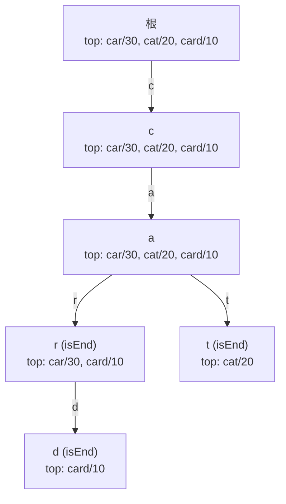

# Trie 自动补全

Elasticsearch 的 completion suggester（补全建议器）面对百万级键的词典，能在个位数微秒内回答一次 typeahead 查询；它既不扫描词典，也不在查询时排序，用的数据结构甚至新不到能拥有一个区别于它 1960 年祖先的维基百科词条。底座是 trie。诀窍在于生产版本在每个节点上做的事。

朴素 trie 能在与查询长度成正比的时间里回答*「`cat` 是一个词吗？」*和*「哪些词以 `ca` 开头？」*。这部分你从 [Tries](../part-6-trees-heaps/08-tries.md) 已经拿到了：每个节点持有一个子节点映射和一个 `is_end` 标志，前缀遍历就是 `len(prefix)` 次数组索引。它做不到的是排序。生产环境的自动补全在每一次按键时都要被问一句：*「在以 `ca` 开头的词里，给我最热门的三个，同分按字典序，一毫秒之内。」* 朴素的答案是扫描以该前缀节点为根的子树，收集所有补全项，按热度排序，返回开头几个。前缀是 `i` 时，那棵子树就是词典里所有以 i 开头的部分；用户还没敲完下一个字母，延迟就已经爆了。[^1]

修法是对 trie 节点做一处结构改动：每个节点携带自己的一份预排序列表，收录经过它的 top-K 词。查询变成先走再读；工作量挪到插入时，而插入天然可摊还，因为按键次数远远多于提交次数。LeetCode 642 *Design Search Autocomplete System* 把 K 硬编码为 3，并用 `'#'` 作查询结束哨兵；其余契约与 Elasticsearch 出厂的形态一个形状。[^2] 本章讲这个结构，以及支撑它的两个操作。

## 节点里改了什么

[Tries](../part-6-trees-heaps/08-tries.md) 里的 trie 每个节点有三个字段：一个子节点映射、一个 `is_end` 布尔值，别无他物。自动补全的扩展加了第四个：一个名为 `top` 的列表，按分数降序、同分按词升序排列，长度封顶在常量 `K_CAP`。三个小决定，每一个都承重。

子节点映射从 26 元素数组改成以字符为键的哈希映射。生产环境的自动补全要见到 Unicode、空格、撇号、数字；一旦词典里出现 `i love you`（LC 642 的示例）或 *café*，R 路数组那套「字母表有界」的假设立刻崩掉。哈希映射节点的代价是 `O(R_v)`，其中 `R_v` 是该节点上实际出现的字母表，通常是个很小的常数。[^5]

上限 `K_CAP` 存在，是因为否则每节点的列表会无限膨胀。生产部署一次性定下 `K_CAP`，取任何调用方可能问到的最大 top-K，这笔账很便宜。`K_CAP = 10` 时，每节点开销是十个 `(score, word)` 元组加上字符串存储，通常 80 到 200 字节，往往还被子节点映射比下去。

排序顺序是本章最脆弱的不变量：**分数降序，同分按词升序**。LC 642 的规范写得很明确：两个句子热度相同时，ASCII 序更小的那个胜出。[^2] 把顺序反过来，或者省掉同分规则，标准测试就会在输入 `["i love you", "island", "i love leetcode", "ironman"]`、热度 `[5, 3, 2, 2]` 上失败：前缀 `i` 应返回 `["i love you", "island", "i love leetcode"]`，因为 `" "`（ASCII 32）排在 `"r"`（ASCII 114）之前，而同分规则写错会把 `i love leetcode` 换成 `ironman`。



*三次 `input("car", 30)`、`input("cat", 20)`、`input("card", 10)` 之后的 trie。每个节点携带经过它的 top-K 词；`topk("ca", 2)` 直接读 `n_ca.top[:2]`，不用向下遍历。*

维护和消费这个结构的两个操作是 `input` 和 `topk`。它们都很短，互为镜像，而它们就是本章。

## 两个操作

### input(word, freq)

`input` 沿词的字符指定的路径往下走，路径断在哪里就在哪里分配节点，并在沿途每个节点上刷新 `top` 列表。刷新是相对朴素 trie 插入唯一新增的一步。其余部分——建节点、在终止节点翻转 `is_end`、向下走——都直接来自 [Tries](../part-6-trees-heaps/08-tries.md)。

刷新有一个不易察觉的要求。如果这个词本来就在词典里、只是分数不同，旧的 `(old_score, word)` 条目必须先移出缓存，新的才能进去。省掉这步，缓存里就会留着同一个词的两条记录，`topk` 开始返回重复项。§2 的参考实现在 `_insert_top` 的第一个循环里做去重。

```python
class TrieNode:
    __slots__ = ("children", "is_end", "top")
    def __init__(self):
        self.children = {}
        self.is_end = False
        self.top = []                        # 分数降序、词升序，上限 K_CAP


K_CAP = 10


def _insert_top(top, score, word):
    for i, (_s, w) in enumerate(top):        # 先移除这个词的旧条目
        if w == word:
            top.pop(i)
            break
    placed = False
    for i, (s, w) in enumerate(top):         # 插到有序位置
        if score > s or (score == s and word < w):
            top.insert(i, (score, word))
            placed = True
            break
    if not placed:
        top.append((score, word))
    if len(top) > K_CAP:                     # 超出上限则淘汰末尾
        top.pop()


class AutocompleteTrie:
    def __init__(self):
        self.root = TrieNode()

    def input(self, word, freq):
        node = self.root
        _insert_top(node.top, freq, word)    # 根节点的缓存给出全局 top
        for ch in word:
            if ch not in node.children:
                node.children[ch] = TrieNode()
            node = node.children[ch]
            _insert_top(node.top, freq, word)
        node.is_end = True

    def topk(self, prefix, k):
        if k <= 0:
            return []
        node = self.root
        for ch in prefix:
            if ch not in node.children:
                return []
            node = node.children[ch]
        return [w for (_s, w) in node.top[:k]]
```

**实现** — Python（[Java](./04-trie-autocomplete/lc-642/sol.java) · [C++](./04-trie-autocomplete/lc-642/sol.cpp) · [Go](./04-trie-autocomplete/lc-642/sol.go)）

```python
# LC 642. Design Search Autocomplete System (Premium)
# 频率扩展的 trie。每个节点缓存经过它的 top-K 词（分数降序、词升序），
# 即经过该节点的全部词；`input(word, freq)` 沿插入路径刷新每个节点的缓存；
# `topk(prefix, k)` 走到前缀节点，直接读缓存。
# 每次插入 O(L * K)；每次查询 O(L + k)。
# 同一份代码也能回答 LC 1268 的免费契约，
# 靠读字典序最小的 top-3 词（把 freq 设为 -ord 串即得字典序）。
from typing import Dict, List, Tuple


class TrieNode:
    __slots__ = ("children", "is_end", "top")

    def __init__(self) -> None:
        self.children: Dict[str, "TrieNode"] = {}
        self.is_end: bool = False
        # Sorted DESC by score, ties ASC by word; capped at K_CAP.
        self.top: List[Tuple[int, str]] = []


K_CAP = 10  # 每节点上限；查询时支持任何 k <= K_CAP


def _insert_top(top: List[Tuple[int, str]], score: int, word: str) -> None:
    for i, (_s, w) in enumerate(top):
        if w == word:
            top.pop(i)
            break
    placed = False
    for i, (s, w) in enumerate(top):
        if score > s or (score == s and word < w):
            top.insert(i, (score, word))
            placed = True
            break
    if not placed:
        top.append((score, word))
    if len(top) > K_CAP:
        top.pop()


class AutocompleteTrie:
    def __init__(self) -> None:
        self.root = TrieNode()
        self.scores: Dict[str, int] = {}

    def input(self, word: str, freq: int) -> None:
        """Insert or refresh `word` with score `freq`. New freq REPLACES prior."""
        self.scores[word] = freq
        node = self.root
        _insert_top(node.top, freq, word)
        for ch in word:
            if ch not in node.children:
                node.children[ch] = TrieNode()
            node = node.children[ch]
            _insert_top(node.top, freq, word)
        node.is_end = True

    def topk(self, prefix: str, k: int) -> List[str]:
        if k <= 0:
            return []
        node = self.root
        for ch in prefix:
            if ch not in node.children:
                return []
            node = node.children[ch]
        return [w for (_s, w) in node.top[:k]]
```

`input` 内部的处理顺序有三处值得点出来。根节点的缓存是**第一个**刷新的，在任何下探之前——这就是 `topk("", k)`（空前缀、全局 top-K）不用特判也正确的原因。刷新发生在下探到每个子节点**之后**，所以每个节点上的缓存概括的是以该节点结尾的前缀。而 `is_end` 的翻转移在**最后**，只发生在终止节点上；它与该节点有没有子节点无关，这一点 trie 那章讲过，自动补全的扩展原样继承。[^4]

组件在三次提交上演示完整的 `input` 流程，然后是配套的 `topk`。看 `n_ca` 上的缓存随三次插入完成，如何从 `[(30, car)]` 涨到 `[(30, car), (20, cat)]`，再到 `[(30, car), (20, cat), (10, card)]`：

> **Interactive widget:** [Trie — 插入 + 前缀遍历 + 频率自动补全](../../../dsa/widgets/w-20-trie.yml) (panel `panel-b`) — 在网站上渲染；YAML 规范描述了各个关键帧。

*静态兜底：trie 从空开始。插入 (car, 30) 建出链 root → c → a → r，并刷新路径上每个节点的缓存为 `[(30, car)]`；插入 (cat, 20) 复用 c 和 a，新建 t 分支，把 c 缓存和 a 缓存更新为 `[(30, car), (20, cat)]`；插入 (card, 10) 复用 c、a、r，给 r 加一个 d 子节点，n_ca 上的缓存变成 `[(30, car), (20, cat), (10, card)]`。最后 `topk("ca", 2)` 走两条边到 n_ca，返回 `n_ca.top[:2] = ["car", "cat"]`。没有 DFS，没有堆。*

### topk(prefix, k)

`topk` 是简单的那一半。走前缀；任一字符没有子节点就返回空；否则读前缀终止节点上的缓存，切出请求的 K。整个函数就是两个短循环加一个 return。

代价是 `O(L + k)`，`L` 是前缀长度，正好是朴素 trie 的 `startsWith` 达到的界，只多出末尾一次 `O(k)` 切片。缓存让整个排序子树在查询时隐形。没有缓存，同样的答案要对前缀子树做一次 DFS，维护一个大小为 K 的最小堆；代价是 `O(L + S log K)`，`S` 是前缀子树的规模，在生产里轻易就是 10⁴ 到 10⁶。边走边堆是对的，LC 642 官方题解就把它放在最前面，因为它读起来干净。这也正是朴素自动补全上线后、在单字母前缀上把延迟 SLO 打穿的原因。[^2]

组件的最后一步演示读侧的机制：走位停在 `n_ca`，答案已经在那里。

## 开销

| 操作 | 时间 | 空间（额外） |
|---|---|---|
| 对长度为 L 的词做 `input(word, freq)` | `O(L * K)` | 最坏情况新分配 `O(L)` 个节点 |
| 前缀长度 L、请求 k ≤ K 的 `topk(prefix, k)` | `O(L + k)` | 返回列表占 `O(k)` |
| 建树（n 个词，字符总数 m） | `O(m * K)` | `O(m + n_nodes * K)` |
| 以新分数刷新已存在的词 | `O(L * K)` | `O(0)` |

`O(L * K)` 的插入代价是把工作挪出读路径所付的钱。`K = 10`、最长生产句子 `L = 30` 时，每次提交大约付出 300 次缓存更新。每秒百万次插入的写密集词典会硬撞这堵墙；而按键比提交多 50 倍的 typeahead 系统，第一次读就把成本赚回来，其余白拿。这个权衡在生产搜索里是通用的：把工作摊到插入上，让读变便宜。[^1]

空间代价是真实的。每个节点都带一个最多 `K` 条 `(score, word)` 的列表外加字符串存储；`K = 10`、词典百万词时，缓存通常主导每节点的内存。这个量级的生产部署不再用朴素 trie，改用有限状态转换器（finite-state transducer，FST），也就是 Lucene 的 completion suggester 在建索引时把 trie 编译成的结构。FST 同时共享前缀**和**后缀，把结构压缩 5 到 10 倍。[^1] 代价是 FST 在两次段合并之间只读；本章讲的纯内存 trie 才是键数在几百万以内、需要增量更新的词典的正解。

要做补全项的有序遍历或通配匹配，另一个底座是 Bentley 和 Sedgewick 1997 年提出的三叉搜索树（ternary search tree）。[^3] TST 把子节点映射换成每节点三个指针（小于、等于、大于），下探是 `O(L log R)` 而不是 `O(L)`，内存是 `O(m)` 而不是数组变体的 `O(m * R)`。它的 `keysWithPrefix` 天生就做自动补全，`keysThatMatch` 处理通配。就本章教的频率扩展场景而言，TST 输给哈希映射 trie，因为每节点缓存这套模式在三个子节点上维护起来很别扭；但要做无权的前缀遍历，它是更干净的结构。

## 模式失效的场景

### 写密集词典：读时边走边堆

读占主导时，每节点缓存是稳赢。写占主导时——突发写入的词典或高频变动的语料——`O(L * K)` 的插入成本不再自我偿付，朴素 trie 的 `O(L)` 插入加上读时 `O(L + S log K)` 查询在总量上反而更优。查询实现是从前缀节点做一次 DFS，维护一个大小为 K、按 `(score, word)` 和本章同分比较器排序的最小堆；LC 642 题解的第一种做法就是教科书参考。[^2] 当多数被提交的词根本不会被查询，或者词典变化速度快过它被查询的速度时，选这个变体。

### 带拼写纠正的建议

生产环境的自动补全要容忍一个字符的错字。走位可以自然扩展：从前缀节点做一次带预算的 DFS，每一步要么沿匹配的子节点走（不消耗编辑预算），要么分叉到任意不匹配的子节点（消耗一次编辑）。当走位在预算还有剩余时到达一个 `is_end` 节点，就收获该节点的缓存而不是单个词，于是单编辑预算下的纠错查询以 `O(L² R K)` 作答。前缀短的时候这完全够用，而查询最初几次按键的前缀总是很短。这种「带编辑预算的 trie DFS」形状正是 LC 676 *Implement Magic Dictionary* 要的，只是缩到了单词答案。

### 前缀-后缀联合查询

当查询是*「以 `ap` 开头且以 `le` 结尾的词」*时，每节点的 top-K 缓存泛化成每节点的最大索引缓存。把每个 `(suffix, '#', word)` 轮转串都插进 trie，一棵树就能以 `O(P + S)` 回答 `(prefix, suffix)` 查询，P 和 S 是查询的前缀与后缀长度。每个节点携带经过它的最大词索引；答案直接读缓存。LC 745 *Prefix and Suffix Search* 是标准实例，而这里的每节点缓存就是本章的模式取 `K = 1`。

## 三个最容易踩的坑

> [!WARNING]
> **重新插入一个词却没给缓存去重。** 在 `input("cat", 20)` 之后调用 `input("cat", 100)`，应当覆盖分数，而不是再加一条缓存记录。`_insert_top` 的参考实现在插入新的 `(score, word)` 之前，先按词的身份扫一遍找旧条目；省掉这个去重循环，`topk` 就会把「cat」返回两次。这个 bug 在分数变化之前完全隐形，然后词典里同一个词突然有了两个名次。

> [!WARNING]
> **同分规则写错会静默弄坏 LC 642。** 比较器从头到尾是 `(分数降序, 词升序)`。只按分数建最大堆，或者用 `heapq.nlargest(k, items, key=lambda x: -x.score)` 接受 Python 那种稳定但未规定的同分行为，都会在标准用例 `["i love you", "island", "iroman", "i love leetcode"]`、权重 `[5, 3, 2, 2]` 上失败。前缀 `i` 的期望输出是 `["i love you", "island", "i love leetcode"]`。同分规则错就会换成 `iroman`。§2 的参考实现把比较器写成 `if score > s or (score == s and word < w):`，两个半句都不能少。[^2]

> [!WARNING]
> **`K_CAP` 只按标准用例定，忘了管理端点。** typeahead 服务上线时 `K_CAP = 3`，因为 UI 只显示三条建议。两个月后，一个调试端点要 top-20，trie 只返回 3 条，后面什么都没有。`K_CAP` 要按任何调用方可能请求的最大 K 来定；每节点内存是 `O(K)` 个词加它们的字符串，所以 `K_CAP = 50` 顶多多出几 KB。Elasticsearch 的 completion suggester 在建索引时守的是同一条纪律：每段的 `max_input_length` 制约着查询时的 `size`。[^1]

第四个坑值得一句话：**`is_end` 不等于「这个节点是叶子」。** 一个节点可以既是 `is_end` 又有子节点，就像 `n_car` 对 `car` 是 `is_end`，同时也带着 `card` 的 `d` 子节点。trie 那章讲这一点，自动补全的扩展继承它，而 bug 会在缓存逻辑叠在不够扎实的 trie 认知之上时冒出来。如果 topk 查询「丢了」兄弟补全项，回去重读 [Tries](../part-6-trees-heaps/08-tries.md) 的 §7。

## 题目梯度

### 核心（全做才算掌握本章）

- [LC 1023 — Camelcase Matching](https://leetcode.com/problems/camelcase-matching/) [中等] • trie-conditional-walk-with-skip *(参考：仅 Python)*
- [LC 676 — Implement Magic Dictionary](https://leetcode.com/problems/implement-magic-dictionary/) [中等] • trie-fuzzy-deviation-dfs ★ *(参考：仅 Python)*
- [LC 745 — Prefix and Suffix Search](https://leetcode.com/problems/prefix-and-suffix-search/) [困难] • trie-dual-key-prefix-suffix *(参考：仅 Python)*

### 进阶（可选）

- [LC 720 — Longest Word in Dictionary](https://leetcode.com/problems/longest-word-in-dictionary/) [简单] • trie-build-incremental-bfs
- [LC 642 — Design Search Autocomplete System](https://leetcode.com/problems/design-search-autocomplete-system/) [困难] • trie-with-frequency-topk-cache *(LeetCode Premium；`04-trie-autocomplete/lc-642/sol.{py,java,cpp,go}` 里的 AutocompleteTrie 参考实现逐字满足这个契约。免费的替代是 [LC 1268 — Search Suggestions System](https://leetcode.com/problems/search-suggestions-system/)，由 [Tries](../part-6-trees-heaps/08-tries.md) 作为 STRETCH 收录；把本章的每节点频率缓存叠上去，就能还原 LC 642 的契约。)*

LC 745 是 PRIMARY 锁给 [Aho-Corasick string matching](../part-12-strings-pattern-matching/04-aho-corasick.md) 的，那章用它讲双向多键索引。它在这里拿到一个核心席位，因为它建的每节点最大索引缓存，结构上就是本章每节点 top-K 缓存取 `K = 1`。

## 后续衔接

自然的下一步是 [Twitter feed（内存时间线设计）](./05-twitter-feed.md)，它把同一套「急切摊还」模式——插入时物化出 top-K 答案，查询时便宜地读出来——抬到每用户 feed 缓存上。再往后，[Aho-Corasick string matching](../part-12-strings-pattern-matching/04-aho-corasick.md) 讲的是 trie 的子节点映射加上失败链接标注之后会变成什么：一台能在流式输入上线性时间匹配所有词典模式的自动机。你刚读的这一章是结构与底座之间的生产化那一步；两个后续章节把它往相反的两个方向延伸。

## 参考文献

[^1]: Adrien Grand 与 Elastic 团队，"You Complete Me"，Elastic.co，讲 completion suggester 的有限状态转换器底座、微秒级前缀查找，以及 FST 相对朴素 trie 的 5-10 倍压缩。 <https://www.elastic.co/blog/you-complete-me>。

[^2]: leetcode.ca，"642 - Design Search Autocomplete System"，发布于 2017-09-02。 <https://leetcode.ca/2017-09-02-642-Design-Search-Autocomplete-System/>。

[^3]: Jon Bentley 与 Robert Sedgewick，"Fast Algorithms for Sorting and Searching Strings"，*Proc. 8th Annual ACM-SIAM Symposium on Discrete Algorithms*（SODA 1997），pp. 360-369。 <http://www.cs.princeton.edu/~rs/strings/paper.pdf>。

[^4]: Wikipedia contributors，"Trie"，最后编辑于 2026 年 3 月 27 日，<https://en.wikipedia.org/wiki/Trie>。

[^5]: cp-algorithms.com，"Aho-Corasick algorithm"，最后更新于 2025-04-18，<https://cp-algorithms.com/string/aho_corasick.html>。
