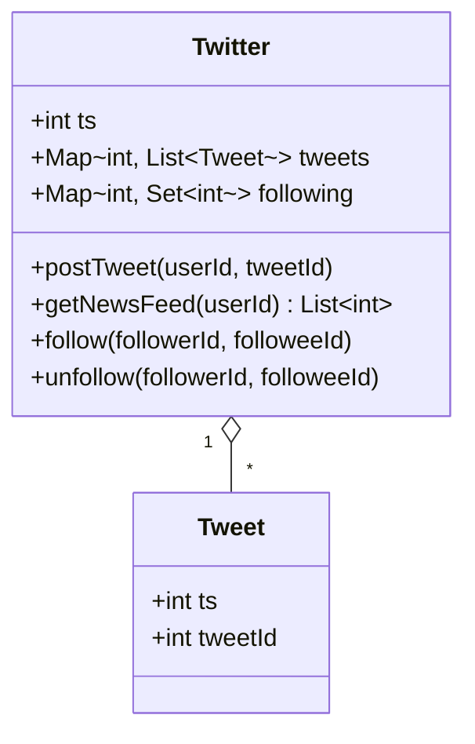
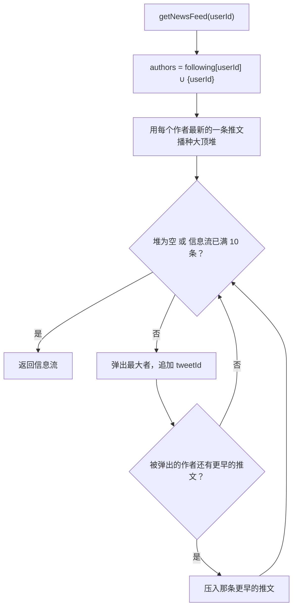
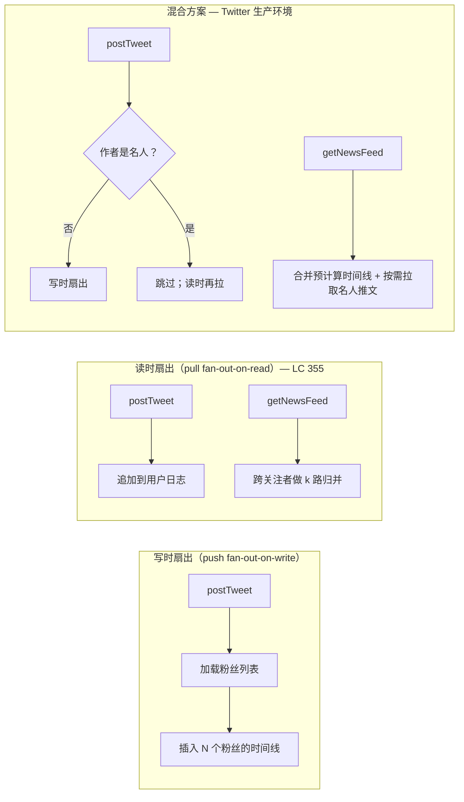

# Twitter 信息流设计

2013 年 Raffi Krikorian 做那场架构演讲时，Twitter 每秒有 6,000 次写、300,000 次读。这 50:1 的比例是挑选时间线策略时唯一要紧的数字。每次请求都从零做读侧归并，读层会被烧穿；写时给每个粉丝预计算时间线，对 Lady Gaga 这类账号（2013 年 3100 万粉丝，一条推文就是 3100 万次 Redis 插入）会把写层烧穿。生产环境的答案是混合方案：按名人阈值把负载拆开。LC 355 的答案就是这套混合方案的*读侧归并内核*，把它提升到一个类的边界内，剥掉生产规模，剩下纯粹的算法。

四个方法的契约是固定的：`postTweet`、`follow`、`unfollow`、`getNewsFeed`。其中三个只是哈希表上的一行操作，第四个才是这一章。`getNewsFeed(u)` 返回 `u` 本人以及 `u` 关注的每个人最近十条推文，最新的排在最前；本质上是对 `|followees| + 1` 条按时间有序的链表做 k 路归并，并给输出大小设了硬上限。形态和 [LC 23 Merge k Sorted Lists](https://leetcode.com/problems/merge-k-sorted-lists/) 一样，归并本身我们已经在[堆与优先队列](../part-6-trees-heaps/04-heaps-priority-queues.md)里讲过了。这里新增的是三件事：把这套归并包进一个带状态的类；让时间戳单调递增，顺序因此没有歧义；以及看清信息流上限 10 把这个复杂度量级从 `O(n log k)` 压成 `O(k log k)`，无论总共存在多少条推文。

## 四个方法，用大白话说

用户能做四件事。发推文，这条推文进他自己的日志。关注另一个用户，对方进他的关注集合。取消关注，把对方移出集合。以及请求自己的信息流，返回自己和自己关注的每个人最近十条推文，最新的在前。[^2]

三份状态覆盖全部四个操作：每个用户的推文列表、每个用户的关注集合，以及一个每次发帖都自增的全局计数器。

| 字段 | 类型 | 用途 |
|---|---|---|
| `ts` | int | 全局单调计数器，每次 `postTweet` 自增 |
| `tweets[user]` | 只追加的 `(ts, tweetId)` 列表 | 每个用户的推文日志，天然按时间有序 |
| `following[user]` | 用户 ID 的哈希集合 | `user` 直接关注的人（不含 `user` 自己） |

全局计数器是跨用户排序没有歧义的原因。真实的 Twitter 用 Snowflake ID，把 41 位毫秒时间戳编进 ID 里；LC 的评测框架只给一个整数，每次调用自增一次，同样的思路，只是去掉了墙上时钟。[^1] 两个不同用户、两次不同 `postTweet` 调用产生的推文会拿到互不相同且可比较的 `ts`，于是“最新在前”在整个类里只有一个定义。



*每个实例持有一份按用户划分的推文日志（只追加）和一份按用户划分的关注集合；`ts` 是给所有用户的推文排序的单调全局计数器。*

## postTweet、follow、unfollow

四个方法里有三个只是哈希表更新，一段话就够。

`postTweet(userId, tweetId)` 先自增全局时间戳，再把 `(ts, tweetId)` 追加到该用户的日志。按我们在[哈希表与哈希集合](../part-1-linear-data-structures/03-hash-maps.md)里证过的动态数组论证，这次追加摊还 `O(1)`；日志天然按时间有序，因为每条新记录的 `ts` 都严格大于此前所有记录。`follow(followerId, followeeId)` 先短路自关注的情况（用户关注自己是个空操作，他自己的推文本来就通过另一条路径进入信息流），其余情况把 `followeeId` 插入关注者的集合。`unfollow(followerId, followeeId)` 调用集合的丢弃原语（Python 的 `set.discard`、Java 的 `Set.remove`、C++ 的 `unordered_set::erase`、Go 的 `delete`）；四者在键不存在时都不报错，正合 LC 的契约——取消关注一个你没关注的人不算错误。[^2] 按 CLRS 定理 11.1 的链式哈希表界，三个操作的期望复杂度都是 `O(1)`。[^3]

这一章真正要讲的内容从第四个方法开始。

## getNewsFeed：k 路归并

直觉的读法是错的读法。“返回该用户及其关注的每个人最近十条推文”听起来像*把所有推文收集起来，按时间戳排序，取前十条*。这么做能对，但绝大部分工作都白做。

```python
# 错误的直觉：O(N log N)，N = 所有关注者的推文总数
def get_news_feed_wrong(self, userId):
    authors = self.following[userId] | {userId}
    all_tweets = []
    for a in authors:
        all_tweets.extend(self.tweets[a])
    all_tweets.sort(key=lambda t: -t[0])
    return [tid for _, tid in all_tweets[:10]]
```

这里有两个问题。第一，排序做的工作远超答案所需。我们要十条，排序却把全部 `N` 条排成完整序列，然后扔掉 `N - 10` 条。第二，`N` 没有上界：一个用户关注 1,000 人、每人发过 1,000 条，每次拉信息流就要对一百万条推文排序。正确的形态是**带提前终止的部分归并**。

这一步归约是本章最硬的洞察：每个关注者的推文日志*已经排好序*，从尾巴读就是时间戳降序。所以 `getNewsFeed` 不是“跨关注者排序”，而是“跨关注者归并，取到十条就停”。这就是 [LC 23 Merge k Sorted Lists](https://leetcode.com/problems/merge-k-sorted-lists/)，只改两处：链表从尾部而不是头部读；归并在输出十条时停下，而不是跑到耗尽。

用大顶堆做 k 路归并是标准解法。播种时每个作者一条（每个关注者最新的推文，加上用户自己最新的那条），然后弹出十次，每次弹出后把该作者的次新推文压回堆里，再做下一次弹出。堆大小永远不超过 `k = |followees| + 1`，因为每次弹出最多配一次同一作者的压入。[^4]

```python
def getNewsFeed(self, userId):
    authors = self.following[userId] | {userId}
    heap = []                                        # 以 ts 为准的大顶堆（标准库只有小顶堆，故取负）
    for a in authors:                                # 播种：每个作者一条
        tw = self.tweets.get(a)
        if not tw:
            continue
        idx = len(tw) - 1
        ts, tid = tw[idx]
        heapq.heappush(heap, (-ts, tid, a, idx))

    feed = []
    while heap and len(feed) < self.FEED_CAP:
        _, tid, a, idx = heapq.heappop(heap)
        feed.append(tid)
        if idx > 0:                                  # 把“这个”作者的游标往前挪一条更早的推文
            nts, ntid = self.tweets[a][idx - 1]
            heapq.heappush(heap, (-nts, ntid, a, idx - 1))
    return feed
```

**解法** — Python（[Java](./05-twitter-feed/lc-355/sol.java) · [C++](./05-twitter-feed/lc-355/sol.cpp) · [Go](./05-twitter-feed/lc-355/sol.go)）

```python
# LC 355. Design Twitter
# 内存中的类，四个操作。真正有含量的工作在 getNewsFeed：
# 它把每个作者的推文日志通过大顶堆做 k 路归并，
# 堆的排序键是单调时间戳。堆大小由作者数量决定，
# 而不是推文总数，因为每个作者同一时刻只贡献一条。
# 每次调用 O(k log k)，k = |followees| + 1；其余操作 O(1)。
import heapq
from collections import defaultdict
from typing import Dict, List, Set, Tuple


class Twitter:
    """In-memory Twitter timeline supporting post/follow/unfollow/news-feed."""

    FEED_CAP = 10

    def __init__(self) -> None:
        self.tweets: Dict[int, List[Tuple[int, int]]] = defaultdict(list)
        self.following: Dict[int, Set[int]] = defaultdict(set)
        self.ts: int = 0

    def postTweet(self, userId: int, tweetId: int) -> None:
        self.ts += 1
        self.tweets[userId].append((self.ts, tweetId))

    def getNewsFeed(self, userId: int) -> List[int]:
        authors = self.following[userId] | {userId}
        # heapq 只有小顶堆；给 ts 取负来模拟大顶堆。
        heap: List[Tuple[int, int, int, int]] = []
        for a in authors:
            tw = self.tweets.get(a)
            if not tw:
                continue
            idx = len(tw) - 1
            ts, tid = tw[idx]
            heapq.heappush(heap, (-ts, tid, a, idx))

        feed: List[int] = []
        while heap and len(feed) < self.FEED_CAP:
            _, tid, a, idx = heapq.heappop(heap)
            feed.append(tid)
            if idx > 0:
                next_idx = idx - 1
                nts, ntid = self.tweets[a][next_idx]
                heapq.heappush(heap, (-nts, ntid, a, next_idx))
        return feed

    def follow(self, followerId: int, followeeId: int) -> None:
        if followerId == followeeId:
            return
        self.following[followerId].add(followeeId)

    def unfollow(self, followerId: int, followeeId: int) -> None:
        self.following[followerId].discard(followeeId)
```

四种语言的实现差异，正是[堆与优先队列](../part-6-trees-heaps/04-heaps-priority-queues.md)给我们预备好的场面。Python 的 `heapq` 只有小顶堆，所以压入和弹出时都要给时间戳取负。C++ 的 `std::priority_queue` 默认大顶，元组按字典序比较，排头的 `ts` 字段自然决定顺序，不用写比较器。Java 的 `PriorityQueue<int[]>` 必须显式写 `Integer.compare(b[0], a[0])` 才能把小顶翻成大顶，而且每次压入都要新分配一个 `int[]`，因为改动一个仍在堆里的数组会悄悄破坏堆不变式。Go 的 `container/heap` 要求实现五个方法的 `heap.Interface`，`Less` 还得返回 `>` 而不是 `<`。同一个算法，四种语言的税。

### 为什么堆大小始终是 k

惰性压入这条不变式，是多数候选人会跳过、而算法恰恰依赖的部分。播种时每个作者只插入一条。主循环每一轮弹出一条，然后有条件地从同一作者压入一条（更早的那条，如果有）。每轮净变化：最多为零。所以整个调用期间堆大小始终以 `k` 为上界。[^4]

另一个诱人的做法是把每个关注者的每条推文都塞进堆里播种。正确性还在，但堆大小从 `O(k)` 变成 `O(N)`，每次压入弹出付的是 `log N` 而不是 `log k`。对一个关注 1,000 人、每人发过 1,000 条的用户来说，单次堆操作是 20 对 10，而光播种阶段就要做一百万次这样的操作。惰性播种才让算法在 `N` 上做到次线性。

### 标准输入的推演

换成一个小例子，算术就落地了。八次调用，最后一次是拉信息流：

```text
postTweet(1, 5)        # ts=1, tweets[1]=[(1,5)]
postTweet(1, 3)        # ts=2, tweets[1]=[(1,5),(2,3)]
follow(1, 2)
postTweet(2, 6)        # ts=3, tweets[2]=[(3,6)]
follow(1, 4)
postTweet(4, 9)        # ts=4, tweets[4]=[(4,9)]
postTweet(2, 7)        # ts=5, tweets[2]=[(3,6),(5,7)]
getNewsFeed(1)         # authors = {1, 2, 4}
```

| 步骤 | 动作 | 堆（按 ts 大顶） | 信息流 |
|---|---|---|---|
| 播种 | 压入 (ts=2, tid=3, a=1) | [(2,3,1)] | [] |
| 播种 | 压入 (ts=5, tid=7, a=2) | [(5,7,2),(2,3,1)] | [] |
| 播种 | 压入 (ts=4, tid=9, a=4) | [(5,7,2),(2,3,1),(4,9,4)] | [] |
| 弹出 | (5,7,2)；a=2 有更早的 → 压入 (3,6,2) | [(4,9,4),(2,3,1),(3,6,2)] | [7] |
| 弹出 | (4,9,4)；a=4 没有更早的 | [(3,6,2),(2,3,1)] | [7,9] |
| 弹出 | (3,6,2)；a=2 没有更早的 | [(2,3,1)] | [7,9,6] |
| 弹出 | (2,3,1)；a=1 有更早的 → 压入 (1,5,1) | [(1,5,1)] | [7,9,6,3] |
| 弹出 | (1,5,1)；a=1 没有更早的 | [] | [7,9,6,3,5] |

信息流里一共五条推文。输出 `[7, 9, 6, 3, 5]` 按 `ts` 降序排列：5、4、3、2、1。堆里的条目从未超过三条（每个作者一条），算法恰好访问五条 `postTweet` 记录，一条不多。



*每次弹出最多配一次同一作者的压入，整个调用期间堆大小因此以 `|authors|` 为上界。*

## 实际开销

`k = |followees(u)| + 1`，`F = 10`（LC 固定的信息流上限），`n` = 类生命周期内累计存储的推文总数。

| 操作 | 时间 | 空间（每次调用） | 生命周期空间 |
|---|---|---|---|
| `postTweet` | 摊还 `O(1)` | `O(1)` | 增加一条推文记录 |
| `follow` | 期望 `O(1)` | `O(1)` | 增加一条关注边 |
| `unfollow` | 期望 `O(1)` | `O(1)` | 删除一条关注边 |
| `getNewsFeed` | `O(k log k)` | `O(k)` 堆 + `O(F)` 信息流 | 不变 |
| 整个类 | 不适用 | 不适用 | `O(n)` 条推文 + `O(\|edges\|)` 条关注关系 |

两个复杂度结论各需要一行证明。

`getNewsFeed` 的界。播种扫过 `k` 个作者、各压入一条，代价 `O(k log k)`。主循环最多跑 `F = 10` 轮，每轮一次弹出加至多一次压入，堆里最多 `k` 项，所以都是 `O(log k)`。合计 `O(k log k + F log k)`，因为 `F` 是固定常数，化简为 `O(k log k)`。CLRS 定理 6.5 给出单次操作的 `O(log k)` 界，习题 6.5-9 给出完整 k 路归并 `O(n log k)` 的总代价。我们付同样的单次代价，但只做 `F` 次操作，而不是 `n` 次。[^4]

`postTweet` 的摊还分析。每次调用都往动态数组追加。溢出即翻倍的策略让多数追加只付 `O(1)`，偶发的翻倍事件付 `O(n)`；CLRS §17.4 把这份代价摊匀到每次调用。我们为哈希表插入做的那套论证可以原样搬过来。[^3]

## 常见误区

> [!WARNING]
> **每次拉信息流都排序再切片。** 错误的直觉是把每个关注者的日志平铺进一个列表，按时间戳降序排，取前十。正确性没问题，代价是 `O(N log N)`，`N` 是所有关注者的推文总数。对一个关注 1,000 人、每人发过 1,000 条的用户，每次拉信息流就是 2000 万次比较。同样输入下堆版本是 `O(k log k)`，约一万次操作。思路上的转变是：“我只要十条，不要完整的有序列表。”

> [!WARNING]
> **把每个关注者的每条推文都塞进堆里播种。** 一个正确但浪费的版本会在播种阶段把所有 `N` 条推文压进堆。堆大小膨胀到 `O(N)`，每次压入付 `log N` 而不是 `log k`。惰性压入不变式就是这个优化：每个作者播种一条，每次弹出时只压入*该作者*更早的那条。堆大小始终停在 `k`。[^4]

> [!WARNING]
> **忘了用户自己的推文。** 作者集合是 `following[userId] | {userId}`，不是 `following[userId]`。第一个症状是 `postTweet(1, 5); getNewsFeed(1)` 返回 `[]` 而不是 `[5]`。用户本身就是自己信息流的作者之一；当 LC 说明的其余部分都在讲关注者时，“来自该用户的推文”那句话很容易被跳过。[^2]

> [!WARNING]
> **改动一个已经在 Java `PriorityQueue` 里的 `int[]`。** Java 的堆存引用，不存副本。改动一个指针仍在堆里的 `int[]` 会悄悄破坏堆不变式：下沉比较可能在遍历中途读到新的字段值，从而挑错子节点。参考实现每次压入都新分配 `int[]`，正是这个原因。记住这句话：*弹出的是我的；压入要新分配。*

> [!WARNING]
> **长期运行的实例上 32 位时间戳溢出。** LC 的评测把操作数限制在远低于 2³¹ 的范围内，所以 `int ts` 对判题够用。放在跑了一年的生产系统里，`ts` 会回绕，排序不变式会反转。生产上的修法是 64 位时间戳（Java 的 `long`、C++ 的 `long long`、Go 的 `int64`；Python 整数是任意精度）；Twitter 真实的生产系统用 Snowflake ID，把 41 位毫秒时间戳打进 64 位字段。[^1]

## 规模化之后的样子

LC 355 是 Twitter 主页时间线服务的读侧归并内核，只是剥掉了规模。真实的生产架构并不是纯拉。

Krikorian 那场 2013 年的演讲把权衡摆开了。[^1] 纯拉（LC 355 的模型）让 `postTweet` 便宜、`getNewsFeed` 昂贵，因为每次读都要从零做 k 路归并。纯推，也叫写时扇出（fan-out-on-write），把权衡反过来。用户发帖时，系统遍历他的粉丝列表，把推文插进每个粉丝预计算好的主页时间线。读于是变成一次 Redis 范围扫描。代价是与粉丝数成正比的写放大，对多数用户没问题，对名人则是灾难。Lady Gaga 一条推文、3100 万粉丝，就是 3100 万次 Redis 插入。



*纯拉（LC 355）用便宜的写换昂贵的读；纯推用便宜的读换名人身上没有上界的写放大；混合方案按粉丝数阈值拆分负载，在读取时把两条路径合并。*

Twitter 实际交付的就是混合方案。非名人的推文在写时扇出到每个粉丝的 Redis 列表，每个列表上限 800 条。名人的推文跳过扇出，只留在作者自己的用户时间线列表里。任何用户的 `getNewsFeed` 都把预计算的主页时间线与按需读取的每个被关注名人的用户时间线合并，再按时间戳给合并结果排序，裁剪到请求的分页大小。阈值是个调参项，惯例在 100 万粉丝上下。[^1]

Yao Yue 2014 年的演讲补上了存储细节。Twitter 的 Timeline Service 跑的是改造过的 Redis，加了两种自定义数据类型：Hybrid List（由定长 ziplist 串成的链表）和自定义 BTree，容量设计要撑住约 6,000 个实例、每秒 3000 万次查询、约 40 TB 的堆内存分配。[^5] Hybrid List 的存在是因为原生 Redis 的 ziplist 每次插入都要做 `O(时间线长度)` 的 memmove，50 条时无所谓，800 条时就是灾难；把时间线切成有界的 ziplist 节点，memmove 就被限制在节点大小以内。

这些扩展工作没有一个改动 `getNewsFeed` 里的算法。读侧归并仍然是基于堆的、对时间戳有序列表做的 k 路归并，只是来源从 `k` 个变成两个（预计算时间线 + 名人拉取），堆也从进程内结构挪到 Redis 里的结构。LC 355 的算法是每次扩容都活下来的那个算法内核。

## 题目梯度

### 核心（全做才算掌握本章）

- [LC 355 — Design Twitter](https://leetcode.com/problems/design-twitter/) [中等] • k-way-merge-design ★
- [LC 1797 — Design Authentication Manager](https://leetcode.com/problems/design-authentication-manager/) [中等] • ttl-design
- [LC 1825 — Finding MK Average](https://leetcode.com/problems/finding-mk-average/) [困难] • sliding-window-with-trimmed-mean

### 进阶（可选）

- [LC 1603 — Design Parking System](https://leetcode.com/problems/design-parking-system/) [简单] • counter-design
- [LC 1622 — Fancy Sequence](https://leetcode.com/problems/fancy-sequence/) [困难] • lazy-evaluation-design *（LeetCode Premium）*

归并这一族里没有可以充当招牌简单题的题目。四个活动部件（构造函数状态、单调时间戳、关注集合、信息流归并）里去掉任何一个，题目要么退化成平凡的计数器，要么丢掉时间线归并的教学点。LC 1603 用邻近的设计模式填上简单题的位置：带状态的构造函数、一次计数校验、一个布尔返回。算法不同，类的形态纪律相同。

## 后续衔接

归并这个子过程在[堆与优先队列](../part-6-trees-heaps/04-heaps-priority-queues.md)里讲，那里有 LC 23 的完整推演，本章把它压缩成了一节。哈希表操作在[哈希表与哈希集合](../part-1-linear-data-structures/03-hash-maps.md)里讲，那里给了我们用来支撑 `follow` 与 `unfollow` 的 `O(1)` 界的链式哈希表证明。至于生产架构本身（扇出权衡、名人阈值、时间线服务的多地域复制），那是系统设计的话题，落在手册算法内核之外。

## 参考文献

[^1]: Todd Hoff（引用 Raffi Krikorian 的说法），"The Architecture Twitter Uses to Deal with 150M Active Users, 300K QPS, a 22 MB/S Firehose, and Send Tweets in Under 5 Seconds," High Scalability 博客，2013-07-08，[https://highscalability.com/the-architecture-twitter-uses-to-deal-with-150m-active-users/](https://highscalability.com/the-architecture-twitter-uses-to-deal-with-150m-active-users/)。

[^2]: LeetCode 355 Design Twitter，[https://leetcode.com/problems/design-twitter/](https://leetcode.com/problems/design-twitter/)。

[^3]: Cormen, Leiserson, Rivest, Stein，*Introduction to Algorithms*，第 4 版，MIT Press，2022。

[^4]: Cormen, Leiserson, Rivest, Stein，*Introduction to Algorithms*，第 4 版，MIT Press，2022。

[^5]: Todd Hoff（引用 Yao Yue 的说法），"How Twitter Uses Redis to Scale - 105TB RAM, 39MM QPS, 10,000+ Instances," High Scalability 博客，2014-09-08，[https://highscalability.com/how-twitter-uses-redis-to-scale-105tb-ram-39mm-qps-10000-ins/](https://highscalability.com/how-twitter-uses-redis-to-scale-105tb-ram-39mm-qps-10000-ins/)。
