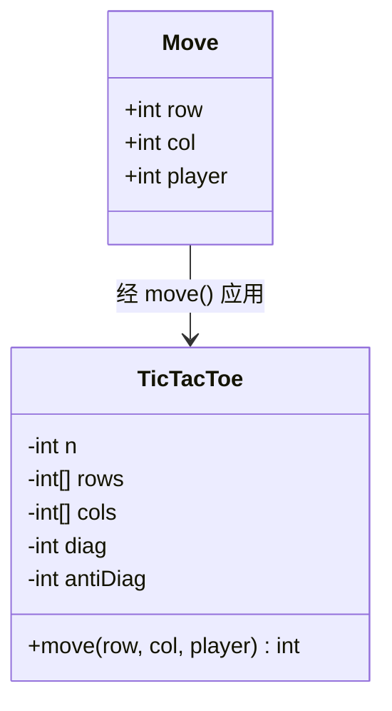
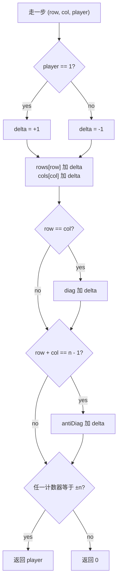

# 游戏状态设计

这道面试题是 *设计井字棋*（LeetCode 348）。几乎所有人的第一版写法都一样：维护一个 `n × n` 的棋盘记录落子，每步之后沿着刚落子的行、列和两条对角线走一遍找赢家。在 `n × n` 的格子上，这是每步 `O(n)`。正确的设计在同样的格子上做到每步 `O(1)`，总内存从 `O(n²)` 降到 `O(n)`。两个数字——单步开销和总内存——同时变好，而且没有任何地方需要让步。

换来这个双赢的技巧小到一行就能写完：不存棋盘，存*扫描棋盘时它会告诉你的东西*。维护四个计数器（每行一个、每列一个、主对角线一个、反对角线一个），落子到来时就地更新。棋盘从不真的被建出来。朴素设计在每步之后跑的那次扫描，被四次与 `±n` 的整数比较取代。本章讲的就是这四个计数器长什么样、为什么够用，以及同一个思路（别存状态，存谓词）在国际象棋引擎那个量级上怎么用。

## 这里的“设计”指什么

游戏状态设计题交给你两个操作，要你给出一套 API：

- 一个**变更操作**：某位玩家在 `(row, col)` 落子。
- 一个**谓词查询**：“这一步是不是刚赢了？”，每次变更之后都会触发。

朴素设计把棋盘建出来（最自然的心智模型），再靠扫描重新推导谓词。每个格子都存下来；每条被落子穿过的线上的每个格子都要读。对 100×100 的格子（LC 348 的上限约束），这是 10,000 个格子的内存，每步大约 400 次读取。[^1]

好的设计把*谓词的输入*建出来，而不是棋盘。对井字棋，谓词是“有没有哪条线上全是同一位玩家的 `n` 个标记？”这个谓词的输入就是按线聚合的计数。直接维护这些计数，格子永远不存。



*类里只有四个聚合计数器，没有二维棋盘；一次 `Move` 只更新那些线经过 `(row, col)` 的计数器。*

从“存棋盘、查询时扫描”转向“存查询的答案、写入时更新”，这一步就是全部关键。CLRS 把这套技巧叫*聚合分析*：在主数据旁边维护一小份派生状态，让每个操作均摊 `O(1)`。[^2] 同样的模式也出现在[哈希表与哈希集合](../part-1-linear-data-structures/03-hash-maps.md)里用于跟踪大小，出现在差分数组里用于区间更新的查询，也出现在最大尺度的国际象棋引擎位棋盘里。这道面试题是它们之中最小、也最有趣的那个实例。

## 四计数器算法

`n × n` 棋盘的状态是四样东西：

- `rows[i]`：第 `i` 行的计数器，取值范围 `[-n, n]`。
- `cols[j]`：第 `j` 列的计数器，取值范围 `[-n, n]`。
- `diag`：主对角线 `(0,0)..(n-1, n-1)` 的计数器。
- `antiDiag`：反对角线 `(0, n-1)..(n-1, 0)` 的计数器。

玩家 1 对每条经过落子格的线贡献 `+1`，玩家 2 贡献 `-1`。这个符号技巧把本来要八个计数器（每条线每位玩家一个）的局面压成四个；每个计数器的值等于 `(该线上玩家 1 的标记数) - (该线上玩家 2 的标记数)`，所以当且仅当玩家 1 独占该线时值为 `+n`，玩家 2 独占时为 `-n`。[^1]

```python
class TicTacToe:
    def __init__(self, n: int):
        self.n = n
        self.rows = [0] * n
        self.cols = [0] * n
        self.diag = 0
        self.anti_diag = 0

    def move(self, row: int, col: int, player: int) -> int:
        delta = 1 if player == 1 else -1
        self.rows[row] += delta
        self.cols[col] += delta
        if row == col:
            self.diag += delta
        if row + col == self.n - 1:
            self.anti_diag += delta

        target = self.n if player == 1 else -self.n
        if (self.rows[row] == target or self.cols[col] == target
                or self.diag == target or self.anti_diag == target):
            return player
        return 0
```

**解法** — Python ([Java](./06-game-state-design/lc-348/sol.java) · [C++](./06-game-state-design/lc-348/sol.cpp) · [Go](./06-game-state-design/lc-348/sol.go))

```python
# LC 348. Design Tic-Tac-Toe

class TicTacToe:
    def __init__(self, n: int):
        self.n = n
        self.rows = [0] * n
        self.cols = [0] * n
        self.diag = 0
        self.anti_diag = 0

    def move(self, row: int, col: int, player: int) -> int:
        """LC 348: place player's mark; return player if the move wins, else 0."""
        delta = 1 if player == 1 else -1
        self.rows[row] += delta
        self.cols[col] += delta
        if row == col:
            self.diag += delta
        if row + col == self.n - 1:
            self.anti_diag += delta

        target = self.n if player == 1 else -self.n
        if (self.rows[row] == target or self.cols[col] == target
                or self.diag == target or self.anti_diag == target):
            return player
        return 0
```

两个更新总会发生（`rows[row]` 和 `cols[col]`），对角线更新则视格子位置发生零次、一次或两次。角上的格子同属三条线。拿 `(0, 0)` 来说：因为 `0 == 0`，它在主对角线上；但除非 `n = 1`，它不在反对角线上。奇数尺寸棋盘的正中心是唯一同时落在四条线上的格子。其他格子都在两到三条线上。不管怎样，谓词检查都是四次常数时间比较。



*两次无条件的计数器更新，加上零到两次对角线更新；胜负检查只测四个计数器，从不碰任何格子。*

### 为什么一步棋只可能补全经过 `(row, col)` 的那条线

胜负检查只看四个计数器，其余一概不看。之所以允许这样，是几何原因：落在 `(row, col)` 的一步只可能补全*经过* `(row, col)` 的那条线。不包含该落子格的线在这一步没有变化，它们的计数器也就没变，因此不可能刚刚跨过 `±n` 的阈值。[^1]

在 `n × n` 的格子上，经过任一格子的线恰好四条：它所在的行、它所在的列、主对角线（当 `row == col`）、反对角线（当 `row + col == n - 1`）。算法检查的正是这四条，而这四条也正是这步棋唯一可能刚补全的线。这个检查既必要又充分。

这就是 CLRS §17.1 作为聚合分析展开的那套“每个操作 `O(1)`”的论证：只在主数据旁边维护刚好够用的派生状态，每次操作的查询就塌缩成常数时间。[^2] 它是设计范式，不只是井字棋的小把戏。

### 为什么 `+n` 是正确目标

长度为 `n` 的一行属于玩家 1，当且仅当其中每个格子都是玩家 1 的标记。每个玩家 1 标记记 `+1`、玩家 2 标记记 `-1`，行计数器的值就等于玩家 1 的数量减玩家 2 的数量。最大值是 `n`（全是玩家 1）。任何严格小于 `n` 的值都意味着至少有一个格子是空的或属于玩家 2，这一行就不归人。阈值 `+n` 恰好就是“这条线归谁”的谓词，一点余量都没有。

`-n` 与玩家 2 的对称论证按符号反过来即可。不存在阈值误判的边界情况：计数器每步只动 `±1`，只能从上一步的 `±(n-1)` 落到 `+n` 或 `-n`，而一步之内能走到，前提是该线上其他格子早已归同一玩家。

## 走一遍对局

一段短推演能让算法落地。取 `n = 3`，标准的井字棋棋盘。玩家 1 走 `(0, 0)`；玩家 2 走 `(1, 0)`；玩家 1 走 `(0, 1)`；玩家 2 走 `(1, 1)`；玩家 1 走 `(0, 2)`。

| 步 | 玩家 | 格子 | rows | cols | diag | antiDiag | 结果 |
|---|---|---|---|---|---|---|---|
| 1 | 1 | (0,0) | `[1, 0, 0]` | `[1, 0, 0]` | 1 | 0 | 0 |
| 2 | 2 | (1,0) | `[1, -1, 0]` | `[0, 0, 0]` | 1 | 0 | 0 |
| 3 | 1 | (0,1) | `[2, -1, 0]` | `[0, 1, 0]` | 1 | 0 | 0 |
| 4 | 2 | (1,1) | `[2, -2, 0]` | `[0, 0, 0]` | 0 | 0 | 0 |
| 5 | 1 | (0,2) | `[3, -2, 0]` | `[0, 0, 1]` | 0 | 1 | **1** |

第 5 步，`rows[0]` 到达 `+3 = +n`。玩家 1 独占第 0 行。函数返回 `1`。注意 `diag` 在第 4 步从 `1` 摆到 `0`（玩家 2 占了 `(1,1)`，它在主对角线上）；每条*可能*有用的线的计数器始终是活的值，算法不需要提前记住哪些线“值得关注”。

## 实际开销

| 变体 | 单步时间 | 空间 | 说明 |
|---|---|---|---|
| 每步之后朴素扫描 | `O(n)` | `O(n²)` 棋盘 | 每次重读最多 `4n` 个格子；最直观的实现。 |
| 计数器法 | **`O(1)`** | **`O(n)`** 计数器 | 两次数组写入，加上零到两次对角线写入；四次比较。 |
| 落子流回放（LC 1275） | 总计 `O(m)`、单步 `O(1)` | 带计数器 `O(n)` | 处理固定的 `m` 步列表，报告赢家 / 平局 / 未结束。[^3] |
| 状态合法性检查（LC 794） | 一次性 `O(n²)` | 额外 `O(1)` | 单次扫描棋盘校验奇偶不变量；非在线。[^4] |
| 位棋盘谓词（国际象棋） | 每次查询 `O(1)` | 每种棋子 `O(64-bit 字)` | 攻击掩码与王的位棋盘做按位与。[^6] |

重点是第二行。每步 `O(1)`、总内存 `O(n)`，这是教科书式的双赢，两个维度同时变好。对 `n = 100`（LC 348 的上限），计数器设计用 200 个 int，朴素设计要 10,000 个；计数器设计每步零次棋盘扫描，朴素设计每步四次。

表格最后一行的位棋盘是同一个思路在国际象棋 64 格棋盘上的版本。Crafty 的位棋盘架构在 Hyatt 1999 年的 *Rotated Bitmaps* 论文里被形式化，它把每种棋子的占据情况压进一个 64 位无符号整数。[^6] “王被攻击了吗？”变成预计算攻击掩码与王的位棋盘之间的一次按位与。形状一样：谓词的输入来自增量更新，每次查询的开销就塌缩成 `O(1)`，与棋盘大小无关。

## 井字棋之外的推广

### 用 Zobrist 哈希表示局面键

国际象棋引擎会通过不同的走子顺序到达同一个局面。同一个局面搜两遍就是浪费，所以引擎把评估结果记忆在*置换表*里，以局面哈希为键。哈希需要随着落子和撤销增量更新；每步从头重算就抵消了缓存的意义。

Zobrist 哈希在 1970 年解决了这个问题。[^5] 启动时给每个 `(棋子, 格子, 颜色)` 三元组分配一个随机 64 位串。局面的哈希是当前棋盘上所有棋子对应位串的异或，再异或上一个“轮到谁走”的位串。落子用两次异或更新哈希（从旧格子移除该棋子，加入新格子）；撤销时再做同样两次异或，因为异或自逆。[^5]

同一个模式：不存局面，存谓词的输入（哈希），并且局部更新它。

### 贪吃蛇：双端队列加成员集合

LC 353 *Design Snake Game* 要求在格子上移动一条蛇，吃到食物变长，撞到自己就死。蛇身天然是一个队列：头在前端，尾在后端，一步操作压入新头、弹出旧尾。但每步的谓词是“新头会不会撞到当前身上的某个格子？”，沿着队列走一遍检查是每步 `O(蛇长)`。

解法是在双端队列旁边维护一个记录被占据格子的哈希集合。压入新头：进队列，进集合。弹出旧尾：出队列，出集合。碰撞检查就是一次集合查找。每步 `O(1)`，与蛇长无关。[^7]

这题有个操作顺序上的细节：当新头落在旧尾即将腾出的那个格子上时，如果集合里还留着尾巴，碰撞检查会误报。先把尾巴从集合里删掉，再测新头，最后把头加进去。跟 LC 348 的四计数器算法是同一个模式：存的是*不变量*，不是字面上的格子。

## 常见误区

> [!WARNING]
> **每步之后重新扫棋盘。** 朴素的 `O(n²)` 解法在 3×3 棋盘上听着很合理（你能在脑子里跑完那次扫描）。到 LC 348 的上限 `n = 100`，一盘一千步的棋要做 4000 万次格子读取，而计数器算法只做几千次计数器写入。设计本身不随 `n` 变化；变的是单步开销，`n × n` 对 `1`。[^8]

> [!WARNING]
> **忘了反对角线的公式。** 主对角线上的格子满足 `row == col`，助记上很干净。反对角线上的格子满足 `row + col == n - 1`，比直觉猜的 `row + col == n` 差一。这个偏移会静默出错：反对角线上的胜利检测不到，棋局在合法的终点之后继续走。从角上推导公式：`(0, n-1)` 在反对角线上，而 `0 + (n-1) = n - 1`。记角上的检查，别记公式。[^8]

> [!WARNING]
> **对已占据的格子重复计数。** 本章的参考实现不检查落子边界，也不检查重复落子；LC 348 的题面保证两者都不会发生。[^1] 生产代码里，重复落子会静默破坏不变量：`rows[r]` 会被同一位玩家加两次，谓词 `rows[r] == n` 可能在 `n - 1` 个真实标记加一个重复的情况下被触发。防御性代码显式拒绝重复落子；本章的教学片段省掉这个检查，是为了让算法本身看得清楚。

> [!WARNING]
> **在国际象棋代码里混用位棋盘的格子约定。** 存在两套互相竞争的约定：Hyatt 的 Crafty 和 DARK THOUGHT 用 `a8 = bit 63, h1 = bit 0`；很多教学实现用 `a1 = bit 0`。半个代码库用一种、另半个用另一种，会产出毫无意义的走子生成和 FEN 解析。项目开始时选一套，写在头注释里，并把 `square_to_bit(sq)` 辅助函数集中到一处。[^6] 这条卫生规则适用于任何编码密集的游戏状态设计：约定只命名一次，然后在所有地方都用同一个。

## 题目梯度

### 核心（全做才算掌握本章）

- [LC 1275 — Find Winner on a Tic Tac Toe Game](https://leetcode.com/problems/find-winner-on-a-tic-tac-toe-game/) [简单] • game-state-incremental *（参考实现：仅 Python）*
- [LC 794 — Valid Tic-Tac-Toe State](https://leetcode.com/problems/valid-tic-tac-toe-state/) [中等] • game-state-invariants ★ *（参考实现：仅 Python）*
- [LC 750 — Number Of Corner Rectangles](https://leetcode.com/problems/number-of-corner-rectangles/) [中等] • game-board-enumeration *（参考实现：仅 Python）*

### 进阶（可选）

- [LC 348 — Design Tic-Tac-Toe](https://leetcode.com/problems/design-tic-tac-toe/) [中等] • game-state-incremental *（Premium；四语言完整代码见 [`lc-348/sol.py`](../../../dsa/part-13-design-the-data-structure/06-game-state-design/lc-348/sol.py)）*
- [LC 1496 — Path Crossing](https://leetcode.com/problems/path-crossing/) [简单] • board-state-hashing *（参考实现：仅 Python）*

> [!NOTE]
> **没有对应的 Hard。** 纯粹的博弈状态设计在公开题库里没有 Hard 题：这个模式的深度在国际象棋引擎的文献里（位棋盘、Zobrist），而不在 LC 的面试题集里。想在这个模式上找 Hard 的读者可以去啃国际象棋引擎方向的扩展（给半个棋盘写一个 Zobrist 键），或者做回溯类的 Hard 题 LC 51 *N-Queens* 和 LC 37 *Sudoku*，见[回溯模板](../part-7-recursion-backtracking/01-backtracking-template.md)，它们练的是带分支的棋盘状态。

## 后续衔接

最近的兄弟是 [LRU 缓存](./00-lru-cache.md)，用的是同一个“在主数据旁边维护一份派生视图”的模式（一条按最近使用排序的双向链表，配一个按键索引的哈希表）。当每步的谓词变成“这两个格子是不是在同一个连通区域里？”时，下一个该想到的模式是[并查集](../part-8-graphs/08-union-find.md)，它是井字棋之外棋盘状态问题的自然接续（LC 305 *Number of Islands II* 是标准实例）。§“井字棋之外的推广”里那个国际象棋引擎的推广，接的是基于回溯的博弈树搜索；AIMA 第 5 章是标准参考，Knuth 的 *Dancing Links* 是让这类搜索变快的那种数据结构的经典论述。

## 参考文献

[^1]: LeetCode 348, *Design Tic-Tac-Toe*（Premium）。题面与约束（`1 <= n <= 100`，"a move is guaranteed to be valid and is placed on an empty block"），镜像见 [leetcode.ca/2016-11-12-348-Design-Tic-Tac-Toe](https://leetcode.ca/2016-11-12-348-Design-Tic-Tac-Toe/)。

[^2]: Cormen, Leiserson, Rivest, Stein, *Introduction to Algorithms*, 4th ed., MIT Press, 2022, §17.1 *Aggregate analysis*。

[^3]: LeetCode 1275, *Find Winner on a Tic Tac Toe Game*。处理一个固定的 `moves` 数组，报告 `A` / `B` / `Draw` / `Pending`。[leetcode.com/problems/find-winner-on-a-tic-tac-toe-game](https://leetcode.com/problems/find-winner-on-a-tic-tac-toe-game/)。

[^4]: LeetCode 794, *Valid Tic-Tac-Toe State*。[leetcode.com/problems/valid-tic-tac-toe-state](https://leetcode.com/problems/valid-tic-tac-toe-state/)。

[^5]: Albert L. 引入 Zobrist 哈希的原始论文；PDF 见 [cs.wisc.edu/techreports/1970/TR88.pdf](https://www.cs.wisc.edu/techreports/1970/TR88.pdf)。

[^6]: Robert Hyatt, *Rotated Bitmaps, a New Twist on an Old Idea*, ICCA Journal Vol. 22 No. 4, 1999。另见 Chessprogramming wiki 的 [*Bitboards*](https://www.chessprogramming.org/Bitboards)

[^7]: walkccc.me 上题目 353 *Design Snake Game* 的 LeetCode 参考，含“双端队列做蛇身 + 哈希集合查碰撞”的 C++ / Java / Python 标准解法。[walkccc.me/LeetCode/problems/353](https://walkccc.me/LeetCode/problems/353/)。

[^8]: walkccc.me 上题目 348 *Design Tic-Tac-Toe* 的 LeetCode 参考，含标准四计数器解法、明确的 `O(1)` 时间 / `O(n)` 空间复杂度说明，以及经过验证的 C++ / Java / Python 实现。[walkccc.me/LeetCode/problems/348](https://walkccc.me/LeetCode/problems/348/)。
