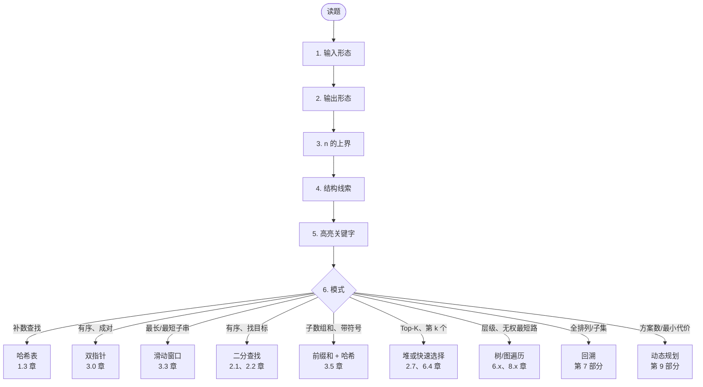

# 模式识别：见效最快的那项技能

二十个模式覆盖了应届生 FAANG 编码轮（coding loop）里大约 95% 的题目，而前五个模式自己就占了一半。这个数字是你这周读到的最有用的东西。它说明“面试题”这个总体是有限的，工作量是有边界的，而那个能在头 90 秒里叫出模式名的候选人，和叫不出的候选人，解的根本不是同一道题。

大多数候选人正是在这 90 秒里输掉整轮的。Ian Douglas 在 interviewing.io 上做过 600 多场面试，他说自己见过的最常见失败模式就是“太早开始写代码”，他给出的节奏正好相反：大约五分钟讲高层思路，大约五分钟讲中层设计，然后才是代码。[^2] 一个候选人如果把一半的讲述预算烧在“没能把题目映射到已知模式”上，那他能用来写代码、调试和解释的时间就明显更少。模式识别不是唯一的面试技能，但它是每小时准备投入产出比最高的那一项。95% 这个覆盖率来自一份 2026 年的四档频率排名，统计范围覆盖多家 FAANG 的应届生面试轮。[^1]

## 怎么判断这是哪个模式？

跑一遍六步走查。每道题都跑。出声跑。这套走查内化之后只要 30 到 60 秒，而且 Two Sum 和 Median From Data Stream 用的是同一套流程。

| 步骤 | 问题 | 写下来 |
|------|----------|------------|
| 1 | 输入长什么样？ | 数组、有序数组、字符串、链表、树、图、矩阵、单个整数、流 |
| 2 | 输出要的是什么？ | 是/否、计数、最小/最大、下标、一个具体的子集或序列 |
| 3 | 约束里的 `n` 有多大？ | `n ≤ 20`、`n ≤ 1000`、`n ≤ 10^5`、`n ≤ 10^6` |
| 4 | 有没有结构线索？ | 有序、唯一、非负、连续、值域有界 |
| 5 | 题面里哪个关键字最响？ | “longest”、“shortest”、“all permutations”、“next greater”、“kth”、“shortest path” |
| 6 | 关键字 + 输入 + `n` 这组组合对上哪个模式？ | 目录里的一条 |

*90 秒走查。第 1 到第 5 步是读取，第 6 步是拿你脑子里那本目录做一次查表。*

## 90 秒走查到底长什么样？

三道题。同样六步。三个不同的模式。

**A. 无序整数数组，一个目标值，返回任意两个下标，使它们的值之和等于目标值。** 输入是无序数组。输出是一对下标。`n` 大约在 `10^4` 量级。无序；值可能为负。最响的字眼是“两数之和等于目标值”里的那个“两个”。双指针在这里是错的，因为数组无序。暴力解法在数据规模允许范围内，但很浪费。模式：**哈希表补数查找**。参见[哈希表](../part-1-linear-data-structures/03-hash-maps.md)。参考题：[LC 1 — Two Sum](https://leetcode.com/problems/two-sum/)。

**B. 字符串 `s`，返回不含重复字符的最长子串长度。** 输入是一个字符串。输出是一个计数。`n` 最大到 `5 × 10^4`。子串是连续的；字符集有界。高亮关键字：“longest”、“substring”，以及一个*动态*约束（“不能重复”）。模式：**可变长度滑动窗口**，配一张记录已见字符次数的哈希表。参见[滑动窗口：可变长度](../part-3-pointers-window-prefix/03-sliding-window-variable.md)。参考题：[LC 3 — Longest Substring Without Repeating Characters](https://leetcode.com/problems/longest-substring-without-repeating-characters/)。

**C. 整数数组，整数 `k`，返回和等于 `k` 的连续子数组个数。** 输入是整数数组。输出是一个计数。`n` 最大到 `2 × 10^4`。**值可以为负。** 高亮关键字：“contiguous subarrays”和“sum equals k”。

滑动窗口是那个显而易见的错误答案。这个模式只在“窗口内的和随窗口长度单调”时才成立，负数打破了这个性质：扩张窗口的过程中，和可能中途反而掉到 `k` 以下。模式：**前缀和 + 哈希**。参见[前缀和 + 哈希](../part-3-pointers-window-prefix/05-prefix-sum-hash.md)。参考题：[LC 560 — Subarray Sum Equals K](https://leetcode.com/problems/subarray-sum-equals-k/)。

C 是这里价值最高的例子。第 1、2、5 步全都指向滑动窗口。第 4 步是那个覆盖项：*值可以为负*。跳过第 4 步的候选人交出的滑动窗口解法，会在第一个含负数的测试用例上挂掉。

## 关键字什么时候会骗我？

只要第 4 步和第 5 步不一致，它就会骗你。高亮关键字是必要条件，真正消歧的是次要的结构线索。下面八种情况是最容易咬人的。

| 信号说的是 | 候选人会伸手去拿 | 正确答案是 | 原因 |
|---|---|---|---|
| “和等于 `k` 的连续子数组”，值可能为负 | 滑动窗口 | 前缀和 + 哈希 | 窗口扩张不再对长度单调 |
| “有序数组，找一个目标值”，但数组被旋转过 | 标准二分查找 | 二分查找的变体 | `lo <= hi` 模板假定整个数组有序 |
| “Top-K 元素”，`k` 非常小 | 大小为 `k` 的堆，`O(n log k)` | 快速选择，平均 `O(n)` | `k` 很小、又不关心最坏情况延迟时，快速选择更优 |
| “链表里有环” | 记录访问节点的哈希集合 | Floyd 龟兔算法 | 哈希集合也行；双指针只花 `O(1)` 空间，而且这才是面试官想听的 |
| “二叉搜索树中第 k 小” | 把 BST 排序后取下标 | 带计数器的中序遍历 | 排序把 BST 的性质扔掉了 |
| “最短路，边权全为 1” | Dijkstra | BFS | 这里 BFS 是 `O(V + E)`；Dijkstra 要 `O((V + E) log V)`，属于杀鸡用牛刀 |
| “区间和查询”，查询之间数组会被修改 | 静态前缀和 | 树状数组或线段树 | 前缀和在每次更新后都要 `O(n)` 重建 |
| “所有子集 / 所有排列”，`n ≤ 8` | 迭代式二进制枚举 | 回溯 | 两者都能做；回溯能推广到带剪枝的约束问题 |

> [!IMPORTANT]
> 第 4 步不能跳。那个覆盖项几乎总是藏在结构线索里，而不是关键字里。

## 为什么交替练习胜过死磕一类？

大多数人的练法是错的。他们连做五十道滑动窗口，再做五十道双指针，再做五十道图。同一模式内的熟练度上去了，识别模式的反射却几乎没动，因为这一整块里每道题都提前把答案告诉了候选人。认知科学里管这叫*分块练习*（blocked practice），Rohrer 和 Taylor 2007 年的研究表明，它的迁移效果比混合练习差，尽管当下感觉更轻松。[^3]

做完前 50 道之后，切到**交替练习**（interleaved practice）。每次训练都把模式打乱混着上：滑动窗口、然后 BFS、然后 DP、然后堆、然后前缀和。强迫自己在动笔前把模式说出声。衡量指标是前 60 秒分类的准确率，不是刷题量。LeetCode Discuss 上一篇刷满 500 题的复盘记录了那个拐点：过了 300 题左右收益开始走平，而拿到 offer 的人把功劳归给模式识别，不是题量。[^4]

老实的时间线：大约 8 到 12 周的刻意练习，才能把分类器内化到面试级反射。没有任何 90 秒的速成法能绕开底下那一堆练习。

## 面试现场我具体该怎么做？

四个习惯，按优先级排。

**打字之前先说出模式。** 在头 90 秒里说出来：“这是一道 [模式名] 的题，因为 [信号]。”面试官要么点头（你对了，而且你拿到了认同），要么反问一个澄清问题（你错了，但你现在有了方向）。两种结果都比沉默好。Douglas 列的第二大问题区是“半截话沟通”——开个头，自己在心里说完，然后换方向。[^2] 把模式说出声是修这个问题最便宜的办法。

**六步全跑完再定方案。** 锚定在第一个“大致对得上”的模式上，是第三常见的失败模式：候选人看到“连续子数组”，十秒内就押定滑动窗口，然后眼看着它在负数输入上给出错答案。修法是机械的。第 1 到第 6 步，按顺序，每次都跑，哪怕答案看起来明摆着。

**给讲述时间做预算。** 五分钟讲高层思路。五分钟过一遍中层设计——伪代码、不变式、由 `n` 的上界推出预期复杂度。然后才是代码。Douglas 那 600 多场面试的数据显示，跳过前十分钟的人，正是那些在压力下重构、并且输在解题能力（而不是语法）上的人。[^2]

**老实对待那 5% 到 10% 你分不出来的题。** 这份目录瞄准的是 90% 到 95% 的情况。剩下的残余是设计题（LRU 缓存、数据流中位数）、数学推理（`pow(x, n)`、素数计数），以及多模式组合（直方图里的最大矩形，是滑动窗口式的一趟扫描里套了一个单调栈）。第 6 步什么都返回不出来时，说出来，然后向面试官要提示。“没有更早求助”是 Douglas 列的第五常见失败模式；早问的人脱困了，不问的人把时间耗光。[^2]

这张小抄短到可以直接背下来。输入有序，先想二分查找或双指针。要 `O(1)` 查找，先想哈希表。子串上的最大/最小值，先想滑动窗口或 DP。区间和或频率，先想前缀和、BIT 或线段树。树，先想 DFS 或 BFS。图，先想 DFS、BFS 或并查集。Top-K，先想堆或快速选择。流，先想堆，或者自己设计一个结构。全排列，先想回溯。[^5]

[最初 5 分钟：澄清问题](../../../dsa/part-14-interview-framework/01-clarifying-questions.md) 讲的是 90 秒走查之后紧接着要跑的东西。先把走查练成反射。第 14 部分的其余内容都建在它之上。

## 参考文献

[^1]: Rafay Abbasi, *20 LeetCode Patterns Every New Grad Must Know Before Interviewing at FAANG (2026)*, Cracking the Tech Interview, May 2026. [dglearning.substack.com/p/20-leetcode-patterns-every-new-grad](https://dglearning.substack.com/p/20-leetcode-patterns-every-new-grad).

[^2]: Ian Douglas, *I've conducted over 600 technical interviews on interviewing.io. [interviewing.io/blog/ive-conducted-over-600-technical-interviews-on-interviewing-io-here-are-5-common-problem-areas-ive-seen](https://www.interviewing.io/blog/ive-conducted-over-600-technical-interviews-on-interviewing-io-here-are-5-common-problem-areas-ive-seen).

[^3]: Rohrer, D. and Taylor, K., "The shuffling of mathematics problems improves learning," *Instructional Science*, 35, 481-498, 2007.

[^4]: Kunal Sonawane, *I Solved 500+ LeetCode Problems, Was It Worth It?*, LeetCode Discuss, March 2025. [leetcode.com/discuss/post/6549966/](https://leetcode.com/discuss/post/6549966/).

[^5]: Sean Prashad, *Leetcode Patterns* (178 problems, 48 patterns), [seanprashad.com/leetcode-patterns/](https://seanprashad.com/leetcode-patterns/).
