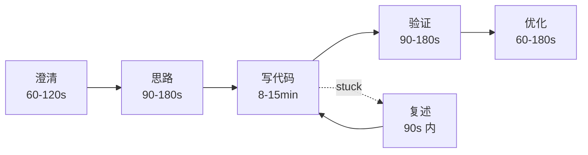
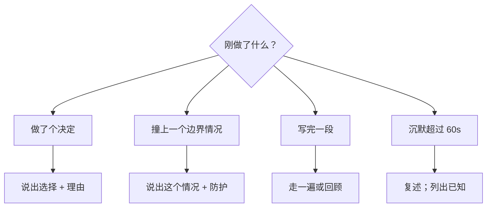

# 面试过程中的沟通

interviewing.io 给十万场模拟面试打了分，评的是三个维度：沟通、解题、代码。他们本以为沟通只是给分数补齐一个角。数据说的正相反。代码 4 分、解题 4 分、沟通 2 分的候选人，晋级率仍有 96%。代码 3 分、解题 3 分、沟通 4 分的候选人，被拒的频率大约是 4-4-2 那组的三倍。[^1]

这个教训很锋利。沟通替代不了把题解出来。它的作用是修正信号，让面试官能给你真正在做的事打分。你要是停下了手里的活，再漂亮的口头表达也救不回这一轮。你要是闷头把活干完，面试官就没有东西可打分了。

## 沉默到底让你付出什么代价？

在一个光标闪动的编辑器前沉默六十秒，就是面试官心里那张模型断电的时刻。他分不清你是在思考、在困惑，还是已经一片空白。Hello Interview 发给自家面试官的指南（按 2026 年周期更新过）把这点说得很直白：一句快速定调的话就能“消解”这三种状态之间的歧义，而沉默超过大约一分钟，判断就开始跑偏。[^2] Logfetch 2022 年的操作守则从候选人这一侧把同一点重说了一遍：面试过程中，你要么在写代码，要么在说话。[^3]

大多数读者都会在最糟的时刻沉默。他们正在读题、正在推一个边界情况、或者刚从一条错路上退回来，认知负荷一上来，嘴就停了。面试官把这段停顿读成“卡住了”。候选人把它读成“在想”。两边都没错，但只有一边在给你打分。

*每一轮编码面试都会朝这五个阶段的形状靠拢；那条虚线回路是结构化的卡壳恢复路径，上限接近 90 秒。*

## 边想的时候我该说什么？

在决策点上成段地说，而不是每敲一个键都说。Hello Interview 建议的校准是：真正在写代码的时候，每 30 到 60 秒说一句，讲清你在做什么、为什么。[^2]“我现在要敲 `function` 这个词了”不够格。“我拿一个以字符为键的哈希表从左往右扫，因为查重需要 O(1) 的查找”才够格。

有三个时刻承担了大部分作用。

**先说出暴力解法，哪怕你已经看到了最优解。** 把 `O(n²) 枚举所有数对，然后是 O(n) 一趟扫描的哈希表版本` 报出来，面试官就拿到了他要打分的权衡推理。直接跳到最优解，看起来像背题。LeetCode Discuss 上那篇 Google L5 候选人的复盘讲的正是这一点：先把暴力解法摊开，解释你为什么不用它，然后再往前走。[^4]

**写代码之前先选定一个方向。**“我选哈希表，因为 n 能到 10⁵，平方级那一版太慢。”这一句话能换来面试官的绿灯，也能让你在实现途中不再在两个方案之间来回漂。Tech Interview Handbook 把同一个动作说成把*最佳理论时间复杂度*（Best Theoretical Time Complexity）讲出声，这本身就是一个正向信号。[^5]

**写循环之前先说出不变式。**“left 和 right 之间的窗口里始终只有不重复的字符；向右扩张保持这个不变式，除非撞上重复字符，那时我就推进 left。”这一句话，就是“我背过双指针”和“我能证明这是对的”之间的差别。Code Intuition 2025 年那篇讲卡壳恢复的文章说，不变式正是大多数人僵住的地方，也是把题目重新接回某个模式的那一级台阶。[^6]

## 要是我真的脑子一片空白呢？

用一句话给沉默划个边界，然后开始诊断，不要慌。Code Intuition 记录的四步恢复法不到 90 秒：复述题目，列出已知，说出你需要的那种变换，找到不变式。[^6]

说出来大概是这样：“我先把题目复述一遍。输入是一个无序数组。我要找一对下标，让距离和较小高度构成的某个函数取最大。暴力解法是枚举所有数对，O(n²)。我在找一个不变式，好跳过那些不必检查的数对。”

在开口要提示之前，让别人看得见地走完三步的候选人，和沉默两分钟后直接要提示的候选人，看起来完全是两种人。同一道题，相反的信号。面试官打的分是：你有没有意识到自己卡住了，以及你多快恢复过来——这正是他们在工作中想看到的能力。[^2]

## 什么时候该闭嘴？

讲得太多是镜像另一侧的失败模式。把正在敲的东西念出来的候选人——“现在写 for i in range，现在把 left 加一”——是把透明和照抄搞混了。AlgoCademy 把东拉西扯和语速过快列成一对并列的坑，两者的根因相同：候选人把“出声思考”理解成了“把脑子里的一切都说出来”。[^7]

两个调整能修好它。第一，用意图叙述替换语法叙述。“我在写一个 for 循环”删掉；“我在从左往右扫，统计出现次数”留着。第二，允许自己安静一段有边界的时间。一句话就够——“我接下来静音一分钟左右，把核心循环写完，然后回来测”——它把可能尴尬的沉默变成了一段合理的停顿。面试官这时知道沉默是有意的，不是卡住了。

## 怎么接住提示又不掉节奏？

你讲述时面试官的沉默不是认可。他插话才是信号。他要是纠正你，最糟的一步就是争辩。

停一下。看面试官。用你自己的话把他说的话复述一遍：“所以你是说数组没排序，那我的二分查找就不成立了。我重新看一下。”然后再把它用进去。像协作那样的接提示，得分高于像投降那样的接提示，而两者都高于无视提示、花十分钟绕着底层问题打补丁。[^2]

自己的例子暴露出 bug 时，套路一样。“我重新检查一下‘数组有序’这个假设。回到题面看，它没说过有序。那二分查找的方案就断了，我需要哈希表。”没人提示就自我纠正，是评分表里最强的信号之一。

## AI 辅助的面试轮里，这些还适用吗？

Meta 和越来越多的公司现在会跑这样的编码轮：候选人在编辑器里用 AI 助手。Hello Interview 2026 年针对这种形式的指南点出了转折：面试官能看到你的 prompt 和 AI 的输出，但看不到你的决策过程，除非你出声演示给他看。[^2] 节奏随之变成“说意图、给 AI 提 prompt、出声审输出，然后往下走”。上面那五个阶段依然成立；只是话术的落点从“每 30 到 60 秒的敲键”改成了“每次提 prompt 之前”和“每次 AI 回复之后”。

*一张口袋大小的决策树，用来决定下一句说什么；每条分支都落在一句短话上，绝不是一个段落。*

## 本周做什么

从上面五个转折点里挑两个——复述、先暴力再优化、不变式、静音段预告、走一遍——把它们硬塞进你本周解的每一道题里，对着空房间出声讲。每天用手机录一到两次，第二天早上回听。第一次听会很难受。到第十次，这些模板会压缩成两三个词，也不再像背稿。

[时间与空间复杂度的讨论](./03-complexity-discussions.md) 是对优化阶段的深入展开，也是本章自然的下一站。

## 参考文献

[^1]: Korolev, D. for interviewing.io (2022, last updated 2023), "Does communication matter in technical interviewing? We looked at 100K interviews to find out," [interviewing.io/blog/does-communication-matter-in-technical-interviewing-we-looked-at-100k-interviews-to-find-out](https://interviewing.io/blog/does-communication-matter-in-technical-interviewing-we-looked-at-100k-interviews-to-find-out).

[^2]: Hello Interview (2026), "Communication During AI-Enabled Interviews," [hellointerview.com/learn/ai-coding/fundamentals/communication](https://www.hellointerview.com/learn/ai-coding/fundamentals/communication).

[^3]: Logfetch (2022), "How to Talk During the Coding Interview: A Step-by-Step Guide," [logfetch.com/talking-during-coding-interview](https://logfetch.com/talking-during-coding-interview/).

[^4]: Anonymous candidate write-up on LeetCode Discuss (December 2024), "Lessons from My Google L5 Interview Experience," [leetcode.com/discuss/post/6147892/Lessons-from-My-Google-L5-Interview-Experience](https://leetcode.com/discuss/post/6147892/Lessons-from-My-Google-L5-Interview-Experience-Tips-and-suggestion/).

[^5]: Tay, Y., *Tech Interview Handbook*, "Top techniques to approach and solve coding interview questions" (last updated April 2026), [techinterviewhandbook.org/coding-interview-techniques](https://www.techinterviewhandbook.org/coding-interview-techniques/).

[^6]: Code Intuition (2025), "When You're Stuck in a Coding Interview," [codeintuition.io/blogs/stuck-in-coding-interview](https://www.codeintuition.io/blogs/stuck-in-coding-interview).

[^7]: AlgoCademy Blog, "How to Think Aloud Effectively During an Interview," [algocademy.com/blog/how-to-think-aloud-effectively-during-an-interview](https://algocademy.com/blog/how-to-think-aloud-effectively-during-an-interview/).
