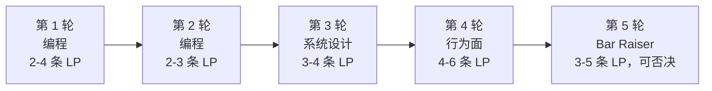

# 亚马逊领导力准则速览

在其他任何一家大厂的面试流程里，编程轮就是编程轮。而亚马逊的编程轮面试官，在投出录用或不录用之前，被要求写下两到四条具体的领导力准则（Leadership Principles，LP）、每条对应浮现出来的证据，以及你的一句原话。这一轮里第 5 分钟和第 50 分钟的闲聊，都算评分表的一部分。你要是把它当成客套寒暄，就会在一场自以为稳过的轮次里挂掉。

本章是入门篇：LP 到底是什么、从哪来、哪些在编程轮里最常出现，以及为什么“我只要把算法做得出色”会错过亚马逊真正在打分的评分表。更深入的 STAR 格式叙述套路在[面试中讲述亚马逊 LP](./07-amazon-lps-narration.md)里。这一页负责把场地铺好，那一页教你怎么打。

## 什么是 LP 轮？

亚马逊并没有单独的“LP 轮”。陷阱就在这里。

16 条领导力准则在流程里的每一轮都会被打分，包括两轮编程。[^1] 亚马逊官方的候选人指南在这一点上毫不含糊：LP 是“每一次招聘决策的基础”，技术岗“同等看待技术能力与领导力准则”。[^2] 2026 年一个 SDE 编程场次大致长这样：5 分钟行为面热身，40 到 45 分钟做技术题，面试官边听边给你的叙述打分，然后 10 分钟行为面追问加上你的提问。每一分钟都在计分。

*每轮考察的 LP 条数来自候选人反馈的 2026 年流程信息。[^1] 整场流程的 LP 覆盖范围是 16 条里的 10 到 12 条。*

## 一轮面试里会出现多少条 LP？

16 条里的 10 到 12 条，而且有重叠。一轮通常考察 2 到 4 条 LP，同一条 LP 常常在两三轮里都冒出来，因为评分表明确要的是多来源交叉印证的证据，而不是一个孤例。[^1]

实际影响是：老一套备考里流传最广的那句错误建议就是“准备五个亚马逊故事”。在清单只有 14 条 LP、轮次之间重叠更少的年代，五个是对的。现在有 16 条 LP，还要跨轮考察，五个故事的储备到第 3 轮就掏空了；而 Bar Raiser（抬杆人）进场前会读前面面试官的复盘笔记，一眼就能看出你在重复用。八到十个故事、每个挂上两到四条 LP，才是校准过的储备量。

## 哪些 LP 在编程轮里最常出现？

五条，大致按这个顺序：Customer Obsession（客户至上）、Earn Trust（赢得信任）、Dive Deep（刨根问底）、Insist on the Highest Standards（坚持最高标准）、Bias for Action（崇尚行动）。[^1]

这五条是能自然嵌进“解题”这个动作里的 LP。Customer Obsession 出现在你从用户角度、而不是从数据结构角度提澄清问题时。Earn Trust 出现在你当众纠正自己说错的复杂度、而不是硬撑时。Dive Deep 出现在面试官让你走一遍代码，你真的逐个值走了一遍，而不是说“应该能跑”时。Insist on the Highest Standards 出现在没人要求你就自己跑边界用例、而不是等被问时。Bias for Action 出现在你说明一次算过账的冒险优化、并且退路已经写在白板上时。

其余十一条 LP——Ownership（主人翁意识）、Have Backbone（敢于谏言、服从大局）、2021 年新增的两条等等——属于第 4 轮和 Bar Raiser 轮的地盘，那里你有整整 60 分钟专门讲 STAR 格式的故事。别在滑动窗口题里表演 Frugality（节俭）。它没地方落脚。

一个关键提醒：2024 到 2026 年，Bar Raiser 对 Customer Obsession 和 Ownership 这两条的把关明显收紧了。[^1] 一个候选人如果 Bias for Action 的故事很精彩、但 Customer Obsession 只有泛泛的证据，即便技术过硬，被拒的风险也比三年前更高。

## 16 条 LP 分别是什么？

下面是亚马逊官方顺序的清单，附上每条通常考什么。[^3] 措辞是转述；想要一字不差的原文定义，去亚马逊自己的页面看。

1. **Customer Obsession（客户至上）。** 从客户出发，反向倒推。*考察场景：* 澄清式提问、以成功指标为框架、来自真实用户行为的边界情况。
2. **Ownership（主人翁意识）。** 长期思考；“这不关我的事”不在词库里。*考察场景：* 你讲一个自己修了职责范围之外的问题的项目。
3. **Invent and Simplify（创新简化）。** 找到新想法，然后把它削到最简。*考察场景：* 你把暴力解法归约到核心思路，而不是在它上面层层叠优化。
4. **Are Right, A Lot（决策正确）。** 判断力强；主动找反面证据。*考察场景：* 你照着提示在轮次中途换掉思路，而且没有慌乱。
5. **Learn and Be Curious（好奇求知）。** 永远学不完。*考察场景：* 你在行为面里主动提起最近自学的东西。
6. **Hire and Develop the Best（选贤育能）。** 每次招聘都抬高门槛。*考察场景：* 管理线和资深 IC 的流程；编程轮里少见。
7. **Insist on the Highest Standards（坚持最高标准）。** 缺陷不许流到下游。*考察场景：* 你没人要求就测自己的代码，拒绝在“看着还行”的时候宣布做完。
8. **Think Big（远见卓识）。** 想得小会自我实现。*考察场景：* 系统设计、影响范围类的故事。
9. **Bias for Action（崇尚行动）。** 速度很重要；很多决策可逆。*考察场景：* 你为优化承担一次算过账的冒险，并在同一句话里说出退路。
10. **Frugality（节俭）。** 约束催生机敏。*考察场景：* 简单方案就够用时，你避开了重量级方案。
11. **Earn Trust（赢得信任）。** 倾听、坦诚表达、公开自我批评。*考察场景：* 你在面试官追问之前就纠正了自己的错误。
12. **Dive Deep（刨根问底）。** 紧贴细节；经常审计。*考察场景：* 你逐个值走代码，而不是断言它能跑。
13. **Have Backbone; Disagree and Commit（敢于谏言、服从大局）。** 有礼有节地反对，然后全力执行。*考察场景：* 你礼貌地反驳面试官的表述框架，并且反驳过程中思路始终连贯。
14. **Deliver Results（交付结果）。** 质量对、按时交、决不含糊。*考察场景：* 你把题做完了、给出能跑的解，哪怕不是最优解。
15. **Strive to be Earth's Best Employer（努力成为地球上最好的雇主）。** 更安全、更高效、更多元的工作。*考察场景：* 管理线流程；编程轮几乎不考。
16. **Success and Scale Bring Broad Responsibility（成功和规模带来广泛责任）。** “我们从车库起家，但现在已经不在车库里了。” *考察场景：* 资深 IC 及以上；设计轮里的伦理权衡场景。

你要是看到哪份备考资料只列了 14 条 LP，那它是 2021 年中期之前的东西。别再看它了。

## 为什么是 16 条而不是 14 条？

亚马逊在 2021 年 7 月 1 日新增了两条准则，四天之后 Jeff Bezos 把 CEO 交给 Andy Jassy。[^4] 新增的是 *Strive to be Earth's Best Employer* 和 *Success and Scale Bring Broad Responsibility*。这份清单从 2015 年起一直是 14 条，那年亚马逊加入了 *Learn and Be Curious*。[^5]

2021 年新增的这两条，是唯一把亚马逊的责任明确从客户和股东扩展到员工和社会的 LP。外界普遍解读为 Bezos 在离任前定调，背景是同年 4 月阿拉巴马州 Bessemer 的工会投票。[^6] 你觉得这说法动人还是虚伪，随你；对流程而言重要的是，一些备考内容还在引用 14 条版本。凡是 2021 年 7 月之前的资料，默认当作过期。

## Bar Raiser 是谁？

一位受过训练的面试官，通常 L6 及以上，来自与招聘经理不同的团队，对面试小组有明确的否决权。[^7] 亚马逊 2024 年公开确认，全公司有超过 10,000 名在职 Bar Raiser 和实习 Bar Raiser。[^7] 这个项目 1999 年由时任 CIO 的 Rick Dalzell 创立，原则是：每个新人都应该抬高他所加入团队的门槛。

Bar Raiser 问的问题和小组里其他人不一样。别的面试官问的是“我想不想招这个人”。Bar Raiser 问的是“招这个人会把亚马逊整体的工程门槛抬高还是拉低”。[^7] 他们的不录用票无法被推翻。Bar Raiser 投了不录用，技术面试官的四张录用票也救不了你。

你几乎永远不会提前知道哪位面试官是 Bar Raiser。圈内传说通常是流程里资历最深、追问最尖锐的那位。你能做的最糟的一件事——评分表在这一点上写得很明确——就是一发现是他就把状态往上调。Bar Raiser 恰恰受过训练，专门识别这种临时调整，而这读起来就是不真诚。[^1]

操作规则很短：每一轮一视同仁。第 1 轮和第 5 轮用同样的方式叙述。讲故事用同样的具体程度。Bar Raiser 不是另一场考试；他是你整个上午待着的同一场流程里，结构化评分表的锚点。

## 本周做什么

如果你的流程还有一个月以上，从近三年里挑八到十个项目，每个写一页 STAR，每个故事挂两到四条 LP，其中至少两个锚在 Customer Obsession 和 Ownership 上。然后读[面试中讲述亚马逊 LP](./07-amazon-lps-narration.md)拿话术模板，等[分公司的面试线](../../../dsa/part-14-interview-framework/11-per-company-tracks-index.md)发布后看亚马逊专属的题目分布。

如果面试就在这周，只做一件事：挑五条 LP（从编程轮那五条开始），每条准备一个故事，掐着秒表出声练。两分钟背景加行动，30 秒可量化的结果。如果任何一个故事里“我们”的出现次数超过“我”的两倍，这个故事在 Bar Raiser 眼里就是在推卸，而且会被写进复盘。[^1] 把它改写成“我”，直到比例反转。

亚马逊打的行为信号是压力下的判断力，而不只是算法正确。带着两个最优解被拒的候选人，几乎都是闷头做题的那批。边打字边讲。边走代码边说话。留 10 分钟给追问。你要是从没给面试官一句可引用的话，他就无法为任何一条 LP 记录证据。

## 参考文献

[^1]: Rafay Abbasi, "Inside the Amazon 2026 Loop: Rounds, Rubric, and What Each Interviewer Scores You On," *Cracking the Tech Interview* (Substack), May 7, 2026, [https://dglearning.substack.com/p/inside-the-amazon-2026-loop-rounds](https://dglearning.substack.com/p/inside-the-amazon-2026-loop-rounds).

[^2]: Brittany Bunch, "Your complete guide to the Amazon interview process," About Amazon (Workplace), April 8, 2025, [https://www.aboutamazon.com/news/workplace/amazon-interview-guide](https://www.aboutamazon.com/news/workplace/amazon-interview-guide).

[^3]: Amazon Jobs, "Leadership Principles" (canonical page), [https://www.amazon.jobs/content/en/our-workplace/leadership-principles](https://www.amazon.jobs/content/en/our-workplace/leadership-principles)

[^4]: Amazon Staff, "Amazon announces two new Leadership Principles," About Amazon Canada, July 1, 2021, [https://www.aboutamazon.ca/news/company-news/amazon-announces-two-new-leadership-principles](https://www.aboutamazon.ca/news/company-news/amazon-announces-two-new-leadership-principles)

[^5]: Annie Palmer, "Amazon sets a new tone as Jeff Bezos era comes to an end," CNBC, July 1, 2021. Documents the 2015 addition of *Learn and Be Curious* as the 14th LP.

[^6]: Eugene Kim, "Amazon updates leadership principles ahead of Jeff Bezos exit," Business Insider, July 1, 2021, [https://www.businessinsider.com/amazon-leadership-principles-updated-jeff-bezos-exit-2021-7](https://www.businessinsider.com/amazon-leadership-principles-updated-jeff-bezos-exit-2021-7).

[^7]: David Zapolsky, Russell Grandinetti, John Felton, Matt Garman, et al. (quoted), "Raising the bar: How Amazon hires for long-term growth and innovation," AWS Careers, 2024, [https://aws.amazon.com/careers/life-at-aws-amazons-bar-raiser-program-hiring-for-long-term-growth-and-innovation/](https://aws.amazon.com/careers/life-at-aws-amazons-bar-raiser-program-hiring-for-long-term-growth-and-innovation/).
