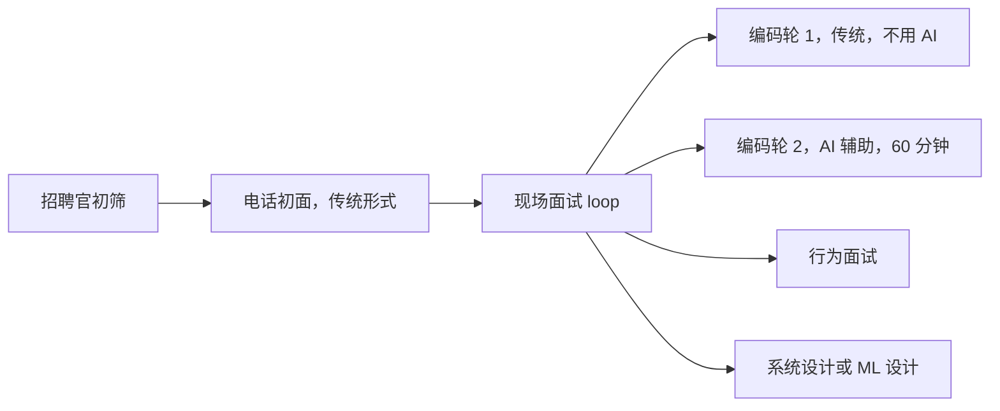
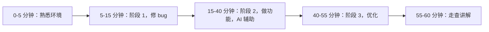

# Meta 的 AI 轮：具体形式

截至 2026 年 5 月，Meta 的现场面试流程（onsite loop）把两轮传统编码轮（coding round）中的一轮换成了 60 分钟的一轮，候选人在这一轮里可以在编辑器中开着 LLM。招聘官会在 loop 前几天告诉你，你的两轮编码轮里哪一轮是 AI 轮；你没有退出的选项。这套形式从内部试点走到几乎覆盖所有 SWE 候选人，只用了大约六个月。

正是这个速度，让本章每一节开头都标着日期。你接下来读到的东西，有一部分到下一季度就不对了。把这一轮的*形状*当成持久不变的，把任何具体名字（某个模型、某道题、某个以分钟计的时长）当成需要向招聘官确认的，而不是拿来背的。

## AI 轮到底是什么？

这是一轮编码面试，AI 在场，但身份是工具，而这一轮评的是你怎么用它。Meta 在公开场合用过的官方叫法是“AI-Enabled Coding Interview”（AI 辅助编码面试）；“AI 轮”是候选人这边的简称。[^3]

这一轮最早出现在 2025 年 7 月下旬一份泄露的 Meta 内部帖子里，帖子在征集模拟候选人，并给出了两种说法：一是未来的 Meta 工程师会和 LLM 一起工作，二是给候选人开放 LLM 能让 take-home 式的作弊不那么好使。[^3] 试点面试在 2025 年 8 月进行；2025 年 10 月这一轮进入正式的现场面试使用。到 2026 年 4 月，它在多数职级上已是默认设置。[^1][^2] 在 E7 及以上，候选人越来越多地反馈 loop 上只有一轮编码轮，就是这一轮。[^2]

> [!IMPORTANT]
> 这一轮**不是**提示词工程（prompt engineering）测试。多份指南都落到同一句话上：你提示（prompting）得多好，几乎没有分数。被打分的是元认知层面的东西——什么时候该委派、什么时候该核实、什么时候该推翻 AI、自己把那行写出来。[^1][^4]

截至 2026 年 4 月，它在这个 loop 里的位置：

*图注：截至 2026 年 4 月，loop 由一轮传统编码轮加一轮 AI 轮组成；招聘官会提前告诉你哪一轮是哪个。*[^1][^2]

## 多长时间，这一个小时怎么过？

六十分钟，2025 年 10 月到 2026 年 4 月之间每一个具名来源都是这么说的。[^1][^2][^4] 这比历史上 45 分钟的编码轮长了十五分钟。多出来的时间花在两处：开头由面试官带着过一遍平台（通常 5 到 6 分钟），以及更大的代码库范围——题目现在是多文件的，而不是一个函数那么大的形状。

在这 60 分钟里，候选人的反馈都指向同一个三段式结构：[^1][^4]

*图注：60 分钟的窗口拆成熟悉环境、调试、主体实现、优化和走查；第三阶段够得着，但拿到 offer 并不要求走到那里。*[^1][^2][^4]

阶段 1 是埋在现有代码库里的小 bug。被报告的例子都不是算法问题：该用 double 的地方写成了 int 转换、差一错误（off-by-one）、条件写反了。有些面试官明确禁止在这一阶段用 AI，有些则不限。如果能自己选，就别借助 AI 来调试。独立调试这个早期信号有分量，而且 bug 小，时间成本不高。[^1]

阶段 2 是重头。你要把一个功能做进现有结构，或者扩展一份半成品实现，或者完成一次比阶段 1 那个 bug 内容更多的调试。Hello Interview 给出的过关实现是“120+ 行”，而这个行数是按你把机械性的活委派给 AI 来校准的。[^1] 在这一阶段拒绝用 AI 是一种公认的失败模式；你会来不及。

阶段 3 是在更大的输入上做优化。测试用例是分档的，每一档都戳中阶段 2 解法里不同的弱点。认出测试数据要求你做哪种优化，才是承重的那项能力。AI 帮得上实现，但很少替你给出洞察。[^1] 有多位候选人没做完阶段 3 也拿到了 offer。[^1][^2]

## 会给我哪些工具？

这一轮跑在一个专门的 CoderPad 环境里，三块面板：左边文件浏览器，中间代码编辑器，右边 AI 对话加题目说明。[^1][^4] 代码保存即重跑；测试运行器从下拉菜单里选。Meta 会在 loop 之前给候选人发一个 CoderPad 练习链接，里面有一道被非正式称作“the puzzle”的样例题。多位候选人反馈这道 puzzle 比真正的面试题还难，所以它适合用来熟悉环境，而不是拿来校准难度。[^1]

AI 对话面板能读项目里的每个文件，但它改不了你的文件。每一行都得你自己敲或者粘进去。[^1]

截至 2026 年 4 月，支持的语言：Java、C++、C#、Python、Kotlin、TypeScript。[^1] 2025 年 11 月试点期的反馈说列表更窄，还有一位候选人因为自己偏好的语言不支持，只好退回 Python。[^5] 你具体那一天的列表，跟招聘官确认。

## 我能用到哪个模型？

模型菜单是这套形式里最不稳定的部分。到 2026 年初，候选人从下拉菜单里选，菜单里出现过 GPT-5、GPT-4o mini、Claude Sonnet 4 和 4.5、Claude Haiku 4.5、Claude Opus 4、Gemini 2.5 Pro 和 Llama 4 Maverick。[^1][^4][^6] 2026 年 1 月和 4 月的反馈列出的菜单有重叠，但不完全相同。[^4][^7] 最近的候选人记录里默认是 Claude Sonnet 4.5；GPT-5 被认为在面试的时间压力下太慢。[^1]

> [!WARNING]
> **AI 可能被削弱（nerf）。** 多位候选人反馈，同一个助手在真实面试里明显不如练习环境——在同一个模型平时能干净解决的问题上出现幻觉，只描述功能而不点出 bug，不肯主动给出修改。[^1][^5] 主导的推测是 Meta 通过系统提示词（system prompt）改了它的行为：不主动报 bug、不主动给完整解法、只描述不诊断；多份反馈彼此印证。据此调整你的准备。如果你只对着一个没有限制的模型练过，现场会感觉它又慢又笨，而你会在意外中丢掉几分钟。

## 怎么评分？

和 Meta 给传统编码轮打分的四项能力一样，只是其中一项要在 AI 介入之后的表现上来读：[^1][^7]

1. **问题解决。** 你理解题目吗，选对算法了吗，边界情况推得清吗？
2. **代码质量。** 代码干净、可维护吗，*以及你理解 AI 生成的东西吗？*
3. **验证。** 你频繁跑代码吗，往下走之前检查 AI 的产出吗，测边界情况吗？
4. **沟通。** 你在同步讲自己的过程、解释决定、把 AI 给的东西讲清楚吗？

Hello Interview 在这里引了一句 Meta 内部的说法：候选人应该用 AI，但必须表现出自己理解代码、能解释它的输出、用之前先测，而且不是靠提示词把自己从思考里绕出去。[^1] 同一处还引了一位招聘官的话：“如果你把它当拐杖用，是会被扣分的。”[^1]

有两种失败模式被扣得足够狠，我查过的每一份指南都把这两条列为最快出局的方式。第一种是粘一大块你自己没法逐行辩护的 AI 代码：面试官问某个分支为什么那样处理空输入，你就卡住了。[^1][^8] 第二种是让 AI 把整道题解完，然后把这个结果当神谕来操作；面试官盯着对话面板，全看得见。[^4][^7] 这两种都可以作为可训练的模式，见[提示词那一章](./09-meta-ai-round-prompting.md)；失败模式本身在[失败与危险信号](./10-meta-ai-round-failures.md)里逐条编了目。

## 这一章什么时候过期？

很快。这一轮的形式波动确实很高，有五种东西按季度变：模型菜单、当前在用的题库轮换（截至 2026 年 4 月大约九道题）、高级职级的流程结构、系统提示词对 AI 削弱的程度，以及这一轮适用于哪些岗位。[^1][^4]

那该怎么办。把*形状*当成持久的：60 分钟、三个阶段、编辑器里有 AI、四项能力的评分表（rubric）。把每一个具体名字当成待确认的。招聘官发来 loop 日程时，问三件事：现在用的是哪份模型菜单、平台支持哪些语言、阶段 1 允不允许用 AI。这些问题都不尴尬；这一轮招聘官本来就预期会被问，他们宁愿提前回答，也不愿看着候选人在编辑器里白白烧掉五分钟找方向。

配套的两章讲具体打法。[轮内怎么提提示词](./09-meta-ai-round-prompting.md)讲的是工作流，包括那个能把大部分时间赚回来的流水线化（pipelining）技巧。[失败与危险信号](./10-meta-ai-round-failures.md)是别的候选人已经踩过的坑的清单。

## 参考文献

[^1]: Evan King (Hello Interview, ex-Meta Staff Engineer), "Meta's AI-Enabled Coding Interview: How to Prepare", April 2026, [hellointerview.com/blog/meta-ai-enabled-coding](https://www.hellointerview.com/blog/meta-ai-enabled-coding).

[^2]: Rafay Abbasi (Cracking the Tech Interview), "Meta's New Coding Round Uses AI, Here's Exactly How to Handle It", April 29, 2026, [dglearning.substack.com/p/how-to-prepare-for-the-meta-ai-assisted](https://dglearning.substack.com/p/how-to-prepare-for-the-meta-ai-assisted).

[^3]: Wired, "Meta Is Going to Let Job Candidates Use AI During Coding Tests", July 29, 2025, [wired.com/story/meta-ai-job-interview-coding](https://www.wired.com/story/meta-ai-job-interview-coding).

[^4]: Rafay Abbasi (Cracking the Tech Interview), "Inside Meta's New AI-Enabled Coding Round: What Changed and How to Prep", April 17, 2026, [dglearning.substack.com/p/inside-metas-new-ai-enabled-coding](https://dglearning.substack.com/p/inside-metas-new-ai-enabled-coding).

[^5]: InterviewDB, "My First-Hand Experience with Meta's New AI-Enabled Interview", November 18, 2025, [interviewdb.io/guides/meta-ai-enabled-interview](https://www.interviewdb.io/guides/meta-ai-enabled-interview).

[^6]: Coditioning, "Meta's AI-Enabled Coding Interview: Questions + Prep Guide", updated January 30, 2026, [coditioning.com/blog/13/meta-ai-enabled-coding-interview-guide](https://www.coditioning.com/blog/13/meta-ai-enabled-coding-interview-guide).

[^7]: Githire B. Wahome (interviewing.io, ex-Meta), "Using AI in Meta's AI-assisted coding interview (with real prompts and examples)", April 2026, [interviewing.io/blog/how-to-use-ai-in-meta-s-ai-assisted-coding-interview-with-real-prompts-and-examples](https://interviewing.io/blog/how-to-use-ai-in-meta-s-ai-assisted-coding-interview-with-real-prompts-and-examples).

[^8]: Isabel (Leetcode Wizard), "Meta's AI-Enabled Coding Interview: Everything You Need to Know to Prepare", April 30, 2026, [leetcodewizard.io/blog/metas-ai-enabled-coding-interview-everything-you-need-to-know-to-prepare](https://leetcodewizard.io/blog/metas-ai-enabled-coding-interview-everything-you-need-to-know-to-prepare).
