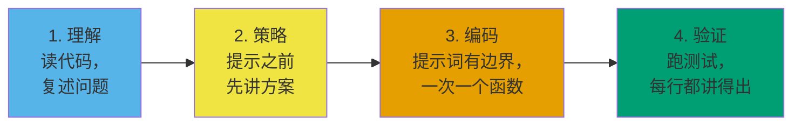

# Meta 的 AI 面试轮：提示词策略

Coditioning 逐字公布了 Meta 的评分标准。第一句正是每个候选人都漏掉的那句：“这不是一场考你会不会用 AI 的面试。AI 更像是个工具，帮你更高效地展示编码能力。评的是你解决问题、代码质量与验证的能力，不是提示词工程。”从 2025 年 10 月到 2026 年一季度，Meta 把这一轮推给了几乎所有 SWE 候选人，失败模式也已经稳定下来：把助手当成解题机的候选人挂掉，把它当成更快的结对程序员的候选人通过。

本章讲的就是能产出后一种行为的那套提示词层级。它不是一份要背下来的提示词清单，而是你做事的先后顺序。

## 到底在评什么？

四项能力，和 Meta 传统编码轮用的是同样四项：Problem Solving（解决问题）、Code Quality（代码质量）、Verification（验证）、Communication（沟通）。[^1][^3] 没有一项叫“提示词工程”。上面引的那份评分标准就是唯一准绳。[^1] AI 轮里变的是评分标准读你提示词的方式：每一次提示词都是你推理过程的一扇窗，面试官评的是推理，不是产出。这一轮 2025 年 10 月推出，到 2026 年一季度已覆盖几乎所有 SWE 候选人；在 E7 和 M2 级别，它是唯一的一轮编码面试。[^2]

在公开的候选人自述里，最具预测力的单一录用信号是**在提示 AI 之前先把算法讲给面试官**。[^3][^4] 说过“我用 trie，因为词表很大但每个词都很短”、然后才向 AI 要一个 trie 骨架的候选人，得分很好。把题目粘进对话框问“What algorithm should I use?”的候选人，评分表上被写“无法独立思考”，然后被拒。[^3]

能打出正确信号的这套层级有四个阶段，无论场景是造新功能、扩展半成品代码，还是调试跑不通的实现，都按这个顺序走。[^5]

*这套四阶段层级。阶段顺序比阶段内容更重要；把顺序倒过来是最常见的被拒模式。[^3][^4]*

第 0 到 10 分钟：理解。读代码库，复述问题，定位失败的测试。AI 用得很少。第 10 到 15 分钟：策略。把你的计划讲给面试官，然后也许让 AI 拿它跟另一种方案比一比。第 15 到 40 分钟：编码。一次只要一个函数，粘进编辑器之前每一行都读过。第 40 到 60 分钟：验证。每次改动后都跑测试，边界情况手工过，代码出声讲一遍。

## 在让 AI 写代码之前，我该先提示什么？

有两类提示词，能在你写下第一行代码之前就换来这一轮的大部分价值。

第一类是**代码库走读**。这一轮的定义性特征就是你从没见过的多文件代码。[^4][^5] 你有十分钟要弄清三到六个文件。从头读到尾根本塞不进这个预算。把其中一个文件粘进对话框，配上“Explain this step-by-step. Identify the class responsibilities and any edge cases the code already handles. Do not suggest changes”，十五分钟的阅读就被压成三分钟的有引导阅读。[^5] 关键在这种不对称的风险结构：解释类提示词不可能把坏代码放进你的编辑器，代码类提示词可以。

第二类是**约束面**。在写计划之前先问：“Here is the problem statement. Here is the file structure. What constraints, edge cases, or assumptions in the existing data models am I likely missing?”AI 会列四到六条。逐条对照真实代码。凡是文件里找不到依据的都丢掉；AI 会编造假设。[^4]

这两类提示词有一个共同的结构性质，值得点出来：它们要 AI 去**描述**，而不是去**修改**。描述类提示词是你压缩阅读时间的手段，修改类提示词是你写代码的手段。搞混两者——让 AI 去“修”一个你还没读过的文件——就是候选人在第一阶段失分的方式。

## LLM 什么时候会让我显得更差？

四类反模式在每一份公开的候选人复盘里都出现。

**让 AI 帮你解题。** 面向招聘方的那句写得很直白：“把它当拐杖用，你会被扣分。”[^3] “How should I solve this?”这种提示词会被记成“无法独立思考”。[^3] interviewdb.io 的面试官对候选人是这么说的：“先自己试着想出来。跟着测试失败往下走。”[^6] 你提方案，AI 做校验，永远不是反过来。

**粘未经审查的输出。** AI 的产出是流畅的、能编译的代码。说得通不等于对。一项 2022 年的研究发现，在直接采用的情况下，大约 40% 的 AI 生成代码带安全漏洞；[^7] 三年过去，这个比例也没塌下来。Coditioning 给的节奏是“提示、审查、运行、确认、往前走”，跳过任何一步都是危险信号。[^1] 把 AI 当成一个很聪明的新同事：他的 PR 你不读完不会合。[^8]

**一次问到底的巨型提示词。** “按这十条需求把整个单词游戏实现出来”会返回 200 行你在面试压力下根本审不完的代码。叠加的错误更糟：“如果第 2 步错了，第 3 到第 10 步也全错。”[^1] 三到五个小提示词、每个都验证过，永远赢过一个巨型提示词。如果对话漂过了第五个提示词，就带着当前状态开一段新的。把上下文窗口重置回你的基准事实。

**含糊的提示词。** “Fix this.”“Solve this problem.”“Write a function to filter sessions.”AI 要么返回 40 行通用代码，改它比自己写还费时间，要么返回跟你代码库里的类对不上的代码。[^9] 强提示词的修法是点名函数签名、输入输出类型、约束条件，以及要用的那个现有类。[^9] 具体程度是判断 AI 在帮你会害你的最大单一指标。[^1][^9]

> [!IMPORTANT]
> 面试里给你的那个 AI，往往明显弱于你练习时用的那个模型。多位候选人反馈，现场环境“帮助小得多”：延迟更高，编造的方法名更多，笃定的错误答案更多。[^3][^4] 练习时就把“什么都验证一遍”练成习惯。别指望那个到当天只发挥一半功力的模型。

## 怎么证明我看懂了它给的代码？

两个技巧，都很小，面试官都看得见。

第一个是**流水线化（pipelining）**。AI 在生成的时候，你干别的：审上一段，把下一步讲给面试官，或者预先写好下一个提示词。[^4][^9] Coditioning 的说法是“AI 在起草函数 X，你同时在审函数 X-1”。[^1] 你从不空着，面试官看到你每一轮都在读、在想。AI 生成时的空转时间，是 Communication 分数的沉默杀手。

第二个是**干跑追踪**。实现落进编辑器之后，让 AI 做：“Trace this function line by line with input `[concrete small example]`. State the value of every variable after each line.”然后读这份追踪，用同一个输入在心里跑一遍。AI 的追踪跟你的心智模型分叉的地方，要么是真 bug，要么是 AI 在编——两者都值得在跑测试之前查一下。[^5] 这一步既是验证，也是一场给面试官看的教学演示：你在用自己的话讲一段不是你写的代码。

每一行都要讲得出。如果一行代码你说不出它做什么、为什么在那儿，就删掉它。一位拿到 offer 的 E5 候选人讲了她的原话规则：“我会跟 AI 说，先把核心逻辑建起来。我会说，现在我想从一个最基础的单函数开始，这样我好审。”[^3]

## 哪个杠杆最高却没人用的提示词？

在策略和实现之间，找一次机会问 AI：

> "I plan to solve this with `[your approach in three sentences]`. List the four most likely failure modes: missed edge cases, performance traps, incorrect assumptions, or constraint violations. Do not propose a different approach."

这一问把 AI 从代码生成器（它会出错）变成对抗式审查者（它此时稳定有用）。它的模式库里存着成千上万个“方案 X 在输入 Y 上失效”的例子；把问题框成“找出失效模式”，就能取到这份知识，又不会招来 AI 重设计你的方案。它还会产出一个你能回应的东西，让面试官听到你说“AI 指出边界上有 off-by-one，我是这么防的”——这类回应明确计入 Communication 分数。

只用一次，在讲完策略、动手实现之前。最多两次——如果第三阶段冒出了跟规模相关的压力测试。

## 本周做什么

挑三道像 Meta 题库的题：一道网格 BFS（LC 200 *Number of Islands*），一道网格回溯（LC 79 *Word Search*），一道哈希找目标（LC 1 *Two Sum*）。[^10] 设三十分钟计时。写任何代码之前，按顺序跑四类提示词：澄清约束、比较两种方案、实现一个函数、用小输入干跑。每次提示都出声讲，就当面试官在看。LC 的测试最后跑。

目标不是通过测试。目标是在真实计时下感受这套四阶段层级，这样到了当天，顺序是自动的，提示词是有边界的。

[模式识别：见效最快的那项技能](./00-pattern-recognition.md) 是策略阶段的前置条件——你没法讲出一个叫不出名字的算法。讲这一轮失败模式的姊妹章节，把本层级专门用来规避的那些被拒模式逐条列了出来。

## 参考文献

[^1]: Coditioning, "Meta's AI-Enabled Coding Interview: Questions + Prep Guide," 2026-01-30, [coditioning.com/blog/13/meta-ai-enabled-coding-interview-guide](https://www.coditioning.com/blog/13/meta-ai-enabled-coding-interview-guide).

[^2]: 这一轮 2025 年 10 月推出，到 2026 年一季度已铺到几乎所有 Meta SWE 候选人；在 E7 和 M2 级别，它是唯一的编码轮。

[^3]: Evan King（前 Meta Staff 工程师）, "Meta's AI-Enabled Coding Interview: How to Prepare," hellointerview.com, 2026, [hellointerview.com/blog/meta-ai-enabled-coding](https://hellointerview.com/blog/meta-ai-enabled-coding).

[^4]: Isabel, "Meta's AI-Enabled Coding Interview: Everything You Need to Know to Prepare," LeetCodeWizard blog, 2026-04-30, [leetcodewizard.io/blog/metas-ai-enabled-coding-interview-everything-you-need-to-know-to-prepare](https://leetcodewizard.io/blog/metas-ai-enabled-coding-interview-everything-you-need-to-know-to-prepare).

[^5]: Githire B. Wahome（前 Meta）, "Using AI in Meta's AI-assisted coding interview (with real prompts and examples)," interviewing.io blog, 2025-2026, [interviewing.io/blog/how-to-use-ai-in-meta-s-ai-assisted-coding-interview-with-real-prompts-and-examples](https://interviewing.io/blog/how-to-use-ai-in-meta-s-ai-assisted-coding-interview-with-real-prompts-and-examples).

[^6]: InterviewDB, "My First-Hand Experience with Meta's New AI-Enabled Interview," 2025-11-18, [interviewdb.io/guides/meta-ai-enabled-interview](https://www.interviewdb.io/guides/meta-ai-enabled-interview).

[^7]: Pearce 等 2022 年的研究，见 Wahome 前引书 [^5]，结论是约 40% 的 AI 生成代码样本在未经审查直接采用时含有安全漏洞。

[^8]: Anthropic, "Prompting best practices" (Claude 4.5 / 4.6 / Sonnet 4.6), Anthropic developer documentation, 2026, [docs.anthropic.com/en/docs/build-with-claude/prompt-engineering/claude-4-best-practices](https://docs.anthropic.com/en/docs/build-with-claude/prompt-engineering/claude-4-best-practices).

[^9]: Rafay Abbasi, "Meta's New Coding Round Uses AI — Here's Exactly How to Handle It," Cracking the Tech Interview (Substack), 2026-04-29, [dglearning.substack.com/p/how-to-prepare-for-the-meta-ai-assisted](https://dglearning.substack.com/p/how-to-prepare-for-the-meta-ai-assisted).

[^10]: 每道题都是 Meta 题库的常客，经多个二手来源确认。仅作个人练习；本章属基础/框架豁免篇，不提供章节掌握梯度。[LC 200 — Number of Islands](https://leetcode.com/problems/number-of-islands/)
