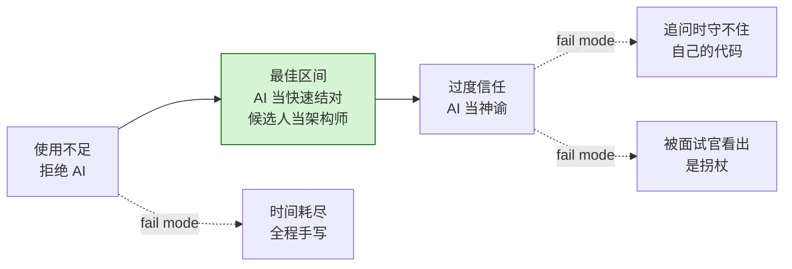

# Meta 的 AI 轮：常见失败

2025 年底，一位 E7 候选人告诉 Hello Interview，在一道迷宫题上，Claude Sonnet“平时用起来非常出色，面试时却反复给出错误答案”，而就在前一天，这个模型还干净利落地解决过同一道题。同一个模型、同一个候选人、同样的提示词。差别在面试本身：多方消息称，Meta 会用一段系统提示词加固 AI 的行为，让它不直接指出 bug，也不主动给出完整解法。他的准备只有一条：“AI 会帮我抓出 bug。”当 AI 不再抓 bug 时，他没有任何退路。

同一份材料里还有另一位候选人，面试官问他某个分支为什么那样处理空输入，他当场卡住。代码是对的，可他守不住那一行。在评分表看来，这和作弊没有区别。

这是两种不同的失败。两种都归本章。

## 这一轮的失败为什么不一样

传统 Meta 编码轮里，你要么算法写错，要么时间不够。这两条在这里照样能杀死你，但 AI 面板引入了一类在空白编辑器上根本不存在的失败：**AI 让你在失败的同时感觉自己很高效**。[^3]

你把题目粘进去，拿回两百行代码。代码能编译，正常路径的测试全过。整轮看起来都没问题，直到第 50 分钟面试官问你，优先队列为什么用那个比较器初始化，而你的诚实回答是：这行不是我写的。

Hello Interview 的评估总结里引用了 Meta 内部的一条规则，很短：“should use AI, but need to show you understand the code. Explain the output. Test before using. Do not prompt your way out of it.”（该用 AI，但必须证明你理解这段代码。解释输出。用之前先测。别靠提示词把自己绕过去。）[^1] 四句话，每一句对应下面的一种失败模式。

## 最常见的失败模式是什么

过度信任。而且领先幅度很大。

在 Hello Interview、interviewing.io 与 CoderPad 评分标准共同取材的 2025-2026 候选人语料里，大约 60% 到 70% 的负面反馈模式集中在同一个维度上：候选人把 AI 当成神谕（oracle）。[^1] [^3] [^9] 他们直接要完整解法。他们粘贴前不逐行读。他们只在最后跑一次测试。被问到某个具体分支时，他们没法像自己写过那样讲一遍。

公开反馈里点名的版本更直白。Rippling 的一位候选人被告知：“relied too heavily on AI even though their initial approach was correct.”（过于依赖 AI，尽管最初的思路是对的。）[^3] 方案是对的，出问题的是执行路径。面试官看着 AI 开车，候选人看着 AI 开车。2025 年一位 Meta 候选人收到几乎一样的评语：“appeared to rely heavily on AI, which impacted the quality of their solution.”（看起来过度依赖 AI，影响了解决方案的质量。）[^1] 代码甚至可能是过的，但评分表标记了这个模式。

mathRules 是 2025 年 11 月在 LeetCode Discuss 发帖的 E5 Product 候选人，正好踩中教科书案例。[^5] 提示词写得很紧。Claude Haiku 一两次就产出了能跑的代码。单元测试全过。面试官问时间复杂度。候选人答得没错：指数级。再问有没有更快的解法。答不上来。事后面试官告诉他，这道题是 NP-complete，“most candidates do not notice that apparently.”（多数候选人显然都没注意到这一点。）[^5] AI 交出了正确的代码，候选人接受了它，却没搞懂它的渐近行为。拒。

注意 mathRules 没做错的部分：提示词写得好，AI 被有效指挥，测试也跑了。失败发生在下游，在交接那一步：候选人把模型的输出当成答案，而不是当成一个需要对照题目约束去评估的选项。

## “作弊”信号是怎么被标记的

三种模式。没有一种是候选人抄答案。

**你守不住某一行。** 面试官指着第四个分支——空输入处理、差一（off-by-one）的守卫、字典的兜底——问为什么这么写。提示词是你写的，这段代码不是你写的。卡住的那一下就是信号。[^7] 一位面试过三千多名候选人的 IGotAnOffer 教练把这称作评分表的红旗：“silently pasting AI output is a red flag and could get you a low score for technical communication.”（悄悄粘贴 AI 输出是红旗，技术沟通一项可能拿低分。）[^10]

**写提示词时长时间沉默。** 在 E4 级别，六十秒的停顿读作思考。在 E7 或 M2 级别，同样的停顿读作“没有工作假设”，因为高级别的评分看的是你有没有主导这一轮，而不是你最后有没有到达某个地方。[^1] [^7] 解法是在发提示词之前先说出来。*“我准备让模型先起草解析器，然后我对照测试集检查边界情况”* 是那个样子；事后补说明不算。

**架构漂移。** AI 建议了一个和现有代码库不搭的数据结构。你采纳了。追问——*“不用 `OrderedDict` 你会怎么做？”*——立刻就能查出这个缺口。候选人让模型决定了解决方案的形状，而这个形状是错的。[^3] [^8]

共同的机制是：面试官评的是**你对 AI 的控制力**，而不是你有没有用 AI。CoderPad 的行业评分标准在这条维度上给候选人打 1 到 5 分：“AI 主导、候选人被动反应”是 1 到 2 分；“有意图、目标明确地使用”是 3 到 4 分；AI 建议错了就当场否掉，属于最高档。[^9] 一个 60 分钟里从未否决过任何 AI 建议的候选人，按定义就落在最低档，哪怕每条建议恰好都对。

## 如果 LLM 给了我没发现的错误答案怎么办

这正是 V1 候选人撞上的失败。据多份候选人反馈，真实面试里的 AI 是被刻意削弱的。[^1] 不直接指 bug。不主动给完整解法。编造代码库里根本不存在的方法名。网格题上给出错误的方向向量数组。昨天一发命中你练习题的那个模型，今天不会一发命中同一道题。

由此引出两种失败模式。第一种是 V1 掉进去的恐慌模式：候选人没准备任何退路，AI 一旦不再替他抓错，他就在第 30 分钟开始手写解法，既没计划也没时间。第二种更安静、也更常见：候选人因为没读自己粘贴的内容而接受了幻觉，幻觉继续叠加。到第 50 分钟，好几个测试开始连锁失败，没人能复原是怎么坏的，也没时间修了。[^3]

Hello Interview 给的指导是可以机械执行的：提示、检查、运行、确认、往下走。[^1] “运行”是承重的那一步。60 分钟的一轮里测试跑不到五次，本身就是评分表会标记的信号。[^3] AI 一旦跑偏，你在下一次运行时就抓住，而不是等到第 50 分钟。

*两极失败面。使用不足在高级别少见但真实存在；过度信任占负面反馈语料的大约 60% 到 70%。[^1] [^3] [^9]*

## 为什么“我做出来了”感觉不像做出来

过程信号。候选人在考场里看不到的东西。

一位匿名的 IIT Kanpur 候选人 2025 年 11 月在 LeetCode Discuss 上贴出了他在 Bangalore 的 SWE Product 完整面试流程：面试官友好，环境有帮助，游戏场景已部分搭好，缺失的逻辑补上了，优化也落地了。[^6] 自评：偏向 Hire 到 Hire。十到十二天后收到拒信，没有具体反馈。

这位候选人的复盘很有参考价值，因为他的记述里没有明显错误。代码能跑，对话也顺。他看不到的是面试官在打分的那些东西：每一句 AI 提示词有多明确、每份输出在粘贴前有没有检查、他验证过几次、有没有干脆否掉过某条建议。[^9] 这些对评分表可见，对候选人不可见。你可以输出过关，却在过程上挂掉。

这套诊断既能用在你上一次练习，也能用在真实面试，一共五个问题：

1. **先读代码库。** 打开 AI 对话前，你花了几分钟读现有文件？低于五分钟就是 V2 / V3 的模式。[^1] [^4] 五分钟的阅读能省十五分钟的调试。[^1]

2. **守得住的代码行。** 此刻你能不能像自己写的一样，讲清最终解法的每一个分支，并且说得出空输入和大输入下的行为？如果不行，你等于提前挂掉了那个必然会来的追问。[^7]

3. **运行节奏。** 从第二阶段开始到收尾，你点了几次运行？60 分钟的一轮里少于五次就是被标记的信号。[^3] 面试官想要的节奏是：提示、检查、运行、确认、往下走。[^1]

4. **否决。** 你有没有干脆丢弃过某条 AI 建议——不是改进，不是重新提示，而是扔掉，自己另写一版？从不否决 AI 输出的候选人，在“批判性评估”这条维度上落在最低档。[^9]

5. **无 AI 退路。** 如果第 20 分钟把 AI 拿走，你还能完成第二阶段吗？如果答案是不能，你就在 V1 的模式里，而真实面试里的 AI 削弱就是那个会弹开的陷阱。[^1]

多数候选人第一次做这五问，有三项答得不好。这五个问题就是本章的收获：把失败模式命名得足够具体，让你能在下一次练习里自我纠正，赶在进流程之前。

## 本周做什么

拿这五个问题去问你的上一次 AI 辅助练习。挑出最差的那一项，在下一次练习里修掉它。

然后故意在削弱过的 AI 下练习。换更小的模型。关掉扩展思考。挑一道没见过的题，上 60 分钟计时器，在发任何提示词之前先手写至少一个核心函数。[^7] 目标不是拒绝 AI，而是搞清楚你没有它还能不能完成第二阶段，因为走进你面试的那版 AI，更接近被削弱的这一版，而不是你一直练的那一版。[^1]

写作时，这个形式才出现六个月。[^2] 评分标准还在校准。公开的候选人语料少到一份有力的报告就能改变共识。把这里的内容当成对 2025-2026 证据的最佳解读，而不是定论；进流程前再去源社区核对一遍。

## 参考文献

[^1]: Evan King（前 Meta 资深工程师），"Meta's AI-Enabled Coding Interview: How to Prepare," Hello Interview，访问于 2026-05-20。基于作者在该轮面试后与 E5 到 E7、M2 候选人的对话；多处逐字候选人引语。 <https://www.hellointerview.com/blog/meta-ai-enabled-coding>。

[^2]: Rafay Abbasi, "The Four FAANG Interview Rounds That Did Not Exist in 2023," Cracking the Tech Interview，2026 年 4 月。引用其 2025 年 10 月上线时间与 2026 年第一季度大范围推开的说法。 <https://dglearning.substack.com/p/the-four-faang-interview-rounds-that>。

[^3]: Hello Interview, "Introduction to AI-Enabled Coding Interviews"（跨公司评估指南，覆盖 Meta、Shopify、LinkedIn、Canva、Rippling），访问于 2026-05-20。引用其四维度评估标准、“边失败边感觉高效”的表述，以及 Rippling 的负面反馈案例。 <https://www.hellointerview.com/learn/ai-coding/overview/introduction>。

[^4]: "My First-Hand Experience with Meta's New AI-Enabled Interview," InterviewDB，2025-11-18。匿名候选人第一手报告；AI 优先的条件反射模式。 <https://www.interviewdb.io/guides/meta-ai-enabled-interview>。

[^5]: mathRules, "[USA] Meta AI Coding Round," LeetCode Discuss 帖子，2025-11-08。E5 Product 流程；NP-complete 案例与面试官侧关于 LLM 当拐杖的观察。 <https://leetcode.com/discuss/post/7335102/usa-meta-ai-coding-round-by-mathrules-z3bd/>。

[^6]: 匿名用户，"My Full Meta Interview Experience (Sept-Oct 2025) - Rejected," LeetCode Discuss，2025-11-18。Bangalore SWE Product 流程；自评 Hire，被拒且无具体反馈。 <https://leetcode.com/discuss/post/7357112/my-full-meta-interview-experience-sept-o-6bik/>。

[^7]: Rafay Abbasi, "Meta's New Coding Round Uses AI: Here's Exactly How to Handle It," Cracking the Tech Interview，2026 年 4 月。逐分钟推演；“候选人卡住”模式；高级别（E7 / M1）的校准。 <https://dglearning.substack.com/p/how-to-prepare-for-the-meta-ai-assisted>。

[^8]: Githire B. 十条规则手册与多文件项目的框架。 <https://interviewing.io/blog/how-to-use-ai-in-meta-s-ai-assisted-coding-interview-with-real-prompts-and-examples>。

[^9]: CoderPad, "5 Skills of the Future Developer: A Framework for Evaluating AI Fluency," 2026-04-02。行业评分标准（5 项技能、5 分制）；《State of Tech Hiring 2026》的发现：发现并修复 AI 错误是招聘方最看重的信号。 <https://coderpad.io/blog/interviewing/5-skills-of-the-future-developer-a-framework-for-evaluating-ai-fluency/>。

[^10]: Kannika Peña 与 Coach John（面试过 3000 多名候选人的 Meta 工程经理），"Meta Coding Interview (questions, AI-enabled round, prep)," IGotAnOffer，最后更新 2026-02-04。Meta 官方 AI 轮结构（第一部分探查/修复，第二部分实现，第三部分扩展/改进）；“悄悄粘贴 AI 输出是红旗”的评分表用语。 <https://igotanoffer.com/en/advice/meta-coding-interviews>。
