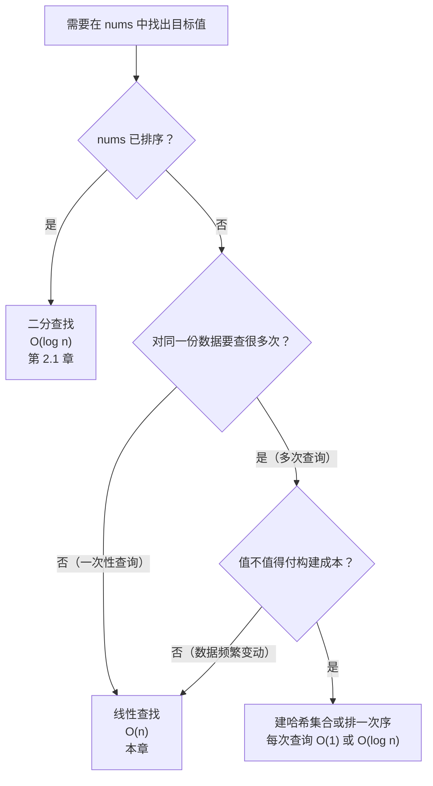
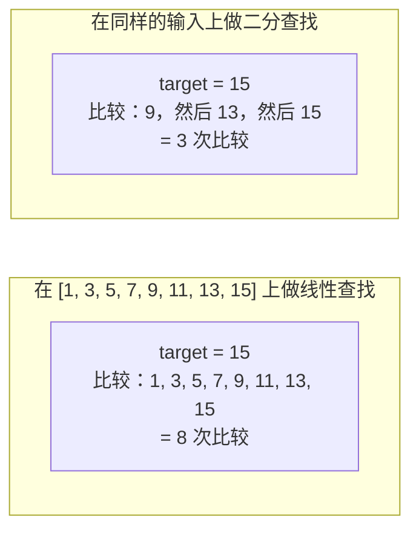

# 线性查找及其适用场景

最干净的第一轮面试题只要六行：遍历一个数组，返回第一个等于目标值的元素下标，没有就返回 `-1`。这就是线性查找（linear search）。只要输入没有可利用的结构（既没排序，也没有预先算好的哈希或索引），而你又只需要问一次“X 在哪”，伸手去拿的就是它。

本部分后面两章会花不少篇幅，只为在你这里写的代码之上挣出一个对数因子。线性查找就是它们必须打败的基线。如果你把它当成傻乎乎的默认做法直接跳过，就理解不了二分查找和哈希表查找究竟买到了什么——因为你手里没有一个可以拿来对照的数字。

本章的骨架一句话说得完：**线性查找永远可用；而一旦输入有序，它就永远不是最优解。** 前半句是它的长处，后半句是通往[二分查找：标准版本](./01-binary-search-canonical.md)的桥。

## 什么时候线性查找才是正确答案

有三种输入形态，会让线性查找成为正确选择，而不是“等以后换成更好的”占位符。

第一种是**输入无序**。如果 `nums` 没有可利用的结构，那么任何算法只要不检查某个位置 `j`，就无法排除目标正躺在 `j` 上。对手会把目标摆在那里，算法就会返回错误答案。对无序输入做成员判断，Theta(n) 次读取是信息论意义下的下界。本部分后面每一个算法，要么为了拿到那种结构先付预处理代价（排序、哈希、建表），要么干脆换到另一套模型里去。

第二种是**一次性查询**。如果你只扫一遍、之后再也不查，任何索引结构的构建成本都会盖过它带来的收益。一个一亿元素的数组只查一次，直接顺序扫一遍比“建个哈希集合、查一次、再扔掉”更快。Sedgewick 和 Wayne 在《*Algorithms*》4e §3.1 里把这个权衡讲得很直白：命题 A 给出顺序查找的上界是 N 次比较，命题 B 给出有序数组上二分查找的上界是 lg N + 1 次比较。[^1] 只有当 lg N + 1 省下的比较能与“先把数组排好序”的代价摊销到一起时，它才划得来。

第三种是 **n 很小**。分支预测和缓存局部性都偏爱紧凑数据上的顺序扫描。二分查找开始胜出的临界点，在现代硬件上大约在 n = 30 到 50 之间；低于这个范围，尽管渐近复杂度更差，循环还是赢。生产环境的排序例程直接利用了这一点。Java 的双轴快排、Go 的 `pdqsort`、Rust 的 `slice::sort`，都在 16 到 32 个元素左右的固定阈值以下切换到插入排序（它是顺序扫描的近亲）。



*图注：输入无序、且只查一次时，线性查找胜出。二分查找要求输入有序；哈希表查找要求先有一个构建阶段。两者都是拿预处理换每次查询更少的比较次数。*

所以你在面试题里要找的模式信号是：**输入无序，加上一次性查询，再加上每一步的状态能用几个变量装下**。这三条只要破一条，就去第 2.1 章的二分查找或[哈希表](../part-1-linear-data-structures/03-hash-maps.md)那一章找升级路径。

## 算法

Knuth 在《计算机程序设计艺术》（*The Art of Computer Programming*）第 3 卷 §6.1（“Sequential Searching”）里用很大篇幅讲了线性查找，把它作为算法 B（基本版）引出，另有两个近亲：带哨兵的算法 Q，以及用于有序表的算法 T。[^2] CLRS 习题 2.1-3 把同一个算法当作循环不变式证明的教科书热身题。[^3] 伪代码六行：

```text
function linear_search(A, v):
    for i = 0 to A.length - 1:
        if A[i] == v:
            return i
    return -1
```

循环不变式是：**每轮迭代开始时，子数组 `A[0..i-1]` 中不含 `v`**。初始化空真成立——空前缀里什么都没有。保持成立，因为要么 `A[i] == v`、循环直接返回，要么 `A[i] != v`、不变式扩展到 `A[0..i]`。终止时 `i == A.length`，说明 `A[0..n-1]` 中没有任何下标匹配，返回 `-1` 是正确的。三行推理，总代价以 `n` 轮迭代为界。

```python
def linear_search(nums: list[int], target: int) -> int:
    for i, x in enumerate(nums):
        if x == target:
            return i
    return -1
```

**解法** — Python（[Java](./00-linear-search/sol.java) · [C++](./00-linear-search/sol.cpp) · [Go](./00-linear-search/sol.go)）

```python
"""LC linear search — scan an unsorted sequence, return first match index.

The contract: walk the array left to right, return the index of the first
element equal to target, or -1 if none. This is Knuth Algorithm B from
The Art of Computer Programming Volume 3 §6.1, the foundation every other
search algorithm in this part is measured against.
"""
from typing import List


def linear_search(nums: List[int], target: int) -> int:
    """Scan left-to-right; return first index where nums[i] == target, else -1.

    Loop invariant (CLRS Exercise 2.1-3): at the start of each iteration,
    nums[0..i-1] does not contain target. Initialisation holds vacuously.
    Maintenance holds because either nums[i] == target and the loop returns,
    or nums[i] != target and the invariant extends to nums[0..i].
    Termination at i == len(nums) says no index in nums[0..n-1] matches.
    """
    for i, x in enumerate(nums):
        if x == target:
            return i
    return -1
```

四份实现各自遵循本语言的标准写法约定：Python 用 `enumerate`；Java 用基本类型 `int[]`，躲开热路径上的装箱；C++ 用 `std::size_t` 去比 `vector::size()`，只在返回时做一次类型转换；Go 直接在切片上用 `range`。标准库里有等价物（C++ 的 `std::find`、Go 1.21+ 的 `slices.Index`），生产代码会调它们；本章教的是显式循环，因为面试官要你写的就是这个。

## 开销

最好情况：O(1)，目标正好在下标 0 时只需一次比较。最坏情况：O(n)，目标不存在或位于最后一个下标时恰好 n 次比较。目标位置均匀随机分布时，平均情况是期望 (n+1)/2 次比较。若目标有 k 个、均匀分布，命中第一个所需探测次数的期望降到 (n+1)/(k+1)。[^2] 空间无论哪种情况都是 O(1)。



*图注：同样是 n = 8 的有序输入，找最后一个元素，线性查找要八次比较，二分查找要三次。这个比例随 n 增长。n = 10^6 时，线性查找最多需要 10^6 次比较，二分查找约 20 次。*

Theta(n) 的最坏情况界是**紧的**，靠的是信息论里的对手论证。一个不做任何预处理的查找过程，最坏情况下必须读取每一个“还没被先前的读取排除掉”的单元。任何算法只要不查看位置 `j` 就返回“不存在”，它就无法区分自己的输入和“目标被放在 `j` 上”的那份输入，于是对手能逼它读满 n 次。

常数因子在实际中很要紧，而它在渐近界里是看不见的。Knuth 的算法 Q（“带哨兵”）把目标写到 `n+1` 槽位上，于是内层循环只判 `A[i] == v` 而不判 `i < n`，每轮的判断次数减半。[^2] 在 Knuth 那台 MIX 机器上，这个节省很可观。在现代带分支预测的 CPU 上，节省小一些，但在紧凑循环里依然看得出来。LeetCode 上跑的、以及你面试要写的，是带显式边界检查的算法 B。算法 Q 是值得知道的微优化，不值得动手敲。

## 模式失效的场景

有三个子模式值得单独命名，因为它们在后面的章节里反复出现。

**带哈希集合的线性扫描。** 当问题从“X 在哪”变成“是否存在满足性质 P 的一对元素”——`LC 217 Contains Duplicate` 就是标准例子——从 O(n²)（嵌套循环、两两比较）升级到 O(n)（单趟遍历、用集合携带“迄今见过的所有元素”）是结构性的，不是算法性的。扫描还是扫描；每一步的状态从“当前元素”长成了一个支持 O(1) 成员查询的哈希集合。升级买到的就是这个集合；支撑它的机制在[哈希表](../part-1-linear-data-structures/03-hash-maps.md)那一章。

**带运行聚合值的线性扫描。** 当问题不是“X 在不在”而是“以这里结尾的最优子序列是什么”，同一个循环携带一个定长累加器。`LC 53 Maximum Subarray`（Kadane 算法）维护一个当前最大和加一个全局最优。`LC 414 Third Maximum Number` 携带三个哨兵最大值。`LC 485 Max Consecutive Ones` 携带一个遇零就重置的计数器。循环骨架与线性查找一模一样，变的只是每个元素上做的事。

**有序表上的线性查找（Knuth 算法 T）。** 如果数组已经有序，但又小到二分查找的开销不划算，扫描可以在第一个 `A[i] >= target` 处提前退出。对于查不存在的目标，这把期望探测次数从 n 降到大约 n/2——还是 O(n)，只是常数更小。[^2] 这就是通往下章的自然桥梁：输入形态相同，访问模式根本不同，而对数收益的价钱要提前用排序付掉。

## 常见陷阱

> [!WARNING]
> **不要给无序数据上的扫描加上提前退出的 `break`。** 提前退出 `if A[i] >= target: break` 只在输入有序时成立。读完二分查找那一章后“顺手加个防御”，是常见 bug；在无序输入上，它会静悄悄地漏掉那些出现在“比目标大的值”之后的匹配。把前置条件写进函数名（`linear_search_sorted`），或者在测试里断言有序性。

> [!WARNING]
> **哨兵值必须落在输入范围之外。** `LC 414 Third Maximum Number` 的某个 Java 实现把 `max1 = max2 = max3 = Integer.MIN_VALUE` 初始化，然后判断 `if (max3 != Integer.MIN_VALUE) return max3`，遇到含 `Integer.MIN_VALUE` 的输入就错。用 `Long.MIN_VALUE`（比输入范围宽一档），或者另带一个 `boolean found3` 标志。

> [!WARNING]
> **把值当成下标返回，是面试压力下最常见的 bug。** 在函数体开头写明返回类型，然后守住它。“X 在不在这里”返回布尔，“X 在哪”返回整数下标，“没找到”返回 `-1`（永远不是 `0`，`0` 是真实下标）。`LC 217 Contains Duplicate` 和 `LC 1 Two Sum` 的区别只在返回契约；把两种契约混用，写出来的代码会静悄悄地错，却还能过掉一个样例测试。

## 题目梯度

CORE 三题全是简单。这份梯度对“线性扫描作为模式”在 LeetCode 上的经典题目是诚实的：这个类别里的困难变体（`LC 41 First Missing Positive`、`LC 42 Trapping Rain Water`）归第 3 部分的双指针章节，那里“带状态的扫描”这套框架更自然。STRETCH 用 Kadane 算法补上中等这一档。

### 核心（三题全做才算掌握本章）

- [LC 1287 — Element Appearing More Than 25% In Sorted Array](https://leetcode.com/problems/element-appearing-more-than-25-in-sorted-array/) [简单] • linear-search-with-counter ★
- [LC 217 — Contains Duplicate](https://leetcode.com/problems/contains-duplicate/) [简单] • linear-search-with-hash-set
- [LC 414 — Third Maximum Number](https://leetcode.com/problems/third-maximum-number/) [简单] • linear-scan-with-fixed-state

### 进阶（可选）

- [LC 53 — Maximum Subarray](https://leetcode.com/problems/maximum-subarray/) [中等] • linear-scan-with-running-aggregate
- [LC 485 — Max Consecutive Ones](https://leetcode.com/problems/max-consecutive-ones/) [简单] • linear-scan-with-counter

## 后续衔接

下一章[二分查找：标准版本](./01-binary-search-canonical.md)是有序数组上的特化版本，用线性查找的普适性换比较次数的指数级下降。桥梁是 Knuth 的算法 T：仍然是顺序扫描，但在越界处提前退出，它说的是“如果你愿意在有序数组里*跳*而不是一步一步走，你就用 O(n) 的最坏情况换来了 O(log n)”。代价是排序。下一章把这个代价当作已付，然后给你看收益。

## 参考文献

[^1]: Robert Sedgewick and Kevin Wayne, *Algorithms*, 4th ed., Addison-Wesley, 2011, §3.1 "Elementary Symbol Tables", Proposition A (sequential search uses N compares in the worst case for both successful and unsuccessful searches in an unordered table) and Proposition B (binary search in an ordered array with N keys uses no more than lg N + 1 compares). <https://algs4.cs.princeton.edu/31elementary/>.
[^2]: Donald E. Knuth, *The Art of Computer Programming, Volume 3: Sorting and Searching*, 2nd ed., Addison-Wesley, 1998, §6.1 "Sequential Searching", Algorithm B (basic), Algorithm Q (with sentinel), Algorithm T (ordered table), pp.
[^3]: *Introduction to Algorithms* (CLRS), 4th ed., Cormen, Leiserson, Rivest, Stein, MIT Press, 2022, Chapter 2 §2.
