# 二分查找：标准版本

2006 年 6 月，Joshua Bloch 在 Google Research 博客上发了一篇标题很长的通告：*Extra, Extra — Read All About It: Nearly All Binary Searches and Mergesorts are Broken.* 他描述的 bug 已经在 `java.util.Arrays.binarySearch` 里躺了九年。Bentley 的 *Programming Pearls* 从 1986 年就带着同一个 bug，而那一章里作者还在 CMU 的课堂上讲过这个算法，并*当场证明了它的正确性*。证明是对的，实现是错的。分歧只有一行：

```text
int mid = (low + high) / 2;
```

这一行在元素超过 2^30 个的数组上会溢出。`low + high` 超出 `Integer.MAX_VALUE`；和回绕成负数；除法结果仍是负数；下一次数组访问在 Java 里抛 `ArrayIndexOutOfBoundsException`，在 C 里返回垃圾值。1986 年没人有十亿级元素的数组，所以这个 bug 隐形了。二十年后在 Google，有人有了。[^1]

修法是 `lo + (hi - lo) / 2`。更难的一课，也是走出本章之后仍然管用的那一课，是 Bentley 从这件事里带走的那句话：**认真考虑你程序里的不变量。** 把区间折半是二分查找里最容易的部分。已发表的实现能几十年保持错误，原因在于边界处理——`lo <= hi` 还是 `lo < hi`，`hi = mid` 还是 `hi = mid - 1`，循环退出时 `lo` 究竟代表什么——这些东西并不直观。它们每次都得从一条写下来的不变量推导出来。

本章给出三个模板，对应三种问题形态。每个模板都带一条足够强的不变量，其余每一行代码都能从它推出来。记住不变量，模板自己就会写出来；只记模板不记不变量，你就会发出 Bloch 那个 bug。

## 看问题选模板，不看输入

三个不同的问题，从二十英尺外看像是同一个问题：有序数组、目标值、找点什么。走近一步就完全不是同一回事了：

- **LC 704 Binary Search。** *`target` 在不在 `nums` 里，在哪？* 返回下标，不存在返回 `-1`。
- **LC 35 Search Insert Position。** *`target` 该插到哪？* 返回最小的下标 `i`，使得把 `target` 插进去后 `nums` 仍然有序。返回值永远落在 `[0, len(nums)]` 内，永远不是 `-1`。
- **LC 278 First Bad Version。** *满足 `isBadVersion(v) == true` 的最小版本 `v`。* 没有数组。序列 `1..n` 是隐含的，判别靠谓词。

当答案是“不存在”时，三个问题的回答方式不同，仅这一处差别就足以要求三个不同的模板。LC 704 返回 `-1`；LC 35 返回插入位置；LC 278 没有“不存在”这种情况，因为谓词保证先假后真单调。想让一个模板用一套指针更新规则同时处理三者，产出的正是本章想防的那些差一 bug。

```mermaid
flowchart TD
    A["有序数组<br/>或单调谓词"] --> B{"问题形态？"}
    B -->|"元素是否存在，返回下标或 -1"| C["模板 A<br/>精确匹配<br/>闭区间"]
    B -->|"元素该插在哪，<br/>最小的 i 使 nums[i] 大于等于 target"| D["模板 B<br/>下界<br/>半开区间"]
    B -->|"满足谓词 P(i) 的最小 i"| E["模板 C<br/>谓词驱动<br/>半开区间"]
    B -->|"有序但被旋转"| F["见二分查找变体：<br/>模板 A 加一个分支"]
```



*三个模板，对应三种问题形态。按问题而不是按输入形态选模板，才能避免把 LC 35 的插入位置语义塞进 LC 704 未命中返回 -1 的契约里。*

从[线性查找及其适用场景](./00-linear-search.md)过来的桥梁只是一次特化。那里你也有一个有序数组，即 Knuth 的 Algorithm T，但你是一步一步走的。二分查找是跳，而跳的代价在排序阶段就预付了。下一章[二分查找变体](./02-binary-search-variants.md)会把这三条不变量搬到不再是有序数组的输入上：旋转数组、找峰值、数值域上的参数化搜索。没有本章教的不变量，那些都做不了。

## 模板 A：闭区间精确匹配

当问题是*`target` 在不在，在哪？*时用模板 A。返回契约是命中给下标，未命中给 `-1`。

```python
def search(nums, target):
    lo, hi = 0, len(nums) - 1
    while lo <= hi:
        mid = lo + (hi - lo) // 2          # 绝不要写 (lo + hi) // 2
        if nums[mid] == target:
            return mid
        if nums[mid] < target:
            lo = mid + 1
        else:
            hi = mid - 1
    return -1
```

不变量只有一句：**如果 `target` 存在于 `nums`，它的下标一定在 `[lo, hi]` 里。** 两个端点都是活的，都是候选。闭括号这件事决定了后面所有代码怎么写。

循环条件由不变量推出。当 `lo == hi` 时区间非空，恰好含一个还没探测过的格子 `nums[lo]`。跳过它，算法就会在不检验不变量所指的那个候选的情况下宣布“不存在”。所以循环条件必须是 `lo <= hi`，而不是 `lo < hi`。代价是单元素情形多跑一轮，而那一轮正是全部意义所在。

未命中后的指针更新同由不变量推出。`mid` 刚刚比较过并被排除，它不能留在闭区间里，两个指针都要越过它：`lo = mid + 1` 丢掉左半，或 `hi = mid - 1` 丢掉右半。写成 `lo = mid` 或 `hi = mid` 是第三常见的二分查找 bug，见下面的[差一错误的重灾区](#差一错误的重灾区)。

在 `nums = [1, 3, 5, 7, 9, 11, 13]`、`target = 7` 上走一遍标准流程：

| 步骤 | lo | hi | mid | nums[mid] | 判断 |
|---|---|---|---|---|---|
| 0 | 0 | 6 | — | — | 闭区间 `[0, 6]`。目标若存在必在此。 |
| 1 | 0 | 6 | 3 | 7 | 命中。返回 3。 |

七元素数组只跑一轮，因为中位数正好落在答案上。把目标换成一个不存在的值，才能看见算法干活。试 `target = 4`：

| 步骤 | lo | hi | mid | nums[mid] | 判断 |
|---|---|---|---|---|---|
| 0 | 0 | 6 | — | — | 闭区间 `[0, 6]` |
| 1 | 0 | 6 | 3 | 7 | 7 > 4。丢掉右半：`hi = 2`。 |
| 2 | 0 | 2 | 1 | 3 | 3 < 4。丢掉左半：`lo = 2`。 |
| 3 | 2 | 2 | 2 | 5 | 5 > 4。单元素：`hi = 1`。 |
| 4 | 2 | 1 | — | — | `lo > hi`。区间为空。返回 -1。 |

`n = 7` 时三次比较。上界是 `ceil(log_2 8) = 3` 次比较，再加一轮空区间的守卫触发。下面的交互组件动画演示的正是这条轨迹；选到“目标不存在”预设后逐帧看。

> **Interactive widget:** [Binary search (exact-match + rotated)](../../../dsa/widgets/w-04-binary-search.yml)（面板 `panel-a`）——在网站上渲染；YAML 规格描述各关键帧。

*静态备用图：取自“目标不存在”预设的四帧，展示闭区间从 `[0, 6]` 缩到 `[0, 2]`、`[2, 2]`，最后为空。*

## 模板 B：半开区间上的下界

把问题换成*`target` 该插到哪？*之后，模板 A 几乎每一行都得改。闭区间变半开区间，循环条件变严格不等，有一个指针保留 `mid` 而不是越过它。返回值不再是命中下标，而是第一个不小于目标的格子位置。

```python
def search_insert(nums, target):
    lo, hi = 0, len(nums)                  # 注意：末尾之后的位置
    while lo < hi:
        mid = lo + (hi - lo) // 2
        if nums[mid] < target:
            lo = mid + 1
        else:
            hi = mid                       # 不是 mid - 1
    return lo
```

不变量现在有两半，每个指针一半：

> 所有满足 `j < lo` 的下标 `j` 都有 `nums[j] < target`。
> 所有满足 `k >= hi` 的下标 `k` 都有 `nums[k] >= target`。

再读一遍。`lo` 走在边界后面，`hi` 走在边界前面。半开形式 `[lo, hi)` 不是风格选择，它直接表达了下界契约。`hi = len(nums)` 是因为答案合法地可能落在最后一个下标之后，也就是所有元素都小于目标的情形。终止状态是 `lo == hi`，按构造这个共同值就是答案。不变量的两半一起把它钉住了。

两个指针的更新不对称也就顺理成章。当 `nums[mid] < target` 时，直到 `mid`（含）的所有下标都太小，所以 `lo` 越过 `mid` 到 `mid + 1`。当 `nums[mid] >= target` 时，`mid` 这个格子本身就是合法的上界候选，而半开区间*不含* `hi`，所以把 `hi` 收缩到 `mid` 既保住不变量，又不会在下一轮重复检验 `mid`。写成 `hi = mid - 1` 就破坏不变量了：`mid - 1` 处的格子可能就是答案，循环却刚刚宣布它不可能。

在 `nums = [1, 3, 5, 6]` 上跑四次，覆盖本章关心的全部情形：

| target | 轨迹 | 返回 | 含义 |
|---|---|---|---|
| 5 | hi 收缩 4 → 2 → 2；lo 前进 0 → 2 | 2 | 命中；插在已有位置 |
| 2 | hi 收缩 4 → 2 → 1 | 1 | 在 1 和 3 之间 |
| 7 | lo 前进 0 → 3 → 4 | 4 | 越过末尾 |
| 0 | hi 收缩 4 → 2 → 1 → 0 | 0 | 在所有元素之前 |

“越过末尾”这一情形，正是 `hi` 从 `len(nums)` 而不是 `len(nums) - 1` 起步的原因。模板 A 在这里会返回 `-1`。模板 B 没别的地方放答案；`len(nums)` 是完全合法的插入位置，算法以 `lo == hi == len(nums)` 结束。

C++ 标准库的 `std::lower_bound` 就是这个模板。Java 的 `Collections.binarySearch` 未命中时返回 `-(insertionPoint + 1)`，形状同样来自下界；负数编码让同一个返回值既能表示“在下标 x 找到”，也能表示“没找到，应插在这里”，调 `Arrays.binarySearch` 的人做一次减法就能解码。Go 的 `sort.Search` 最接近下面的模板 C：它接受谓词，不接受值。

## 模板 C：谓词驱动的最左值

第三个模板是模板 B 做一处替换。模板 B 比较 `nums[mid] < target` 的地方，模板 C 改调一个黑盒谓词 `P(mid)`，该谓词在整个搜索区间上恰好从假翻成真一次。循环与指针逻辑逐字节相同：

```python
def first_true(lo, hi, P):
    while lo < hi:
        mid = lo + (hi - lo) // 2
        if P(mid):
            hi = mid
        else:
            lo = mid + 1
    return lo
```

不变量形状相同，只是把 `nums[j] < target` 换成 `not P(j)`：

> 所有满足 `j < lo` 的下标 `j` 都有 `not P(j)`。
> 所有满足 `k >= hi` 的下标 `k` 都有 `P(k)`。

LC 278 First Bad Version 是标准例子。谓词是平台提供的 API `isBadVersion(v)`。坏提交之前的每个版本返回假，从坏提交起每个版本返回真。这个函数回答的是*哪个版本把东西弄坏了*，完全不做数组索引，只调黑盒谓词。

```python
def first_bad_version(n, is_bad_version):
    lo, hi = 1, n
    while lo < hi:
        mid = lo + (hi - lo) // 2
        if is_bad_version(mid):
            hi = mid
        else:
            lo = mid + 1
    return lo
```

LC 278 的约束是 `n <= 2,147,483,647`。这个数就是 32 位有符号整数的 `INT_MAX`，也正是 Bloch 那个 bug 关心的边界。当 `lo == 0`、`hi == 2^31 - 1` 时算 `(lo + hi) / 2` 会让有符号整数溢出；回绕结果是负数；下一次谓词调用就把一个负数版本号传给根本不期待它的 API。修法 `lo + (hi - lo) / 2` 让每个中间值都被 `hi` 界住，按构造能装进有符号类型。两种写法在无界整数上数学等价，在有界整数上不是位等价。

模板 C 是从“在有序数组上二分”通向“在答案上二分”的桥，[二分查找变体](./02-binary-search-variants.md)就住在那儿。一旦意识到谓词不必是 `nums[i] >= target`，搜索空间就不再是数组，而是任意“整数区间上的单调谓词”：运完一批货的最少天数（LC 1011）、赶上截止时间的最小进食速度（LC 875）、不超过阈值的最小除数（LC 1283）。下一章把这三个都走一遍。

## 四种语言的惯用写法

**解法** — Python（[Java](./01-binary-search-canonical/sol.java) · [C++](./01-binary-search-canonical/sol.cpp) · [Go](./01-binary-search-canonical/sol.go)）

```python
# LC 704. Binary Search. 精确匹配闭区间模板。
# LC 35. Search Insert Position. 下界半开区间模板。
# LC 278. First Bad Version. 谓词驱动半开区间模板。
#   LC 704: ([-1,0,3,5,9,12], 9) -> 4; ([-1,0,3,5,9,12], 2) -> -1;
#           ([5], 5) -> 0; ([5], -5) -> -1; ([1,3,5,7,9,11,13], 7) -> 3; ([], 1) -> -1.
#   LC 35: ([1,3,5,6], 5) -> 2; ([1,3,5,6], 2) -> 1; ([1,3,5,6], 7) -> 4; ([1,3,5,6], 0) -> 0.
#   LC 278: n=5,bad=4 -> 4; n=1,bad=1 -> 1; n=INT_MAX,bad=1702766719 -> 1702766719.

from typing import Callable, List


def search(nums: List[int], target: int) -> int:
    """LC 704. Exact-match closed-interval template.

    Loop invariant: target, if it exists, is in nums[lo..hi] (both inclusive).
    Loop terminates when lo > hi (interval empty, target not present).
    """
    lo, hi = 0, len(nums) - 1
    while lo <= hi:
        mid = lo + (hi - lo) // 2  # 相比 (lo + hi) // 2 不会溢出
        if nums[mid] == target:
            return mid
        if nums[mid] < target:
            lo = mid + 1
        else:
            hi = mid - 1
    return -1


def search_insert(nums: List[int], target: int) -> int:
    """LC 35. Lower-bound (leftmost insertion point) template.

    Loop invariant: every index j with j < lo satisfies nums[j] < target;
    every index k with k >= hi satisfies nums[k] >= target.
    Terminates when lo == hi; lo is the insertion point.

    Uses half-open style: [lo, hi) with hi = len(nums) (one past the end).
    """
    lo, hi = 0, len(nums)
    while lo < hi:
        mid = lo + (hi - lo) // 2
        if nums[mid] < target:
            lo = mid + 1
        else:
            hi = mid
    return lo


def first_bad_version(n: int, is_bad_version: Callable[[int], bool]) -> int:
    """LC 278. Predicate-driven leftmost template on [1, n].

    Loop invariant: the answer (first bad version), which exists by problem
    guarantee, lies in [lo, hi]. At loop exit lo == hi == answer.
    """
    lo, hi = 1, n
    while lo < hi:
        mid = lo + (hi - lo) // 2
        if is_bad_version(mid):
            hi = mid
        else:
            lo = mid + 1
    return lo
```

标准测试覆盖 LC 704 的单元素、空数组、命中、未命中、“越过末尾”几类情形；LC 35 的四种插入点情形；以及 LC 278 的 `n = INT_MAX` 溢出边界。四种语言里有三种存在标准库等价物：C++ 的 `std::lower_bound`、Java 带负数编码返回值的 `Collections.binarySearch`、Go 的 `sort.Search`。生产代码直接调它们。面试官要你从零写模板 A，而本章教的就是这个。

## 实际开销

最坏情况 `Theta(log_2 n)` 次比较；由决策树论证可知是紧的。区间 `[lo, hi]` 每轮至少缩小一半：每次比较后，要么 `lo := mid + 1` 丢掉左半（含 `mid`），要么 `hi := mid - 1` 丢掉右半（含 `mid`）。新区间长度最多是 `floor((hi - lo) / 2)` 加上边界调整，严格小于原长的一半。`k` 轮之后区间长度最多 `n / 2^k`；长度为 0 时循环终止，因此 `k <= ceil(log_2 n)`。[^2] 目标正好落在第一次探测的中点上时，最好情况 `Theta(1)`。迭代写法空间 `Theta(1)`；递归版本为调用栈付 `Theta(log n)`，什么也没换回来。

信息论下界与此吻合。基于比较的查找算法必须区分 `n + 1` 种结果（`n` 个可能命中的下标，加一个未命中），所以它的决策树至少有 `n + 1` 个叶子；有 `n + 1` 个叶子的二叉树最小高度是 `ceil(log_2(n + 1))`。[^3] 因此在有序数组上，二分查找在基于比较的查找算法里是渐近最优的。Knuth 的“均匀二分查找”（预计算中点偏移）能省常数，改不了这个界。[^3]

这个界也解释了为什么在结构化输入上存在更快的替代方案。哈希表每次查询期望 `O(1)`，代价是 `Theta(n)` 预处理和 `Theta(n)` 额外空间。B 树和 trie 每次查询 `O(log n)`，并支持高效插入。在均匀分布的数值键上，插值查找期望 `O(log log n)`，代价是对键分布的假设。同一类查询，各自付不同的价钱。当输入是静态有序数组、你又不想为额外结构付费时，二分查找就是赢家。

## 差一错误的重灾区

三个指针更新 bug 形状相同：都是一行代码，都能编译，都能过几个样例，都在单元素边界、`INT_MAX` 边界或空数组边界上崩掉。把不变量写下来之后，修法是机械的。这些 bug 之所以常见，是因为工程师在面试压力下不会去写不变量。

> [!CAUTION]
> **绝不要把 `(lo + hi) / 2` 当作中点。** 这个 bug 在 `java.util.Arrays.binarySearch` 里存活了九年才被 Bloch 抓住。[^1] 在任何超过 2^30 个元素的数组上，求和会溢出；回绕值是负数；数组访问要么抛异常要么返回垃圾。修法是 `lo + (hi - lo) / 2`。两种写法在无界整数上数学等价，在有界整数上不等价。把安全写法练成反射：每种语言、每一次都用。Java 里更快的替代 `(lo + hi) >>> 1`（无符号右移）同样安全，也是 Bloch 认可的做法；减法写法能在本章教的四种语言里干净地移植。

> [!WARNING]
> **循环条件由区间风格决定，不由个人偏好决定。** 闭区间 `[lo, hi]`（模板 A）要求 `while lo <= hi`；单元素情形 `lo == hi` 非空，必须探测。半开区间 `[lo, hi)`（模板 B、C）要求 `while lo < hi`；`lo == hi` 是空区间终止态，也正是答案。两者混用——闭区间配 `lo < hi`，或半开区间配 `lo <= hi`——会在单元素边界上产生差一漏检，或在单元素处死循环，取决于你错在哪一边。这个 bug 在大多数随机输入上不吭声，只在答案恰好落在下标 0、最后一个下标，或数组只有一个元素时发作。面试筛选会故意打这些点。

> [!WARNING]
> **在模板 A 里，未命中后绝不要写 `lo = mid` 或 `hi = mid`。** 闭区间必须收缩。`mid` 已经比较过并被排除；只要有一个指针只移到 `mid` 而不是越过它，那么在下一轮 `lo + 1 == hi` 时，`mid` 向下取整到 `lo`，指针更新成了空操作，循环就永远转下去。规则是机械的：闭区间，未命中，越过 `mid`。半开区间正相反：模板 B 的 `hi = mid` 是对的，因为半开区间按定义不含 `hi`，而 `mid` 这个格子本身仍是合法候选。

> [!WARNING]
> **“所有模板都返回 `lo`”这条记忆会在上界孪生题上失效。** 模板 B、C 返回 `lo`，因为它们的不变量在循环退出时把 `lo` 认定为答案。上界变体——见[二分查找变体](./02-binary-search-variants.md)——返回 `lo - 1`，因为它不变量认定的是另一个指针。返回语句要从自己的不变量推出，绝不能从别的模板抄。同样的警告适用于模板 A 的 `return -1`：那个常量是对的，因为模板 A 返回下标，从不返回插入点；拿 `-1` 当模板 B 的未命中返回，会把一个完全合法的插入点答案 `0` 悄悄变成“未找到”标记。

> [!WARNING]
> **二分查找需要单调性，不是有序性。** 更深层的前提是某个谓词 `P(i)` 在 `i` 上单调地先假后真。有序只是达成它的一种方式（`P(i) := nums[i] >= target`）；数值域上的可行性谓词是另一种（LC 1011 的参数化搜索里 `P(c) := canShipInDays(c) <= D`）。如果你写不出搜索所依赖的那条单调性质，二分查找就不适用，它会以 `O(log n)` 给出错误答案，而不是以 `O(n)` 给出正确答案。

## 后续衔接

[二分查找变体](./02-binary-search-variants.md)原样复用模板 A 的闭区间不变量，每轮多加一次比较，去处理字面上不再有序的输入：旋转数组（LC 33）、两侧各自单调的输入上找峰值（LC 162）、跨两个数组的分割搜索（LC 4），以及优化问题上的答案二分（LC 875、LC 1011）。把不变量吃透再走出本章的读者，看 2.2 的旋转数组代码会觉得“就是模板 A 加一个分支”。不变量还模糊地走出本章的读者会在那里挣扎，因为分支怎么判*正是*从不变量推出来的。你刚才点过的那个交互组件与那一章共用；面板 B 在同一块画布上演示旋转情形。

## 题目梯度

三个 CORE 题在 LeetCode 上全是 Easy，这是结构性的，不是选题偏好。标准三模板二分查找题按设计就是 LC-Easy；模板*本身*是课程内容，输入故意做到最小，好让模板站到台前。往 CORE 里加一道 Hard，等于要教另一章（旋转数组、分割搜索、参数化搜索），而它们都在[二分查找变体](./02-binary-search-variants.md)里。STRETCH 承担 Medium 和 Hard 的台阶，在合集层面满足难度跨度要求。

### 核心（全做才算掌握本章）

- [LC 704 — Binary Search](https://leetcode.com/problems/binary-search/) [简单] • binary-search-template-1 ★
- [LC 35 — Search Insert Position](https://leetcode.com/problems/search-insert-position/) [简单] • binary-search-leftmost-insertion
- [LC 278 — First Bad Version](https://leetcode.com/problems/first-bad-version/) [简单] • binary-search-on-monotone-predicate

### 进阶（可选）

- [LC 540 — Single Element in a Sorted Array](https://leetcode.com/problems/single-element-in-a-sorted-array/) [中等] • binary-search-template-1，配一个基于奇偶性的巧妙单调谓词
- [LC 4 — Median of Two Sorted Arrays](https://leetcode.com/problems/median-of-two-sorted-arrays/) [困难] • binary-search-on-partition-index *（参考：仅 Python）*

LC 540 是本章范围内模板 A 最干净的延伸：谓词是“在最左侧那个未配对下标处，偶下标元素右边不再有重复”，§“模板 A”里同一条闭区间不变量就能撑起证明。[^4] LC 4 是标准的 Hard 二分查找题；描述看着简单，实际要求在一个数组的分割位置上做 `Theta(log(min(m, n)))` 的二分，用的是模板 A 的不变量做一次不平凡的比较。[^5]

## 参考文献

[^1]: Joshua Bloch, "Extra, Extra — Read All About It: Nearly All Binary Searches and Mergesorts are Broken," *Google Research blog*, June 2, 2006. <https://blog.research.google/2006/06/extra-extra-read-all-about-it-nearly.html>.

[^2]: Cormen, Leiserson, Rivest, Stein, *Introduction to Algorithms*, 4th ed., MIT Press, 2022, exercise 2.

[^3]: Donald E. Knuth, *The Art of Computer Programming, Volume 3: Sorting and Searching*, 2nd ed., Addison-Wesley, 1998, §6.2.1 "Searching an Ordered Table"; decision-tree height bound for any comparison-based search.

[^4]: Robert Sedgewick and Kevin Wayne, *Algorithms*, 4th ed., Addison-Wesley, 2011, §1.1 "Basic programming model", `BinarySearch.java`. <https://algs4.cs.princeton.edu/code/edu/princeton/cs/algs4/BinarySearch.java.html>.

[^5]: dsaprep.dev, "Median of Two Sorted Arrays LeetCode Solution," <https://dsaprep.dev/blog/median-of-two-sorted-arrays-solution/>
