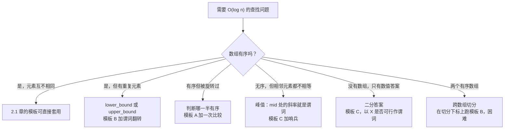

# 二分查找的变体：lower_bound、upper_bound、峰值与旋转数组

拿数组 `[1, 2, 2, 2, 3]`，二分查找 `2`。[上一章](./01-binary-search-canonical.md)的模板对同一个输入会给出三个不同答案，取决于你问的是哪个问题。`lower_bound` 返回 `1`，最左边的那个 `2`。`upper_bound` 返回 `4`，最右边 `2` 的后一格。精确匹配的模板 A 返回 `{1, 2, 3}` 里的*某个*下标，取决于它先探到哪一格。同样的输入，三个答案，在各自的契约下都正确。

差异各只在一行里。`lower_bound` 用 `nums[mid] < target` 比较。`upper_bound` 把严格小于翻转成非严格的小于等于：`nums[mid] <= target`。整份差别就这一处。骨架、循环判断、指针更新、半开区间不变式，其余每一行都和 2.1 章的模板 B 逐字节相同。只记模板不记不变式，你迟早会在某处把 `<` 写成 `<=`，发出去一个能通过 90% 测试的 bug。记住不变式，谓词自己就写出来了。

本章做五次这样的翻转。每个变体都是相对 2.1 某个模板改一行的谓词，只是换一种输入形态：重复元素、旋转数组、峰值、数值域、两个数组同时出现。界仍然是 `O(log n)`。要教的是那个谓词。

## 从输入形态定位变体



*五个问题，五个谓词。本章按顺序走一遍。结尾的交互组件演示旋转数组那一支，因为那个分支判断是读者最容易做错的一处。*

## 变体 1：重复元素上的 lower_bound 与 upper_bound

2.1 章的模板 B 针对的是键互不相同的数组。契约是*返回最小的 `i` 使 `nums[i] >= target`*，在标准输入上，这个下标同时也定位到唯一的命中（如果存在）。一旦数组里出现重复元素，契约就分叉了。

`lower_bound` 返回最小的 `i` 使 `nums[i] >= target`。在 `[1, 2, 2, 2, 3]` 上查 `2`，就是下标 `1`，最左边的 `2`。

`upper_bound` 返回最小的 `i` 使 `nums[i] > target`。同样输入、同样目标：下标 `4`，最右边 `2` 的后一格。

两者都是插入点。`lower_bound` 插在等值块之前，`upper_bound` 插在之后。等于 `target` 的格子数是 `upper_bound(target) - lower_bound(target)`，LC 34（Find First and Last Position of Element in Sorted Array）就是这么用两次二分加一次减法解出来的。

```python
def lower_bound(nums, target):
    lo, hi = 0, len(nums)
    while lo < hi:
        mid = lo + (hi - lo) // 2
        if nums[mid] < target:           # 严格 < 把相等留在右侧
            lo = mid + 1
        else:
            hi = mid
    return lo

def upper_bound(nums, target):
    lo, hi = 0, len(nums)
    while lo < hi:
        mid = lo + (hi - lo) // 2
        if nums[mid] <= target:          # 非严格 <= 把相等留在左侧
            lo = mid + 1
        else:
            hi = mid
    return lo
```

**解答** — Python（[Java](./02-binary-search-variants/sol.java) · [C++](./02-binary-search-variants/sol.cpp) · [Go](./02-binary-search-variants/sol.go)）

```python
"""LC 33, LC 153, LC 162: binary-search variants on non-trivially-sorted input,
plus lower_bound / upper_bound on duplicate-bearing sorted arrays and the
parametric-search template (binary search on the answer).

The closed-interval and half-open invariants from chapter 2.1 carry through.
What changes per variant is which comparison drives the halving decision.
"""
from typing import Callable, List


def lower_bound(nums: List[int], target: int) -> int:
    """Smallest index i with nums[i] >= target, or len(nums) if none.

    Half-open [lo, hi). Invariant: every j < lo has nums[j] < target;
    every k >= hi has nums[k] >= target. Comparison: nums[mid] < target.
    On [1, 2, 2, 2, 3] target 2 returns 1 (leftmost 2).
    """
    lo, hi = 0, len(nums)
    while lo < hi:
        mid = lo + (hi - lo) // 2
        if nums[mid] < target:
            lo = mid + 1
        else:
            hi = mid
    return lo


def upper_bound(nums: List[int], target: int) -> int:
    """Smallest index i with nums[i] > target, or len(nums) if none.

    Same skeleton as lower_bound; the comparison is nums[mid] <= target,
    which flips equality to the left of the boundary instead of the right.
    On [1, 2, 2, 2, 3] target 2 returns 4 (one past the rightmost 2).
    The count of equal keys is upper_bound(t) - lower_bound(t).
    """
    lo, hi = 0, len(nums)
    while lo < hi:
        mid = lo + (hi - lo) // 2
        if nums[mid] <= target:
            lo = mid + 1
        else:
            hi = mid
    return lo


def search_rotated(nums: List[int], target: int) -> int:
    """LC 33. Exact match in a rotated sorted array (distinct values).

    Closed [lo, hi]. At each step exactly one of [lo..mid] and [mid..hi]
    is sorted; test target against the sorted half's endpoints and recurse
    into the half whose range contains target.
    """
    lo, hi = 0, len(nums) - 1
    while lo <= hi:
        mid = lo + (hi - lo) // 2  # 按 Bloch 2006，防溢出
        if nums[mid] == target:
            return mid
        if nums[lo] <= nums[mid]:
            # 左半 [lo..mid] 有序。
            if nums[lo] <= target < nums[mid]:
                hi = mid - 1
            else:
                lo = mid + 1
        else:
            # 右半 [mid..hi] 有序。
            if nums[mid] < target <= nums[hi]:
                lo = mid + 1
            else:
                hi = mid - 1
    return -1


def find_min_rotated(nums: List[int]) -> int:
    """LC 153. Minimum in a rotated sorted array of unique elements.

    Compare nums[mid] with the right endpoint nums[hi]: if mid is larger,
    the rotation point is strictly right of mid; otherwise mid is itself
    a candidate, so keep it on the left.
    """
    lo, hi = 0, len(nums) - 1
    while lo < hi:
        mid = lo + (hi - lo) // 2
        if nums[mid] > nums[hi]:
            lo = mid + 1
        else:
            hi = mid
    return nums[lo]


def find_peak_element(nums: List[int]) -> int:
    """LC 162. Index of any strict peak (boundary sentinels -infinity).

    Slope at mid: nums[mid] > nums[mid+1] means a peak is in [lo..mid];
    nums[mid] < nums[mid+1] means a peak is in [mid+1..hi]. The boundary
    sentinels guarantee at least one peak exists in any half.
    """
    lo, hi = 0, len(nums) - 1
    while lo < hi:
        mid = lo + (hi - lo) // 2
        if nums[mid] > nums[mid + 1]:
            hi = mid
        else:
            lo = mid + 1
    return lo


def bs_on_answer_min(lo: int, hi: int, feasible: Callable[[int], bool]) -> int:
    """Binary search on the answer: smallest X in [lo, hi] with feasible(X)
    true. feasible must be monotone (once true at X, true for every X' >= X).
    Returns hi + 1 if no X in [lo, hi] is feasible.
    """
    while lo < hi:
        mid = lo + (hi - lo) // 2
        if feasible(mid):
            hi = mid
        else:
            lo = mid + 1
    return lo if feasible(lo) else hi + 1
```

这两个函数看起来一模一样。再读一遍：只有比较运算符不同。要把这个映射锁在不变式前面，不是锁在代码前面。

> 严格比较 `nums[mid] < target` 把相等放在边界的**右侧**，所以 `lower_bound` 返回相等段的起点。
> 非严格比较 `nums[mid] <= target` 把相等放在边界的**左侧**，所以 `upper_bound` 返回相等段的终点。

这句话就是变体本身。谓词把等值块的哪一侧判成“假”，`lo` 最后就会指过那一侧，返回值标识的也就是那一侧。

C++ 从 C++98 起就在 `<algorithm>` 里提供 `std::lower_bound` 和 `std::upper_bound`。Python 提供的是 `bisect.bisect_left` 和 `bisect.bisect_right`。Java 的 `Collections.binarySearch` 未命中时返回 `-(insertionPoint + 1)`，这是下界形状用符号翻转来编码“未找到”，没有内置的上界。Go 提供 `sort.Search`，一个模板 C 形状的谓词查找：你交出谓词，得到的是谓词翻转点所标识的那个界。形状是通用的，函数名各不相同。

## 变体 2：旋转有序数组

一个升序数组在未知枢轴处被旋转，比如 `[4, 5, 6, 7, 0, 1, 2]`，它不再有序，但*几乎*有序：两段升序在旋转点处接上。朴素的 `nums[mid] vs target` 比较单靠它自己已经不够了：判别取决于 `mid` 落在哪一段上，而 `mid` 两段都可能落。

修法是每轮多一次比较。在标准的推进步骤之前，先看 `nums[lo]` 和 `nums[mid]` 的大小关系，判断哪一半是没断的那段有序区间。然后问 `target` 是否落在这段的取值范围内。在，就递归进这一段；不在，就递归进另一半。目标如果存在，一定在那边。

```python
def search_rotated(nums, target):
    lo, hi = 0, len(nums) - 1
    while lo <= hi:
        mid = lo + (hi - lo) // 2
        if nums[mid] == target:
            return mid
        if nums[lo] <= nums[mid]:           # 左半 [lo..mid] 是有序段
            if nums[lo] <= target < nums[mid]:
                hi = mid - 1                # target 在有序的左半
            else:
                lo = mid + 1                # target 在被旋转的右半
        else:                                # 右半 [mid..hi] 是有序段
            if nums[mid] < target <= nums[hi]:
                lo = mid + 1
            else:
                hi = mid - 1
    return -1
```

2.1 章的闭区间不变式原样延续：*如果 `target` 在 `nums` 里，它的下标就在 `[lo, hi]` 中*。新的分支判断把搜索收窄到有序的一半内部；在这一半里定方向，仍然是原来那个“目标与端点比较”。闭区间的 `lo <= hi` 判断不变，防溢出的中点算法不变。这个变体就是模板 A 上多一个分支。

带等的 `nums[lo] <= nums[mid]` 比看上去更重要。长度为 2 的输入上 `lo == mid`，所以 `nums[lo] == nums[mid]` 恒成立，严格的 `<` 会把长度 2 的数组判成“右半有序”，在 `[3, 1]` 这类输入上把搜索带错方向。本章最后的第一个警告说的就是这个 bug。

LC 153（Find Minimum in Rotated Sorted Array）在同样的输入形态上换了判别方式。这里没有 `target`，问题是*最小值是多少*。直接把 `nums[mid]` 和 `nums[hi]` 比。右端点是唯一保证落在两段中较高那段上的格子（由“升序后旋转”的定义可知），所以它是稳定的参照点。相比之下 `nums[lo]` 落在哪一段取决于旋转量，作参照就不稳定。

```python
def find_min_rotated(nums):
    lo, hi = 0, len(nums) - 1
    while lo < hi:
        mid = lo + (hi - lo) // 2
        if nums[mid] > nums[hi]:
            lo = mid + 1                    # 旋转点严格在 mid 之后
        else:
            hi = mid                        # mid 自己可能就是最小值，保留它
    return nums[lo]
```

这里返回用的是半开形式；闭区间形式在读斜率时会走出数组末端。每一步最小值都在 `nums[lo..hi]` 里；循环在 `lo == hi` 时结束，答案在 `nums[lo]`。对未旋转的输入 `[11, 13, 15, 17]`，每次迭代都走 `else` 分支（`nums[mid] <= nums[hi]` 恒成立），`hi` 一路收到 `0`，算法返回 `nums[0] = 11`。变体干净地退化。

## 实例推演：LC 33，`[4, 5, 6, 7, 0, 1, 2], target = 0`

枢轴在下标 3 和 4 之间。目标落在被旋转的右段。三次迭代：

| 步骤 | lo | hi | mid | nums[mid] | 有序的一半 | 决策 |
|---|---|---|---|---|---|---|
| 0 | 0 | 6 | — | — | — | 闭区间 `[0, 6]`。 |
| 1 | 0 | 6 | 3 | 7 | 左 `[0..3]` | `nums[lo]=4 <= nums[mid]=7`。目标 0 不在 `[4, 7)` 内，递归进右半。 |
| 2 | 4 | 6 | 5 | 1 | 左 `[4..5]` | `nums[lo]=0 <= nums[mid]=1`。目标 0 在 `[0, 1)` 内，递归进左半。 |
| 3 | 4 | 4 | 4 | 0 | — | 命中，返回 4。 |

分支判断在迭代之间来回翻。第一轮，目标在有序左半之外，算法跳到被旋转的右半。第二轮，目标落在新范围的有序左半之内。下面的交互组件在 panel B 上把这条轨迹逐步刷过去；panel A 就是 2.1 章那个，挨在旁边，在未旋转的输入上动画演示同一套模板，这样你能看出旋转的分支判断是叠在同一套指针舞蹈之上的*一层*。

> **Interactive widget:** [Binary search (exact-match + rotated)](../../../dsa/widgets/w-04-binary-search.yml)（面板 `panel-b`）—— 在网站上渲染；YAML 描述文件里是关键帧。

*静态回退：从标准轨迹里取四帧——初始状态、第一次分支判断（目标不在有序左半）、第二次分支判断（目标在新范围的有序左半）、下标 4 处命中。*

## 变体 3：两侧单调输入上的峰值查找

LC 162（Find Peak Element）把有序性整个丢掉。唯一的结构保证是每个 `i` 都满足 `nums[i] != nums[i+1]`，再加上隐含的边界哨兵 `nums[-1] = nums[n] = -infinity`。“峰值”指任何下标 `i`，在该哨兵约定下 `nums[i]` 严格大于两侧邻居。题目要求用 `O(log n)` 找出*任意*一个峰值。线性扫描是 `O(n)`，很平凡；对数界才是这道题有意思的地方。

判别器是 `mid` 处的斜率：

```python
def find_peak_element(nums):
    lo, hi = 0, len(nums) - 1
    while lo < hi:
        mid = lo + (hi - lo) // 2
        if nums[mid] > nums[mid + 1]:        # 下降：峰值在 [lo..mid]
            hi = mid
        else:                                 # 上升：峰值在 [mid+1..hi]
            lo = mid + 1
    return lo
```

为什么哪里都没有序也能成立？边界哨兵承担了主要工作。如果 `mid` 处的斜率下降，那么 `[lo..mid]` 是从左边某处*升到* `mid` 的。这段爬升必须终止于左哨兵 `-infinity`，所以 `[lo..mid]` 里存在峰值，可能是 `mid` 自己，也可能更早。反过来，如果斜率上升，`[mid+1..hi]` 从 `mid+1` 向右爬，必须在右哨兵之前以某个峰值收尾。两个分支都保持不变式*峰值在 `nums[lo..hi]` 里*，而区间每轮减半。

半开形式 `lo < hi` 在这里是强制的，原因很机械：斜率判断要读 `nums[mid + 1]`。半开判断保证 `mid != hi`，所以 `mid + 1 <= hi` 永远在界内。改写成闭区间的 `lo <= hi`，最后一轮会让 `mid == hi` 溜过去，读到数组外面。这就是本章最后的第三个坑；凭本能跳过半开形式的读者正好踩进去。

函数返回的是*某个*峰值，不是全局最大值。`[1, 2, 1, 3, 5, 6, 4]` 在下标 1 和 5 各有一个峰值，算法返回它中点轨迹走到的那一个。要返回全局最大，就得花 `O(n)` 检查每个元素。契约用这处模糊性换来了加速。

## 变体 4：二分答案

2.1 章的模板 C 接受一个谓词，返回谓词从假翻成真的最小下标。谓词的参数是数组下标。模板的正确性证明其实并不依赖这一点，证明只需要一个整数区间上的单调谓词。

把数组换成可能答案构成的数值域，同一套模板就解另一类问题。搜索空间是 `[1, max_input]`，或者题目给出的任何界 `[lo, hi]`。谓词是一个多项式时间能跑完的可行性检查，并且单调：在某处 `X` 为真之后，对所有 `X' >= X` 都为真（或者取对称的先假后真方向）。

```python
def bs_on_answer_min(lo, hi, feasible):
    while lo < hi:
        mid = lo + (hi - lo) // 2
        if feasible(mid):
            hi = mid                          # mid 可行；还能更小吗？
        else:
            lo = mid + 1                      # mid 不可行；必须更大
    return lo if feasible(lo) else hi + 1
```

与模板 C 逐字节相同。变的是 `feasible` 干什么。几个例子：

- **LC 875 (Koko Eating Bananas)。** `feasible(K)` 检查吃速 `K` 根/小时能否在 `H` 小时内清空所有堆。谓词是 `O(n)`。答案域是 `[1, max(piles)]`。吃得快只会有帮助，所以谓词单调不减。
- **LC 1011 (Capacity to Ship Packages)。** `feasible(C)` 检查容量 `C` 下能否在 `D` 天内运完全部包裹。容量更大只会有帮助。单调。
- **LC 410 (Split Array Largest Sum)。** `feasible(S)` 检查数组能否切成 `m` 个子数组，且没有子数组的和超过 `S`。`S` 更大只会有帮助。单调。

这个模式的信号很锐利：一个答案数值化的优化问题，*原始*问题看起来像 DP 或者 NP-hard，但*检查器*可解，并且对参数单调。该抓的本能是在答案空间上二分，不是在输入上搜索。Tatsuhiro Tsukioka 2025 年对近期 Google 面试轮次的调查把这一点列为当前轮次里准备最不充分的二分变体[^1]。读者会背经典模板，题目一套不上就慌。

如果单调性其实不存在，这个本能也很危险。动手套模板之前，把单调性那句话说出来：*“如果容量 C 能在 D 天内运完，那么任何不小于 C 的容量也能在 D 天内运完。”* 如果你没法用一句干净的理由把这句话补完，谓词就不单调，二分会在 `O(log n)` 里给出错误答案，而不是在 `O(n)` 里给出正确答案。本章最后的第四个坑就是这个陷阱。

二分答案的完整讲法——包括 Megiddo 1983 年形式化的参数化搜索归约[^2]和 Aliens trick 那一脉——放在[动态规划：从递归到记忆化](../../../dsa/part-9-dynamic-programming/00-dp-recursion-to-memo.md)。本章只介绍契约。

## 变体 5：跨数组切分（LC 4，压轴题）

LC 4（Median of Two Sorted Arrays）是本章最难的题，也是这个模式最出人意料的一题。两个有序数组，长度可能不同；在 `O(log min(m, n))` 内求合并后有序数组的中位数。

朴素归并是 `O(m + n)`。在虚拟的合并数组上做快速选择也是 `O(m + n)`。两个都达不到要求的界。正确答案搜的是完全另一个空间：较小数组里的一个*切分下标*。从较小数组左边取 `i` 个元素，从较大数组左边取 `(m + n + 1) / 2 - i` 个元素，合并后的左半部分按构造恰好有 `(m + n + 1) / 2` 个元素。检查这个切分是否合法（两个数组都满足 `max(left_partition) <= min(right_partition)`），然后在 `i` 上二分，找出满足检查的那个分割。

搜索空间大小是 `min(m, n)`，所以深度是 `log min(m, n)`。每个中点上的检查是四次比较，`O(1)`。总计 `O(log min(m, n))`。dsaprep.dev 2025 年的频次快照把 LC 4 列进最常问的 LC 题目前 20 名，是那一档里最难的 Hard[^3]。

本章不展开切分的证明细节；完整的推演去看 [LC 4 题解](https://leetcode.com/problems/median-of-two-sorted-arrays/)。本章要教的是题解没明说的那条元教训：*“二分查找”就是那个你能保持单调的比较*。切分下标空间不是字面意义上有序的，不是字面意义上的输入数组，也不是字面意义上的值。它是一个位置，其合法性是一个单调性质。这是本章给出的关于二分查找最一般的表述。

## 实际开销

| 变体 | 时间 | 空间 | 备注 |
|---|---|---|---|
| `lower_bound` / `upper_bound` | `Theta(log n)` | `O(1)` | 由 2.1 的决策树下界可知已经取紧。 |
| LC 33 旋转数组精确匹配 | `O(log n)` 最坏，`O(1)` 最好 | `O(1)` | 每轮多一次比较；递推式不变。 |
| LC 153 旋转数组最小值 | `O(log n)` | `O(1)` | 每轮一次比较。 |
| LC 162 峰值查找 | `O(log n)` | `O(1)` | 撑起这个界的是哨兵，不是有序性。 |
| 二分答案 | `O((log W) * F)` | `O(1)` | `W = hi - lo` 是答案域，`F` 是单次可行性检查的代价。 |
| LC 4 两数组中位数 | `O(log min(m, n))` | `O(1)` | 在较小数组的切分下标上搜索。 |

界仍然是 2.1 章那个 `T(n) = T(n/2) + Theta(1) -> Theta(log n)` 递推式，依据 CLRS 4e §4.5 的主定理[^4]。变体 A、B、C 折半的是字面区间 `[lo, hi]`。变体 D 折半的是数值域。变体 E 折半的是切分下标空间。每轮在旋转场景做 `O(1)` 工作，在二分答案里做 `O(F)` 工作；迭代次数完全一样。

2.1 章的 Bloch 溢出教训原样延续。本章每个中点都写成 `lo + (hi - lo) / 2`，从不写 `(lo + hi) / 2`，每种语言都一样。对二分答案来说，这个界比数组下标时更要紧，因为答案域经常超过 `INT_MAX / 2`。LC 1011 的包裹重量和 LC 410 的数组和都能到 10^9。不安全的写法会溢出，安全写法不会。[^5]

## 常见陷阱

> [!WARNING]
> **在 LC 33 里，分支判断必须是 `nums[lo] <= nums[mid]`，用非严格的 `<=`，不是严格 `<`。** 长度为 2 的输入上 `lo == mid`，比较就成了 `nums[lo] <= nums[lo]`，恒真；严格的 `<` 会判错哪一半有序。用目标 `1`（必须返回 `1`）和目标 `3`（必须返回 `0`）单测 `[3, 1]`，两个都得过。doocs 题解用非严格形式，正是这个原因。

> [!WARNING]
> **在 LC 153 里，不要把 `nums[mid]` 和 `nums[lo]` 比。** 左端点落在哪一段取决于旋转量；只有 `nums[hi]` 保证在较高那段上。拿 `nums[lo]` 比，在未旋转输入上、或者 `nums[mid] == nums[lo]` 的输入上都会出错。用 `nums[mid] > nums[hi]`，并单测未旋转用例 `[11, 13, 15, 17]`（必须返回 `11`）和长度 2 的用例 `[2, 1]`（必须返回 `1`）。

> [!WARNING]
> **在 LC 162 里，用半开形式 `lo < hi`，不要闭区间 `lo <= hi`。** 斜率判断要读 `nums[mid + 1]`。半开保证 `mid != hi`，所以 `mid + 1 <= hi` 恒成立。闭区间形式会让 `mid == hi` 在最后一轮溜过去，读到数组末尾之外。没有能保住闭区间的修法；改写成半开。

> [!WARNING]
> **二分答案要求可行性谓词*单调*。** 一旦 `feasible(X)` 为真，每个 `X' >= X` 也必须可行（求最大答案的问题取对称方向）。不单调的谓词会在 `O(log n)` 里给出错误答案：算法又快又自信，而且是错的。动手套模板之前，把单调性那句话写出来：*“如果容量 C 能在 D 天内运完，那么任何不小于 C 的容量也能在 D 天内运完。”* 如果你补不完这句话、给不出理由，二分答案就不适用。

> [!WARNING]
> **标准库的二分不返回手写版本的返回值。** `std::lower_bound` 返回迭代器（未命中时等于 `end()`，不是哨兵下标）。Java 的 `Collections.binarySearch` 未命中时返回 `-(insertionPoint) - 1`，不是 `-1`。Go 的 `sort.Search` 是谓词查找，行为像模板 C。面试里手写模板，让返回约定和题目要求对上。生产代码另说，生产代码直接调标准库。

## 题目梯度

本章的 CORE 在结构上是三道 Medium。纯二分变体的题目（旋转数组、峰值查找、参数化搜索）在 LeetCode 上按设计标成 Medium 或 Hard；存在的 Easy 候选（LC 35、LC 704、LC 278）属于 2.1 章，它们在那里教的是各变体所基于的模板。STRETCH 用 LC 4 加一道参数化搜索题撑起 Hard 那一档，这样难度跨度在合集层面满足约束。

### 核心（三题全做才算掌握本章）

- [LC 33 — Search in Rotated Sorted Array](https://leetcode.com/problems/search-in-rotated-sorted-array/) [中等] • binary-search-rotated ★
- [LC 153 — Find Minimum in Rotated Sorted Array](https://leetcode.com/problems/find-minimum-in-rotated-sorted-array/) [中等] • binary-search-rotation-pivot
- [LC 162 — Find Peak Element](https://leetcode.com/problems/find-peak-element/) [中等] • binary-search-on-implicit-monotone

### 进阶（可选）

- [LC 4 — Median of Two Sorted Arrays](https://leetcode.com/problems/median-of-two-sorted-arrays/) [困难] • binary-search-on-two-sorted-arrays *（参考：仅 Python）*
- [LC 875 — Koko Eating Bananas](https://leetcode.com/problems/koko-eating-bananas/) [中等] • binary-search-on-answer

LC 4 是本章花了篇幅的那个 Hard；LC 875 是 Part 9 梯度之外二分答案最干净的一道练习。两题把本章的前提（*“二分查找就是那个你能保持单调的比较”*）推进到最让读者意外的两个角落。

## 后续衔接

二分查找到这里收尾。Part 2 接下来的章节转向比较排序：[比较排序 I：归并排序](./03-comparison-sorts-1.md) 引入分治，以及 `T(n) = 2T(n/2) + Theta(n)` 递推式（与二分同样的树形，每层工作量更多）和稳定归并的不变式。[比较排序 II：快速排序与划分](./04-comparison-sorts-2.md) 引入划分这个基本操作，[快速选择](../../../dsa/part-2-search-sort/07-quickselect.md) 后面拿它做线性时间选择，那里“二分答案”的直觉会换一身衣服再出现。二分答案本身在[动态规划：从递归到记忆化](../../../dsa/part-9-dynamic-programming/00-dp-recursion-to-memo.md)的参数化搜索标题下回归，带 Aliens trick 和 LC 410 / 875 / 1011 的梯度做实操应用。

## 参考文献

[^1]: Tatsuhiro Tsukioka, "Google Binary Search Interview: The Hidden Pattern," codeintuition.io, 2025 年 4 月 4 日. <https://www.codeintuition.io/blogs/google-binary-search-interview>.

[^2]: Nimrod Megiddo, "Applying parallel computation algorithms in the design of serial algorithms," *Journal of the ACM* 30(4):852-865, 1983. <https://doi.org/10.1145/2157.322410>.

[^3]: dsaprep.dev, "Median of Two Sorted Arrays LeetCode Solution," 2025 年 2 月 1 日. <https://dsaprep.dev/blog/median-of-two-sorted-arrays-solution/>.

[^4]: Cormen, Leiserson, Rivest, Stein, *Introduction to Algorithms*, 4th ed., MIT Press, 2022, §4.5 主定理应用于 `T(n) = T(n/2) + Theta(1)`，第 2 种情形，`a = 1`、`b = 2`、`f(n) = Theta(1)`。

[^5]: Joshua Bloch, "Extra, Extra — Read All About It: Nearly All Binary Searches and Mergesorts are Broken," *Google Research blog*, 2006 年 6 月 2 日. <https://research.google/blog/extra-extra-read-all-about-it-nearly-all-binary-searches-and-mergesorts-are-broken/>.
