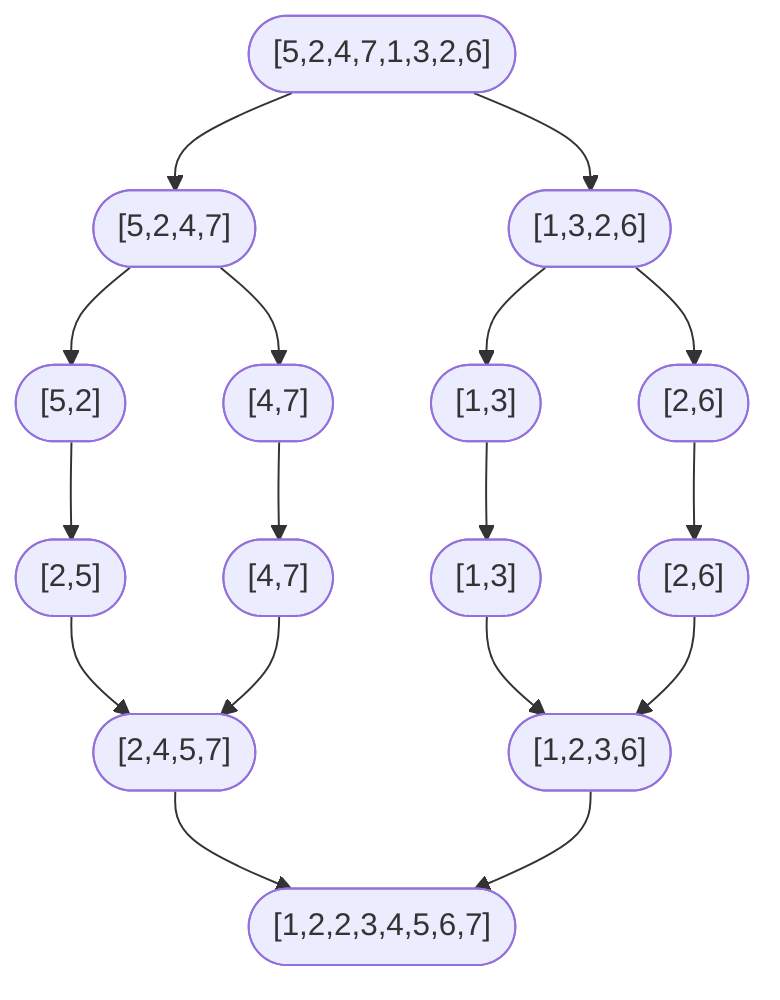

# 比较排序 I：插入排序与归并排序

有序数组是个前置条件，它把二分查找变成 O(log n)，把前缀和扫描变成 O(n)，也让[上一章](./02-binary-search-variants.md)那套双指针武器成为合理的第一反应。可这个前置条件总得有人造出来。接下来两章讲的就是造它的算法。

本章讲其中两个。挑这两个，是因为它们站在一条你会反复回访的光谱两端。插入排序原地、稳定，在已排好序的输入上是 Theta(n)；一旦 n 涨过几十，它几乎输给所有同行。归并排序大量分配、稳定，在任何输入上都是 Theta(n log n)；除了小 n，它几乎处处取胜。这个交叉点可靠到生产级排序例程在编译期就把它钉死。Java 的 Timsort 和 Python 的 `list.sort`，对长度短于标定最小值的游程（视输入长度在 32 到 64 个元素之间）用插入排序，超过就切归并。这两个算法不是竞争对手。它们是一个混合方案的两端，而这个混合方案装在你用到的每一个标准库里。

## 算法 A：插入排序

插入排序是 CLRS 最先教的算法，因为它的正确性证明可以从纸面上直接读出来。[^1]

```text
function insertion_sort(A):
    for i from 1 to length(A) - 1:
        key = A[i]
        j = i - 1
        while j >= 0 and A[j] > key:
            A[j + 1] = A[j]
            j = j - 1
        A[j + 1] = key
```

不变式：外层循环每一轮开始时，前缀 `A[0..i-1]` 已按非降序排好，且元素集合与原始 `A[0..i-1]` 相同。初始化：`i = 1` 时前缀只有一个元素，显然有序。保持：内层循环把大于 `key` 的元素依次右移一格，再把 `key` 塞进空出来的位置；循环结束后 `A[0..i]` 有序。终止：`i = n` 时整个数组有序。

最坏情况是 Theta(n^2)。逆序输入逼着内层循环在外层每一轮都走到前缀最前端。最好情况是 Theta(n)：已排好序的输入根本不进内层循环，总工作量就是一趟外层循环。平均情况（均匀随机输入）是 Theta(n^2)。辅助空间 O(1)；算法原地排序，只用一个标量寄存器存 `key`。

插入排序是**稳定的**，因为内层循环的严格比较 `A[j] > key` 只移动严格大于 `key` 的元素；相等的键永远不会被挪过 `key` 的落点。它还是**自适应的**：输入里既有的部分有序会缩短内层循环的平均移动距离，把常数压下去。这两个性质正是生产级稳定排序拿插入排序当短有序游程内层循环的原因。也正是几个面试题直接伸手去用插入排序的原因：LC 147 就是在链表上跑这个算法本身，LC 148 在小规模基础情形那一支里，可以在递归块缩到阈值以下时用它。

## 算法 B：归并排序

**稳定性要紧，或者输入是链表**时，就该伸手去拿归并排序。它的定义性承诺在归并这一步：给定两个已排好序的半区，用两个指针同时走，每次输出较小的那个队首元素，相等时左边的先出。就这一个决定，让算法稳定，让它在链表上每趟归并只用 O(1) 辅助空间，也让递推式 `T(n) = 2T(n/2) + Theta(n)` 直接从递归树上掉下来。[^1]

```python
def sort_array(nums):
    if len(nums) <= 1:
        return list(nums)
    arr = list(nums)
    aux = [0] * len(arr)            # 只用一个共享的临时缓冲区
    _merge_sort(arr, aux, 0, len(arr) - 1)
    return arr


def _merge_sort(arr, aux, lo, hi):
    if lo >= hi:
        return
    mid = lo + (hi - lo) // 2       # Bloch 2006：别用 (lo + hi) // 2
    _merge_sort(arr, aux, lo, mid)
    _merge_sort(arr, aux, mid + 1, hi)
    if arr[mid] <= arr[mid + 1]:
        return                      # 已经有序；Sedgewick algs4 §2.2.2 的短路判断
    _merge(arr, aux, lo, mid, hi)


def _merge(arr, aux, lo, mid, hi):
    for k in range(lo, hi + 1):
        aux[k] = arr[k]
    i, j, k = lo, mid + 1, lo
    while i <= mid and j <= hi:
        if aux[i] <= aux[j]:        # `<=` 保证稳定性
            arr[k] = aux[i]; i += 1
        else:
            arr[k] = aux[j]; j += 1
        k += 1
    while i <= mid:
        arr[k] = aux[i]; i += 1; k += 1
    while j <= hi:
        arr[k] = aux[j]; j += 1; k += 1
```

**解法** — Python ([Java](./03-comparison-sorts-1/lc-912/sol.java) · [C++](./03-comparison-sorts-1/lc-912/sol.cpp) · [Go](./03-comparison-sorts-1/lc-912/sol.go))

```python
# LC 912. Sort an Array（标准归并排序，自顶向下，共享 aux 缓冲区）
"""Merge sort, top-down, stable.

The merge step uses `<=` (not `<`) when comparing left[i] vs right[j], which
guarantees stability: equal keys from the left half are emitted before equal
keys from the right half. CLRS 4th ed. §2.3.1 calls this the stable-merge
invariant; Sedgewick algs4 §2.2 makes the same observation.
"""
from __future__ import annotations
import sys
from typing import List

sys.setrecursionlimit(10**6)  # 在顶层设一次，不要每次调用都设。


def sort_array(nums: List[int]) -> List[int]:
    """Sort `nums` in non-decreasing order using merge sort. Returns a new list."""
    if len(nums) <= 1:
        return list(nums)
    arr = list(nums)
    aux = [0] * len(arr)  # 只用一个共享的临时缓冲区
    _merge_sort(arr, aux, 0, len(arr) - 1)
    return arr


def _merge_sort(arr: List[int], aux: List[int], lo: int, hi: int) -> None:
    if lo >= hi:
        return
    mid = lo + (hi - lo) // 2  # Bloch 2006：别用 (lo + hi) // 2，避免溢出。
    _merge_sort(arr, aux, lo, mid)
    _merge_sort(arr, aux, mid + 1, hi)
    if arr[mid] <= arr[mid + 1]:
        return  # 已经有序；Sedgewick algs4 §2.2.2 的短路判断
    _merge(arr, aux, lo, mid, hi)


def _merge(arr: List[int], aux: List[int], lo: int, mid: int, hi: int) -> None:
    # 先把这一段拷进 aux，这样就能原地写回 arr。
    for k in range(lo, hi + 1):
        aux[k] = arr[k]
    i, j, k = lo, mid + 1, lo
    while i <= mid and j <= hi:
        if aux[i] <= aux[j]:  # `<=` 让归并保持稳定。
            arr[k] = aux[i]
            i += 1
        else:
            arr[k] = aux[j]
            j += 1
        k += 1
    while i <= mid:
        arr[k] = aux[i]
        i += 1
        k += 1
    while j <= hi:
        arr[k] = aux[j]
        j += 1
        k += 1
```

有三个实现细节没有商量余地。漏掉任何一个，算法仍然能认出是归并排序，但每个被漏掉的细节都会产出一个真实的 bug。

第一，**用 `mid = lo + (hi - lo) / 2`** 绕开 Joshua Bloch 在 2006 年记录的那个整数溢出 bug——它出现在 `java.util.Arrays.binarySearch` 和 `mergeSort` 里，在 JDK 内部潜伏了九年没被发现。[^2] 两个写法在无界整数上完全一致；在有符号 32 位算术里，数组一旦超过 2^30 个元素，`lo + hi` 就溢出成负数，除完仍是负数，递归一路跑出数组末尾。

第二，**归并里用 `<=`（而不是严格的 `<`）**，这是那个稳定性不变式。左半相等的键先于右半相等的键输出。把 `<=` 换成 `<`，排序仍然产出非降序的结果，但稳定性悄悄坏了；这个 bug 在纯整数排序上不可见，只有在稳定性于下游被要求时才现形（先按主键排好，再按次键做多键排序）。

第三，**在调用归并之前加 `if arr[mid] <= arr[mid + 1]: return`**。当左半最大元素已经不大于右半最小元素时，两个半区的相对顺序本来就对，归并纯属白干。这个判断是一次比较；一旦命中，整趟归并直接跳过。加上这一行，归并排序在已排好序的输入上就是 Theta(n) 而不是 Theta(n log n)。Sedgewick 的 `algs4` §2.2.2 管它叫「Helping with small subarrays and ordered subarrays」；而这正是 Timsort 推广到输入里所有天然游程上的那个优化。[^3]

## 为什么归并这一步带来 Theta(n log n)

递推式 `T(n) = 2T(n/2) + Theta(n)`，边界 `T(1) = Theta(1)`，用两种等价论证都解出 `Theta(n log n)`。递归树论证：树有 `log_2 n` 层，每层的归并工作量加起来正好是 `n`，因为这些互不相交的子归并把原始 `n` 个元素彼此分完了。两者相乘得 `n log_2 n`。主定理论证（CLRS §4.5，`a=2`、`b=2`、`f(n)=Theta(n)`、临界指数 `log_b a = 1` 的第 2 种情形）直接给出同样的答案。[^1]

正是这种「每层工作量」的结构，让归并排序的界在各种输入分布上都稳得住。最好、平均、最坏，全是 `Theta(n log n)`。插入排序在已排好序的输入上能更好（`Theta(n)`），在逆序输入上则更差（`Theta(n^2)`）；归并排序在每种输入上都是同样的 `Theta(n log n)`，唯一的例外就是那个短路判断——它让预排序的输入以 `Theta(n)` 扫过去。

辅助空间 `Theta(n)` 来自那个长度为 `n` 的单一共享 `aux` 缓冲区。递归栈再加 `Theta(log n)`，在数组这一情形下被缓冲区压过去了。到了链表变体（LC 148），辅助缓冲区根本不需要，改指针就够了，所以总辅助空间降到 `Theta(log n)`。

比较排序的 Omega(n log n) 下界来自决策树论证（CLRS §8.1，定理 8.1）。[^1] 任何基于比较的排序都必须区分输入的 `n!` 种排列；一棵有 `n!` 个叶子的二叉决策树，高度至少是 `log_2(n!) = Omega(n log n)`。归并排序确定性地达到这个界。快速排序只在期望意义上达到；不做随机化，最坏情况是 `O(n^2)`。堆排序确定性地达到，且只用 `O(1)` 辅助空间——这就是堆排序存在的理由：它在缓存局部性上输给快排、在稳定性上输给归并，却把下界和 O(1) 空间同时拿到手。

## 稳定性对照表

| 算法 | 最好时间 | 平均时间 | 最坏时间 | 空间（辅助） | 稳定？ | 原地？ | 自适应？ |
|---|---|---|---|---|---|---|---|
| 插入排序 | Theta(n) | Theta(n^2) | Theta(n^2) | O(1) | 是 | 是 | 是 |
| 归并排序（自顶向下） | Theta(n log n) | Theta(n log n) | Theta(n log n) | Theta(n) | 是 | 否 | 部分[^3] |
| 归并排序（自底向上迭代） | Theta(n log n) | Theta(n log n) | Theta(n log n) | Theta(n) | 是 | 否 | 否 |
| 链表上的归并排序（LC 148） | Theta(n log n) | Theta(n log n) | Theta(n log n) | Theta(log n) | 是 | 是 | 部分 |
| 快速排序（三数取中） | Theta(n log n) | Theta(n log n) | Theta(n^2) | O(log n) | 否 | 是 | 否 |
| 堆排序 | Theta(n log n) | Theta(n log n) | Theta(n log n) | O(1) | 否 | 是 | 否 |
| Timsort | Theta(n) | Theta(n log n) | Theta(n log n) | Theta(n) | 是 | 否 | 是 |

「自适应」指算法在部分有序的输入上跑得更快。「稳定」指相等的键保持输入顺序，这在你叠加多次排序时才要紧：先按部门排，再在部门内按姓名排，第二次排序不能打乱第一次的结果。「原地」指 O(1) 或 O(log n) 辅助空间；归并排序在数组上不满足，在链表上满足，这正是 LC 148 成为归并排序标准面试题的承重理由。

一个具体的稳定性例子。取记录 `[(2, "a"), (1, "b"), (2, "c")]`，按整数键排序。稳定排序产出 `[(1, "b"), (2, "a"), (2, "c")]`：输入里 `"a"` 在 `"c"` 之前，相等的 `2` 键在输出里保持了这个顺序。不稳定排序可能产出 `[(1, "b"), (2, "c"), (2, "a")]`，`"a"` 和 `"c"` 换了位置。两个输出都是按整数键有序的，只有稳定那个能扛住再叠加一次按字符串键的排序。这就是为什么数据库引擎里每一个多键排序、SQL 里每一条 `ORDER BY a, b`、每一次 Pandas 的 `DataFrame.sort_values`，都假定底层引擎是稳定的。

跨语言的稳定性现状比多数读者以为的更锋利。Java 的 `Arrays.sort(int[])` 是双轴快速排序，**不稳定**；`Arrays.sort(Object[])` 是 Timsort，**稳定**。这个分叉是那条权衡的生产级编码：基本类型键没有可观察的次键，稳定性无关紧要，快排靠局部性取胜；对象引用可能带次键，稳定性就是刚需。C++ 的 `std::sort` 是内省排序（快速排序加堆排序兜底），**不稳定**；稳定版是 `std::stable_sort`。Go 的 `slices.Sort` 是 pdqsort，**不稳定**；`slices.SortStableFunc` 才稳定。Python 的 `list.sort` 是 Timsort，默认稳定。知道哪种语言不用开口问就给你稳定性，就是「代码能跑」和「代码在多键隐式测试上挂掉」之间的差别。

## 实例推演：在 `[5, 2, 4, 7, 1, 3, 2, 6]` 上跑归并排序

递归树把输入拆成单个元素，再一路归并回去：



*这棵递归树有 log_2(8) = 3 层归并工作，每层加起来正好是 n = 8 次单元格访问。*

顶层那一趟归并才是暴露稳定性的地方。左半是 `[2, 4, 5, 7]`，右半是 `[1, 2, 3, 6]`。两个 `2` 在第二个输出槽位上撞车。因为归并用 `<=`，左半的 `2`（原始输入下标 1）先于右半的 `2`（原始输入下标 6）输出。输出保持了它们在输入里的相对顺序：`[1, 2_left, 2_right, 3, 4, 5, 6, 7]`。把 `<=` 换成严格的 `<`，顺序就翻过来。稳定性丢了，而且悄无声息。

> **Interactive widget:** [排序可视化（归并排序 + 快速排序）](../../../dsa/widgets/w-05-sorting-visualizer.yml)（面板 `panel-a`）—— 在网站上渲染；YAML 规格描述了各个关键帧。

*静态回退：上面那棵递归树，外加第 16 步的定格画面，展示重复的 2 这个平局按左边优先化解。*

## 常见陷阱

> [!CAUTION]
> **取中点用 `lo + (hi - lo) / 2`，别用 `(lo + hi) / 2`。** Bloch 2006 年那篇 Google Research 博客记录了 `java.util.Arrays.binarySearch` 和 `Arrays.sort` 里的这个 bug，它在 JDK 里九年没被发现。[^2] 数组超过 2^30 个元素后，和会溢出；除以二仍是负数；数组访问抛 `ArrayIndexOutOfBoundsException`（Java）或者返回垃圾数据（C）。两个写法在无界整数上等价，在有界整数类型上不等价。

> [!WARNING]
> **归并里用 `<=` 而不是 `<`。** 严格的 `<` 产出的是排好序的输出，但破坏了稳定性；相等时右半胜出，而不是左半。这个 bug 在纯整数排序上是静默的。只有当稳定性在下游被要求时才现形——而那恰恰是没人盯着的时候。

> [!WARNING]
> **辅助数组只在顶层分配一次。** CLRS 的教科书伪代码在每次归并调用时都新分配 `left[]` 和 `right[]`，整个排序总共做 Theta(n log n) 次分配。一个长度为 n、在顶层分配、按引用传下去的共享缓冲区，只做一次分配。Sedgewick 的 `algs4` §2.2.2 把这条叫「Reuse of an auxiliary array」。[^3] 每一个生产级稳定排序都这么做。

> [!WARNING]
> **C++ 的 `std::sort` 和 Go 的 `slices.Sort` 不稳定。** 需要稳定性时，显式调用 `std::stable_sort`（C++）或 `slices.SortStableFunc`（Go）。Python 的 `list.sort` 和 Java 的 `Arrays.sort(Object[])` 默认稳定（都是 Timsort），这两种语言里不需要显式选稳定版本。知道自己语言的默认值，才谈得上在多键排序上信任标准库。

> [!WARNING]
> **“已排好序”短路不在教科书伪代码里。** CLRS 的参考实现没有 `if arr[mid] <= arr[mid+1]: return` 这一行；逐字照搬 CLRS 的读者交付的归并排序，在已排好序的输入上跑的是 Theta(n log n)，而不是可达到的 Theta(n)。把这一行加上。任何哪怕只有轻微预有序的输入都能把它赚回来；而对那些到手就已排好序的输入（生产里出奇常见的一种形态），它按 log n 的比例削减墙钟时间。

## 题目梯度

一旦把 LC 912 那个平凡的排序外壳算掉，归并排序的招牌应用天生就是中等或困难。现存的简单候选（LC 21 Merge Two Sorted Lists、LC 88 Merge Sorted Array）归链表章和数组章所有——在那里归并这一步才是主题，外围的排序不是。所以这里的 CORE 落在 M+M+H，这是诚实的取舍；STRETCH 再加一道数逆序对的变体。

### 核心（全做才算掌握本章）

- [LC 912 — Sort an Array](https://leetcode.com/problems/sort-an-array/) [中等] • merge-sort ★
- [LC 148 — Sort List](https://leetcode.com/problems/sort-list/) [中等] • merge-sort + linked-list-mid
- [LC 315 — Count of Smaller Numbers After Self](https://leetcode.com/problems/count-of-smaller-numbers-after-self/) [困难] • merge-sort + inversion-counting

### 进阶（可选）

- [LC 493 — Reverse Pairs](https://leetcode.com/problems/reverse-pairs/) [困难] • merge-sort + inversion-counting

数逆序对是本章最深的回报。*逆序对*（inversion）是满足 `i < j` 且 `nums[i] > nums[j]` 的一对 `(i, j)`；LC 315 要的是以每个下标结尾的这种对的数量。朴素的 `O(n^2)` 解法直接数每一对。归并排序的解法是在归并这一步上做装饰：当右半的某个元素先于左半游标之后的所有元素输出时，剩下每一个左半元素都 `>` 这个右半元素，且在原始输入里下标更小，所以每个剩下的左半元素都对刚输出的这个右半元素贡献一个逆序对。计数器在那一步加 `mid - i + 1`。所有归并加起来，计数工作每层 `O(n)`，共 `log n` 层，所以整体 `O(n log n)`。LC 493 把谓词改成 `nums[i] > 2 * nums[j]`，需要单独一趟归并前计数（这个谓词在归并顺序上不再单调），但底座是同一个算法。归并计数器这个惯用法一旦通了，「数满足单调谓词的对」这一整族问题就塌缩成一个模板。

## 后续衔接

下一章[比较排序 II：快速排序、分区与生产级混合排序](./04-comparison-sorts-2.md)和本章配成双面板小组件，让你能在同一份输入上并排拖动归并排序和快速排序。快速排序是为缓存局部性放弃稳定性的原地平均赢家。归并排序是为可预测性放弃局部性的稳定最坏情况赢家。看两个算法处理同样的八个元素，是内化这个对比最快的方式。

再下一章[堆排序与 n log n 下界](../../../dsa/part-2-search-sort/05-heap-sort.md)会证明：在基于比较的模型里，为什么这两个算法都没法做得比 Theta(n log n) 更好，并给出第三个 O(n log n) 排序——它在 O(1) 辅助空间里做到。

## 参考文献

[^1]: Cormen、Leiserson、Rivest、Stein，《Introduction to Algorithms》第 4 版，MIT Press，2022。

[^2]: Joshua Bloch，“Extra, Extra — Read All About It: Nearly All Binary Searches and Mergesorts are Broken”，*Google Research blog*，2006 年 6 月 2 日。<https://research.google/blog/extra-extra-read-all-about-it-nearly-all-binary-searches-and-mergesorts-are-broken/>。

[^3]: Robert Sedgewick 与 Kevin Wayne，《Algorithms》第 4 版，Addison-Wesley，2011，§2.2 “Mergesort”。§2.2.2 讲工程上的几个优化：共享辅助数组、已排好序的短路判断，以及小规模子数组切到插入排序。在线版见 <https://algs4.cs.princeton.edu/22mergesort/>。
