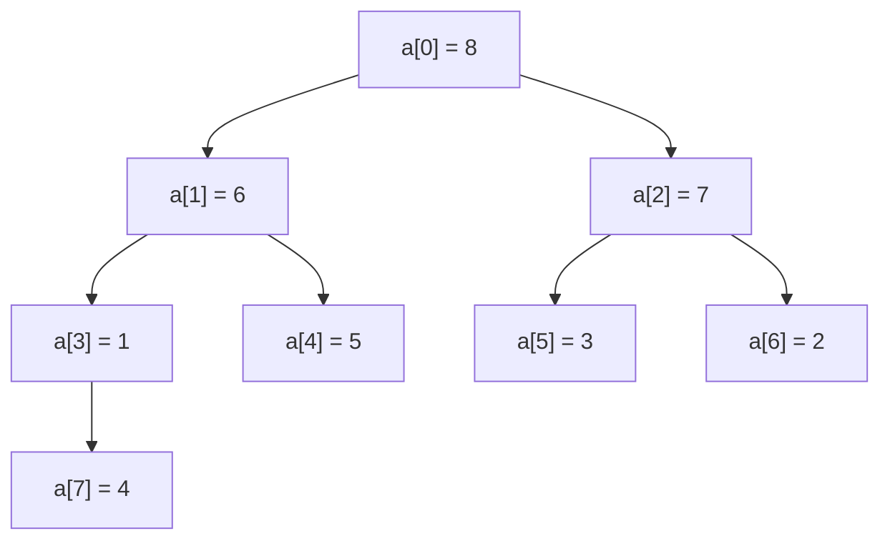
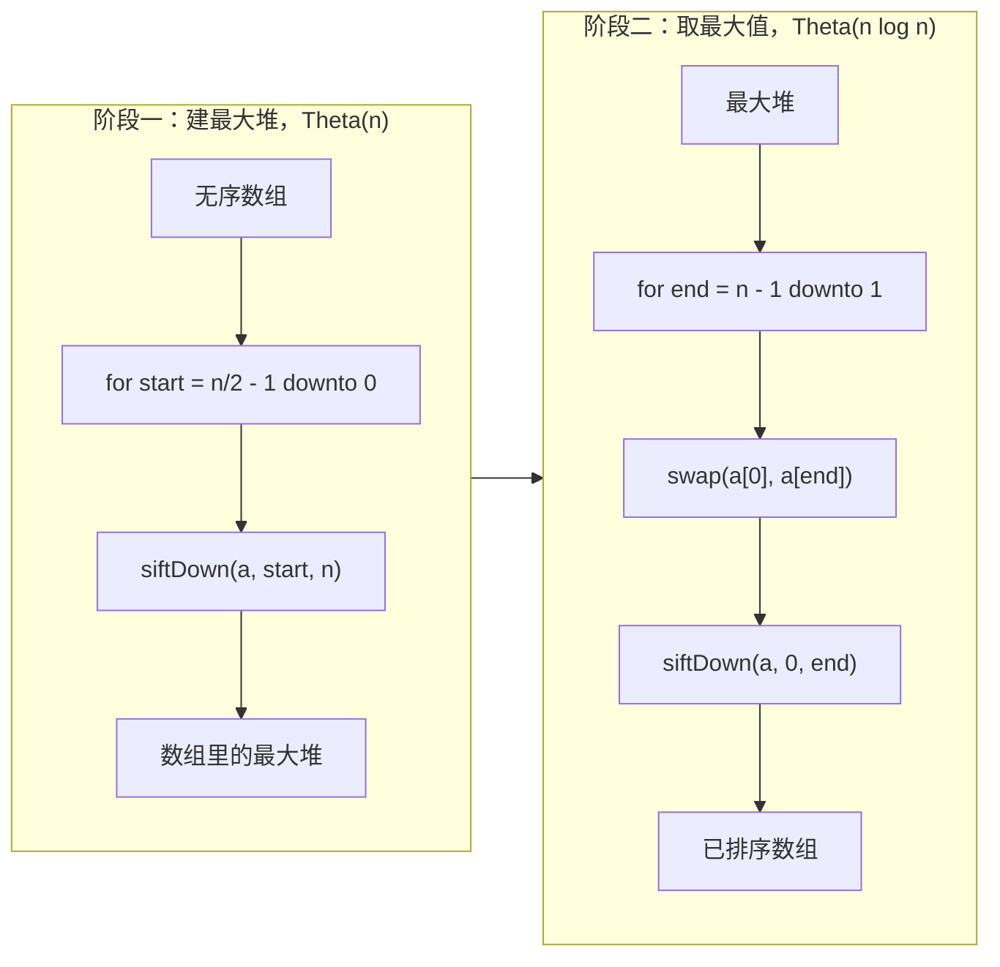

# 堆排序与 n log n 下界

Linux 内核的排序例程在 `lib/sort.c` 开头用两句话交代了它为什么选这个算法。内核用的是堆排序。注释里说，快速排序有两个毛病：最坏情况是平方级、可被攻击者利用的，而且要额外内存，这两点让它不适合内核使用。大多数应用代码永远碰不到这条约束，内核碰得到。对抗性输入是真实存在的（内核数据结构的走向由用户可控的哈希键决定），而在中断处理程序里额外开一块 Theta(n) 的缓冲区根本不是一个选项。两条约束同时收紧时，剩下的就只有堆排序。

本章讲堆排序，正是出于这两条约束；也因为建最大堆的分析是全书里用平摊式推理处理树形状态最干净的一个例子。[^1] 本章同时给第二部分的论证收尾：[比较排序 I](./03-comparison-sorts-1.md)、[比较排序 II](./04-comparison-sorts-2.md) 和堆排序最终都收敛到 Theta(n log n)——一个任何基于比较的排序都打不破的决策树下界。这一章之后，[线性时间排序](./06-linear-sorts.md) 会展示那些彻底离开比较模型、从而绕过这个界的算法。

## 什么是二叉堆

n 个元素上的二叉最大堆是一棵完全二叉树，每个父节点都不小于它的两个子节点。「完全」这个条件（除最后一层外每层都填满，最后一层从左往右填）正是让这棵树可以隐式地住在一个扁平数组里的原因。下标从 0 起算时，下标 `i` 的父节点在 `(i - 1) // 2`，左孩子在 `2i + 1`，右孩子在 `2i + 2`。没有指针，没有逐节点分配。堆**就是**这个数组。



*数组 `[8, 6, 7, 1, 5, 3, 2, 4]` 画成它隐式对应的那棵树。下标 0 是根；下标 3 是下标 1 的左孩子；下标 7 是下标 3 的左孩子。每个父节点都压过自己的孩子，所以每个节点上都满足堆性质。*

对 n 个元素，下标 `[n // 2, n)` 是叶子，`[0, n // 2)` 是内部节点。最后一个内部节点落在下标 `(n // 2) - 1`。叶子天然就是合法的单节点堆。关于堆的所有有意思的问题，都是关于它内部节点的问题。

## 原语：下沉

堆排序只需要一个例程。叫它 `siftDown(a, root, end)`。它接收一个节点 `root`，这个节点的两棵子树**已经是合法的最大堆**，然后把 `root` 的值往下压，直到 `root` 处也满足堆性质。

```text
function sift_down(a, root, end):
    while True:
        left = 2 * root + 1
        if left >= end: return                  # root 是叶子，下面没有东西
        right = left + 1
        child = left
        if right < end and a[right] > a[left]:
            child = right                       # 挑较大的那个孩子
        if a[root] >= a[child]: return          # 堆性质成立，收工
        swap(a[root], a[child])
        root = child                            # 带着值继续往下走
```

两个细节值得单独占几行。挑较大的孩子这一步是有意义的：跟较小的孩子交换，可能留下一个仍然小于另一个孩子的父节点，下一步就破坏了堆性质。而 `>=` 这个短路判断（不是 `>`）才是让全等键输入只花 Theta(n) 而不是 Theta(n log n) 的原因——循环第一次看到非严格违反就退出，所以一个全等的堆在第一次比较之后就不再干活。

前置条件是最多读者跳过、然后又为此买单的地方。CLRS §6.2 把它写得很明确：MAX-HEAPIFY 假定以 LEFT(i) 和 RIGHT(i) 为根的二叉树都是最大堆，但 A[i] 可能小于它的孩子。[^2] 如果你对一个孩子还不是堆的节点调用 `siftDown`，例程只修好 `root` 处的违反，对更深的违反视而不见；产出的结构不是堆。这就是下面阶段一要**从右往左**访问内部节点、而不是从左往右的原因。这个顺序不是风格问题。

还有一个姊妹原语叫 `siftUp`，把一个值从叶子往根走。流式优先队列在 `push` 时用的就是它（[堆与优先队列](../../../dsa/part-6-trees-heaps/04-heaps-priority-queues.md) 有讲）。堆排序不需要它。整数组建堆用反方向的 `siftDown` 更便宜，而这个事实正是本章的回报所在。

## 阶段一：Floyd 建最大堆

给一个长度为 n 的无序数组，原地把它变成最大堆。朴素的方案是逐个插入：把 n 个元素一个个插进一个不断长大的堆里，每个新来的往上浮到自己的位置——n 次调用，每次最多 O(log n)，总共 Theta(n log n)。Floyd 1964 年的 Algorithm 245[^5] 换了个做法。从最后一个内部节点开始，从右往左循环。每一步里，两棵子树都已经是合法的堆（归纳假设；叶子天然合法，而我们是自底向上访问节点的）。对当前节点调用 `siftDown`，前置条件成立；堆性质就这样一个节点一个节点装上去，循环结束后整个数组就是堆。

```text
function build_max_heap(a):
    n = length(a)
    for start in (n // 2 - 1) down to 0:
        sift_down(a, start, n)
```

循环的起点是读者最容易搞错的那半个数组。下标 `[n // 2, n)` 是叶子；最后一个内部节点在 `(n - 2) // 2`，无论 n 是奇数还是偶数都等于 `n // 2 - 1`（验证一下：n=6 时 `(6-2)//2 = 2 = 6//2 - 1`；n=7 时 `(7-2)//2 = 2 = 7//2 - 1`）。记住 `n // 2 - 1` 这个形式，用到的时候写一行注释。这里的差一错误是静默的：你在一个叶子上白费了功夫，算法照样给出正确答案，所以这种错误能活过整套通过的测试。

### 为什么这个阶段是 Theta(n) 而不是 Theta(n log n)

朴素的预期是 Theta(n log n)：n 次调用，每次 O(log n)。这个估计太宽松了，而「到底宽松了多少」正是本章的核心洞察。

高度为 h 的节点最多能被下压 h 层。（高度 0 是叶子，一步都动不了；根的高度是 `floor(log n)`。）n 个节点的二叉堆，高度为 h 的节点最多 `ceil(n / 2^(h+1))` 个。把成本按高度加总：

```text
T(n) <= sum over h from 0 to floor(log n) of  ceil(n / 2^(h+1)) * h
     <= n * sum over h from 0 to infinity   of  h / 2^(h+1)
     == n * 1
     == O(n)
```

无穷级数恒等式 `sum_{h>=0} h / 2^(h+1) = 1` 是承重的那块砖。[^2] 级数收敛，是因为每一项都按几何速度缩小；求和等于 1，靠直接裂项就能看出来。

Sedgewick 的几何说法不用正式级数也能把界讲具体。[^3] 最后 n/2 个数组位置是叶子，零工作量。接着 n/4 个高度为 1，最多一次交换。再接着 n/8 个高度为 2，最多两次交换。总工作量上界是 `n/2 * 0 + n/4 * 1 + n/8 * 2 + ... < n`，整个建堆过程最多 n 次交换、最多 2n 次比较。同一个答案，两种推导。

跟 sift-up 插入法的对比才是要命的地方。Williams 1964 年的 Algorithm 232 是反复把元素插到末尾、再往上浮到根来建堆的。[^6] 一半的调用落在规模至少 n/2 的堆上；四分之三落在规模至少 n/4 的堆上；依此类推。加总就是 `lg 1 + lg 2 + ... + lg n = lg(n!) ~ n lg n`，由 Stirling 公式。外层循环次数一样，原语一样（每次调用一趟树高），渐进界却相反。Floyd 的大多数调用落在小堆上；Williams 的大多数调用落在大堆上。工作量集中在哪里，就是全部的故事。

## 阶段二：把最大值依次换到后缀

阶段一之后整个数组是一个最大堆，所以 `a[0]` 是最大值。阶段二把这个最大值一路送到数组末尾，把堆缩掉一格，然后重复。

```text
function extract_phase(a):
    n = length(a)
    for end in (n - 1) down to 1:
        swap(a[0], a[end])         # 把当前最大值放到它最终的格子
        sift_down(a, 0, end)        # 在缩短后的前缀 [0, end) 上恢复堆
```

账很好算。每轮把根换进后缀（常数工作），再对一个规模最多 n 的堆调用 `siftDown`（O(log n) 工作）。循环跑 n - 1 次。总工作量：Theta(n log n)。

两个阶段合起来就是完整的算法：

```python
def heap_sort(nums):
    n = len(nums)
    # 阶段一：Floyd 建最大堆，从最后一个内部节点开始从右往左。
    for start in range(n // 2 - 1, -1, -1):
        _sift_down(nums, start, n)
    # 阶段二：反复把最大值取到已排序的后缀里。
    for end in range(n - 1, 0, -1):
        nums[0], nums[end] = nums[end], nums[0]
        _sift_down(nums, 0, end)
    return nums


def _sift_down(a, root, end):
    while True:
        left = 2 * root + 1
        if left >= end:
            return
        right = left + 1
        child = left
        if right < end and a[right] > a[left]:
            child = right
        if a[root] >= a[child]:
            return
        a[root], a[child] = a[child], a[root]
        root = child
```

**解法** —— Python（[Java](./05-heap-sort/lc-912/sol.java) · [C++](./05-heap-sort/lc-912/sol.cpp) · [Go](./05-heap-sort/lc-912/sol.go)）

```python
# LC 912. Sort an Array —— 堆排序参考实现（原地，最坏情况 O(n log n)）
from typing import List


def heap_sort(nums: List[int]) -> List[int]:
    n = len(nums)
    # 阶段一：Floyd 建最大堆，从最后一个内部节点开始从右往左。
    for start in range(n // 2 - 1, -1, -1):
        _sift_down(nums, start, n)
    # 阶段二：反复把最大值取到已排序的后缀里。
    for end in range(n - 1, 0, -1):
        nums[0], nums[end] = nums[end], nums[0]
        _sift_down(nums, 0, end)
    return nums


def _sift_down(a: List[int], root: int, end: int) -> None:
    """Restore max-heap property at `root`, assuming both child subtrees
    are valid max-heaps and the heap occupies indices [0, end)."""
    while True:
        left = 2 * root + 1
        if left >= end:
            return
        right = left + 1
        child = left
        if right < end and a[right] > a[left]:
            child = right
        if a[root] >= a[child]:
            return
        a[root], a[child] = a[child], a[root]
        root = child
```

四个实现都没用标准库的堆支持：没有 `heapq`，没有 `PriorityQueue`，没有 `std::priority_queue`，没有 `container/heap`。`siftDown` 拆开之后，换成语言标准库的堆只是一行重构——Python 的 `heapify` **就是** Floyd 的建堆，CPython 的 `heapq._siftup` 和 `_siftdown` 写成迭代版，理由和本章把它们写成迭代版一样。[^3]



*两个阶段共用 `siftDown` 这个原语，只是把数组哪一端算「活的」反过来。阶段一在内部节点上从右往左建堆。阶段二把根换进后缀，缩掉堆，再在根上修复。*

## 实例推演：在 `[5, 2, 3, 1]` 上跑一遍堆排序

阶段一：建最大堆。最后一个内部节点在下标 `(4 // 2) - 1 = 1`。依次迭代 `start = 1, 0`。

| `start` | 之前 | siftDown 之后 | 说明 |
|---|---|---|---|
| 1 | `[5, 2, 3, 1]` | `[5, 2, 3, 1]` | 节点 `a[1]=2` 有左孩子 `a[3]=1`；`2 >= 1`，不交换 |
| 0 | `[5, 2, 3, 1]` | `[5, 2, 3, 1]` | 根 `a[0]=5` 的孩子是 `2, 3`；`5 >= 3`，不交换 |

输入本来就是最大堆。阶段一的比较次数：大概三次。

阶段二：反复取最大值。

| `end` | 之前 | 交换之后 | 在 `[0, end)` 上 siftDown 之后 |
|---|---|---|---|
| 3 | `[5, 2, 3, 1]` | `[1, 2, 3, 5]` | `[3, 2, 1, 5]`（1 和较大的孩子 3 交换） |
| 2 | `[3, 2, 1, 5]` | `[1, 2, 3, 5]` | `[2, 1, 3, 5]`（1 和较大的孩子 2 交换） |
| 1 | `[2, 1, 3, 5]` | `[1, 2, 3, 5]` | 规模为 1 的堆，基例 |

最终数组：`[1, 2, 3, 5]`。三轮迭代，每轮 O(log n) 工作量；阶段二的总工作量装得进 Theta(n log n) 的天花板，在这个小输入上还富余很多。

## n log n 下界

CLRS §8.1 定理 8.1：任何基于比较的排序算法，最坏情况下都需要 Omega(n log n) 次比较。[^4] 证明是一个决策树论证。任何确定性的比较排序都可以建模成一棵二叉树：每个内部节点是一次比较，每个叶子是输入的一个排列。要区分全部 n! 种输入排列，树至少得有 n! 个叶子。有 n! 个叶子的二叉树，最小高度是 `ceil(lg(n!)) = Omega(n log n)`，由 Stirling 近似 `n! ~ sqrt(2 pi n) (n / e)^n` 得到。决策树的高度等于算法最坏情况的比较次数。所以是 Omega(n log n)。

堆排序在渐进意义上达到了这个界，因此是**渐进最优**的比较排序。归并排序和调好的快速排序同样达到这个界；但三者之中，只有堆排序是**确定性地、原地地**达到它。[^4] [线性时间排序](./06-linear-sorts.md) 讲那些突破这个界的算法（计数排序、基数排序、桶排序），并说明它们为这份特权付了什么代价：输入必须取自某个取值域，而比较模型不允许它们做这个假设。

## 为什么堆排序在实战中打不过快速排序

堆排序和快速排序的平均情况渐进复杂度一样。在随机整数数组上，调好的快速排序快两到三倍。原因是缓存局部性。[^7]

快速排序的分区步骤是对一段连续区间做线性扫描。CPU 预取器认得这个访问模式，会把缓存行提到读指针前面；现代 x86 核心跑这个循环可以接近 DRAM 带宽的吞吐。递归让工作集不断收窄，于是后续的趟落在 L2 里，再往后落在 L1 里。整个算法对内存层次的每一层都友好。

堆排序的 `siftDown` 恰恰相反。从下标 `i` 跳到它的孩子 `2i + 1`，在物理内存上是一次大跳：n = 10^6 时，根的孩子只隔 4 个字节，但到了深度 20，孩子之间隔着几兆字节。预取器猜不到下一次读会落在哪，因为这些跳转跟着数据走，不跟地址算术走。下沉的每一层都可能缓存未命中。维基百科「Heapsort」条目里那张与快速排序对比的微基准，在随机整数输入上把差距钉在两到三倍这个系数上，与 n 无关，几乎可以全部归因于局部性差异。[^7]

这就是关于堆排序的诚实答案：实战里它很少是正确的选择。快速排序赢在缓存。归并排序赢在稳定性和并行。堆排序只在它必须赢的地方赢——最坏情况必须确定性地是 `O(n log n)`，而内存预算只有 `O(1)`。有两个场景这两条约束同时成立，堆排序真的进了生产：

| 系统 | 堆排序的用法 | 原因 |
|---|---|---|
| Linux 内核 `lib/sort.c` | 主算法 | 最坏 O(n log n) 与 O(1) 辅助空间，两条约束同时成立[^1] |
| `std::sort`（libstdc++、libc++） | 内省排序里的兜底 | 快速排序递归深度超过 2 lg n 时触发[^7] |

内省排序这个场景，是大多数生产代码与堆排序相遇的地方。David Musser 1997 年的设计跑三数取中快速排序，但记录递归深度；一旦深度越过阈值，算法就中止这次递归调用，对剩下的子区间跑堆排序。这个混合体把快速排序的平均情况常数因子和堆排序的最坏情况保证拼在一起。大多数调用永远碰不到阈值；少数本来会退化成平方的调用被救了回来。这就是为什么 `std::sort` 号称有 O(n log n) 保证，而它内部的引擎却是快速排序——单看快速排序并没有这个保证。答案是：`std::sort` 不是快速排序。它是内省排序，而备用柜子里塞满了堆排序。[比较排序 II](./04-comparison-sorts-2.md) 把内省排序从头到尾展开。

## 实际开销

| 变体 | 时间 | 空间（辅助） | 说明 |
|---|---|---|---|
| 建最大堆（Floyd，下沉） | Theta(n) | O(1) | 按高度加权求和，[^2] |
| 建最大堆（Williams，上浮插入） | Theta(n log n) | O(1) | `lg(n!) ~ n lg n`，由 Stirling 公式，[^3] |
| 取最大值阶段（n - 1 次下沉） | Theta(n log n) | O(1) | n - 1 次调用，每次 O(log n) |
| 堆排序整体，键互不相同 | Theta(n log n) | O(1) | 键互不相同时没有快路径，[^4] |
| 堆排序整体，全部相等 | Theta(n) | O(1) | `>=` 短路立刻触发 |
| 任何比较排序的下界 | Omega(n log n) | n/a | 决策树，CLRS 定理 8.1，[^4] |

辅助空间确实是 O(1)。堆住在输入数组里面，已排序的后缀原地生长，迭代版 `siftDown` 不分配栈帧。总空间是 Theta(n)，也就是输入本身；其余的只是一把下标。

即使建堆阶段的优化不改变渐进界，「建堆 vs 取数」这个拆法也值得记住。阶段一是 Theta(n)，阶段二是 Theta(n log n)，总共还是 Theta(n log n)。但同一套按高度加权的论证，在为建堆换来 Theta(n) 之后，还会在 [并查集](../../../dsa/part-8-graphs/08-union-find.md) 的按秩合并分析里回来，在 [单调队列](../../../dsa/part-4-stack-queue-patterns/01-monotonic-deque.md) 的平摊分析里回来，在任何「每次调用的工作量集中在小规模子问题上」的地方回来。这是本章最可迁移的产出。

## 常见陷阱

> [!WARNING]
> **不要在子树还没堆化的节点上调用 `siftDown`。** 这个原语的前置条件 CLRS §6.2 写得很明确：MAX-HEAPIFY 假定以 LEFT(i) 和 RIGHT(i) 为根的二叉树已经是最大堆，但 A[i] 可能小于它的孩子。[^2] Floyd 的从右往左循环是唯一能靠归纳维持这个前置条件的顺序。在孩子堆化之前就对根调用 `siftDown`，例程会修好根处的违反，对更深的违反视而不见；产出的结构在根上满足堆性质，下面不满足。阶段二取最大值时就会返回错误答案。

> [!WARNING]
> **用上浮建堆，白丢 Theta(n)。** 反射式写下 `for i in range(n): siftUp(a, i)` 是正确的，但是 Theta(n log n) 而不是 Theta(n)。输入已经在内存里时，用 Floyd 的下沉式建堆（从右往左的 siftDown 循环）。上浮是流式插入优先队列的正确原语，那里的元素一个一个到，每次 push 之后堆都必须合法；那个场景属于 [堆与优先队列](../../../dsa/part-6-trees-heaps/04-heaps-priority-queues.md)，不是堆排序。

> [!WARNING]
> **堆排序不稳定。** 下沉过程中的交换可以任意重排相等的键；阶段二把根换进后缀的那次交换同样不管输入顺序。如果你的问题要求相等键保持稳定（多键排序、带并列的排名），改用归并排序或 Timsort。Python 的 `list.sort()` 和 Java 的 `Arrays.sort(Object[])` 默认都是 Timsort，都稳定；悄悄换成基于堆或基于快排的排序，会弄坏依赖稳定性的代码。

> [!WARNING]
> **最后一个内部节点的差一错误是静默的。** 写成 `for start in range(n // 2, -1, -1)` 会在叶子上多跑一轮，白费功夫但无害，可它能活过每一个测试。写成 `for start in range((n - 1) // 2, -1, -1)` 恰好正确，只是因为整数除法对齐的巧合；不要依赖这个代数。记住 `n // 2 - 1` 这个形式，用到的时候写一行注释。

> [!WARNING]
> **递归版下沉在某些语言的对抗性输入上会崩。** Python 默认递归上限是 1000，而 `log_2(10^5) ~ 17`，所以递归移植版能活过大多数 LC 输入。但每一步都递归（而不是用 `root = child` 迭代）的移植版，每次交换都建一个栈帧，稍不留神就会爆栈。像四个参考实现那样把 `siftDown` 写成迭代的；CPython 标准库的 `heapq` 也是这么做的。

## 题目梯度

本章讲的是堆排序算法和 n log n 决策树下界，不去抢「堆作为数据结构」那些题的地盘。面试里最经典的堆题（LC 215 第 K 大、LC 23 合并 K 个有序链表、LC 295 数据流的中位数、LC 703 数据流中的第 K 大）归 [堆与优先队列](../../../dsa/part-6-trees-heaps/04-heaps-priority-queues.md) 和 [快速选择](./07-quickselect.md) 所有，那里把堆当作优先队列这种数据结构来讲，而不是当作排序。下面两道热身题在更小的面上落定阶段二的机制（建最大堆、反复取最大值、改一改、塞回去）；两道都是可选的。

- [LC 1962 — Remove Stones to Minimize the Total](https://leetcode.com/problems/remove-stones-to-minimize-the-total/) [中等] • 堆取最大值
- [LC 1046 — Last Stone Weight](https://leetcode.com/problems/last-stone-weight/) [简单] • 堆取最大值

## 后续衔接

[线性时间排序](./06-linear-sorts.md) 讲那些离开比较模型、绕过 n log n 下界的算法。计数排序吃的是有界整数键；基数排序吃的是定宽键；桶排序吃的是均匀分布。每一个都带一个前提，而这个前提恰好让下界的前提不成立；前提成立时，每一个都是 Theta(n)。再往后，[快速选择](./07-quickselect.md) 给出基于堆的 top-K 的线性时间替代方案，适用于输入离线、只要第 k 个元素而不需要完整有序输出的场景。

## 参考文献

[^1]: Linus Torvalds et al., Linux kernel source, `lib/sort.c`, file header comment "A fast, small, non-recursive O(n log n) sort for the Linux kernel" and `sort_r` doc comment. <https://github.com/torvalds/linux/blob/master/lib/sort.c>.

[^2]: Cormen, Leiserson, Rivest, Stein, *Introduction to Algorithms*, 4th ed., MIT Press, 2022.

[^3]: Robert Sedgewick and Kevin Wayne, *Algorithms*, 4th ed., Addison-Wesley, 2011, §2.4 "Priority Queues". Online at <https://algs4.cs.princeton.edu/24pq/>.

[^4]: CLRS 4e, §8.1 Theorem 8.1: "Any comparison sort algorithm requires Omega(n log n) comparisons in the worst case." Decision-tree proof. §6.4 Exercise 6.4-5: heapsort has no fast cases on distinct keys.

[^5]: Robert W. Floyd, "Algorithm 245: Treesort," *Communications of the ACM*, 7(12):701, December 1964.

[^6]: J. W. J. Williams, "Algorithm 232: Heapsort," *Communications of the ACM*, 7(6):347-348, June 1964.

[^7]: Wikipedia, "Heapsort," §"Comparison with other sorts." A well-implemented quicksort is typically two to three times faster than heapsort, attributable to "much better locality of reference: partitioning is a linear scan with good spatial locality, and the recursive subdivision has good temporal locality." Introsort fallback discussion in the same section. <https://en.wikipedia.org/wiki/Heapsort>.
