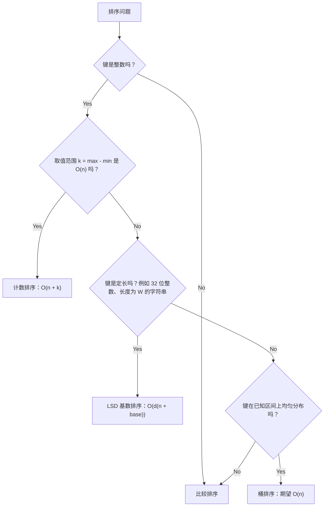

# 线性时间排序：计数排序、基数排序、桶排序

[堆排序](./05-heap-sort.md) 收尾时撞上了一堵墙：任何靠比较输入元素对来决定输出顺序的排序，最坏情况下至少要做 Omega(n log n) 次比较。证明是一棵有 n! 个叶子的决策树，最小高度为 `lg(n!) = Omega(n log n)`。这堵墙来自信息论。比较模型里的任何聪明技巧都绕不过去。

那么 Linux 的 `kfifo_alloc` 是怎么在线性时间里排好 32 位数据包 ID 的？Pandas 对一百万个整数画直方图，为什么比调一次 `.sort()` 还快？有三个算法彻底走出了比较模型。它们都不把键互相比较。计数排序直接用键值当下标访问计数数组；基数排序按键的某一位分发；桶排序按键所属区间分发。三者都把一次比较（每对元素耗时不定）换成一次数组下标访问（每个键耗时恒定），下界成立的前提也就不再适用。

代价在三种算法身上一模一样：每个算法都带着一个输入必须满足的前提。计数排序要求整数取值范围有界；基数排序要求键是定长的；桶排序要求分布均匀。正是这个前提买来了低于 O(n log n) 的复杂度。给任意 `int[]` 排序不可能做到线性时间；但如果每个值都落在 `[0, 1000]`，就能在 `O(n + 1000) = O(n)` 时间里排完。本章的主线，就是认出每个算法想要哪个前提，再把它和题目给的信号对上。

## 三个前提，三种算法



*挑那个前提刚好被输入满足的线性时间排序。一个都不满足，就退回比较排序。每个分支在面试里的线索都是题目明写的约束：`0 <= nums[i] <= 1000`（计数排序）、`nums[i] is a 32-bit unsigned int`（基数排序）、`keys are uniform on [0, 1)`（桶排序）。*

最该带走的判断依据只有一条：**只有当输入分布允许时，低于 O(n log n) 的排序才在选项里。** 前提一破，比较排序立刻收回主场。CLRS 第 8 章用三节、从三个角度讲这件事：§8.1 证明比较模型的下界，§8.2 到 §8.4 介绍三种绕开下界的办法。[^1]

## 计数排序

计数排序作用于有界整数键。三趟线性扫描：统计直方图、前缀和、回填。

```python
def counting_sort(nums):
    if not nums:
        return []
    lo = min(nums)
    hi = max(nums)
    k = hi - lo + 1
    count = [0] * k
    for x in nums:
        count[x - lo] += 1
    # 前缀和：count[i] 变成键 (lo + i) 最后一个槽位之后的下标。
    for i in range(1, k):
        count[i] += count[i - 1]
    out = [0] * len(nums)
    # 从后往前遍历输入，以保持稳定性。
    for x in reversed(nums):
        count[x - lo] -= 1
        out[count[x - lo]] = x
    return out
```

**题解** —— Python（[Java](./06-linear-sorts/sol.java) · [C++](./06-linear-sorts/sol.cpp) · [Go](./06-linear-sorts/sol.go)）

```python
# LC 274. H-Index (Medium)
# LC 1122. Relative Sort Array (Easy)
# LC 164. Maximum Gap (Hard)
# LC 451. Sort Characters By Frequency (Medium)
from collections import Counter
from typing import List


def counting_sort(nums: List[int]) -> List[int]:
    """对有界整数键做稳定的计数排序。

    时间：O(n + k)，其中 k = max(nums) - min(nums) + 1。
    空间：O(n + k)。
    稳定性：相等的键保持相对顺序。从后往前遍历（先减后写）是
    保证这一点的关键；正向回填会把顺序颠倒过来。
    """
    if not nums:
        return []
    lo = min(nums)
    hi = max(nums)
    k = hi - lo + 1
    count = [0] * k
    for x in nums:
        count[x - lo] += 1
    # 前缀和：count[i] 变成键 (lo + i) 最后一个槽位之后的下标。
    for i in range(1, k):
        count[i] += count[i - 1]
    out = [0] * len(nums)
    # 从后往前遍历输入，以保持稳定性。
    for x in reversed(nums):
        count[x - lo] -= 1
        out[count[x - lo]] = x
    return out


def h_index(citations: List[int]) -> int:
    """LC 274 H-Index，用计数排序加上截断到 n 的技巧。

    按定义答案以 n 为上界（h 指数不可能高于你写过的论文数），
    所以任何超过 n 的引用次数在结构上都等价于 n。截断把值域从
    任意整数收缩到 [0, n]，计数排序于是无论原始输入范围多大，
    都能在 O(n) 时间和空间内跑完。
    """
    n = len(citations)
    count = [0] * (n + 1)
    for c in citations:
        count[min(c, n)] += 1
    total = 0
    for h in range(n, -1, -1):
        total += count[h]
        if total >= h:
            return h
    return 0


def relative_sort_array(arr1: List[int], arr2: List[int]) -> List[int]:
    """LC 1122 Relative Sort Array。约束把取值范围固定为 [0, 1000]，
    所以 1001 个桶的计数数组永远够用。计数表一旦建好，输出顺序
    就成了自由的设计参数：先按 arr2 的顺序输出，再把剩下的键按
    升序输出。
    """
    count = [0] * 1001
    for x in arr1:
        count[x] += 1
    out: List[int] = []
    for x in arr2:
        out.extend([x] * count[x])
        count[x] = 0
    for v in range(1001):
        if count[v]:
            out.extend([v] * count[v])
    return out


def maximum_gap(nums: List[int]) -> int:
    """LC 164 Maximum Gap，用鸽巢原理做桶排序。

    鸽巢原理保证 (n - 1) 个等宽桶里至少有一个是空的，所以最大
    间隙一定要跨过桶边界。每个桶只需要记 (min, max)，不必保存
    桶内完整的有序内容。整体关于 n 线性。
    """
    if len(nums) < 2:
        return 0
    lo, hi = min(nums), max(nums)
    if lo == hi:
        return 0
    n = len(nums)
    width = max(1, (hi - lo + n - 2) // (n - 1))
    n_buckets = (hi - lo) // width + 1
    INF = float("inf")
    bmin = [INF] * n_buckets
    bmax = [-INF] * n_buckets
    for x in nums:
        i = (x - lo) // width
        bmin[i] = min(bmin[i], x)
        bmax[i] = max(bmax[i], x)
    best = 0
    prev_max = lo
    for i in range(n_buckets):
        if bmin[i] == INF:
            continue
        best = max(best, int(bmin[i]) - prev_max)
        prev_max = int(bmax[i])
    return best


def frequency_sort(s: str) -> str:
    """LC 451 Sort Characters By Frequency，用按出现次数索引的桶排序。
    长度为 n 的字符串里，任何字符的出现次数都在 [1, n]，所以 n + 1
    个频次桶能覆盖所有情况；从 n 到 1 倒着遍历桶，就能按频次降序输出。
    """
    freq = Counter(s)
    n = len(s)
    buckets: List[List[str]] = [[] for _ in range(n + 1)]
    for ch, f in freq.items():
        buckets[f].append(ch)
    out: List[str] = []
    for f in range(n, 0, -1):
        for ch in buckets[f]:
            out.append(ch * f)
    return "".join(out)


if __name__ == "__main__":
    cases = [
        ([4, 2, 2, 8, 3, 3, 1], [1, 2, 2, 3, 3, 4, 8]),
        ([], []),
        ([5, 5, 5], [5, 5, 5]),
        ([0, 1, 0, 2, 1, 0], [0, 0, 0, 1, 1, 2]),
        ([-3, -1, -2, 0, -1], [-3, -2, -1, -1, 0]),
    ]
    for nums, expected in cases:
        assert counting_sort(nums) == expected, (nums, expected)
    assert h_index([3, 0, 6, 1, 5]) == 3
    assert maximum_gap([3, 6, 9, 1]) == 3
    print("PASS")
```

全程没有比较。时间 `O(n + k)`，空间 `O(n + k)`。

从后往前回填是保证稳定性的不变式，也是读者最常跳过、然后付出代价的那个细节。放置一个键时，我们先减计数再写入，于是输入中最后一次出现的元素会落在它所在桶的最高位置。相等的键因此保持输入里的先后顺序。正向回填（边走边加）正好相反，得到的是不稳定排序。CLRS §8.2 证明的正是这种从后往前写法的稳定性；它的归纳做在循环迭代次数上，一旦改成正向走，归纳立刻断裂。[^1]

稳定性不是装饰。基数排序每一位都要调一次计数排序，而这个按位的子过程*必须*稳定，基数排序才可能输出有序结果。本章最痛苦的调试场面，就是基数排序内层用了正向回填的计数排序：高位结果对，低位乱成一团。

把计数排序叫“线性”的陷阱在于：O(n + k) 只在 *k 是 O(n)* 时才关于 n 线性。当 `n = 1000`、`k = 10^9` 时，计数排序要分配十亿个格子并遍历两遍。这时它是 O(k) 而不是 O(n)，比地球上任何一种比较排序都慢。[^2] 前提是**有界**的整数键，不只是整数键。面试里的线索就是 `0 <= nums[i] <= 1000` 这种明写的约束。

### 截断到 n 的技巧

LC 274 H-Index 是本章最值得讲的那个抽象最干净的应用。引用数组的 h 指数是最大的 `h`，使得有 `h` 篇论文各自至少被引用 `h` 次。表面看，引用次数没有上界，计数排序用不上。

解法是：对计算 h 而言，任何超过 `n` 的引用次数在结构上都等价于 `n`，因为答案按定义不可能超过 `n`（h 指数不可能高于你写过的论文数）。把每个引用次数截断到 `n`，值域就收缩成 `[0, n]`，计数排序于是能在 `O(n)` 时间和空间内适用，与原始输入范围无关。

```python
def h_index(citations):
    n = len(citations)
    count = [0] * (n + 1)
    for c in citations:
        count[min(c, n)] += 1
    total = 0
    for h in range(n, -1, -1):
        total += count[h]
        if total >= h:
            return h
    return 0
```

面试信号是“答案被某个能从 `n` 推出来的量所界定”。看到它，就把输入截断到同一个上界，计数排序即可生效。截断到 n 这个技巧是本章的主线：任意整数没有上界；题目的结构给答案设了上界；把输入截到那个上界，值域就坍缩；计数排序就跑起来了。

第二个变体钻研的是*输出顺序*而不是值域。LC 1122 Relative Sort Array 由约束把取值范围固定在 `[0, 1000]`，所以 1001 个桶的计数数组永远够用。但输出不是升序的，它按第二个数组给定的自定义顺序排列。计数表一旦建好，怎么用它就是一个设计参数：先按 arr2 的顺序输出，再把剩下的键按升序输出。“计数排序”其实是“按键值计数”，排序只是计数表*典型*的用法，不是唯一用法。

## LSD 基数排序

当键是整数、但范围大到没法直接计数排序时（32 位整数的 k = 2^32，n = 10^5），就按位排而不是按值排。LSD（最低有效位，least-significant digit）基数排序对每个数位跑一次计数排序，从最低位到最高位：

```text
function lsd_radix_sort(nums, base):
    out = copy of nums
    max_val = max(out)
    exp = 1
    while max_val / exp > 0:
        out = stable_sort_by_digit(out, exp, base)  # 对 (x / exp) % base 做计数排序
        exp *= base
    return out
```

时间 `O(d * (n + base))`，其中 `d` 是位数，`base` 是字母表大小。对 32 位无符号整数取 `d = 4`、`base = 256`，总工作量是 `O(n)`。Sedgewick 的 `algs4` 中 `LSD.java` 给出的数据是：n 较大、键为 32 位整数时，比系统排序快两到三倍。[^3]

正确性极度依赖按位排序的稳定性。CLRS §8.3 引理 8.3 给出了前提：给定 n 个 d 位数，每一位最多有 k 种取值，若所用的稳定排序耗时 `Theta(n + k)`，则 RADIX-SORT 能在 `Theta(d(n + k))` 时间内排好。[^1] 归纳做在数位上：第 i 趟之后，数组按最低 i 位排好序；第 i+1 趟按第 i+1 位排序，稳定性保证第 i+1 位相同的元素维持第 i 趟建立的顺序。丢了稳定性，相同位上的元素就乱套；高位那趟在高位上正确，在低位上任意。如果你的测试输入没有位相同的簇，这个 bug 是静默的。

LSD 假定键是定长的：每个键位数相同，短的补前导零。对于带共同前缀的变长字符串键，正确的变体是 MSD（最高有效位，most-significant digit）基数排序：先处理最高位字符，递归进非空桶，一旦提前区分开就短路。Sedgewick 的 `algs4` §5.1 深入讲了 MSD；本章提到它只是为了完整，因为真实世界的字符串排序（对可读字符串做字典序）正是 MSD 的主场。

生产系统在你想不到的地方用基数排序。Kafka broker 按 64 位 offset 对日志段文件排序做归并；offset 稠密且定长，基数排序比 `qsort` 快得不是一点。Linux 的 `lib/sort.c` *不*用基数排序（它用堆排序，原因上一章讲过），但处理中断上下文工作的 `prio_heap.c` 和好几个网络数据包分类例程用了。只要键定长、数组够大，基数排序就是不用装箱的选择。

## 桶排序

桶排序在 `[0, 1)` 上均匀分布的前提下：

```text
function bucket_sort_uniform(values):
    n = length(values)
    buckets = array of n empty lists
    for x in values:
        i = floor(n * x)
        append x to buckets[i]
    for each bucket:
        insertion_sort(bucket)
    return concatenation of buckets
```

时间*期望* `O(n)`。概率论证在 CLRS §8.4 定理 8.4：均匀分布下，桶 i 的负载 `n_i` 服从均值为 1 的二项分布，且 `E[sum_i (n_i)^2] <= 2n`，所以逐桶插入排序的总代价（即 `sum O(n_i^2)`）期望为 `O(n)`，拼接是 `O(n)`。合计 `O(n)`。[^1]

“期望”这个限定词承载了算法的全部风险。所有键都落进一个桶时，最坏情况是 `Theta(n^2)`。而在 Zipf 分布的输入上——尽管教科书礼貌地假设均匀，真实数据大多长这样——桶排序就退化了。想要最坏情况保证的生产代码，会把逐桶插入排序换成比较排序，代价变成 `O(n log(n / m))`，m 是桶数。不再线性，但有界。

桶排序真正派上用场的地方，是分布形状已知的整数直方图。网络数据包分类器按目的子网位分桶，并假设各子网之间大致平坦；时序数据库按时间戳分桶，每桶数量由采样率界定。这两个场景里，均匀假设不是一厢情愿，而是上游数据生成方式强制的。

### 鸽巢变体：LC 164 Maximum Gap

LC 164 是本章最难的题，也是回报最出人意料的题。给定整数数组，在线性时间里找出*排序后*相邻元素之间的最大间隙。朴素解法是排序再扫描，`O(n log n)`。桶排序的答案是 `O(n)`，换来它的那个技巧是本章最深的洞见。

把 n 个元素放进横跨 `[min, max]` 的 `n - 1` 个等宽桶里。鸽巢原理保证至少有一个桶是空的。因此最大间隙必定*跨过某个桶边界*：桶内间隙不可能超过桶宽，而桶宽本身又小于平均间隙 `(max - min) / (n - 1)`。每个桶只需要 `(min, max)` 就能确定从它开始的那个间隙，不需要完整的桶内有序内容。总工作量：分桶 `O(n)`，扫描 `O(n)`。[^4]

```python
def maximum_gap(nums):
    if len(nums) < 2:
        return 0
    lo, hi = min(nums), max(nums)
    if lo == hi:
        return 0
    n = len(nums)
    width = max(1, (hi - lo + n - 2) // (n - 1))
    n_buckets = (hi - lo) // width + 1
    INF = float("inf")
    bmin = [INF] * n_buckets
    bmax = [-INF] * n_buckets
    for x in nums:
        i = (x - lo) // width
        bmin[i] = min(bmin[i], x)
        bmax[i] = max(bmax[i], x)
    best = 0
    prev_max = lo
    for i in range(n_buckets):
        if bmin[i] == INF:
            continue
        best = max(best, bmin[i] - prev_max)
        prev_max = bmax[i]
    return best
```

这里的“桶”是粗粒度的投影，不是排好序的子数组。本章最深的回报是认出题目要的是有序序列的某个*性质*，而不是完整的有序数组——因为每桶需要存的东西会随之坍缩。LC 451 Sort Characters By Frequency 用同一套骨架、换一种每桶载荷（桶按出现次数索引，内容按频次降序输出），同样从这个洞见里掉出来。

## 实际开销

| 算法 | 最好 | 平均 | 最坏 | 空间 | 稳定 |
|---|---|---|---|---|---|
| 计数排序 | O(n + k) | O(n + k) | O(n + k) | O(n + k) | 是 |
| LSD 基数排序 | O(d(n + base)) | O(d(n + base)) | O(d(n + base)) | O(n + base) | 是（子过程稳定时） |
| MSD 基数排序（字符串） | O(N + 各不同前缀长度之和) | 典型 O(N log_R N) | O(N · W) | O(N + R · D) | 是 |
| 桶排序（均匀分布） | O(n) | 期望 O(n) | O(n^2) | O(n) | 取决于内层排序 |

`n` = 键的数量；`k` = max - min + 1；`d` = 位数；`base` = 每位的取值个数；`N` = 基数排序字符串输入的总字符数；`W` = 最长字符串长度；`R` = 字符串字母表基数；`D` = 递归深度。每一行的出处：CLRS §8.2 到 §8.4，MSD 那几个数字另加 Sedgewick §5.1。[^1] [^3]

计数排序和比较排序的盈亏平衡点大致在 `k = c * log_2(n)`，`c` 是依实现而定的常数。`n = 10^5`、`k = 1000` 时，计数排序大约访问 `10^5` 个格子，比较排序大约做 `10^5 * 17 = 1.7 * 10^6` 次比较，计数排序赢一个数量级。`n = 1000`、`k = 10^9` 时，计数排序访问 `10^9` 个格子，比较排序只做约 `10^4` 次比较，计数排序输五个数量级。渐近记号把加法项 `k` 藏了起来，约束条件把它露了出来。

## 常见陷阱

> [!CAUTION]
> **线性时间排序不是更快的比较排序。** 遇到 `nums[i] <= 10^9` 而数组只有 1000 个元素，你选计数排序，拿到的是 MLE（超出内存限制），不是更快的排序。计数排序是*关于 n + k* 线性，不是关于 n 线性。动手前先核对前提；O(n) 这个记号藏了那个加法项 k，而 k 正决定这个选择是神来之笔还是灾难。[^2]

> [!WARNING]
> **正向回填的计数排序不稳定。** 那个感觉很自然的 `for x in nums: out[count[x]] = x; count[x] += 1` 能产出有序结果，但破坏了稳定性。拿它当基数排序的内层子过程，相同位上的元素顺序会静默出错：高位那趟正确，低位那趟乱掉。修法是像上面参考代码那样从后往前回填、先减后写。CLRS §8.2 证明的正是这种写法的稳定性。[^1]

> [!WARNING]
> **用 `std::sort` 当内层的基数排序是坏的。** `std::sort` 是内省排序（introsort），不稳定；拿它替换按位的计数排序，会产出“几乎有序”的结果，能骗过大多数随手写的测试。用 `std::stable_sort` 或手写计数排序。这个 bug 只在位相同的簇出现时暴露，而那恰恰是没人盯着的时候。

> [!WARNING]
> **桶排序在 Zipf 分布输入上退化到 Theta(n^2)。** 真实数据大多不均匀；桶排序只适用于教学示例，以及你亲自验证过分布的数据。如果前提写的是“均匀”但数据来源不明，就把逐桶插入排序换成比较排序（有界但不再线性），或者干脆直接用比较排序。

> [!WARNING]
> **LC 164 的鸽巢逻辑不能推广到 LC 912。** 把 LC 164 当成通用线性排序题（对每个桶完整排序）是对的，但很浪费。反过来，在需要完整有序输出的题上套“只记 (min, max)”的坍缩就是错的：完整排序需要桶内全部内容。同一套骨架，不同的每桶载荷。把这条规则记牢：题目要的是有序序列的某个性质时只存极值；题目要的是排好序的数组本身时就完整排序。

## 题目梯度

CORE 三题横跨简单/中等/困难。LC 274 是本章的招牌题；截断到 n 的技巧是本章的核心抽象，而这题确实靠计数排序赢过了“先排序再扫描”的 `O(n log n)` 方案。LC 1122 是最干净的值域固定计数排序练习。LC 164 是最难的变体，也是桶排序不再追求完整有序输出的地方。

### 核心（全做才算掌握本章）

- [LC 1122 — Relative Sort Array](https://leetcode.com/problems/relative-sort-array/) [简单] • counting-sort
- [LC 274 — H-Index](https://leetcode.com/problems/h-index/) [中等] • counting-sort ★
- [LC 164 — Maximum Gap](https://leetcode.com/problems/maximum-gap/) [困难] • bucket-sort

### 进阶（可选）

- [LC 451 — Sort Characters By Frequency](https://leetcode.com/problems/sort-characters-by-frequency/) [中等] • bucket-sort

## 后续衔接

[快速选择](./07-quickselect.md) 为 Part 2 收尾，讲只想要第 k 个元素、不要完整有序数组时的线性时间替代方案。之后 Part 3 从双指针模式开场；LC 11 Container With Most Water、LC 15 3Sum 这类题依赖有序数组的不变式，和 LC 164 的鸽巢依赖分桶数组的不变式是一个道理。至于键无界、计数排序的 `O(k)` 空间已不现实的情形，[哈希表](../part-1-linear-data-structures/03-hash-maps.md) 讲了用哈希表索引的计数器：为 n 个不同键付 `O(n)` 空间，而不是为 k 个可能取值付 `O(k)` 空间。值域太宽时，它是计数排序最自然的接班人。

## 参考文献

[^1]: Cormen, Leiserson, Rivest, Stein, *Introduction to Algorithms*（《算法导论》），第 4 版，MIT Press，2022，第 8 章：§8。

[^2]: Stack Overflow，"Sorting Array in O(n) run time"，<https://stackoverflow.com/questions/12240997/sorting-array-in-on-run-time>。

[^3]: Robert Sedgewick and Kevin Wayne, *Algorithms*，第 4 版，Princeton University，§5.1 "String Sorts"。含 LSD 与 MSD 基数排序的完整 Java 参考实现；N 较大时 LSD 报告为“比系统排序快 2-3 倍”。在线地址 <https://algs4.cs.princeton.edu/51radix/>。

[^4]: Algomaster，"Maximum Gap (LC 164)"，<https://algomaster.io/learn/dsa/maximum-gap>。
