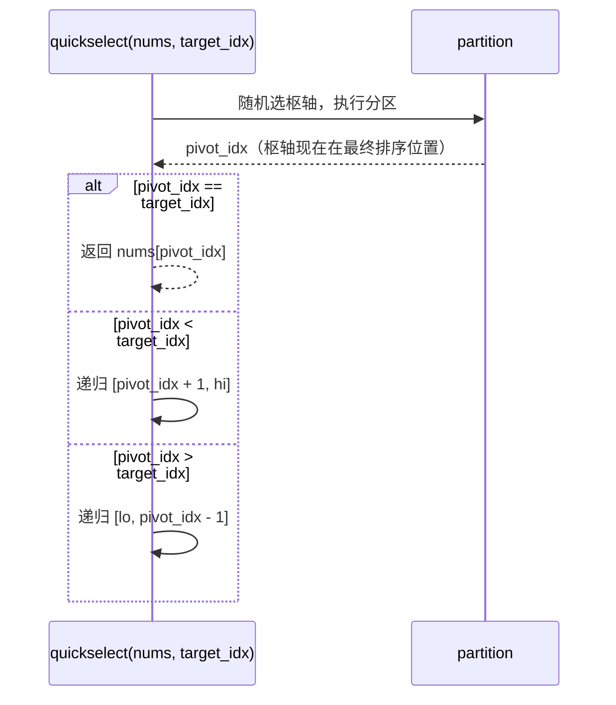

# 快速选择：线性时间选择

把一百万个随机整数丢给「第 10 万大的是哪个」这个问题，最省事的答案是先把数组排序再按下标取，`n log n` 次比较，大概 `2 * 10^7` 次。这个最省事的答案在渐近意义上也是错的。面试官想要 `n`，而你能给他 `n`，只多一个约 3.4 的常数因子。这个技巧已经六十年了：Hoare 在 1961 年把它作为 Algorithm 65 发表，和快速排序同一年，也是同一对论文。他给它起的名字是 *Find*。

快速选择就是砍掉一半递归的快速排序。一次分区把枢轴（pivot）放到它最终排好的位置之后，你不往两边都递归：拿枢轴的下标和你真正想要的下标比一下，只往包含目标的那一侧递归。另一侧永远不排序、不访问、不读取。每层只走一侧，每层线性工作量，期望总计 `Theta(n)`。排序为除目标之外的每个元素都把答案算出来又扔掉；快速选择根本不去算它。[^1]

## 基本操作：分区

[往前翻几页的那一章](./04-comparison-sorts-2.md) 已经认可了 Lomuto 分区。一个枢轴、一次扫描、两个下标：`store` 游标标记「小于枢轴」前缀的边界，`i` 游标从 `lo` 扫到 `hi - 1`。扫描结束后再做一次交换，把枢轴放到 `arr[store]`。让分区成为有用原语的是它的后置条件：枢轴落在它最终排好的下标上，左带里装着所有严格小于它的元素，右带里装着所有大于等于它的元素。

快速选择用的就是同一个分区。唯一的改动是它返回之后发生的事。



*每次分区之后的三路判断。算法每层最多访问一侧；这就是快速选择期望线性、而不是 `n log n` 的全部原因。*

这就是整个算法。两行比较、一个三向分支、一次递归调用（教科书形式），或者一次循环继续（本章每份参考实现用的迭代形式）。

## 诀窍：只递归一侧

把快速排序和快速选择并排放，优化只有一个代码块：

```text
quicksort(nums, lo, hi):
    if lo >= hi: return
    p = partition(nums, lo, hi)
    quicksort(nums, lo, p - 1)        # 递归左边
    quicksort(nums, p + 1, hi)        # 还要递归右边

quickselect(nums, lo, hi, target):
    while lo <= hi:
        p = partition(nums, lo, hi)
        if p == target: return nums[p]
        if p < target: lo = p + 1     # 只往右带推进
        else:          hi = p - 1     # 或者只往左带收缩
```

快速排序的递推式是 `T(n) = 2 * T(n/2) + Theta(n)`，解得 `Theta(n log n)`。快速选择是 `T(n) = T(n/2) + Theta(n)`，用主定理的第三种情形，或者直接几何级数求和，都得到 `Theta(n)`。递归上那个因子 2 就是全部的 log 因子；去掉它，界就少了一个对数。

不用递推式，直觉更锋利。每一趟分区的工作量和当前活动区间成正比。枢轴选得好，区间每层减半。总工作量是 `n + n/2 + n/4 + n/8 + ...`，这是个几何级数，不管递归多深都加到 `2n`。排序是在*一棵 log 深的树的每一层*都付线性工作量；快速选择是*把所有层加起来只付一次*线性工作量。同样的分区，不同的记账方式。

「枢轴选得好」这个条件，正是随机选枢轴买来的东西。均匀随机的枢轴落进排序序中间 50% 的概率是一半；这时递归那一侧最多 `n/2` 个元素。期望减半就够了；CLRS 的形式论证给出 `E[T(n)] <= E[T(3n/4)] + cn`，同样是 `Theta(n)` 的界。[^2]

## 随机枢轴不是可选项

把随机枢轴抽掉，算法就有一个输入能触发的 Theta(n²) 最坏情况。取 `nums = [1, 2, 3, ..., n]` 已经是升序的，再加一条教科书枢轴规则「永远取 `arr[hi]`」。每次分区都选中剩余元素里最大的那个；每次分区递归的那一侧都是整个活动区间减去枢轴那一个槽位。递推式变成 `T(n) = T(n - 1) + Theta(n)`，加起来是 `Theta(n^2)`。拿这个去提交 LC 215，那个隐藏的 5 万元素有序输入用例会超时，和朴素 Lomuto 快速排序在同一种形状上超时得一模一样。

修法就一行。在分区从 `arr[hi]` 取枢轴之前，把 `arr[hi]` 和 `arr[uniform_random(lo, hi)]` 交换。对手看不到你的随机硬币，就构造不出最坏输入；按排列的对称性，任何输入在期望上一样坏，而 Devroye 1984 年的指数尾界让「比较次数超过 `Cn`」的概率在 `C` 足够大时随 `C` 超指数级地小。[^3] 这就是本章说的「期望线性时间」——期望是对算法抛的硬币取的，不是对输入分布取的。

随机枢轴不是性能优化。它是那个正确性修复，把算法从「跑得过基准、扛不住对抗输入」变成「以压倒性概率跑得过任何输入」。生产代码用它；不用的生产代码是坏的。

```python
import random
from typing import List


def find_kth_largest(nums: List[int], k: int) -> int:
    """LC 215. Return the k-th largest element (1-indexed)."""
    target = len(nums) - k                          # 第 k 大 = 第 (n - k) 小
    lo, hi = 0, len(nums) - 1
    while lo <= hi:
        pivot_idx = _partition(nums, lo, hi)
        if pivot_idx == target:
            return nums[pivot_idx]
        if pivot_idx < target:
            lo = pivot_idx + 1                      # 目标严格在右边
        else:
            hi = pivot_idx - 1                      # 目标严格在左边
    return -1


def _partition(nums: List[int], lo: int, hi: int) -> int:
    """Lomuto partition with a uniformly random pivot."""
    rand_idx = random.randint(lo, hi)
    nums[rand_idx], nums[hi] = nums[hi], nums[rand_idx]
    pivot = nums[hi]
    store = lo
    for i in range(lo, hi):
        if nums[i] < pivot:
            nums[store], nums[i] = nums[i], nums[store]
            store += 1
    nums[store], nums[hi] = nums[hi], nums[store]
    return store
```

**解法** — Python（[Java](./07-quickselect/lc-215/sol.java) · [C++](./07-quickselect/lc-215/sol.cpp) · [Go](./07-quickselect/lc-215/sol.go)）

```python
# LC 215. Kth Largest Element in an Array
import random
from typing import List


def find_kth_largest(nums: List[int], k: int) -> int:
    """LC 215. Return the k-th largest element (1-indexed)."""
    target = len(nums) - k
    lo, hi = 0, len(nums) - 1
    while lo <= hi:
        pivot_idx = _partition(nums, lo, hi)
        if pivot_idx == target:
            return nums[pivot_idx]
        if pivot_idx < target:
            lo = pivot_idx + 1
        else:
            hi = pivot_idx - 1
    return -1  # 只要 1 <= k <= len(nums) 就走不到这里


def _partition(nums: List[int], lo: int, hi: int) -> int:
    """Lomuto partition with a uniformly random pivot."""
    rand_idx = random.randint(lo, hi)
    nums[rand_idx], nums[hi] = nums[hi], nums[rand_idx]
    pivot = nums[hi]
    store = lo
    for i in range(lo, hi):
        if nums[i] < pivot:
            nums[store], nums[i] = nums[i], nums[store]
            store += 1
    nums[store], nums[hi] = nums[hi], nums[store]
    return store
```

四个实现都用迭代的 `while lo <= hi` 形式，而不是显式递归。随机枢轴的期望栈深是 `O(log n)`，但任何递归实现里都潜伏着最坏情况栈深（就是随机枢轴在时间界上防住的那个 `O(n)` 病态）。迭代消掉了最坏情况的栈风险，把辅助空间做成干净的 `O(1)`。Java 的 `-Xss` 和 Python 的 `sys.setrecursionlimit` 意味着：在对抗性的 5 万元素输入上，递归版快速选择离让 CI 挂掉的 StackOverflow 只差一层，而迭代版轻轻松松过。

`target = len(nums) - k` 这一行是本章最容易出 bug 的单行代码。对 1-indexed 的第 k 大（LC 215 的框架），它在升序数组里的位置是 `n - k`。对 1-indexed 的第 k 小，是 `k - 1`。这两条式子在每一场面试里都会撞车，只要候选人没在写循环之前先用小例子把换算推出来。手算一遍 `n = 6, k = 2`：`[3, 2, 1, 5, 6, 4]` 的第 2 大是 `5`；升序是 `[1, 2, 3, 4, 5, 6]`；5 在下标 4 = 6 - 2。两条式子只有写出来才显出一致。

## 实例推演：LC 215，输入 `[3, 2, 1, 5, 6, 4], k = 2`

组件把枢轴规则固定成 `pivot = arr[lo]`，好让轨迹可复现。生产代码随机化；这个固定是教学上的妥协，不是正确性上的妥协。两轮分区就找到答案。

第 1 轮取枢轴 `3`（来自下标 0），把它移到 `arr[hi] = arr[5]`，跑 Lomuto。扫描结束后 `store` 游标停在下标 2；最后一次交换把 `3` 放到下标 2，左边是 `[2, 1]`（全都 `< 3`），右边是 `[5, 6, 4]`（全都 `>= 3`）。把 `pivot_idx = 2` 和 `target_idx = 4` 比一下：`2 < 4`，所以答案在右边。把 `lo` 推到 3；左带此后再也不会被访问。

第 2 轮在 `arr[3..5] = [5, 6, 4]` 上做。枢轴是 `5`（来自下标 3）；走完 Lomuto，`5` 落到下标 4。比较：`pivot_idx = 4 == target_idx = 4`。返回 `arr[4] = 5`。

总比较工作量：第 1 轮 5 次，第 2 轮 2 次，6 个元素一共 7 次。排序大概要做 16 次。这个优势随 `n` 复利增长。

> **Interactive widget:** [快速选择：分区，然后只递归一侧](../../../dsa/widgets/w-07-quickselect.yml) —— 在网站上渲染；YAML 规格描述了各个关键帧。

*静态版：确定性的 `pivot=lo` 轨迹，14 步，展示选枢轴、分区扫描、枢轴落位、第 1 轮之后的向右递归决策，以及在下标 4 上终止得到的答案。*

## 为什么期望线性成立

把复杂度论证压缩成一段话：每一层分区都花 `Theta(active_range)` 的工作量；分区之后算法只往一侧递归。枢轴均匀随机时，递归那一侧的期望规模最多 `3n/4`（枢轴落进中间一半的概率是一半；这时较大那一侧最多 `3n/4`）。递推式 `E[T(n)] <= E[T(3n/4)] + cn` 用几何级数论证加总得到 `4cn = Theta(n)`。更干净的教学形式：每层让活动区间*在期望上*减半，于是总工作量是 `n + n/2 + n/4 + ... = 2n = Theta(n)`。找中位数时 `Theta(n)` 界里藏的那个常数是 `n(2 + 2 ln 2 + o(1))`，按 Wikipedia「更精细的计算」条目约为 `3.4n + o(n)`。[^4]

实测数字对得上。在一份公开的微基准里，对 64 位整数的 top-K 查询，快速选择比二叉堆 top-K 实现在同样的输入形状上快大约 20%。[^4] 理论界和基准数字指向同一个方向：当输入是离线的、调用方又不需要有序的 top-K 时，快速选择就是合适的工具。

## 快速选择还是堆

Part 6 那章 [堆与 top-K 模式](../../../dsa/part-6-trees-heaps/04-heaps-priority-queues.md) 教的是大小为 K 的小顶堆，用 `Theta(n log k)` 时间、`Theta(k)` 空间回答同一个问题。对任何 `k > 1`，它的复杂度都严格差于快速选择的期望 `Theta(n)`，但堆在两种情况下才是正解。知道是哪两种，比知道这两个算法更难，也更像面试题。

| 约束 | 选哪个 | 原因 |
|---|---|---|
| 单次离线批处理，`k` 中等偏大，不需要 top-K 有序 | 快速选择 | 只要 `k >> 1`，期望 `Theta(n)` 就胜过 `Theta(n log k)` |
| 输入是流（你手上没有完整数组） | 堆 | 快速选择需要完整数组；堆在元素到达的过程中维持滚动 top-K |
| 调用方后续要按顺序问第 k、第 (k-1)、……、第 1 | 堆 | 弹 k 次拿到有序输出；快速选择只能确定一个边界 |
| `k` 是 `O(1)`（top 1、top 5、top 10）而 `n` 巨大 | 堆，靠常数因子取胜 | `k` 为常数时 `n log k = O(n)`；堆的工作集更小，缓存上赢 |
| 调用方把数组交给你，只要一个返回值 | 快速选择 | 期望比较次数严格更少 |

流式场景是那个专坑「把快速选择背成严格更优的 top-K 算法」的读者的地方。快速选择需要对整个数组随机访问；存不下全部 `n` 个元素，就跑不了它。堆的 `O(k)` 空间才是它成为日志流、排行榜、以及任何「最近一小时的 top-K」这类元素到达速度快于你排序速度的问题的答案的原因。

## 实际开销

| 变体 | 时间 | 空间 | 说明 |
|---|---|---|---|
| 最好情况（均匀随机枢轴，切分平衡） | `Theta(n)` | `O(1)` | 迭代形式 |
| 期望（均匀随机枢轴） | `Theta(n)` | `O(1)` | 迭代；递归形式为 `O(log n)` |
| 最坏情况（枢轴规则总取到最小/最大） | `Theta(n^2)` | 迭代 `O(1)`；递归 `O(n)` | 随机枢轴让这种情况的概率变成 `O(1/n^c)` |
| BFPRT（中位数的中位数） | 确定性最坏 `Theta(n)` | `O(log n)` | 实践中很少用；常数约是随机枢轴的 5 倍 |
| Floyd-Rivest 1975 | 求中位数平均 `1.5n + O(sqrt(n))` | `O(1)` | 中位数的最佳常数；生产级中位数例程用它 |

迭代形式的 `O(1)` 辅助空间来自尾调用消除：`while lo <= hi` 循环在活动区间收窄时复用同一个栈帧，Lomuto 分区原地跑。递归形式会把递归栈显式背着，期望深度 `O(log n)`，在对抗输入上最坏深度 `O(n)`——随机枢轴在时间上防住了这种输入，在栈空间上没防住。

## 为什么没人用中位数的中位数

存在一个确定性的 `O(n)` 最坏情况算法：BFPRT，以它 1973 年的作者 Blum、Floyd、Pratt、Rivest、Tarjan 命名。[^5] 它的枢轴规则是把元素按 5 个一组排序，取每组的中位数，再递归地从这些中位数里选出中位数的中位数当总枢轴。选出的枢轴可证明落在活动区间的第 30 到第 70 百分位之间，于是每次递归最多把问题缩到 `7n/10` 个元素。合并的递推式 `T(n) <= T(n/5) + T(7n/10) + cn` 解得 `T(n) = Theta(n)`，因为 `1/5 + 7/10 = 9/10 < 1`。原论文把这个算法叫 *PICK*，把 Hoare 的快速选择叫 *FIND*；「BFPRT」这个缩写是在其后的教科书传统里定型的。

生产代码不用 BFPRT。三个原因。枢轴计算本身在每一层都要跑一个 `O(n)` 算法；就算递推式有利，常数因子在真实输入上差不多是随机枢轴快速选择的五倍。30/70 的切分是保证，不是典型结果；在非对抗数据上，随机枢轴的期望减半实测更紧。而且 BFPRT 防的那个最坏情况在随机枢轴下罕见得几乎不存在，为了防它而在每次调用里都付常数因子是糟糕的工程。C++ STL 的 `std::sort` 是内省排序（Musser 1997），`std::nth_element` 是快速选择的变体，递归深度超过阈值时回退到堆排序或 BFPRT；回退在对抗输入上触发，在随机输入上从不触发。

本章讲 BFPRT 是为了完整，也是为了复杂度表收尾的那条引用。诚实的说法是生产里的那个：随机枢轴快速选择，配上 introselect 风格的深度限制回退。在面试代码里写纯 BFPRT 是错的答案。

## 常见陷阱

> [!CAUTION]
> **下标换算的 off-by-one。** 对 LC 215 里 1-indexed 的第 k 大，`target_idx = n - k`。对 1-indexed 的第 k 小，`target_idx = k - 1`。写错的式子（`n - k - 1`、`k`）会静默返回错元素，还能过掉那些平凡的测试用例。写循环之前，用一个小例子把换算显式算出来。例子：`n = 6, k = 2`，第 2 大是 `5`，升序下标 4。两条式子只有写出来才显出一致。

> [!WARNING]
> **比较之后递归错了方向。** 写分支之前先把循环不变式说出来：「分区之后 `nums[pivot_idx]` 在它最终排好的位置上；答案严格在右侧，当且仅当 `target_idx > pivot_idx`。」只背「枢轴小于目标就往右走」而不带不变式，题目一变、比较的方向一翻，立刻就反。

> [!WARNING]
> **快速选择会改动调用方的数组。** Lomuto 分区本质上是破坏性的——整个空间效率的论证就建立在这一点上。如果调用方假设调用后 `nums` 没变，就在边界上复制（Python 的 `list(nums)`、Java 的 `nums.clone()`、Go 的 `slices.Clone(nums)`）。四份参考实现都写明了这个副作用；包一层快速选择的生产代码也该照做。

> [!WARNING]
> **全相等输入上的 Lomuto 会退化成 `Theta(n^2)`，随机枢轴也救不了。** 严格 `<` 的 Lomuto 把每个元素都塞进「小于枢轴」那一侧，枢轴每次迭代都落在 `lo`，递归每步只缩一个。修法是**三路（荷兰国旗）分区**，它一趟就把相等键的那一带压平，只在严格更小和严格更大两带上递归。Sedgewick 的 `Quick3way` 是标准参考。[^6]

> [!WARNING]
> **快速选择的后置条件是分区，不是排序。** `find_kth_largest(nums, k)` 返回之后，`nums[:target_idx]` 全都 `<=` 答案，`nums[target_idx+1:]` 全都 `>` 答案，但两个子区间都没排序。要把 top-K 作为有序列表返回，就在快速选择之后跟一句 `sort(nums[target_idx:])`，多花 `O(k log k)`。这是部分快速排序的变体；把快速选择的输出当成排好序的前缀，是 LC 215 / LC 973 上最常见的混淆。

## 题目梯度

CORE 三次都落在中等档，因为快速选择天然的问题空间从中等起步——简单档的选择题（LC 414 Third Maximum Number）归 [线性搜索与滚动聚合模式](./00-linear-search.md) 所有，那里三个整数跟踪器就能解掉，根本用不上快速选择。STRETCH 提供困难那一级。

### 核心（三题全做才算掌握本章）

- [LC 215 — Kth Largest Element in an Array](https://leetcode.com/problems/kth-largest-element-in-an-array/) [中等] • 快速选择 ★
- [LC 973 — K Closest Points to Origin](https://leetcode.com/problems/k-closest-points-to-origin/) [中等] • 派生键上的快速选择
- [LC 347 — Top K Frequent Elements](https://leetcode.com/problems/top-k-frequent-elements/) [中等] • 先哈希计数再做快速选择

### 进阶（可选）

- [LC 4 — Median of Two Sorted Arrays](https://leetcode.com/problems/median-of-two-sorted-arrays/) [困难] • 合并虚拟数组上的快速选择

LC 973 是「在派生键上做快速选择」的变体：每个格子是一个点，键是到原点的平方距离，比较器作用在派生键上，而交换搬的是复合对象。同一个算法，多一层间接。LC 347 是两段式变体：先在 `O(n)` 里哈希成 `(value, count)` 对，再在计数这一维上跑快速选择；这也是 Part 6 那个堆解法竞争得最直接的地方。LC 4 的最优解是在分区下标上做二分搜索，`O(log min(m, n))`，不是快速选择；本章教「合并虚拟数组上做快速选择」这个视角，作为问题的一个干净 `O(m + n)` 透镜，然后才把读者指向 [二分搜索变体](./02-binary-search-variants.md) 里的二分最优解。

## 后续衔接

这是 Part 2 的最后一章。下一部分从 [双指针：相向而行](../../../dsa/part-3-pointers-window-prefix/00-two-pointers-opposite.md) 开始，那里分区这套机制以它的 `K = 3` 特化形式回来，也就是 LC 75 Sort Colors 的 Dijkstra 荷兰国旗。[堆与 top-K 模式](../../../dsa/part-6-trees-heaps/04-heaps-priority-queues.md) 接走快速选择服务不了的流式场景和「top-K 要有序」的场景。最坏情况线性的确定性枢轴这条线，则在高级数据结构里继续，introselect 式的混合算法把「默认随机、运气差就回退」这个设计搬进 `std::sort`、`Arrays.sort` 和 Go 的 `slices.Sort`。

## 参考文献

[^1]: C. A. R. Hoare, "Algorithm 65: Find," *Communications of the ACM*, 4(7):321-322, July 1961.

[^2]: Cormen, Leiserson, Rivest, Stein, *Introduction to Algorithms*, 4th ed., MIT Press, 2022.

[^3]: Luc Devroye, "Exponential bounds for the running time of a selection algorithm," *Journal of Computer and System Sciences*, 29(1):1-7, 1984.

[^4]: Wikipedia, "Quickselect," <https://en.wikipedia.org/wiki/Quickselect>.

[^5]: Manuel Blum, Robert Floyd, Vaughan Pratt, Ronald Rivest, Robert Tarjan, "Time bounds for selection," *Journal of Computer and System Sciences*, 7(4):448-461, August 1973.

[^6]: Robert Sedgewick and Kevin Wayne, *Algorithms*, 4th ed., Addison-Wesley, 2011, §2.3 Quicksort. Online at <https://algs4.cs.princeton.edu/23quicksort/>.
