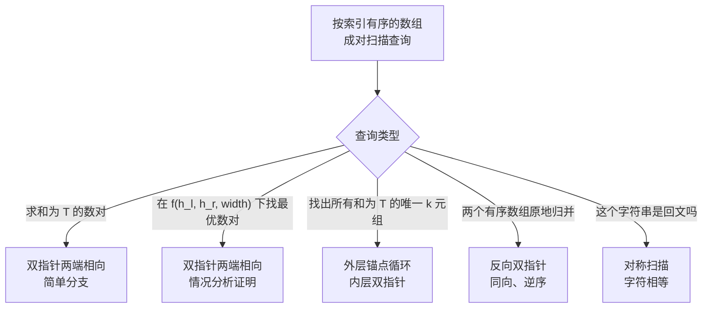

# 双指针：两端相向

一排竖直线，高度是 0 到 10,000 之间的整数，最多 10 万条。挑两条，它们之间蓄住的水是 `min(h[l], h[r]) * (r - l)`。找出蓄水最多的那一对。最老实的第一次尝试是枚举所有数对，算出面积，留下最大值。n = 100,000 时大约有 50 亿个数对。而正解只扫 100,000 个下标。

这道鸿沟就是本章的全部内容。填平它的技巧到处都在用：3Sum、接雨水、回文判断、两个有序数组的原地归并。它们共享同一个动作：在一个按索引有序的数组两端各放一个指针，让它们相向而行。

## 暴力解法为何不够

LC 11（Container With Most Water）是这里的招牌题。样例输入 `height = [1, 8, 6, 2, 5, 4, 8, 3, 7]`，期望答案 `49`。肉眼一看就明白：下标 1 和 8 处的两条边，高度 8 和 7，距离 7，蓄水 `min(8, 7) * 7 = 49`。n = 9 时一眼可见，n = 100,000 时肉眼毫无用处。

暴力解法就是面试时你忘了自己在哪一章会写出的那个循环：

```python
def max_area_brute(height):
    n = len(height)
    best = 0
    for i in range(n):
        for j in range(i + 1, n):
            area = min(height[i], height[j]) * (j - i)
            if area > best:
                best = area
    return best
```

结果是对的。但在 LC 真正拿来判的 n = 100,000 用例上，它必死。大约 `n * (n - 1) / 2` 个数对，每个做一次比较，时间预算只有 1 秒。n 超过约 10,000 就会超时。

问题不在循环体里。问题在于循环体做着大量重复劳动，而问题的结构早把答案摆在明面上。面积的上界由 `min(h[l], h[r])` 决定，哪条边更矮，哪条就是瓶颈。矮边配另一条矮边，距离再远也赢不了。暴力解法把这个问题对每个数对重问一次。一旦知道瓶颈是矮的那条边，问题就简化成：该移动哪个指针？

把指针放在两端，`l = 0`、`r = n - 1`。看这两条边，总有一条更矮。现在比较两种走法：

- 把**更高**的那条边向内移动。宽度减 1，矮边没变，所以上界没变。面积不可能变大，只会变小。
- 把**更矮**的那条边向内移动。宽度减 1，新边可能更高，上界还有上升空间。这是唯一能让面积变大的方向。[^1]

所以永远移动更矮的那条边。整个算法就这一句。

```python
def max_area(height):
    l, r = 0, len(height) - 1
    best = 0
    while l < r:
        h = min(height[l], height[r])
        if h * (r - l) > best:
            best = h * (r - l)
        if height[l] < height[r]:
            l += 1
        else:
            r -= 1
    return best
```

**Solution** — Python（[Java](./00-two-pointers-opposite/lc-11/sol.java) · [C++](./00-two-pointers-opposite/lc-11/sol.cpp) · [Go](./00-two-pointers-opposite/lc-11/sol.go)）

```python
# LC 11. Container With Most Water
from typing import List


def max_area(height: List[int]) -> int:
    """LC 11 Container With Most Water."""
    left, right = 0, len(height) - 1
    best = 0
    while left < right:
        h_l, h_r = height[left], height[right]
        if h_l < h_r:
            best = max(best, h_l * (right - left))
            left += 1
        else:
            best = max(best, h_r * (right - left))
            right -= 1
    return best
```

每轮迭代把间距恰好缩小 1，循环最多跑 `n - 1` 次，总工作量 O(n)。[^2] n = 100,000 时几毫秒就跑完。

> [!IMPORTANT]
> **两端相向不变量。** 在按索引有序的数组上持有两个指针 `(l, r)`，且候选量对数对单调时，移动较小一侧的指针是唯一可能改进答案的动作。移动另一侧，要么瓶颈不变而搜索空间变小（更差），要么用严格更差的搭档重访同一个伙伴。本章后面的每个子模式都继承这个不变量；下一章[双指针：同向](./01-two-pointers-same-direction.md)会明确与它对照。

## 证明为何真的成立（以及在哪里失效）

「移动更矮的边」这条规则，属于那种不写情况分析就觉得是在猜的算法招式。那就写出来。在任意状态 `(l, r)` 且 `h[l] <= h[r]` 时，面积是 `h[l] * (r - l)`。把每种走法列一遍：

- 把 `r`（更高的那条边）向内移动。新宽度是 `r - 1 - l`，严格更小。新的高度上界是 `min(h[l], h[r-1])`，它不超过 `h[l]`，因为 `h[l]` 本来就是更矮的那条。新面积至多是 `h[l] * (r - 1 - l)`，严格小于当前面积。
- 把 `l`（更矮的那条边）向内移动。新宽度是 `r - l - 1`，严格更小。新的高度上界是 `min(h[l+1], h[r])`。若 `h[l+1] <= h[l]`，上界不超过 `h[l]`，面积缩小；若 `h[l+1] > h[l]`，上界抬高，面积是否变大，取决于高度增益能否抵消宽度损失。

第一种走法永远不可能改进答案，第二种可能。所以移动更矮的边占优。关键在于「可能改进」就够了。算法不需要知道哪种移动会赢，它只需要知道另一种会输，于是可以扔掉高边那一侧继续走。[^3]

CS Stack Exchange 上讨论 LC 11 的那个帖子把它形式化为循环不变量，并用归纳法给出了证明。[^3] 我们*没*访问的每个数对，都被某个我们*访问过*的数对支配，所以被丢弃的那半边里错过的最优值，不会好过我们保留的最优值。这段证明是本章最重要的一段；要是还没想通，就跑一下下面的 LC 11 组件，看算法访问了哪些数对、跳过了哪些。

这个证明在按索引无序的输入上就崩了，这也正是数对求和问题与它的区别（也是 LC 1 Two Sum 属于哈希表问题、而不是双指针问题的原因）。陷阱一节还会再说。

## 四个基本操作

每个两端相向问题都在填同样四个槽：放指针、观察当前数对、决定移动哪个指针、终止。骨架一样，特化不同。

| 题目 | `init_pointers` | `observe(l, r)` | `advance_rule` | `terminate` |
|---|---|---|---|---|
| LC 167 — Two Sum II | `l = 0, r = n - 1` | sum 与 target 比较 | sum < T → `l++`; sum > T → `r--`; 命中 → 返回 | 命中，或 `l >= r` |
| LC 11 — Container | `l = 0, r = n - 1` | `min(h[l], h[r]) * (r - l)` 与 best 比较 | 更矮那一侧前进 | `l >= r` |
| LC 15 — 3Sum | `l = i+1, r = n-1`（每个锚点 `i`） | sum 与 `-nums[i]` 比较 | sum < T → `l++`; sum > T → `r--`; 命中 → 记录并去重 | `l >= r` |
| LC 125 — Valid Palindrome | `l = 0, r = n - 1` | `s[l]` 与 `s[r]` 比较（忽略大小写） | 不匹配 → false；匹配 → 两端同时向内 | `l >= r` |

遇到新的两端相向问题，你要做的就是把这四格填上。骨架在所有这类问题里完全一样。下面这个组件是最简单特化（有序数组上的数对求和）的可配置演示；本章后面两个题解组件把 LC 11 和 LC 15 固定在给定输入上，完整还原每一步。

> **Interactive widget:** [双指针（和为目标值）](../../../dsa/widgets/w-08-two-pointers-3sum.yml) —— 在网站上渲染；YAML 规格描述了各个关键帧。

*本章组件在标准输入 `nums = [-2, -1, 1, 4, 7, 12, 15], target = 6` 上，把数对求和这个特化走过三次分支判断，最后落在下标 `[1, 4]` 的命中上。往下读之前先单步走一遍；「移动更小的一侧」这个几何直觉，感觉比读来得快。*

## 实例推演：LC 11 在 `[1, 8, 6, 2, 5, 4, 8, 3, 7]` 上

在 LC 的标准例子上跑一遍。两个指针，`l = 0`、`r = 8`。高度 `1` 和 `7`。面积 `min(1, 7) * 8 = 8`。左边更矮，所以 `l` 前进。

`l = 1, r = 8`。高度 `8` 和 `7`。面积 `min(8, 7) * 7 = 49`。最优值更新为 `49`。**这就是答案。** 在一个 9 格的数组上，第二次探查就找到了最优数对。现在右边更矮，所以 `r` 前进。

剩下的迭代只为确认后面没有数对能超过 `49`。`l` 钉在下标 1 之后，后续每个 `r` 都落在比 8 更矮的边上，而宽度单调收缩。所以上界就是 `r` 落到的那个高度乘以越来越小的宽度。高度 3、8、4、5、2、6 配距离 6、5、4、3、2、1，得到面积 18、40、16、15、4、6，没有一个达到 49。指针交错，算法返回 49。

> **Interactive widget:** [Container With Most Water（LC 11）—— 贪心双指针收缩](../../../dsa/widgets/e-LC011-container.yml) —— 在网站上渲染；YAML 规格描述了各个关键帧。

*LC 11 题解组件在同样的输入上完整还原了同一条轨迹。它是只能预置的——标准输入本身就是课程内容。第 2 步就是答案，其余都是确认。*

如果有人看完第 1-3 步后问「算法为什么没找到藏在数组中间那个更大的答案？」，那他就撞上了这段证明。中间那些数对至少有一条边不高于 7，距离也严格小于 7，所以每个中间数对的 `min * width` 都以 `7 * 7 = 49` 为上界——而这正是我们已经拿到的值。算法不需要去检查它们。

## 如何识别这个模式

本章教的五个子模式是同一副脚手架的方言。先判断一道题说的是哪种方言，然后填那四个基本操作。



*读者跑一次这棵决策树，就能把一道题映射到本章的某个子模式。*

## 实例推演：LC 15（3Sum）在 `[-1, 0, 1, 2, -1, -4]` 上

3Sum 是本章第二个标准题。归约只有一句话：先排序，每次固定一个锚点，剩下的问题就是「在后缀里找出所有和为 `-nums[i]` 的数对」——正是 LC 167 那个简单的两端相向扫描。[^4]

排序后：`[-4, -1, -1, 0, 1, 2]`。

**锚点 i = 0（值 -4，目标和 +4）。** 设 `l = 1, r = 5`。后缀上的和永远到不了 4（最大可能是 `1 + 2 = 3`）。`l` 前进四次就把后缀走完，没有命中。

**锚点 i = 1（值 -1，目标和 +1）。** 设 `l = 2, r = 5`。

- `nums[2] + nums[5] = -1 + 2 = 1`。命中。记录 `[-1, -1, 2]`。两个指针同时推进；检查两侧有没有重复；两边都没有可跳过的重复（`nums[3] != nums[2]`，`nums[4] != nums[5]`）。
- `nums[3] + nums[4] = 0 + 1 = 1`。命中。记录 `[-1, 0, 1]`。两个指针同时推进；指针交错。

**锚点 i = 2（值 -1）。** 与 `nums[i-1]` 相等。跳过重复锚点的那一行触发了：`if i > 0 and nums[i] == nums[i-1]: continue`。直接跳过，内层扫掠根本不跑。没有这一行，两个三元组都会被重复输出。

**锚点 i = 3（值 0，目标和 0）。** 设 `l = 4, r = 5`。和 `1 + 2 = 3 > 0`。`r` 后退；指针交错。

**锚点 i = 4（值 1）。** 提前退出的 `if nums[i] > 0: break` 触发了；正数锚点配上两个更大的正数，凑不出零。

最终结果：`[[-1, -1, 2], [-1, 0, 1]]`。

> **Interactive widget:** [3Sum（LC 15）—— 排序 + 锚点 + 两端相向并去重](../../../dsa/widgets/e-LC015-3sum.yml) —— 在网站上渲染；YAML 规格描述了各个关键帧。

*LC 15 题解组件把这条轨迹逐步动画化，包括排序那一步（忘记排序是个反复出现的 bug），以及第 10 步的锚点去重（整条轨迹里杠杆最高的一刻）。*

去重这套编排，正是 3Sum 比 Two Sum II 难的全部原因。第一次命中后，光把两个指针一起推进不够——如果新的 `nums[l]` 和旧值相同，你会用不同的内层搭档把同一个三元组再找一遍。修法是三行，不是两行。

### 3Sum 需要的三处去重

三行代码，按这个顺序，没有一行可以省：

```python
# (a) 跳过重复的锚点。
if i > 0 and nums[i] == nums[i - 1]:
    continue

# 命中之后，两个指针同时推进，然后：
# (b) 跳过左侧的重复。
while l < r and nums[l] == nums[l - 1]:
    l += 1
# (c) 跳过右侧的重复。
while l < r and nums[r] == nums[r + 1]:
    r -= 1
```

少任何一处，碰上合适的输入就会出错。少 (a)，同一个锚点值出现两次时会重复输出三元组（就是本章实例推演里 `[-1, -1]` 那种情况）。少 (b) 或 (c)，当命中点左侧或右侧有重复值时，三元组会被重复输出。像 `[-2, -2, 0, 0, 2, 2]` 这种输入能很快暴露问题：锚点 `-2` 在下标 `(2, 5)` 找到 `(0, 2)`，两个指针同时推进，如果没有那两处跳过，就会在下标 `(3, 4)` 再找到同一个 `(0, 2)`。[^5]

## 实际开销

| 变体 | 时间 | 空间 | 说明 |
|---|---|---|---|
| LC 11 最大面积 | O(n) | O(1) | 单趟扫描；每步把一个指针移动 1。 |
| LC 15 3Sum（排序后） | O(n^2) | O(1) 额外 | 外层锚点 O(n)；每个锚点的内层数对扫掠 O(n)。不计输出。 |
| LC 15 3Sum 排序步骤 | O(n log n) | O(log n) 栈 | 被 O(n^2) 吸收，因为 `n >= 1` 时 `n^2 >= n log n`。 |
| LC 42 Trapping Rain Water | O(n) | O(1) | 同一副两端相向脚手架，带上 `left_max` 与 `right_max` 两个不变量。 |
| LC 125 回文扫描 | O(n) | O(1) | 对称扫描，逐字符比较。 |

面对会问「这是最优解吗」的面试官，3Sum 复杂度的诚实说法是：双指针 O(n^2) 算法已经达到 Erickson 1999 建立的线性决策树下界。[^2] 想再快，就得用 Grønlund 与 Pettie 2014 的 word-RAM 技巧，运行时间是 `O(n^2 (log log n)^O(1) / log^2 n)`，完全超出一场面试的范围。[^2] 所以在比较模型下，`n^2` 的工作量省不掉。word-RAM 模型下是否存在真正的次二次 3Sum 算法至今未定——Pătrașcu 在 STOC 2010 提出的 3SUM 硬度猜想，是几十个细粒度复杂度归约底下那根承重梁。[^6]

## 模式失效的场景

**有序数组上的数对求和（LC 167）。** 最简单的成员。比较键是 `nums[l] + nums[r]` 与目标 T。内部分支就是标准写法「if sum < T: l++; elif sum > T: r--; else: 命中」。刚接触这个模式的读者应该从这道题开始。

**非排序数组上的数对极值（LC 11、LC 42）。** 数组不是按值有序的，但索引轴是有序的。正确性靠情况分析证明，而不是靠 `sum < T` 这类分支。LC 42（Trapping Rain Water）沿用同一副脚手架，在向内扫掠时维护 `left_max` 与 `right_max` 两个不变量；每个格子上方的水是 `min(left_max, right_max) - h[i]`。脚手架相同，记账更难。

**三元组（或 k 元组）求和（LC 15、LC 16、LC 18）。** 外面套一层对「锚点」下标的循环固定一个元素，然后对后缀跑标准的数对求和内层扫掠，目标和为 `T - nums[i]`。多套几层锚点就能推广到 k 元组，复杂度 O(n^(k-1))。LC 15 的去重编排可以原封不动搬到 LC 18 和 LC 259。

**回文式对称扫描（LC 125）。** 指针分别放在 `l = 0` 和 `r = n - 1` 上向内推进；比较的是字符是否相等（忽略大小写），而不是算术值。脚手架相同，观察这一步不同。

**反向归并（LC 88）。** 两个有序数组合并到较大那个数组的尾部。方向反过来了：两个指针并行后退，较大的元素写到后端的写头。这个模式归在[双指针：同向](./01-two-pointers-same-direction.md)那一章，因为方向让它变成一个写头问题而不是收敛问题，但它最近的亲戚在这里。

## 三个最容易踩的坑

> [!WARNING]
> **把两端相向套到无序数组上。** 读者在 LC 的标签列表里看到 two-pointer，就在无序数组上摆出 `l = 0, r = n - 1`，想找和为 T 的数对。算法返回错误答案。「和太小就把 l 右移」这条规则依赖左边下一个格子严格更大，而这只有在数组有序时才成立。修法：题目允许就先排序（代价 O(n log n)）。如果题目要求保留原始下标（LC 1 Two Sum），改用哈希表。两端相向在这里是错的工具。

> [!WARNING]
> **LC 11 宽度上的差一错误。** 把宽度写成 `width = right - left + 1` 而不是 `width = right - left`，每个答案都会多算一个墙高。标准测试 `[1, 1] → 1` 立刻能抓住它；错误公式返回 2。宽度是两条边之间的几何*间隔*，不是包含端点的格子*个数*。相隔一个位置的两条边，蓄的是 1 个单位宽的水带，不是 2。

> [!WARNING]
> **把 LC 11 当成滑动窗口。** 两个算法都有两个下标，语法上的相似很诱人。语义上的差别就是本章的全部内容。滑动窗口是单向的（两个指针都向前），处理子数组查询，谓词对窗口扩张单调；两端相向是双向的（指针收敛），处理数对查询，谓词对数对的代数组合单调。不变量不同，终止条件也不同。[滑动窗口：固定大小](./02-sliding-window-fixed.md)那一章详细展开这个对比。

## 题目梯度

### 核心（三题全做才算掌握本章）

- [LC 167 — Two Sum II — Input Array Is Sorted](https://leetcode.com/problems/two-sum-ii-input-array-is-sorted/) [简单] • two-pointers-opposite-ends-on-sorted
- [LC 11 — Container With Most Water](https://leetcode.com/problems/container-with-most-water/) [中等] • two-pointers-greedy-shrink ★
- [LC 15 — 3Sum](https://leetcode.com/problems/3sum/) [中等] • two-pointers-on-sorted-with-anchor

### 进阶（可选）

- [LC 42 — Trapping Rain Water](https://leetcode.com/problems/trapping-rain-water/) [困难] • two-pointers-with-running-max
- [LC 125 — Valid Palindrome](https://leetcode.com/problems/valid-palindrome/) [简单] • two-pointers-symmetric-scan

LC 11 是本章的招牌题（★），上面那段情况分析证明就是它的高光时刻。LC 42 是自然的 Hard 后续：它沿用「矮边决定瓶颈」的洞察，在向内扫掠时维护 `left_max` 与 `right_max` 两个不变量，同样的正确性论证多带一项就能走通。

## 后续衔接

兄弟章节是[双指针：同向](./01-two-pointers-same-direction.md)。不变量不同：两端相向收缩一个区间，每个数对等价类只访问一次；同向维持稳定的读/写分界，每个元素只访问一次。两个模式除了名字几乎不共享任何东西。

窗口那边的亲戚是[滑动窗口：固定大小](./02-sliding-window-fixed.md)。两个指针都往前走；它们之间的窗口本身是关注对象，而不是搜索空间。这处交叉引用重要，因为凭错直觉看，LC 11 很像滑动窗口问题，而负责澄清的正是旁边那一章。

## 参考文献

[^1]: LeetCopilot Team, "Container With Most Water: Why Greedy Two Pointers Works (Proof)," 2025. <https://web.archive.org/web/20260518191203/https://leetcopilot.dev/leetcode-pattern/two-pointers/container-water-proof>.

[^2]: Wikipedia contributors, "3SUM," last edited 2025-11-10. <https://en.wikipedia.org/wiki/3SUM>.

[^3]: scanny et al., "Proof for LeetCode: 11. Container With Most Water problem," Computer Science Stack Exchange, 2020. <https://cs.stackexchange.com/questions/121472/proof-for-leetcode-11-container-with-most-water-problem>.

[^4]: LeetCode, "15. 3Sum"（中等）。 <https://leetcode.com/problems/3sum/>. 本篇实例推演所用标准样例 `[-1, 0, 1, 2, -1, -4] → [[-1, -1, 2], [-1, 0, 1]]` 的来源。

[^5]: Stack Overflow, "Leetcode #15: 3sum, avoiding duplicate," 2018-onwards. <https://stackoverflow.com/questions/38909591/leetcode-15-3sum-avoiding-duplicate>.

[^6]: Mihai Pătrașcu, "Towards polynomial lower bounds for dynamic problems," *Proceedings of the 42nd ACM symposium on Theory of computing — STOC '10*, 2010, pp. 603-610. <https://doi.org/10.1145/1806689.1806772>.
