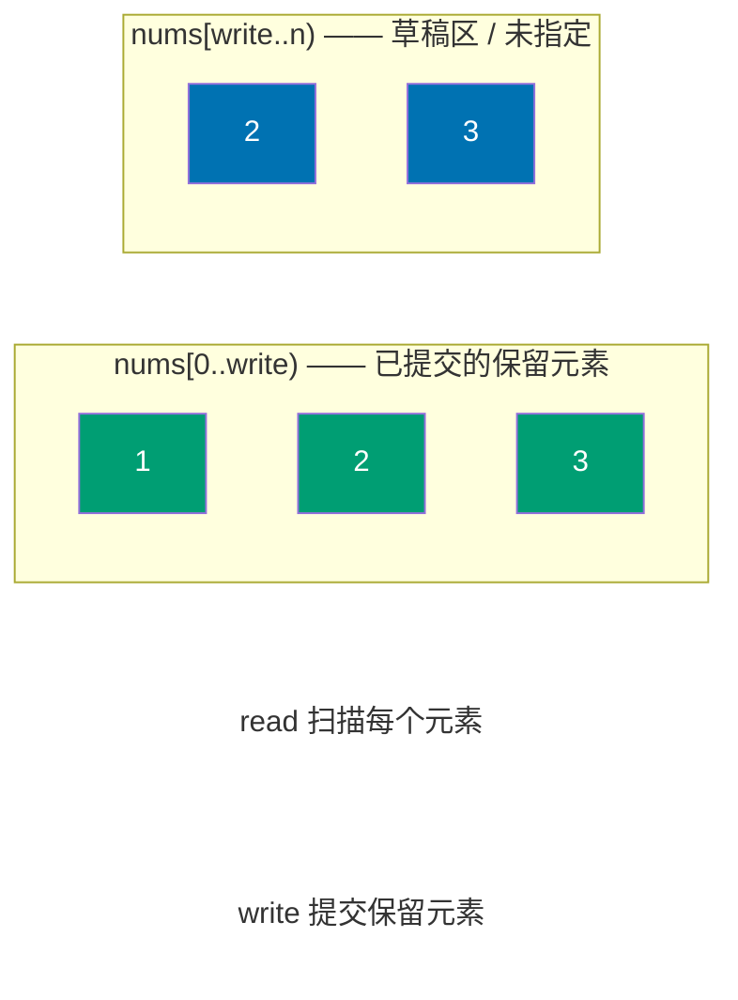
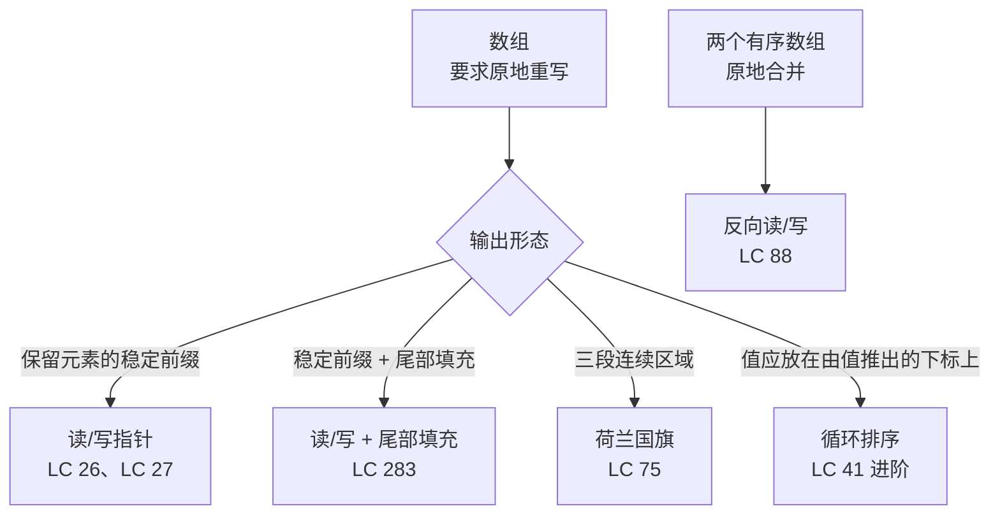

# 双指针：同向

一个最多 30,000 个整数的有序数组。原地删掉重复项，返回新长度，不许用额外数组。错误答案恰恰是最自然的那个：遍历输入，把每个新值追加到一个新建的输出数组里，返回它的长度。答案正确，但被明令禁止——题目说了不许用额外数组。

这条约束就是本章的全部内容。解法是算法里最小的技巧之一，碰巧也是适用范围最广的技巧之一：再加一个索引，让它以和第一个索引不同的速度从左走到右。一个指针负责读，另一个指针负责写。读指针把数组走完时，写指针已经确认保留的那些元素就是答案。

## 暴力解法烧的是内存，不是时间

LC 26（Remove Duplicates from Sorted Array）是本章的招牌题。样例输入 `[1, 1, 2, 2, 3]`，期望返回 `k = 3`，期望前三个值为 `[1, 2, 3]`。末尾几格是什么无所谓，判题器只看 `nums[0..k)`。

老实的第一版会开一个输出数组，遍历输入，把每个值第一次出现的那份拷进去，返回输出数组的长度：

```python
def remove_duplicates_brute(nums):
    if not nums:
        return 0
    out = [nums[0]]                         # 额外 O(n) 数组——题目不许
    for i in range(1, len(nums)):
        if nums[i] != nums[i - 1]:
            out.append(nums[i])
    nums[:len(out)] = out                   # 拷回 nums[0..k)
    return len(out)
```

它是对的。但对本章来说它是错误答案：题目要 O(1)，它多用了 O(n) 空间。有意思的修法不是把比较变快——两种做法都是 O(n) 时间。修法在于意识到：输入数组内部就有地方放答案，因为答案正是它自身的一个严格前缀。

再放一个索引，叫它 `write`，指着下一个要保留的元素该落的位置。`read` 指针逐个扫过每一格。`read` 遇到值得保留的东西，就把它向前拷到 `nums[write]`，并把 `write` 加一。`read` 遇到该丢掉的东西，`write` 原地不动，`read` 自己往前走。两个指针在同一个数组上、朝同一个方向、以不同的速度前进。

```python
def remove_duplicates(nums):
    if not nums:
        return 0
    write = 1                               # 种子：长度为 1 的前缀一定无重复
    for read in range(1, len(nums)):
        if nums[read] != nums[write - 1]:   # 谓词：与最后一个已保留值不同
            nums[write] = nums[read]
            write += 1
    return write
```

**Solution** — Python（[Java](./01-two-pointers-same-direction/lc-26/sol.java) · [C++](./01-two-pointers-same-direction/lc-26/sol.cpp) · [Go](./01-two-pointers-same-direction/lc-26/sol.go)）

```python
# LC 26. Remove Duplicates from Sorted Array
from typing import List


def remove_duplicates(nums: List[int]) -> int:
    """LC 26：原地去掉有序数组中的重复项，返回新长度 k。

    不变量：任一时刻，nums[0..write) 是到目前为止见过的值中若干互不相同
    元素构成的有序前缀。每个新元素要么延长这个前缀（当它与
    nums[write - 1] 不同），要么被丢掉。
    """
    if not nums:
        return 0
    write = 1
    for read in range(1, len(nums)):
        if nums[read] != nums[write - 1]:
            nums[write] = nums[read]
            write += 1
    return write
```

两版的时间复杂度相同，读输入的次数也相同。原地版本边走边覆写输入，`write` 之后的原始值都算草稿区。算法上的差别仅此而已；它值得单独写一章，是因为同一个技巧在十来个面试题里反复出现，不需要再做任何推广。

> [!IMPORTANT]
> **读/写不变量。** 循环中的任一时刻，`nums[0..write)` 是算法已经决定保留的元素的稳定前缀，顺序与原始顺序一致。从 `write` 往后全是草稿区，算法还在往上覆写。姊妹篇[双指针：相向而行](./00-two-pointers-opposite.md)维护的是另一条不变量：答案落在 `left` 与 `right` *之间*，窗口收拢时循环结束。同一个家族名，不同的不变量。相向而行收缩一个区间，同向而行生长一个稳定前缀。

## 四个基本操作

单写指针模板填四个空：种下前缀、扫描、判断是否保留、（有时）收拾尾部。不同的题目只是在特化同样这四个格子。

| 题目 | `init` | `keep(read, write)` | `commit` | `tail-fixup` |
|---|---|---|---|---|
| LC 26 —— 去掉相邻重复 | `write = 1` | `nums[read] != nums[write - 1]` | `nums[write] = nums[read]; write++` | 无 |
| LC 27 —— 删掉目标值 | `write = 0` | `nums[read] != val` | 同上 | 无 |
| LC 283 —— 移动零 | `write = 0` | `nums[read] != 0` | 同上 | 尾部填充 `nums[write..n) = 0` |
| LC 80 —— 最多保留两次的去重 | `write = 0` | `write < 2 or nums[read] != nums[write - 2]` | 同上 | 无 |

碰到一个新的同向题目，你要做的就是把四个格子填上，骨架不变。荷兰国旗（LC 75）是真正推广到三个区域的版本，它值得拥有自己的循环形状，下面会讲。[^1]

## 实例推演：LC 26 作用于 `[1, 1, 2, 2, 3]`

五个值是把算法每条分支都跑出来的最小输入。走一遍推演。

| 步骤 | `read` | `nums[read]` | `nums[write - 1]` | 判断 | 之后：`write` | 之后：`nums` |
|---|---:|---:|---:|---|---:|---|
| 初始化 | n/a | n/a | 1 | 种下 `write = 1`；长度为 1 的前缀不做比较直接提交 | 1 | **[1,]** 1, 2, 2, 3 |
| 1 | 1 | 1 | 1 | 重复；跳过 | 1 | **[1,]** 1, 2, 2, 3 |
| 2 | 2 | 2 | 1 | 新值；提交 | 2 | **[1, 2,]** 2, 2, 3 |
| 3 | 3 | 2 | 2 | 重复；跳过 | 2 | **[1, 2,]** 2, 2, 3 |
| 4 | 4 | 3 | 2 | 新值；提交 | 3 | **[1, 2, 3,]** 2, 3 |
| 结束 | n/a | n/a | 3 | 返回 `write = 3` | 3 | **[1, 2, 3,]** ?, ? |

三条分支：种种子、跳过重复、提交新值。每一次迭代都是这三者之一。答案就是最后一行那个加粗前缀，长度为 3。末尾两格留着最后一次写入留下的东西，LC 判题器不看它们。



*已提交的前缀从左向右生长。读指针扫过每个元素，写指针只在谓词接受该元素时才前进。*

## 实际开销

| 变体 | 时间 | 空间 | 说明 |
|---|---|---|---|
| LC 26 / 27 / 283 | O(n) | O(1) | 一趟无条件扫描；每个下标常数工作量。 |
| LC 75 荷兰国旗 | O(n) | O(1) | 每个元素最多被检查两次（`mid` 落到它上面一次，高位交换后再一次）。 |
| LC 80（允许两次） | O(n) | O(1) | 同一模板，容差参数化为 `k = 2`。 |
| LC 41 循环排序 | O(n) | O(1) | 每次成功交换固定一个位置；交换总数不超过 `n - 1`。 |

对单写指针这一族，算法把每个下标恰好读一次，最多写一次。CLRS 第 7 章对 `Partition` 的分析是教科书上的原型。[^2] 荷兰国旗的终止性可以一句话论证：量 `(j - i) + ((n - 1) - k)` 非负，并且每次迭代都严格减小——除了高位交换那一行，它减的是 `k`。循环的总步数最多 `n` 步。

LC 41 的复杂度分析是本章最划算的一句话，因为内层 `while` 循环让算法看起来是平方级的。它并不是。每次成功交换都把某个值放到它最终的位置 `nums[i] - 1` 上，放对的值此后不会再被移动，所以整个循环的交换总数不超过 `n - 1`。标准的摊还论证，形状和“带路径压缩的并查集近似线性”那个证明一样。[^3]

## 如何识别这个模式

本章教的五个子模式是同一副脚手架的不同方言。先判断题目说的是哪种方言，再去填那几个基本操作。



*读者只需跑一次的决策树：把一个原地重写类题目映射到某个子模式上。*

## 模式失效的场景

### 尾部填充（LC 283）

移动零就是读/写模板再加一个循环。谓词：`nums[read] != 0`。读的扫描结束后，`nums[0..write)` 按原顺序装好了非零元素，`nums[write..n)` 是原数组留下的垃圾。再一个简单循环把这段尾部覆写成零。

```python
def move_zeroes(nums):
    write = 0
    for read in range(len(nums)):
        if nums[read] != 0:
            nums[write] = nums[read]
            write += 1
    for i in range(write, len(nums)):
        nums[i] = 0
```

还有一个单趟交换的变体：`if nums[read] != 0: swap(nums[write], nums[read]); write += 1`。它在白板上更漂亮，但输入里没有零时会多做写入，因为每个非零元素都在和自己交换。选一个变体，然后一直用它。下面陷阱一节里的那个 bug，就是候选人把两者混着用的后果。

### 三路划分 / 荷兰国旗（LC 75）

颜色分类是真正的推广：输入是三种值（`0`、`1`、`2`）的混合，答案是一趟扫描、O(1) 额外空间下得到的三段连续区域。三个指针 `low`、`mid`、`high` 把数组分成四块：`nums[0..low)` 是 `0`，`nums[low..mid)` 是 `1`，`nums[mid..high]` 尚未排序，`nums[high+1..n)` 是 `2`。`mid > high` 时循环结束。

```python
def sort_colors(nums):
    low, mid, high = 0, 0, len(nums) - 1
    while mid <= high:
        if nums[mid] == 0:
            nums[low], nums[mid] = nums[mid], nums[low]
            low += 1
            mid += 1
        elif nums[mid] == 2:
            nums[mid], nums[high] = nums[high], nums[mid]
            high -= 1
            # mid 不要前进：换进来的值还没检查过。
        else:
            mid += 1
```

这是 Dijkstra 1976 年的原始算法。[^4] 读者改错最多的一行是高位交换分支：`mid` *不*前进，因为换进来的值来自 `nums[high]`，从未被检查过。低位交换分支则要前进 `mid`，因为换进来的值来自 `nums[low]`，它已经检查过、已经提交了。不对称是设计出来的；对称才是 bug。

CLRS 习题 7-2（"Quicksort with equal element values"）和 Sedgewick & Wayne 在 `algs4` 里的 `Quick3way` 实现是标准的二手参考资料；两者都在三路划分这个标题下讲这个算法。[^2] [^5]

### 反向归并（LC 88）

两个已经排好序的数组，原地合并进较大那个数组的尾部。说它同向，是因为三个指针一起往前走，只是方向反了过来。不变量随之翻转：`nums1[write+1..n)` 是已归并元素的稳定后缀。行进方向是唯一表面上的差别；读与写的骨架完全一样。

### 循环排序（LC 41，相邻模式的进阶题）

缺失的第一个正数属于同一族（"原地重排，O(1) 额外空间"），但具体机制不同。外层指针从左向右扫描，部分答案同样以稳定前缀的形式生长，但算法用的是指向由值推出的目标下标（`nums[i] - 1`）的*交换*，而不是维护一个 `write` 做覆写。把它当成相邻模式，而不是同一个东西。本章的进阶梯度把它收进来，是因为那个更宽的模式信号（"原地、整数约束、O(1) 额外空间"）会先把已经内化读/写模板的读者拉向 LC 41；而在读者于白板上写出错误骨架之前，知道这处机制差别是值得的。[^3]

## 三个最容易踩的坑

> [!WARNING]
> **单趟交换 vs 两趟先覆写再填充（LC 283）。** 交换变体靠构造本身维持后置条件：零通过交换链自然落到后面。覆写变体则必须显式补尾部。混着用会静默地产生错误输出：对 `[0, 1, 0, 3, 12]`，混搭出来的 bug 返回 `[1, 3, 12, 3, 12]` 而不是 `[1, 3, 12, 0, 0]`，残留的非零被留在尾部格子里。选定一个变体，配上对应的循环后步骤，不要混。

> [!WARNING]
> **高位交换时让 `mid` 前进（LC 75）。** 写成 `if nums[mid] == 2: swap(nums[mid], nums[high]); --high; ++mid;` 会让 `mid` 越过一个从未检查过的值。像 `[2, 1, 0]` 这种对抗性输入于是输出 `[1, 0, 2]` 而不是 `[0, 1, 2]`。两个交换分支必须区别对待：低位交换前进 `mid`，高位交换不前进。Dijkstra 1976 年的伪代码在这一点上写得很明确。[^4]

> [!WARNING]
> **LC 26 的空数组种子写错。** 写成 `int write = 0; for (int read = 0; ...)` 会在第一轮迭代访问 `nums[write - 1] = nums[-1]`。这在 C++ 和 Go 里是未定义行为，在 Python 里是 `IndexError`（注意负索引回绕会给出错误答案而不是崩溃），在 Java 里是 `ArrayIndexOutOfBoundsException`。种子应当写 `write = 1`，读循环从 `read = 1` 开始。空前缀哨兵——*长度为 1 的前缀一定无重复，所以不做比较直接提交*——从构造上消掉了这个边界情况。

## 题目梯度

### 核心（三题全做才算掌握本章）

- [LC 26 — Remove Duplicates from Sorted Array](https://leetcode.com/problems/remove-duplicates-from-sorted-array/) [简单] • read-write-pointer-deduplication ★
- [LC 283 — Move Zeroes](https://leetcode.com/problems/move-zeroes/) [简单] • read-write-pointer-stable-partition
- [LC 75 — Sort Colors](https://leetcode.com/problems/sort-colors/) [中等] • dutch-national-flag-three-pointer

### 进阶（可选）

- [LC 27 — Remove Element](https://leetcode.com/problems/remove-element/) [简单] • read-write-pointer-drop-value
- [LC 41 — First Missing Positive](https://leetcode.com/problems/first-missing-positive/) [困难] • cyclic-sort-index-as-hash

LC 26 是本章的招牌题（★），也是读/写模板最干净的一页纸演示。核心三题覆盖简单/简单/中等；严格的读/写一族里没有困难题，因为算法核心就装在一个短循环里。LC 41 靠相邻的循环排序机制补上进阶里的困难档：同一家族（"原地、O(1) 额外空间"），具体形状不同。[^6]

## 后续衔接

窗口类的表亲是[滑动窗口：可变长度](./03-sliding-window-variable.md)。两个指针都在向前走，差别在于它们之间装的是什么。在读/写模板里，`nums[0..write)` 是稳定的答案前缀，`nums[write..read]` 是草稿。在可变窗口里，`nums[left..right]` 是*当前候选*：谓词允许时从右侧扩张，不允许时从左收缩。行进方向相同，空隙的角色不同。能从空白写出 LC 26 的读者，已经具备可变窗口所需的心智模型；要变的只是空隙的含义。

快慢指针的变体住在链表那几章：Floyd 判环、找链表中点、删除倒数第 n 个节点。机制上的类比完全相同（一个指针扫过每个元素，另一个以受控的落后量或领先量跟着），只是数据结构从数组变成了节点链。

## 参考文献

[^1]: LeetCode 讨论帖，"The Two Pointers Cheat Sheet: Master 25+ Problems with Just ONE Pattern," post 7350824, 2024. <https://leetcode.com/discuss/post/7350824/>.

[^2]: Cormen, Leiserson, Rivest, Stein, *Introduction to Algorithms*, 4th ed., MIT Press, 2022, 第 7 章。

[^3]: Educative, "First Missing Positive (Grokking the Coding Interview, cyclic-sort module)," 访问于 2026-05-19. <https://www.educative.io/courses/grokking-coding-interview-in-csharp/first-missing-positive>.

[^4]: Dijkstra, Edsger W., *A Discipline of Programming*, Prentice-Hall, 1976, 第 14 章。荷兰国旗问题的原始三指针伪代码；NIST Dictionary of Algorithms and Data Structures 的 "Dutch national flag" 条目可交叉印证：<https://www.nist.gov/dads/HTML/DutchNationalFlag.html>

[^5]: Sedgewick, Robert and Kevin Wayne, *Algorithms*, 4th ed., Addison-Wesley, 2011, §2.3. `Quick3way` 实现见 <https://algs4.cs.princeton.edu/code/edu/princeton/cs/algs4/Quick3way.java.html>

[^6]: webcoderspeed, "Remove Duplicates from Sorted Array — Write Pointer Pattern Explained," 访问于 2026-05-19. <https://webcoderspeed.com/blog/dsa-arrays-strings/08-remove-duplicates-sorted-array>.
